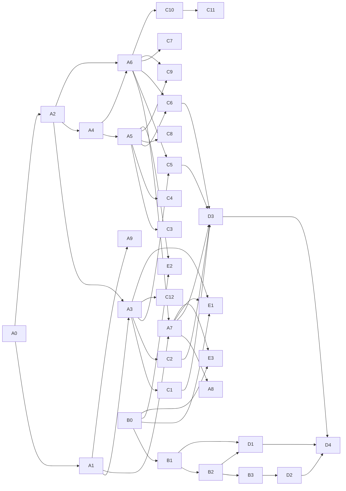

# Syllabus

A mastery-based course with no deadline and no fixed length: it ends when you meet the
[definition of done](#course-level-definition-of-done), not when the calendar says so. Hours below are estimates
for planning (≈ 6 h per weekly unit). Retakes, refreshes and reviews come on top, so add ≈ 15–25%.

The source of truth for every module's id, prerequisites, hours and gate is its `modules/<ID>-<slug>/module.json`;
this document explains the *why* and the sequencing. If the two disagree, the JSON wins and this file has a bug.

Legend: **CORE** = required for the mastery gate and the definition of done. **STRETCH** = extra depth; do it when
it interests you or when the tutor points you at it after a weak spot.

## How the course is built

Five tracks, interleaved rather than done one after another:

| Track | What | Why it's here | Core hours (≈) |
|---|---|---|---|
| **A** HLD fundamentals | A0–A9 | Every case study is a recombination of these ~10 ideas. Fuzzy concepts are weak spot (a). | 158 |
| **B** LLD / machine coding in Go | B0–B3 | The machine-coding round, and the code you'll write in Track E. | 79.5 |
| **C** HLD case studies | C1–C12 (+4 stretch) | Applying A under interview conditions: guided, then solo with a rubric. | 90 |
| **D** Mocks | D1–D4 | Timed, scored, with realistic follow-up probes. Unlocked only by gates. | 46 |
| **E** Build real systems | E1–E3 | Multi-process services on localhost: the "can actually build it" goal. | 60 |
| | | **Total (core + in-module stretch of core modules)** | **≈ 434 h ≈ 72 weekly units** |

At 6 h/week that's roughly 16–20 months including retakes. That's honest, not padded: it's what mastery of three
interview formats *and* building the systems costs. You'll be interview-capable well before the end (see
[milestones](#milestones-youll-feel)).

(Simplified; each `module.json` has the exact prerequisite list.)

## How a weekly unit works

A unit is ≈ 6 hours, typically three 2-hour sittings:

1. **Sitting 1 — read & predict (2 h).** Read the unit's sections. At every **Predict** block, write your answer
   down *before* opening the reveal. Wrong predictions are the most valuable part of the course: they show you where
   your mental model is off.
2. **Sitting 2 — build & break (2 h).** Implement the lab stub until `sd lab <ID>` is green, then do the
   **Break it** exercise and explain what you observed.
3. **Sitting 3 — retrieve & apply (2 h).** "Check yourself", `sd review` (≈ 15 min), `sd estimate` (≈ 10 min
   while in A0, then a few problems weekly), and the unit's part of the design exercise or teach-back.

Interleave tracks: a common week is 4 h on the current Track A/C module and 2 h on Track B. `sd status` suggests one
item per track for exactly this reason.

## Mastery gates

A module's gate passes only when **all** of its components hold (each module's `gate.requires` lists which):

| Component | Pass condition | Recorded by |
|---|---|---|
| quiz | ≥ 85% on **two** full attempts on **different days** | `sd quiz <ID>` |
| lab | all CORE lab packages pass with `-race` | `sd lab <ID>` |
| design | design exercise self-scored, and tutor score ≥ **meets** (senior bar) on its rubric | `sd record design` (tutor) |
| teachback | written explanation in your own words passes the tutor's checklist | `sd record teachback` (tutor) |
| mocks | N timed mocks at ≥ meets in the module's own format, one per problem (Track D only; refused while locked) | `sd record mock` (tutor) |

Passing a gate unlocks the modules that list it as a prerequisite. Afterwards, `sd review` keeps resurfacing the
module's questions on a spaced schedule (1, 3, 7, 14, 30, 60, 120 days). If your last 10 reviews for a module drop
below 70%, it is marked **needs refresh**: re-read the unit wrap-ups and pass a full `sd quiz` again to clear it.
Refresh never re-locks anything; it just becomes the first thing `sd status` tells you to do.

Rubric scale (course-wide): **below** · **approaching** · **meets** (senior bar: driven by you, quantified,
trade-offs explicit, failure modes covered) · **exceeds** (staff signal: anticipates probes, reasons about
evolution, cost, org impact).

---

## Track A — HLD fundamentals

### A0 — Interview framework & estimation · CORE · 12 h (2 units) · prereqs: none · **written**
Attacks weak spots (b) structuring the 45 minutes, (c) estimation and (d) defending trade-offs.
- Derive the 45-minute framework from the dependency chain between decisions; time budget with checkpoints
  ([reference card](docs/INTERVIEW_FRAMEWORK.md)); driving, recovering when behind, the trade-off sentence, the
  probe ladder.
- Back-of-envelope estimation: QPS, peak, read/write split, storage with retention and replication, bandwidth,
  cache memory, servers needed, Little's law, latency budgets, availability math — each tied to the decision it
  drives. Drill with `sd estimate` ([numbers sheet](docs/NUMBERS.md)).
- Lab: `labs/a0/capacity` — a capacity-modelling package (unit parsing, QPS/storage/bandwidth/servers/Little's law,
  full estimate sheet). Break it: the compounding cost of bits/bytes and missing replication.
- Design exercise: timed framework rehearsal on a small system, rubric weighted to structure and quantification.

### A1 — Networking, API design, DNS/LB/CDN · CORE · 20 h (3 units: 6 + 6 + 8) · prereqs: A0 · **written**
- The request path: DNS and TTLs, TCP/TLS/QUIC handshake costs in RTTs, HTTP/1.1 vs 2 vs 3, connection pooling,
  L4 vs L7 load balancing, balancing algorithms, health checks and outlier ejection, CDNs.
- API design: resources and method semantics, error models, versioning, REST vs gRPC vs GraphQL (and when the answer
  flips), offset vs cursor pagination, long-running operations, webhooks.
- Idempotency keys end to end; authentication/authorisation: sessions vs tokens, JWT pitfalls, OAuth2 + PKCE,
  client credentials, OIDC, SAML, mTLS — mapped onto your SSO-adapter experience.
- Labs: `lb` (pickers + passive health + reverse proxy), `pagination` (keyset + HMAC'd cursors vs offset),
  `idempotency` (net/http middleware, concurrent duplicates execute once); STRETCH `token` (signed tokens with
  key rotation).

### A2 — Storage · CORE · 18 h (3 units) · prereqs: A0
SQL vs NoSQL by access pattern; indexes (B-tree, composite, covering, secondary in partitioned stores); B-tree vs
LSM (write/read/space amplification); WAL and durability; transactions and isolation levels with the anomalies you
actually hit (lost update, write skew, phantoms); schema design and migrations without downtime.
Labs: `lsm` (memtable, SSTables, compaction, bloom filter), `btree`, `isolation` (MVCC snapshot isolation and an
anomaly simulator); STRETCH `wal` (crash recovery).

### A3 — Caching · CORE · 12 h (2 units) · prereqs: A1, A2
Where caches sit (client, CDN, service, DB buffer pool), cache-aside vs read/write-through vs write-back,
invalidation and TTL strategy, stampedes, hot keys, negative caching, consistency with the source of truth,
eviction policies, sizing from hit-rate math. Labs: `lru` (O(1) LRU + TTL), `cacheaside` (singleflight stampede
protection); STRETCH `lfu`.

### A4 — Replication & partitioning · CORE · 18 h (3 units) · prereqs: A2
Leader/follower, multi-leader, leaderless; sync vs async replication; replication lag anomalies (read-your-writes,
monotonic reads) and fixes; partitioning by range/hash; consistent hashing and virtual nodes; rebalancing; hot keys
and celebrity problems; secondary indexes across partitions. Labs: `ring` (consistent hashing with vnodes),
`replkv` (leader/follower with a lag simulator); STRETCH `hotkey`.

### A5 — Consistency & distributed basics · CORE · 18 h (3 units) · prereqs: A4
CAP stated correctly, PACELC, linearizability vs serializability vs eventual consistency, quorums (N/R/W) and what
they don't guarantee, clocks (physical, Lamport, vector), ordering, why "exactly-once" is a property of the whole
pipeline (idempotency + dedupe), consensus intuition (Raft), leases and fencing tokens. Labs: `quorum` (with read
repair), `clocks`; STRETCH `raftlite`.

### A6 — Async: queues, logs, pub/sub, outbox, sagas, backpressure · CORE · 18 h (3 units) · prereqs: A2, A4
When a queue helps and when it hides a problem; queue vs log semantics; partitions, consumer groups and ordering;
delivery guarantees; poison messages and DLQs; transactional outbox; sagas (orchestration vs choreography) with
compensations; backpressure and load shedding. Labs: `tinylog`, `outbox`, `saga`; STRETCH `backpressure`.

### A7 — Reliability · CORE · 18 h (3 units) · prereqs: A1, A6
Timeouts and deadline budgets, retries with exponential backoff + jitter and retry budgets, circuit breakers,
rate limiting algorithms, bulkheads, graceful degradation, load shedding, multi-AZ/multi-region, RPO/RTO and DR —
heavily tied to vendor-adapter failures you've lived. Labs: `ratelimit`, `breaker`, `retry`; STRETCH `bulkhead`.

### A8 — Observability, SLOs, capacity planning · CORE · 12 h (2 units) · prereqs: A7
Metrics/logs/traces and what each is for, percentiles and why you can't average them, SLIs/SLOs/error budgets,
multi-window burn-rate alerts, capacity planning and load testing. Labs: `histogram`, `burnrate`.

### A9 — Security & multi-tenancy · CORE · 12 h (2 units) · prereqs: A1
Threat modelling in a design interview, authn/authz at scale (RBAC/ABAC, token validation at the edge), secrets
management, encryption in transit and at rest (envelope encryption), tenant isolation models (silo/pool/bridge),
noisy neighbours, audit trails — your credit-union multi-tenancy is the running example. Labs: `tenancy`,
`auditlog` (hash-chained); STRETCH `envelope`.

## Track B — LLD and machine coding in Go

### B0 — Go concurrency for interviews · CORE · 13.5 h (2 units: 6 + 7.5) · prereqs: none · **written**
Goroutines and the scheduler, channels and select, sync primitives, the memory model and race detector, context
cancellation, worker pools, bounded parallelism, pipelines without leaks, graceful shutdown, testing concurrent
code. Labs: `safemap`, `batcher`, `group` (errgroup clone), `pipeline`, `fanout` (vendor quote aggregator with
per-call timeouts and an overall deadline), plus `breakit` demos for the race and leak detectors.

### B1 — Pragmatic OOD in Go · CORE · 12 h (2 units) · prereqs: B0
Interfaces defined by the consumer, composition over inheritance, constructors and invariants, errors as values,
package boundaries, SOLID without Java-isms, designing for tests. Lab: refactor-a-god-object exercises.

### B2 — Patterns that matter · CORE · 6 h (1 unit) · prereqs: B1
Strategy, observer, state, factory, adapter, decorator: the problem each solves, the idiomatic Go form, and when a
pattern is over-engineering. Lab: one small system per pattern.

### B3 — Machine-coding problem bank · CORE · 48 h (8 units) · prereqs: B0, B2
Each problem: a spec, a time box, a test suite (run with `-race`), and a rubric (extensibility, concurrency safety,
clean interfaces, tests, time management). Do each timed, get it critiqued, refactor, re-attempt if below "meets".

| # | Problem | Time box | Focus |
|---|---|---|---|
| 1 | LRU cache with TTL | 60 min | data structures, concurrency safety |
| 2 | Rate limiter library (token bucket + sliding window, per key) | 60 min | strategy, clocks, concurrency |
| 3 | Parking lot | 75 min | modelling, extensibility |
| 4 | In-memory KV store with nested transactions | 75 min | state, undo logs |
| 5 | Pub-sub broker with acks and redelivery | 90 min | channels, at-least-once |
| 6 | Job scheduler (delayed + recurring, cancellation) | 90 min | heaps, timers, worker pools |
| 7 | Expense sharing (Splitwise) with debt simplification | 75 min | modelling, algorithms |
| 8 | Elevator controller | 90 min | state machines, scheduling strategy |
| 9 | Ticket booking with concurrent seat holds and expiry | 90 min | contention, correctness under `-race` |
| 10 | In-memory file system | 75 min | trees, path handling |
| 11 | Logging library with async batching sinks | 60 min | decorator, backpressure |
| 12 | Vending machine | 60 min | state pattern |
| 13 | Order book / matching engine | 90 min | price-time priority, invariants |
| 14 | Library/inventory with reservations | 75 min | modelling, concurrency |
| 15 | Resilient HTTP client (retry + circuit breaker) | 60 min | your vendor-adapter life, in an interview |
| 16 | URL shortener (in-process, pluggable ID/store) | 60 min | interfaces, testing |
| 17 | STRETCH: leaderboard (top-k with updates) | 60 min | heaps/skip lists |
| 18 | STRETCH: consistent-hashing cache client | 75 min | hashing, rebalancing |

Gate: all core problem tests pass, and the tutor scores your timed attempts ≥ meets on the rubric.

**Authoring status:** written (part 1: problems 1–9, units 1–4; part 2: problems 10–18, units 5–8 including the round
playbook; `labs/b3/`). `modules/B3-machine-coding/module.json` carries the authoritative hours (core 46 h, stretch
7.5 h; the 48 h above was the planning estimate) and its lab gate covers the sixteen core packages (`leaderboard` and
`hashcache` are stretch). Each problem has three staged requirement levels, a rubric, common mistakes and a debrief;
`quiz.json` is a practice deck (not gating).

## Track C — HLD case studies

Every case study has two passes: a **guided design** (predict-then-reveal through the whole 45-minute framework,
with deep dives and a trade-off table), then a **solo design** under the clock, self-scored and critiqued by the
tutor. Gate: quiz + solo design ≥ meets + teach-back. Case studies that ship a lab (a toy Go implementation of
the hardest component, in `labs/<id>/`) also gate on it passing under `-race`; each `module.json` lists which.

| ID | Case study | Hours | Prereqs | Signature deep dives |
|---|---|---|---|---|
| C1 | URL shortener (**written**; lab `labs/c1/keygen` also gates) | 6 | A1, A2, A3 | ID generation, redirect cache, analytics pipeline, abuse |
| C2 | Distributed rate limiter (**written**; lab `labs/c2/distlimit` also gates) | 6 | A3, A7 | algorithm choice, shared counters, accuracy vs latency |
| C3 | Unique ID generator (**written**; lab `labs/c3/snowflake` also gates) | 6 | A4, A5 | Snowflake layout, clock skew, coordination-free generation |
| C4 | Distributed KV store (**written**; lab `labs/c4/antientropy` also gates) | 9 | A4, A5 | partitioning, quorums, repair, membership |
| C5 | News feed (**written**; lab `labs/c5/feed` also gates) | 9 | A3, A4, A6 | fan-out on write vs read, celebrities, timeline cache |
| C6 | Chat / messaging (**written**; lab `labs/c6/chat` also gates) | 9 | A1, A5, A6 | connections at scale, ordering, delivery receipts, offline sync |
| C7 | Notification service (**written**; lab `labs/c7/dispatch` also gates) | 6 | A6, A7 | provider failover, dedupe, preferences, rate limits |
| C8 | Ticket booking (**written**; lab `labs/c8/waitroom` also gates) | 6 | A2, A5 | holds, oversell prevention, flash-sale queues |
| C9 | Payments & ledger (**written**; lab `labs/c9/ledger` also gates) | 9 | A2, A5, A6, A7, A9 | double-entry, idempotency end to end, reconciliation |
| C10 | File storage & sync (**written**; lab `labs/c10/chunker` also gates) | 9 | A4, A6 | chunking, dedupe, metadata vs blobs, conflicts |
| C11 | Video streaming (**written**; lab `labs/c11/transcode` also gates) | 9 | A1, A6, C10 | transcoding pipeline, ABR, CDN economics |
| C12 | Search autocomplete (**written**; lab `labs/c12/suggest` also gates) | 6 | A3, A4 | tries vs inverted index, top-k aggregation, freshness |
| C13–C16 | STRETCH: web crawler, proximity search, metrics system, collaborative editing | 6 each | see module.json | |

## Track D — Mock kit (unlocked by gates)

Each D module is the kit for its format: a timed format with a phase checklist and time checkpoints
(`format.md`), the senior-level scoring rubric with gating dimensions and an overall rule (`rubric.md`), a bank of
interviewer follow-up probes (`probe-bank.md`; D3's is per case study, C1–C16), an interviewer-only problem bank
with answer sheets and mid-way requirement changes (`problem-bank.md`), and a mock log template (`mock-log.md`).
Short units teach what only shows up under a real clock: checkpoints, absorbing requirement changes, answering
probes, scoring yourself. The tutor runs the mocks (see [TUTOR.md](TUTOR.md) §8) and records them with
`sd record mock`.

Gate rules, enforced by `sd`: a mock can only be recorded once the module is unlocked; only the module's own format
counts (`gate.mock_formats`); and a repeated problem counts once (`mock_distinct_problems` in `course/course.json`).
Logs and machine-coding code live in `_mocks/` (outside `./...`), committed with `progress.json`.

| ID | Format | Hours | Unlocks after | Gate |
|---|---|---|---|---|
| D1 | `lld-45`: 45-min LLD/OOD (**written**) | 6 | B1, B2 | 3 mocks ≥ meets, distinct problems |
| D2 | `mc-90`: 90-min machine coding (**written**) | 10 | B3 | 3 mocks ≥ meets, distinct problems |
| D3 | `hld-45`: 45-min HLD (**written**) | 10 | A0–A7, C1, C2, C5, C6 | 4 mocks ≥ meets on distinct, unseen problems |
| D4 | `loop`: full senior loop, HLD + LLD + machine coding back to back + a 20-min component oral (**written**) | 20 | D1–D3, A8, A9, remaining core C | 3 loops ≥ meets: every round ≥ meets on its own rubric and the oral passes |

D4's hours went from the 12 h planning estimate to 20 h: a loop is ≈ 4.5 hours with breaks and debrief, and three of
them are the gate. Hours include the mocks themselves; retakes come on top.

## Track E — Build real systems

Multi-process services on localhost, `net/http`, stdlib only, every listener bound to loopback. Each has a spec
(`spec.md`), staged milestones whose tests run under `go test -race` (`-run TestM1`, `TestM2`, …), a starter skeleton in
`labs/<id>/` with a reference implementation in `solutions/<id>/`, failure injection in the default test suite
(SIGKILL, SIGTERM drain, SIGSTOP, a fault-injecting proxy for delay and partitions, torn log tails), a design-rationale
write-up written before milestone 1 and revised with a predicted-vs-observed table (the design exercise), and a
reflection checklist that ties each choice back to a Track A section (the teach-back).

Gate: quiz + labs + design rationale ≥ meets + reflection pass. The quiz was added to the planned gate when the modules
were written, so the concepts behind each build are retrieved on a schedule like every other module. Tests start the
services as real child processes and need macOS or Linux (WSL on Windows) for Unix signals.

| ID | Project | Hours | Prereqs | Milestones | Labs |
|---|---|---|---|---|---|
| E1 | URL shortener service (**written**) | 18 | A1, A2, A3, A7, B0 | API + persistent store (file-backed log) → cache with invalidation → rate limiter → failure injection → STRETCH load test & p99 report | `labs/e1/shorty` (store + api processes); STRETCH `loadgen` |
| E2 | Replicated KV store (**written**) | 24 | A4, A5, B0 | single node with WAL → leader/follower replication → lag measurement → failure injection & failover with fencing → read-your-writes | `labs/e2/wal`, `labs/e2/rkv` (node + coordinator processes) |
| E3 | Async job / notification pipeline (**written**) | 18 | A6, A7, B0 | queue + workers → retries with backoff + jitter → idempotent handlers → dead-letter + replay → backpressure under overload | `labs/e3/jobq` (broker + worker + provider processes) |

## Recommended sequence

`course/course.json` → `recommended_order` drives `sd status`'s suggestions. In phases:

| Phase | Modules (interleaved) | Core hours (≈) | You can now… |
|---|---|---|---|
| 1. Foundations | A0, B0, A1 | 46 | structure 45 minutes, estimate, design APIs; write correct concurrent Go |
| 2. Data | A2, B1, A3, B2, C1 | 54 | choose and model storage, cache with intent; first full case study |
| 3. Scale | A4, B3, A5, C3, C4 | 99 | partition, replicate, reason about consistency; machine-coding bank |
| 4. Async & reliability | A6, A7, C2, D1, C5, C6, C7 | 72 | design event-driven, failure-tolerant systems; LLD mocks |
| 5. Operate & build | A8, E1, C8, A9, C9, D2 | 67 | SLOs, security, payments; first real service; machine-coding mocks |
| 6. Breadth & mocks | C10, C11, C12, D3, E2, E3, D4 | 96 | full HLD mocks, the two hardest builds, the final loop |

## Milestones you'll feel

- **After phase 1:** a 45-minute HLD with a sane structure and correct numbers, even if shallow.
- **After phase 3:** passes a mid-level loop comfortably; senior on topics you've covered.
- **After D3:** senior-bar HLD on unseen problems.
- **After D4 + E1–E3:** the definition of done below.

## Course-level definition of done

You're done when **all** of these hold at the same time:

1. **Every CORE gate passed** (A0–A9, B0–B3, C1–C12, D1–D4, E1–E3), and no module is in *needs refresh*.
2. **HLD cold:** given any C1–C12 case study, or an unseen variant the tutor picks, you design it in 45 minutes and
   defend it under the probe ladder, scoring ≥ meets on every rubric dimension — demonstrated in the D3 and D4
   mocks.
3. **Machine coding:** every B3 core problem solved within its time box with all tests passing under `-race`, plus
   two unseen problems in D2/D4 at ≥ meets.
4. **Estimation:** `sd estimate` shows ≥ 80% of the last 20 problems within the ±25% tolerance, covering all seven
   kinds (`sd status` reports "MASTERED"), and the estimates in your mocks are within that tolerance of the tutor's.
5. **First principles:** for each major building block — DNS, load balancer, CDN, cache, relational DB, LSM/KV
   store, search index, object store, queue, log, coordination/consensus service, rate limiter, circuit breaker —
   you can explain why it exists, how it works inside, how it fails, and **when not to use it**. Evidenced by the
   passed teach-backs and a final component oral in D4.
6. **Track E complete:** E1–E3 milestones pass their tests, the failure-injection scenarios behave as your design
   doc predicted (or you explained why not), and the reflection checklists are reviewed.
7. **Retention:** your recent `sd review` accuracy is ≥ 85% (last 50 cards, see `sd progress`).

## Authoring status

Written this session: A0, A1, B0, the CLI, the framework card and the numbers sheet. Everything else is
`"status": "planned"` with metadata in place. To author a module, start a Claude session with:
"Author module <ID> following MODULE_TEMPLATE.md and the quality bar set by A0, A1 and B0." Modules with
satisfied prerequisites can be written in parallel sessions because the format is fixed.
