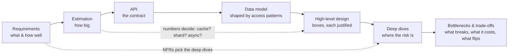

# The 45-minute HLD framework (reference card)

This is the condensed card. Module A0, Unit 1 ([`modules/A0-framework-estimation/`](../modules/A0-framework-estimation/))
derives every step and drills it; read that first. The card is for the five minutes before a mock or an interview.

## Why there is a framework at all

The interviewer has 45 minutes to answer one question: *would I trust this person to own the design of a real
system?* They can only judge what you say out loud, so the framework is just the order in which decisions
**depend on each other**, made explicit:

Skip a step and a later decision has nothing to stand on: a schema before requirements optimises the wrong access
pattern; boxes before numbers can't justify why a cache or a queue exists; deep dives before an end-to-end diagram
leave the interviewer with no system at minute 45.

## Time budget and checkpoints

| Clock | Phase | Output on the board | Senior signal |
|---|---|---|---|
| 0:00–0:06 | **Requirements & scope** | 3–5 functional reqs; NFRs *with numbers* (latency, availability, durability, consistency); explicit out-of-scope list | You ask the questions whose answers change the design, and say why you're asking |
| 0:06–0:10 | **Estimation** | QPS (avg/peak, read/write), storage growth, bandwidth, hot set; each number tied to a decision | "50k writes/s → one primary won't do → partition by user_id" |
| 0:10–0:13 | **API** | 3–6 endpoints/RPCs with key params, pagination, idempotency keys where retries happen | Contract reflects NFRs (cursor pagination, idempotent writes, auth) |
| 0:13–0:16 | **Data model** | Entities, keys, the access patterns they serve, store choice with one-line reason | Partition key and indexes named from access patterns |
| 0:16–0:25 | **High-level design** | End-to-end diagram for the main read and write paths; every box justified by a requirement or a number | Walks one request through it; nothing decorative |
| 0:25–0:40 | **Deep dives** (2–3) | The riskiest parts: the hot path, the consistency boundary, the failure-prone integration | Quantified trade-offs, failure modes, alternatives rejected and why |
| 0:40–0:45 | **Bottlenecks, failures, evolution** | What breaks first at 10×, how you'd detect it, what you'd change; open risks | Operational view: metrics, alerts, rollout, cost |

**Checkpoints:** numbers on the board by **0:10** · a complete end-to-end diagram by **0:25** · stop drilling at
**0:40** no matter what.

**Behind schedule?** Say so and compress: "I'll keep the API brief so we have time for the write path." Never
silently skip estimation or the end-to-end diagram; shorten deep dives instead. If the interviewer pulls you into a
deep dive early, follow, then say "let me close the loop on the overall design" before time runs out.

## Driving vs following

You drive by default: announce each phase ("Let me pin down requirements first"), and end each with a one-line
summary and a check ("Does that scope match what you had in mind?"). When the interviewer steers, follow
immediately — their steer is a hint about what they're grading — and then return to the plan.

## Stating a trade-off (use this shape every time)

> **Claim** — "I'd use a cache-aside Redis tier in front of Postgres for reads,"
> **because** — "we estimated ≈ 200k peak reads/s against a p99 < 50 ms target; at ≈ 20k indexed reads/s per
> replica that's ≈ 10 replicas, versus ≈ 2–3 Redis nodes at a 95% hit rate,"
> **cost** — "we accept up to ~60 s of staleness and a stampede risk on hot keys, which I'd handle with request
> coalescing,"
> **flip** — "if the product needed read-your-writes on every read, I'd route the author's reads to the primary or
> drop the cache for that path."

A trade-off without a cost or a flip condition is a preference, not a trade-off.

## The probe ladder (expect these on every deep dive)

1. **What if it fails?** — this node, this dependency, this region. Detect → contain → recover.
2. **What at 10× (or 100×)?** — which resource saturates first, and what you change.
3. **Why not Y?** — the strongest alternative, and the condition under which you'd pick it.
4. **How would you know?** — the metric/alert that tells you it's breaking (SLI, saturation, lag, error rate).
5. **What does it cost?** — money (egress, storage tiers, instances) and complexity (on-call, migrations).
6. **How do you get there?** — migration/rollout from the current state without downtime.

Prepare one sentence for each before you finish a deep dive; you'll usually get asked two or three.

## Mid-level vs senior, in one table

| | Mid-level | Senior bar |
|---|---|---|
| Requirements | Lists features | Turns NFRs into numbers; negotiates scope |
| Estimation | Computes numbers | Uses them to make (and rule out) decisions |
| Design | Correct boxes | Every box justified; one request walked end to end |
| Deep dives | Describes a component | Compares alternatives with costs and flip conditions |
| Failures | Mentions "add replicas" | Names failure modes, blast radius, detection, recovery |
| Ops & cost | Absent | Metrics, rollout, migration, cost drivers |

Numbers to quote: [`NUMBERS.md`](NUMBERS.md). Practise the arithmetic with `sd estimate`.
