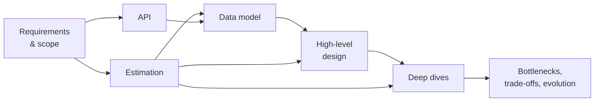
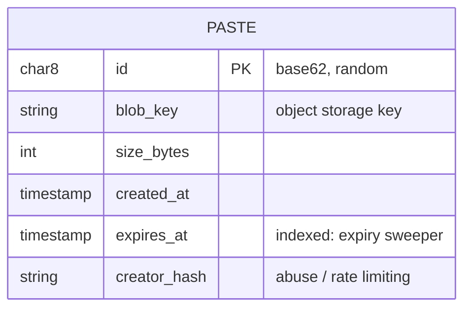
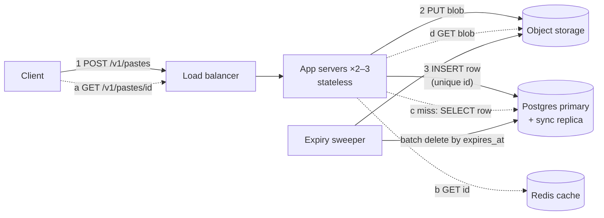
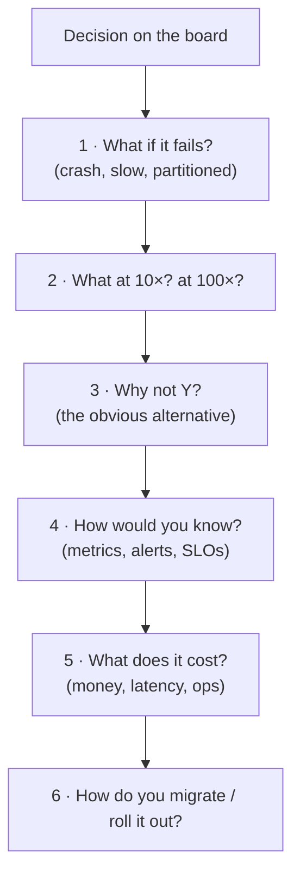
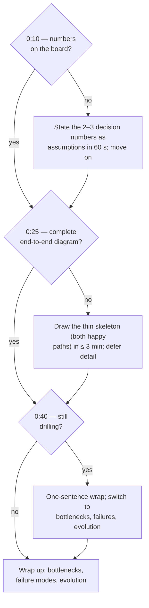

# A0 Unit 1 — The 45-minute framework

> Time: ~6 h · CORE: §1–§7 (5 h) · STRETCH: §8 (1 h) · Lab: none in this unit (the Go lab, `labs/a0/capacity`,
> belongs to [Unit 2](unit-2-estimation.md)) · Reference card: [docs/INTERVIEW_FRAMEWORK.md](../../docs/INTERVIEW_FRAMEWORK.md)

This unit does not give you a template to memorise. A memorised template breaks the first time an interviewer
interrupts you. You'll derive the framework from two facts instead: what the interviewer has to write down about
you within 45 minutes, and which design decisions depend on which. Once you see the dependencies, the order and the
time budget follow, and you can rebuild them under pressure even when the interview goes off script.

Keep a notes file open (`notes/A0.md` or wherever you like). Every **Predict** block asks you to write something
down *before* you open the reveal. Skipping that step turns this unit into reading, and reading doesn't change
what you do at 0:23 with a marker in your hand.

## Before you start

You need nothing from earlier modules. You do need to be honest about your starting point, so here is a warm-up
built from what you already know from your adapter work.

1. Your SSO adapter calls an identity provider. Name two non-functional requirements you had for it, with
   numbers if you knew them.
2. Roughly how many requests per second is 1 million requests per day?
3. Name one design decision in an adapter you built that you'd make differently if traffic were 100× higher.

<details data-kind="answer">
<summary>Warm-up answers</summary>

1. Typical answers: a timeout (e.g. "the IdP call must answer within 2 s or we fail the login"), an availability
   target inherited from the vendor's SLA, a security requirement (signed assertions, token lifetime), an audit
   requirement (every login attempt is logged). If you couldn't put a number on any of them, that's normal, and
   it's the first habit this unit builds: every NFR gets a number.
2. ≈ 11.6 req/s (10^6 / 86,400). Napkin: ≈ 10 req/s. If this took you more than ten seconds, Unit 2 is where
   it becomes reflexive.
3. Anything concrete counts: "we opened a new HTTP connection per call", "we cached nothing", "we retried
   synchronously inside the request". Hold on to your answer; §5 turns it into a defended trade-off.

</details>

**Session plan (3 × 2 h):** Session 1: §1–§3. Session 2: §4–§6. Session 3: §7 (the full walkthrough), then one
timed rehearsal from [design-exercise.md](design-exercise.md) as a dry run (don't record it yet). §8 is STRETCH.

---

## §1 What is being scored, and why the order is forced

### The failure story

The prompt is "design a URL shortener". At 0:03 the candidate says "let's start with the schema" and writes
`CREATE TABLE urls (id BIGSERIAL PRIMARY KEY, long_url TEXT, ...)`. It's a good schema. By 0:20 they're comparing
B-tree and hash indexes. At 0:31 the interviewer asks, "How many redirects per second does this need to handle?"
The candidate hasn't decided, so they guess. At 0:38 the interviewer asks what happens when the database primary
dies. The candidate starts drawing a load balancer for the first time. The clock runs out.

The feedback says: *"Strong on SQL. Did not establish requirements or scale. No end-to-end design. Could not
discuss failure handling. Not at senior bar."* The candidate knew more about indexes than the interviewer did. It
didn't matter: ≈ 28 of 45 minutes (≈ 60%) went on one of seven things the interviewer had to assess, and the
other six got nothing.

### Predict

<!-- predict id="A0-U1-P01" -->
**Predict.** Write these down before you open the reveal.

1. List the things you think an interviewer has to be able to write about you after a 45-minute design round.
   (Think about what the feedback form asks, not what you'd like to show off.)
2. Put these seven activities in the order they *must* happen, and for each one, name the earlier activity it
   depends on: API, data model, deep dives, estimation, high-level design, requirements, trade-offs/bottlenecks.
3. Out of 45 minutes, how many would you give the deep dives? Why not more?
<!-- /predict -->

### Reveal

<details data-kind="reveal" data-for="A0-U1-P01">
<summary>Reveal</summary>

**1. What gets scored.** Companies word it differently, but a senior system-design assessment comes down to
roughly six signals:

| Signal | The question on the form |
|---|---|
| Problem exploration | Did they pin down what to build, and what *not* to build, before building it? |
| Quantitative reasoning | Did they size the problem, and did the numbers change their design? |
| Design coverage | Is there a working end-to-end design, where each component has a reason to be there? |
| Depth | Did they go deep where the risk is, and stay correct under follow-up questions? |
| Trade-offs and judgement | Could they say why this and not that, what it costs, and when they'd choose differently? |
| Communication and ownership | Did they drive the session, take hints, and manage the time? |

The URL-shortener candidate scored on *depth* in one area that wasn't risky, and on nothing else. A common
wrong answer is "they score whether you know technology X". Knowing X is only evidence for depth or trade-offs.
Nobody scores it on its own.

**2. The order** follows from what each decision needs as input:

requirements → estimation → API → data model → high-level design → deep dives → trade-offs/bottlenecks.

- **Estimation needs requirements.** You can't size an unscoped system. "1M pastes/day" is a requirement.
- **The API needs requirements.** The operations are the functional requirements, written as a contract.
- **The data model needs the API and the estimates.** The API tells you the access patterns ("get paste by id"),
  and the estimates tell you whether one node holds the data.
- **The HLD needs all of the above.** It wires the operations to stores that can serve those access patterns at
  those numbers.
- **Deep dives need the HLD and the estimates.** You dig where the design is most likely to break, and the
  numbers tell you where that is.
- **Trade-offs close it.** They're only credible once there is a design to criticise.

The tempting wrong answer is "HLD first, then requirements as they come up". It feels fast, but every box you
draw before scoping is a guess, and some of them will have to be erased.

**3. Deep dives get the biggest block: ≈ 15 minutes (0:25–0:40).** That's where senior candidates pull away from
mid-level ones. You can't give them more, because everything before them is a prerequisite (no HLD means
nothing to dive into), and the last 5 minutes on bottlenecks and evolution produce a lot of signal for their
length. If you answered 25–30 minutes, ask yourself which prerequisite you'd squeeze, and what the interviewer
writes when it's missing.

</details>

### How it actually works

**The dependency chain.** Each phase consumes the output of the ones before it. That's why the order holds even
when the interviewer jumps around: if they ask about sharding at 0:08, the honest answer depends on a number you
haven't computed yet, so you say that and compute it.



**The time budget.** It's the same budget as the reference card
([docs/INTERVIEW_FRAMEWORK.md](../../docs/INTERVIEW_FRAMEWORK.md)). Each slot is justified by what it buys:

| Time | Phase | Output on the board | Why this much and no more |
|---|---|---|---|
| 0:00–0:06 | Requirements & scope | 3–5 functional reqs; NFRs **with numbers**; an explicit out-of-scope list | Every later decision depends on it. Past ≈ 6 min you're asking questions whose answers don't change the design. |
| 0:06–0:10 | Estimation | 4–6 numbers, each tied to a decision | Only the numbers that decide whether you need caching, sharding, async or a CDN. A full spreadsheet is wasted time. |
| 0:10–0:13 | API | The core endpoints: request/response, status codes, idempotency where it matters | It's the contract. It turns functional requirements into access patterns. |
| 0:13–0:16 | Data model | Entities, keys, the store type, and which access pattern each index serves | It follows the access patterns. Picking the store before knowing them is the "MongoDB because it scales" mistake. |
| 0:16–0:25 | High-level design | End-to-end happy path for each core operation; every box justified | Coverage. Without a complete path there's nothing to deep-dive *into*. |
| 0:25–0:40 | Deep dives (2–3) | Mechanisms, failure handling, numbers | Depth is the strongest senior signal, so it gets the largest block. |
| 0:40–0:45 | Bottlenecks, failure modes, trade-offs, evolution | What breaks first, at what number, and what you'd do about it | It shows judgement and ownership, and it's what the interviewer remembers last. |

**Three checkpoints** tell you whether you're on schedule:

1. **Numbers on the board by 0:10.** Otherwise you'll draw boxes you can't justify.
2. **A complete end-to-end diagram by 0:25.** Otherwise "design coverage" scores below the bar, however good the
   deep dives are.
3. **Stop drilling at 0:40.** Otherwise you never reach failure modes and evolution, which carry a lot of the
   senior signal.

**Breadth first, then depth.** The budget is breadth-first on purpose: a shallow but complete design by 0:25,
then depth. A depth-first candidate (the URL-shortener story) produces one excellent component and an
unassessable design. A breadth-only candidate (14 boxes, §4) produces an assessable design that fails on depth.
The framework gets both into 45 minutes.

### Build it

No Go lab for this section; the module's lab is in [Unit 2 §1–§7](unit-2-estimation.md). Build your own reference
card instead. From memory, with this page closed, write the seven phases, their time slots, the three checkpoints,
and one line per phase on *why it comes where it does* (its dependency). Then compare with
[docs/INTERVIEW_FRAMEWORK.md](../../docs/INTERVIEW_FRAMEWORK.md). Repeat until your version matches without
looking. Acceptance: you can rebuild the card in under 3 minutes, including the dependency for each phase.

### Break it

Run a 12-minute mini-rehearsal of "design a pastebin" and **skip requirements entirely**: start at the API. Use a
timer. Afterwards, list every decision you made (store type, ID format, size limits, expiry, auth) and mark each
one *justified by a requirement* or *a default I assumed*.

<details data-kind="answer">
<summary>What you should observe</summary>

Most of your decisions will be marked "a default I assumed". Typical silent defaults: unlimited paste size, no
expiry, pastes are public, SQL storage of the content itself, no rate limiting. Each of these is a requirement
you never stated, so an interviewer can overturn any of them with one question ("pastes can be 50 MB" moves
content to object storage; "pastes expire" adds a sweeper and an index on `expires_at`). That's what the order
protects you from: without scoping, any follow-up question can force you to redesign.

</details>

### In the wild

The interview framework is a compressed design document. Real engineering organisations use the same structure:

- **Google design docs** (as described in Malte Ubl's widely cited "Design Docs at Google" write-up) have
  *context and scope*, *goals and non-goals*, *the actual design*, *alternatives considered* and *cross-cutting
  concerns* (security, privacy, observability). "Non-goals" is the interview's out-of-scope list.
- **Rust RFCs** (the `rust-lang/rfcs` template) require *Motivation*, *Drawbacks* and *Rationale and
  alternatives*. That's the trade-off statement of §5, in a public process.
- **Architecture Decision Records** (Michael Nygard's 2011 format: *Context*, *Decision*, *Status*,
  *Consequences*) record why a decision was made and what it costs, so the next engineer knows when to revisit it.
- **Amazon's "working backwards"** practice starts from the customer outcome (the press release and FAQ) before
  any architecture, which is requirements-first taken to an extreme.

When a senior engineer at a big-tech company reviews a design in real life, they ask the same questions an
interviewer asks: what is it for, how big is it, why this component, what happens when it fails.

### Trade-offs

| Approach | Wins when | Loses when | When the answer flips |
|---|---|---|---|
| Breadth-first framework (this unit) | Standard 45-min HLD round; the interviewer is evaluating overall design ability | The interviewer wants one problem explored deeply from minute 5 | If the interviewer says "skip the basics, assume a standard web stack; I want to talk about X", compress phases 1–5 into ≈ 5 minutes of stated assumptions and spend the rest on X. |
| Depth-first on the most interesting component | Staff-level or specialist rounds that announce a focus ("design the storage engine") | A general round: coverage scores below the bar | When the prompt is itself a component ("design a rate limiter"), the "HLD" *is* the component's internals, and depth is the coverage. |
| Pure follow-the-interviewer | The interviewer is clearly steering towards a specific discussion | A quiet interviewer who expects *you* to drive; you get "lacked ownership" | The moment the interviewer goes quiet or says "it's your design", go back to driving. |

### Senior bar

**What mid-level vs senior looks like across the whole session:**

| | Mid-level | Senior |
|---|---|---|
| Order | Follows a memorised sequence, or none | Can explain *why* the order holds, and adapts it on purpose |
| Numbers | Computes some, then ignores them | Every number on the board changes or confirms a decision |
| Coverage | Partial diagram, or a big diagram nobody can trace | Complete happy path by 0:25; each box justified |
| Depth | Goes deep where they're comfortable | Goes deep where the risk is, and says why that's where the risk is |
| Ownership | Waits for questions | Announces the plan, signposts transitions, manages the clock out loud |

**Failure modes of the framework itself:** reciting it ("Now I will do non-functional requirements") instead of
using it. Spending 10 minutes on requirements because the framework says "requirements first". Refusing to
skip a phase when the interviewer has explicitly waived it. The framework is a default plan, so treat it like one.

**Interviewer follow-up probes:**

<details data-kind="answer">
<summary>Probe: "Let's skip requirements. Just assume it's like Twitter scale. Start designing."</summary>

Comply, and turn the waiver into stated assumptions in about 30 seconds: "Sure. I'll assume ≈ 200M DAU,
read-heavy at ≈ 100:1, eventual consistency is acceptable for timelines, and p99 read latency ≈ 200 ms. I'll
come back to anything that turns out to matter." You keep the dependency chain (your numbers still have a source)
without arguing with the interviewer. Pushing back ("but I need requirements first") reads as rigid. Asking
nothing and drawing reads as unanchored.

</details>

<details data-kind="answer">
<summary>Probe: "Why are you spending time on estimation? Just design it."</summary>

"Two numbers decide the shape of this design: peak write QPS and total storage. If writes stay under a few
thousand per second, one relational primary works and I won't shard. If storage fits on a node, I won't
partition. Give me 2 minutes to get those two numbers and I'll skip the rest." That shows you estimate *to
decide*, not out of habit, and it offers the trade (2 minutes) on your own initiative.

</details>

<details data-kind="answer">
<summary>Probe: "You have 10 minutes left and haven't talked about failures. What would you prioritise?"</summary>

Name the single most damaging failure and the single most likely bottleneck, one minute each, then evolution:
"The worst failure is losing the metadata primary: writes stop. I'd run a synchronous replica in another AZ with
automated failover, so we lose seconds, not data. The first bottleneck at 10× is read traffic on the primary,
which read replicas and the cache absorb. If we go global, the next step is ...". Prioritising out loud is
itself the senior signal here.

</details>

### Check yourself

1. Why must estimation come before the data model, not after?
2. What's the checkpoint at 0:25, and what goes wrong in the feedback if you miss it?
3. An interviewer says, "I mainly care about how you'd make this highly available." Which phases do you compress,
   and which do you keep?

<details data-kind="answer">
<summary>Answers</summary>

1. The data model's biggest choices (one node or partitioned, which store, which key) depend on volume: how much
   data, and at what read/write rates. Without the numbers you pick a store by habit, then have to defend it on
   no evidence.
2. A complete end-to-end diagram. Without it, design coverage is below the bar however good your deep dives
   are, because the interviewer can't tell whether your system actually works end to end.
3. Compress requirements to the HA-relevant NFRs (availability target with a number, RPO/RTO, consistency),
   estimation to the few numbers that size replicas and failover, and the API to one or two lines. Keep a minimal
   but complete HLD, because HA has to be discussed against something. Then spend most of the time on failure
   domains, replication and failover in the deep dives.

</details>

---

## §2 Requirements and scope (0:00–0:06)

### The failure story

Two candidates get the prompt "design a chat app".

Candidate A asks nothing. They design one-to-one messaging, group chats up to 100k members, voice calls, end-to-end
encryption, read receipts and stories. At 0:30 they're still explaining group-call media servers. The interviewer
wanted one-to-one messaging with delivery guarantees and offline sync. Most of the 30 minutes went on features
that weren't asked for.

Candidate B asks twenty-two questions over twelve minutes ("Do we support emojis? Dark mode? What languages?").
That's 27% of the interview gone before a single number or box, and most of the answers changed nothing.

Both candidates failed problem exploration, in opposite directions.

### Predict

<!-- predict id="A0-U1-P02" -->
**Predict.** Set a 4-minute timer. For "design a pastebin" (users paste text and get a short link that others can
open), write down:

1. three functional requirements;
2. three non-functional requirements, *each with a number*;
3. three things you'd explicitly put out of scope.

Then answer: which *one* of your NFRs, if the interviewer changed it, would change your architecture the most?
<!-- /predict -->

### Reveal

<details data-kind="reveal" data-for="A0-U1-P02">
<summary>Reveal</summary>

A strong 4-minute answer:

- **Functional:** create a paste (text, optional expiry) and get back a short URL; read a paste by its URL;
  pastes expire (by default after 2 years, or earlier if the user says so).
- **Non-functional:** ≈ 1M new pastes/day, reads ≈ 10:1 over writes; p99 read latency ≤ 200 ms; reads available
  ≥ 99.9%; a successfully created paste is never lost (durability matters more than availability for writes);
  pastes up to 1 MB, average ≈ 10 KB.
- **Out of scope:** user accounts and editing; syntax highlighting (client-side); analytics; search.

**Which NFR changes the architecture most?** The usual candidates are *paste size* and *scale*. If pastes can be
up to 1 GB, content moves to object storage with multipart uploads and the API needs presigned upload URLs. If
the interviewer says "100× the traffic", the read path needs a cache and a CDN. A *consistency* change ("edits must
be visible instantly worldwide") would matter too, but editing is out of scope, so it doesn't apply here.

Two common mistakes. (1) NFRs without numbers ("highly available, low latency, scalable"). Those words can't
drive a decision, so they score as if you hadn't said them. (2) Functional requirements that are really
implementation ("store pastes in S3"). That's a design decision, and putting it in requirements skips the
reasoning the interviewer wants to hear.

</details>

### How it actually works

**Functional requirements** are a few verbs on nouns: what a user can do. Keep it to 3–5 core operations and
say which ones you'll design in detail. Anything beyond that goes on the out-of-scope list *out loud*. That's not
avoidance: it narrows the problem so you can solve it properly in the time, and interviewers count the narrowing
as a skill.

**Non-functional requirements** are the qualities that decide the architecture. Each needs a number or a sharp
statement:

| NFR | Ask or assume | Why it moves boxes |
|---|---|---|
| Scale | DAU, actions per user per day, read:write ratio | Drives every estimate in §3 and Unit 2 |
| Latency | p99 target for the core operations (e.g. read ≤ 200 ms) | Decides caching, data locality, sync vs async |
| Availability | A target such as 99.9% or 99.99%, and for which operation | Decides redundancy, multi-AZ or multi-region, failover |
| Consistency | Can a read briefly return stale data? Read-your-writes? | Decides replication mode, cache invalidation, where the source of truth lives |
| Durability | Can data ever be lost? RPO (how much)? | Decides sync vs async replication, backups |
| Data size and retention | Average and max item size; how long it's kept | Decides the store type and storage cost |
| Security and compliance | PII, encryption, audit, data residency | Can add whole components (audit log, KMS, regional isolation) |

**The question filter.** Before you ask a clarifying question, check: *would the answer change a box or a
number?* If yes, ask. If no, don't. If you can't decide, *state an assumption* and invite correction: "I'll assume
eventual consistency is fine for view counts; stop me if not." Stating assumptions is quicker than asking, and it
shows judgement. Asking about everything shows you can't tell what matters.

**Banking link.** You've done this for real. When you integrated an image or vendor provider, the important
requirements weren't the API fields. They were the vendor's rate limit, its timeout behaviour, whether a
retried request could double-post, and how long you had to keep the audit trail. Those are NFRs, and every one
changed your adapter's design. In an interview, use the same instinct on a product you've never seen.

### Build it

No Go lab for this section; see [Unit 2](unit-2-estimation.md) for the lab. Write a requirements card (functional,
NFRs with numbers, out of scope, assumptions) in ≤ 5 minutes for each of: a photo-sharing app, a rate limiter
service, and a notification service for a banking app (transaction alerts by push and SMS). Acceptance: every NFR
has a number, and every out-of-scope item is something a reasonable interviewer might otherwise have expected.

### Break it

Take your pastebin card from the Predict and flip one NFR at a time: (a) pastes up to 1 GB; (b) reads must be
p99 ≤ 50 ms worldwide; (c) creation must survive the loss of a whole region. For each flip, write which
components you'd add or change.

<details data-kind="answer">
<summary>What changes</summary>

- **(a) 1 GB pastes:** content goes to object storage with direct client uploads (presigned URLs, multipart), the
  API splits into "start upload" and "complete", the app servers stay out of the data path, and storage
  estimates are dominated by the size distribution's tail, not the average.
- **(b) 50 ms p99 worldwide:** with cross-continent RTT ≈ 80–150 ms ([NUMBERS.md](../../docs/NUMBERS.md)), you
  can't serve from one region. Reads need a CDN or edge cache, possibly regional read replicas. Writes can stay
  in one region if read-your-writes is handled (e.g. the creator's first read is served from origin).
- **(c) region-loss durability:** writes must be synchronously replicated to a second region *before* you
  acknowledge them, which adds a cross-region RTT to every write (≈ tens of ms). Or you accept a small RPO with
  async replication. Whichever you pick, say it out loud as a trade-off.

One NFR flip can redesign a third of the system. That's why scoping comes first, and why you should *say* which
NFR is most sensitive.

</details>

### In the wild

- **SLOs and error budgets** (Google's *Site Reliability Engineering* book, chapters on service level
  objectives): availability and latency requirements written as numbers per operation, with an error budget
  that decides when to stop shipping features. "Reads ≥ 99.9%" in an interview is the same idea in miniature.
- **Cloud SLAs are per operation and per product.** For example, AWS states a design target of 99.999999999%
  (11 nines) *durability* for S3 Standard, and a separate, much lower *availability* SLA. Durability and
  availability are different NFRs, and serious systems write them down separately.
- **Data residency requirements** (e.g. GDPR in the EU) regularly add whole components such as regional storage
  and per-region keys. That's an NFR that changes the architecture, not a detail.

### Trade-offs

| Approach | Wins when | Loses when | When the answer flips |
|---|---|---|---|
| Ask clarifying questions | The answer changes a box or a number, and you can't guess it sensibly | The answer doesn't matter (emoji support), or you could have stated an assumption | When the interviewer starts answering "up to you", switch to stating assumptions. |
| State assumptions and invite correction | Speed; shows judgement; keeps you driving | The assumption is unusual and the interviewer silently disagrees | If you're assuming something non-standard (strong consistency on a social feed), ask instead. |
| Narrow scope aggressively | Leaves time for depth; signals prioritisation | You cut the part the interviewer wanted to probe | Always say what you cut and ask "is that the right cut?", so a wrong cut costs 10 seconds, not 20 minutes. |

### Senior bar

- **Failure modes:** under-scoping (designing features nobody asked for), over-asking (more than ≈ 6 minutes),
  NFRs without numbers, and missing the one NFR that dominates (durability for a payments ledger, latency for an
  ad auction, freshness for stock prices).
- **Capacity:** the scale NFRs ("≈ 1M writes/day, 10:1 reads") feed straight into Unit 2. If you leave
  requirements without a DAU, a per-user action rate and a size per item, you can't do estimation at all.
- **Ops and cost:** a senior candidate often adds one operational requirement nobody asked for: "we need to be
  able to take down abusive pastes within minutes", "deploys must not drop in-flight uploads". That shows they've
  run systems, not just drawn them.

**Interviewer follow-up probes:**

<details data-kind="answer">
<summary>Probe: "You decide the scale."</summary>

Pick a number big enough that design matters and small enough to stay realistic, state it, and say why: "I'll
design for 10M DAU and 1M new pastes a day. That's large enough to need care on the read path but doesn't
justify sharding on day one. I'll call out what changes at 100×." Choosing "1 billion users" for a pastebin
signals you want to show off sharding, not solve the problem in front of you.

</details>

<details data-kind="answer">
<summary>Probe: "Why didn't you ask about consistency?"</summary>

If you stated an assumption, point to it: "I assumed read-after-write for the creator and eventual consistency
for everyone else, because pastes are immutable once created, so there's nothing to go stale except deletion and
expiry." If you didn't, own it, decide now, and say what the decision changes: "Good catch: since pastes are
immutable, the only consistency question is how fast an expiry or takedown propagates. I'd accept up to the
cache TTL, ≈ 1 minute, except for abuse takedowns, which purge the cache explicitly."

</details>

### Check yourself

1. Rewrite "the system must be highly available and fast" as two NFRs a design can be checked against.
2. Give one example of a clarifying question that's worth asking for a pastebin and one that isn't.
3. Why is an explicit out-of-scope list a *positive* signal rather than avoidance?

<details data-kind="answer">
<summary>Answers</summary>

1. For example: "Reads of an existing paste succeed ≥ 99.9% of the time per month (≈ 43 min of downtime/30 days)"
   and "p99 read latency ≤ 200 ms measured at the load balancer".
2. Worth asking: maximum paste size (it decides whether content can sit in a database row or needs object
   storage). Not worth asking: whether the short URL uses lowercase letters (it changes nothing structural;
   state a choice later, in the ID deep dive).
3. It shows you can prioritise, and it protects your time. It also invites correction early, when a wrong cut
   costs seconds, instead of at 0:30.

</details>

---

## §3 Estimation, API and data model (0:06–0:16)

### The failure story

The candidate computes storage per day, per month, per year, per five years and per decade. Then bandwidth in
both directions, cache size three ways, and the number of characters in a short URL. It takes 9 minutes and
fills half the board. When they draw the design, none of the numbers are referred to again. They pick "Cassandra
because it scales" for 35 writes per second. Then they design the API as CRUD over their tables
(`POST /paste_rows`, returning an internal auto-increment id).

They did the work of estimation and never used it. Their API leaks the storage design, so any change to storage
breaks clients. And the store was chosen before anyone asked which queries it had to answer.

### Predict

<!-- predict id="A0-U1-P03" -->
**Predict.** Pastebin, from the reveal in §2: ≈ 1M new pastes/day, 10:1 reads, average paste ≈ 10 KB, kept 2
years. Write down:

1. Which *three* numbers would you compute in the 4-minute estimation slot, and which design decision does each
   one drive? (Compute them roughly if you can. Unit 2 makes this fast.)
2. A sketch of the two core API calls (method, path, request, response, status codes). Which of them needs an
   idempotency mechanism, and why?
<!-- /predict -->

### Reveal

<details data-kind="reveal" data-for="A0-U1-P03">
<summary>Reveal</summary>

**1. Three decision numbers:**

| Number | Value (≈) | Decision it drives |
|---|---|---|
| Peak write QPS | 1M/day ÷ 86,400 ≈ 11.6/s avg; × 3 peak ≈ **35/s** | One relational primary is plenty (≈ 1k–10k TPS per [NUMBERS.md](../../docs/NUMBERS.md)). **No sharding, no write queue.** |
| Peak read QPS | ≈ 116/s avg; × 3 ≈ **350/s** | A few stateless app servers; a cache is optional for load and useful for latency. |
| Storage over retention | 1M × 10 KB = 10 GB/day; × 730 days ≈ **7.3 TB** of content (× 3 if you replicate it yourself ≈ 22 TB); metadata ≈ 1M × 200 B × 730 ≈ **146 GB** | Content goes to object storage. The metadata fits on one database node. |

Notice what the numbers tell you: **this is not a scale problem.** That's a valuable finding. It means the deep
dives should go to ID generation, expiry and abuse, not to sharding. Candidates who skip estimation shard the
pastebin anyway.

**2. API sketch:**

```
POST /v1/pastes
  Idempotency-Key: <client-generated UUID>
  { "content": "...", "expires_in_days": 30 }
→ 201 Created  { "id": "aZ3kQ9xT", "url": "https://p.example/aZ3kQ9xT", "expires_at": "..." }
→ 400 (too large / invalid), 429 (rate-limited)

GET /v1/pastes/{id}
→ 200 { "content": "...", "created_at": "...", "expires_at": "..." }
→ 404 (never existed), 410 Gone (expired or taken down)
```

`POST` needs idempotency. Mobile clients retry on timeouts, and without a key a retry creates a second paste with
a different URL, so the user shares a link that isn't the one they saw confirmed. `GET` is naturally idempotent.
The wrong answer is "idempotency only matters for payments". Any create that a client might retry needs it.

</details>

### How it actually works

**Estimate to decide.** Unit 2 teaches the arithmetic. In the interview, the discipline is to compute only numbers
that sit next to a threshold you know. If a number can't change a decision, don't compute it.

| Number | Threshold you compare it with (≈, [NUMBERS.md](../../docs/NUMBERS.md)) | Decision |
|---|---|---|
| Peak write QPS | One relational primary ≈ 1k–10k small TPS | Single primary, or partition/shard the writes |
| Peak read QPS | Indexed point reads ≈ 10k–50k QPS per DB node; app server ≈ 1k–10k req/s | Read replicas, cache, number of app servers |
| Total storage | A node holds ≈ several TB of NVMe | Single node, partitioned DB, or object storage |
| Peak egress | NIC ≈ 10–25 Gbps; internet egress costs ≈ $0.05–0.09/GB | CDN or not; cost becomes a design driver |
| Hot set size | RAM per box ≈ 128–512 GB | Does the cache fit on one node, or does it need to be distributed? |
| Concurrency (Little's law) | Pool limits, e.g. Postgres `max_connections` defaults to 100 | Pool sizes, connection proxies, in-flight limits |

Say the decision out loud, right after the number: *"35 writes per second peak, so one Postgres primary with
about two orders of magnitude of headroom. I won't shard."*

**The API is the contract.** Design it from the functional requirements, not from the tables. That means
resource-oriented paths, request and response bodies with only what the client needs, error codes that
distinguish the cases a client handles differently (404 vs 410), idempotency keys on creates, pagination on lists,
and opaque IDs that don't expose an auto-increment counter (anyone could enumerate an incrementing id). Three
minutes is enough for the core calls. Leave the rest as "and the obvious admin endpoints".

**The data model follows the access patterns.** Write the access patterns first, then choose keys, then choose
the store:

1. *Get paste by id*: point lookup by primary key, ≈ 350/s peak.
2. *Create paste*: insert with a uniqueness check on id, ≈ 35/s peak.
3. *Find expired pastes*: range scan on `expires_at`, in background batches.



Content lives in object storage under `blob_key`. The row is ≈ 100–200 bytes. One relational database serves all
three patterns: a primary-key index for (1) and (2), and a secondary index on `expires_at` for (3). If the access
patterns had included "list all pastes by user, newest first" at high volume, the key design would change
(a partition key on the user), and that's the point of listing them first.

### Build it

The estimation half of this section is the lab: `labs/a0/capacity` (`Estimate`, plus the helpers it uses) in
[Unit 2](unit-2-estimation.md). Run it on the pastebin numbers once you've built it. The pastebin spec is the
fixture in `TestEstimate_PastebinSheet`, and the example in `example_test.go` prints the board version.

### Break it

Change one input: the average paste is **10 MB** (people paste logs), not 10 KB. Re-derive the three decision
numbers and say which decisions flip.

<details data-kind="answer">
<summary>What flips</summary>

QPS doesn't change (≈ 35 writes/s, ≈ 350 reads/s peak). Everything measured in bytes grows by 1000×:

- Content storage: 10 TB/day, ≈ 7.3 PB over 2 years. Object storage is now the only sane option, and **storage
  cost** becomes a requirement-level concern (at ≈ $0.023/GB-month, 7.3 PB ≈ $170k/month at list price,
  TODO-VERIFY current pricing). Shorter default retention suddenly matters.
- Peak egress: 350 × 10 MB = 3.5 GB/s ≈ 28 Gbps. That's beyond one 10–25 Gbps NIC, so you need a **CDN**, or
  presigned URLs straight to object storage so the app servers stay out of the data path.
- Ingress: 35 × 10 MB = 350 MB/s ≈ 2.8 Gbps. **Direct-to-object-storage uploads** become attractive.

Same request rates, completely different architecture. Byte numbers and request numbers drive different
decisions, which is why you compute both.

</details>

### In the wild

- **Idempotency keys:** Stripe's API accepts an `Idempotency-Key` header on POST requests and returns the
  original result for retries with the same key. That's the pattern in the API above. Your banking work has the
  same need: a retried transfer must not post twice.
- **Access-patterns-first modelling** is official guidance for DynamoDB: AWS's data modelling docs tell you to
  list access patterns before designing tables and keys, because the key design decides which queries are cheap.
- **Resource-oriented API design:** Google's public API Design Guide (cloud.google.com/apis/design) describes
  resources, standard methods and error models. It's a good reference for "API as contract".

### Trade-offs

| Decision | Option | Wins when | Loses when | When the answer flips |
|---|---|---|---|---|
| Paste content store | In the DB row | Small items (≲ tens of KB), simple ops, transactional with metadata | Large or variable items bloat the DB, backups and replication | Average size ≳ 100 KB or max ≳ a few MB → object storage |
| | Object storage + metadata row | Large or variable items; cheap per GB; durability handled by the provider | Two systems to keep consistent (orphan blobs, dangling rows) | Tiny items with a strict transactional need → keep them in the row |
| Metadata store | Single relational primary + replica | Writes ≲ 1k–10k TPS, data ≲ a few TB, rich queries | Write rate or data volume beyond one node | ≈ 10k+ sustained write TPS or multi-TB hot data → partitioned store |
| | Partitioned KV / wide-column | Huge write rates, simple key access | Secondary queries, transactions, operational complexity | Access patterns need joins or ad-hoc queries |

### Senior bar

- **Failure modes:** numbers that never connect to a decision; an API that exposes storage internals; a store
  chosen by brand; missing idempotency on creates; no distinction between "not found" and "gone".
- **Capacity numbers:** state the *headroom*, not just the fit: "35 writes/s against ≈ 1k–10k TPS is ≈ 30–300×
  headroom". Headroom tells you when you'd revisit the decision.
- **Ops and cost:** a senior candidate mentions schema migration (adding `expires_at` later means a backfill),
  backup size (≈ 146 GB of metadata is quick to back up; 7.3 TB of blobs is the provider's problem), and which
  store is cheapest per GB for the bulky part.

**Interviewer follow-up probes:**

<details data-kind="answer">
<summary>Probe: "Why not just use a NoSQL store for everything? It scales."</summary>

"At 35 writes/s and ≈ 150 GB of metadata, scale doesn't separate the options. What separates them is the
access patterns and operations. I need a point lookup, a uniqueness check on insert, and a range scan on
`expires_at`. A relational DB does all three with plain indexes, and the team knows how to run it. A KV store
would make the expiry scan awkward unless I use its TTL feature. If writes grew past ≈ 10k/s, or we went
multi-region active-active, I'd revisit." That's claim → why here → cost → when it flips (§5).

</details>

<details data-kind="answer">
<summary>Probe: "How do you return 410 for expired pastes if a sweeper deletes the row?"</summary>

Options: keep a tombstone row (id, expired_at) for some time after deleting the content; or don't distinguish,
and return 404 for both. Say which you'd choose and why: "Tombstones cost ≈ 50 bytes each. Over 2 years
that's ≈ 730M × 50 B ≈ 37 GB, which is affordable. And 410 tells the client not to retry, which cuts pointless
traffic." Then mention that the sweeper deletes the blob first and the row second, so a crash in between leaves an expired row whose blob is gone. The lazy check already returns 410 for it, and the
sweeper deletes it on its next run. The reverse order leaves a blob with no row, which you'd only find by listing
the whole bucket.

</details>

### Check yourself

1. Why is "this is not a scale problem" a strong finding to state at 0:10?
2. What's wrong with `POST /paste_rows` returning `{"id": 18273}`?
3. Name the access pattern that justifies an index on `expires_at`.

<details data-kind="answer">
<summary>Answers</summary>

1. It moves the deep dives to where the real risk is (IDs, expiry, abuse, hot items), and it shows that your
   numbers drive decisions. It also guards against over-engineering, which interviewers probe hard.
2. It names a storage concept instead of a resource, and it exposes a sequential id. Clients would couple to your
   storage, and anyone can enumerate all pastes by counting up, which is a privacy problem for unlisted pastes.
3. "Find pastes whose `expires_at` is in the past, in batches", for the background sweeper.

</details>

---

## §4 High-level design (0:16–0:25)

### The failure story

For the pastebin, the candidate draws: CDN, load balancer, API gateway, auth service, paste service, ID service,
Kafka, a consumer service, Redis, Cassandra, Elasticsearch, S3, ZooKeeper and a metrics pipeline. That's 14
boxes. The board looks impressive. Then the interviewer asks, "Walk me through what happens when I open a paste
link." The candidate traces CDN → LB → gateway → paste service → Redis... and then hesitates: is the content in
Cassandra or S3? Which service writes to S3, and is that before or after Kafka? Nobody had traced a request, so
nobody had noticed there was no path.

Then: "Why Elasticsearch?" Search was out of scope. "Why Kafka?" "For scalability." The peak write rate is 35/s.
Each extra box is now something the candidate has to defend, and they can't.

### Predict

<!-- predict id="A0-U1-P04" -->
**Predict.** Draw the pastebin HLD with as few boxes as you can while still meeting the requirements from §2 and
the numbers from §3. Next to each box, write a one-line justification that points to a requirement or a number.
Then trace both happy paths (create, read) as numbered arrows.

Second question: the interviewer says "this feels over-engineered". Which box do you remove first, and what do
you lose?
<!-- /predict -->

### Reveal

<details data-kind="reveal" data-for="A0-U1-P04">
<summary>Reveal</summary>

A minimal, justified HLD has about six boxes:

| Box | Justification |
|---|---|
| Load balancer | ≥ 2 app servers for 99.9% availability (N+1 for failures and deploys) |
| App servers (stateless, × 2–3) | ≈ 385 req/s peak total; one server's ≈ 1k–10k req/s covers it, and the others are for redundancy |
| Metadata DB (Postgres primary + sync replica) | Point lookups, uniqueness on id, expiry index; ≈ 146 GB; durability needs a sync replica |
| Object storage | ≈ 7.3 TB of content over retention; cheap per GB; durability handled by the provider |
| Cache (Redis) | Optional for load (≈ 350 r/s is easy for Postgres); justified by read latency on hot pastes and for viral spikes |
| Expiry sweeper (cron job / worker) | Retention requirement: deletes expired content and rows in batches |

The **first box to remove** is the cache. The load doesn't need it, so you lose some read latency on hot pastes
and your protection against a viral paste. Say that the cache comes back the moment a single paste is expected
to get thousands of reads per second. A wrong answer is removing the replica: that removes the durability
guarantee you stated as a requirement.

</details>

### How it actually works

**Trace the happy paths before adding anything.** Draw the request path for each core operation, numbered, and
check it against the requirements. Then ask of every box: *which requirement or number forces this box?* If the
answer is "best practice", it's a candidate for removal.



The order inside the write path matters, and it's a typical deep-dive hook. Write the blob first and the row
second. A crash between the two then leaves an orphan blob that a reaper can find by listing blobs without rows.
The opposite order leaves a row pointing at nothing, which shows up as a user-visible error. That's a decision
you can only make once the path is drawn.

**Label arrows with rates when it matters.** "≈ 350 r/s" on the read arrow and "≈ 35 w/s" on the write arrow
make the next 15 minutes easier, because every "what at 10×?" question starts from a number that's already on
the board.

**Start minimal, then evolve.** The 0:25 diagram should be the simplest design that meets the requirements. Each
deep dive may add a component, but the component then comes with a reason. Interviewers trust a design that
grows under pressure more than one that starts with fourteen boxes.

### Build it

No Go lab for this section; see [Unit 2](unit-2-estimation.md). Draw, timed (9 minutes), the HLD for the
photo-sharing card you wrote in §2's Build it. Acceptance: both happy paths are numbered, each box has a
one-line justification, and there's at least one rate on an arrow.

### Break it

Take your pastebin HLD and run two fault experiments on paper.

1. **Remove the cache.** Recompute the database read load at peak, at 1× and at 100× traffic.
2. **Kill the object store** for 10 minutes. Trace what happens to creates and to reads, cached and uncached.

<details data-kind="answer">
<summary>What you should find</summary>

1. At 1×, the DB sees ≈ 350 point reads/s, and Postgres handles ≈ 10k–50k indexed point reads/s, so you have
   ≈ 30× headroom. The cache isn't needed for load. At 100×, it's ≈ 35k reads/s, which is near or past one node's
   limit. Now the cache (or read replicas) becomes a requirement. So the cache is a *10×–100× decision*, and you
   can say exactly when you'd add it.
2. Creates fail: you can't store the blob. Return 503 and let the client retry with the same idempotency key. Do
   *not* write the row first. Cached reads keep working. Uncached reads fail. If read availability matters more
   than consistency, cache more aggressively (longer TTLs) during the outage. That's a real decision, and you
   should state it as one.

</details>

### In the wild

- **The C4 model** (Simon Brown) separates *context*, *container*, *component* and *code* diagrams. An interview
  HLD sits at the *container* level: deployable things and data stores, not classes.
- **Production readiness reviews** (described in Google's SRE book) walk the request paths and ask, for each
  dependency, what happens when it's slow or down. That's the Break-it you just did.
- **Blob + metadata split:** many systems store large content in object storage and keep a small metadata row
  elsewhere. S3 itself offers lifecycle rules to expire objects automatically, so expiry can live partly in the
  storage layer.

### Trade-offs

| Decision | Option | Wins when | Loses when | When the answer flips |
|---|---|---|---|---|
| Diagram shape | Minimal, justified boxes | Every box can be defended; deep dives have room | Interviewer wants to see breadth of components (rare) | Prompt explicitly asks for a "complete production architecture": then add observability, auth and so on, still each with a reason |
| | Exhaustive "production" diagram | Looks thorough at first glance | Every unjustified box becomes a probe you can't answer | Never your default |
| Write path | Synchronous (app writes blob + row, then responds) | Low write rate; the user needs the URL immediately | Slow downstreams delay the user; spikes reach the DB | Expensive post-processing (virus scan, rendering, indexing) → acknowledge, then do it asynchronously from a queue |
| | Asynchronous via a queue | Absorbs spikes; decouples slow work | Extra moving part; read-your-write gets harder | Writes are cheap and the user must see the result now → synchronous |

### Senior bar

- **Failure modes in the HLD phase:** boxes with no reason; a path you can't trace; components that contradict a
  requirement (an async queue in front of a write that must be read immediately); no redundancy for the stated
  availability target.
- **Capacity:** annotate one or two arrows with rates; size the app tier from peak (Unit 2 §5).
- **Ops:** a senior HLD has a deploy story built in: stateless app servers so rolling deploys don't drop requests,
  and a sweeper that's idempotent so it can be restarted. Mention it in one sentence.
- **Cost:** say which component dominates cost (here: object storage, then egress if pastes get large).

**Interviewer follow-up probes:**

<details data-kind="answer">
<summary>Probe: "Why is the replica synchronous? That slows writes."</summary>

"Yes, every commit waits for the replica's acknowledgement: ≈ 1–2 ms extra in the same region across AZs,
TODO-VERIFY for the specific cloud. I chose it because I stated that a created paste must never be lost, and
with async replication a primary failure can lose the last few seconds of acknowledged writes. At 35 writes/s
the extra latency is irrelevant. If writes were latency-critical and losing a second of pastes were acceptable,
I'd go async and state the RPO."

</details>

<details data-kind="answer">
<summary>Probe: "Where's the single point of failure?"</summary>

Go through the boxes: LB (managed and multi-AZ, or a pair), app servers (N+1, stateless), Postgres (primary with a
sync replica and automated failover, so the SPOF window is the failover time, ≈ tens of seconds), object store
(provider-managed, multi-AZ), cache (losing it only costs latency at 1×). Then name the subtle one: the *expiry
sweeper*, if it runs as a single cron job. Its failure is silent, and storage grows. Mitigation: a leader-elected
or idempotent job, plus an alert on "oldest unexpired-but-past-due paste age".

</details>

### Check yourself

1. What test do you apply to every box on the HLD?
2. Why write the blob before the row?
3. At what traffic level does the pastebin cache become necessary for *load*, not just latency?

<details data-kind="answer">
<summary>Answers</summary>

1. "Which requirement or number forces this box?" If you can't answer with one of them, remove the box or
   mark it as future evolution.
2. A crash between the two steps then leaves an orphan blob (invisible, and a reaper can clean it up), not a row
   pointing at missing content (a user-visible error).
3. When peak reads approach what one DB node (or the replicas) serves. With ≈ 10k–50k point reads/s per node,
   that's roughly 30–100× today's ≈ 350 r/s peak. Before that, the cache only buys latency and spike protection.

</details>

---

## §5 Deep dives and defending trade-offs (0:25–0:40)

### The failure story

The design is a notification service. The candidate has Kafka between the API and the senders.

> **Interviewer:** Why Kafka?
> **Candidate:** It's scalable and reliable.
> **Interviewer:** What's the event rate?
> **Candidate:** Uh, it could be high.
> **Interviewer:** What happens if Kafka is unavailable?
> **Candidate:** Kafka is replicated, so it doesn't really go down.
> **Interviewer:** Why not just a database table as a queue?
> **Candidate:** That wouldn't scale.

Four answers, none tied to a requirement or a number, and one factually dangerous (anything can go down). The
interviewer writes "could not justify technology choices", and that sentence alone can sink a senior loop. The
decision itself may have been right. It was the defence that failed.

### Predict

<!-- predict id="A0-U1-P05" -->
**Predict.** The notification service must accept ≈ 20k events/s at peak from upstream systems, deliver push
and SMS within ≈ 30 s, and never lose an accepted event. Downstream SMS vendors sometimes slow down to 5–10 s per
call for minutes at a time.

1. Rewrite "We'll use Kafka because it's scalable" as a defensible statement of 3–4 sentences.
2. List the follow-up questions you'd expect after your statement, as many as you can in 2 minutes.
<!-- /predict -->

### Reveal

<details data-kind="reveal" data-for="A0-U1-P05">
<summary>Reveal</summary>

**1. A defensible statement** has four parts: **claim → why here → cost → when it flips.**

> *Claim:* I'll put a durable log (Kafka) between intake and the senders.
> *Why here:* Intake peaks at ≈ 20k events/s, but the SMS vendors sometimes slow to 5–10 s per call. Without a
> buffer, that slowness pushes back into upstream systems. The log absorbs minutes of backlog and lets senders
> retry without losing accepted events, which is the durability requirement.
> *Cost:* another system to operate, end-to-end latency rising during backlogs (still within the 30 s target
> unless the vendor outage lasts longer than that), and at-least-once delivery, so senders must deduplicate.
> *When it flips:* at a few hundred events/s, a database table used as an outbox/queue is simpler and fine.
> I'd only add Kafka once the rate or the replay needs justify running it.

**2. The follow-ups you should expect.** This list is the *probe ladder*, covered next: what if Kafka (or a
broker) fails; what at 10× (200k/s: partitions, consumers); why not SQS, RabbitMQ or a DB queue; how would you
know it's working (consumer lag, oldest-unprocessed age, delivery success rate); what does it cost (brokers,
storage for retention, ops headcount); how do you migrate from the current system without losing or duplicating
notifications.

A candidate who lists fewer than four of these in 2 minutes is likely to be surprised in a real deep dive. That's
not a knowledge problem. It's a preparation habit, and it's fixed with the ladder below.

</details>

### How it actually works

**Choosing the 2–3 deep dives.** Go where the risk is: the parts of the design most likely to be wrong, or most
expensive if they are. Three good sources:

1. **The biggest number on your sheet.** That's where scale breaks first (the write path at 50k/s, egress at
   100 Gbps).
2. **The subtlest correctness property.** Uniqueness, ordering, exactly-once effects, consistency during failover.
3. **What the interviewer pointed at.** If they asked "what about hot keys?" at 0:18, that's your first deep dive.
   They're telling you what they want to assess.

Announce your choice and the reason ("The two risky parts are ID generation, because uniqueness has to hold
without coordination, and expiry, because it's a background process that fails silently. I'll start with IDs
unless you'd prefer something else"), then go.

**The trade-off statement: claim → why here → cost → when it flips.**

| Part | What it says | Weak version | Strong version |
|---|---|---|---|
| Claim | The decision, specifically | "Use a cache" | "Cache-aside Redis in front of the metadata DB, TTL 1 h" |
| Why here | Tied to *this* system's requirement or number | "Caches make things fast" | "Hot pastes get ≈ 10k r/s when they go viral; that's one key, and it would hammer one DB row" |
| Cost | What you pay: money, latency, complexity, consistency, ops | (omitted) | "Stale reads for up to 1 h after a takedown unless we purge; another system on call" |
| When it flips | The condition under which you'd choose differently | (omitted) | "If no paste ever exceeds ≈ 1k r/s, skip the cache and rely on DB + CDN" |

The last part is the one most candidates miss, and it's the strongest signal: it shows you know the decision is
a function of the inputs, not a preference.

**The probe ladder.** Interviewers' deep-dive questions follow a few patterns. Prepare each important decision
against all six rungs:



**A worked ladder: pastebin IDs as random 8-character base62.**

| Rung | Model answer |
|---|---|
| Fails? | Collisions: 62^8 ≈ 2.2 × 10^14 possible ids, and after 2 years ≈ 7.3 × 10^8 pastes exist, so a new id collides with probability ≈ 7.3e8 / 2.2e14 ≈ 3 × 10^-6. The unique constraint on insert catches it, and we retry with a new id. Over 2 years that's ≈ (7.3e8)² / (2 × 2.2e14) ≈ 1,200 retries in total, which is negligible. |
| At 10×? | 7.3 × 10^9 pastes: per-insert collision probability ≈ 3 × 10^-5, still fine. At 1000× I'd go to 9–10 characters. The constraint and retry logic don't change. |
| Why not a counter + base62? | Sequential ids are enumerable (privacy for unlisted pastes) and need coordination (a single counter or range allocation). Random ids need nothing, because the database's uniqueness check *is* the coordination. |
| How would you know? | Metric: insert retries due to unique violation per minute. Alert if it exceeds ≈ 100× its baseline, which would mean a broken random source or keyspace exhaustion. |
| Cost? | One extra index lookup per insert (already there for the PK); 8 bytes per id. |
| Migrate? | Ids are opaque to clients, so lengthening new ids later is backward compatible. Old links keep working. |

**Practice set.** Run the ladder (all six rungs, written, ≤ 6 minutes each) for: (a) "Postgres with a sync
replica for pastebin metadata"; (b) "a CDN in front of paste reads"; (c) "an outbox table instead of Kafka for a
banking transaction-alert service at 300 events/s". Then compare your answers with a tutor, or against the
probes in this unit.

### Build it

No Go lab for this section; see [Unit 2](unit-2-estimation.md). Write one **trade-off card** per decision in your
photo-sharing HLD (from §4's Build it), using the four-part statement, and run the six-rung ladder on the two
riskiest. Acceptance: every "when it flips" names a measurable condition (a number, a requirement change, a
failure), not "if it doesn't work out".

### Break it

Ask a tutor (or a friend) to interrupt your pastebin deep dive at random moments with "why not Y?" for a Y of
their choosing. Or do it yourself: write ten alternatives on slips of paper and draw one every 2 minutes. Each
time, answer in under 30 seconds using claim → why here → cost → when it flips.

<details data-kind="answer">
<summary>What to watch for</summary>

You'll find that a decision is easy to defend exactly when you know its *flip condition*. Where you hesitated,
you probably didn't have one, so the decision was a habit, not a choice. Write the missing flip conditions down.
The second thing you'll notice: under time pressure, people drop the *cost* part first. Practise saying the
cost even when you're rushed. It's the part that tells the interviewer you're not selling.

</details>

### In the wild

- **Architecture Decision Records** have a mandatory *Consequences* section: the cost part, written down for the
  next engineer.
- **The Rust RFC template's** *Drawbacks* and *Rationale and alternatives* sections make "why not Y" and "cost"
  required parts of every proposal.
- **Error budgets** (Google SRE book) turn "what does reliability cost?" into a number: an extra nine of
  availability is paid for in slower feature delivery. That's a trade-off with an explicit flip point.

### Trade-offs

| Approach | Wins when | Loses when | When the answer flips |
|---|---|---|---|
| You pick the deep dives (announced, risk-justified) | Interviewer is passive; shows judgement | You pick something the interviewer considers low-risk | If the interviewer has hinted at a topic, that topic wins over your own ranking. |
| Interviewer-led deep dives | Interviewer has a specific rubric item to check | You never show your own risk judgement | If they ask "what would *you* dig into?", give your ranked list with reasons. |
| Two deep dives, deep | Clean depth signal | Narrow coverage of risks | If both are done by ≈ 0:35, take a third, quickly. |
| Many shallow dives | Shows breadth of awareness | No depth signal: reads as "knows the words" | Rarely right for a senior bar. |

### Senior bar

- **Failure modes:** brand answers ("because it's scalable"); answering the "why not Y" question by attacking Y
  instead of tying back to requirements; no cost; no flip; claiming something can't fail.
- **Capacity:** every deep dive should mention a number. Collision probability, partitions per throughput,
  replica lag in seconds, cache hit ratio.
- **Ops:** "how would you know" is the rung mid-level candidates skip. Name a metric and an alert threshold.
- **Cost:** for big systems, cost *is* the design driver (egress, storage tiers). Say so when it is.

**Interviewer follow-up probes:**

<details data-kind="answer">
<summary>Probe: "Kafka is replicated. Why do you need to plan for it being down?"</summary>

"Replication protects against a broker failing, not against everything else: a bad config push, a cluster-wide
bug, losing ZooKeeper or controller quorum, a full disk from retention misconfiguration, or a network partition
between producers and the cluster. If intake can't write to the log, I have to choose: reject with 503 and let
upstream retry (they must already handle that), or spill to a local durable buffer. For a banking alert service,
I'd reject with 503 rather than accept an event I might lose, because 'accepted' means 'won't be lost'."

</details>

<details data-kind="answer">
<summary>Probe: "Why not use a database table as the queue?"</summary>

Answer by flipping to the condition where it wins, not by attacking it: "At a few hundred events/s, an outbox
table is the better choice: same transaction as the business write, so no dual-write problem, one fewer system,
and easy to inspect. At 20k events/s, polling a table with many competing consumers creates lock contention and
index churn that a log avoids, and I'd also lose cheap replay. So the table wins below ≈ 1k events/s and the log
wins above, roughly. Many systems use both: an outbox table relayed into the log." TODO-VERIFY the crossover:
it depends heavily on the DB and the polling design, so state it as an order of magnitude.

</details>

<details data-kind="answer">
<summary>Probe: "How would you know your deep-dive design is working in production?"</summary>

Pick the 2–3 metrics that tie to the requirement, each with a threshold: "Requirement: delivered within 30 s.
Metrics: (1) age of the oldest unprocessed event per partition, alert above 20 s; (2) consumer lag in events;
(3) delivery success rate per vendor, alert below 99% over 5 min, which also tells us which vendor to fail over
from." A number on each alert is what moves this answer from mid-level to senior.

</details>

### Check yourself

1. State the four parts of a defensible trade-off.
2. Name the six rungs of the probe ladder.
3. Why is "when it flips" the strongest part of the statement?

<details data-kind="answer">
<summary>Answers</summary>

1. Claim, why here (tied to a requirement or number), cost, when it flips.
2. What if it fails; what at 10×/100×; why not Y; how would you know (metrics); what does it cost; how do you
   migrate or roll it out.
3. It proves the decision is a function of the inputs (you know the boundary of its validity), which is exactly
   what "judgement" means on the feedback form. Without it, the statement could be a preference you'd hold
   whatever the inputs.

</details>

---

## §6 Driving, following and recovering

### The failure story

At 0:12 the interviewer asks, almost in passing, "How would consistent hashing work for your cache?" The
candidate explains the hash ring, virtual nodes, rebalancing on node loss and a comparison with rendezvous
hashing. It's all correct, and it takes 11 minutes. At 0:23 they're back at the data model, with no HLD. At 0:31
the diagram is half done. The deep dives never happen.

The interviewer didn't want 11 minutes on consistent hashing. They wanted to know whether the candidate *knew*
it, which took 60 seconds, and then whether the candidate would get back on track. The candidate followed the
interviewer *too* well and lost the session.

The opposite failure: at 0:20 the interviewer says, "I'm curious what happens with very popular pastes." The
candidate says "I'll get to that" and carries on with their plan. They never get to it. The interviewer's own
rubric item goes unassessed, and the feedback says "didn't take hints".

### Predict

<!-- predict id="A0-U1-P06" -->
**Predict.** Write down what you'd *say*, word for word, in each case:

1. It's 0:12. The interviewer asks the consistent-hashing question from the story above.
2. It's 0:22. You've just finished the data model, and the HLD isn't started.
3. It's 0:41. You're mid-way through an interesting deep dive on cache invalidation.
<!-- /predict -->

### Reveal

<details data-kind="reveal" data-for="A0-U1-P06">
<summary>Reveal</summary>

1. **Answer briefly, then park and re-anchor.** "Short version: keys and nodes hash onto a ring, each key goes to
   the next node clockwise, and virtual nodes even out the load, so losing a node only moves ≈ 1/N of the keys.
   I'd like to come back to it when we size the cache in the deep dives. Shall I finish the data model first?"
   That's 45 seconds. It answers the question, shows you know it, and puts you back in charge of the clock.
2. **You're 6 minutes behind, so compress.** "I'm going to sketch the end-to-end flow quickly and come back to
   details." Draw the minimal skeleton in ≈ 3 minutes: client → LB → app → stores, both happy paths, no extras.
   Hit the 0:25 checkpoint with a complete but thin diagram, and say what you're deferring.
3. **Stop drilling.** "I want to leave time for the bigger picture. Let me wrap up invalidation in one sentence:
   [sentence]. Now, the first bottleneck at 10× is ..., and the biggest failure risk is ..." Then evolution.
   Interviewers count the stop as ownership, not as running out of material.

The common wrong answer for (1) is answering fully because "the interviewer asked". For (2) it's apologising and
going faster at the same level of detail, which never catches up. For (3) it's carrying on because the
interviewer seems engaged. They're engaged, and they still have to fill in the rest of the form.

</details>

### How it actually works

**Driving** means the interviewer always knows where you are and where you're going next:

- **Announce the plan** in the first minute: "I'll clarify requirements, do a quick estimate, sketch the API and
  data model, draw the end-to-end design, then go deep on the risky parts. Stop me anytime."
- **Signpost every transition**: "That's requirements. Moving to numbers." It sounds mechanical, but it tells the
  interviewer which rubric box you're filling.
- **Check in at phase ends**: "Does this scope match what you had in mind?" It takes 5 seconds and catches wrong
  turns early.
- **Keep a parking lot**: a corner of the board where you write deferred topics ("hot pastes", "consistent
  hashing"). Interviewers see that you haven't ignored their question, and the parking lot is a ready-made
  deep-dive list.

**Following** means treating every interviewer question as information about the rubric:

- A **direct question** ("how would X work?") gets a short answer (≈ 30–90 s), then you re-anchor.
- A **hint** ("I'm curious about popular pastes") is a request for a deep dive. Put it first in your deep-dive
  list and *say* so: "Let's make that our first deep dive."
- A **correction** ("actually, assume pastes are mutable") changes a requirement. Say which part of the design it
  affects, and adjust only that part.
- A **silence** is not approval. Keep driving.

**Recovering when behind.** Use the checkpoints as triggers:



When you're behind, **cut in this order:** detailed API fields → secondary endpoints → data-model detail beyond
keys and indexes → a third deep dive. Never cut: numbers that drive decisions, the complete happy path, the
final failure modes.

### Build it

No Go lab for this section; see [Unit 2](unit-2-estimation.md). Write your own one-line "scripts" for: the
opening plan, three transition signposts, a re-anchor after a tangent, a hint-to-deep-dive acceptance, and a 0:40
stop. Say them out loud until they sound like you, not like a template. Acceptance: each script is under 15 words.

### Break it

Run a full 45-minute pastebin rehearsal with *injected interruptions*. Ask a tutor (or set random timers) to fire
three interruptions: a deep technical tangent between 0:08 and 0:15, a hint between 0:18 and 0:24, and "let's go
deeper on that" at 0:38. Record the clock time at each checkpoint.

<details data-kind="answer">
<summary>What you're measuring</summary>

The metric is **checkpoint slip**: how late you hit 0:10, 0:25 and 0:40. A good result is ≤ 2 minutes of slip at
each. The usual pattern in early rehearsals: the tangent costs 5–10 minutes, because the answer was too long, and
the slip carries through every later checkpoint. The fix is almost always a shorter first answer plus an explicit
re-anchor. At 0:38, "let's go deeper" is a test: give 2 more minutes, then say "I want to leave time for
bottlenecks" and switch. Repeat until slip is ≤ 2 minutes with interruptions.

</details>

### In the wild

- **Incident command** (described in Google's SRE book, chapter "Managing Incidents"): the incident commander
  keeps the overall picture, delegates deep investigation, timeboxes, and holds regular status updates. That's
  the same split between driving and following, under similar time pressure.
- **Design reviews** in many organisations run against a timed agenda, with a "parking lot" for off-topic
  questions. It's the same technique, used for the same reason: the meeting has to reach a decision.

### Trade-offs

| Approach | Wins when | Loses when | When the answer flips |
|---|---|---|---|
| Strong driving | Passive or neutral interviewer; standard round | The interviewer is steering towards a rubric item and you don't let them | When the interviewer interrupts twice on the same topic, that topic becomes your first deep dive. |
| Strong following | The interviewer clearly has an agenda | Quiet interviewer: "lacked ownership" | When the interviewer says "your call" or goes quiet, go back to driving. |
| Park and return | Tangents early in the session | The tangent *was* the interviewer's main interest and you never return | Always return to parked items in the deep dives or the wrap-up, even if only for one sentence. |

### Senior bar

- **Failure modes:** over-answering early questions; ignoring hints; apologising for being behind instead of
  compressing; never checking in; treating silence as approval.
- **Numbers:** your clock is the number here. Glance at it at every phase boundary, and say the time out loud
  when recovering ("we're at 0:22, so I'll sketch quickly").
- **Ops analogy:** this is on-call discipline. Mitigate first (get to a complete design), diagnose later (deep
  dives), communicate status throughout.
- **Senior vs mid:** mid-level candidates *react* to the interviewer. Senior candidates *manage* the session and
  still treat interviewer signals as the top priority.

**Interviewer follow-up probes:**

<details data-kind="answer">
<summary>Probe (at 0:14): "Before we move on, how exactly would you handle replica lag?"</summary>

"Short version: reads that must see the latest write go to the primary or use read-your-writes via a
session-pinned LSN; everything else tolerates ≈ seconds of lag. Pastes are immutable, so lag only matters for
the creator's first read. I'll note it for the deep dives." Write "replica lag" in the parking lot. 45 seconds,
and back on the plan.

</details>

<details data-kind="answer">
<summary>Probe (at 0:30): "Let's say we have no CDN. Go."</summary>

That's a constraint change in the middle of a deep dive. Acknowledge it, name what it affects, adjust: "Then hot
pastes hit our origin directly. At ≈ 10k r/s for one viral paste, the cache absorbs it as long as it's a single
key with request coalescing, and egress is 10k × 10 KB = 100 MB/s ≈ 0.8 Gbps, which is fine on our NICs. So
without a CDN the cache becomes mandatory rather than optional." Then carry on with the current deep dive, now
updated.

</details>

### Check yourself

1. How long should your first answer to an off-plan technical question be?
2. What do you cut first when you're behind, and what do you never cut?
3. The interviewer has said nothing for 10 minutes. What does that mean, and what do you do?

<details data-kind="answer">
<summary>Answers</summary>

1. ≈ 30–90 seconds: enough to show you know it. Then park it explicitly and re-anchor to the plan.
2. Cut API field detail, secondary endpoints, data-model detail beyond keys and indexes, and a third deep dive.
   Never cut the decision numbers, the complete happy path, or the final failure modes.
3. Nothing in particular. Silence is neither approval nor disapproval. Keep driving, and check in at the next
   phase boundary ("does this match what you'd like me to focus on?").

</details>

---

## §7 Putting it together: pastebin in 45 minutes

### The failure story

Two candidates, A and B, know the same material and design the same pastebin. A gets "no hire, below senior",
B gets "strong hire". The difference is how they *present*: which numbers they connect to decisions, which
claims they defend, and what they do with the clock. Here are the same three moments from both sessions.

**At 0:08:**

> **A:** "So storage is 10 GB a day, that's 3.65 TB a year, 18 TB in five years, and bandwidth is... let me
> compute... and the cache could be 20% of reads..." (computes for 6 minutes; never mentions a decision)
>
> **B:** "Peak writes ≈ 35/s, peak reads ≈ 350/s, so one Postgres primary with ≈ 100× write headroom: no
> sharding. Content ≈ 7.3 TB over two years, so object storage; metadata ≈ 150 GB on one node. So this isn't a
> scale problem. The risk is in IDs, expiry and viral pastes. That's where I'll go deep."

**At 0:27, "Why Redis?":**

> **A:** "Redis is really fast and everyone uses it for caching."
>
> **B:** "Load doesn't need it; Postgres handles 350 r/s easily. I want it for viral pastes: one paste at
> ≈ 10k r/s is a single hot row. Cost: another system, plus up to a TTL of staleness after takedown, so
> takedowns purge explicitly. If we put a CDN in front, I'd drop Redis."

**At 0:41:**

> **A:** still explaining Redis eviction policies when time runs out.
>
> **B:** "Let me close with bottlenecks and failures. At 100×, reads hit ≈ 35k/s: the cache and read replicas
> carry that, and writes at ≈ 3.5k/s still fit one primary, with far less headroom. The worst failure is the
> object store being down: creates fail cleanly with 503, cached reads survive. Evolution: CDN for public pastes,
> then a second region for reads."

### Predict

<!-- predict id="A0-U1-P07" -->
**Predict.** Before reading the walkthrough, write your own: seven timestamps, one sentence per phase of what
you'd put on the board for the pastebin, and the two deep dives you'd pick. Then compare line by line with the
walkthrough below and mark every place where yours differs. For each difference, decide whether it's a valid
alternative or a gap.
<!-- /predict -->

### Reveal

<details data-kind="reveal" data-for="A0-U1-P07">
<summary>Reveal</summary>

The full annotated walkthrough is right below this block, under "How it actually works". Compare it with your
version one line at a time.

The most common gaps at this stage: (1) NFRs without numbers; (2) no explicit "this is not a scale problem"
conclusion after the estimate, so the deep dives drift to sharding; (3) no write-path ordering (blob before row);
(4) deep dives chosen by interest, not by risk; (5) no failure modes in the last 5 minutes. Valid alternatives
include: a KV store for metadata with a TTL feature instead of a sweeper (with that trade-off stated), or a
pre-generated key service instead of random ids (with its cost stated).

</details>

### How it actually works

**The annotated walkthrough.** On the left is what's said and drawn; on the right is why it scores.

| Time | What happens | Why it scores |
|---|---|---|
| 0:00 | "I'll scope it, estimate, sketch API and data model, draw the end-to-end design, then go deep on the risky parts." | Ownership: the interviewer knows the plan. |
| 0:01 | **Functional:** create paste → short URL; read by URL; expiry (default 2 years, user can set shorter). | 3 core operations, nothing extra. |
| 0:03 | **NFRs:** ≈ 10M DAU, 1M new pastes/day, 10:1 reads; avg 10 KB, max 1 MB; read p99 ≤ 200 ms; reads ≥ 99.9%; an acknowledged paste is never lost. | Every NFR has a number; durability stated separately from availability. |
| 0:05 | **Out of scope:** accounts, editing, server-side highlighting, analytics, search. "Good cut?" | Explicit narrowing, with a check-in. |
| 0:06 | **Estimate:** 11.6 w/s avg → ≈ 35 peak; ≈ 116 r/s avg → ≈ 350 peak; 10 GB/day → ≈ 7.3 TB over retention; metadata ≈ 150 GB; peak egress ≈ 3.5 MB/s ≈ 28 Mbps; cache ≈ 20 GB. | Only decision numbers. |
| 0:09 | "So: one Postgres primary, no sharding, content in object storage, a cache only for viral pastes. The risk is IDs, expiry and abuse." | **Numbers on the board by 0:10, and turned into decisions.** |
| 0:10 | **API:** `POST /v1/pastes` with `Idempotency-Key` → 201 {id, url, expires_at}; `GET /v1/pastes/{id}` → 200 / 404 / 410. Rate-limited per client. | Contract, idempotency, error semantics. |
| 0:13 | **Data model:** access patterns (get by id; insert with unique id; scan by `expires_at`), then `pastes(id PK, blob_key, size, created_at, expires_at, creator_hash)`; index on `expires_at`; blob in object storage. | The model follows the access patterns. |
| 0:16 | **HLD:** LB → stateless app ×2–3 → Postgres (primary + sync replica), object storage, Redis; expiry sweeper. Write path: blob first, then row. Read path: cache → DB → blob. Arrows labelled ≈ 35 w/s, ≈ 350 r/s. | Every box justified; both paths traced. |
| 0:23 | "Single points of failure: Postgres primary, handled by sync replica + failover; sweeper, idempotent with an alert." | Failure-awareness already in the HLD. |
| 0:25 | "Deep dives: IDs first (uniqueness without coordination), then expiry (silent background failure), then viral pastes if there's time. OK?" | **Complete diagram by 0:25**; deep dives chosen by risk and announced. |
| 0:26 | **Deep dive 1: IDs.** Random 8-char base62, ≈ 2.2 × 10^14 keyspace; collision ≈ 3 × 10^-6 per insert at 2 years; unique constraint + retry; vs counter (enumerable, needs coordination) vs a pre-generated key service (an extra component without a matching requirement). Metric: retry rate. | Full probe ladder, with numbers. |
| 0:32 | **Deep dive 2: expiry.** Lazy check on read (return 410 if `expires_at` has passed) *plus* a sweeper deleting in batches of ≈ 1k by `expires_at`, blob first, then row; idempotent; object-store lifecycle rule as a backstop. Metric: age of the oldest overdue paste. | Correctness *and* operability. |
| 0:37 | **Deep dive 3 (short): viral paste.** One id at ≈ 10k r/s: cache with request coalescing (one DB fetch per miss); egress ≈ 100 MB/s ≈ 0.8 Gbps; CDN for public pastes. | Uses the numbers to bound the problem. |
| 0:40 | **Stop.** Bottlenecks at 100×: reads ≈ 35k/s → cache + replicas; writes ≈ 3.5k/s → still one primary, but with ≈ 3× headroom instead of ≈ 100×; partition by id hash if growth continues. | **Stopped drilling at 0:40.** |
| 0:42 | Failure modes: object store down → creates 503, cached reads survive; Redis down → DB absorbs 350 r/s at 1×; region down → read-only from replicas in a second region (evolution). | Failure handling with consequences. |
| 0:44 | Evolution: CDN, a second region for reads, abuse detection pipeline. "That's my design. What would you like to dig into?" | Closes with ownership. |

**Mid-level vs senior, phase by phase:**

| Phase | Mid-level | Senior |
|---|---|---|
| Requirements | Lists features; NFRs as adjectives | Few core ops; NFRs with numbers; explicit out-of-scope; names the dominant NFR |
| Estimation | Computes everything, uses nothing | Computes only decision numbers and states the decision right after each |
| API | CRUD over tables | Resource contract; idempotency on creates; precise error codes |
| Data model | Picks a store first | Access patterns → keys → store; says which index serves which pattern |
| HLD | Many boxes, or a partial path | Minimal, traced, every box justified, rates on arrows |
| Deep dives | Picks favourites; describes how a tech works | Picks by risk; ties back to numbers; failure, metrics and cost included |
| Wrap-up | Runs out of time | Stops at 0:40; bottleneck at a number; failure modes; evolution |

### Build it

No Go lab for this section. Run `capacity.Estimate` (once you've built it in Unit 2) on the pastebin spec, and
check that your 0:06 numbers match the sheet (`TestEstimate_PastebinSheet` holds the exact values). Then rehearse
this walkthrough out loud, timed, *without* the table in front of you.

### Break it

Do the rehearsal twice more with one change each time: (a) the interviewer waives requirements ("assume
whatever is standard"); (b) at 0:20 they announce "pastes can be edited, and edits must be visible to all
readers within 1 s". Record checkpoint times and what you changed.

<details data-kind="answer">
<summary>What good adaptation looks like</summary>

- **(a)** Requirements become 45 seconds of stated assumptions. The time saved goes into a fuller third deep dive.
  Don't spend it on extra requirements.
- **(b)** This is a consistency requirement arriving mid-design. Name the parts it hits: the cache (TTL-based
  staleness now violates the 1 s requirement, so you need explicit invalidation or a short TTL), any CDN (purge
  on edit, or don't CDN-cache editable pastes), and the read path from replicas (lag must stay under 1 s, or reads
  go to the primary). The data model needs a version column. Then redo the deep-dive choice: edit propagation is
  now the riskiest part and goes first. Keep the 0:25 and 0:40 checkpoints anyway.

</details>

### In the wild

The walkthrough's choices mirror patterns you can verify in public docs:

- **TTL support:** Redis has per-key expiry (`EXPIRE`). DynamoDB has a TTL attribute that deletes expired items
  in the background, not instantly; AWS documents the delay as up to a few days (TODO-VERIFY current wording), so
  reads must still check `expires_at`. That's why "lazy check on read + background sweep" is the robust pattern.
- **S3 lifecycle rules** can expire objects by age: the backstop in deep dive 2.
- **Request coalescing** for hot keys appears in CDNs and caching proxies (e.g. NGINX's `proxy_cache_lock`,
  Varnish request coalescing) and in Go's `golang.org/x/sync/singleflight`. The last one isn't stdlib, so in this
  course you'd write the equivalent yourself.

### Trade-offs

| Decision (pastebin) | Option | Wins when | Loses when | When the answer flips |
|---|---|---|---|---|
| ID scheme | Random base62 + unique constraint | No coordination, non-enumerable, simple | Rare retries; slightly longer ids | Need for short sequential ids or guaranteed no-retry inserts → counter/range allocation |
| | Pre-generated key service (KGS) | Insert never collides; ids can be very short | An extra stateful component to run and keep available | Very high write rates where retries add up, or very short ids are a product requirement |
| Expiry | Lazy check + sweeper | Correct immediately (lazy) and bounded storage (sweep) | Two mechanisms to maintain | A store with native TTL *and* a bounded delay that fits the requirement → rely on it, keep the lazy check |
| Viral reads | Redis + coalescing | Origin-only deployments; fine control | Doesn't help egress at the edge | Many public viral pastes → CDN first |

### Senior bar

The senior-vs-mid table above is the bar for this section. In addition:

- **Failure modes of the walkthrough itself:** rehearsing it so often that you recite it. A real interviewer will
  break the script within 5 minutes, so practise the *transitions and checkpoints*, not the sentences.
- **Capacity numbers:** be able to re-derive every number in the walkthrough from the four inputs (DAU, writes
  per user, ratio, size). If you can't, do Unit 2 before rehearsing again.

**Interviewer follow-up probes:**

<details data-kind="answer">
<summary>Probe: "Your design is basically a textbook pastebin. What would make it better than average?"</summary>

Talk about operations and abuse, not more components: "Three things: (1) abuse handling. Pastebins get used for
leaked credentials and malware, so we need a takedown path that purges the cache and CDN within minutes, plus
rate limits per client. (2) Cost: tier content older than ≈ 30 days to an infrequent-access storage class, since
most reads happen soon after creation (an assumption I'd check against access logs). (3) Observability: the
retry-rate and overdue-expiry alerts from the deep dives, and a read-latency SLO." That's senior signal: it comes
from running systems, not from knowing more boxes.

</details>

<details data-kind="answer">
<summary>Probe: "Walk me through exactly what happens if the app server crashes after writing the blob."</summary>

"The client gets a connection error and retries with the same `Idempotency-Key`. The new app server looks up the
key (in a small idempotency table or in Redis with a TTL of ≈ 24 h). It finds nothing committed, because the row
was never written, so it writes a new blob and row. The first blob is now an orphan. A daily reaper lists blobs
older than ≈ 1 h that have no row and deletes them. Net effect: the user gets exactly one paste, and we leak a
blob for at most a day."

</details>

### Check yourself

1. In the walkthrough, which sentence at 0:09 does the most to steer the rest of the interview?
2. What's the order of the expiry sweeper's deletes, and why?
3. Name two things in B's 0:27 answer that A's answer lacks.

<details data-kind="answer">
<summary>Answers</summary>

1. "So this isn't a scale problem. The risk is in IDs, expiry and viral pastes." It converts the numbers into a
   deep-dive plan.
2. Blob first, then row. A crash in between leaves an orphan row, which a reaper can find by scanning rows and
   which users don't see as broken content. The reverse leaves blobs no row points to, which you'd have to find
   by listing the whole bucket.
3. Why-here tied to numbers (350 r/s is easy for Postgres; a viral paste at ≈ 10k r/s is a hot row), the cost
   (another system, staleness after takedown), and the flip condition (with a CDN, drop Redis).

</details>

---

## §8 STRETCH: the same framework in LLD and machine-coding rounds

> STRETCH (≈ 1 h). Skip if you're short on time. Later modules on LLD come back to this.

### The failure story

In a 90-minute machine-coding round (formats vary by company: TODO-VERIFY for the specific company you're
interviewing with), the prompt is "build an in-memory parking-lot system with these commands". The candidate
spends 35 minutes on a class diagram with eleven classes, three interfaces and a strategy pattern for pricing.
At 1:20 they start wiring the command parser. At the end the code doesn't compile, and nothing runs. The
feedback: "Over-designed; no working solution; could not demo." In a machine-coding round, the working program is
the main deliverable, and they had none.

### Predict

<!-- predict id="A0-U1-P08" -->
**Predict.** Map the seven HLD phases onto a 90-minute machine-coding round. Which phases survive, which shrink,
what replaces "estimation", and where do your three checkpoints go?
<!-- /predict -->

### Reveal

<details data-kind="reveal" data-for="A0-U1-P08">
<summary>Reveal</summary>

The dependency chain survives. The content of each phase changes:

| HLD phase | Machine-coding equivalent | ≈ Time of 90 min |
|---|---|---|
| Requirements | Restate the commands/inputs/outputs; list edge cases; ask about the constraints the problem leaves open | 5–8 |
| Estimation | *Complexity budget*: input sizes → which data structures (O(1) lookup map vs scan) | 2–3 |
| API | The public interface: commands, method signatures, error cases | 5 |
| Data model | Core entities and their relationships; the in-memory indexes | 5 |
| HLD | Package/class layout, only as much as the requirements force | 5 |
| Deep dives | *Implementation*: a vertical slice first (one command end to end, runnable), then the rest | 50–55 |
| Trade-offs | Demo, tests, and what you'd extend (the "evolution" phase becomes extensibility) | 5–10 |

Checkpoints: **interfaces agreed by ≈ 0:20**; **one command runnable end to end by ≈ 0:40**; **feature-freeze
and demo by ≈ 1:20**. The common wrong answer is to keep the HLD time split. Design is ≈ 25% here, not ≈ 55%,
because the program is what gets graded.

</details>

### How it actually works

The framework is a *dependency chain plus checkpoints*, so it transfers:

- **LLD (object-oriented design, often 45–60 min):** requirements → use cases → entities and responsibilities →
  interfaces → key interactions (sequence for 1–2 use cases) → patterns *only where a requirement forces them*
  (e.g. strategy for pricing because pricing rules vary by lot) → extensibility and concurrency questions. The
  trade-off statement applies unchanged: "Strategy for pricing (claim), because rules vary per lot (why here);
  costs an extra interface (cost); if pricing is a single formula, a function is enough (flip)."
- **Machine coding:** a vertical slice first, then breadth, then polish. A running program with three commands
  beats an elegant design with zero. Write the tests or demo script alongside, so the final demo is cheap.

### Build it

No Go lab for this section. Optional: take one machine-coding prompt you've seen before, and implement only the
vertical slice (one command, parsed, executed and printed) in Go in ≤ 30 minutes. Acceptance: it runs with
`go run .` and handles one invalid input gracefully.

### Break it

Repeat the vertical-slice exercise, but first spend 20 minutes on a class diagram. Compare the time to first run.

<details data-kind="answer">
<summary>What you'll likely see</summary>

Time to first run usually grows by more than the 20 minutes you spent, because the diagram commits you to
abstractions you then have to fill in before anything runs. Design that comes *after* a working slice tends to be
smaller and closer to what the problem needs.

</details>

### In the wild

- **"Make it work, make it right, make it fast"** (often attributed to Kent Beck) is the machine-coding order.
- **Walking skeleton** (Alistair Cockburn's term): a tiny end-to-end implementation that links the main parts.
  It's the vertical slice, and it's the machine-coding version of the 0:25 checkpoint.

### Trade-offs

| Approach | Wins when | Loses when | When the answer flips |
|---|---|---|---|
| Vertical slice first | Machine-coding rounds graded on working code | Rounds graded purely on design artefacts | When the round is explicitly "LLD on a whiteboard, no code", the design artefacts are the deliverable. |
| Patterns up front | Requirements explicitly demand extensibility in a known direction | Patterns added "for flexibility" with no requirement | A requirement like "pricing rules will change per customer" justifies an interface. Otherwise a function is enough. |

### Senior bar

- Senior machine-coding signal: working code, clean boundaries, tests for the tricky parts, and a short,
  specific "how I'd extend this" at the end, not a big up-front design.
- Concurrency questions ("what if two cars park at the same spot concurrently?") are a common LLD deep dive.
  Answer with a specific mechanism (a mutex around the allocation, or a CAS on the spot state) and its cost.

<details data-kind="answer">
<summary>Probe: "Your code works. How would you add a new vehicle type?"</summary>

Point to the exact seam: "Vehicle type only affects which spot sizes fit. That's the `fits(spot, vehicle)`
function and the size enum. A new type is one enum value and one rule. Nothing in allocation or billing changes.
If types started to carry their own pricing, I'd move pricing behind an interface then, not before."

</details>

### Check yourself

1. What replaces "estimation" in a machine-coding round?
2. What's the machine-coding equivalent of "complete end-to-end diagram by 0:25"?

<details data-kind="answer">
<summary>Answers</summary>

1. A complexity budget: input sizes and operation rates decide the data structures (maps for O(1) lookup, heaps
   for "nearest free spot", and so on).
2. A runnable vertical slice: one command working end to end, by ≈ 0:40 of 90.

</details>

---

## Unit wrap-up

| Situation | Do this | Flip to this when… |
|---|---|---|
| Start of a standard HLD round | Announce the plan; requirements with numbers, ≤ 6 min | The interviewer waives a phase → state assumptions in < 1 min |
| Choosing what to estimate | Only numbers next to a known threshold (write QPS, storage, egress, hot set) | A number can't change a decision → skip it |
| Designing the API | Resource contract, idempotency on creates, precise errors | The prompt is internal or batch → note it, keep it to one line |
| Choosing the store | Access patterns → keys → store | Two stores fit equally → choose the one the team can operate, and say so |
| Drawing the HLD | Minimal, traced, every box justified | The interviewer asks for production completeness → add, still with reasons |
| Picking deep dives | By risk: biggest number, subtlest correctness, interviewer hints | The interviewer hinted → their topic goes first |
| Defending a decision | Claim → why here → cost → when it flips | — (always) |
| Behind schedule | Compress at checkpoints; cut detail, never the happy path or failure modes | — |

**Next:** [Unit 2 — Back-of-envelope estimation](unit-2-estimation.md), where the 0:06–0:10 slot becomes fast and
reliable, and where the Go lab lives. When both units are done: `sd quiz A0`, then the
[design exercise](design-exercise.md) and the [teach-back](teachback.md).
