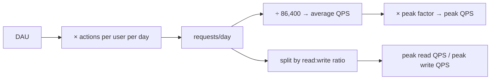
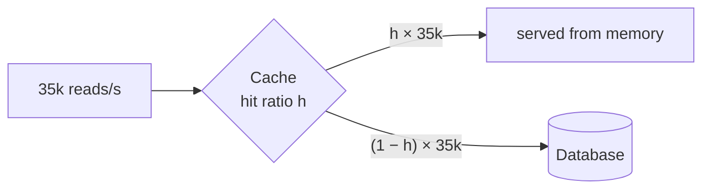
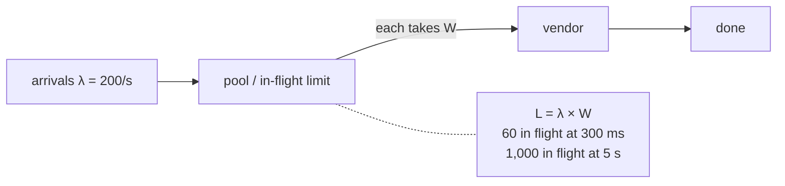
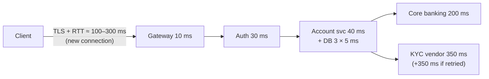

# A0 Unit 2 — Back-of-envelope estimation

> Time: ~6 h · CORE: §1–§7 (5 h) · STRETCH: §8 (1 h) · Lab: `labs/a0/capacity` · Drill: `sd estimate` ·
> Numbers sheet: [docs/NUMBERS.md](../../docs/NUMBERS.md)

Estimation in an interview isn't about precision. It's about getting the right *order of magnitude* fast enough
that the number can change your design. A ±25% error almost never changes a decision. An 8× or 1000× error
always does. This unit drills the arithmetic until it's automatic, shows you where the big errors come from, and
ties every kind of estimate to the design decision it drives.

You'll also build a small Go package, `capacity`, that does the same arithmetic in code. That way the
arithmetic gets tested, which an interview never does, and you have a tool for checking your drills.

## Before you start

You should have done [Unit 1](unit-1-interview-framework.md), or at least its §1 and §3. Warm-up (spaced
retrieval from Unit 1):

1. What are the three checkpoints of the 45-minute framework?
2. In the pastebin, which number led to "no sharding", and what threshold was it compared with?
3. State the four parts of a defensible trade-off.

<details data-kind="answer">
<summary>Warm-up answers</summary>

1. Numbers on the board by 0:10; a complete end-to-end diagram by 0:25; stop drilling at 0:40.
2. Peak write QPS ≈ 35/s, against one relational primary's ≈ 1k–10k small transactions per second
   ([NUMBERS.md](../../docs/NUMBERS.md)). That's ≈ 30–300× headroom, so no sharding.
3. Claim → why here (tied to a requirement or number) → cost → when it flips.

</details>

**Session plan (3 × 2 h):** Session 1: §1–§3 and lab functions `ParseQuantity`, `HumanBytes`/`HumanCount`/
`HumanBits`, `AvgQPS`, `PeakQPS`, `StorageBytes`, `BandwidthBytesPerSec`, `BitsPerSec`. Session 2: §4–§6 and lab
functions `ServersNeeded`, `Concurrency`, `SerialAvailability`, `ParallelAvailability`, `DowntimePerYear`.
Session 3: §7 (`Estimate`, the break-it exercise) and the first `sd estimate` drill runs. §8 is STRETCH. The
mastery drill (20 consecutive problems) can be spread over several days.

---

## §1 Napkin arithmetic that survives: powers of ten, rounding, units

### The failure story

A team plans a log pipeline: 2,000 servers each ship ≈ 1 MB/s of logs to a collector tier. An engineer
estimates: "2,000 × 1 MB/s = 2 GB/s. Our collector boxes have 10 G NICs, so one box at 20% load, plus a spare."
Two collectors get deployed.

On day one, both collectors' NICs are saturated, and logs back up on every server until local disks fill. The
mistake: a "10 G" NIC is **10 gigabits** per second, ≈ **1.25 gigabytes** per second. The real load is 2 GB/s =
16 Gbps, which is 160% of one NIC, not 20%. It's an 8× error from one missing conversion, and nobody caught it
because "10 G" and "2 G" *looked* comparable. ([NUMBERS.md](../../docs/NUMBERS.md) calls bits vs bytes "the
single most common estimation error".)

### Predict

<!-- predict id="A0-U2-P01" -->
**Predict.** Write the answers down, no calculator:

1. With a target utilisation of 60% per NIC and one spare, how many 10 Gbps collectors does the log pipeline
   above really need?
2. Compute 3.2 × 10^8 × 4.5 × 10^3 in your head. Then 7.3 × 10^12 ÷ 8.64 × 10^4.
3. You approximate 86,400 s/day as 10^5. Is your QPS estimate too high or too low, and by roughly how much?
<!-- /predict -->

### Reveal

<details data-kind="reveal" data-for="A0-U2-P01">
<summary>Reveal</summary>

1. Load = 2 GB/s × 8 = 16 Gbps. Usable per collector = 10 Gbps × 0.6 = 6 Gbps. 16 / 6 = 2.67 → **3**, plus one
   spare = **4** collectors. The original plan had 2, a 2× shortfall *after* the 8× error is fixed, because it
   also ignored utilisation headroom. (The lab's `ServersNeeded(16, 10, 0.6, 1)` returns 4.)
2. Multiply mantissas, add exponents: 3.2 × 4.5 = 14.4, so 14.4 × 10^11 = **1.44 × 10^12**. Divide mantissas,
   subtract exponents: 7.3 / 8.64 ≈ 0.845, so 0.845 × 10^8 ≈ **8.4 × 10^7**.
3. **Too low.** 10^5 overstates the seconds in a day by ≈ 16% (100,000 / 86,400 ≈ 1.157), so QPS comes out
   ≈ 14% low (86,400 / 100,000 = 0.864). That's fine on a whiteboard, especially since a peak factor goes on top.
   But know the direction, because errors compound (§7).

</details>

### How it actually works

**Scientific notation is the whole trick.** Write every quantity as *mantissa × 10^exponent*, with one or two
significant figures. Multiplication becomes "multiply small numbers, add exponents". Division becomes "divide
small numbers, subtract exponents". You'll rarely need anything harder than 3 × 4 or 7 ÷ 2.

**Carry units through every step.** Write them down, and cancel them like algebra:

```
(1 × 10^8 requests/day) ÷ (8.64 × 10^4 seconds/day) ≈ 1.16 × 10^3 requests/second
(2 × 10^9 bytes/s) × (8 bits/byte)                   = 1.6 × 10^10 bits/s = 16 Gbps
```

If the units don't cancel to what you want, the formula is wrong. That catches the bits-vs-bytes error, and the
"per day vs per second" one.

**Round aggressively, but track the direction.** Round each input to one significant figure, and note whether
you rounded up or down. Relative errors in a product roughly *add*: +15% and +10% give ≈ +27%. A useful habit:
when you round one factor up, round another down. For 86,400 there's a precise shortcut: divide by 10^5, then add
≈ 15% (1.157). For example, 10^8/day ÷ 10^5 = 1,000/s, plus 15% ≈ 1,150/s. The exact answer is 1,157.

**The conversions to know cold** (all in [NUMBERS.md](../../docs/NUMBERS.md)):

| You have | Multiply by | To get |
|---|---|---|
| per day | ÷ 8.64 × 10^4 (≈ ÷ 10^5, + 15%) | per second |
| per month | ÷ ≈ 2.6 × 10^6 | per second |
| bytes/s | × 8 | bits/s (network) |
| 1 Gbps | ≈ 125 MB/s | |
| KB, MB, GB, TB, PB | 10^3, 10^6, 10^9, 10^12, 10^15 (decimal) | bytes |

**Decimal SI throughout.** This course uses 1 KB = 1000 B. Binary prefixes (KiB = 1024 B) differ by 2.4% at KB
and ≈ 12.6% at PB (2^50 / 10^15 ≈ 1.126). That's irrelevant for napkin maths. What matters is not mixing them in
one calculation.

### Build it

Lab: `labs/a0/capacity`. Implement:

- `ParseQuantity(s string) (float64, error)`: accepts `500`, `2e6`, `.5M`, `1.2k`, `3M`, `1.2bn`, `40TB`,
  `1.5 GB`. It rejects ambiguous or dangerous input with an error wrapping `ErrBadQuantity`: lowercase `m`
  (milli, not mega), binary prefixes (`MiB`), **bit units (`Gb`, `Gbps`)**, negatives, `1,000`, NaN/Inf, and
  overflow.
- `HumanBytes`, `HumanCount`, `HumanBits`: one decimal, trailing `.0` trimmed, rolling over at 1000 ("999,999 B"
  is "1 MB", not "1000 KB").
- `BitsPerSec(bytesPerSec)`: × 8.

Acceptance tests: `TestParseQuantity_AcceptsEstimateNotation`, `TestParseQuantity_RejectsAmbiguousOrMalformed`,
`TestParseQuantity_ReadsBackHumanOutput`, `TestHumanBytes_DecimalSIOneDecimal`,
`TestHumanCount_SuffixesWithBnForBillion`, `TestHumanBits_LinkUnits`, `TestBandwidthBytesPerSec_AndBitsPerSec`.
Run: `go test -race ./labs/a0/capacity/ -run 'Parse|Human|Bandwidth'`.

Why does the parser *reject* `10Gbps` instead of converting it? Because silent conversion is how the 8× error
hides. Forcing an explicit `/ 8` keeps the conversion visible in your code and on your whiteboard.

### Break it

In your solution, make `ParseQuantity` accept `Gbps` and quietly return the number in *bytes* (divide by 8).
Then imagine a teammate who reads `ParseQuantity("10Gbps")` as "10 gigabits" and multiplies by 8 again to
"convert to bits". Predict what number they end up with, then revert.

<details data-kind="answer">
<summary>What happens</summary>

`ParseQuantity("10Gbps")` would return 1.25e9 (bytes/s). The teammate multiplies by 8 and gets 1e10, which they
believe is bits/s, so it looks right. But any code that compares 1.25e9 with a *bit* rate is off by 8× in one
direction, and code that "converts" it again is off by 8× in the other. Implicit unit conversion in a parser
puts the error somewhere nobody looks. That's why the lab's parser refuses bit units entirely.

</details>

### In the wild

- **Network vs storage units:** NIC, switch and cloud network bandwidth are sold in bits per second (e.g. "up to
  25 Gbps" on cloud instance types), while disk throughput and object sizes are in bytes. Every capacity review
  that crosses the boundary needs the × 8.
- **Binary vs decimal:** disk vendors label capacity in decimal (a "1 TB" drive is 10^12 bytes), while some
  operating systems display binary units, which is why a new drive "looks smaller". The IEC introduced KiB/MiB/GiB in the late 1990s to make the distinction explicit.
- **Kubernetes resource quantities** accept both: `500M` means 500 × 10^6 and `500Mi` means 500 × 2^20, and a
  lowercase `m` means milli (`500m` CPU = half a core). That's exactly the ambiguity the lab parser rejects.

### Trade-offs

| Approach | Wins when | Loses when | When the answer flips |
|---|---|---|---|
| Round to 1 significant figure | Interview speed; mental arithmetic | Several roundings in the same direction compound past ±25% | When a result lands within ≈ 2× of a decision threshold, redo it with 2 significant figures. |
| 1e5 seconds/day | Fast; errors on the safe side for storage per second, low for QPS | Used in code or reused across many steps | In code, always 86,400. On the whiteboard, 1e5 + 15%. |
| Exact arithmetic | Code, capacity plans that get signed off | The interview: slow, and false precision distracts | Never on the whiteboard; always in a capacity plan. |

### Senior bar

- **Failure modes:** bits vs bytes (8×); per day vs per second; KB vs MB (1000×); forgetting that "10 G" is a
  bit rate; false precision ("1,157.407 QPS") that suggests you don't know which digits matter.
- **Capacity numbers:** know these cold. 1 Gbps ≈ 125 MB/s. 10 Gbps ≈ 1.25 GB/s. 1M/day ≈ 12/s. 1B/day ≈ 12k/s.
- **Ops:** monitoring dashboards mix units too (network graphs in bits, disk graphs in bytes). Check the axis
  label before you claim headroom during an incident.
- **Cost:** egress is billed per GB (bytes), but links are sized in Gbps (bits). A cost estimate built from a
  link-utilisation graph needs the conversion.

**Interviewer follow-up probes:**

<details data-kind="answer">
<summary>Probe: "You said 2 GB/s. Will that fit on one 25 Gbps NIC?"</summary>

"2 GB/s × 8 = 16 Gbps, which is ≈ 64% of 25 Gbps. It fits, but it's already at my 60–70% planning ceiling with
no headroom for spikes or a failed peer, so I'd still plan two boxes plus a spare. And I'd check whether the
real bottleneck is the NIC or the collector's disk or CPU: 2 GB/s of writes is also a lot of fsync and parsing."

</details>

<details data-kind="answer">
<summary>Probe: "Your estimate rounds a lot. How wrong could it be?"</summary>

"Each input is within ≈ ±30%, and I've rounded in mixed directions, so the result is probably within ≈ ±50%,
well inside a factor of 2. That's fine for the decisions I'm making, because the thresholds I compare against
(one primary at ≈ 1k–10k TPS, a NIC at 10 Gbps) are themselves ranges. If a number landed within 2× of a
threshold, I'd refine it or design for the higher side."

</details>

### Check yourself

1. 5 × 10^9 bytes ÷ 2 × 10^3 bytes per item = ?
2. A 25 Gbps link is how many GB/s?
3. Why is 999,999 bytes formatted as "1 MB" and not "1000 KB"?

<details data-kind="answer">
<summary>Answers</summary>

1. 2.5 × 10^6 items.
2. 25 / 8 ≈ 3.1 GB/s.
3. Rounding to one decimal turns 999.999 KB into "1000.0 KB", which is the next unit. A formatter that doesn't roll
   over prints a number that looks like it's in the wrong unit. The lab's `TestHumanBytes_DecimalSIOneDecimal`
   checks this.

</details>

---

## §2 QPS: average, peak and the read/write split

### The failure story

A hypothetical digital-banking platform serves 2M credit-union members. Capacity planning: ≈ 25% log in on a
given day (500k DAU), ≈ 1.5 sessions each, ≈ 12 API calls per session, so 9M calls/day. 9 × 10^6 / 86,400 ≈
104 req/s on average. Each app server handles ≈ 100 req/s of these calls (they're heavy: each one calls core
banking), so they run 2.

On payday, ≈ 30% of the day's traffic arrives between 07:00 and 09:00, as members check whether their salary
has landed. That's 0.3 × 9M / 7,200 s = **375 req/s**, 3.6× the average. Two servers rated at 100 req/s each
see 188% load, latency climbs past the mobile app's timeout, the app retries, and load rises further. Most of
the day there's no problem. The outage is the busiest two hours of every payday.

### Predict

<!-- predict id="A0-U2-P02" -->
**Predict.**

1. A chat service has 200M DAU, each sending ≈ 20 messages/day, with a peak factor of 2. Compute average and peak
   *write* QPS. Then: can one relational primary take these writes? If not, roughly how many partitions do you
   need?
2. For the banking platform above, if you only knew "9M calls/day, consumer traffic", which peak factor would you
   assume, and how would you check it?
<!-- /predict -->

### Reveal

<details data-kind="reveal" data-for="A0-U2-P02">
<summary>Reveal</summary>

1. Writes/day = 2 × 10^8 × 20 = 4 × 10^9. Average = 4 × 10^9 / 8.64 × 10^4 ≈ **46k/s**. Peak ×2 ≈ **93k/s**.
   One relational primary handles ≈ 1k–10k small TPS ([NUMBERS.md](../../docs/NUMBERS.md)), so **no**. That's
   ≈ 10–90× over. **Partitioning is mandatory, and it's the first deep dive.** At an assumed ≈ 5k TPS per
   partition and a 60% planning target: 93k / (5k × 0.6) ≈ 31 partitions, plus spares. The exact count doesn't
   matter. The number "tens of partitions" decides the architecture: a partitioned store with a partition key
   (conversation id) chosen for even load.
2. For consumer traffic, [NUMBERS.md](../../docs/NUMBERS.md) suggests ≈ 2–3×, so 3× is a reasonable default
   (≈ 310 req/s). But banking has known spikes (paydays, month-end, bill-pay deadlines), so the honest answer is
   "assume 3×, and check the busiest hour in the access logs". Here it would have shown 3.6×, and a promotion or
   an outage-recovery surge can be higher still. The tempting wrong answer is "the average, since that's what
   the data gives us". Average is never the number you size for.

</details>

### How it actually works



**Average QPS** = DAU × actions per user per day / 86,400. The lab's `AvgQPS`.

**Peak QPS** = average × peak factor. The lab's `PeakQPS`, which treats a factor below 1 as 1: a peak below the
average is an input error. Where does the factor come from?

- **Rule of thumb:** consumer traffic ≈ 2–3×; flash events 10×+; B2B/batch can be spikier
  ([NUMBERS.md](../../docs/NUMBERS.md)).
- **Derive it from concentration:** if a fraction *f* of the daily traffic arrives in a window of *w* seconds,
  peak ≈ *f* × daily / *w*. The banking example has f = 0.3 and w = 7,200 s. This is usually the stronger answer
  in an interview, because it comes from a stated assumption about user behaviour rather than a magic number.

**Read/write split.** Size reads and writes separately, because they hit different components. Writes go to a
primary (hard to scale out), reads go to replicas and caches (easy to scale out). The lab's `Spec` takes
`WritesPerUserPerDay` and `ReadWriteRatio` (reads per write), because that's how interviewers usually state it:
"users post 2 photos a day, and the feed is 50:1 read-heavy".

**The decision each number drives:**

| Peak number (≈) | Typical decision |
|---|---|
| Write QPS ≲ 1k | One relational primary, comfortable |
| Write QPS ≈ 1k–10k | One primary may work; check transaction size, think about batching, plan the partition key |
| Write QPS ≳ 10k | Partition the writes (sharded SQL, or a partitioned KV/wide-column store); an async log in front if spiky |
| Read QPS ≳ 10k–50k on one node | Cache and/or read replicas |
| Total QPS / per-server capacity | Number of app servers (§5) |

### Build it

Lab: `labs/a0/capacity`. Implement `AvgQPS(dau, actionsPerUserPerDay)` (with the exact 86,400) and
`PeakQPS(avg, peakFactor)`. Acceptance tests: `TestAvgQPS_DAUTimesActionsOverExactSecondsPerDay`,
`TestPeakQPS_ScalesAverageAndNeverDropsBelowIt`. `TestEstimate_WriteHeavySheetNeedsAFleet` uses the chat numbers
from the Predict, so you'll see them again when you build `Estimate` in §7.

### Break it

Take the chat example and change the peak factor from 2 to 10 (a global sporting final, everyone messaging at
once). Recompute peak writes and partitions. Then answer: would you provision for that permanently?

<details data-kind="answer">
<summary>What changes</summary>

Peak writes ≈ 46k × 10 ≈ 460k/s, so ≈ 150 partitions at 3k usable TPS each, 5× the normal fleet. Provisioning that
permanently would leave ≈ 80% idle most of the year. The usual answers are a durable log in front of the writes
to absorb the burst (accept seconds of delivery delay), autoscaling with pre-warming before known events, and
load shedding of non-critical writes (typing indicators, read receipts) to protect messages. Peak factor is a
design input, not just a multiplier. Asking "what's the peak, and is it predictable?" in requirements pays off
here.

</details>

### In the wild

- **Predictable peaks:** retail Black Friday, sports finals and New Year's Eve messaging spikes are the classic
  examples of peaks far above the daily average. Large services pre-scale for them.
- **Banking-specific peaks:** payday mornings, month-end, and bulk-file windows (payroll and ACH files are
  processed in scheduled batches in US payment systems) create spikes a "consumer 2–3×" rule misses. Your own
  platform's access logs are the right source. TODO-VERIFY the specific batch windows for your platform's
  processors.
- **Sharding thresholds in practice:** large Postgres and MySQL deployments are sharded at the application
  level, or with tools such as Vitess (MySQL) or Citus (Postgres), once write volume or data size outgrows one
  primary.

### Trade-offs

| Approach to peak | Wins when | Loses when | When the answer flips |
|---|---|---|---|
| Rule-of-thumb factor (2–3×) | No data; consumer product; interview speed | Known spiky domains (banking paydays, ticket sales) | When the domain has scheduled events, derive the peak from concentration instead. |
| Derived from concentration (f × daily / w) | You can state a behavioural assumption | You have no idea how traffic is distributed | When you have logs, use the measured p99 minute, not any formula. |
| Provision for the peak | Peak is frequent (daily) and short-notice | Rare, predictable extreme peaks: most capacity sits idle | When the extreme peak is rare and predictable → pre-scale or buffer instead. |

### Senior bar

- **Failure modes:** sizing for the average; one peak factor for both reads and writes when they peak
  differently; ignoring retry amplification (a slow system gets *more* load as clients retry: one retry per
  timeout can double the load exactly when you have the least headroom).
- **Capacity:** quote both average and peak, and say which component each one sizes.
- **Ops:** load-test at the peak, not the average; alert on saturation (CPU, pool usage) before latency.
- **Cost:** the gap between peak and average is idle capacity you pay for. That's what autoscaling, buffering and
  shedding trade against.

**Interviewer follow-up probes:**

<details data-kind="answer">
<summary>Probe: "Where did your peak factor of 3 come from?"</summary>

"It's an assumption for consumer traffic: daily active users concentrate in a few hours across a couple of time
zones. Derived: if ≈ 25% of daily traffic falls in the busiest 2 hours, peak = 0.25 × daily / 7,200 s ≈ 3× the
average. With real logs I'd use the busiest minute of the last 30 days, and design for 1.5–2× that to allow for
growth and retry storms."

</details>

<details data-kind="answer">
<summary>Probe: "Your writes are 93k/s. What's your partition key?"</summary>

"The key has to spread writes evenly *and* keep the main read pattern on one partition. For chat that's the
conversation id: messages of one conversation are read together, and there are many conversations, so load is
spread. The risk is a huge group or a celebrity channel, a hot partition. For those I'd split by
(conversation id, time bucket) or give them dedicated partitions. I'd check the size distribution of the largest
conversations before committing."

</details>

### Check yourself

1. 100M requests/day, peak factor 3. Peak QPS?
2. 1B DAU × 0.5 writes/day: average write QPS?
3. Why size reads and writes separately?

<details data-kind="answer">
<summary>Answers</summary>

1. ≈ 1,160 × 3 ≈ 3,500 req/s.
2. 5 × 10^8 / 8.64 × 10^4 ≈ 5,800 writes/s on average. That's within one primary's range on average, but at a
   2–3× peak it's ≈ 12k–17k/s, so you plan to partition.
3. They hit different components with different scaling properties. Writes go to the primary (scale up or
   partition); reads go to replicas and caches (scale out). One combined number hides the bottleneck.

</details>

---

## §3 Storage and bandwidth

### The failure story

A photo-sharing team estimates storage: "100M photos a day × 200 KB = 20 TB." They provision a 100 TB cluster,
"5× headroom", and move on. Twenty TB is *one day*. Over a year of retention it's 7.3 PB, and with the store's
3× replication it's ≈ 22 PB. The cluster fills in **five days**. The two missing factors (retention 365×,
replication 3×) multiply to a ≈ 1,100× error.

Same team, egress: "50 reads per upload, 100 KB each: 5 × 10^9 × 100 KB per day." Nobody turns that into a peak
bit rate. It's ≈ 116 Gbps at peak, which is far past any origin's NICs and costly at internet egress prices. The
CDN goes from "nice to have" to "the product doesn't work without it", and nobody had noticed.

### Predict

<!-- predict id="A0-U2-P03" -->
**Predict.** Photo sharing: 50M DAU, 2 uploads per user per day, average stored photo 200 KB, read:write 50:1,
average read response 100 KB, retention 1 year, replication 3, peak factor 2.5.

1. Storage after one year, replicated.
2. Peak ingress and peak egress, in bytes/s *and* Gbps.
3. Which of these numbers decides the most expensive part of the architecture?
<!-- /predict -->

### Reveal

<details data-kind="reveal" data-for="A0-U2-P03">
<summary>Reveal</summary>

1. Uploads/day = 5 × 10^7 × 2 = 10^8. Per day 10^8 × 2 × 10^5 B = 2 × 10^13 B = 20 TB. One year: 20 TB × 365 =
   7.3 PB. ×3 = **≈ 21.9 PB**.
2. Average upload rate = 10^8 / 86,400 ≈ 1,157/s, peak × 2.5 ≈ 2,894/s. Ingress ≈ 2,894 × 200 KB ≈ **579 MB/s ≈
   4.6 Gbps**. Reads = 50 × 1,157 ≈ 57,870/s average, peak ≈ 144,676/s. Egress ≈ 144,676 × 100 KB ≈ **14.5 GB/s ≈
   116 Gbps**.
3. **Egress.** 116 Gbps rules out serving from origin (a commodity server has a 10–25 Gbps NIC), so a CDN is
   required, and egress cost (§8) is likely the largest line item. Storage (≈ 22 PB/year, growing) is a close
   second and decides storage tiering. Ingress at ≈ 4.6 Gbps fits a handful of upload servers and isn't a
   design driver. (These are exactly the "correct" values in the lab's break-it test.)

</details>

### How it actually works

**Storage** = items/day × bytes per item × retention days × replication × (1 + index/metadata overhead). That's
`StorageBytes` × (1 + overhead), which is what `Estimate` computes. Each factor is a classic omission:

| Factor | Typical value (≈) | If you forget it |
|---|---|---|
| Retention | 30 days (logs) to "forever" (ledgers, photos) | Off by the retention length: 365× for a year |
| Replication | 3 for self-managed replicated stores (HDFS defaults to 3; Kafka is commonly configured with replication factor 3) | 3× under |
| Index/metadata overhead | ≈ 10–50% ([NUMBERS.md](../../docs/NUMBERS.md)) | 1.1–1.5× under |
| Headroom | Don't run disks above ≈ 70–80% full (compaction, rebalancing, growth) | You hit "disk full" while the plan says "fine" |

**Managed object storage is the exception to "× replication".** S3-class services price per *logical* GB, with
redundancy included (AWS says S3 Standard stores data across at least three Availability Zones; TODO-VERIFY
current wording). So for a cost estimate on managed object storage, don't multiply by 3. For self-managed disks
(HDFS, Cassandra, Kafka, your own Postgres replicas), do. Saying this out loud is a small senior signal.

**Split metadata from content.** For the photo service, metadata (owner, timestamps, captions, ≈ 500 B/photo) is
10^8 × 500 B = 50 GB/day, ≈ 18 TB/year. With 30% index overhead and 3× replication that's ≈ 71 TB, so the
*metadata* also needs a partitioned store, separately from the ≈ 22 PB of blobs. Different sizes, different
access patterns, different stores.

**Bandwidth** = QPS × bytes per request: `BandwidthBytesPerSec`. Always compute it at **peak**, and always
convert to **bits** (`BitsPerSec`) before comparing with links. Compute ingress (writes × write size) and egress
(reads × response size) separately: egress is usually much larger for read-heavy products, and it's the one
you're billed for.

**Decisions they drive:**

| Number (≈) | Decision |
|---|---|
| Total storage ≲ a few TB | One node (plus replicas) can hold it |
| Tens of TB to PB | Partitioned store, or object storage for blobs; tiering by age |
| Peak egress ≳ a few Gbps of cacheable content | CDN; signed URLs so origin servers stay out of the data path |
| Ingress ≳ a NIC's worth | Direct-to-object-storage uploads (presigned URLs), multiple upload endpoints |

### Build it

Lab: `labs/a0/capacity`. Implement `StorageBytes(itemsPerDay, bytesPerItem, retentionDays, replication)`
(replication below 1 is treated as 1; zero retention means zero storage) and
`BandwidthBytesPerSec(qps, bytesPerRequest)`. Acceptance tests:
`TestStorageBytes_MultipliesRetentionAndReplication`, `TestBandwidthBytesPerSec_AndBitsPerSec`.

### Break it

In your solution, change `StorageBytes` to ignore `replication`, and run `go test ./labs/a0/capacity/ -run
Storage`. Read the failure message. Then restore it, and for the photo example answer: by how much would a
system sized on this bug be under-provisioned, and after how many days of the year would it be full?

<details data-kind="answer">
<summary>What you should see</summary>

The test fails on the "pastebin 2 years x3" case (7.3 × 10^12 instead of 2.19 × 10^13) with a message that
forgetting replication under-sizes the cluster 3×. For the photo example: 7.3 PB provisioned instead of 21.9 PB,
so the cluster is full after ≈ 365 / 3 ≈ 122 days. Worse, it doesn't fail gracefully: replicated stores need free
space for re-replication when a node dies, so they start failing *before* the disks are literally full.

</details>

### In the wild

- **HDFS** has a default block replication of 3 (`dfs.replication`), and Hadoop 3 added erasure coding (e.g. a
  Reed-Solomon 6+3 policy, ≈ 1.5× overhead instead of 3×) for colder data. That's a storage-vs-CPU trade made
  precisely because 3× replication at PB scale is expensive.
- **Kafka** retention is configured per topic by time or size (`retention.ms`, `retention.bytes`), and disk usage
  ≈ ingress × retention × replication factor. It's the formula above, applied to a log.
- **CDNs** exist because of the egress number: serving popular bytes from edge caches near users cuts both origin
  bandwidth and latency.

### Trade-offs

| Decision | Option | Wins when | Loses when | When the answer flips |
|---|---|---|---|---|
| Durability scheme | 3× replication | Hot data; fast reads and recovery; simple | Storage cost at PB scale | Data gets cold and large → erasure coding (≈ 1.4–1.5×) or a colder storage class |
| | Erasure coding | Large, colder data; cuts raw storage ≈ 2× vs 3× replication | Reconstruction costs CPU and network; slower degraded reads | Hot, latency-sensitive data → replication |
| Retention | Keep forever | Ledgers, compliance archives, user-generated content users expect to keep | Linear growth forever; cost compounds | Data with a declining value curve (logs, metrics) → TTL + downsampling |
| Serving bytes | From origin | Low egress (≲ a Gbps), private or uncacheable content | Large public egress | Peak egress of cacheable content in the multi-Gbps range → CDN |

### Senior bar

- **Failure modes:** forgetting retention or replication; using averages for bandwidth; ignoring disk headroom;
  sizing only blobs and forgetting metadata; ignoring growth (DAU grows, so storage grows *faster than linearly*
  over the plan's horizon).
- **Capacity:** quote storage *per year* and *growth per day*. "20 TB/day, ≈ 22 PB/year replicated" tells the
  interviewer you'd plan tiering.
- **Ops:** rebalancing, compaction and node rebuilds need spare capacity. Rebuilding a dead 20 TB node at
  ≈ 200 MB/s takes ≈ 28 hours (2 × 10^13 / 2 × 10^8 = 10^5 s), and that rebuild time is a durability risk on its
  own.
- **Cost:** storage cost grows with *accumulated* data, egress with *traffic*. Check which one dominates (§8).

**Interviewer follow-up probes:**

<details data-kind="answer">
<summary>Probe: "Do you really need 3× replication for photos in S3?"</summary>

"No. On managed object storage the price per GB already includes the provider's redundancy across zones, so I
budget ≈ 7.3 PB/year of logical storage, not 22 PB. I'd still think about a cross-region copy for disaster
recovery, which *does* double cost, and only do it if the durability requirement says losing a region's photos
is unacceptable. And I'd tier photos older than ≈ 90 days to an infrequent-access class if access logs confirm
reads fall off with age."

</details>

<details data-kind="answer">
<summary>Probe: "What if the average photo is 2 MB instead of 200 KB?"</summary>

"Everything measured in bytes grows 10×. Storage goes to ≈ 73 PB/year logical. Peak egress goes to ≈ 1.2 Tbps,
so it's CDN-only, and I'd serve resized variants (thumbnails ≈ 10–50 KB) for feeds, so the average *response* is
much smaller than the average *original*. The number to push down is bytes per read, not photos per day."

</details>

### Check yourself

1. 10M items/day × 1 KB × 90 days × 3 replicas = ?
2. 50k reads/s × 20 KB at peak. Egress in Gbps?
3. Why is "× 3 for replication" wrong for a managed object-storage cost estimate?

<details data-kind="answer">
<summary>Answers</summary>

1. 10^7 × 10^3 × 90 × 3 = 2.7 × 10^12 B = 2.7 TB.
2. 5 × 10^4 × 2 × 10^4 = 10^9 B/s = 1 GB/s = 8 Gbps.
3. The provider's per-GB price already includes its internal redundancy. You pay for logical bytes. Multiplying
   by 3 triples the cost estimate for no reason. (For capacity on your own disks, the × 3 is right.)

</details>

---

## §4 Cache sizing for a hot set

### The failure story

A team adds a cache in front of a product-catalogue database that serves ≈ 30k reads/s at peak. Sizing: "cache
everything", the full 4 TB catalogue, on a 32-node cluster. It works. It also costs about as much as the database,
and the hit ratio on the long tail is barely higher than it would be with a fraction of the memory. Meanwhile
another team caches a feed service with "a few GB, should be plenty" and gets a 40% hit ratio, because the hot set
is ≈ 300 GB. The database sees 60% of the read traffic it was supposed to be shielded from, and falls over at
peak.

Both teams sized the cache without estimating the **hot set**: the subset of objects that gets most of the reads.

### Predict

<!-- predict id="A0-U2-P04" -->
**Predict.**

1. Pastebin: 10M reads/day, 10 KB per read, cache 20% of a day's reads. How much memory? Does it fit on one node?
2. A timeline service caches the latest 800 tweet ids (8 bytes each) for each of 200M daily users. How much
   memory, and what does that imply?
3. At 35k reads/s, what database load do you get at a 90% hit ratio, and at 80%?
<!-- /predict -->

### Reveal

<details data-kind="reveal" data-for="A0-U2-P04">
<summary>Reveal</summary>

1. 0.2 × 10^7 × 10^4 B = **2 × 10^10 B = 20 GB**. That fits easily on one node (commodity RAM ≈ 128–512 GB), so a
   single cache node plus a replica is enough. This is the lab's `CacheBytes` for the pastebin fixture.
2. 2 × 10^8 × 800 × 8 B = **1.28 × 10^12 B ≈ 1.3 TB** before per-key overhead. That doesn't fit on one node, so
   the cache must be **partitioned** (≈ 5–10 nodes at a few hundred GB each, plus replicas). The number decides
   that the cache is a distributed system with its own sharding and failover.
3. Misses = (1 − hit ratio) × reads: **3.5k/s** at 90%, **7k/s** at 80%. A 10-point drop in hit ratio *doubles*
   DB load. That's why hit ratio is a capacity number, not just a performance number, and why a cold cache after
   a restart can take the database down.

</details>

### How it actually works

There are two ways to size a cache. Know both, and say which you're using.

1. **From read volume (upper bound):** cache bytes ≈ hot fraction × reads/day × bytes per read. This counts every
   read as a distinct object, so it *over*-estimates when popular objects are read many times. It's the formula
   `Estimate` uses for `CacheBytes`, and it's the one interview prompts usually intend ("cache 20% of daily
   reads"). The 20% comes from the 80/20 heuristic ([NUMBERS.md](../../docs/NUMBERS.md)).
2. **From distinct objects (better when you know it):** cache bytes ≈ number of hot objects × (object size +
   per-key overhead). For the pastebin: if almost all reads hit pastes created in the last 24 h, the hot set is
   ≤ 10^6 × 10 KB = 10 GB, half of method 1.

**Per-key overhead matters for small values.** In-memory stores add metadata per key (pointers, expiry, type
info), roughly tens of bytes per key in Redis (TODO-VERIFY for your version and encoding). For 100M keys with
100-byte values, an extra ≈ 60 B per key turns 10 GB into ≈ 16 GB. For 10 KB pastes it's noise.

**Hit ratio and DB load.** DB load = reads × (1 − hit ratio). Because the miss rate is what the database sees,
going from 99% to 98% doubles it. Plan the database for the *worst realistic* hit ratio, including a cold start
after a cache restart or a failover, or protect it with request coalescing and admission limits.



**Decisions it drives:** fits on one node (≲ ≈ 100–300 GB usable) → a single primary plus replica. Larger → a
partitioned cache (consistent hashing, client-side or proxy sharding). Hot set ≈ whole data set → reconsider:
maybe the database should simply hold it in RAM, or the access pattern isn't cacheable.

### Build it

Lab: `labs/a0/capacity`. `Spec.CacheHotFraction` feeds `Sheet.CacheBytes` in `Estimate` (§7) using method 1.
There's no separate function: once `Estimate` is done, `TestEstimate_PastebinSheet` checks the 20 GB.

### Break it

Assume the pastebin cache restarts empty at peak (≈ 350 reads/s today, ≈ 35k/s at 100×). For each, estimate DB
load in the first seconds, when the hit ratio is ≈ 0. Which one is an outage?

<details data-kind="answer">
<summary>What you should find</summary>

Today: the DB sees ≈ 350 reads/s, which it handles easily, so a cold cache is harmless. At 100×: the DB suddenly
sees ≈ 35k reads/s instead of ≈ 3.5k (at a 90% steady hit ratio). That's at or past one node's ≈ 10k–50k point-read
range, plus the object store gets all the blob fetches. That's the classic "cache restart takes down the
database" outage. Mitigations: warm the cache before taking traffic, restart cache nodes one at a time, request
coalescing so one miss per key reaches the DB, and an admission limit on DB concurrency so excess requests fail
fast instead of queueing.

</details>

### In the wild

- **Redis** offers eviction policies such as `allkeys-lru` and `allkeys-lfu`, and a `maxmemory` limit. Choosing
  them is part of sizing: LFU keeps frequently read keys when the hot set is skewed.
- **Memcached** uses a slab allocator. Memory is carved into size classes, so a cache full of one value size can
  waste memory for another. That's another reason to estimate value sizes, not just counts.
- **Hot-key concentration:** viral items, celebrity accounts and flash sales concentrate reads far beyond 80/20,
  which is why large caches add per-key replication or local in-process caches for the very hottest keys.

### Trade-offs

| Approach | Wins when | Loses when | When the answer flips |
|---|---|---|---|
| Size from read volume (fraction × reads/day × size) | Interview prompts; no knowledge of object popularity | Very skewed reads: over-estimates | When you know the number of distinct hot objects, size from that. |
| Size from distinct hot objects | You know the recency or popularity pattern | Long-tail catalogues where "hot" is vague | When the hit-ratio curve is unknown, measure it with a shadow cache or a sampled trace. |
| Cache everything | The data set is small (fits on a node) | Large data with a long tail: paying RAM for keys nobody reads | When the hot set is ≲ 20% of data, cache only that. |
| Small cache | The hot set really is small | The hot set is larger than the cache: low hit ratio, DB overload | Measure the hit ratio at peak, and alert when it drops. |

### Senior bar

- **Failure modes:** cache sized below the hot set; the DB sized assuming a hit ratio you can't guarantee
  (cold start, failover); thundering herd on popular keys after expiry; forgetting per-key overhead for tiny
  values.
- **Capacity:** state the cache size *and* the DB load at the worst realistic hit ratio.
- **Ops:** warm-up procedures, rolling restarts, eviction-rate and hit-ratio dashboards, and an alert on hit-ratio
  drops.
- **Cost:** RAM costs far more per GB than SSD or object storage. Caching the long tail is the expensive mistake.

**Interviewer follow-up probes:**

<details data-kind="answer">
<summary>Probe: "Why 20%?"</summary>

"It's the 80/20 heuristic: in many workloads a small fraction of objects gets most of the reads. It's a starting
assumption, not a law. For a pastebin, recency is the better model: most reads are of pastes created in the last
day, so the hot set is about one day of pastes, ≈ 10 GB. In production I'd measure the hit ratio against cache
size (simulate LRU on a sampled access log) and pick the knee of the curve."

</details>

<details data-kind="answer">
<summary>Probe: "Your cache node dies. What happens to the database?"</summary>

"Its share of keys misses until another node takes over and warms. With 10 cache nodes, that's ≈ 10% of keys, so
DB load rises by ≈ 10% of total reads × (the old hit ratio). At 35k reads/s and a 90% hit ratio, that's ≈ +3.2k
reads/s on the DB, which it can take. If the whole cache tier died, the DB would see 10× its normal read load, so
I'd make sure the DB has an admission limit and that clients degrade gracefully, rather than assume the cache
never fails."

</details>

### Check yourself

1. 100M daily reads of 2 KB objects; cache 20% of daily reads. Size?
2. Hit ratio drops from 95% to 90% at 20k reads/s. What happens to DB load?
3. When does method 1 (read volume) badly over-estimate?

<details data-kind="answer">
<summary>Answers</summary>

1. 0.2 × 10^8 × 2 × 10^3 = 4 × 10^10 B = 40 GB.
2. From 1k/s to 2k/s: it doubles.
3. When reads are concentrated on few objects. Then many of the "20% of reads" are repeat reads of the same
   object, and the distinct hot set is much smaller.

</details>

---

## §5 Servers and Little's law

### The failure story

Your image-vendor adapter (the banking platform calls a third-party cheque-image provider) handles ≈ 200
requests/s. The vendor normally answers in ≈ 300 ms. The adapter uses an HTTP client pool capped at 100
connections, and nobody remembers why 100. One afternoon the vendor degrades to ≈ 5 s per call. The adapter
needs 200 × 5 = 1,000 requests in flight, but only 100 connections exist. Requests queue for a connection, queue
time stacks on top of the vendor's 5 s, upstream callers time out and retry, and the adapter's goroutines,
memory and file descriptors pile up. Within minutes the *whole* adapter service is unhealthy, including
endpoints that don't call this vendor at all.

The pool size was never derived from anything. Little's law would have told you what it needed to be and what
would happen when latency changed.

### Predict

<!-- predict id="A0-U2-P05" -->
**Predict.**

1. At 200 req/s and 300 ms, how many requests are in flight on average? At 5 s?
2. You add a 2 s timeout on vendor calls. What's the maximum in-flight count now, and what happens to the
   requests over the limit?
3. Peak 3,500 req/s; each app server measured at 1,000 req/s; target utilisation 60%; N+1. How many servers?
<!-- /predict -->

### Reveal

<details data-kind="reveal" data-for="A0-U2-P05">
<summary>Reveal</summary>

1. L = λ × W = 200 × 0.3 = **60** in flight. At 5 s: 200 × 5 = **1,000**. A pool of 100 is fine at 60, and
   exhausted 10× over at 1,000.
2. W is capped at 2 s, so L ≤ 200 × 2 = **400**. Requests past the timeout fail fast, and the caller gets an
   error instead of an ever-growing queue. Combined with a bulkhead (a separate, bounded pool per vendor), the
   slow vendor can no longer starve the rest of the service. The tempting wrong fix is "make the pool 1,000".
   That just moves the pile-up to memory and the vendor's own limits.
3. 3,500 / (1,000 × 0.6) = 5.83 → **6**, + 1 = **7** servers. (`ServersNeeded(3500, 1000, 0.6, 1)`.)

</details>

### How it actually works

**Servers needed** = ceil(peak QPS / (per-server QPS × target utilisation)) + spares. That's the lab's
`ServersNeeded`. Each part has a reason:

- **Per-server QPS** must be *measured* with real business logic. "Hello world" benchmarks are 10–100× too
  optimistic ([NUMBERS.md](../../docs/NUMBERS.md)). Without a measurement, state an assumption (≈ 1k–10k req/s
  for a Go/Java service doing real work with 1–2 downstream calls).
- **Target utilisation ≈ 50–70%** leaves room for spikes, garbage-collection pauses, and the load a failed peer
  hands over.
- **Spares (N+1, N+2)** cover a node lost to a failure *while* another is out for a deploy.
- **Round up**, and beware floating point: 4,900 / (700 × 0.7) is exactly 10, but in float64 it comes out as
  10.000000000000002, which a naive `math.Ceil` turns into 11. The lab test
  `TestServersNeeded_RoundsUpAddsSparesAndIgnoresFloatNoise` checks that case.

**Little's law: L = λ × W.** In a stable system, the average number of items inside (L) equals the arrival rate
(λ) times the average time each spends inside (W). It holds for any stable system, whatever the arrival
distribution, which makes it the most useful single formula for sizing:

| You know | Little's law gives you |
|---|---|
| QPS and latency | Concurrent requests → thread/goroutine counts, in-flight limits |
| QPS × queries per request and query latency | DB connections in use → pool size |
| Pool size and latency | Max throughput: λ_max = L / W |
| Queue length and drain rate | Time a new item waits |

**The DB connection pool, worked.** 2,000 req/s × 2 queries × 5 ms = 20 connections busy on average, ≈ 60 at a 3×
peak. Add headroom: ≈ 80–100 total. Spread across 10 app instances, that's ≈ 10 per instance, not the 20–50 a
framework default might give you. Postgres' default `max_connections` is 100, so 10 instances × 20 = 200 would be
refused. You'd need smaller pools or a connection pooler such as PgBouncer.

**Backlog drain time.** If a consumer is down for 5 minutes while 20k events/s arrive, the backlog is 20k × 300 s =
6M events. If consumers can process 30k/s, the *net* drain rate is 30k − 20k = 10k/s, so catching up takes 6M /
10k = 600 s = 10 minutes. Recovery time depends on spare capacity, not total capacity. That's another reason the
utilisation target isn't 100%.



### Build it

Lab: `labs/a0/capacity`. Implement:

- `ServersNeeded(peakQPS, perServerQPS, targetUtil, spares) (int, error)`: an error wrapping `ErrInvalidInput`
  for per-server ≤ 0, utilisation outside (0, 1], negative spares, or negative/NaN/Inf peak; at least one server
  before spares; a float-noise-tolerant ceiling.
- `Concurrency(qps, latency time.Duration) float64`: Little's law.

Acceptance tests: `TestServersNeeded_RoundsUpAddsSparesAndIgnoresFloatNoise`,
`TestServersNeeded_RejectsInputsThatCannotDescribeAFleet`, `TestConcurrency_LittlesLaw`.

### Break it

In your `ServersNeeded`, replace the noise-tolerant ceiling with a plain `math.Ceil(raw)` and rerun the test.
Which cases fail? Then think about it at fleet scale: if a capacity tool has this bug, how much does it
over-provision a 10,000-server fleet?

<details data-kind="answer">
<summary>What you should see</summary>

The cases `float noise: 4900/(700*0.7) is exactly 10` (you get 11) and `float noise with spares` (490 / 490
gives 1.0000000000000002 → 2, + 2 = 4 instead of 3) fail. At fleet scale the bug adds *at most one* server per
service, but a fleet of 10,000 servers is often hundreds of separately sized services, so it adds hundreds of
servers nobody needs. More importantly, it teaches you never to trust `ceil` on a computed ratio. The same bug
appears in shard counts, batch counts and pagination.

</details>

### In the wild

- **Bulkheads and timeouts** (from Michael Nygard's *Release It!*) are the standard defence against the
  failure story: bounded pools per dependency and timeouts that cap W.
- **Go's `net/http` client** has `MaxConnsPerHost` and `MaxIdleConnsPerHost` on `http.Transport`. The default
  `MaxIdleConnsPerHost` is 2, a common surprise under load: connections get closed and reopened, paying the TCP
  and TLS handshakes again ([NUMBERS.md](../../docs/NUMBERS.md): 2–3 RTTs).
- **Postgres** defaults to `max_connections = 100`. Large deployments put PgBouncer (transaction pooling) in front,
  precisely because Little's law across many app instances exceeds what the server should hold open.
- **N+2 provisioning** (one unit out for maintenance, one lost to failure) is the redundancy rule Google's SRE book uses in its capacity-planning discussion. TODO-VERIFY the exact chapter and wording.

### Trade-offs

| Decision | Option | Wins when | Loses when | When the answer flips |
|---|---|---|---|---|
| Utilisation target | High (≈ 80%+) | Cost-sensitive batch work; spare capacity elsewhere | Latency-sensitive services; no room for failover load | When a peer's failure must be absorbed without degradation, plan ≈ 50–70%. |
| | Low (≈ 50%) | Latency SLOs; spiky traffic; recovering backlogs quickly | Pays for idle capacity | When autoscaling reacts within the spike's rise time, you can run hotter. |
| Pool sizing | Derived from Little's law + headroom | Predictable latency; protects downstreams | Latency can change 10× (vendor degradation) | Pair with timeouts and bulkheads, so W, and therefore L, stay bounded. |
| | "Big enough to never run out" | — | Moves the pile-up to memory and the downstream | Never. Unbounded pools turn slowness into outages. |

### Senior bar

- **Failure modes:** pools sized by guessing; no timeouts (W unbounded, so L unbounded); one shared pool for all
  dependencies (no bulkhead); utilisation at 90% leaving no failover headroom; retries multiplying λ during an
  outage.
- **Capacity:** quote L at normal *and* at degraded latency. "60 normally, 1,000 if the vendor slows to 5 s, so
  the 2 s timeout caps it at 400."
- **Ops:** alert on pool saturation and queue wait time, not just error rates. Load-test with a slow dependency.
- **Cost:** spares and headroom are 30–50% of a fleet's cost. The trade is explicit: availability and latency
  against money.

**Interviewer follow-up probes:**

<details data-kind="answer">
<summary>Probe: "How did you pick 1,000 req/s per server?"</summary>

"It's an assumption for a Go service doing real work with a couple of downstream calls, within the ≈ 1k–10k range.
I'd replace it with a load test: ramp traffic against one instance with production-like payloads until p99
latency breaks the SLO, and take ≈ 70% of that point as the per-server number. If the service is mostly waiting
on I/O, per-server throughput is bounded by in-flight limits (Little's law) rather than CPU."

</details>

<details data-kind="answer">
<summary>Probe: "What happens to your fleet when one of the seven servers dies at peak?"</summary>

"3,500 req/s across 6 servers is ≈ 583 req/s each, 58% of measured capacity, so we absorb it. That's what the
60% target and the +1 are for. If a second server died during a deploy, we'd be at 3,500 / 5 = 700 each, 70%,
still under the measured limit but with higher latency. That's the argument for N+2 during deploy windows."

</details>

### Check yourself

1. 5,000 req/s, 40 ms average latency: how many requests are in flight?
2. A pool of 50 connections and queries that take 10 ms: maximum query throughput?
3. Peak 12,000 req/s, 2,000 per server, 70% target, N+2: servers?

<details data-kind="answer">
<summary>Answers</summary>

1. 5,000 × 0.04 = 200.
2. λ_max = L / W = 50 / 0.01 = 5,000 queries/s.
3. 12,000 / 1,400 = 8.57 → 9, + 2 = 11.

</details>

---

## §6 Latency budgets and availability math

### The failure story

A product team promises partners a 99.95% availability SLA for the "open account" API. The request path:
gateway (99.99%), auth service (99.95%), account service (99.95%), core-banking adapter (99.9%), a KYC vendor
(99.5%, per its contract). Nobody multiplies. The best this chain can deliver is ≈ 99.29%, about **62 hours** of downtime a year, against the **4.4 hours** promised. The SLA is broken before the first deploy, and the contract
has penalties.

Separately, the same API has a p99 latency target of 800 ms. The engineers each budget their own component, and
every p99 is "within budget". The end-to-end p99 is 1.4 s, because nobody added the parts, nobody counted the
TLS handshake to the vendor, and a retry on the KYC call doubles its share.

### Predict

<!-- predict id="A0-U2-P06" -->
**Predict.**

1. Compute the chain's availability above (multiply), and the annual downtime it implies.
2. If you add a second KYC vendor and fail over between them (assume independent failures), what does the KYC
   step become, and what's the new chain availability?
3. A request fans out to 50 backends in parallel and waits for all of them. Each has p99 = 100 ms. What fraction
   of requests sees at least one response slower than 100 ms?
<!-- /predict -->

### Reveal

<details data-kind="reveal" data-for="A0-U2-P06">
<summary>Reveal</summary>

1. 0.9999 × 0.9995 × 0.9995 × 0.999 × 0.995 ≈ **0.9929** (99.29%). Downtime ≈ 0.0071 × 8,760 h ≈ **62 h/year**.
   The weakest link (the vendor, 99.5%) dominates. The chain can never beat its worst serial dependency.
2. Parallel KYC: 1 − 0.005² = **0.999975**. New chain ≈ 0.9999 × 0.9995 × 0.9995 × 0.999 × 0.999975 ≈ **0.9979**
   (99.79%, ≈ 19 h/year). Still short of 99.95%: the core-banking adapter (99.9%) is now the floor. To promise
   99.95% you'd need to make the adapter more available, or make the API *degrade* (accept the application and
   finish KYC asynchronously) rather than fail. Also, "independent failures" is optimistic: two vendors can share
   an upstream data provider, a cloud region, or your own adapter code.
3. 1 − 0.99^50 ≈ **39.5%**. With fan-out, the tail becomes the typical case. That's why fan-out systems use
   hedged requests, partial results or tighter per-backend tails.

</details>

### How it actually works

**Serial dependencies multiply:** A = Π aᵢ. Every hard dependency on the request path lowers the ceiling. This is
`SerialAvailability`.

**Redundant (parallel) replicas:** A = 1 − Π(1 − aᵢ), *if failures are independent*. This is
`ParallelAvailability`. Two 99% replicas give 99.99% on paper. In practice they share deploys, configuration,
regions and bugs, so real gains are smaller. Say that every time you use the formula.

**Nines to downtime** (`DowntimePerYear`, 365-day year):

| Availability | Downtime/year | Downtime/30 days |
|---|---|---|
| 99% | ≈ 3.65 days | ≈ 7.2 h |
| 99.9% | ≈ 8.8 h | ≈ 43 min |
| 99.95% | ≈ 4.4 h | ≈ 22 min |
| 99.99% | ≈ 53 min | ≈ 4.3 min |
| 99.999% | ≈ 5.3 min | ≈ 26 s |

**Latency budgets.** Start from the end-to-end target and allocate it down the call chain, including the parts
nobody owns: connection setup, serialisation, queueing, retries.



Rules that keep budgets honest:

- **Sum the p99s for a serial chain** as a conservative planning number. Real end-to-end p99 is usually lower
  (not every hop hits its p99 at once), but planning on the sum is safe, and it shows where the budget goes.
- **Count connection setup.** A fresh TLS 1.3 connection over a 100 ms RTT costs ≈ 200 ms before the first byte
  ([NUMBERS.md](../../docs/NUMBERS.md)). Connection reuse is often the single biggest latency win.
- **Retries spend budget.** One retry can double a component's worst case. Retry only inside the remaining
  budget, with a timeout per attempt below the caller's timeout.
- **Timeouts shrink as you go down the chain:** each caller's timeout is larger than its callee's (plus any retry
  it allows), or callers give up while callees are still working.
- **Fan-out amplifies tails:** P(at least one slow) = 1 − (1 − p)^N.

**Banking link.** Your SSO adapter sits in exactly such a chain: app → gateway → your adapter → the identity
provider → back. The IdP's SLA is a hard ceiling on login availability unless you can degrade (e.g. honour an
existing valid session while the IdP is down). That's a product decision you can now put a number on.

### Build it

Lab: `labs/a0/capacity`. Implement `SerialAvailability(...float64)`, `ParallelAvailability(...float64)` (both
clamp inputs to [0, 1]; empty serial = 1, empty parallel = 0) and `DowntimePerYear(availability)` (rounded to the
second). Acceptance tests: `TestSerialAvailability_MultipliesDependencies`,
`TestParallelAvailability_OneMinusProductOfFailures`, `TestDowntimePerYear_FromNines`.

### Break it

Use your functions on the open-account chain. Then model *correlated* failure: assume the two KYC vendors share
a dependency (say, a common data bureau) that is up 99.8% of the time. The KYC step is now serial(0.998,
parallel(0.995, 0.995)). Compute it, and compare it with the "independent" answer.

<details data-kind="answer">
<summary>What you should find</summary>

`ParallelAvailability(0.995, 0.995)` = 0.999975. With the shared bureau: `SerialAvailability(0.998, 0.999975)`
≈ 0.997975, which is only slightly better than one vendor alone (0.995) and far from the 0.999975 the
independence assumption promised. The shared dependency becomes the ceiling. That's the general lesson:
redundancy only helps as far as failures are independent, and the shared parts (region, DNS, deploy pipeline,
config, a common upstream) decide the real number.

</details>

### In the wild

- **AWS's Well-Architected Framework** (reliability pillar) discusses calculating availability with hard
  dependencies and redundant components, with the same multiply-serial and 1 − Π(1 − a) arithmetic.
- **"The Tail at Scale"** (Dean and Barroso, *Communications of the ACM*, 2013) is the classic paper on
  fan-out tail amplification and mitigations such as hedged requests.
- **SLO-based alerting** in the Google SRE workbook uses error-budget burn rates. 99.9% over 30 days is a budget
  of ≈ 43 minutes, and the alert fires when you're spending it too fast.

### Trade-offs

| Decision | Option | Wins when | Loses when | When the answer flips |
|---|---|---|---|---|
| Dependency on a weak vendor | Hard (synchronous) dependency | Result needed before responding; vendor reliable enough for the SLA | Vendor availability below your SLA | When the SLA needs more nines than the vendor offers → async completion, a fallback vendor, or degraded mode |
| | Async / degrade gracefully | The user can be told "pending"; the work can finish later | The product needs an immediate answer | When regulation or UX requires a synchronous answer (e.g. instant decisioning) |
| Redundancy | Second replica or vendor | Failures are mostly independent | Shared dependencies dominate; failover logic adds bugs | When common-mode failures dominate, invest in isolation (cells, regions) instead |
| Retries | Retry within the budget | Transient errors; idempotent calls | Overloaded dependency: retries amplify load | When the error is overload (429/503), back off or shed instead |

### Senior bar

- **Failure modes:** promising an SLA above the serial product; assuming independence; forgetting connection setup
  and retries in latency budgets; timeouts that grow down the chain; ignoring fan-out tails.
- **Capacity:** availability is a capacity number too. N+1 sizing (§5) is what makes "one server died" a non-event.
- **Ops:** measure availability per dependency (success rate from the caller's side), and alert on error-budget
  burn.
- **Cost:** each extra nine costs roughly an order of magnitude more effort: redundancy, multi-region, testing.
  Say which nines the product actually needs.

**Interviewer follow-up probes:**

<details data-kind="answer">
<summary>Probe: "Can you make this 99.99% if the vendor is 99.5%?"</summary>

"Not with a hard synchronous dependency: the chain can't exceed 99.5%. Three options: (1) take the vendor off
the critical path. Accept the request, return 'pending', finish asynchronously, and the API's availability
becomes ours rather than theirs. (2) A second vendor with independent infrastructure: on paper ≈ 99.9975%, in
practice limited by shared dependencies. (3) Renegotiate the SLA to exclude vendor-caused downtime. I'd push for
(1) if the product can live with 'pending', because it changes the arithmetic instead of fighting it."

</details>

<details data-kind="answer">
<summary>Probe: "How would you set the timeouts in this chain?"</summary>

"From the outside in. The client gives the API 800 ms. The account service needs ≈ 100 ms of its own work, so
calls to core banking and KYC can't exceed ≈ 600 ms combined if they're sequential, or ≈ 600 ms each if they're
parallel. KYC gets a 300 ms per-attempt timeout and one retry only if ≥ 300 ms of budget remains. Each timeout
is smaller than its caller's, so no callee keeps working on a request its caller has already abandoned. And I'd
propagate the deadline in the request context so every hop knows how much time is left."

</details>

### Check yourself

1. Three serial services at 99.9% each: availability and annual downtime?
2. Three independent replicas at 99%: availability?
3. Why is "sum of p99s" a conservative estimate for a serial chain?

<details data-kind="answer">
<summary>Answers</summary>

1. 0.999³ ≈ 0.997 (99.7%), ≈ 26 h/year.
2. 1 − 0.01³ = 0.999999 (six nines) on paper. In practice it's limited by correlated failures.
3. The end-to-end p99 is only the sum if every hop is at its own p99 in the same request. That's possible but
   unlikely when hops are independent, so the true p99 is usually lower. Planning on the sum gives you a safety
   margin.

</details>

---

## §7 The estimate sheet: which numbers matter, compound errors, and the drill

### The failure story

The break-it estimator in the lab (`labs/a0/capacity/breakit.go`, behind the `breakit` build tag) was written by
a teammate in a hurry. It has four "small" shortcuts: 10^5 seconds per day, a "bits-to-bytes" division by 8 on
sizes that were already bytes, storage without replication, and servers sized for average traffic at 100%
utilisation. Each looks harmless on its own. Run on the photo-sharing spec, its sheet says: storage 7.3 PB
(real: 21.9 PB), peak egress ≈ 12.5 Gbps (real: ≈ 116 Gbps), 28 servers (real: 125). A capacity review approving
that sheet buys a third of the disk, a tenth of the bandwidth and less than a quarter of the servers.

### Predict

<!-- predict id="A0-U2-P07" -->
**Predict.** Before running anything, write down the ratio *naive / correct* that the buggy estimator produces for
each field of the photo-sharing sheet: AvgQPS, PeakQPS, StorageBytes, PeakIngressBytesPerSec,
PeakEgressBytesPerSec, CacheBytes, Servers, PeakConcurrency. (Spec: 50M DAU, 2 writes/user/day, 50:1, 200 KB
writes, 100 KB reads, 365 days, ×3, peak 2.5, hot fraction 0.02, 2,000 QPS/server, 60% target, 2 spares,
120 ms.)
<!-- /predict -->

### Reveal

<details data-kind="reveal" data-for="A0-U2-P07">
<summary>Reveal</summary>

| Field | Bugs that touch it | Ratio naive/correct |
|---|---|---|
| AvgQPS, PeakQPS, PeakConcurrency | (1) 1e5 s/day | 86,400 / 100,000 = **0.864** |
| StorageBytes | (3) no replication | 1/3 = **0.333** |
| Peak ingress / egress | (1) and (2): 0.864 × 1/8 | **0.108** (≈ 9.3× under) |
| CacheBytes | none (it's per day, not per second) | **1.000** |
| Servers | (1), and (4) average instead of peak and 100% instead of 60%, then ceil and spares | 28 / 125 = **0.224** (≈ 4.5× under) |

The lesson is in the compounding. Bug (1) alone is within the ±25% interview tolerance, so you'd accept it on a
whiteboard. Combined with (2), the bandwidth estimate is off by almost an order of magnitude. Combined with (4),
the server count is off by 4.5×, because (4) is itself two errors, peak factor (2.5×) and utilisation (1/0.6),
multiplied. Relative errors multiply, so several "small" shortcuts in one direction add up to a wrong design.

Run `go test -tags breakit -run Breakit -v ./labs/a0/capacity/` to check your table against the logged ratios.

</details>

### How it actually works

**The estimate sheet.** In an interview, the 0:06–0:10 slot produces a short sheet. In the lab, `Estimate(spec)`
produces it in code. Each line comes with the decision it drives:

| Sheet line | Formula | The decision it drives |
|---|---|---|
| Peak write QPS | DAU × writes / 86,400 × peak factor | Single primary vs partitioned writes; async buffer |
| Peak read QPS | writes × ratio, same path | Replicas, cache, app tier size |
| Storage | writes/day × size × retention × replication × (1 + overhead) | One node vs partitioned vs object storage; tiering |
| Peak ingress / egress | peak QPS × bytes, then × 8 for links | CDN; direct-to-storage uploads; egress cost |
| Cache | hot fraction × reads/day × read size | Single cache node vs partitioned cache |
| Servers | ceil(peak / (per-server × util)) + spares | Fleet size, cost |
| Peak concurrency | peak QPS × latency | Pool sizes, in-flight limits, connection proxies |
| Availability | Π serial, 1 − Π(1 − a) parallel | Which dependencies must go async or redundant |

**Which numbers matter.** Compute a number only if it sits near a threshold that changes a decision. Then say the
decision out loud. Examples of the full move:

- "Peak writes ≈ **93k/s**, against one primary's ≈ 1k–10k TPS. **So we partition by conversation id**, ≈ 30+
  partitions."
- "Peak egress ≈ **116 Gbps**, against a 25 Gbps NIC and per-GB egress pricing. **So a CDN is mandatory**, and
  feeds serve thumbnails."
- "Cache ≈ **1.3 TB**, against ≈ 128–512 GB RAM per node. **So the timeline cache is partitioned.**"
- "Peak writes ≈ **35/s**. **So no sharding and no queue.** The risk is elsewhere."
- "Vendor at **99.5%** in a 99.95% SLA chain. **So KYC goes async**, or the SLA changes."

**The drill: `sd estimate`.** Speed and reliability come from repetition with feedback. `sd estimate` generates
randomised problems of seven kinds, each mapped to a section of this unit:

| Kind (`-kind`) | Section | Typical prompt |
|---|---|---|
| `qps` | §2 | DAU × actions → average or peak QPS |
| `storage` | §3 | items/day × size × retention × replication |
| `bandwidth` | §3 | QPS × payload → bytes/s or bits/s |
| `cache` | §4 | hot fraction of a day's reads × size |
| `servers` | §5 | peak / (per-server × utilisation) + spares |
| `concurrency` | §5 | Little's law: QPS × latency |
| `availability` | §6 | serial and parallel combinations |

All inputs are in the prompt. An answer counts if it's within ±25% of the exact value, and the CLI then shows a
worked solution. Answers accept the same notation as the lab parser's common forms (`1.2k`, `3M`, `2e6`).

**Drill plan:**

1. **Per kind, untimed (session 3):** `sd estimate -kind qps -n 5`, then the same for each of the other six kinds.
   Write the units at every step. For every miss, read the worked solution and classify the error: *formula*,
   *units* (8×, 1000×, per-day/per-second), or *arithmetic*.
2. **Mixed, timed (following days):** `sd estimate -n 20`, aiming for ≤ 90 s per problem, no calculator. If a kind
   didn't come up in a run, top up with `sd estimate -kind <kind> -n 3`.
3. **Mastery target: ≥ 80% within tolerance over 20 consecutive problems covering every kind** (≥ 16/20). Unit
   errors count double in your own review: an 8× error is a design error, a 20% arithmetic slip isn't.
4. **Keep it alive:** after mastery, one `sd estimate -n 5` before each mock interview.

### Build it

Lab: `labs/a0/capacity`. Implement `Spec.Validate()` (each field against the rule in its comment, wrapping
`ErrInvalidInput` and naming the field) and `Estimate(spec) (Sheet, error)`, built from your helpers. Acceptance
tests: `TestEstimate_PastebinSheet`, `TestEstimate_WriteHeavySheetNeedsAFleet`,
`TestEstimate_ZeroReadRatioIsWriteOnly`, `TestEstimate_RejectsSpecsThatCannotDescribeASystem`,
`TestEstimate_ConcurrentCallsAreIndependent`, and `ExampleEstimate` (which prints the pastebin board). Then run
the whole lab: `go test -race ./labs/a0/...`, or `sd lab A0`, which records the result.

### Break it

The break-it exercise for this module, documented in [labs/a0/README.md](../../labs/a0/README.md):

1. Fill in the Predict table above (if you haven't already).
2. Run `go test -tags breakit -run Breakit -v ./labs/a0/capacity/` and compare the logged ratios with your
   prediction.
3. Fix `NaiveEstimate` in `labs/a0/capacity/breakit.go` with the smallest possible changes, until the test passes
   (tolerance 1%). Don't change the test.

<details data-kind="answer">
<summary>The four fixes</summary>

1. `secondsPerDay = SecondsPerDay` (86,400).
2. Remove both `/ 8`: `WriteBytes` and `ReadBytes` are already bytes.
3. Multiply storage by `s.Replication`.
4. Size servers from `PeakQPS` at `TargetUtil`, with a noise-tolerant ceiling:
   `int(math.Ceil(sh.PeakQPS/(s.PerServerQPS*s.TargetUtil)*(1-1e-9))) + s.Spares`, or just call `ServersNeeded`.

The reference version is `solutions/a0/capacity/breakit.go`. Note that the test's tolerance is 1%, not 25%. A
whiteboard can live with 1e5 seconds per day. Code that other people reuse shouldn't carry a known 14% error
that will compound with someone else's shortcut.

</details>

### In the wild

- **Capacity planning in SRE practice:** the Auxon case study in Google's SRE book (chapter "Software Engineering in SRE") describes *intent-based capacity planning*, which turns demand forecasts and redundancy requirements into resource allocations. That's the estimate sheet, automated and reviewed.
- **Cloud pricing calculators** (AWS, GCP, Azure) take the same inputs (storage per month, egress, instance
  counts) and are where your sheet goes when it becomes a budget.
- **Load testing tools** (e.g. `wrk`, k6, Gatling) produce the per-server number your sheet assumes. The sheet is
  only as good as that measurement.

### Trade-offs

| Approach | Wins when | Loses when | When the answer flips |
|---|---|---|---|
| Compute only decision numbers | Interviews; early design | You skip a number that turns out to matter (egress for media) | For media or large payloads, always add bandwidth, even if the prompt doesn't mention it. |
| Full sheet (all lines) | Capacity reviews; tooling (`Estimate`) | The interview: time | When you're at 0:06 with a well-understood prompt, compute 3–5 lines, not 9. |
| Point estimates | Speed | Inputs are very uncertain (new product) | When an input is a guess spanning 10×, show a low/high range and design for the high end with a migration path. |

### Senior bar

- **Failure modes:** shortcuts compounding in one direction; computing numbers that don't drive anything; not
  saying the decision; false precision; no sanity check ("does 125 servers for 150k req/s make sense? ≈ 1.2k each,
  yes").
- **Capacity:** cross-check one number against another. Egress / read QPS should equal the read size, and
  storage / (writes per day × size) should equal retention × replication.
- **Ops:** an estimate sheet is a forecast. Revisit it with real metrics after launch, and keep the inputs in
  version control next to the code (a `Spec` literal is a good format for that).
- **Cost:** the sheet is the input to cost (§8). Every line with bytes in it has a price.

**Interviewer follow-up probes:**

<details data-kind="answer">
<summary>Probe: "Your numbers seem high. How confident are you?"</summary>

"The inputs are assumptions with maybe ±50% error each, so the outputs are good to within ≈ 2×. That's enough for
the decisions I made from them: 93k writes/s is over one primary's limit by ≈ 10×, so a 2× error doesn't change
'partition'. Where a number is within 2× of a threshold, I've designed for the high side. Which input do you
think is off? I can show what changes."

</details>

<details data-kind="answer">
<summary>Probe: "Do it again at 10× the users."</summary>

Scale linearly, and say which *decisions* flip, not just which numbers change. For the photo service: "Upload writes ≈ 29k/s at peak, past one primary's write range. At 1× the metadata store was partitioned for size (≈ 71 TB/year); now it's partitioned for write throughput too, so the partition key has to spread uploads evenly. Storage ≈ 220 PB/year: tiering and erasure coding become mandatory for cost. Egress ≈ 1.2 Tbps: multi-CDN, and bytes per read becomes the main optimisation target. Servers ≈ 1,230 plus spares: now regional deployment matters more than the count." That
answer tells the interviewer you know which parts of the design are sensitive to scale.

</details>

### Check yourself

1. Why does a 14% error from 1e5 s/day matter in code but not on a whiteboard?
2. Which sheet line would you add for a video product that the pastebin didn't need?
3. What's the mastery target for `sd estimate`?

<details data-kind="answer">
<summary>Answers</summary>

1. On a whiteboard it's within tolerance and visible. In code it's hidden, reused, and compounds with other
   shortcuts (the break-it estimator compounds it into 9.3× and 4.5× errors).
2. Bandwidth, in bits, at peak, and its cost. For video, egress dominates both the architecture (CDN, adaptive
   bitrates) and the bill.
3. ≥ 80% of answers within ±25%, over 20 consecutive problems that include every kind.

</details>

---

## §8 STRETCH: estimating cost

> STRETCH (≈ 1 h). Prices drift. Every price below is a ≈ list price from
> [NUMBERS.md](../../docs/NUMBERS.md), which marks them TODO-VERIFY. Use them to compare designs, not to quote.

### The failure story

The photo-sharing design passes review on capacity. Three months after launch, finance escalates: the monthly
cloud bill is several times the plan. Compute (125 servers) was budgeted carefully. Nobody had priced **egress**
or the **accumulating storage**, and both turn out to dominate.

### Predict

<!-- predict id="A0-U2-P08" -->
**Predict.** Using ≈ $0.023/GB-month object storage, ≈ $0.05/GB internet egress and ≈ $300/month per server,
estimate the photo service's monthly cost for (a) storing one year of photos (7.3 PB logical), (b) one month of
egress at the *average* read rate (≈ 57,870 reads/s × 100 KB), (c) 125 servers. Which dominates?
<!-- /predict -->

### Reveal

<details data-kind="reveal" data-for="A0-U2-P08">
<summary>Reveal</summary>

- (a) 7.3 × 10^6 GB × $0.023 ≈ **$168k/month**, and it grows every month as photos accumulate.
- (b) 57,870 × 10^5 B ≈ 5.8 GB/s × 2.6 × 10^6 s/month ≈ 1.5 × 10^7 GB ≈ 15 PB/month, × $0.05 ≈ **$750k/month**
  at list price.
- (c) 125 × $300 ≈ **$37.5k/month**.

Egress dominates by ≈ 4× over storage and ≈ 20× over compute. So the cost-driven design decisions are about bytes
served: CDN contracts (committed-use pricing is far below list), thumbnails and modern image formats (fewer bytes
per read), and cache-control headers that let clients reuse images. Optimising the server count is almost
irrelevant to the bill.

</details>

### How it actually works

Cost per month ≈ Σ (quantity × unit price) for each line of the sheet:

| Sheet line | Cost driver | Unit |
|---|---|---|
| Storage | Accumulated logical bytes (managed) or raw bytes × replication (self-managed) | $/GB-month |
| Egress | Average bytes served to the internet per month | $/GB |
| Servers | Count (with spares) × instance price | $/instance-month |
| Requests | Some managed services charge per request (e.g. object-store GETs and PUTs) | $/million requests |

Use **average** rates for the monthly bill (you pay for total bytes) and **peak** rates for capacity (you size
for the worst minute). Mixing them up is the cost-side version of the average-vs-peak error.

### Build it

No lab function for cost. Optional: write a 20-line Go program that takes your `Sheet` and a price table and
prints monthly cost per line. Keep it in your own scratch space, not in the lab package.

### Break it

Re-price (b) assuming a CDN serves 90% of bytes at a committed rate of one fifth of list egress, with the
remaining 10% from origin at list. What's the new egress bill?

<details data-kind="answer">
<summary>Answer</summary>

CDN: 0.9 × 1.5 × 10^7 GB × $0.01 ≈ $135k. Origin: 0.1 × 1.5 × 10^7 GB × $0.05 ≈ $75k. Total ≈ $210k/month, down
from ≈ $750k. (The "one fifth" is an assumed committed rate for the exercise; real CDN pricing is negotiated and
varies. TODO-VERIFY before you use it in a real plan.) Note that the cheaper path was an *architecture* decision,
not a tuning one.

</details>

### In the wild

- **Egress as the surprise line item** is a recurring theme in cloud cost reports and in [NUMBERS.md](../../docs/NUMBERS.md).
  Media products in particular live or die on CDN pricing.
- **Storage classes** (e.g. S3 Standard vs Standard-IA vs Glacier classes) trade per-GB price for retrieval
  cost and latency, which is the cost version of the hot-set analysis in §4.

### Trade-offs

| Decision | Option | Wins when | Loses when | When the answer flips |
|---|---|---|---|---|
| Storage tiering | Keep everything hot | Small data, or uniformly accessed | PB-scale data with reads falling off with age | When access logs show reads concentrated on recent items |
| Egress | Serve from origin | Low traffic; private content | High public egress | When egress cost exceeds what a CDN commit would cost |
| Compute | On-demand instances | Spiky or uncertain load | Steady base load | When base load is predictable → reserved or committed pricing |

### Senior bar

- Mention cost when it's the dominant driver (media, logs, analytics), and use it to *compare* options, never as
  a precise budget.
- A senior candidate notices which line dominates and directs optimisation there. "Shrink bytes per read before
  shaving servers."

<details data-kind="answer">
<summary>Probe: "How would you cut this bill in half?"</summary>

"Egress is ≈ 80% of it, so that's where to work: (1) CDN with committed pricing; (2) serve thumbnails and modern
formats in feeds, which cuts bytes per read several times over; (3) long cache lifetimes on immutable image URLs,
so clients and the CDN reuse them. Then storage: tier photos older than ≈ 90 days to an infrequent-access class
if reads fall off with age. Compute is ≈ 4% of the bill, so I wouldn't touch it first."

</details>

### Check yourself

1. Do you use average or peak rates for a monthly egress bill? For link capacity?
2. Why might storage cost overtake egress over several years even if egress dominates in year one?

<details data-kind="answer">
<summary>Answers</summary>

1. Average for the bill (you pay for total bytes). Peak for capacity (you size for the worst minute).
2. Storage cost scales with *accumulated* data, which keeps growing as long as retention is long. Egress scales
   with current traffic. Without tiering or expiry, the storage line grows every month.

</details>

---

## Unit wrap-up

| Estimate | Formula | Decision it drives | Flips when… |
|---|---|---|---|
| Peak write QPS | DAU × writes / 86,400 × peak | One primary vs partitioning | ≳ 10k/s sustained → partition |
| Peak read QPS | writes × ratio, same path | Cache, replicas, app servers | ≳ 10k–50k/s on one node → cache/replicas |
| Storage | items/day × size × retention × replication × (1 + overhead) | Node vs partitioned vs object storage | ≳ a few TB → partition or object storage |
| Bandwidth | peak QPS × bytes, × 8 for links | CDN, direct uploads | Multi-Gbps of cacheable bytes → CDN |
| Cache | hot fraction × reads/day × size (upper bound) | Single vs partitioned cache | ≳ one node's RAM → partition |
| Servers | ceil(peak / (per-server × util)) + spares | Fleet size, cost | A peer's failure must be absorbed → lower util, N+2 |
| Concurrency | L = λ × W | Pool sizes, in-flight limits | Dependency latency can change 10× → timeouts + bulkheads |
| Availability | Π serial; 1 − Π(1 − a) parallel | Async vs sync dependencies, redundancy | Chain ceiling below the SLA → take the dependency off the critical path |

**Next:** finish the lab (`sd lab A0`), drill (`sd estimate`) until you hit the mastery target, then take
`sd quiz A0`, the [design exercise](design-exercise.md) and the [teach-back](teachback.md).
