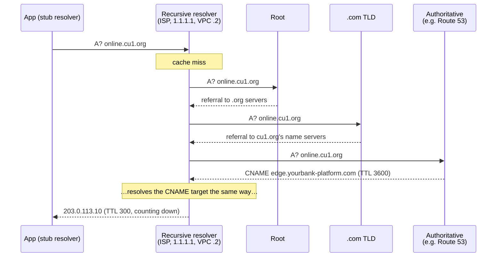
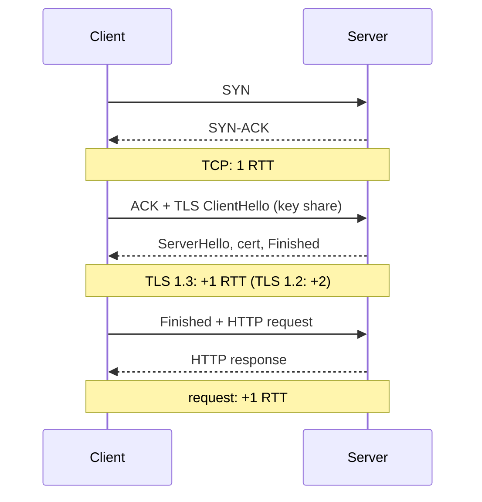
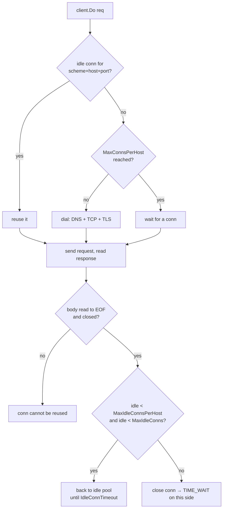
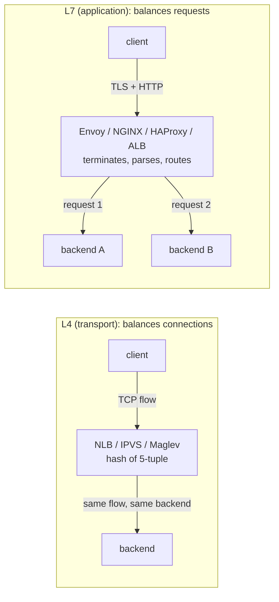
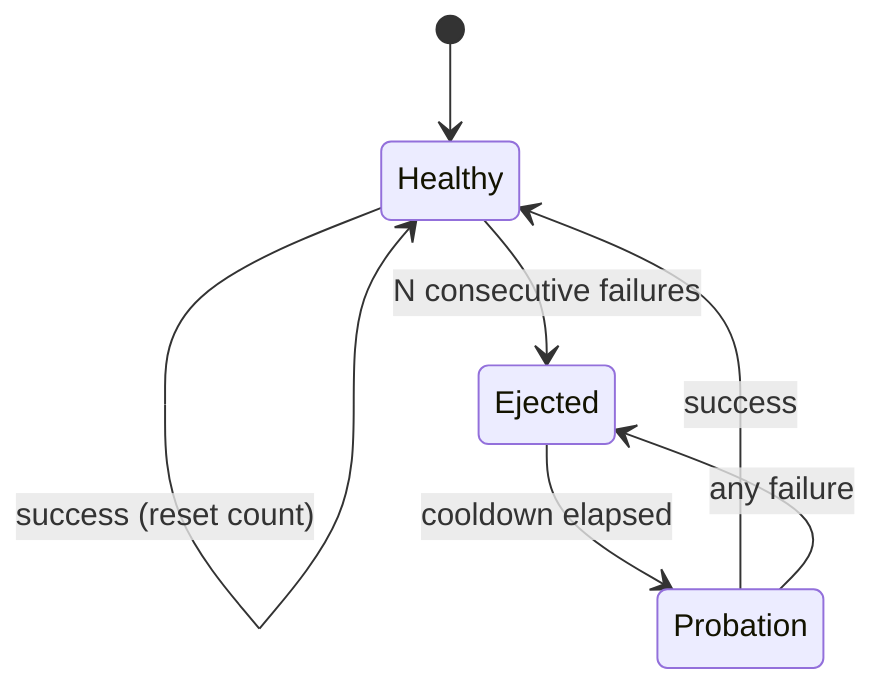
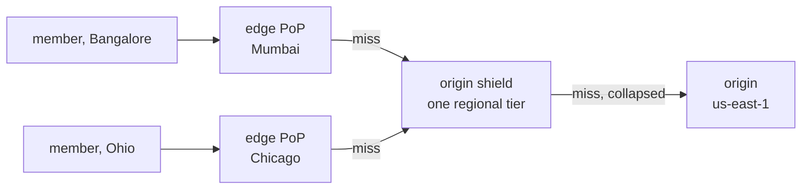

# A1 Unit 1 — The request path

> Time: ~6 h · CORE: §1–§6 · STRETCH: the "QUIC internals" part of §2 and the "P2C math" part of §4 · Lab: `labs/a1/lb`

Everything a member's tap on "View balance" goes through before your code runs: a name lookup, a connection
handshake, maybe a CDN edge, a load balancer that picks one of your servers, and a pool of connections your server
uses to call the next thing. Each hop has a cost in round trips and a way to fail. Interviewers probe this path
constantly ("what happens when one backend gets slow?", "why is DNS failover slow?") because it separates people who
have drawn boxes from people who have operated them.

## Before you start

You should have finished A0 (the 45-minute framework and estimation). Keep [`docs/NUMBERS.md`](../../docs/NUMBERS.md)
open; this unit leans on its RTT table.

Warm-up (spaced retrieval from A0). Answer on paper first.

1. 100 M requests/day with a peak factor of 2.5. Peak QPS?
2. 2,000 req/s, each spends 250 ms in your service. How many requests are in flight?
3. A request must pass through 3 services in series, each 99.9% available. Best-case availability of the chain?

<details data-kind="answer">
<summary>Warm-up answers</summary>

1. 100 M / 86,400 ≈ 1,160 req/s average (napkin: 100 M / 10^5 = 1,000). × 2.5 ≈ 2,900 req/s peak (napkin ≈ 2,500).
2. Little's law: L = λ × W = 2,000 × 0.25 = 500 in flight. You will use this in §3 to size connection pools.
3. 0.999³ ≈ 0.997 → 99.7%. Serial hops multiply; the LB, the CDN and DNS are hops too.

</details>

---

## §1 DNS

### The failure story

Your platform serves 40 credit unions. Each one points `online.<cu>.org` at you with a CNAME to
`edge.yourbank-platform.com`, which is a Route 53 failover record: primary is the load balancer in us-east-1, secondary
is the DR stack in us-west-2. TTL 300 s. The runbook promises an RTO of 5 minutes.

At 09:02 on a Monday the us-east-1 load balancer starts timing out. Route 53's health checker probes every 30 s and
needs 3 consecutive failures: it flips the record at ≈ 09:03:30. Resolvers that cached the old answer at 09:02:59 keep
serving it until ≈ 09:08. At ≈ 2,000 req/s, that is ≈ 700k failed requests before most clients move. Then the long tail:
a partner's batch job on a JVM that cached the address, a corporate resolver that clamps TTLs upward, and every
mobile app that already had a keep-alive connection open to the dead region. At 09:40 support is still taking calls
from members of two credit unions.

Someone proposes "set the TTL to 5 seconds". Someone else points out that every one of those millions of devices
would then hit a resolver miss far more often, and that it would not have helped the clients that were stuck anyway.

### Predict

<!-- predict id="A1-U1-P01" -->
**Predict.** Write your answers down before opening the reveal.

1. With a 60 s TTL and a health check that detects failure in 30 s, what is the worst-case time until *every* client
   has stopped sending traffic to the dead region? List each term that contributes.
2. Why doesn't TTL = 1 s solve DNS failover?
<!-- /predict -->

### Reveal

<details data-kind="reveal" data-for="A1-U1-P01">
<summary>Reveal</summary>

1. "30 s + 60 s = 90 s" is the tempting answer and it is the *best* case for a well-behaved client. The real terms:
   - **detection**: health-check interval × failure threshold (+ propagation of the record change to the DNS
     provider's edge, usually seconds);
   - **resolver caches**: up to one TTL at each caching layer that honours TTLs. Layers can stack (stub cache → OS
     cache → recursive resolver), and some resolvers clamp very low TTLs upward;
   - **application caches**: some runtimes and libraries cache lookups on their own terms (historically JVMs could
     cache "forever" under some configurations — `TODO-VERIFY: current JVM default for networkaddress.cache.ttl`);
   - **connection pinning**: the big one. DNS is consulted only when a *new* connection is dialled. A keep-alive or
     HTTP/2 connection that is already open keeps going to the old IP until it breaks or is closed. For a dead
     region the connections do break (timeouts), but for a *degraded* region that still accepts connections, clients
     can stay pinned for as long as the connections live.

   So the worst case is not bounded by anything you control on the DNS side. That is the key insight: **DNS is a
   hint, not a switch.**
2. TTL 1 s multiplies resolver traffic and puts a resolution (often a network round trip) in front of far more
   requests, some resolvers enforce a minimum TTL anyway, and it does nothing for pinned connections or for
   misbehaving caches. Low TTLs are a tool for *planned* moves (lower the TTL a day ahead, then change the record),
   not a failover mechanism.

</details>

### How it actually works



- **Caching is the whole design.** Each answer carries a TTL; the recursive resolver serves it from cache and counts
  the TTL down. The root and TLD referrals have long TTLs (≈ days), so in steady state a lookup is one hop to a warm
  recursive resolver (≈ 1–20 ms) or zero hops (OS cache).
- **Negative answers are cached too** (NXDOMAIN, per the zone's SOA settings, RFC 2308). Delete a record by mistake
  and re-add it, and resolvers can keep saying "does not exist" for the negative-cache TTL.
- **Multiple A records** give crude load spreading: clients typically try the first or a random address. There is no
  health awareness and no weighting at the client.
- **GeoDNS / latency-based routing**: the authoritative server answers differently depending on who asks. It sees
  the *resolver's* IP, not the user's, unless the resolver sends EDNS Client Subnet (RFC 7871). A member using a
  public resolver can be routed by where the resolver is, not where they are.
- **Anycast** is the other way to steer users: the same IP is announced via BGP from many locations and the network
  delivers packets to the "nearest" one. Failover happens by withdrawing the route, which converges much faster
  than DNS caches expire. CDNs and public resolvers use it heavily.

In Go: the standard library resolver does not cache results itself; each new dial resolves again (caching is done by
the OS or a local caching resolver if you have one). Connection reuse is what makes that cheap — and what causes
the pinning above.

### Build it

No lab package for this section: DNS is configuration, not code you would write. The in-band alternative to DNS
failover (an L7 load balancer that ejects unhealthy backends per request) is what you build in §4–§5.

### Break it

Reproduce connection pinning on loopback. This program has a fake resolver: "DNS" for `api.bank.test` starts at
`us-east` and then fails over to `us-west`.

```go
// DNS has "failed over", but a pooled keep-alive connection is still pinned
// to the old address. Loopback only: a fake resolver decides where
// "api.bank.test" points.
package main

import (
	"context"
	"fmt"
	"io"
	"net"
	"net/http"
	"net/http/httptest"
	"sync/atomic"
)

func main() {
	east := httptest.NewServer(http.HandlerFunc(func(w http.ResponseWriter, r *http.Request) { io.WriteString(w, "us-east") }))
	west := httptest.NewServer(http.HandlerFunc(func(w http.ResponseWriter, r *http.Request) { io.WriteString(w, "us-west") }))
	defer east.Close()
	defer west.Close()

	var resolved atomic.Value // what "DNS" currently answers for api.bank.test
	resolved.Store(east.Listener.Addr().String())

	tr := &http.Transport{
		DialContext: func(ctx context.Context, network, _ string) (net.Conn, error) {
			var d net.Dialer
			return d.DialContext(ctx, network, resolved.Load().(string)) // "resolve" on every new dial
		},
	}
	client := &http.Client{Transport: tr}
	get := func() string {
		resp, err := client.Get("http://api.bank.test/")
		if err != nil {
			return err.Error()
		}
		defer resp.Body.Close()
		b, _ := io.ReadAll(resp.Body)
		return string(b)
	}

	fmt.Println("before failover:", get())
	resolved.Store(west.Listener.Addr().String()) // the DNS record now points west
	for i := 0; i < 3; i++ {
		fmt.Println("after DNS change:", get()) // still east: the pooled conn is reused
	}
	tr.CloseIdleConnections() // or: a max connection age, or the server closing idle conns
	fmt.Println("after closing idle conns:", get())
}
```

Predict the output, run it (`go run .` in a scratch directory), then try: (a) set `DisableKeepAlives: true` on the
transport; (b) have `east` stop responding (`east.Close()` instead of changing `resolved`).

<details data-kind="answer">
<summary>What you should see, and why</summary>

Output: `us-east` four times, then `us-west`. The DNS answer changed but no new dial happened, so nothing consulted
it. (a) With keep-alive disabled every request dials, so the switch is immediate — at the price of a TCP (and in real
life TLS) handshake per request, which §2 and §3 show is far worse. (b) When `east` dies, the pooled connection
errors and the next request dials fresh and lands on whatever "DNS" says. The dangerous case is the *degraded*
region that still accepts connections: clients stay pinned. Production fixes: a maximum connection age (servers
or proxies closing connections after N minutes; HTTP/2 servers send GOAWAY), and failover in-band at a load
balancer rather than via DNS.

</details>

### In the wild

- **Route 53** has failover, weighted, latency-based and geolocation routing policies, plus health checks (standard
  interval 30 s, "fast" 10 s, failure threshold default 3). Alias records let the zone apex point at an AWS load
  balancer.
- **AWS load balancers** are reached by DNS name; the IPs behind an ALB change as it scales, which is why clients
  must respect TTLs and must not hard-code IPs. NLB can instead give you a static IP per AZ.
- **Anycast**: Cloudflare and Google announce their edge and public resolver IPs (1.1.1.1, 8.8.8.8) from many
  locations.
- **Kubernetes**: pod `resolv.conf` defaults to `ndots:5`, so a name like `api.vendor.com` is first tried with each
  search domain appended — several wasted queries per lookup unless you use a trailing dot or tune `ndots`.
- **When DNS itself fails**: the October 2016 DDoS on Dyn (Mirai botnet) made many large sites unreachable for hours
  even though their servers were fine. Large operators now use more than one DNS provider.

### Trade-offs

| Option | Wins when | Loses when | When the answer flips |
|---|---|---|---|
| DNS failover between regions | Cross-region DR; cheap; works for any protocol | You need failover in seconds; clients cache or pin | Flip to anycast or a global L7 front door (CDN/global LB) when RTO < ≈ 1 min matters |
| Anycast | Fast failover; users reach the nearest PoP automatically | You run your own network edge (BGP); hard to do yourself | Flip to DNS when you're one team on one cloud: buy anycast via a CDN/global LB instead |
| Low TTL (≈ 30–60 s) | Planned migrations; moderately fast failover | Resolver load and lookup latency rise; still no help for pinned connections | Flip to long TTL (hours) for records that never move (e.g. MX, verification TXT) |
| GeoDNS / latency routing | Steering users to the closest region | The resolver is far from the user (public resolvers without ECS) | Flip to anycast when accuracy per user matters more than per resolver |

### Senior bar

- **Failure modes**: stale caches; connection pinning to a degraded region; negative caching after a mistaken delete;
  the DNS provider itself being down (single provider = SPOF); health checks that only test "port open" so DNS never
  fails over.
- **Capacity**: queries reaching your authoritative servers scale with (number of *resolvers*) / TTL, not with number
  of users, because resolvers share caches. Halving the TTL ≈ doubles authoritative query volume.
- **Ops**: planned move playbook = lower TTL to 60 s at least one old-TTL ahead → change record → watch traffic drain
  → restore TTL. Test the DR failover regularly; an untested failover is a hope.
- **Cost**: managed DNS bills per million queries and per health check (`TODO-VERIFY: current Route 53 per-query and
  per-health-check prices`); cheap, but low TTLs on a high-traffic name do show up.

Interviewer follow-up probes:

1. "Your RTO is 5 minutes and you rely on DNS failover with a 300 s TTL. Defend it or fix it."

<details data-kind="answer">
<summary>Model answer</summary>

It doesn't meet the RTO even in the good case (detection ≈ 30–90 s + up to 300 s of caching), and the tail is
unbounded. Fixes, in order of strength: (1) drop the TTL to ≈ 60 s and use fast health checks, which gets
well-behaved clients to ≈ 2 min; (2) put a global front door in the path (CDN or global load balancer with anycast
IPs) so the IP clients hold never changes and failover happens at the edge in seconds; (3) make clients
region-aware (mobile app knows two endpoints and fails over on errors). I'd also set a maximum connection age so
degraded-but-alive regions don't keep clients pinned.

</details>

2. "Why might a client keep hitting the dead region after DNS has updated?"

<details data-kind="answer">
<summary>Model answer</summary>

Because DNS is consulted only on new connections, and the client is reusing an existing keep-alive/HTTP/2
connection; or because some layer (JVM, library, corporate resolver) caches longer than the TTL. Mitigations:
connection max-age / GOAWAY on the server side, `CloseIdleConnections` or a reconnect on repeated errors on the client
side, and not relying on DNS for fast failover in the first place.

</details>

3. "Should you use DNS round-robin across your app servers instead of a load balancer?"

<details data-kind="answer">
<summary>Model answer</summary>

Not for anything that needs health awareness: clients keep hitting a dead server until caches expire, there's no
per-request balancing, and you can't drain. DNS round-robin is fine *across load balancers* (each one is itself
redundant and health-checked) or across regions, which is how most large systems use it.

</details>

### Check yourself

1. What does an authoritative GeoDNS server use to decide where a user is, by default?
2. You delete a record by mistake and re-create it 10 s later. Why might some users still get NXDOMAIN?
3. Why is a low TTL "a tool for planned moves, not failover"?

<details data-kind="answer">
<summary>Answers</summary>

1. The recursive resolver's IP address — unless the resolver sends EDNS Client Subnet.
2. Negative caching: resolvers cached the NXDOMAIN for the zone's negative TTL.
3. For a planned move you control timing: lower the TTL ahead, switch, everyone moves within one (short) TTL. For
   failover, detection time, misbehaving caches and pinned connections dominate, and a low TTL helps none of them.

</details>

---

## §2 Connection setup and HTTP versions

### The failure story

A member opens the mobile banking app on a cellular connection ≈ 150 ms RTT from your region. The dashboard screen
makes 12 API calls (accounts, recent transactions, pending transfers, offers, messages…). Your API gateway is
configured, by accident, to close the connection after every response (`Connection: close`), and TLS 1.2 is the
newest version it offers.

Each call pays TCP (1 RTT) + TLS 1.2 (2 RTT) + the request itself (1 RTT) = 4 RTT = 600 ms before server time. Even
with 6 connections in parallel that's two waves: ≈ 1.2 s of pure network setup before anything renders. On
Monday morning at 10x traffic, the gateway also burns CPU on ≈ 10x the TLS handshakes it needs to, and its p99
climbs. Product files a bug: "app is slow on mobile". Nothing is "broken"; every request succeeds.

### Predict

<!-- predict id="A1-U1-P02" -->
**Predict.** Write the numbers down before opening the reveal.

1. Same 12 calls, 150 ms RTT. Estimate time-to-all-responses (network only) for: (a) HTTP/1.1 with keep-alive and
   TLS 1.3, 6 connections; (b) HTTP/2 over TLS 1.3, one connection; (c) HTTP/3 (QUIC), first visit.
2. On a lossy network (say 2% packet loss), which do you expect to degrade more: HTTP/1.1 over 6 connections, or
   HTTP/2 over one? Why?
<!-- /predict -->

### Reveal

<details data-kind="reveal" data-for="A1-U1-P02">
<summary>Reveal</summary>

1. (a) First request on each connection: TCP 1 + TLS 1.3 1 + request 1 = 3 RTT = 450 ms; with 6 connections
   opened in parallel, the first 6 calls finish at ≈ 450 ms, the next 6 reuse the warm connections: +1 RTT →
   ≈ 600 ms. (b) One connection: 2 RTT setup + 1 RTT with all 12 requests multiplexed → ≈ 450 ms. (c) QUIC
   combines transport and TLS 1.3 into 1 RTT: 1 + 1 → ≈ 300 ms. A returning visitor with 0-RTT resumption could
   send requests in the first flight (≈ 150 ms), but 0-RTT data is replayable (see below).
2. HTTP/2 often degrades more. All its streams share one TCP connection, and TCP delivers bytes in order: a lost
   packet stalls *every* stream until it's retransmitted (TCP-level head-of-line blocking), and the single
   connection's congestion window takes the whole hit. Six HTTP/1.1 connections lose independently. The tempting
   wrong answer is "HTTP/2 always wins" — it wins on typical networks, and HTTP/3 exists largely because of this
   case.

</details>

### How it actually works



From [`docs/NUMBERS.md`](../../docs/NUMBERS.md): RTTs before the first request byte are TCP 1, TCP+TLS 1.2 3, TCP+TLS
1.3 2, QUIC 1, QUIC 0-RTT 0. Multiply by the RTT of the path; that's why *where TLS terminates* matters (a CDN edge
20 ms away terminates TLS far faster than an origin 150 ms away) and why connections must be reused.

**HTTP/1.1.** Connections are persistent by default (keep-alive), but a connection carries one request/response at a
time. Pipelining exists in the spec but is effectively unused (browsers disabled it). So concurrency = number of
connections; browsers cap it at ≈ 6 per host. A slow response blocks the next request on that connection
(application-level head-of-line blocking).

**HTTP/2** (RFC 9113). One TCP connection, many concurrent *streams*, each request/response a stream of binary frames
interleaved on the wire. Header compression (HPACK) removes the repeated cookies/auth headers that dominate small
API calls. Per-stream and per-connection flow control. The server advertises `SETTINGS_MAX_CONCURRENT_STREAMS`
(commonly 100–250 — `TODO-VERIFY: per-server defaults`). Server push existed but browsers removed support; ignore it.
Remaining problem: TCP-level head-of-line blocking (above).

**HTTP/3** (RFC 9114) over **QUIC** (RFC 9000). QUIC runs over UDP, implements reliability and congestion control in
user space, and bakes in TLS 1.3. Consequences:
- 1-RTT setup (transport + crypto together), 0-RTT on resumption.
- Loss on one stream doesn't stall others (streams are independently ordered).
- Connections are identified by connection IDs, not the 4-tuple, so a phone moving from Wi-Fi to cellular can keep
  its connection (connection migration).
- Discovery: servers advertise HTTP/3 via the `Alt-Svc` header or DNS HTTPS records; clients start on HTTP/2 and
  upgrade. Some networks block UDP, so clients must fall back.

**STRETCH — QUIC internals worth knowing for a deep dive.** Packet numbers are never reused (retransmitted data gets
a new packet number), which removes TCP's retransmission ambiguity for RTT estimation. Most of the header is
encrypted, so middleboxes can't ossify the protocol. Because it's user space and UDP, kernel/NIC offloads that make
TCP cheap don't all apply, so CPU per byte is typically higher than TCP (`TODO-VERIFY: current magnitude; varies by
implementation and GSO/GRO support`). Read the QUIC RFC 9000 sections on streams and connection IDs if a team you
interview with runs a CDN or mobile-heavy product.

**0-RTT is replayable.** TLS 1.3 and QUIC 0-RTT early data can be captured and replayed by an attacker; the server
cannot tell the replay from the original. Only safe, idempotent requests (GET) should be allowed in early data.
For a banking API: never let `POST /transfers` ride in 0-RTT. Unit 3's idempotency keys protect against *client*
retries; 0-RTT replay is a reason to disable early data for unsafe methods at the edge.

### Build it

No lab package for this section — the protocols come from the standard library. What you control is whether
connections are reused; that is §3.

### Break it

Measure what a handshake costs even with ≈ zero network latency: 200 sequential HTTPS requests over loopback, with
and without keep-alive.

```go
// Time 200 sequential HTTPS requests over loopback with and without
// keep-alive, and count TLS handshakes with httptrace.
package main

import (
	"crypto/tls"
	"fmt"
	"io"
	"net/http"
	"net/http/httptest"
	"net/http/httptrace"
	"time"
)

func main() {
	srv := httptest.NewTLSServer(http.HandlerFunc(func(w http.ResponseWriter, r *http.Request) {
		io.WriteString(w, "ok")
	}))
	defer srv.Close()

	for _, keepAlive := range []bool{false, true} {
		tr := srv.Client().Transport.(*http.Transport).Clone() // trusts the test cert
		tr.DisableKeepAlives = !keepAlive
		client := &http.Client{Transport: tr, Timeout: 5 * time.Second}

		handshakes := 0
		trace := &httptrace.ClientTrace{
			TLSHandshakeDone: func(tls.ConnectionState, error) { handshakes++ },
		}
		start := time.Now()
		for i := 0; i < 200; i++ {
			req, _ := http.NewRequest("GET", srv.URL, nil)
			req = req.WithContext(httptrace.WithClientTrace(req.Context(), trace))
			resp, err := client.Do(req)
			if err != nil {
				panic(err)
			}
			io.Copy(io.Discard, resp.Body)
			resp.Body.Close()
		}
		el := time.Since(start)
		fmt.Printf("keep-alive=%-5v handshakes=%3d total=%8s per request=%s\n",
			keepAlive, handshakes, el.Round(time.Millisecond), (el / 200).Round(time.Microsecond))
	}
}
```

Predict the ratio before running. Then answer: what would each line become on a 100 ms RTT path?

<details data-kind="answer">
<summary>What you should see</summary>

On one test container: 200 handshakes, ≈ 1.4 ms per request without keep-alive vs 1 handshake, ≈ 40 µs per request
with it (≈ 35x; measured, varies by CPU). That is pure CPU and loopback; there is no network latency in it. On a 100 ms
RTT path, add ≈ 300 ms per request without keep-alive (TCP + TLS 1.3 + request = 3 RTT) vs ≈ 100 ms with a warm
connection. The CPU part matters at the server: a gateway doing 10k new TLS handshakes/s spends a measurable share of
its cores on key exchange instead of your traffic.

</details>

### In the wild

- Browsers allow ≈ 6 concurrent HTTP/1.1 connections per host (Chrome, Firefox).
- Go's `net/http` negotiates HTTP/2 automatically over TLS (client via `DefaultTransport`, server via
  `ListenAndServeTLS`). As of Go 1.24 there is no HTTP/3 in the standard library; `quic-go` is the common third-party
  implementation.
- NGINX added QUIC/HTTP/3 support in the 1.25 line; Cloudflare, Google and Fastly serve HTTP/3 at the edge.
- gRPC runs on HTTP/2 and relies on long-lived multiplexed connections (this matters for load balancing, §4).
- **HTTP/2 "Rapid Reset" (CVE-2023-44487, October 2023)**: attackers opened and immediately cancelled streams at
  enormous rates, producing record-breaking DDoS attacks against major providers. Multiplexing is cheap for the
  client and not free for the server; servers now limit stream churn.

### Trade-offs

| Option | Wins when | Loses when | When the answer flips |
|---|---|---|---|
| HTTP/1.1 + keep-alive | Simple, debuggable, universal; a few large requests | Many small concurrent requests (connection cap, repeated headers) | Flip to HTTP/2 once a client makes many parallel calls to one host |
| HTTP/2 | Many concurrent requests to one host; header-heavy APIs; gRPC | Lossy networks (TCP HOL); behind L4 balancers (one connection pins to one backend) | Flip to HTTP/3 for mobile/lossy users; flip back to 1.1 when an L4 LB must spread load per connection |
| HTTP/3 / QUIC | Mobile, lossy, high-RTT users; connection migration | UDP blocked; higher CPU per byte; less mature tooling | Flip to HTTP/2 for datacenter-internal traffic (low loss, low RTT; TCP offloads) |
| TLS 1.3 0-RTT | Returning clients, safe GETs | Any non-idempotent request (replay) | Flip to 1-RTT for writes; always |

### Senior bar

- **Failure modes**: TLS terminating far from users (every new connection pays the long RTT); certificate expiry
  (a classic self-inflicted outage — automate renewal and alert on days-to-expiry); HTTP/2 connection to an L4 LB
  pinning all traffic from a big client to one backend; enabling 0-RTT for unsafe methods.
- **Capacity**: a fresh TLS handshake costs a server ≈ 1 ms of CPU (measured above, order of magnitude); at 10k new
  connections/s that's ≈ 10 cores. Resumption and reuse cut that by orders of magnitude.
- **Ops**: terminate TLS at the edge (CDN/LB) and re-encrypt to the origin over pooled connections; monitor new-
  connection rate as its own metric.
- **Cost**: CPU for handshakes; for mobile users, latency is the cost and it's paid in conversion.

Interviewer follow-up probes:

1. "Your mobile app's p50 is fine but p90 is bad on cellular. What do you look at in the connection layer?"

<details data-kind="answer">
<summary>Model answer</summary>

Number of new connections per screen (are we reusing?), where TLS terminates (edge vs origin RTT), TLS version
(1.2 costs an extra RTT), HTTP version (HTTP/2 to multiplex the dashboard's parallel calls; HTTP/3 for lossy links and
network switches), and whether the app makes calls serially that could be parallel or batched. Each RTT on cellular
is ≈ 100–200 ms, so removing two of them on the critical path is worth more than any server optimisation.

</details>

2. "Should internal service-to-service traffic use TLS, given the handshake cost?"

<details data-kind="answer">
<summary>Model answer</summary>

Yes in most modern setups (zero-trust networking; often mutual TLS so services authenticate each other). The
handshake cost is amortised by long-lived pooled connections: you pay it once per connection, not per request.
Inside a datacenter the RTT is ≈ 0.1–0.5 ms, so even the latency cost is small. The real risks are operational
(certificate rotation), which is why meshes automate it.

</details>

3. "Why not just enable 0-RTT everywhere to save a round trip?"

<details data-kind="answer">
<summary>Model answer</summary>

Early data is replayable by a network attacker and the server can't distinguish a replay. Fine for idempotent reads,
dangerous for anything that changes state. Edges that support 0-RTT typically let you restrict it to safe methods, and
servers can mark replay-sensitive requests (e.g. the `Early-Data: 1` header from RFC 8470) so the origin can reject
them with 425 Too Early.

</details>

### Check yourself

1. How many RTTs before the first request byte for TCP + TLS 1.2? TCP + TLS 1.3? QUIC (new)?
2. What is "head-of-line blocking" at the HTTP/1.1 layer vs at the TCP layer?
3. Why does HTTP/3 survive a phone switching from Wi-Fi to cellular?

<details data-kind="answer">
<summary>Answers</summary>

1. 3, 2, 1.
2. HTTP/1.1: one request per connection at a time, so a slow response blocks the next request on that connection.
   TCP: in-order delivery means one lost packet stalls all HTTP/2 streams sharing the connection.
3. QUIC identifies connections by connection IDs rather than the IP/port 4-tuple, so the connection can migrate to
   the new path.

</details>

---

## §3 Connection pooling

### The failure story

This one may be familiar. A remote-deposit-capture vendor requires mutual TLS, so someone wrote the adapter like this:

```go
package vendor

import (
	"context"
	"crypto/tls"
	"io"
	"net/http"
	"time"
)

func callVendor(ctx context.Context, cert tls.Certificate, body io.Reader) (*http.Response, error) {
	client := &http.Client{ // built per call, because "it needs the cert"
		Timeout: 30 * time.Second,
		Transport: &http.Transport{
			TLSClientConfig: &tls.Config{Certificates: []tls.Certificate{cert}},
		},
	}
	req, err := http.NewRequestWithContext(ctx, http.MethodPost, "https://rdc.vendor.example/v2/deposits", body)
	if err != nil {
		return nil, err
	}
	return client.Do(req)
}
```

At 20 deposits/s nobody notices. On the first business day after a holiday it's 300/s. The vendor is ≈ 40 ms RTT
away, so every call pays TCP + TLS (+ client-certificate work on both sides) before sending a byte. Each per-call
`Transport` keeps its connection idle afterwards — and a zero-value `Transport` has `IdleConnTimeout` 0, meaning *no
limit* — so idle sockets accumulate until the process hits its file-descriptor limit: `socket: too many open files`.
The vendor sees 300 new mutual-TLS handshakes per second from one IP and starts rate-limiting. Deposits time out,
members retry, and (Unit 3) some deposits get submitted twice.

The "fix" PR moves to a single shared client with the default transport settings. Errors drop, but p99 is still
bad and the NAT gateway's connection metrics look odd. That second bug is subtler: it's in the defaults.

### Predict

<!-- predict id="A1-U1-P03" -->
**Predict.** Write your answers down first.

1. After the fix (one shared client, default `http.Transport` settings), the adapter sends 300 req/s to the vendor
   and each call takes ≈ 200 ms. How many connections are in use at once? How many idle connections will Go keep
   for that host between bursts by default? What happens to the rest?
2. Name two things in calling code that silently prevent connection reuse even with a shared client.
<!-- /predict -->

### Reveal

<details data-kind="reveal" data-for="A1-U1-P03">
<summary>Reveal</summary>

1. Little's law: 300 × 0.2 = 60 connections in use. But `http.DefaultMaxIdleConnsPerHost` is **2** (Go source,
   `net/http/transport.go`), so when a burst of responses completes, only 2 connections go back to the idle pool and
   the other ≈ 58 are closed. The next burst dials ≈ 58 new connections (more handshakes). The side that closes a TCP
   connection holds it in TIME_WAIT for ≈ 60 s on Linux, consuming an ephemeral port; with the default range
   32768–60999 (≈ 28k ports) you can sustain only ≈ 470 new connections/s to one destination IP:port before running
   out. Behind a NAT gateway there's a per-destination connection limit too. Fix: `MaxIdleConnsPerHost` ≈ the
   concurrency you expect (here ≈ 64–100), plus `MaxConnsPerHost` as a cap to protect the vendor.
2. Not reading the response body to EOF and closing it (Go's docs: if the body is not both read to EOF and closed,
   the Transport "may not be able to re-use" the connection); creating a new `Transport` per request (often hidden
   in a helper); `DisableKeepAlives: true`; a custom `TLSClientConfig`/`DialContext` without `ForceAttemptHTTP2: true`
   silently disables HTTP/2, which loses multiplexing if the vendor supports it.

</details>

### How it actually works



An `http.Transport` *is* the pool. `http.Client` is a thin wrapper (redirect policy, cookie jar, overall timeout);
creating many clients that share one Transport is fine, creating many Transports is not. `http.DefaultTransport`
(Go 1.24 source) sets `MaxIdleConns: 100`, `IdleConnTimeout: 90s`, `TLSHandshakeTimeout: 10s`,
`ExpectContinueTimeout: 1s`, `ForceAttemptHTTP2: true`, and leaves `MaxIdleConnsPerHost` at 0, which means
`DefaultMaxIdleConnsPerHost` = 2. `http.Client.Timeout` defaults to 0: **no timeout**.

The timeouts you actually need, client side:

| Knob | Bounds | Typical choice for a vendor call |
|---|---|---|
| `net.Dialer.Timeout` | TCP connect | ≈ 1–3 s |
| `Transport.TLSHandshakeTimeout` | TLS handshake | ≈ 3–5 s |
| `Transport.ResponseHeaderTimeout` | waiting for response headers after sending | ≈ vendor p99.9 + margin |
| `Client.Timeout` or request `context` deadline | the whole exchange including reading the body | your latency budget for this hop |
| `Transport.IdleConnTimeout` | how long an idle conn is kept | ≈ 60–90 s, below the vendor's own idle timeout |

Server side (`http.Server`): `ReadHeaderTimeout` (without it, a client that sends headers one byte at a time — the
Slowloris attack — holds a connection forever), `ReadTimeout`, `WriteTimeout`, `IdleTimeout`.

A vendor client done properly:

```go
package vendor

import (
	"crypto/tls"
	"net"
	"net/http"
	"time"
)

// NewClient builds ONE client per vendor at startup and shares it.
func NewClient(cert tls.Certificate) *http.Client {
	tr := &http.Transport{
		DialContext:           (&net.Dialer{Timeout: 2 * time.Second, KeepAlive: 30 * time.Second}).DialContext,
		TLSClientConfig:       &tls.Config{Certificates: []tls.Certificate{cert}, MinVersion: tls.VersionTLS12},
		ForceAttemptHTTP2:     true, // custom TLSClientConfig would otherwise disable HTTP/2
		TLSHandshakeTimeout:   5 * time.Second,
		ResponseHeaderTimeout: 10 * time.Second,
		MaxIdleConns:          200,
		MaxIdleConnsPerHost:   100, // ≈ expected concurrency to this host (Little's law)
		MaxConnsPerHost:       150, // bulkhead: never more than this to the vendor
		IdleConnTimeout:       60 * time.Second,
	}
	return &http.Client{Transport: tr, Timeout: 15 * time.Second}
}
```

And every caller does `defer resp.Body.Close()` and drains bodies it doesn't fully read
(`io.Copy(io.Discard, resp.Body)`; cap it with `io.LimitReader` if bodies can be large).

### Build it

No lab package for this section. The experiment below is runnable as-is, and the `lb` lab's `NewHandler` takes a
shared `http.RoundTripper` for exactly the reason this section explains.

### Break it

Count connections a client opens for 1,000 requests at concurrency 50, under three configurations.

```go
// Count how many TCP connections a client opens for 1,000 requests at
// concurrency 50, under three client configurations.
package main

import (
	"fmt"
	"io"
	"net"
	"net/http"
	"net/http/httptest"
	"sync"
	"sync/atomic"
	"time"
)

func main() {
	var newConns atomic.Int64
	srv := httptest.NewUnstartedServer(http.HandlerFunc(func(w http.ResponseWriter, r *http.Request) {
		time.Sleep(5 * time.Millisecond) // the vendor's processing time
		io.WriteString(w, `{"status":"accepted"}`)
	}))
	srv.Config.ConnState = func(_ net.Conn, s http.ConnState) {
		if s == http.StateNew {
			newConns.Add(1)
		}
	}
	srv.Start()
	defer srv.Close()

	run := func(name string, client func() *http.Client) {
		newConns.Store(0)
		var wg sync.WaitGroup
		sem := make(chan struct{}, 50)
		for i := 0; i < 1000; i++ {
			wg.Add(1)
			sem <- struct{}{}
			go func() {
				defer wg.Done()
				defer func() { <-sem }()
				resp, err := client().Get(srv.URL)
				if err != nil {
					return
				}
				io.Copy(io.Discard, resp.Body) // drain...
				resp.Body.Close()              // ...and close, or the conn is not reused
			}()
		}
		wg.Wait()
		fmt.Printf("%-34s %4d new connections\n", name, newConns.Load())
	}

	run("new Transport per request", func() *http.Client {
		return &http.Client{Transport: &http.Transport{}, Timeout: 5 * time.Second}
	})
	shared := &http.Client{Timeout: 5 * time.Second} // uses http.DefaultTransport
	run("shared DefaultTransport", func() *http.Client { return shared })
	tuned := &http.Client{Timeout: 5 * time.Second, Transport: &http.Transport{
		MaxIdleConns: 100, MaxIdleConnsPerHost: 64, IdleConnTimeout: 90 * time.Second,
	}}
	run("shared, MaxIdleConnsPerHost=64", func() *http.Client { return tuned })
}
```

Predict the three numbers, run it, then: (a) delete the `io.Copy`/`Close` lines and rerun; (b) while (a) runs, watch
`ss -tan | grep -c TIME-WAIT` (Linux) or `netstat -an | grep -c TIME_WAIT` (macOS) in another terminal.

<details data-kind="answer">
<summary>What you should see</summary>

On one test machine: 1000, ≈ 360, 50. Per-request transports dial every time. The shared default transport still
dials hundreds of times because only 2 idle connections per host survive each burst. The tuned transport opens
exactly the concurrency (50) and reuses them. In (a), the connections can't be returned to the pool: new-connection
counts climb toward one per request and file descriptors leak until GC/timeouts reclaim them. In (b), you see the
closed connections sitting in TIME_WAIT — the ephemeral-port budget from the reveal being spent.

</details>

### In the wild

- **Go**: values above are from `net/http/transport.go` (Go 1.24). `httptrace.ClientTrace.GotConn` reports
  `Reused` per request — the single most useful debugging hook for this class of bug.
- **NGINX → upstream**: by default NGINX opens a new connection to the upstream per request; the `keepalive N`
  directive in an `upstream` block keeps idle connections, and needs `proxy_http_version 1.1` and
  `proxy_set_header Connection ""`.
- **Envoy** pools connections per upstream host, and its circuit breakers cap connections, pending requests and
  requests per cluster (defaults 1024 each, `max_retries` 3).
- **Java**: Apache HttpClient's pooling manager has historically defaulted to a small per-route limit
  (`TODO-VERIFY: defaultMaxPerRoute/maxTotal defaults for the HttpClient version you use`) — the same class of bug.
- **AWS NAT gateway**: documented limit of ≈ 55,000 simultaneous connections to each unique destination; adapters
  behind NAT that churn connections to one vendor hit it.
- **Databases**: the same problem one layer down; PgBouncer and RDS Proxy exist because Postgres connections are
  expensive (processes). Covered in the storage modules.

### Trade-offs

| Option | Wins when | Loses when | When the answer flips |
|---|---|---|---|
| New connection per request | Very low rate; you *want* every request re-resolved and re-balanced | Anything above a trickle: handshakes, TIME_WAIT, fd use | Flip to pooling as soon as RTT × rate makes setup visible (it almost always does) |
| Shared pool, HTTP/1.1 | Default for most service calls | Pool too small (churn) or unbounded (hammers a slow dependency) | Flip to HTTP/2 when the peer supports it and you have many concurrent small requests |
| HTTP/2 multiplexing | Many concurrent requests; fewer sockets | All load on one connection: one backend behind an L4 LB; one TCP loss stalls all | Flip to several connections (or HTTP/1.1) when you need per-connection spreading |
| Hard cap (`MaxConnsPerHost`) | Protect a fragile vendor; bulkhead | Cap too low → requests queue client-side and time out | Flip to a higher cap + explicit rate limiting when the vendor publishes limits |

### Senior bar

- **Failure modes**: per-request transports; undrained bodies; default 2 idle conns/host; no `Client.Timeout`
  (a hung vendor holds goroutines and connections forever); idle timeout longer than the server's or NAT's idle
  timeout (you reuse a connection the other side already dropped → "connection reset" on first write; retry
  idempotent requests once on a fresh connection).
- **Capacity**: pool size ≈ peak rate × latency (Little's law) + headroom; ≈ 470 new connections/s per destination
  IP:port before ephemeral ports run out under TIME_WAIT (≈ 28k ports / 60 s).
- **Ops**: dashboards for open connections, new-connection rate, `GotConn.Reused` ratio, TIME_WAIT count. One pool per
  dependency (bulkhead) so one slow vendor can't take every connection/goroutine.
- **Cost**: vendors and NAT gateways charge or throttle on connection churn; CPU for handshakes on both sides.

Interviewer follow-up probes:

1. "After a deploy that 'just added mTLS to the vendor call', the adapter's p99 went from 250 ms to 900 ms. Diagnose."

<details data-kind="answer">
<summary>Model answer</summary>

Suspect connection reuse. Adding a client certificate usually means building a custom `tls.Config`, and the easy
mistake is building a new Transport per call, so every call does TCP + a mutual-TLS handshake (≈ 2–3 extra RTTs plus
cert verification on both sides). Also: a custom TLS config without `ForceAttemptHTTP2` turns off HTTP/2 if the
vendor supported it. I'd confirm with `httptrace` (`GotConn.Reused` false) or the new-connection rate, then move to
one shared, tuned Transport per vendor.

</details>

2. "How big should the connection pool to a dependency be?"

<details data-kind="answer">
<summary>Model answer</summary>

Start from Little's law: concurrency = rate × latency. At 300 req/s and 200 ms p50 (use a high percentile for
headroom, e.g. p99 if latency is spiky) that's 60–100. Set idle-per-host to about that so steady state never
re-dials, and set a hard max that the *dependency* can tolerate (its documented limits or what load tests show).
If requests queue at the max, that's backpressure working; alert on it rather than raising the cap blindly.

</details>

3. "What timeouts must a Go HTTP server set, and why?"

<details data-kind="answer">
<summary>Model answer</summary>

At least `ReadHeaderTimeout` (Slowloris: otherwise a client can hold a connection by trickling headers),
`IdleTimeout` (bound idle keep-alive connections), and either `ReadTimeout`/`WriteTimeout` or per-handler deadlines
via `http.TimeoutHandler`/contexts for request processing. The zero-value `http.Server` has no timeouts.

</details>

### Check yourself

1. What is `http.DefaultMaxIdleConnsPerHost`, and where does it bite?
2. What does a zero `http.Client.Timeout` mean?
3. Why does "one `http.Client` per request" sometimes *not* cause the bug?

<details data-kind="answer">
<summary>Answers</summary>

1. 2. Any client with concurrency > 2 to one host churns connections after each burst unless
   `MaxIdleConnsPerHost` is raised.
2. No timeout at all.
3. If the client has no `Transport` set, it uses the shared `http.DefaultTransport`, so the pool is shared. The bug
   is a new *Transport* per request (often hidden because a custom TLS config forced someone to build one).

</details>

---

## §4 Load balancing: L4 vs L7, and picking a backend

### The failure story

Four app servers behind a round-robin balancer, ≈ 5 ms per request each. One of them develops a problem — a noisy
neighbour on its host, a long GC pause, a degraded disk — and starts taking ≈ 80 ms. Health checks still pass (it
*is* healthy, just slow). Round robin keeps sending it exactly 25% of traffic. The `lb` lab's break-it run, on a
laptop with 16 concurrent clients:

| picker | mean | p50 | p90 | p99 | share to slow backend |
|---|---|---|---|---|---|
| RoundRobin | 25 ms | 6 ms | 81 ms | 81 ms | 25% |
| LeastConnections | 8 ms | 6 ms | 7 ms | 81 ms | ≈ 2% |
| PowerOfTwoChoices | 9 ms | 6 ms | 7 ms | 81 ms | ≈ 5% |

(Measured, varies run to run.) Now scale it: 400 req/s, normal latency 50 ms, the sick server at 2 s. Round robin
sends it 100 req/s; by Little's law it needs 200 concurrent requests in flight to keep up. Its worker pool is 64.
Requests queue, queue time adds to latency, latency adds to in-flight… it falls over, and its share of traffic
becomes errors.

A different team runs gRPC services behind an L4 network load balancer. Their dashboards show one backend at 90% CPU
and three at 10%. Nothing is misconfigured — or rather, everything is configured exactly as designed.

### Predict

<!-- predict id="A1-U1-P04" -->
**Predict.** Write your answers down first.

1. In the table above, why is p99 the same (≈ 81 ms) for every picker, even though least-connections sends the
   slow server ten times less traffic than round robin?
2. You run 50 load balancer instances (each with its own view of in-flight counts). You add a fresh backend with
   0 connections. What happens under least-connections? Under power-of-two-choices?
3. Why is the gRPC team's load so uneven behind an L4 balancer?
<!-- /predict -->

### Reveal

<details data-kind="reveal" data-for="A1-U1-P04">
<summary>Reveal</summary>

1. p99 is the latency that 1% of requests exceed. As long as *more than 1%* of requests land on the 80 ms server, p99
   is ≈ 80 ms. Least-connections cuts the share from 25% to ≈ 2% — the mean and p90 collapse — but 2% > 1%. To fix
   the tail you need to stop sending it traffic at all (outlier ejection on latency, §5), or hedge requests, or
   time out and retry elsewhere. Pickers shape the *distribution*; they don't remove a bad backend.
2. Least-connections: every one of the 50 balancers independently sees the new backend as the least loaded and sends
   it *all* their new requests until their local counts catch up — a thundering herd onto a cold server (cold
   caches, JIT/warm-up, empty pools). P2C: each balancer only considers the new backend when it's one of two random
   samples, so it ramps up gradually, while still preferring less-loaded servers. That's why large deployments
   prefer P2C: nearly the benefit of least-loaded with none of the herding, and O(1) per pick instead of a scan.
3. An L4 balancer balances *connections*, not requests. gRPC (HTTP/2) opens one long-lived connection and multiplexes
   every request over it, so each client's entire load lands on whichever backend its connection hashed to. Fixes:
   an L7 (HTTP/2-aware) balancer that spreads *streams*, or client-side balancing across all backends, or periodic
   connection recycling (max connection age).

</details>

### How it actually works



**L4** forwards packets of a TCP/UDP flow to a backend chosen per connection (usually a hash of the 5-tuple so all
packets of a flow go to the same place). It never sees HTTP: no path routing, no retries, no header injection. It is
very fast, can preserve the client IP, and some designs (Maglev, LVS with direct server return) let responses bypass
the balancer entirely.

**L7** terminates the client's TCP (and usually TLS) connection, parses each HTTP request, picks a backend *per
request* and sends it over its own pooled connection to that backend. It can route by host/path/header, retry,
time out, add `X-Forwarded-For`, authenticate, rate limit, and observe status codes for health. It costs CPU (TLS,
parsing) and is a full proxy in the data path.

Picker algorithms (all implemented or discussed in the lab):

| Algorithm | Picks | State needed | Weakness |
|---|---|---|---|
| Round robin | next in rotation | a counter | blind to load and to slow backends |
| Weighted round robin | rotation proportional to weights (NGINX uses a "smooth" variant that interleaves) | weights | static weights don't track real load |
| Random | uniform | none | same as RR, plus variance |
| Least connections / least requests | fewest in flight | in-flight count per backend; O(n) scan | herding with many balancers or stale counts |
| Power of two choices (P2C) | the less loaded of 2 random backends | in-flight counts; O(1) | slightly worse than perfect least-loaded on one balancer |
| Hash (source IP, header, consistent hashing) | same key → same backend | hash ring/table | uneven load with skewed keys; topic of A4 |

**STRETCH — the P2C math.** Throw n balls into n bins uniformly at random and the fullest bin has ≈ log n / log log n
balls. Choose 2 random bins per ball and put it in the emptier one, and the maximum drops to ≈ log log n / log 2 — an
exponential improvement from one extra sample (Mitzenmacher, "The Power of Two Choices in Randomized Load
Balancing"). A third choice helps much less than the second.

**Slow start**: a freshly added backend (cold caches, unwarmed JIT, empty connection pools) can be ramped from a small
weight to full weight over a window; ALB, Envoy and NGINX Plus offer this.

### Build it

Lab `labs/a1/lb`, file `lb.go`. Implement:

- `(*RoundRobin).Pick` — atomic counter modulo `len(candidates)`.
- `LeastConnections.Pick` — linear scan on `InFlight()`, ties to the earliest candidate.
- `PowerOfTwoChoices.Pick` — follow the documented draw protocol (`i := Rand(n); j := Rand(n-1); if j >= i { j++ }`)
  so the injected deterministic `Rand` in tests reproduces your choices.

Acceptance tests: `TestRoundRobin_CyclesInOrder`, `TestRoundRobin_ConcurrentPicksAreExactlyEven` (8 goroutines,
exact counts under `-race`), `TestLeastConnections_PicksFewestInFlightAndBreaksTiesByOrder`,
`TestPowerOfTwoChoices_FollowsDrawProtocolAndPicksLessLoaded`, `TestPowerOfTwoChoices_TieGoesToFirstDraw`,
`TestPowerOfTwoChoices_DefaultRandIsConcurrencySafeAndInRange`. Run `go test -race -run 'RoundRobin|Least|Power'
./labs/a1/lb/`.

### Break it

Once the pool and handler (§5) work, run the slow-backend experiment:

`go test -tags breakit -run BreakIt_SlowBackendTail -v ./labs/a1/lb/`

Before running, predict each picker's share of traffic to the slow backend. Then copy `breakit_test.go` to a scratch
file (e.g. `breakit_scratch_test.go`, keep the `//go:build breakit` line, rename the test function — the shared test
files must stay identical to the solution's) and change: (a) `clients` from 16 to 64; (b) the slow backend to 10x
slower (800 ms); (c) `PowerOfTwoChoices` to a `Rand` that always returns 0 (so it always samples the same two).
Explain each change.

<details data-kind="answer">
<summary>What you should see, and why</summary>

Baseline: as in the failure-story table — RR 25%, least-connections and P2C a few percent; p99 unchanged.
(a) More concurrency means more requests are in flight on the fast backends at any moment, so the slow backend's
in-flight count looks *relatively* better and it gets a somewhat larger share under LC/P2C; RR is unchanged at 25%
and its mean latency also rises because more requests queue behind slow ones. (b) LC/P2C send it even less (its
in-flight count stays high longer), RR's mean balloons (25% of requests at 800 ms), p99 for all of them jumps to
≈ 800 ms. (c) Always sampling candidates 0 and 1 means backends 2 and 3 never get traffic: P2C's guarantees depend on
*random* sampling; a biased source silently becomes a broken balancer. That's why the lab's draw protocol and
injectable `Rand` are tested.

</details>

### In the wild

- **NGINX** `upstream`: round robin by default (smooth weighted), `least_conn`, `ip_hash`, `hash <key>
  [consistent]`, and `random two least_conn` (power of two choices).
- **HAProxy** `balance`: `roundrobin`, `static-rr`, `leastconn`, `source`, `uri`, `hdr(...)`, `random`
  (`TODO-VERIFY: the random(<draws>) syntax and which version added it`).
- **Envoy**: `ROUND_ROBIN`, `LEAST_REQUEST` (which by default samples 2 hosts — P2C — via `choice_count`),
  `RING_HASH`, `MAGLEV`, `RANDOM`; slow-start config for new hosts.
- **AWS**: ALB is L7 (round robin or least outstanding requests; `TODO-VERIFY: weighted random with automatic target
  weights availability`); NLB is L4 (flow hash on the 5-tuple), preserves client IP, static IP per AZ.
- **Google Maglev** (NSDI 2016): software L4 balancers on commodity machines using consistent hashing so any Maglev
  instance maps a flow to the same backend.
- **gRPC**: client-side load balancing policies `pick_first` (default) and `round_robin`; that's the usual fix for
  the L4 imbalance above. **Kubernetes** Services are L4 (kube-proxy in iptables mode picks a backend per connection
  at random; IPVS mode offers rr, lc and others), so gRPC services in Kubernetes hit the same imbalance.

### Trade-offs

| Option | Wins when | Loses when | When the answer flips |
|---|---|---|---|
| L4 balancer | Raw throughput, non-HTTP protocols, client IP preservation, TLS passthrough (end-to-end encryption to the backend) | Need per-request routing, retries, HTTP health, or long-lived multiplexed connections (gRPC) | Flip to L7 as soon as you need HTTP awareness; many stacks use L4 in front of a fleet of L7 proxies |
| L7 proxy | Per-request balancing, routing, retries, observability, auth at the edge | CPU cost, added latency (≈ sub-ms to ms), another thing to operate | Flip to L4 for extreme throughput or non-HTTP; to client-side LB for internal RPC at scale |
| Round robin | Homogeneous backends, uniform cheap requests | Heterogeneous request cost or a slow backend | Flip to least-requests/P2C when request cost varies or tails matter |
| Least connections | One balancer, accurate counts | Many balancers / stale counts → herding | Flip to P2C at scale |
| P2C | Many balancers; cheap; robust | Single balancer with perfect info (LC slightly better) | Rarely flips; it's Envoy's default for a reason |
| Client-side LB | Internal RPC (no proxy hop, no SPOF) | Every client needs discovery + health logic; polyglot fleets | Flip to a proxy/sidecar when you can't control all clients |

### Senior bar

- **Failure modes**: the balancer itself as a SPOF (use a managed LB, or active/passive pairs with a floating IP, or
  anycast/ECMP across many); connection-level balancing of multiplexed protocols; herding onto new/recovered hosts;
  balancing on stale signals.
- **Capacity**: L7 proxies are CPU-bound by TLS and parsing; plan them like any service (measure req/s per core for
  *your* traffic, `TODO-VERIFY` any vendor figure you quote). Little's law tells you each backend's needed concurrency
  at a given latency.
- **Ops**: weights for canaries (send 1% to the new version), slow start for new instances, per-backend dashboards
  (in-flight, latency, error rate) so you can see a sick backend before the picker hides it.
- **Cost**: managed LBs bill per hour plus per unit of capacity (ALB "LCUs"); a proxy fleet costs instances and on-call.

Interviewer follow-up probes:

1. "Least connections with 50 load balancer instances: what goes wrong when you add a backend?"

<details data-kind="answer">
<summary>Model answer</summary>

Each instance only knows its own in-flight counts. All 50 see the new backend at 0 and send it every new request
until their local view catches up: a herd onto a cold server, which then gets slow and possibly fails its health
checks, and flaps. Fixes: P2C (random sampling breaks the synchronisation), slow start (ramp the new host's
weight), or shared load reports (e.g. backends reporting utilisation), with P2C being the cheap default.

</details>

2. "L4 or L7 for your banking platform's public API?"

<details data-kind="answer">
<summary>Model answer</summary>

L7 for the API: I want per-request balancing, path-based routing to services, retries for idempotent calls, HTTP
health signals, WAF/auth/rate limiting at the edge, and access logs with status codes. I might still have an L4 layer
in front (static IPs that partners allow-list, DDoS absorption, or TLS passthrough for a partner that requires
end-to-end mTLS to my service). Internally, for gRPC between services, client-side or sidecar L7 balancing.

</details>

3. "A backend is slow but healthy. Which knob fixes the tail: the picker, the health check, or something else?"

<details data-kind="answer">
<summary>Model answer</summary>

A load-aware picker reduces the share of traffic it gets, but p99 stays bad as long as > 1% goes there. To fix the
tail: latency-based outlier ejection, per-try timeouts with a retry on another backend for idempotent requests, or
request hedging (send a second copy after ≈ p95 and take the first response, with a budget). And find out *why* it's
slow — pickers hide symptoms.

</details>

### Check yourself

1. What does an L4 balancer choose a backend *per*? An L7?
2. Why does P2C avoid herding while still preferring lightly loaded servers?
3. What's the lab's P2C draw protocol, and why does the test pin it?

<details data-kind="answer">
<summary>Answers</summary>

1. L4: per connection (flow). L7: per request.
2. Each pick only compares two random candidates, so independent balancers don't all converge on the same "best"
   server, but the comparison still steers away from loaded ones.
3. `i := Rand(n); j := Rand(n-1); if j >= i { j++ }`, return the less loaded (tie → `i`). Pinning it lets the test
   inject a scripted random source and assert exact choices — deterministic tests for a randomised algorithm.

</details>

---

## §5 Health checks, outlier ejection, draining, sticky sessions

### The failure story

Three incidents from the same quarter:

1. **Deploys cause 502s.** The rolling deploy sends SIGTERM and the process exits immediately. The load balancer's
   active health check runs every 10 s and needs 3 failures, so for up to ≈ 30 s it keeps sending ≈ 1/N of traffic
   to an instance that is gone. Every deploy of a 10-instance service at 2,000 req/s produces ≈ 200 req/s of errors
   for ≈ 30 s — ≈ 6,000 failed requests per instance restarted.
2. **A "deep" health check takes everything down.** `/health` checks the database. The database has a 5-second
   failover. Every instance fails its health check at once, the balancer removes all of them, and a 5-second DB blip
   becomes a 60-second total outage (instances must pass several consecutive checks to come back).
3. **Sticky sessions.** The legacy online-banking web tier keeps session state in memory, so the balancer pins each
   member to one server by cookie. One server dies: ≈ 25% of logged-in members are logged out mid-transfer. And a
   batch of large credit-union admins all stuck to one server makes it hot while others idle.

### Predict

<!-- predict id="A1-U1-P05" -->
**Predict.** Write your answers down first.

1. What should a load balancer health check actually test? What should it deliberately *not* test?
2. Write the sequence of steps for removing one instance with zero failed requests.
3. Your passive ejection marks a backend bad after 3 consecutive failures. What should happen if *every* backend
   crosses that threshold at once?
<!-- /predict -->

### Reveal

<details data-kind="reveal" data-for="A1-U1-P05">
<summary>Reveal</summary>

1. "Can *this instance* serve requests right now?" — process up, not overloaded, local resources (thread pool, disk,
   config) OK. It should *not* fail because a shared dependency (database, vendor) is down: every instance shares
   that dependency, so the check fails everywhere at once and the balancer has nowhere to send traffic. A dependency
   outage should produce fast, graceful errors (or degraded responses) from the app, not instance removal.
   Kubernetes splits this into *liveness* ("restart me") and *readiness* ("don't send me traffic").
2. (1) Mark the instance not-ready / deregister it from the balancer; (2) wait until the balancer has stopped sending
   new requests (≥ one health-check propagation or the deregistration delay); (3) stop accepting new connections and
   let in-flight requests finish (Go: `http.Server.Shutdown(ctx)`), with a deadline; (4) exit. The tempting wrong
   answer is "Shutdown on SIGTERM" alone: if the balancer still routes to you, new connections get refused.
3. Don't eject everyone. Removing all backends guarantees 100% errors; keeping them might give partial success. Real
   proxies cap ejection (Envoy's `max_ejection_percent`) and have a *panic threshold*: when too few hosts are
   healthy, balance across all of them and ignore health. The lab keeps it simple (`ErrNoHealthyBackends` → 503);
   know the better answer.

</details>

### How it actually works

**Active health checks**: the balancer probes each backend (`GET /healthz`) every *interval*; after *fall*
consecutive failures it's marked down, after *rise* consecutive successes it's back. Detection time ≈ interval ×
fall. Cost: probes × balancers × backends, which matters with large fleets ("health check storms").

**Passive health checks / outlier detection**: watch real traffic. Consecutive connect errors or 5xx (or latency
outliers) → eject for a cooldown; the next ejection lasts longer. Detects problems that active checks miss (the
`/healthz` endpoint is fine but real requests fail) and reacts at traffic speed. Can't detect problems on a backend
that gets no traffic — so use both.



That diagram is exactly what the lab's `Pool` implements. Two subtleties the tests enforce: (1) results that arrive
for an already-ejected backend (from requests that were in flight) are ignored; (2) a *client* hanging up is not
the backend's fault and must not count as a failure — otherwise impatient mobile clients on bad networks could eject
healthy servers.

**Connection draining** (a.k.a. deregistration delay): stop *new* requests to a backend, let in-flight ones finish,
then remove it. HTTP/1.1 servers signal with `Connection: close` on responses; HTTP/2 servers send GOAWAY. In Go:

```go
package main

import (
	"context"
	"errors"
	"log"
	"net/http"
	"os"
	"os/signal"
	"sync/atomic"
	"syscall"
	"time"
)

func main() {
	var ready atomic.Bool
	ready.Store(true)
	mux := http.NewServeMux()
	mux.HandleFunc("/readyz", func(w http.ResponseWriter, r *http.Request) {
		if !ready.Load() {
			http.Error(w, "draining", http.StatusServiceUnavailable)
			return
		}
		w.WriteHeader(http.StatusOK)
	})
	srv := &http.Server{Addr: ":8080", Handler: mux, ReadHeaderTimeout: 5 * time.Second}

	go func() {
		sig := make(chan os.Signal, 1)
		signal.Notify(sig, syscall.SIGTERM)
		<-sig
		ready.Store(false)           // 1. fail readiness: LB stops sending new requests
		time.Sleep(15 * time.Second) // 2. wait > LB's detection/deregistration time
		ctx, cancel := context.WithTimeout(context.Background(), 30*time.Second)
		defer cancel()
		_ = srv.Shutdown(ctx) // 3. stop accepting, finish in-flight, close idle
	}()
	if err := srv.ListenAndServe(); !errors.Is(err, http.ErrServerClosed) {
		log.Fatal(err)
	}
}
```

**Sticky sessions** (session affinity): the balancer routes a client to the same backend by cookie or source IP.
Why to avoid them: uneven load (heavy users stick), failover loses state, deploys must drain for the session length,
autoscaling can't rebalance. The fix is to make the app tier stateless: sessions in a shared store (Redis) or in
signed tokens (Unit 3). Legitimate uses: WebSocket/long-lived connections (affinity is inherent), per-user warm
caches as an optimisation (not correctness), and legacy apps you can't change yet.

### Build it

Lab `labs/a1/lb`, file `lb.go`. Implement `NewPool`, `Healthy`, `Next`, `ReportSuccess`, `ReportFailure`, `Drain`,
`Undrain` (state machine above; re-admission computed lazily from the injected clock — no background goroutine) and
`NewHandler` (`httputil.ReverseProxy` with `Rewrite`, `ModifyResponse` for status-based health and `ErrorHandler`
for transport errors → 502, skipping the failure report when the inbound request's context is done).

Acceptance tests: `TestPool_EjectsAfterConsecutiveFailures`, `TestPool_ReadmitsAfterCooldownOnProbation`,
`TestPool_AllEjectedReturnsErrNoHealthyBackends`, `TestPool_DefaultsThresholdIsThree`,
`TestPool_DrainStopsNewTrafficAndWaitsForInFlight`, `TestPool_DrainRespectsContextDeadline`,
`TestHandler_ProxiesRoundRobinAndPreservesPath`, `TestHandler_KilledBackendIsEjectedAfterThreshold` (a closed
`httptest` server: exactly 2 client-visible 502s at threshold 2, then none),
`TestHandler_Upstream5xxIsPassedThroughAndCountsAsFailure`, `TestHandler_ClientCancelDoesNotEjectBackend`,
`TestHandler_NoHealthyBackendsReturns503`, `TestHandler_ConcurrentLoad` (16 goroutines × 25 requests per picker,
in-flight back to 0). Run `go test -race ./labs/a1/lb/`.

### Break it

1. `go test -tags breakit -run BreakIt_DeadBackend -v ./labs/a1/lb/` — one of four backends is dead; compare
   client-visible errors over 200 requests with ejection effectively off vs threshold 3. Predict both numbers first.
2. Delete the `r.Context().Err()` check in your `ErrorHandler` and run `TestHandler_ClientCancelDoesNotEjectBackend`.
3. Remove the "ignore reports while ejected" rule and think through what a burst of late failures from in-flight
   requests does to the ejection.

<details data-kind="answer">
<summary>What you should see, and why</summary>

1. ≈ 50/200 errors without ejection (round robin sends 25% to the dead one, forever) vs ≈ 3/200 with threshold 3
   (exactly the threshold, then it's out). Even 3 is avoidable: a retry on another backend for idempotent requests
   would hide them — at the cost of retry amplification if *many* backends fail (Unit 3 §1 on retry budgets).
2. The test fails: a client that gave up is counted as a backend failure, and with threshold 1 a healthy backend is
   ejected. On a real mobile-heavy API, this turns bad cellular networks into server ejections.
3. Without it, each late failure re-starts or extends the cooldown (depending on your code), so a backend that
   recovered stays out longer than configured — or, if you reset on late successes, it comes back early. Ejection
   decisions should be made on fresh evidence.

</details>

### In the wild

- **Envoy outlier detection** defaults: `consecutive_5xx` 5, `interval` 10 s, `base_ejection_time` 30 s (multiplied
  by the number of times the host has been ejected), `max_ejection_percent` 10%. Separate **panic threshold** (default
  50%): below it, Envoy balances across all hosts regardless of health.
- **NGINX** open source does passive checks only: `max_fails` (default 1) within `fail_timeout` (default 10 s) marks a
  server unavailable for `fail_timeout`. Active `health_check` is an NGINX Plus feature.
- **HAProxy** active checks `check inter 2s rise 2 fall 3` (those are the defaults), plus passive `observe layer7`
  with `on-error mark-down`.
- **AWS ALB/NLB** target groups: configurable interval, healthy/unhealthy thresholds (`TODO-VERIFY: current ALB
  defaults — commonly cited as 30 s interval, 5 healthy, 2 unhealthy`), and a **deregistration delay** defaulting to
  300 s. Sticky sessions via the `AWSALB` cookie or an application cookie.
- **Kubernetes**: readiness vs liveness probes; endpoint removal is asynchronous to SIGTERM, which is why many teams
  add a `preStop` sleep of a few seconds before the app starts shutting down.
- **Go**: `http.Server.Shutdown` closes listeners, closes idle connections and waits for active ones to finish (or
  the context to expire); it does not wait for hijacked connections (WebSockets).

### Trade-offs

| Option | Wins when | Loses when | When the answer flips |
|---|---|---|---|
| Active health checks | Detect dead instances with no traffic; drive deploys/autoscaling | Probe ≠ real traffic; probe load in big fleets; slow (interval × fall) | Add passive when real requests fail while probes pass |
| Passive (outlier detection) | Reacts at traffic speed to real failures | Can't see idle backends; needs traffic to recover from probation | Add active for low-traffic services |
| Shallow health check | Only removes instances that are themselves broken | Instance "up" but can't do useful work | Flip to checking *local* critical resources (pool exhaustion), never shared dependencies |
| Deep health check | Catches dependency misconfig on a single instance | Shared dependency blip removes *all* instances | Use deep checks for alerting/dashboards, not for LB routing |
| Sticky sessions | Long-lived connections; legacy stateful apps | Uneven load; failover loses state; slow deploys | Flip to stateless + shared session store as soon as you can |

### Senior bar

- **Failure modes**: correlated health-check failure (deep checks); ejecting everyone; flapping (hosts bouncing in and
  out: add hysteresis — rise > 1, growing ejection time); retry storms after ejection when capacity is short; long
  drains blocking deploys (WebSockets, long polls: set a drain deadline and have clients reconnect).
- **Capacity**: when you eject k of n backends, the remaining n − k take all the load. If you run at 70% utilisation,
  losing more than ≈ 30% overloads the rest — this is what `max_ejection_percent` protects. Plan N+1/N+2.
- **Ops**: deploy choreography (readiness off → wait → Shutdown → exit) is a checklist item; measure 5xx during deploys
  as an SLO. Deregistration delay ≈ longest normal request + margin, not the 300 s default for a 50 ms API.
- **Cost**: probes are cheap; incidents from bad health-check design are not.

Interviewer follow-up probes:

1. "The database has a 5-second blip. Walk me through what your load balancer does."

<details data-kind="answer">
<summary>Model answer</summary>

If health checks are shallow, nothing: instances stay in rotation, requests that need the DB fail fast or retry with
backoff inside the app, and the blip shows as ≈ 5 s of elevated errors. If health checks were deep, every instance
would fail them, the LB would remove all of them, and recovery would take rise × interval after the DB returns — a
much longer outage. I'd keep LB health checks shallow and rely on app-level timeouts, circuit breakers and
degraded responses for dependencies.

</details>

2. "How long should the deregistration delay be?"

<details data-kind="answer">
<summary>Model answer</summary>

Long enough for in-flight requests to finish: ≈ the p99.9 of request duration plus margin. For a 50 ms API, ≈ 10–30 s
is plenty; the 300 s default slows every deploy. For long-lived connections (WebSockets, streaming) set an explicit
drain deadline and make clients reconnect, because "wait until all connections close" may be never.

</details>

3. "When are sticky sessions acceptable?"

<details data-kind="answer">
<summary>Model answer</summary>

When affinity is inherent (a WebSocket connection is already sticky), when it's only a performance optimisation
(warm per-user cache) and losing it is harmless, or as a transitional step for a legacy stateful app. Not when
correctness depends on it: a lost node must not mean lost sessions or lost in-progress transfers.

</details>

4. "Every backend just got ejected. What should the balancer do?"

<details data-kind="answer">
<summary>Model answer</summary>

Fail open: route to all of them anyway (panic mode) because some requests might succeed and 100% errors is the
worst outcome; cap ejections so you never get here from outlier detection alone (e.g. ≤ 10–30% ejected); and page,
because "everything is unhealthy" usually means a shared dependency or a bad health check, not N independent
failures.

</details>

### Check yourself

1. Liveness vs readiness: which one should a database outage affect?
2. What does "probation" mean in the lab's pool, and why is it useful?
3. Why must a client-side cancellation not count as a backend failure?

<details data-kind="answer">
<summary>Answers</summary>

1. Neither, ideally; if anything, readiness of instances that *individually* can't reach it. Never liveness —
   restarting every instance doesn't fix the database.
2. After cooldown the backend is re-admitted but a single failure re-ejects it; a success clears it. It lets a
   recovered backend back quickly while limiting damage if it's still broken.
3. The backend did nothing wrong; counting it lets client behaviour (bad networks, impatient users) eject healthy
   servers.

</details>

---

## §6 CDNs

### The failure story

The credit-union web app is a single-page app: ≈ 2 MB of JavaScript/CSS/fonts. A redesign launches on the 1st of the
month, when ≈ 50,000 members log in between 09:00 and 09:10 to check that their pay arrived. Served from the origin:
50,000 × 2 MB = 100 GB in 600 s ≈ 167 MB/s ≈ 1.3 Gbps out of your origin, plus every member far from your region
paying a long RTT for TLS and for TCP slow start on a 2 MB download. The origin's NIC and LB are the bottleneck; login
page loads take 8 s.

Someone puts a CDN in front and, to "reduce API load too", adds a rule caching `GET /api/*` for 60 s with the URL as
the cache key. At 09:04, member B opens the app and sees member A's balance. `GET /api/accounts/summary` has the same
URL for everyone; the identity is in a header the cache key doesn't include. This is a reportable data breach.

### Predict

<!-- predict id="A1-U1-P06" -->
**Predict.** Write your answers down first.

1. In an authenticated banking web app, list what can be cached at a shared CDN, what can be cached only in the
   member's browser, and what must not be cached anywhere. Give the `Cache-Control` header for each.
2. You deploy a new version of the app. How do you avoid members getting new HTML that references JavaScript the
   edge doesn't have yet — or old HTML with new JavaScript?
3. With a 95% hit ratio the origin serves 5% of requests. What does going to 99% do to origin load?
<!-- /predict -->

### Reveal

<details data-kind="reveal" data-for="A1-U1-P06">
<summary>Reveal</summary>

1. - **Shared cache (CDN)**: static assets with content-hashed filenames (`app.3f9a1c.js`) →
     `Cache-Control: public, max-age=31536000, immutable`. Public, non-personal data (branch locator, published
     rates, marketing pages) → short TTL, e.g. `public, s-maxage=60, stale-while-revalidate=30`.
   - **Browser only**: rarely-changing per-member data you're happy to keep on the device briefly (e.g. a profile
     avatar) → `private, max-age=…`. For a banking app, usually nothing sensitive goes here.
   - **Nowhere**: balances, transactions, statements, anything personal or security-relevant →
     `Cache-Control: no-store`. (HTML shell → `no-cache`, meaning "store but revalidate every time", so new deploys
     are picked up.)

   The tempting wrong answer is "cache API responses and include the Authorization header in the cache key". It
   works until someone changes the key config, and it fills the cache with per-user entries that are never shared
   anyway. Personal data stays out of shared caches by policy, and responses say so explicitly.
2. Versioned (content-hashed) asset URLs, uploaded/available *before* the HTML that references them goes live; the
   HTML itself is short-TTL or `no-cache`. Old HTML keeps referencing old hashed assets, which still exist (keep the
   previous release's assets around). You never purge to deploy; purges are for mistakes.
3. Origin load goes from 5% to 1% of requests: a **5x** reduction. Hit-ratio improvements at the top end are worth
   far more than they look, because origin load is proportional to the *miss* ratio.

</details>

### How it actually works



- **Pull CDN** (the default): an edge receives a request; on a miss it fetches from the origin (or a mid-tier), caches
  it per the response's headers, and serves it. **Push**: you upload content to the CDN/storage ahead of time (large
  media, software downloads); there is no origin fetch on the hot path.
- **Cache key**: by default ≈ scheme + host + path + query string. You can add headers/cookies (dangerous; fragments
  the cache) or strip query parameters (tracking params). `Vary: Accept-Encoding` adds a dimension; `Vary` on a
  high-cardinality header effectively disables caching.
- **Freshness**: `Cache-Control: max-age` (all caches), `s-maxage` (shared caches only, overrides `max-age`),
  `private` (browser only), `no-store` (nobody), `no-cache` (store, but revalidate before use). When stale, caches
  revalidate with `If-None-Match`/`If-Modified-Since` and get a cheap `304 Not Modified`. `stale-while-revalidate`
  (RFC 5861) serves stale content while refreshing in the background; `stale-if-error` serves stale content when the
  origin is failing — a free availability boost for public content.
- **Requests with `Authorization`**: HTTP caching rules (RFC 9111) say a shared cache must not reuse a response to an
  authenticated request unless the response explicitly allows it (e.g. `public` or `s-maxage`). The breach in the
  story needed someone to override that with a CDN rule.
- **Invalidation**: purge by URL, prefix/wildcard, or tag (surrogate keys). Purges propagate to all PoPs in seconds
  to minutes depending on vendor. Versioned URLs avoid needing them.
- **Origin shield / tiered caching**: a single mid-tier between edges and origin, so N edges missing on the same object
  produce one origin fetch; combined with **request collapsing** (concurrent misses for the same key wait for one
  fetch), this protects the origin after a purge or a cold start.
- **CDNs for uncacheable traffic**: terminating TLS at an edge 20 ms from the user instead of an origin 200 ms away
  saves RTTs on every new connection; the edge keeps warm, pooled connections to the origin; and the edge absorbs DDoS
  and runs WAF rules. So an API with nothing cacheable can still benefit.

### Build it

No lab package for this section: cache keys and freshness are configuration. The caching mechanics (TTL vs
invalidation, stampedes, hit-ratio math) are built properly in the caching module (A3). The experiment below shows
the classic bug.

### Break it

A naive "edge cache" keyed only by URL in front of an origin that returns per-member data:

```go
// A naive "edge cache" keyed only by URL, in front of an origin that returns
// per-member data. Flip honourPrivate to see the fix.
package main

import (
	"fmt"
	"io"
	"net/http"
	"net/http/httptest"
	"strings"
	"sync"
)

const honourPrivate = false // set to true: responses marked private/no-store are never shared

type edge struct {
	origin http.Handler
	mu     sync.Mutex
	cache  map[string]string // cache key = URL only (the bug)
}

func (e *edge) ServeHTTP(w http.ResponseWriter, r *http.Request) {
	key := r.URL.String()
	e.mu.Lock()
	body, hit := e.cache[key]
	e.mu.Unlock()
	if hit {
		io.WriteString(w, body)
		return
	}
	rec := httptest.NewRecorder()
	e.origin.ServeHTTP(rec, r)
	cc := rec.Header().Get("Cache-Control")
	cacheable := !honourPrivate || !(strings.Contains(cc, "private") || strings.Contains(cc, "no-store"))
	if cacheable {
		e.mu.Lock()
		e.cache[key] = rec.Body.String()
		e.mu.Unlock()
	}
	w.Write(rec.Body.Bytes())
}

func main() {
	origin := http.HandlerFunc(func(w http.ResponseWriter, r *http.Request) {
		member := r.Header.Get("Authorization") // stand-in for a real session/token check
		w.Header().Set("Cache-Control", "private, no-store")
		fmt.Fprintf(w, "balance for %s: $%d", member, len(member)*1000)
	})
	e := &edge{origin: origin, cache: map[string]string{}}
	for _, who := range []string{"alice", "bob"} {
		r := httptest.NewRequest("GET", "/api/accounts/summary", nil)
		r.Header.Set("Authorization", who)
		w := httptest.NewRecorder()
		e.ServeHTTP(w, r)
		fmt.Printf("%-5s sees: %s\n", who, w.Body)
	}
}
```

Predict the output, run it, then flip `honourPrivate`. Finally: delete the origin's `Cache-Control` line and keep
`honourPrivate = true`. What happens, and what does that tell you about defaults?

<details data-kind="answer">
<summary>What you should see, and why</summary>

With `honourPrivate = false`, Bob sees Alice's balance: the cache key doesn't include identity and the cache ignores
the origin's instructions. With it `true`, each sees their own. With the header deleted, the leak is back even with
the "fix" — because the cache treats unmarked responses as cacheable. Real CDNs have their own defaults for
unmarked responses (e.g. CloudFront applies a default TTL), which is why sensitive responses must *always* carry
`no-store` explicitly, and why "cache everything under /api" rules need a security review.

</details>

### In the wild

- **CloudFront**: cache policies decide the cache key (which headers/cookies/query strings); origin request policies
  decide what's forwarded without being in the key. Default TTL when the origin sends no caching headers is 24 h.
  **Origin Shield** is the optional extra caching layer; invalidations are by path (with wildcards) and are billed
  beyond a free monthly allowance (`TODO-VERIFY: current free invalidation path count and price`).
- **Cloudflare**: anycast network; by default caches responses for static file extensions and not HTML unless you add
  rules; **Tiered Cache** is its origin-shield equivalent; purge by URL, prefix, host or cache tag.
- **Fastly**: built on Varnish (VCL), known for fast purges by **surrogate key**, which lets you invalidate "every
  page that shows product 123" in one call.
- **Akamai**: tiered distribution (parent tiers) for origin offload; one of the largest edge networks.
- **The Steam incident** (25 December 2015): a caching configuration change during a traffic spike caused Steam store
  pages containing other users' account details to be served to the wrong people (Valve reported ≈ 34,000 affected
  users, `TODO-VERIFY` the exact figure). The same class of mistake as this section's failure story.

### Trade-offs

| Option | Wins when | Loses when | When the answer flips |
|---|---|---|---|
| Pull CDN | Most web assets; zero upfront work | Cold misses after deploy/purge hit the origin | Flip to push/pre-warm for large launches or huge files |
| Long TTL + versioned URLs | Static assets; deploys never need purges | Content whose URL can't change (HTML entry point, public API docs) | Flip to short TTL + revalidation (`no-cache`, ETag) for those |
| Short TTL / revalidation | Content that changes unpredictably | More origin traffic (even 304s cost a round trip) | Flip to purge-on-change (surrogate keys) when changes are rare but must be visible instantly |
| Caching API responses at the edge | Public, identical-for-everyone data (rates, catalogue) | Personal data (leak risk), high-cardinality keys (no hits) | Flip to `no-store` + edge for TLS/DDoS only for anything personal |
| CDN in front of an uncacheable API | Global users (edge TLS), DDoS/WAF | Adds a vendor in the data path that sees plaintext | Flip to direct-to-origin when users are all near the region and compliance forbids third-party TLS termination |

### Senior bar

- **Failure modes**: personal data in shared caches; cache-key fragmentation (hit ratio collapses after someone adds
  a cookie to the key); purge stampede on the origin; serving stale security fixes (long-TTL HTML); a CDN outage
  taking your site down (CDNs are a dependency; multi-CDN for the largest players).
- **Capacity**: origin load = total × (1 − hit ratio). 95% → 99% is a 5x reduction; plan the origin for the *cold*
  case (after a purge or a new region), not the steady state.
- **Ops**: deploy ordering (assets first, HTML last, old assets retained); cache-hit-ratio and origin-request
  dashboards; a reviewed allow-list of cacheable paths.
- **Cost**: CDN egress is usually cheaper per GB than cloud origin egress (`TODO-VERIFY` current prices for your
  providers); the bigger saving is origin capacity you don't need.
- **Compliance (banking)**: a CDN that terminates TLS sees plaintext — it becomes a third-party processor your
  vendor-risk team will review. Keep personal data `no-store`, and know which paths the edge can see.

Interviewer follow-up probes:

1. "How do you ship a new frontend version safely behind a CDN?"

<details data-kind="answer">
<summary>Model answer</summary>

Content-hashed asset names with a one-year immutable TTL, uploaded first; the HTML entry point is `no-cache` (or a
very short TTL) and deployed last; keep the previous release's assets for at least the HTML TTL plus the longest
session so old pages keep working. Rollback = re-point HTML. No purges in the normal path.

</details>

2. "Would you put an API with nothing cacheable behind a CDN?"

<details data-kind="answer">
<summary>Model answer</summary>

Often yes, for global users: TLS terminates at a nearby edge (saving 1–2 long RTTs per new connection), the edge reuses
warm connections to the origin, and you get DDoS absorption and WAF. Costs: another vendor in the path that sees
plaintext (compliance review), and debugging through one more hop. For an API whose callers are all in-region
servers (e.g. partner back ends in the same cloud region), I'd skip it.

</details>

3. "After a purge, the origin falls over. Why, and what prevents it?"

<details data-kind="answer">
<summary>Model answer</summary>

Every edge PoP misses at once and fetches from the origin: a stampede proportional to the number of PoPs × hot objects.
Origin shield (one tier that collapses misses), request collapsing at each tier, `stale-while-revalidate` so edges keep
serving while refreshing, and avoiding wide purges (versioned URLs, tag-scoped purges) prevent it.

</details>

### Check yourself

1. `no-cache` vs `no-store`?
2. What does `s-maxage` do that `max-age` doesn't?
3. Hit ratio goes from 90% to 98%. Factor change in origin requests?

<details data-kind="answer">
<summary>Answers</summary>

1. `no-cache`: may be stored but must be revalidated before every use. `no-store`: must not be stored at all.
2. Applies only to shared caches (CDNs, proxies) and overrides `max-age` there.
3. Misses go from 10% to 2%: 5x fewer origin requests.

</details>

---

## Unit wrap-up

| Decision | Default | Flip when… |
|---|---|---|
| Cross-region failover | Global front door (anycast CDN/LB); DNS with ≈ 60 s TTL as a backstop | You're small and an RTO of minutes is acceptable: DNS failover alone is fine |
| Protocol to clients | HTTP/2 over TLS 1.3, terminated at the edge | Mobile/lossy users at scale → add HTTP/3; never 0-RTT for writes |
| Outbound calls (vendors, services) | One shared, tuned Transport per dependency; timeouts everywhere | Never "flip" to per-request connections; raise pool caps only with evidence |
| Balancer layer | L7 for HTTP APIs | Non-HTTP, extreme throughput, TLS passthrough → L4 (often in front of L7) |
| Picker | P2C / least-requests | Homogeneous backends and uniform requests → round robin is fine |
| Health | Shallow active checks + passive outlier ejection, capped, with panic mode | Low-traffic services lean on active checks |
| Deploys | Readiness off → wait → graceful Shutdown → exit | Long-lived connections: explicit drain deadline + client reconnect |
| Sessions | Stateless app tier (shared store or tokens) | Affinity only for inherent long-lived connections or as an optimisation |
| CDN | Hashed static assets immutable; HTML `no-cache`; personal data `no-store` | Public, shared data → short `s-maxage` + `stale-while-revalidate` |

Next: run `sd quiz A1` once you've finished all three units (the pool covers all of them), and make sure
`go test -race ./labs/a1/lb/` passes before moving to Unit 2.
