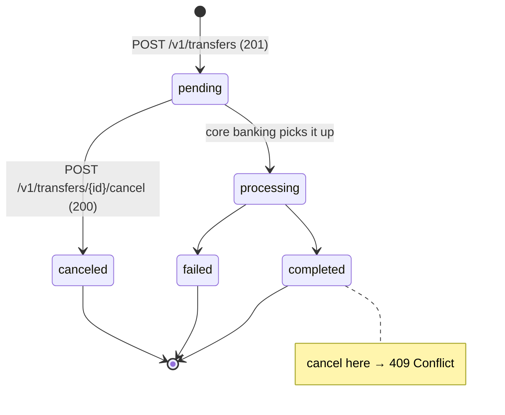
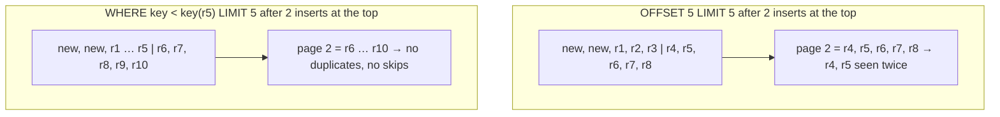
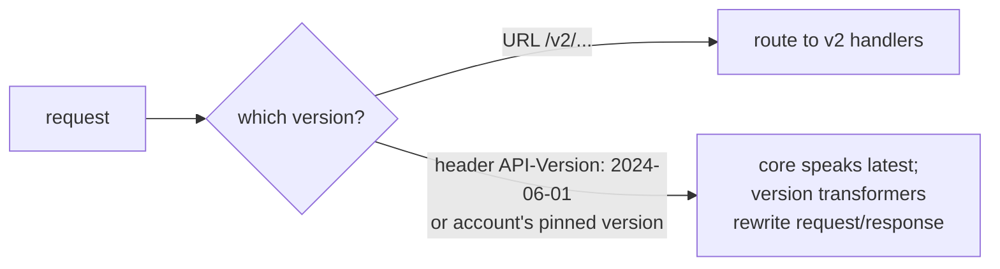
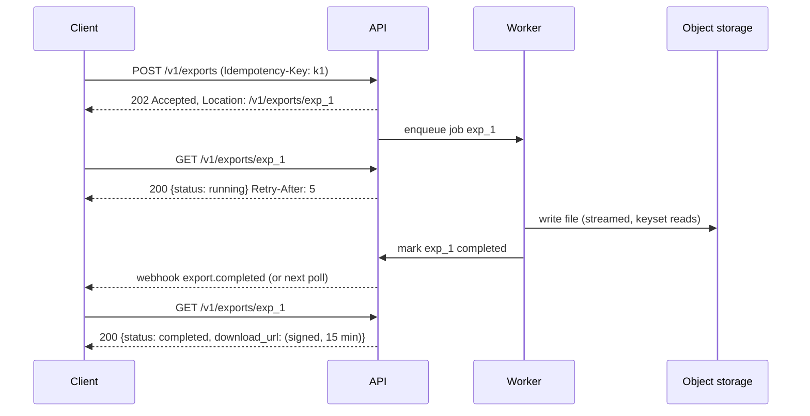
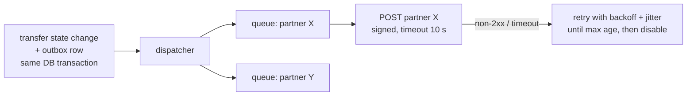

# A1 Unit 2 — API design

> Time: ~6 h · CORE: §1–§5 · STRETCH: the "GraphQL at scale" part of §4 · Lab: `labs/a1/pagination`

An API is the one part of a system you can't refactor quietly: once a partner has integrated, every field name,
status code and pagination quirk is a contract. In interviews, the API sketch is usually the second thing you draw,
and the follow-ups ("what happens if the client retries?", "how does pagination behave while new rows arrive?",
"how do you evolve this without breaking partners?") are where seniority shows. In banking, the stakes are concrete:
a sloppy status code becomes a duplicate payment.

## Before you start

You should have finished Unit 1 ([`unit-1-request-path.md`](unit-1-request-path.md)). Warm-up from Unit 1 — answer
first:

1. Why does a backend that returns 500 for *client* mistakes eventually get ejected by an L7 balancer?
2. Your partner's server calls your API at 300 req/s with 200 ms latency. Roughly how many connections should their
   pool hold to you?
3. Which `Cache-Control` value belongs on a transactions-list response?

<details data-kind="answer">
<summary>Warm-up answers</summary>

1. Passive health checking (outlier detection) counts 5xx responses as backend failures; enough consecutive 5xx and
   the backend is ejected even though it's working correctly. Status codes are signals to infrastructure, not just
   to clients — §1 builds on this.
2. Little's law: 300 × 0.2 = 60 concurrent; size the idle pool ≈ 60–100 (and remember Go's default of 2 idle per host).
3. `no-store`: personal data must never be stored by shared caches (and here, not by the browser either).

</details>

---

## §1 Resources, methods, status codes and errors

### The failure story

The first version of the partner transfers API was designed like a set of function calls:

```
POST /api/doTransfer        {"from":..., "to":..., "amount":...}
POST /api/getTransfers      {"memberId":...}
POST /api/cancelTransfer    {"transferId":...}
```

Every response was `200 OK` with `{"success": false, "error": "Insufficient funds"}` on failure. Three things went
wrong over a year:

- During a core-banking slowdown, ≈ 2% of transfers failed for 40 minutes. Dashboards counted 5xx responses, saw
  0%, and nobody was paged. Partners noticed first.
- To "improve reliability", someone configured the gateway to retry `POST` requests on upstream timeouts. Because
  *everything* was `POST`, reads and writes looked the same; `doTransfer` was retried after timeouts that had actually
  succeeded. 37 duplicate transfers in one afternoon.
- A partner parsed the English error string. A copy edit ("Insufficient funds." → "Not enough available balance")
  broke their integration.

### Predict

<!-- predict id="A1-U2-P01" -->
**Predict.** Write your answers down first.

1. Which HTTP methods are *safe*? Which are *idempotent*? Is `DELETE /payees/p_1` still idempotent if the first call
   returns 204 and the second 404?
2. Redesign the three endpoints as resources. Give method, path and success status for: create a transfer, read one,
   list a member's transfers, cancel a pending transfer. Then give the status code for: insufficient funds; cancelling
   a transfer that already completed; two admins editing the same payee at once; a partner asking for a transfer that
   belongs to a different credit union.
<!-- /predict -->

### Reveal

<details data-kind="reveal" data-for="A1-U2-P01">
<summary>Reveal</summary>

1. **Safe** (no intended state change): GET, HEAD, OPTIONS, TRACE. **Idempotent** (the intended effect of N
   identical requests equals that of one): the safe methods plus PUT and DELETE. POST and PATCH are neither by
   definition (RFC 9110). Idempotency is about the *effect on server state*, not about the response: DELETE returning
   204 then 404 is idempotent — the payee is gone either way. The tempting wrong answer is "idempotent means same
   response".
2. - `POST /v1/transfers` → **201 Created** with `Location: /v1/transfers/tr_8f2k…` (plus an idempotency key, Unit 3).
   - `GET /v1/transfers/{id}` → 200. `GET /v1/transfers?member=…&status=pending` → 200 with a paginated list (§2).
   - Cancel: `POST /v1/transfers/{id}/cancel` → 200 with the updated transfer. A state transition with side effects
     is better modelled as a custom action than as `PATCH {"status":"canceled"}` (which invites clients to set any
     status).
   - Insufficient funds → **422 Unprocessable Content** (well-formed request, business rule says no) with a stable
     code `insufficient_funds`. Not 400 (that's for malformed input), not 402 (reserved, unused in practice).
   - Cancel a completed transfer → **409 Conflict** (the request conflicts with the resource's current state).
   - Concurrent edit → optimistic concurrency: `GET` returns an `ETag`; the update sends `If-Match: <etag>`; if
     someone else changed it first → **412 Precondition Failed**. (Without preconditions: last write wins, silently.)
   - Another credit union's transfer → **404 Not Found**, deliberately, so the API doesn't confirm the ID exists.
     403 is fine for "you know it exists but may not do this" (e.g. a read-only key attempting a write).

</details>

### How it actually works

**Resource modelling.** Nouns, not verbs: collections (`/v1/transfers`) and items (`/v1/transfers/{id}`),
sub-resources where ownership is real (`/v1/members/{id}/accounts`), opaque prefixed IDs (`tr_…`, `acct_…`) that
don't leak sequence or volume. Model state machines explicitly and expose transitions as actions:



**Methods.**

| Method | Safe | Idempotent | Typical use | Cacheable |
|---|---|---|---|---|
| GET | yes | yes | read | yes |
| HEAD | yes | yes | headers only | yes |
| PUT | no | yes | create-or-replace at a client-known URI | no |
| DELETE | no | yes | remove | no |
| POST | no | no | create in a collection; actions | rarely |
| PATCH | no | no (some patch formats can be) | partial update | no |

Infrastructure relies on this table: proxies and client libraries retry requests automatically on connection
failure only when they believe it's safe (NGINX's `proxy_next_upstream` does not pass non-idempotent methods such as
POST and PATCH to the next upstream unless `non_idempotent` is set; Go's `http.Transport` transparently retries a
request whose reused connection broke only if it's GET/HEAD/OPTIONS/TRACE *or carries an `Idempotency-Key` header*,
with a rewindable body — see `Request.isReplayable` in the Go source), caches only store safe responses, and
browsers prefetch GETs. Lying about safety (a GET with side effects) gets you
side effects triggered by link previewers and crawlers.

**Status codes that carry meaning to clients and infrastructure.**

| Code | Use it for | Infrastructure/client reaction |
|---|---|---|
| 200 / 201 / 204 | success / created (+ `Location`) / no body | — |
| 202 Accepted | accepted for async processing (§5) | poll or wait for a webhook |
| 304 Not Modified | conditional GET hit | cache reuses stored body |
| 400 | malformed request (bad JSON, wrong type) | don't retry |
| 401 | not authenticated (missing/invalid credentials; send `WWW-Authenticate`) | re-authenticate |
| 403 | authenticated but not allowed | don't retry |
| 404 | no such resource *for this caller* | don't retry |
| 409 | conflicts with current state | re-read, decide |
| 412 | `If-Match` precondition failed | re-read, merge, retry |
| 422 | well-formed but violates a business rule | don't retry unchanged |
| 429 | rate limited (+ `Retry-After`) | back off, retry later |
| 500 | bug / unexpected error | maybe retry (idempotent only) |
| 502 / 503 / 504 | upstream failure / overloaded or down (+ `Retry-After`) / upstream timeout | retry with backoff; LBs count these against backends |

**Error model.** One shape for every error, machine-readable code first:

```json
{
  "error": {
    "type": "invalid_request",
    "code": "insufficient_funds",
    "message": "The source account's available balance is lower than the transfer amount.",
    "param": "amount_cents",
    "request_id": "req_7Hq2…"
  }
}
```

`code` is the contract (stable, documented, enumerable); `message` is for humans and may change; `param` points at the
offending field; `request_id` (also in a response header) ties the error to your logs and audit trail — the first
thing support asks a partner for. RFC 9457 "Problem Details" (`application/problem+json` with `type`, `title`,
`status`, `detail`, `instance`) is the standardised alternative; pick one and use it everywhere.

### Build it

The error model is exercised by the pagination handler you build in §2 (`NewHandler` in `labs/a1/pagination`): 400
with `{"error":{"code":"invalid_limit"|"invalid_cursor","message":…}}`, 405 with an `Allow: GET` header, and
`"items": []` (never `null`) for an empty list. The acceptance test is `TestHandler_ErrorsUseErrorModel`.

### Break it

After §2's lab passes: (a) make your handler return **500** for an invalid cursor and imagine it sitting behind the
`lb` balancer from Unit 1 with `FailureThreshold: 3`; (b) make it return **200** with the error body. For each, what
happens to clients, to the balancer, and to your dashboards?

<details data-kind="answer">
<summary>What happens, and why</summary>

(a) A partner with a stale cursor sends it three times (their client retries 5xx) and your balancer ejects a healthy
backend; a few such clients can eject the whole pool. The client also retries a request that can never succeed.
`TestHandler_ErrorsUseErrorModel` fails. (b) Client libraries treat it as success and try to parse items from an
error body; generic retry/backoff logic never kicks in; error-rate dashboards and SLOs based on status codes show
0% — the failure story's 40-minute blind spot. Status codes are part of the API for *machines in the middle*, not
just for the caller.

</details>

### In the wild

- **Stripe**: resource-oriented URLs (`/v1/charges`, `/v1/payment_intents/{id}/confirm` for actions), errors with
  `type`, `code`, `message`, `param`, and a `Request-Id` response header.
- **Google AIPs** (API Improvement Proposals): AIP-121 resource-oriented design, AIP-136 custom methods
  (`POST /v1/{name}:cancel`), AIP-193 errors (`google.rpc.Status` with typed details).
- **RFC 9110** defines method semantics and status codes (it absorbed 422 from WebDAV, now "Unprocessable Content");
  **RFC 9457** defines Problem Details.
- **OWASP API Security Top 10 (2023)**: #1 is Broken Object Level Authorization — an API that returns another
  tenant's object when given its ID. In a multi-tenant credit-union platform, every lookup must be scoped by tenant
  *in the query*, and the response for "exists but not yours" should be 404.

### Trade-offs

| Option | Wins when | Loses when | When the answer flips |
|---|---|---|---|
| Fine-grained status codes | Clients, proxies and dashboards can act on them | Teams disagree on edge cases (400 vs 422) | Never flip to "200 for everything"; pick a documented convention |
| Custom action (`POST …/cancel`) | Transitions with side effects and rules | Simple field edits | Flip to `PATCH` for plain attribute changes (nickname, memo) |
| `PATCH` (partial) vs `PUT` (replace) | PATCH: clients send only what changes | PUT: needs full representation; risk of clobbering | Flip to PUT when the client owns the whole resource (e.g. a config document) and you want idempotent writes |
| 404 for others' objects | Doesn't leak existence across tenants | Harder debugging for legit callers with wrong scope | Flip to 403 when existence isn't sensitive and the caller is in the same tenant |
| Optimistic concurrency (`ETag`/`If-Match`) | Concurrent edits are rare; no locks | High contention → many 412 retries | Flip to explicit locking/queueing for hot resources |

### Senior bar

- **Failure modes**: 200-with-error (invisible outages); 5xx for client errors (retries + ejections); GETs with side
  effects; error strings as contracts; cross-tenant object access (BOLA); inconsistent error shapes across services
  (every client writes N parsers).
- **Capacity**: status semantics drive *load*: 5xx/429/503 trigger retries. A wrong code turns one bad request into
  several; `Retry-After` lets you shape the retry wave.
- **Ops**: request IDs in every response and log line; error codes as metrics dimensions (alert on a spike in
  `insufficient_funds` vs `core_unavailable` differently); an API style guide plus a linter on OpenAPI specs.
- **Cost**: support time. Every ambiguous error is a ticket.

Interviewer follow-up probes:

1. "Is DELETE idempotent if the second call returns 404?"

<details data-kind="answer">
<summary>Model answer</summary>

Yes. Idempotency is defined on the server-side effect: after one or many identical DELETEs the resource is gone.
The responses can differ. Some APIs return 204 on repeat deletes to make client retry logic simpler; either is
defensible if documented.

</details>

2. "A partner asks for a transfer ID that exists but belongs to another credit union. What do you return, and where
   is that enforced?"

<details data-kind="answer">
<summary>Model answer</summary>

404, so the API doesn't confirm existence across tenants. Enforced in the data access layer: the query is
`WHERE id = $1 AND tenant_id = $2` with the tenant taken from the authenticated principal, never from a request
parameter. Fetching by ID and then checking ownership in a handler is how BOLA bugs happen (someone adds a new
endpoint and forgets the check).

</details>

3. "Why 422 and not 400 for insufficient funds?"

<details data-kind="answer">
<summary>Model answer</summary>

400 means the request is malformed — the client should fix its code. Insufficient funds is a valid request that a
business rule rejects *right now*; the same request might succeed later. Separating them lets clients route errors
correctly (bug vs user-facing message) and lets you monitor them separately. What matters more than the number is the
stable `code` in the body.

</details>

### Check yourself

1. Which methods may a proxy safely retry on a connection failure without knowing anything about your API?
2. What header turns "last write wins" into a detected conflict?
3. What does `request_id` buy you operationally?

<details data-kind="answer">
<summary>Answers</summary>

1. Idempotent ones: GET, HEAD, OPTIONS, PUT, DELETE (and only if the request is otherwise retryable, e.g. no
   non-replayable body).
2. `If-Match` with the resource's ETag (server answers 412 on mismatch).
3. A join key between a partner's report, your logs, traces and audit trail.

</details>

---

## §2 Pagination

### The failure story

A credit union's commercial member has 40,000 transactions on one operating account. The mobile app lists
transactions with offset pagination: `GET /v1/accounts/a1/transactions?offset=39980&limit=20`, i.e. SQL
`ORDER BY created_at DESC LIMIT 20 OFFSET 39980`. The database has to walk and discard ≈ 40k index entries to return
20 rows. A finance team's script exports the history page by page; it gets slower with every page (the total work is
≈ n²/2 rows read: ≈ 40M for a 40k-row export) and pins a DB core.

Meanwhile, on the member's phone: three new card authorisations post while they scroll, so page 2 starts with the
last three rows of page 1 — the member sees the same $1,200 payment twice and calls support: "was I charged twice?"
A reversal (a deleted pending authorisation) shifts rows the other way, and one transaction never appears at all.
And the nightly ACH batch stamps 400 postings with the same `created_at` second; with no tiebreaker the database
is free to return those 400 in a different order on each query, so rows swap between pages.

### Predict

<!-- predict id="A1-U2-P02" -->
**Predict.** Write your answers down first.

1. With offset pagination (page size 5), the member reads page 1. Two new rows are inserted at the top, then they
   request page 2. Which rows do they see twice, or never? What if instead two rows from page 1 are deleted?
2. You switch to "give me rows with `created_at` < the last row's `created_at`". What breaks on the ACH batch with
   400 identical timestamps? What's the fix?
3. What goes inside a cursor, and why should it be opaque and signed?
<!-- /predict -->

### Reveal

<details data-kind="reveal" data-for="A1-U2-P02">
<summary>Reveal</summary>

1. Offset counts *positions*, and positions shift. Two inserts at the top push every row down by 2: page 2 (offset 5)
   now starts with what were rows 4 and 5 of page 1 — **duplicates**. Two deletes from page 1 pull every row up by 2:
   the rows that were at positions 6 and 7 are now at 4 and 5, which the client already "passed" — **skipped**. The
   lab encodes exactly these two cases as `TestOffset_InsertAtFrontDuplicatesRows` and
   `TestOffset_DeleteSeenRowSkipsRows`.
2. `created_at < last` skips every remaining row that shares the last row's timestamp (up to 399 rows in the ACH
   batch); `<=` repeats them. The sort key must be **unique and total**: `(created_at, id)`, compared as a tuple —
   `WHERE (created_at, id) < ($1, $2) ORDER BY created_at DESC, id DESC`. The tempting wrong answer is "use a
   higher-precision timestamp": collisions get rarer, never impossible.
3. The last row's sort key (here `created_at` with full precision + `id`), a format version, and ideally a binding to
   the query (filters, sort order) so a cursor can't be reused with different parameters. **Opaque** (base64) so
   clients don't construct or depend on its contents — you can change the format later. **Signed** (HMAC) so clients
   can't forge positions, probe for IDs, or crash your parser with crafted input. Signed is not encrypted: base64 is
   readable, so encrypt it if the key itself is sensitive. And the cursor is never the authorisation boundary — the
   query still filters by tenant/account.

</details>

### How it actually works



**Offset pagination**: `LIMIT n OFFSET k`. Cost O(k + n) per page (the database still produces and discards k rows).
Stable only if nothing changes. Simple, supports "jump to page 37" and totals.

**Keyset (seek / cursor) pagination**: remember where you stopped (the last row's key) and seek past it. With an
index on `(created_at, id)` the database does an index seek plus n rows: O(log N + n) at any depth. Guarantee (what
the lab tests): *every row that exists for the whole walk is returned exactly once, in order*; rows inserted or
deleted during the walk may or may not appear depending on where they land relative to the cursor.

Fetch `limit + 1` rows: if you get the extra one, there's a next page (return a cursor built from the *limit-th*
row, not the extra one); otherwise this is the last page and you don't send an empty trailing page.

Cursor layout used by the lab's reference solution:

```
base64url_nopad( version(1 byte) | created_at unix nanos (8 bytes, big endian) | id | HMAC-SHA256(secret, everything before)(32 bytes) )
```

Things the API contract should say: maximum page size (e.g. 100) and default (e.g. 20); results are ordered by
`created_at` desc then `id` desc; cursors are opaque and may expire; there is no total count (a `COUNT(*)` over a
large filtered set costs as much as the walk — offer an approximate count or none).

Variations: backward paging (`ending_before` = seek the other way, then reverse); sorting by other columns (the key
becomes `(amount, id)` and the cursor must record which sort was used); consistent snapshots for exports (a
point-in-time read, or — better for 40k rows — an async export job, §5).

### Build it

Lab `labs/a1/pagination`, file `pagination.go`. Provided: `Item`, `Key`, `KeyOf`, `Before` (the sort order) and
`Store.Insert/Delete/Len`. Implement:

- `(*Store).Offset(offset, limit)` — the comparison baseline.
- `(*Store).After(after *Key, limit)` — binary search (`sort.Search`) for the first item strictly after the key; it
  must work when the cursor's item has been deleted.
- `EncodeCursor(secret, Key)` / `DecodeCursor(secret, string)` — opaque, URL-safe, HMAC-SHA256, constant-time compare
  (`hmac.Equal`), any failure → `ErrInvalidCursor`.
- `(*Paginator).List(cursor, limit)` — validation, `limit+1` fetch, `NextCursor`, non-nil `Items`.
- `NewHandler(*Paginator)` — `GET ?limit=&cursor=` → JSON with the error model from §1.

Acceptance tests: `TestOffset_*`, `TestAfter_SeeksStrictlyAfterKey`, `TestAfter_WorksWhenCursorItemWasDeleted`,
`TestCursor_RoundTrip`, `TestCursor_TamperingNeverYieldsADifferentKey` (every single-character change, every
truncation, a different secret, garbage), `TestList_WalksEveryItemExactlyOnceWithTiedTimestamps`,
`TestList_NoDuplicatesNoSkipsUnderMutation` (inserts at the top, deletes of seen and unseen rows, a backdated insert,
same-timestamp inserts on both sides of the cursor), `TestList_ConcurrentWritersAndReaders` (4 writers, 4 readers,
`-race`), `TestHandler_*`. Run `go test -race ./labs/a1/pagination/`.

### Break it

`go test -tags breakit -run BreakIt -v ./labs/a1/pagination/` walks a 500-row table with both modes while random
mutations (new rows at the top, backdated rows in the middle, deletes of rows inserted during the walk) happen between
pages, and counts duplicates and skips of the original rows. Predict both columns for each mode first. Then: change
`Before` in your copy to compare only `CreatedAt` (no ID tiebreak) and re-run the normal test suite.

<details data-kind="answer">
<summary>What you should see, and why</summary>

Reference run: offset ≈ 24–28 duplicates and ≈ 6–10 skips per walk; keyset 0 and 0 (the harness fails if keyset shows
any). Offset skips original rows even though only rows inserted *during* the walk are ever deleted: deleting one of
those volatile rows that sits above the current offset shifts every original row below it up by one position.
Without the ID tiebreak, `Store.Insert` and `After` can't order tied timestamps, so
`TestList_WalksEveryItemExactlyOnceWithTiedTimestamps` loses or repeats rows inside a timestamp group — the ACH
batch bug.

</details>

### In the wild

- **Stripe** list endpoints: `limit` (1–100, default 10), `starting_after` / `ending_before` (object IDs used as
  cursors), and `has_more`.
- **Slack** Web API: `cursor` parameter, `response_metadata.next_cursor` in responses.
- **GitHub** REST: `Link` header with `rel="next"` URLs; some endpoints are cursor-based. **GraphQL Relay
  connections** (used by GitHub's GraphQL API): `edges { cursor node }`, `pageInfo { hasNextPage endCursor }`.
- **Google AIP-158**: `page_size`, opaque `page_token`, `next_page_token`; tokens must not be parsed by clients.
- **Elasticsearch**: `from + size` deep paging is capped by `index.max_result_window` (default 10,000); deep paging
  uses `search_after` (keyset) with a point-in-time for consistency.
- **Postgres** supports row-value comparison `(created_at, id) < ($1, $2)` and can use a composite index for it; on
  other databases you may need the expanded form `created_at < $1 OR (created_at = $1 AND id < $2)`
  (`TODO-VERIFY: index usage for row-value comparisons on your MySQL version`).

### Trade-offs

| Option | Wins when | Loses when | When the answer flips |
|---|---|---|---|
| Offset | Small, static data; admin UIs that need "page 37 of 80" and totals | Live data (dups/skips); deep pages (O(offset)) | Flip to keyset as soon as data changes while users page or depth exceeds ≈ thousands |
| Keyset / cursor | Feeds, transaction lists, exports, any live data; constant cost at depth | Arbitrary page jumps; sorts on non-unique, non-indexed columns | Flip to offset (or search) for small admin tables; offer "jump to date" via a seek on `created_at` instead of page numbers |
| Snapshot / point-in-time | Exports and reports that must be internally consistent | Holding snapshots costs the server (resources, retention) | Flip to an async export job writing a file (§5) for very large results |
| Server-side page tokens (state stored on server) | Expensive queries you don't want to re-run | Server state per client; expiry handling | Flip to stateless signed cursors unless re-running the query is prohibitive |

### Senior bar

- **Failure modes**: non-unique sort keys; cursors that encode raw SQL fragments or tenant IDs and are trusted;
  cursor format changes breaking in-flight cursors (version byte; accept old versions for a while); unbounded
  `limit`; `COUNT(*)` on every page.
- **Capacity**: offset page k costs ≈ k + n rows. 200 req/s of page-2000 requests at n = 20 is ≈ 8M rows/s read and
  discarded; keyset makes it ≈ 4k rows/s. Exports: offset total work ≈ N²/(2n) rows; keyset ≈ N.
- **Ops**: composite index on the sort key per list endpoint (the cursor is useless without it); max page size
  enforced; cursor-secret rotation (accept the previous secret during a window, like token keys in Unit 3).
- **Cost**: DB CPU for deep offsets; support tickets for "duplicate" transactions that weren't.

Interviewer follow-up probes:

1. "Product wants 'jump to page 50'. What do you do?"

<details data-kind="answer">
<summary>Model answer</summary>

Ask what the user actually wants: almost always "go to March" or "find the $1,200 payment". Offer a date jump (keyset
seek starting at a timestamp) and search/filters. If page numbers are truly required on a small, mostly static set,
offset is acceptable there — with a max depth and an index that supports the sort.

</details>

2. "How do you sort transactions by amount with cursors?"

<details data-kind="answer">
<summary>Model answer</summary>

The key becomes `(amount, id)`, with an index on it (per account/tenant: `(account_id, amount, id)`). The cursor
records the sort mode and the last `(amount, id)`; a cursor issued for date order is rejected for amount order
(bind the cursor to the query parameters, e.g. include them in the MAC).

</details>

3. "Why sign the cursor if the query filters by tenant anyway?"

<details data-kind="answer">
<summary>Model answer</summary>

Tenant filtering is the security boundary; signing is defence in depth and API hygiene: clients can't fabricate
positions (enumerating IDs, scraping), can't send crafted inputs to your decoder, and can't start depending on the
format, so you can change it. HMAC is cheap (≈ µs).

</details>

### Check yourself

1. Why fetch `limit + 1` rows?
2. What exactly does keyset pagination guarantee while rows are inserted and deleted?
3. Why does `TestAfter_WorksWhenCursorItemWasDeleted` matter in production?

<details data-kind="answer">
<summary>Answers</summary>

1. To know whether another page exists without a count query, and so the last page doesn't come with a cursor to an
   empty page.
2. Rows present for the whole walk appear exactly once, in order; rows inserted/deleted during it may or may not
   appear.
3. A cursor is a position in the order, not a pointer to a row; the row it came from is often deleted (reversals,
   expired holds) before the next page is requested.

</details>

---

## §3 Versioning and evolution

### The failure story

Two "harmless" changes in one release:

1. The transfer response gained a `fee_cents` field. One partner's client decoded responses with unknown fields
   disallowed ("strict, to catch bugs early"). Every response now failed to parse; their 02:00 batch run failed
   completely.
2. Compliance needed a new status, `on_hold`, for transfers paused for review. Another partner's code mapped any
   status it didn't recognise to "failed" and told members their transfer had failed. Members re-submitted. 112 of
   those held transfers were later released — and the re-submissions also went through. Duplicate payments again.

Neither change renamed or removed anything.

### Predict

<!-- predict id="A1-U2-P03" -->
**Predict.** Write your answers down first.

Classify each change as *safe* or *breaking* for existing clients, and say what the contract must state up front to
make the "safe" ones actually safe: (a) add an optional request field; (b) add a response field; (c) add an enum
value; (d) make an optional request field required; (e) rename a field; (f) change a default (e.g. `limit` 10 → 20);
(g) tighten validation (memo max length 140 → 80); (h) change an error code string.
<!-- /predict -->

### Reveal

<details data-kind="reveal" data-for="A1-U2-P03">
<summary>Reveal</summary>

- (a) Safe. (b) Safe **only if** the contract says clients must ignore unknown fields — say it on day one, because
  strict decoders exist. (c) Safe **only if** the contract says enums are open and clients must handle unknown values
  (map to "unknown/pending, check later", never to "failed"); otherwise breaking — the failure story. (d) Breaking.
  (e) Breaking (it's a remove + add). (f) Breaking: behaviour changes for every client that relied on the default.
  (g) Breaking: previously valid requests now fail. (h) Breaking: clients branch on codes.

The tempting wrong answer is "additive changes are always safe". They are safe only for *tolerant readers*, and you
get tolerant readers by documenting the rule and testing your SDKs against it.

</details>

### How it actually works

Two separate questions: **how do you make changes without breaking clients** (compatibility rules) and **what do you
do when you must break them** (versioning).

Compatibility rules for a JSON API: never remove or rename; never change type or meaning; new request fields are
optional with defaults that preserve old behaviour; responses may gain fields; enums may gain values; clients must
ignore unknown fields and handle unknown enum values. For Protobuf/gRPC: never reuse or renumber field numbers
(mark removed ones `reserved`), don't change field types, enums need an `UNSPECIFIED = 0` value, and unknown fields
are preserved by modern runtimes — which is why most internal gRPC APIs evolve without explicit versions.

Versioning strategies when you must break:



| Strategy | Example | Notes |
|---|---|---|
| Major version in URL | `/v1/transfers` → `/v2/transfers` | Obvious, cache-friendly; each major is a big migration; tends to be rare (years) |
| Version header / media type | `Accept: application/vnd.bank.v2+json` | Clean URLs; easy to forget in tooling and logs |
| Date-based, pinned per client | Stripe: account pinned to the version at first call; `Stripe-Version` header overrides | Many small breaking changes; a compatibility layer transforms responses back to each client's version |
| No versions, additive only | Internal gRPC; Google's "v1 forever" for many APIs | Requires discipline and tolerant readers; breaking change = new method/field |

Deprecation lifecycle: announce, mark (`Sunset` header, RFC 8594; a `Deprecation` header is also standardised —
`TODO-VERIFY: RFC number for the Deprecation header`), measure usage *per client* of the old behaviour, contact the
stragglers, remove. For a B2B partner API you usually know every caller by API key — use that.

### Build it

No lab package for this section — versioning is a contract decision. The same idea at small scale is the version
byte in your §2 cursor: it lets a future format coexist with cursors already in clients' hands.

### Break it

Run this "partner client" against your v1 response and against the v1 response plus the two additive changes:

```go
// A partner's v1 client decodes your transfer response. You ship two
// "additive" changes: a new field and a new enum value.
package main

import (
	"bytes"
	"encoding/json"
	"fmt"
)

type Transfer struct {
	ID     string `json:"id"`
	Amount int64  `json:"amount_cents"`
	Status string `json:"status"`
}

func decodeStrict(b []byte) (Transfer, error) {
	var t Transfer
	dec := json.NewDecoder(bytes.NewReader(b))
	dec.DisallowUnknownFields() // "be strict, catch bugs early"
	return t, dec.Decode(&t)
}

func decodeTolerant(b []byte) (Transfer, error) {
	var t Transfer
	return t, json.Unmarshal(b, &t)
}

func describe(t Transfer) string {
	switch t.Status {
	case "pending", "processing":
		return "in progress"
	case "completed":
		return "done"
	default:
		return "FAILED - tell the member to retry" // the bug: unknown != failed
	}
}

func main() {
	v1 := []byte(`{"id":"tr_1","amount_cents":50000,"status":"pending"}`)
	v1plus := []byte(`{"id":"tr_1","amount_cents":50000,"status":"on_hold","fee_cents":0}`)
	for _, body := range [][]byte{v1, v1plus} {
		_, errS := decodeStrict(body)
		t, errT := decodeTolerant(body)
		fmt.Printf("strict err=%v | tolerant err=%v status=%q -> %s\n", errS, errT, t.Status, describe(t))
	}
}
```

Predict both lines. Then fix `describe` so an unknown status can't cause a duplicate payment.

<details data-kind="answer">
<summary>What you should see, and the fix</summary>

Line 1 is fine. Line 2: the strict decoder fails with `unknown field "fee_cents"`; the tolerant decoder succeeds but
`describe` says FAILED for `on_hold`. Fix: the default branch must mean "status not recognised — treat as in progress
and re-check / show 'processing'"; only an explicit `failed` should invite a retry. On the server side, publish both
rules (ignore unknown fields; enums are open) in the API reference, and run contract tests with a strict decoder so
*your own* SDKs never ship strict.

</details>

### In the wild

- **Stripe**: date-named versions; an account is pinned to the version current when it first made a request;
  per-request override with the `Stripe-Version` header; internally, the core speaks the newest version and
  "version change" modules transform responses for older pins (Stripe has written publicly about this design).
- **GitHub REST**: `X-GitHub-Api-Version: 2022-11-28` header selects a date-based version.
- **Twilio**: the version date is in the URL (`/2010-04-01/Accounts/...`).
- **Google**: major version in the path (`v1`, `v1beta1`); AIP-180 lists what counts as backwards-compatible;
  AIP-185 covers versioning.
- **Kubernetes**: API groups move through `v1alpha1` → `v1beta1` → `v1` with a published deprecation policy.
- **Protobuf** language guide: "reserved" field numbers/names, never reuse a tag.

### Trade-offs

| Option | Wins when | Loses when | When the answer flips |
|---|---|---|---|
| URL major versions | Public APIs with rare, big changes; easy routing and docs | You need frequent small breaking changes; N parallel code paths | Flip to date-pinned versions + transformers when you ship many small breaks (Stripe's situation) |
| Date-pinned versions | Many small changes; clients upgrade when ready | Compatibility layer is real engineering; testing matrix grows | Flip to "additive only" for internal APIs where you control clients |
| Additive-only, no versions | Internal services, gRPC, mobile apps you can't force-upgrade | A genuinely incompatible redesign | Flip to a new major (or a new resource/method) for the redesign |
| Strict client decoding | Catch typos in tests | Breaks on every additive change in production | Strict in contract tests, tolerant in production clients |

### Senior bar

- **Failure modes**: additive changes breaking strict clients; open-world enums treated as closed; silent default
  changes; old mobile app versions in the wild for years (you cannot force-upgrade everyone — design APIs so old apps
  degrade gracefully, and keep a minimum-supported-version kill switch).
- **Capacity**: not a throughput problem; the cost is engineering capacity per live version.
- **Ops**: API changelog; contract tests / consumer-driven contracts (e.g. Pact) run in CI against partner
  expectations; per-client usage metrics of deprecated fields before removal; a schema linter that blocks breaking
  diffs in OpenAPI/Protobuf (e.g. `buf breaking` for Protobuf).
- **Cost**: each supported version multiplies testing; each forced migration costs partners real money — which is
  why banking partners negotiate deprecation windows contractually.

Interviewer follow-up probes:

1. "You need to rename `amount` to `amount_cents`. Walk me through it."

<details data-kind="answer">
<summary>Model answer</summary>

Add `amount_cents` alongside `amount`, populate both, document `amount` as deprecated (Sunset date), accept either
on input (reject requests that send both with different values), measure which clients still read or send `amount`
(by API key), notify them, and remove it only in the next major/version pin. The rename itself is a breaking change;
the process makes it an additive one followed by a scheduled removal.

</details>

2. "How does supporting years of API versions not become a maintenance nightmare?"

<details data-kind="answer">
<summary>Model answer</summary>

Keep one core implementation at the latest version and isolate old behaviour in small, composable transformations
applied at the edge (request upgrade, response downgrade), one per breaking change, each with tests. The version is
just the list of transformations to apply. Old versions then cost a little code per change, not a forked codebase.

</details>

3. "What do you put in the contract on day one to keep future changes non-breaking?"

<details data-kind="answer">
<summary>Model answer</summary>

Clients must ignore unknown fields; enums may gain values and clients must handle unknown ones safely; fields may be
added to responses and optional fields to requests; error `code`s are the contract, messages are not; ordering of
JSON keys is not significant; IDs are opaque strings of unspecified length.

</details>

### Check yourself

1. Why is adding an enum value potentially breaking?
2. In Protobuf, what must you never do with a field number?
3. Which header announces when a deprecated endpoint will stop working?

<details data-kind="answer">
<summary>Answers</summary>

1. Clients that switch exhaustively or map unknown values to a wrong default (e.g. "failed") misbehave.
2. Reuse it (or change its type). Mark removed numbers `reserved`.
3. `Sunset` (RFC 8594).

</details>

---

## §4 REST vs gRPC vs GraphQL, and streaming

### The failure story

Three teams, three proposals in one architecture review:

- The mobile team, tired of the 12 calls on the dashboard (Unit 1 §2), wants GraphQL. Their prototype lets a client
  ask for `member { accounts { transactions(last: 50) { merchant { … } } } }`. A business member with 50 sub-accounts
  turns one query into 1 + 50 + 2,500 database queries (the N+1 problem, twice), and an internal load test with a
  deeply nested query takes the read replica down.
- The platform team wants gRPC for everything, including the partner API. The first partner asks how to call it from
  their browser-based admin console and from a low-code integration tool. Neither speaks gRPC.
- The statements team returns a 2-million-row CSV export from a synchronous REST endpoint that builds the whole file in
  memory: ≈ 2M × 200 B ≈ 400 MB per request; three concurrent exports and the pod is OOM-killed.

### Predict

<!-- predict id="A1-U2-P04" -->
**Predict.** Write your answers down first.

1. Pick a style for each and give one reason and one risk: (a) the public partner API for fintechs; (b) calls between
   your internal services (transfers → ledger → notifications); (c) the mobile app's dashboard aggregation.
2. What are two ways to deliver the 2-million-row export without holding it in memory?
<!-- /predict -->

### Reveal

<details data-kind="reveal" data-for="A1-U2-P04">
<summary>Reveal</summary>

1. (a) **REST/JSON over HTTPS** with an OpenAPI spec: every partner's stack, tool and proxy speaks it; HTTP caching,
   status codes and idempotency keys apply directly; easy to debug with curl. Risk: weaker typing → invest in the
   spec and SDKs. (b) **gRPC**: Protobuf contracts with codegen, efficient binary encoding, deadlines propagated
   across hops, streaming. Risk: needs L7/client-side load balancing (Unit 1 §4) and gRPC-aware tooling. (c)
   **A backend-for-frontend (BFF)** or **GraphQL**: one round trip, response shaped for the screen. GraphQL's risks
   are N+1 resolvers, unbounded query cost, and harder HTTP caching; a BFF (a small REST endpoint per screen owned by
   the mobile team) gets most of the latency win with less machinery. The tempting wrong answer is one style for
   everything.
2. **Stream it** (chunked transfer encoding: write rows as you read them from a cursor, flushing periodically; NDJSON
   or CSV) with memory O(batch), or — better for very large or slow exports — make it an **async job** (§5) that
   writes the file to object storage and returns a short-lived signed URL. The async version survives client
   disconnects and load-balancer idle timeouts.

</details>

### How it actually works

| | REST/JSON | gRPC | GraphQL |
|---|---|---|---|
| Contract | OpenAPI (optional) | `.proto` (required), codegen | Schema (required), introspection |
| Transport | HTTP/1.1 or 2 | HTTP/2 (browsers need gRPC-Web or a proxy) | HTTP, usually `POST /graphql` |
| Encoding | JSON (text) | Protobuf (binary, ≈ several times smaller/faster to parse — `TODO-VERIFY` for your payloads) | JSON |
| Shape | server decides per endpoint | server decides per method | client selects fields |
| Errors | HTTP status + body | gRPC status codes (`INVALID_ARGUMENT`, `NOT_FOUND`, `DEADLINE_EXCEEDED`, `UNAVAILABLE`, …) | usually HTTP 200 with an `errors` array |
| Caching | HTTP caching works (GET) | none built in | hard at HTTP level (POST); client-side normalised caches |
| Streaming | chunked responses, SSE, WebSockets | server, client and bidirectional streams | subscriptions (usually over WebSockets) |
| Best fit | public/partner APIs, resource CRUD | internal service-to-service, high QPS, streaming | many client types with different data needs |

**gRPC call types**: unary, server-streaming (statement lines), client-streaming (bulk upload), bidirectional (chat,
live quotes). **Deadlines**: the client sets a deadline; it travels in metadata (`grpc-timeout`) and each hop can
derive its own remaining budget — the RPC version of passing `context.Context` down. Status codes map cleanly to retry
decisions (`UNAVAILABLE` → retry; `INVALID_ARGUMENT` → don't).

**GraphQL mechanics**: each field has a resolver; naive resolvers produce N+1 queries; the fix is batching per
request (the DataLoader pattern: collect keys during one execution tick, fetch with one `WHERE id = ANY(...)`).
Protection: depth and complexity limits, pagination required on list fields, timeouts, and — for first-party apps —
**persisted queries** (the server only accepts pre-registered query hashes), which also restores cacheability.
Authorisation must be enforced per field/object, not per endpoint.

**Streaming to clients**:

| Mechanism | Direction | Notes |
|---|---|---|
| Chunked HTTP response (NDJSON/CSV) | server → client, one response | Simple; bounded memory; dies with the connection |
| Server-Sent Events (`text/event-stream`) | server → client | Text events over HTTP; browser `EventSource` auto-reconnects and sends `Last-Event-ID` |
| WebSockets | both ways | Long-lived, stateful connections: sticky by nature (Unit 1 §5), need draining plans |
| Long polling | server → client | Works everywhere; one request per event batch |
| gRPC streams | any | Needs HTTP/2 end to end |

**STRETCH — GraphQL at scale.** Federation (Apollo Federation, Netflix's DGS) composes one graph from many services'
subgraphs; cost-based rate limiting (charge each query by estimated work, not by request count); and field-level
deprecation (`@deprecated`) gives GraphQL an evolution story different from §3's versions: clients only break if they
*select* a removed field, and the server can see exactly which clients select it.

### Build it

No lab package for this section — the choice is a design decision. Unit 3's idempotency middleware is written as
`net/http` middleware; the same logic is a gRPC unary interceptor in an internal service.

### Break it

Count database round trips for "a business member's accounts with their recent transactions", resolved naively vs
batched:

```go
// Count database round trips for "accounts with their last 5 transactions"
// resolved naively (one query per account) vs batched (DataLoader-style).
package main

import "fmt"

type db struct{ queries int }

func (d *db) accounts(member string) []string {
	d.queries++
	out := make([]string, 50) // a business member with 50 sub-accounts
	for i := range out {
		out[i] = fmt.Sprintf("acct_%d", i)
	}
	return out
}

func (d *db) txnsFor(acct string) []string { d.queries++; return []string{acct + "/t1"} }

func (d *db) txnsForMany(accts []string) map[string][]string {
	d.queries++ // one query: WHERE account_id = ANY($1)
	m := make(map[string][]string, len(accts))
	for _, a := range accts {
		m[a] = []string{a + "/t1"}
	}
	return m
}

func main() {
	naive := &db{}
	for _, a := range naive.accounts("m1") {
		_ = naive.txnsFor(a) // the resolver for Account.transactions, called per account
	}
	batched := &db{}
	accts := batched.accounts("m1")
	_ = batched.txnsForMany(accts) // the loader collects keys, then fetches once
	fmt.Printf("naive: %d queries, batched: %d queries\n", naive.queries, batched.queries)
}
```

Predict the two numbers. Then extend it: each transaction has a `merchant` resolved per transaction (5 per account).
What is the naive count now, and the batched one? At 1 ms per query round trip, what's the latency difference?

<details data-kind="answer">
<summary>What you should see, and why</summary>

51 vs 2. With 5 transactions per account and a merchant lookup each: naive 1 + 50 + 250 = 301 queries; batched 3
(accounts, transactions for all accounts, merchants for all transactions). At ≈ 1 ms per round trip (same-AZ DB),
that's ≈ 300 ms vs ≈ 3 ms if executed sequentially — and nested queries multiply, which is why GraphQL servers need
batching *and* depth/complexity limits.

</details>

### In the wild

- **Google** serves many public APIs as gRPC with REST/JSON transcoding from the same `.proto` (the
  `google.api.http` annotations); Envoy has a gRPC-JSON transcoder filter that does the same in a proxy.
- **GitHub** offers both REST and GraphQL; its GraphQL API rate-limits by a computed query cost ("points") rather
  than by request count (`TODO-VERIFY: current points-per-hour limit`). **Shopify** throttles GraphQL by calculated
  query cost too.
- **gRPC** is the RPC layer of etcd and of Envoy's control plane (xDS uses long-lived gRPC streams).
- **Open banking APIs** (e.g. the UK Open Banking standard) are REST/JSON over mutually authenticated TLS — the
  partner-API default in finance.

### Trade-offs

| Option | Wins when | Loses when | When the answer flips |
|---|---|---|---|
| REST/JSON | Public/partner APIs; broad tooling; HTTP caching | Chatty clients needing many resources; very high internal QPS | Flip to gRPC internally when serialisation/latency matter and you own both ends |
| gRPC | Internal RPC, polyglot services with codegen, streaming, deadlines | Browsers, partners, low-code tools; L4-only infrastructure | Flip to REST (or transcoding) at the public edge |
| GraphQL | Many client types with different needs; rapid frontend iteration | Without batching/limits; when HTTP caching matters; simple CRUD | Flip to a BFF for one or two first-party apps; to REST for partners |
| BFF per client | One team owns a screen's data shape end to end | Many clients → many BFFs to maintain | Flip to GraphQL when the number of client shapes explodes |
| Streaming response | Big results to an online client | Long durations (idle timeouts, disconnects) | Flip to async job + download URL beyond ≈ tens of seconds |

### Senior bar

- **Failure modes**: GraphQL N+1 and query-of-death; gRPC behind L4 balancers (one hot backend); gRPC without
  deadlines (hung calls pile up); WebSockets without a drain/reconnect plan (deploys drop every client at once);
  streaming endpoints killed by LB idle timeouts.
- **Capacity**: GraphQL load is per *query cost*, not per request — rate-limit by cost. A 2M-row export at ≈ 200 B/row
  is ≈ 400 MB: streaming keeps memory at one batch (≈ KB–MB); in-memory scales with concurrency × export size.
- **Ops**: schema registries and breaking-change checks for both `.proto` and GraphQL schemas; per-method metrics;
  for gRPC, keepalive and max-connection-age settings so connections rebalance.
- **Cost**: gRPC saves CPU and bandwidth at high internal QPS; GraphQL saves mobile round trips but costs server-side
  complexity and security review.

Interviewer follow-up probes:

1. "Why not expose gRPC to your fintech partners?"

<details data-kind="answer">
<summary>Model answer</summary>

Reach and operability: partners use every language, browser consoles and integration platforms; many can't do
HTTP/2 end to end through their proxies; debugging with curl and reading JSON matters during onboarding; idempotency
keys, rate-limit headers and HTTP caching are well understood in REST. I'd use gRPC internally and either REST at the
edge or transcode from the same `.proto` so there's one contract.

</details>

2. "How do you stop a malicious or accidental expensive GraphQL query?"

<details data-kind="answer">
<summary>Model answer</summary>

Depth and complexity limits computed before execution, mandatory pagination arguments with max page sizes,
per-request timeouts, batching to kill N+1, cost-based rate limiting per client, and for first-party apps persisted
queries so arbitrary queries are rejected outright. Plus field-level authorisation so a valid query can't reach
another tenant's data.

</details>

3. "A member wants their full 7-year transaction history as CSV. Design the endpoint."

<details data-kind="answer">
<summary>Model answer</summary>

`POST /v1/exports` with filters and an idempotency key → 202 + `Location: /v1/exports/{id}`. A worker reads with a
keyset cursor, streams rows into a file in object storage, and marks the export `completed` with a short-lived
signed download URL (and optionally a webhook/notification). Status polling with `Retry-After`. Survives disconnects
and idle timeouts, doesn't hold DB snapshots for minutes, and the download goes from storage/CDN, not the API tier.

</details>

### Check yourself

1. What does a gRPC deadline give you that an HTTP client timeout doesn't?
2. What's the DataLoader pattern?
3. Which streaming mechanism auto-reconnects in browsers and resumes from the last event?

<details data-kind="answer">
<summary>Answers</summary>

1. It propagates: downstream hops know the caller's remaining budget and can stop work that can no longer be used.
2. Collect all keys requested during one execution step, fetch them in one batched query, and distribute results to
   the waiting resolvers.
3. Server-Sent Events (`EventSource`, `Last-Event-ID`).

</details>

---

## §5 Long-running operations and webhooks

### The failure story

Two features, one bad week.

**Statement export.** `POST /v1/statements/export` runs synchronously and takes 30 s to 4 min. The ALB's idle
timeout (default 60 s) cuts long ones off; the client sees a 504, retries, and starts a second export of the same
data. Some members end up with 4 concurrent exports.

**Transfer webhooks.** Your platform notifies fintech partners when a transfer changes status. Partner X's webhook
endpoint goes down for 2 hours. Your dispatcher retries every event every second: ≈ 7,000 retries per event ×
≈ 170 events = ≈ 1.2M requests that hit the partner's load balancer the moment it recovers, and it goes down again.
Meanwhile Partner Y processes the same `transfer.completed` event twice (your dispatcher timed out waiting for their
200 and re-sent it) and credits a member's wallet twice. Partner Z receives `transfer.completed` *before*
`transfer.processing` and overwrites the final status with an intermediate one. And Partner Z's security team
discovers anyone can POST a fake `transfer.completed` to their endpoint, because nothing is signed.

You've seen the receiving side of this: vendor callbacks into your adapters (an image vendor posting "deposit
accepted" twice, a card processor's callbacks arriving out of order).

### Predict

<!-- predict id="A1-U2-P05" -->
**Predict.** Write your answers down first.

1. Sketch the API for an export that takes up to 10 minutes: the request, the immediate response, how the client
   learns it's done, and what a retry of the original request does.
2. List everything a webhook *receiver* must do to be correct when delivery is at-least-once, unordered, and over the
   public internet.
3. What should the *sender* do when an endpoint is down for 2 hours?
<!-- /predict -->

### Reveal

<details data-kind="reveal" data-for="A1-U2-P05">
<summary>Reveal</summary>

1. `POST /v1/exports` with an `Idempotency-Key` → **202 Accepted**, body `{ "id": "exp_…", "status": "pending" }`,
   `Location: /v1/exports/exp_…`. Client polls `GET /v1/exports/exp_…` (server sends `Retry-After` to pace polling)
   and/or receives an `export.completed` webhook; the completed resource carries a short-lived download URL. A retry
   of the POST with the same key returns the same operation (Unit 3), never a second job. The tempting wrong answer
   is "raise the timeout" — it fights every proxy and LB idle timeout on the path and still loses work on disconnect.
2. **Verify the signature** over the *raw* body (HMAC with a shared secret, constant-time compare) and **reject old
   timestamps** (replay window, e.g. 5 min); **deduplicate** by event ID (a unique constraint on processed event IDs,
   inside the same transaction as the effect); **don't trust order** — compare a version/timestamp on the resource
   or fetch current state from the API ("thin events"); **acknowledge fast** (2xx after durably enqueuing; do the
   work async) so the sender doesn't time out and resend; and make processing idempotent (the wallet credit keyed by
   the transfer ID).
3. Retry with exponential backoff and jitter (seconds → minutes → hours) for a bounded period (e.g. ≈ 3 days), keep
   per-endpoint queues so one dead partner doesn't slow others, cap concurrency per endpoint, then disable the
   endpoint, alert the partner, and offer replay of missed events (from a stored log) once they're back.

</details>

### How it actually works

**Long-running operations (LRO).**



The operation is a resource with a status (`pending/running/succeeded/failed/canceled`), progress metadata, and a
result or error (Google's AIP-151 `Operation` has exactly this shape: `name`, `done`, `metadata`, `response` or
`error`). Polling cost = clients × polls/s; set `Retry-After`, and prefer webhooks with polling as the fallback.

**Webhook delivery (sender side).**



- **Outbox**: write the event row in the same transaction as the state change, then deliver from the outbox. Otherwise
  you either send events for changes that rolled back, or lose events when the process dies between commit and send.
  (Messaging modules cover this pattern properly.)
- **At-least-once** is the honest guarantee: the sender can't know whether a timed-out request was processed, so it
  must resend. "Exactly-once" is achieved by the *receiver* deduplicating.
- **Signing**: `signature = HMAC-SHA256(secret, timestamp + "." + raw_body)`, sent with the timestamp in a header.
  Including the timestamp bounds replay; supporting two signatures during rotation lets you roll secrets without
  downtime.
- **Thin vs fat events**: a fat event carries the full object (convenient, but stale and ordering-sensitive); a thin
  event carries an ID and type, and the receiver fetches the current state (ordering problems disappear; costs an
  API call).
- **SSRF**: partners register webhook URLs. If your dispatcher will POST to *any* URL, someone registers
  `http://169.254.169.254/...` (cloud metadata) or an internal hostname. Resolve and block private/link-local ranges,
  and send from an isolated egress.

### Build it

No lab package for this section; the verifier below is small enough to write and test yourself. Write it in a scratch
`_test.go` file with table tests for: fresh signature, tampered body, wrong secret, old timestamp, future timestamp,
missing header parts, two `v1` signatures during rotation. Unit 3's idempotency middleware is the server-side twin of
receiver deduplication.

```go
// Verify a Stripe-style webhook signature: header "t=<unix>,v1=<hex hmac>",
// HMAC-SHA256 over "<t>.<raw body>", with a replay tolerance window.
package main

import (
	"crypto/hmac"
	"crypto/sha256"
	"encoding/hex"
	"errors"
	"fmt"
	"strconv"
	"strings"
	"time"
)

var errBadSig = errors.New("webhook: bad signature")

func sign(secret []byte, t int64, body []byte) string {
	m := hmac.New(sha256.New, secret)
	fmt.Fprintf(m, "%d.", t)
	m.Write(body)
	return fmt.Sprintf("t=%d,v1=%s", t, hex.EncodeToString(m.Sum(nil)))
}

// verify checks the header against the RAW request body (never re-serialised JSON).
func verify(secret []byte, header string, body []byte, now time.Time, tolerance time.Duration) error {
	var ts int64
	var sigs [][]byte
	for _, part := range strings.Split(header, ",") {
		k, v, _ := strings.Cut(part, "=")
		switch k {
		case "t":
			ts, _ = strconv.ParseInt(v, 10, 64)
		case "v1": // may appear more than once during secret rotation
			if b, err := hex.DecodeString(v); err == nil {
				sigs = append(sigs, b)
			}
		}
	}
	if ts == 0 || len(sigs) == 0 {
		return errBadSig
	}
	if d := now.Sub(time.Unix(ts, 0)); d > tolerance || d < -tolerance {
		return errBadSig // too old (replay) or from the future
	}
	m := hmac.New(sha256.New, secret)
	fmt.Fprintf(m, "%d.", ts)
	m.Write(body)
	want := m.Sum(nil)
	for _, s := range sigs {
		if hmac.Equal(s, want) { // constant time
			return nil
		}
	}
	return errBadSig
}

func main() {
	secret := []byte("whsec_test")
	body := []byte(`{"id":"evt_123","type":"transfer.completed","data":{"id":"tr_1"}}`)
	now := time.Now()
	h := sign(secret, now.Unix(), body)
	fmt.Println("fresh:", verify(secret, h, body, now, 5*time.Minute))
	fmt.Println("tampered:", verify(secret, h, []byte(strings.Replace(string(body), "tr_1", "tr_9", 1)), now, 5*time.Minute))
	fmt.Println("replayed 1h later:", verify(secret, h, body, now.Add(time.Hour), 5*time.Minute))
}
```

### Break it

Using the verifier: (a) remove the timestamp tolerance check, then "replay" a captured request a day later;
(b) verify against `json.Marshal` of the decoded body instead of the raw bytes, and send a body with different key
order or whitespace; (c) replace `hmac.Equal` with `bytes.Equal`. What does each break, and which one will tests
never show you?

<details data-kind="answer">
<summary>What breaks, and why</summary>

(a) Any captured webhook (from a log, a proxy, a compromised intermediary) can be replayed forever and will verify.
Dedup by event ID still saves you if the effect is keyed correctly — defence in depth. (b) Valid webhooks start
failing: re-serialised JSON is not byte-identical to what was signed (key order, spacing, number formatting,
escaping). Always verify the raw bytes, then parse. (c) Functionally identical in tests; but a short-circuiting compare
leaks, through timing, how many leading bytes matched, which in principle lets an attacker forge a signature byte by
byte. Tests won't show it — that's why it's a rule rather than something you discover.

</details>

### In the wild

- **Stripe webhooks**: `Stripe-Signature: t=…,v1=…` (HMAC-SHA256 over `timestamp.payload`); the official libraries
  default to a 5-minute tolerance; in live mode Stripe retries failed deliveries with exponential backoff for up to 3
  days; the docs state that events can be delivered more than once and out of order.
- **GitHub webhooks**: `X-Hub-Signature-256` (HMAC-SHA256 of the body), `X-GitHub-Delivery` (a unique delivery GUID
  for dedup); failed deliveries can be redelivered from the UI/API (`TODO-VERIFY: whether GitHub retries
  automatically`).
- **Standard Webhooks** (an industry spec started by Svix and others): `webhook-id`, `webhook-timestamp`,
  `webhook-signature` headers, so receivers can reuse one verifier across providers.
- **AWS** async APIs return a job ID and notify completion via SNS (e.g. Textract's `StartDocumentAnalysis` →
  `JobId`); **Google** long-running operations follow AIP-151. ALB idle timeout defaults to 60 s.

### Trade-offs

| Option | Wins when | Loses when | When the answer flips |
|---|---|---|---|
| Synchronous response | Work finishes well within ≈ a few seconds | Long work: idle timeouts, retries duplicate work, held connections | Flip to 202 + operation once p99 approaches proxy/LB timeouts |
| Polling an operation | Simple clients; no inbound endpoint needed | Many clients polling → load; latency = poll interval | Flip to webhooks for server-side partners; keep polling as fallback |
| Webhooks | Server-to-server, near-real-time | Receivers need public endpoints, verification, dedup | Flip to polling/event feeds (`GET /events?cursor=`) for partners who can't host endpoints |
| Fat events | Receivers avoid a fetch | Ordering and staleness bugs; more data in transit/logs | Flip to thin events when ordering matters or payloads are sensitive |
| Event feed (`GET /v1/events?cursor=`) | Replay, catch-up after downtime, audit | Clients must poll | Use alongside webhooks: webhooks for latency, feed for completeness |

### Senior bar

- **Failure modes**: retry storms on recovering receivers (backoff + jitter + per-endpoint concurrency caps); events for
  rolled-back changes (no outbox); lost events (fire-and-forget after commit); receivers doing slow work before
  answering (sender timeouts → duplicates); out-of-order overwrites; unsigned or replayable webhooks; SSRF through
  registered URLs; secret rotation without overlap.
- **Capacity**: deliveries/day = events × subscribed endpoints × retry factor. 1M transfers/day × 5 status events × 3
  partners ≈ 15M deliveries/day ≈ 175/s average before retries; a 2-hour partner outage at backoff caps the retry
  wave instead of multiplying it.
- **Ops**: per-endpoint delivery dashboard and logs that partners can see; manual replay tool; auto-disable after
  max age with notification; audit trail of every attempt (status, latency) — in banking you will be asked "did you
  tell partner X about transfer Y, and when?".
- **Cost**: storage for delivery logs and the event feed (retention policy); egress per delivery.

Interviewer follow-up probes:

1. "How do you guarantee you never send `transfer.completed` for a transfer that was rolled back — and never miss one?"

<details data-kind="answer">
<summary>Model answer</summary>

Transactional outbox: the state change and the event row commit in the same database transaction; a dispatcher reads
the outbox (polling or change data capture) and delivers, marking rows sent. Rolled-back transactions leave no event;
a crash after commit leaves an unsent row that is retried. Delivery is then at-least-once, so receivers dedupe by
event ID.

</details>

2. "A partner's endpoint was down for 6 hours. What happens, and what do they do when they're back?"

<details data-kind="answer">
<summary>Model answer</summary>

Deliveries back off exponentially with jitter (so the backlog doesn't arrive as one wave), bounded by a max age
(e.g. 3 days). Other partners are unaffected because queues and concurrency are per endpoint. When they recover,
retries drain at a capped rate; they can also reconcile from an event feed (`GET /v1/events?starting_after=…`) or
fetch current state for the affected transfers. If they're down beyond the max age, the endpoint is disabled, they're
notified, and they replay from the feed.

</details>

3. "Events arrive out of order. How should the consumer handle it?"

<details data-kind="answer">
<summary>Model answer</summary>

Never apply an event blindly. Either compare a monotonic version/sequence on the resource and ignore older ones, or
treat events as notifications ("transfer tr_1 changed") and fetch current state from the API. For state machines,
only apply valid transitions (`completed` is terminal; a late `processing` is ignored).

</details>

### Check yourself

1. Why is 202 + an operation resource better than raising timeouts?
2. Why must a webhook signature cover a timestamp?
3. Where does the "exactly once" in webhook processing actually come from?

<details data-kind="answer">
<summary>Answers</summary>

1. It doesn't depend on every proxy's idle timeout, survives client disconnects, and makes retries safe (with an
   idempotency key) instead of starting duplicate work.
2. To bound replay: an old captured request fails the tolerance check.
3. From receiver-side deduplication (event ID with a unique constraint, idempotent effects) on top of at-least-once
   delivery.

</details>

---

## Unit wrap-up

| Decision | Default | Flip when… |
|---|---|---|
| Resource shape | Nouns, collections/items, opaque prefixed IDs, actions for state transitions | Plain attribute edits → `PATCH` |
| Status codes | Precise codes; 4xx for client faults, 5xx only for server faults; `Retry-After` on 429/503 | Never "200 for everything" |
| Errors | One error shape, stable machine `code`, `request_id` | — |
| Concurrency on updates | `ETag` + `If-Match` → 412 | Hot resources → explicit locks/queues |
| Pagination | Keyset with `(sort_col, id)` key, signed opaque cursor, `limit+1`, max page size | Small static admin lists → offset is fine |
| Evolution | Additive changes + tolerant-reader rules stated on day one | Real redesign → new major or date version with transformers |
| Style | REST for partners, gRPC internally, BFF/GraphQL for first-party apps | Partners who need streaming → SSE/webhooks, not raw gRPC |
| Long work | 202 + operation resource + webhook, idempotency key on create | Work reliably < ≈ 2 s → synchronous |
| Webhooks | Outbox, at-least-once, signed (timestamp + raw body), backoff + jitter, per-endpoint queues, event feed for replay | Partner can't host endpoints → event feed only |

Next: make `go test -race ./labs/a1/pagination/` pass, then Unit 3, where the retry problems that kept appearing in
this unit get their real solution.
