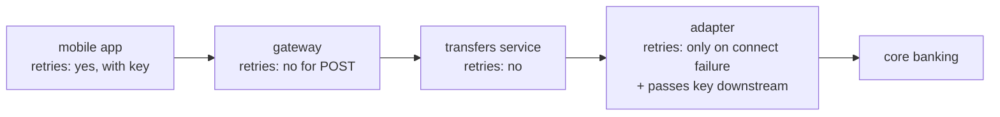
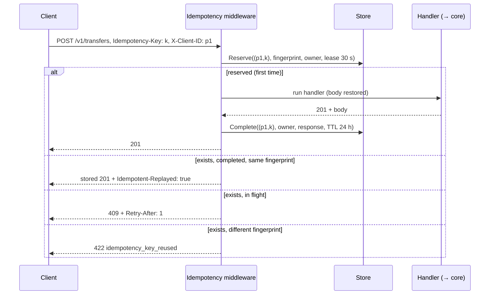
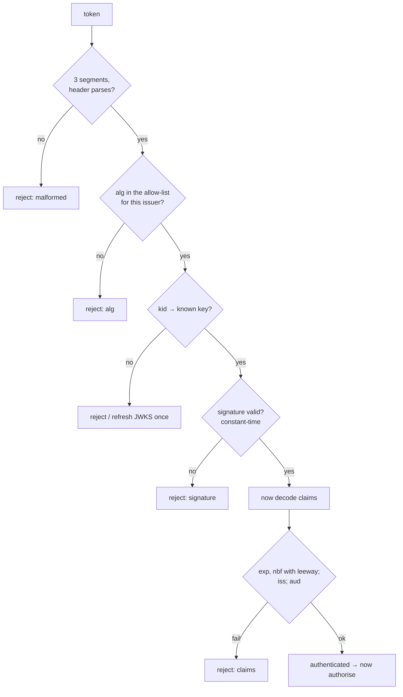

# A1 Unit 3 — Idempotency and auth

> Time: ~8 h (includes ≈ 1.5 h of gate work: design exercise + teach-back) · CORE: §1, §2, §3 (concepts), §4 · STRETCH (≈ 1 h): §3 "Build it" (the `token` lab) and the SAML deep dive in §4 · Labs: `labs/a1/idempotency` (core), `labs/a1/token` (stretch)

Two topics that interviewers love to combine in one probe: "the partner's request timed out — did the money move,
and how do you know the retry came from the same partner?" Retries over an unreliable network are the reason
idempotency keys exist; authentication is what lets you scope them, and authorisation is what stops partner A from
replaying a request against credit union B. This is the unit where your banking background is most directly an
interview advantage: you have lived both problems.

## Before you start

You should have finished Units 1 and 2. Warm-up — answer first:

1. Is `POST /v1/transfers` idempotent per HTTP semantics? Is `PUT /v1/payees/p_1`?
2. Your webhook dispatcher timed out waiting for a partner's 200. What's the honest delivery guarantee, and who makes
   it "exactly once"?
3. Which status code tells a client "a request with this key is still being processed"?

<details data-kind="answer">
<summary>Warm-up answers</summary>

1. POST: no. PUT: yes (replacing a resource with the same representation N times has the same effect as once).
2. At-least-once; the receiver makes processing exactly-once by deduplicating on event ID and making effects
   idempotent.
3. 409 Conflict (with `Retry-After`), in the design used in this unit's lab.

</details>

---

## §1 Retries, timeouts and duplicates

### The failure story

The mobile app calls `POST /v1/transfers` with a 10 s client timeout. The transfers service calls the core-banking
adapter, which calls the core. Core latency: p99 ≈ 9 s, p99.9 ≈ 14 s on busy mornings. At 1 M transfers/day,
≈ 0.1% exceed 10 s: ≈ 1,000 client timeouts a day. For roughly half of them the core *did* post the transfer; the
response just arrived after the client gave up. The app retries automatically. ≈ 500 duplicate transfers a day,
each one a support call, a reversal, and sometimes an overdraft fee you have to refund.

Then the core has a slow morning. The app retries up to 3 times; the API gateway retries upstream timeouts up to 3
times; the adapter retries the core up to 3 times. Every layer is "just being resilient". A single user tap becomes up
to 4 × 4 × 4 = 64 requests at the core — at exactly the moment it is struggling. The slowdown becomes an outage.

### Predict

<!-- predict id="A1-U3-P01" -->
**Predict.** Write your answers down first.

1. A client's request to `POST /v1/transfers` times out. List every possible state the server could be in.
2. Which failures are safe to retry for a non-idempotent request *without* any idempotency mechanism?
3. 1,000 clients all get an error at the same instant and retry with exponential backoff (100 ms, 200 ms, 400 ms,
   800 ms) and no jitter. What does the core see?
<!-- /predict -->

### Reveal

<details data-kind="reveal" data-for="A1-U3-P01">
<summary>Reveal</summary>

1. (a) The request never arrived (lost on the way, connection refused). (b) It arrived and is still running. (c) It
   ran and failed, and the error response was lost. (d) It ran and **succeeded**, and the response was lost or late.
   (e) It partly ran (debited one account, crashed before crediting the other). The client cannot distinguish these:
   **a timeout is an ambiguous outcome**, and a blind retry turns (b) and (d) into duplicates.
2. Only failures that *prove* the request wasn't processed: connection refused / DNS failure / TLS handshake failure
   (nothing was sent), or an explicit response that guarantees no effect (e.g. 429 or 503 from a layer that rejects
   before doing work, if the API documents that). A read timeout, a reset after sending, or a 502/504 from a proxy
   are *not* safe — the upstream may have done the work. Hence idempotency keys (§2).
3. Synchronised waves: all 1,000 retries land at t = 100 ms, then all at 300 ms, 700 ms, 1.5 s. Each wave is a
   spike as big as the original failure, so a service recovering from overload gets knocked over again. Jitter
   spreads them (the experiment below: worst 10 ms window drops from 1,000 retries to ≈ 160).

</details>

### How it actually works

**A sane retry policy** has five parts:

1. **What to retry**: only idempotent operations, or non-idempotent ones carrying an idempotency key; only on
   transient errors (connection failures, 503/429 with `Retry-After`, gRPC `UNAVAILABLE`), never on 4xx.
2. **How many times**: a small number (≈ 2–3 attempts), at **one layer** of the stack — usually the one closest to the
   user that knows the overall deadline. Inner layers fail fast.
3. **When**: exponential backoff with jitter ("full jitter": sleep a random time in [0, base × 2^attempt), capped).
4. **Budget**: limit retries to a fraction of normal traffic (e.g. ≤ 10% extra), so a widespread failure can't
   multiply load. When the budget is spent, fail fast.
5. **Deadline**: retries must fit inside the caller's deadline; propagate it (`context.Context`, gRPC deadlines) so
   downstream work stops when nobody is waiting for it anymore.



Amplification is multiplicative: with r retries at each of k layers, a request can become (r + 1)^k attempts. Three
layers with 3 retries each is 64x; one layer with 2 retries is 3x.

Timeouts need to be ordered: the outermost caller has the longest timeout and each hop inward a shorter one (with
its own share of the budget). If the adapter's timeout to the core is longer than the client's timeout to you, the
adapter keeps working on requests whose caller already gave up and retried — doing the work twice.

### Build it

No lab package for this section — §2's middleware is what makes retries safe, and the experiment below is runnable.

### Break it

```go
// 1,000 clients all fail at t=0 (core banking blipped) and retry up to 4
// times with exponential backoff (base 100 ms, cap 5 s). Count the worst
// 10 ms window of retry arrivals, with and without jitter.
package main

import (
	"fmt"
	"math/rand/v2"
	"time"
)

func backoff(attempt int, jitter bool, r *rand.Rand) time.Duration {
	d := 100 * time.Millisecond << attempt // 100ms, 200ms, 400ms, 800ms
	if d > 5*time.Second {
		d = 5 * time.Second
	}
	if jitter {
		return time.Duration(r.Int64N(int64(d))) // "full jitter": uniform in [0, d)
	}
	return d
}

func main() {
	for _, jitter := range []bool{false, true} {
		r := rand.New(rand.NewPCG(1, 2))
		buckets := map[int64]int{}
		for c := 0; c < 1000; c++ {
			t := time.Duration(0)
			for attempt := 0; attempt < 4; attempt++ {
				t += backoff(attempt, jitter, r)
				buckets[int64(t/(10*time.Millisecond))]++
			}
		}
		worst := 0
		for _, n := range buckets {
			worst = max(worst, n)
		}
		fmt.Printf("jitter=%-5v worst 10 ms window: %4d retries\n", jitter, worst)
	}
}
```

Predict both numbers, run it, then: (a) change "full jitter" to "±10% jitter" (`d*9/10 + rand(d/5)`); (b) compute by
hand how many requests reach the core in the failure story's 3-layer setup if the core fails *every* request.

<details data-kind="answer">
<summary>What you should see, and why</summary>

Without jitter: 1,000 (every client in the same window, four times over). With full jitter: ≈ 160. (a) ±10% jitter
helps much less (≈ 500 in the worst window on the reference run): the first wave is smeared over only ≈ 20 ms around
100 ms, so the waves are still there. Full jitter trades a slightly longer average wait
for removing the synchronisation. (b) 4 attempts at the app × 4 at the gateway × 4 at the adapter = 64 core requests
per tap; at 100 taps/s that's 6,400 req/s against a core that was already failing. Retry at one layer, with a
budget.

</details>

### In the wild

- **AWS Architecture Blog, "Exponential Backoff And Jitter"** (Marc Brooker): the analysis behind "full jitter"; the
  AWS SDKs implement backoff with jitter and a client-side retry quota (token bucket) by default.
- **gRPC** service config supports retry policies with backoff and `retryableStatusCodes`, plus **retry throttling**
  (a token-bucket budget per client) and hedging policies.
- **Envoy**: `retry_on` conditions, per-try timeouts, and retry budgets (`retry_budget` as a percentage of active
  requests) in cluster circuit breakers.
- **Go's `http.Transport`** silently retries a request on a reused connection that broke before any response only
  if the request is replayable: GET/HEAD/OPTIONS/TRACE, or any method with an `Idempotency-Key` (or
  `X-Idempotency-Key`) header and a rewindable body (`Request.isReplayable` in `net/http/request.go`). Your
  idempotency key header changes the *client library's* behaviour too.

### Trade-offs

| Option | Wins when | Loses when | When the answer flips |
|---|---|---|---|
| Retry at the edge (client) only | One owner of the deadline; no amplification | Inner hops can't hide transient blips | Flip to an inner retry for *connect* failures only (nothing sent, always safe) |
| Retry at every layer | Never (it's how outages amplify) | Load multiplies under failure | — |
| Full jitter | Large fleets retrying after a shared failure | Slightly higher mean latency | Flip to small jitter only for a handful of clients where latency matters more than herding |
| Retry budget | Protects dependencies during widespread failure | Some retryable requests fail fast | Flip to unlimited retries only for idempotent background work with long deadlines (still with backoff) |
| Hedged requests | Tail latency for idempotent reads | Doubles load if the hedge delay is too short | Use only for reads, with hedge delay ≈ p95 and a budget |

### Senior bar

- **Failure modes**: ambiguous timeouts creating duplicates; retry storms; inverted timeouts (inner > outer); retries
  without deadlines; retrying 4xx; idempotency key regenerated per attempt (useless).
- **Capacity**: plan for retry load: at 5% failure with 2 retries, offered load is ≈ 1.1x; at 50% failure it's ≈ 1.75x
  — exactly when you have least capacity. Budgets cap it (e.g. +10%).
- **Ops**: metrics per layer — attempts vs unique requests (retry ratio), timeouts by hop; alert on retry ratio spikes.
- **Cost**: duplicates in money movement cost far more than the extra infrastructure to prevent them (reversals,
  fees refunded, regulator complaints).

Interviewer follow-up probes:

1. "Your client timeout is 10 s and the core's p99.9 is 14 s. What do you change?"

<details data-kind="answer">
<summary>Model answer</summary>

First, make retries safe: idempotency keys from the client, passed end to end to the core (or the adapter keeps its
own mapping). Then fix the timeout ordering so inner hops give up before outer ones, and consider making the
operation asynchronous: accept with 202 and a transfer in `pending`, then notify — so a slow core doesn't hold client
connections at all. Raising the client timeout alone just moves the cliff.

</details>

2. "Why not retry at every layer to be safe?"

<details data-kind="answer">
<summary>Model answer</summary>

Because retries multiply: (r + 1)^layers. Under a partial outage, that turns degraded into down. Retry at one layer
(the one that owns the user's deadline), fail fast elsewhere, and enforce a retry budget.

</details>

3. "Which errors are always safe to retry for a POST?"

<details data-kind="answer">
<summary>Model answer</summary>

Only those that prove nothing was sent or processed: DNS failure, connection refused, TLS handshake failure. Everything
after the request bytes left the client (read timeouts, resets, 502/504) is ambiguous and needs an idempotency key.

</details>

### Check yourself

1. Why is a timeout "ambiguous"?
2. What's (r + 1)^k for r = 2 retries at k = 3 layers?
3. Why must inner timeouts be shorter than outer ones?

<details data-kind="answer">
<summary>Answers</summary>

1. The client can't tell whether the server didn't receive, is still processing, failed, or succeeded.
2. 27.
3. Otherwise inner hops keep working on requests whose caller has already given up (and possibly retried), wasting
   capacity and creating duplicates.

</details>

---

## §2 Idempotency keys end to end

### The failure story

The duplicate transfers from §1 get three attempted fixes:

1. **"Dedupe on content"**: reject a transfer if one with the same from/to/amount exists in the last 5 minutes. Members
   who genuinely split rent into two identical $600 payments get blocked; and two concurrent identical requests both
   pass the check because neither has committed yet.
2. **"Unique key column"**: the app sends a request ID; the service calls the core, then inserts the transfer row with
   a unique constraint on the request ID. The second request also calls the core before its insert fails. Duplicate.
3. **"Check first"**: look up the request ID, call the core if absent. A member double-taps "Send" (≈ 0.3% of transfers
   on mobile); both requests look up, both see nothing, both call the core.

Every fix had a race or put the check after the side effect.

### Predict

<!-- predict id="A1-U3-P02" -->
**Predict.** Write your answers down first.

Design the server side of `Idempotency-Key` for `POST /v1/transfers`:

1. What is the store keyed by, and what does a record contain?
2. What do you return for: (a) a retry after the first request completed; (b) a duplicate while the first is still
   running; (c) the same key with a different body; (d) the first attempt's handler returned 503 because the core was
   down?
3. The server crashes after the core posted the transfer but before your record says "completed". What happens on
   retry, and what makes that safe?
<!-- /predict -->

### Reveal

<details data-kind="reveal" data-for="A1-U3-P02">
<summary>Reveal</summary>

1. Keyed by **(client/tenant scope, key)** — two partners can pick the same key for unrelated requests. The record:
   state (in-flight / completed), a **fingerprint** of the request (method, path, body hash), the stored response
   (status, headers, body), an owner token and lease expiry for in-flight, and created/expiry times.
2. (a) **Replay** the stored status, headers and body exactly (plus a marker header such as
   `Idempotent-Replayed: true`); don't run the handler. (b) **409 Conflict** with `Retry-After` (the lab's choice) —
   or block and wait for the first to finish, then replay (simpler for clients, but ties up a server connection per
   duplicate). (c) **422**: the client has a bug (reused a key for a different intent); never replay a response to a
   request it doesn't belong to. (d) It depends on what 503 *means*: if the handler guarantees "nothing happened"
   (failed before any side effect / rolled back), don't store it and let the retry re-execute — the lab's choice.
   Stripe instead stores and replays 500s, because a 500 may mean "partially happened" and re-execution could be
   worse. Either way, document it.
3. The record is stuck "in-flight". Its **lease** expires (e.g. 30 s), so a retry can take over and re-execute — which
   is only safe if the *downstream* side effect is idempotent too: the adapter passes the same key (or a key derived
   from it) to the core, so the core's own dedup returns the original posting. Without end-to-end keys, a crash between
   the side effect and recording it is exactly where duplicates hide; the alternative is to mark such records
   "unknown" and reconcile against the core before answering.

</details>

### How it actually works



The mechanism in pieces:

- **Atomic reservation** is the whole game. "Check, then act" is a race (fix 3 above). The reservation must be one
  conditional write: `INSERT … ON CONFLICT DO NOTHING` (Postgres), `SET key value NX PX 30000` (Redis), a conditional
  put with `attribute_not_exists` (DynamoDB). Exactly one concurrent request wins.
- **Leases, not locks**: an in-flight reservation expires so a crashed worker can't wedge the key forever. The price:
  a worker that was merely slow (GC pause, stuck downstream) might still be running when its lease is taken over. An
  **owner token** makes the stale worker's `Complete` fail (`ErrNotOwner`) instead of overwriting the new owner's
  result — the lab tests exactly this (`TestIdempotency_StuckReservationLeaseCanBeTakenOver`). The handler may still
  have run twice; that's why downstream calls carry the key too.
- **Fingerprint**: hash of method + path + body (some designs include selected headers). It turns client bugs (same
  key, different request) into 422s instead of silent wrong replays.
- **What to cache**: 2xx/3xx/4xx results are *decisions* — replay them (a 422 `insufficient_funds` should not turn into
  a success when retried after a deposit; the client should send a new key for a new attempt). 5xx: the trade-off
  above.
- **Retention**: at least the client's maximum retry window (Stripe: keys can be pruned after 24 h). Expired keys mean a
  late retry executes again — so mobile clients that persist a pending request across app restarts must not resend
  days later.
- **With a database transaction**: if the business effect is a local DB write, store the idempotency record *in the
  same transaction* as the effect — the record is then both the lock and the proof. When the effect is an external
  call (core banking, a card network), break the request into phases with recorded recovery points ("atomic
  phases"), and pass an idempotency key to the external system.
- **Client side**: generate the key when the *user intent* is created (the tap on "Send", a UUIDv4), persist it with the
  pending request, reuse it for every retry of that intent, and generate a new key for a new intent.

**Banking link.** Money movement is the canonical use case, and your vendor adapters are where end-to-end keys break
most often: the vendor's API may have its own idempotency mechanism (a client reference field, a request ID), or none
— in which case the adapter must record "sent request X" before calling and reconcile on restart. Multi-tenant scoping
is the (tenant, partner) pair: credit union A's partner and credit union B's partner must never share key space.

### Build it

Lab `labs/a1/idempotency`, file `idempotency.go`. Provided: types, `Store` interface, `ScopedKey`, `Fingerprint`.
Implement:

- `MemoryStore` (`Get`, `Reserve` — check-and-write under one lock acquisition, `Complete`/`Release` only for the
  current owner of an in-flight record; expired records count as absent).
- `Middleware(cfg, next)` — the behaviour list in the package doc: POST/PATCH only; no key → pass through; key > 255
  chars or missing `X-Client-ID` → 400; fingerprint mismatch → 422; in flight → 409 + `Retry-After`; completed →
  replay + `Idempotent-Replayed: true`; handler ≥ 500 → release, not stored; panic → release and re-panic; store
  failure → 503 (fail closed); TTL and lease from the injected clock.

Acceptance tests: `TestMemoryStore_ReserveIsAtomic` (100 goroutines, exactly one winner),
`TestMemoryStore_CompleteAndReleaseRequireOwnership`, `TestIdempotency_SameKeySameBodyExecutesOnceAndReplays`,
`TestIdempotency_HandlerSeesFullBody`, `TestIdempotency_SameKeyDifferentRequestIs422`,
`TestIdempotency_KeysAreScopedPerClient`, `TestIdempotency_PassThroughCases`, `TestIdempotency_BadKeyOrMissingClientIs400`,
`TestIdempotency_ConcurrentDuplicateExecutesOnce` (50 concurrent duplicates, handler runs once),
`TestIdempotency_ServerErrorIsNotCached`, `TestIdempotency_ClientErrorIsCached`, `TestIdempotency_KeyExpiresAfterTTL`,
`TestIdempotency_StuckReservationLeaseCanBeTakenOver`, `TestIdempotency_HandlerPanicReleasesReservation`,
`TestIdempotency_StoreFailureFailsClosed`. Run `go test -race ./labs/a1/idempotency/`.

### Break it

1. Wire the `breakNoInFlightLock` constant into your middleware as the stub's comment describes (replace `Reserve`
   with `Get` + run + store), then run
   `go test -tags breakit -race -run Concurrent -v ./labs/a1/idempotency/`. Predict how many times the handler runs.
2. Set `LockTimeout` to 10 ms in the concurrent test's config (in a scratch copy) while the handler sleeps 30 ms.
3. Change your middleware to store 5xx responses and run `TestIdempotency_ServerErrorIsNotCached`. Argue for the
   change anyway.

<details data-kind="answer">
<summary>What you should see, and why</summary>

1. Reference run: `handler ran 50 times for 50 concurrent duplicates; a retried payment would be charged 50 times`.
   All 50 `Get`s happen before any request finishes, so all see "absent". That's fix 3 from the failure story.
2. Leases expire mid-execution, so later duplicates take over and run the handler again: more than one execution.
   The lease must comfortably exceed the handler's worst-case duration (and the handler's downstream timeouts must
   be shorter than the lease).
3. The test fails: a retry after "core unavailable" replays the 503 for 24 hours and the transfer can never be made
   with that key. The argument *for* it (Stripe's choice): a 5xx might mean "partially done", and re-executing could
   double-post; replaying the error forces a human/reconciliation path. Which is right depends on whether your handler
   can guarantee a 5xx means "no effect" (transactional) — say that out loud in an interview.

</details>

### In the wild

- **Stripe**: `Idempotency-Key` header on POST; keys up to 255 characters; keys may be removed after they're at least
  24 hours old; the request parameters are compared and a mismatch is an error; results are saved only once the
  endpoint began executing, and then *including* 500 errors. `TODO-VERIFY: Stripe's exact status/error code for a
  concurrent in-progress request (409 "idempotency_key_in_use") and the Idempotent-Replayed response header.`
- **IETF draft "The Idempotency-Key HTTP Header Field"** (httpapi working group) standardises the header and suggests
  responses for missing key, key reuse with a different payload, and concurrent requests (`TODO-VERIFY: current draft
  status and its exact recommended codes — 400 / 422 / 409`).
- **Brandur Leach, "Implementing Stripe-like Idempotency Keys in Postgres"** (2017): atomic phases and recovery points,
  idempotency keys table with `locked_at`, the definitive long-form treatment.
- **Other payment APIs**: Adyen (`Idempotency-Key`), PayPal (`PayPal-Request-Id`); AWS EC2 `ClientToken` on
  `RunInstances` and similar APIs.
- **Kafka's idempotent producer** (producer ID + per-partition sequence numbers) is the same idea one layer down: the
  broker dedupes retried writes.

### Trade-offs

| Option | Wins when | Loses when | When the answer flips |
|---|---|---|---|
| 409 for in-flight duplicates | Server never blocks; simple; client retries after `Retry-After` | Clients must handle 409 and retry | Flip to wait-and-replay for clients you don't control well (simpler contract), with a bounded wait |
| Wait-and-replay | Clients just see the final response | A connection/goroutine held per duplicate; double taps × slow core = many held requests | Flip to 409 when duplicates can pile up |
| Don't store 5xx | Transactional handlers where 5xx means "no effect" | Handler isn't transactional (partial effects) → re-execution duplicates | Flip to storing 5xx (Stripe) when you can't guarantee no partial effect |
| Store in the business DB (same transaction) | Effect is a local write; strongest guarantee | Extra write per request on the primary | Flip to Redis/DynamoDB for very high volume or when the effect is external anyway |
| Store in Redis | Fast, TTL built in | Data loss on failover can forget keys (duplicate on retry); not transactional with the effect | Flip to the DB for money movement unless Redis persistence/replication is configured and you accept the window |
| Long retention (days) | Clients that retry very late (offline mobile, batch reruns) | Storage | Flip to 24 h when clients' retry windows are short |

### Senior bar

- **Failure modes**: check-then-act races; key regenerated per attempt; keys not scoped per tenant/client (cross-
  partner replay leaks a response); fingerprint missing the path (key reused across endpoints replays the wrong
  resource); lease shorter than handler; store outage (fail closed for money movement → 503); replaying `Set-Cookie`
  or other per-request headers; streaming responses (can't buffer) — idempotency for those needs a different design.
- **Capacity**: 1 M transfers/day × ≈ 2 KB per record (response body + metadata) ≈ 2 GB/day; with 24 h retention
  ≈ 2 GB live, with 7 days ≈ 14 GB. Each request adds one conditional write (reserve) and one update (complete) — at
  ≈ 12 transfers/s average that's nothing; at 10k/s it's a sizing question for the store.
- **Ops**: metrics for replay rate, 409 rate (double taps / aggressive clients), 422 rate (client bugs — tell the
  partner), stuck in-flight records (leases that expired without completion = crashes); idempotency records double as
  an audit trail for disputes ("you charged me twice" → "no, here are the two requests with the same key and the
  replay").
- **Cost**: store size; one extra round trip to the store per write request.

Interviewer follow-up probes:

1. "The server crashes after the core posted the transfer but before you stored the response. What now?"

<details data-kind="answer">
<summary>Model answer</summary>

The record stays in flight until its lease expires; then a retry re-executes. That's only safe because the adapter
sends an idempotency key (derived from the client key, scoped per tenant) to the core, so the core returns the
original posting instead of creating a second one. If the downstream has no idempotency support, I'd record "about to
call core with reference R" before the call, and on takeover reconcile (query the core by reference) before deciding
to call again — or park it as "unknown" for operations.

</details>

2. "Redis or the database for the key store?"

<details data-kind="answer">
<summary>Model answer</summary>

For money movement I'd start with the same database as the transfer, writing the idempotency record in the same
transaction as the transfer row: no window where one exists without the other, and failover semantics are the DB's.
Redis is attractive for speed and TTLs but asynchronous replication can lose recent keys on failover, which turns
into duplicates on retry — acceptable for some APIs, not for this one without extra safeguards.

</details>

3. "The client generates a new key on every retry. What happens?"

<details data-kind="answer">
<summary>Model answer</summary>

Each retry looks like a new intent, so the server executes each one: no protection at all. The key must be created
once per user intent and persisted with it. I'd catch this in the SDK (keys generated when the operation object is
created, not per HTTP attempt) and in monitoring (many distinct keys with identical fingerprints from one client in
seconds).

</details>

4. "Why 422 for the same key with a different body, rather than just replaying?"

<details data-kind="answer">
<summary>Model answer</summary>

Replaying would return a response for a *different* request — e.g. the client thinks its $900 transfer succeeded when
the stored response is for a $500 one. A mismatch means the client has a bug (key reuse); failing loudly surfaces it
immediately.

</details>

### Check yourself

1. What must the store's reservation operation guarantee?
2. Why does the lab scope keys by `X-Client-ID`?
3. Why is a completed 4xx replayed but a 5xx not (in the lab's design)?

<details data-kind="answer">
<summary>Answers</summary>

1. Atomicity: of N concurrent reservations for an absent key, exactly one succeeds (check and write in one operation).
2. Two clients can choose the same key for unrelated requests; without scoping, client B would get client A's
   response (a correctness and data-leak bug).
3. A 4xx is a decision about that request; a 5xx (by the handler's contract) means nothing happened and a retry should
   get a real attempt.

</details>

---

## §3 Authentication and tokens

### The failure story

The partner API issues JWT access tokens: HS256, valid for 24 hours, and the signing secret is shared with the six
internal services that verify tokens. Over a year:

- A partner's token appears in a debug log that was shipped to a third-party log tool. You can't revoke it: every
  service verifies tokens locally, and it's valid for 23 more hours.
- One of the six services has a dependency vulnerability. Because verification uses a shared HMAC secret, the attacker
  who reads that service's config can now **mint** tokens for any partner and any credit union.
- A library upgrade in one service changes defaults, and it starts accepting tokens whose header says `"alg": "none"`.
- Tokens carry per-credit-union entitlements and grow to ≈ 6 KB for partners with many CUs; requests start failing
  with 400/431 at a proxy whose header buffer is 8 KB once cookies and tracing headers are added.
- After a VM migration, one service's clock is 40 s behind the issuer's; for 40 s after issue, every new token is
  rejected as "not yet valid".

### Predict

<!-- predict id="A1-U3-P03" -->
**Predict.** Write your answers down first.

1. What does a valid JWT signature prove? What does it *not* prove?
2. How do you revoke a self-contained token before it expires? Give two approaches and their costs.
3. Six services verify tokens issued by one auth server. HMAC (shared secret) or asymmetric signatures (RS256/ES256)?
   Why?
<!-- /predict -->

### Reveal

<details data-kind="reveal" data-for="A1-U3-P03">
<summary>Reveal</summary>

1. It proves the header and payload were produced by someone holding the signing key and haven't been modified. It
   does **not** prove: that the token is still valid (check `exp`/`nbf`), that it's meant for *you* (check `aud`),
   that it came from the issuer you expect (check `iss` and which key), that it hasn't been revoked, that the bearer
   is its legitimate owner (bearer tokens are like cash), or anything about confidentiality — the payload is only
   base64url-encoded, readable by anyone.
2. (a) **Short-lived access tokens** (≈ 5–15 min) plus **refresh tokens** that are checked against the server on use:
   revocation takes effect within one access-token lifetime; cost: refresh traffic and a revocation check at the
   auth server. (b) A **denylist** of revoked token IDs (`jti`) or subjects pushed to every verifier: immediate; cost: a
   distributed lookup on every request, which erodes the "verify locally" benefit. Or (c) use **opaque tokens with
   introspection** (RFC 7662) where revocation matters more than latency.
3. **Asymmetric.** With HMAC every verifier holds the key that can *sign*, so compromising any verifier lets an attacker
   mint tokens. With RS256/ES256 only the auth server holds the private key; verifiers fetch public keys (a JWKS
   endpoint) and can only verify. HMAC is fine when issuer and verifier are the same service (like the lab).

</details>

### How it actually works

**Authentication** answers "who is calling?"; **authorisation** answers "may they do this, to this object?".
Most API security bugs are authorisation bugs (Unit 2 §1: BOLA).

**Sessions vs bearer tokens.**

| | Server-side session | Self-contained token (JWT) |
|---|---|---|
| What the client holds | opaque random ID (cookie) | signed claims |
| Verification | lookup in a session store per request | signature check + claims check, locally |
| Revocation | delete the session: immediate | hard: wait for expiry, or denylist |
| Scaling | shared store (Redis) on the hot path | no shared state |
| Size | ≈ 32 bytes | hundreds of bytes to KBs |
| Typical use | browser apps (first party) | APIs, service-to-service, federated identity |

**JWT structure** (RFC 7519, signed per RFC 7515 as JWS):
`base64url(header) . base64url(payload) . base64url(signature)`, where the header is e.g.
`{"alg":"ES256","kid":"2026-05","typ":"JWT"}` and the payload carries registered claims — `iss`, `sub`, `aud`, `exp`,
`nbf`, `iat`, `jti` — plus your own (`scope`, `tenant`).



Pitfalls, each of which has bitten real systems:

- **`alg: none` / algorithm confusion**: never let the token choose the algorithm. Verifiers must have an allow-list
  per issuer/key. The classic confusion attack: a verifier configured with an RSA *public* key accepts an HS256 token
  and uses that public key as the HMAC secret — and the attacker knows the public key.
- **Missing `aud` check**: a token issued for the statements service is accepted by the transfers service.
- **`kid` injection**: `kid` is attacker-controlled input; using it in a file path or SQL query is an injection bug.
  Look it up in a map of known keys.
- **Clock skew**: allow a small leeway (≈ 30–60 s) on `exp`/`nbf`, and run NTP everywhere.
- **Size**: tokens travel on every request; stuff entitlements in them and you hit header limits and pay bandwidth.
  Put coarse claims (tenant, scopes) in the token, fetch fine-grained permissions server-side.
- **Storage in browsers**: `localStorage` is readable by any script on the page (XSS → token theft); `HttpOnly`,
  `Secure`, `SameSite` cookies resist XSS but need CSRF protection. First-party banking web apps usually prefer
  cookie-based sessions (often behind a "backend for frontend" that holds the OAuth tokens).
- **Key rotation**: publish keys with `kid`s (JWKS); issue new tokens with the new key; keep the old public key until
  every token signed with it has expired; then remove it. Verifiers cache JWKS and refresh on an unknown `kid` (rate
  limited).

### Build it

**STRETCH** — lab `labs/a1/token`, file `token.go` (not required for the gate). Implement `Keyring` (`Add` copies the
secret, `SetCurrent`, `Remove`; safe for concurrent use), `Sign` (standard JWT HS256 compact format, `kid` in the
header), and `Verifier.Verify` in exactly the order of the package doc: segments → `alg` allow-list (rejects `none`) →
`kid` lookup → constant-time signature check → *then* claims (`exp` required, leeway on `exp`/`nbf`, `aud`).

Acceptance tests: `TestToken_SignVerifyRoundTrip`, `TestToken_SignProducesStandardHS256JWT` and
`TestToken_VerifiesHandBuiltJWT` (wire compatibility with any JWT library), `TestToken_RejectsUnsupportedAlgorithms`
(`none`, `None`, `RS256`, `HS512`, missing), `TestToken_RejectsTamperedPayload` (a forged `tenant` claim),
`TestToken_SignatureIsCheckedBeforeClaims`, `TestToken_RejectsUnknownOrMissingKid`, `TestToken_RejectsMalformed`,
`TestToken_ExpiryWithLeeway`, `TestToken_NotBeforeWithLeeway`, `TestToken_AudienceMustMatch`,
`TestToken_KeyRotation`, `TestToken_KeyringCopiesSecrets`, `TestToken_ConcurrentVerifyDuringRotation`. Run
`go test -race ./labs/a1/token/`.

### Break it

With the token lab passing: (a) delete your `alg` check; (b) move the claims checks before the signature check;
(c) set `Leeway` to 0 and give the verifier a clock 2 s behind the signer's. Run the tests after each change and
explain the attack or outage each one corresponds to.

<details data-kind="answer">
<summary>What you should see, and why</summary>

(a) `TestToken_RejectsUnsupportedAlgorithms` fails. In a real library that supports `none`, the attacker strips the
signature, sets `alg: none`, and edits the claims freely (any partner, any tenant). (b)
`TestToken_SignatureIsCheckedBeforeClaims` fails: you're making decisions (and possibly logging attacker-controlled
claims, or returning different errors that leak information) based on unauthenticated data. Verify first, then trust.
(c) Freshly issued tokens with `nbf = iat` are rejected for the first 2 s on that verifier: intermittent 401s that
only happen on some hosts, right after login — painful to debug. Leeway plus NTP monitoring.

</details>

### In the wild

- **RFC 8725 "JSON Web Token Best Current Practices"**: perform algorithm verification, validate all cryptographic
  operations, validate `iss` and `aud`, use explicit typing — a checklist for reviewing any JWT code.
- **2015 JWT library vulnerabilities**: a widely read disclosure (Tim McLean, "Critical vulnerabilities in JSON Web
  Token libraries") showed many libraries accepting `alg: none` and vulnerable to RS/HS confusion; libraries now
  require the caller to specify expected algorithms (e.g. Go's `golang-jwt/jwt` key functions and
  `WithValidMethods`).
- **JWKS**: identity providers (Auth0, Okta, Microsoft Entra ID, Amazon Cognito, Google) publish public keys at a
  JWKS URL found via OIDC discovery (`/.well-known/openid-configuration`).
- **RFC 9068** defines a JWT profile for OAuth access tokens (`typ: at+jwt`) so access tokens can't be confused with
  ID tokens. **RFC 7662** token introspection is the opaque-token alternative.
- **Kubernetes** service account tokens are audience-bound, time-limited JWTs (projected tokens).

### Trade-offs

| Option | Wins when | Loses when | When the answer flips |
|---|---|---|---|
| Server-side sessions | First-party web apps; instant revocation | Every request hits the session store | Flip to tokens for APIs consumed by many services/partners |
| JWT access tokens | Many verifiers; no shared state on the hot path | Revocation; size; key management | Flip to opaque + introspection (or short TTL + denylist) when instant revocation matters |
| HMAC (HS256) | Issuer == verifier (one service) | Multiple verifiers (any can mint) | Flip to RS256/ES256 the moment a second service verifies |
| Long-lived tokens | Simplicity | Leaks are long-lived | Flip to 5–15 min access tokens + refresh tokens |
| Fat tokens (entitlements inside) | No permission lookup | Size limits; stale permissions until expiry | Flip to coarse claims + server-side permission lookup (cached) |

### Senior bar

- **Failure modes**: algorithm confusion; missing `aud`/`iss` checks; shared HMAC secrets across services; no
  revocation story; clock skew; header-size limits; logging tokens (treat them as secrets in logs and traces); JWKS
  endpoint outage (cache keys, serve stale).
- **Capacity**: ES256/RS256 verification costs ≈ tens of µs of CPU (`TODO-VERIFY` on your hardware; RSA verify is fast,
  RSA sign slow; ECDSA the other way round), HMAC ≈ 1 µs; token size × requests/s = bandwidth (6 KB × 10k req/s ≈
  60 MB/s of headers).
- **Ops**: key rotation runbook and calendar; alert on verification failures by reason (spike in `bad signature` vs
  `expired` mean different things); NTP drift alerts.
- **Cost**: introspection calls if you go opaque; identity provider pricing per active user/machine client.

Interviewer follow-up probes:

1. "How do you revoke a JWT?"

<details data-kind="answer">
<summary>Model answer</summary>

You mostly don't — you keep access tokens short-lived (minutes) and revoke the refresh token at the auth server, so a
revoked session dies within one access-token lifetime. For emergencies (a leaked partner token), push a denylist of
`jti`s or subjects to verifiers (small, short-lived, since entries can expire with the tokens). If immediate
revocation is a hard requirement everywhere, use opaque tokens with introspection and cache the results briefly.

</details>

2. "Why are the services verifying with a shared HMAC secret a problem?"

<details data-kind="answer">
<summary>Model answer</summary>

Anyone who can verify can also sign. Compromise any one of the six services and you can mint tokens for any partner
and tenant. Use asymmetric keys: the issuer keeps the private key, services get public keys via JWKS.

</details>

3. "Where should a banking SPA keep its tokens?"

<details data-kind="answer">
<summary>Model answer</summary>

Preferably nowhere in JavaScript: a backend-for-frontend does the OAuth flow, holds the tokens server-side, and gives
the browser an `HttpOnly; Secure; SameSite` session cookie, with CSRF protection for state-changing requests. That
keeps tokens out of reach of XSS. If the SPA must hold tokens, keep them in memory only, short-lived, with refresh
token rotation.

</details>

### Check yourself

1. Is a JWT payload encrypted?
2. What must a verifier decide before it looks at the token's header `alg`?
3. Why should verifiers refresh JWKS when they see an unknown `kid` — and why rate-limit that refresh?

<details data-kind="answer">
<summary>Answers</summary>

1. No; it's base64url-encoded and readable by anyone. Encryption is JWE, a different format.
2. Which algorithms (and keys) it accepts for this issuer; the token's header is attacker-controlled.
3. A new key may have been rotated in; rate-limiting stops attackers from forcing a JWKS fetch per request with random
   `kid`s.

</details>

---

## §4 Delegated access, enterprise SSO and service-to-service auth

### The failure story

Your platform has every kind of identity:

- **Members** log into the mobile app and web banking.
- **Credit-union staff** sign into the admin portal with SSO from their own identity provider — 40 credit unions,
  40 SAML configurations (ADFS, Okta, Entra ID…). Each IdP signing certificate rotates every 1–3 years: roughly one
  rotation a month across the fleet. One missed rotation = one credit union's staff locked out on a Monday morning.
- **Fintech partners** call the transfers API from their servers.
- **Internal services** call each other; a nightly batch job reconciles with the core.

Incidents from the past two years:

1. An early mobile build used the OAuth implicit flow; access tokens appeared in URL fragments and leaked through
   browser history on shared devices. A later build used the authorisation code flow without PKCE, and a malicious app
   that registered the same custom URL scheme could intercept the code.
2. The transfers API accepted the OIDC **ID token** the mobile app received at login as if it were an access token.
3. An admin portal's SAML integration verified *a* signature in the response, but read the user from a *different,
   unsigned* assertion an attacker inserted (XML signature wrapping). Anyone could log in as any CU admin.
4. A partner's API key — long-lived, unscoped, full access — was committed to a public repository.
5. Internal services trusted an `X-User-ID` header from any caller on the network. One compromised internal box could
   act as any member.

### Predict

<!-- predict id="A1-U3-P04" -->
**Predict.** Write your answers down first.

1. Pick the mechanism for each caller: member mobile app; CU staff into the admin portal; fintech partner servers;
   internal service → service; the nightly batch job.
2. What's the difference between an OIDC ID token and an OAuth access token, and why does incident 2 matter?
3. Where should tokens be validated: at the API gateway, in each service, or both? What does each place check?
<!-- /predict -->

### Reveal

<details data-kind="reveal" data-for="A1-U3-P04">
<summary>Reveal</summary>

1. - **Member mobile app**: OAuth 2.0 **authorisation code + PKCE** via the system browser (OIDC for identity), short
     access tokens, rotating refresh tokens. Never implicit, never a client secret embedded in the app.
   - **CU staff**: **SAML 2.0 or OIDC** federation with each credit union's IdP (whatever their IdP supports — many
     enterprises still default to SAML), mapped to roles in your admin portal.
   - **Fintech partners**: OAuth **client credentials** (short-lived access tokens with scopes, bound to the partner and
     the tenants it may act for), ideally with **mutual TLS** (client certificates) or certificate-bound tokens for
     high-value operations. API keys are a weaker, simpler alternative (identification more than authentication).
   - **Internal service → service**: **mTLS** with workload identities (each service has a certificate identifying it),
     plus a propagated, signed end-user context when acting on behalf of a member.
   - **Batch job**: a workload identity like any service (client credentials or mTLS), with the narrowest scopes —
     not a shared admin password.
2. The **ID token** is for the *client application*: it tells the app who logged in (`aud` = the app's client ID). The
   **access token** is for the *resource server* (API): `aud` = the API, with scopes. Accepting ID tokens at an API
   means any app that can obtain an ID token for a user (even a different client) can call your API as that user —
   audience confusion. APIs must require access tokens with *their* audience.
3. Both. The **gateway** does coarse, uniform checks: token valid (signature, expiry, issuer, audience), scopes for the
   route, rate limits per client, rejects junk early. **Services** do fine-grained authorisation: may *this* principal
   act on *this* object (tenant ownership, account access, amount limits)? That logic needs domain data the gateway
   doesn't have. The gateway then forwards identity in a form services can trust (mTLS between them, or a signed
   internal token), never as a bare header anyone could set (incident 5).

</details>

### How it actually works

**OAuth 2.0 authorisation code + PKCE** (RFC 6749 + RFC 7636):

```mermaid
sequenceDiagram
    participant App as Mobile app
    participant B as System browser
    participant AS as Authorization server
    participant API as Transfers API
    App->>App: code_verifier = random; code_challenge = SHA256(verifier)
    App->>B: open /authorize?client_id&redirect_uri&scope&state&code_challenge&method=S256
    B->>AS: user logs in (MFA), consents
    AS-->>B: redirect to app with ?code&state
    B-->>App: code
    App->>AS: POST /token code + code_verifier
    AS->>AS: SHA256(verifier) == challenge?
    AS-->>App: access_token (aud=transfers-api, 10 min), refresh_token, id_token
    App->>API: Authorization: Bearer access_token
```

PKCE binds the code to the app instance that started the flow: an attacker who intercepts the code doesn't have the
verifier. OAuth 2.1 (in progress) makes PKCE mandatory for the code flow and drops the implicit and password grants.

**Client credentials**: a server authenticates as itself (`client_id` + secret, or a signed JWT assertion, or mTLS) to
the token endpoint and gets an access token. No user involved; scopes and tenant bindings come from the client's
registration.

**OIDC** layers identity on OAuth: the `openid` scope returns an **ID token** (a JWT about the user, for the client),
a `userinfo` endpoint, and discovery metadata (`/.well-known/openid-configuration`, JWKS URL).

**STRETCH — SAML 2.0 in enterprise SSO.** The IdP sends the browser an XML `Response` containing a signed `Assertion`
(subject, attributes, conditions), which the browser POSTs to your service provider's Assertion Consumer Service (ACS)
URL. The SP must validate: the signature covers the *exact* assertion element it reads (defeats signature wrapping);
the signing certificate is the one configured for *that* IdP; `Issuer`; `Audience` (your SP entity ID); `Recipient`/
`Destination` (your ACS URL); `NotBefore`/`NotOnOrAfter` (with small leeway); `InResponseTo` matches a request you
sent (SP-initiated) — or, if you allow IdP-initiated SSO, extra replay protection; and one-time use of the assertion
ID. Use a well-maintained library and keep metadata (certificates) fresh: subscribe to each IdP's metadata URL so
certificate rollovers happen automatically. Your SSO adapters lived exactly this list.

**Mutual TLS**: both sides present certificates; the server authenticates the client at the transport layer.
Certificate-bound access tokens (RFC 8705) tie a token to the client's certificate so a stolen token is useless
without the private key (DPoP, RFC 9449, does the same at the application layer). Workload identity systems (SPIFFE/
SPIRE, service meshes) issue and rotate short-lived service certificates automatically.

**API keys**: a long random secret identifying a client. Good practice: show it once, store only a hash, give it a
recognisable prefix (so secret scanners can find leaks), scope it, allow two active keys for rotation, and log the key
ID (never the key).

**Multi-tenant authorisation** (your platform): the tenant comes from the authenticated principal (token claim, client
registration), never from a request parameter; every data access is scoped by it; partner tokens list which credit
unions the partner may act for; and the idempotency store from §2 is scoped by (tenant, client) for the same reason.

### Build it

No new lab package for this section. The `token` lab (§3, STRETCH) is the verification core every one of these flows
ends in; the design exercise asks you to place these mechanisms in a real API.

### Break it

Find the flaw in each configuration (write your answer before opening):

1. The mobile app's OAuth client is registered with `redirect_uri = https://*.cu-app.example/*`.
2. PKCE is enabled with `code_challenge_method=plain`.
3. The partner API validates tokens at the gateway and forwards `X-Partner-ID` and `X-Tenant-ID` headers to services
   over plain HTTP inside the VPC; services trust them.
4. The admin portal accepts IdP-initiated SAML responses and checks the signature and `NotOnOrAfter` only.

<details data-kind="answer">
<summary>Flaws</summary>

1. Wildcard redirect URIs let an attacker who controls any matching host or path (a forgotten subdomain, an open
   redirect) receive authorisation codes. Register exact redirect URIs.
2. `plain` sends the verifier itself as the challenge, so anyone who sees the authorisation request (logs, a malicious
   app) can redeem the code. Use `S256`.
3. Any process that can reach a service inside the VPC can set those headers and act as any partner or tenant
   (incident 5). Use mTLS between gateway and services and/or a signed internal token, and have services verify it.
4. Without checking `Audience`, `Recipient`/`Destination` and one-time use of the assertion ID, an assertion issued to
   *another* service provider, or replayed within its validity window, is accepted. IdP-initiated SSO has no
   `InResponseTo` to bind to, so it needs extra replay protection — or should be disabled.

</details>

### In the wild

- **RFCs**: OAuth 2.0 (RFC 6749), bearer token usage (RFC 6750), PKCE (RFC 7636), OAuth for native apps (RFC 8252:
  use the system browser, claimed HTTPS redirects), token introspection (RFC 7662), mTLS client auth and
  certificate-bound tokens (RFC 8705), DPoP (RFC 9449); OpenID Connect Core 1.0; SAML 2.0 (OASIS).
- **Financial-grade API (FAPI)** profiles from the OpenID Foundation tighten OAuth/OIDC for banking (e.g. PKCE,
  sender-constrained tokens via mTLS or DPoP); open-banking regimes build on them.
- **SAML signature wrapping**: "On Breaking SAML: Be Whoever You Want to Be" (USENIX Security 2012) found the attack
  class in many SAML frameworks.
- **Token prefixes for leak detection**: GitHub personal access tokens start with `ghp_`; Stripe secret keys with
  `sk_live_`/`sk_test_`; GitHub secret scanning notifies providers when such strings are pushed publicly.
- **Gateways**: Envoy's `jwt_authn` and `ext_authz` filters; AWS API Gateway JWT and Lambda authorizers; Kong and
  Apigee plugins — coarse checks at the edge, with services doing object-level authorisation.
- **Workload identity**: SPIFFE IDs and SVIDs (SPIRE), Istio/Linkerd mTLS between services with automatic
  certificate rotation.

### Trade-offs

| Option | Wins when | Loses when | When the answer flips |
|---|---|---|---|
| OAuth client credentials (partners) | Short-lived scoped tokens; standard; rotation without downtime | Partners must implement a token fetch/refresh | Flip to API keys for low-risk, read-only public data where simplicity wins |
| mTLS for partners | Strong client authentication at the transport layer; no bearer secrets | Certificate lifecycle for every partner; TLS-terminating proxies complicate it | Flip to client credentials with private-key JWT assertions when partners can't manage certs |
| API keys | Simplest onboarding | Long-lived bearer secrets; coarse; leak-prone | Flip to OAuth once keys grant write access to money movement |
| SAML (enterprise SSO) | The customer's IdP only speaks SAML (common in banking) | XML complexity; signature-wrapping risks | Flip to OIDC when the IdP supports it |
| Validate at gateway only | Simple services | No object-level authorisation; services trust the network | Always add service-level authorisation for tenant/object checks |
| Validate in every service only | Defence in depth | Duplicated logic, inconsistent rules, no early rejection | Put coarse checks at the gateway too |

### Senior bar

- **Failure modes**: implicit flow / missing PKCE; ID tokens accepted at APIs; wildcard redirects; SAML signature
  wrapping and missing audience/replay checks; IdP certificate rotations breaking SSO; long-lived unscoped API keys;
  trusting identity headers from the network; partner tokens not bound to tenants (a partner for CU A acting on CU B).
- **Capacity**: token endpoint load = clients / token lifetime (10k partner servers refreshing every 10 min ≈ 17 req/s:
  trivial); JWKS fetches should be cached (≈ minutes to hours) or every verifier becomes load on the IdP.
- **Ops**: per-tenant SSO health (synthetic logins per IdP), metadata auto-refresh and certificate-expiry alerts ≥ 30
  days ahead, secret scanning on repositories, key rotation runbooks, audit logs of who (which principal, which tenant,
  which client) did what — regulators and credit unions will ask.
- **Cost**: identity provider licences, engineering time per enterprise SSO onboarding (≈ days each; a self-service
  metadata upload flow pays off at 40 tenants).

Interviewer follow-up probes:

1. "Your fintech partners call the transfers API. Client credentials, API keys, or mTLS?"

<details data-kind="answer">
<summary>Model answer</summary>

Client credentials for short-lived, scoped, tenant-bound access tokens, with mTLS (or private-key JWT client
authentication plus certificate-bound tokens) for the money-movement scopes, because a leaked bearer token there is
very costly. API keys only for low-risk read endpoints, if at all. Whatever the choice: per-partner scopes, tenant
bindings enforced in services, rotation without downtime (two valid credentials), and audit logs keyed by client ID.

</details>

2. "How do internal services know which member a request is for, and why should they believe it?"

<details data-kind="answer">
<summary>Model answer</summary>

The gateway authenticates the member and forwards a signed, short-lived internal token (or the original access
token) carrying subject and tenant; services verify it. Service identity comes from mTLS, so a service also knows
*which service* is calling. A plain header is only trustworthy if the transport proves who set it — on a flat network
it isn't.

</details>

3. "Forty credit unions, forty SAML IdPs. How do you keep SSO from breaking on certificate rotation?"

<details data-kind="answer">
<summary>Model answer</summary>

Consume each IdP's metadata URL and refresh it on a schedule so new signing certificates are picked up automatically
(and support two active certs during rollover); alert on certificates expiring within 30–60 days and on SSO failure
rates per tenant; run synthetic SSO logins per tenant; offer a self-service admin page to upload new metadata with
validation. Treat each IdP integration as a dependency with its own health signal.

</details>

### Check yourself

1. What attack does PKCE prevent?
2. Which token goes in `Authorization: Bearer` to your API — ID token or access token?
3. Name three SAML assertion checks besides the signature.

<details data-kind="answer">
<summary>Answers</summary>

1. Authorisation code interception (a malicious app or observer redeeming a code it didn't request).
2. The access token, with the API as its audience.
3. Any three of: issuer, audience, recipient/destination, NotBefore/NotOnOrAfter, InResponseTo, one-time assertion ID,
   signature covers the assertion actually read, cert matches the configured IdP.

</details>

---

## Unit wrap-up

| Decision | Default | Flip when… |
|---|---|---|
| Retries | One layer, idempotent or keyed requests only, backoff + full jitter, budget, deadline-aware | Connect failures (nothing sent) may be retried by inner layers |
| Duplicate protection for writes | Client-generated `Idempotency-Key` per intent, scoped per (tenant, client), atomic reservation, fingerprint, replay | — (no flip for money movement) |
| In-flight duplicates | 409 + `Retry-After` | Clients you don't control well → bounded wait-and-replay |
| 5xx results | Don't store if the handler is transactional | Partial effects possible → store and replay (Stripe) |
| Key store | Same DB transaction as the effect | Very high volume, external effects → Redis/DynamoDB with leases + downstream keys |
| Sessions vs tokens | Cookie sessions (via BFF) for first-party web; short JWT access tokens for APIs | Instant revocation needed for APIs → opaque + introspection |
| Token signing | Asymmetric (ES256/RS256) with JWKS and `kid` rotation | Issuer == verifier → HMAC is fine |
| Partner auth | OAuth client credentials (+ mTLS for money movement), tenant-bound scopes | Low-risk read-only → API keys acceptable |
| Staff SSO | OIDC where possible, SAML where the IdP requires it, metadata auto-refresh | — |
| Where to authorise | Gateway: token validity, scopes, rate limits. Services: object/tenant-level | — |

Next: make `go test -race ./labs/a1/idempotency/` pass (and `./labs/a1/token/` if you're doing the stretch), run
`sd lab A1`, then do the design exercise ([`design-exercise.md`](design-exercise.md)) and the teach-back
([`teachback.md`](teachback.md)).
