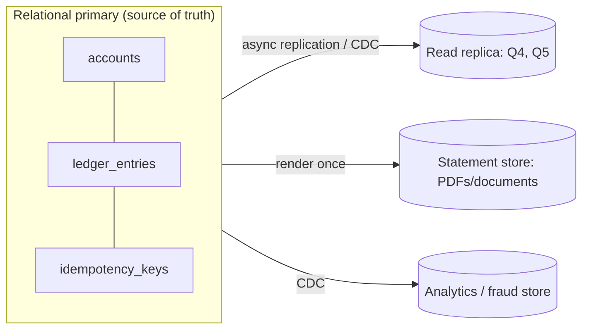
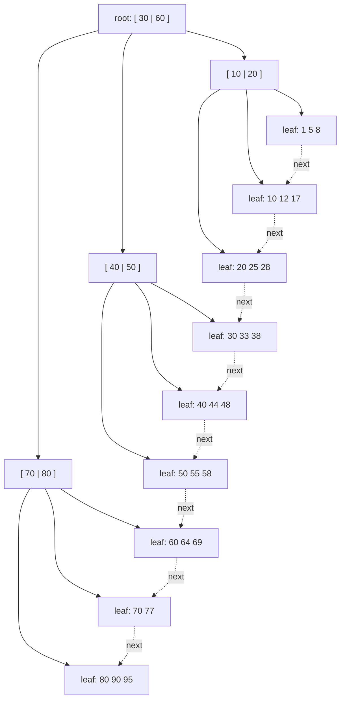
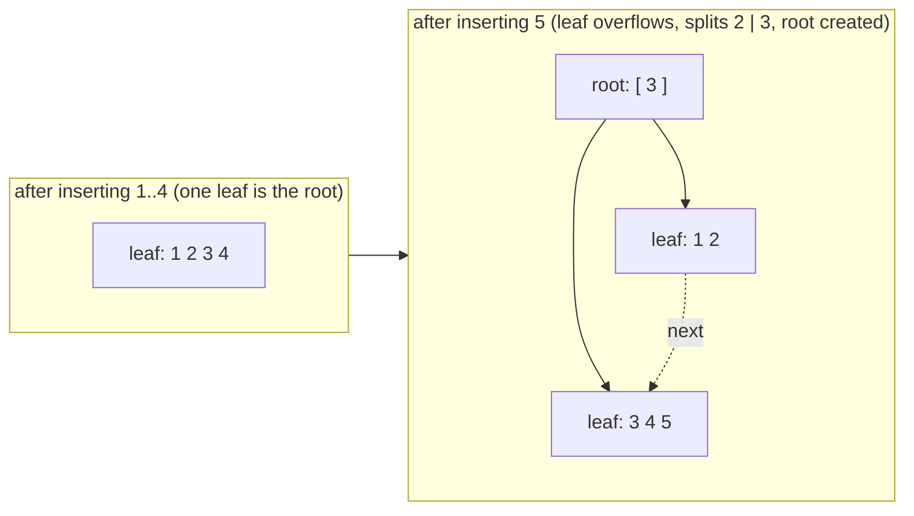

# A2 Unit 1 — Access patterns, schema and indexes

> Time: ~6 h · CORE: §1–§3 · STRETCH: the wide-column and DynamoDB-style modelling digression in §1, and the partial/expression-index digression in §3 (marked) · Lab: `labs/a2/btree`

Every storage decision in a system design interview is the same decision wearing different clothes: *what queries will
run, how often, and what must be true when they return?* Engines, indexes and schemas are answers to that question,
not preferences. This unit is about asking it before reaching for a product: choose a data model from the access
patterns (§1), understand the one data structure behind almost every database index (§2), and learn to design indexes
for queries instead of for columns (§3). The lab is a B+tree you build and instrument, so "height 3, three page reads"
stops being a slogan and becomes something you can count.

## Before you start

You should have finished A0 ([`../A0-framework-estimation/README.md`](../A0-framework-estimation/README.md)) and A1
([`../A1-networking-api/README.md`](../A1-networking-api/README.md)). Warm-up from those modules, answer first:

1. (A0) A platform posts 2 M transfers a day across all credit unions. What are the average and peak write rates,
   if peak is ≈ 3× average?
2. (A1) The keyset pagination query
   `WHERE (created_at, id) < ($1, $2) ORDER BY created_at DESC, id DESC LIMIT 20` is "O(log N + 20) at any depth".
   What has to exist in the database for that to be true?
3. (A0) A random 4 KB read on NVMe takes ≈ 20–100 µs. What does a lookup that needs three uncached page reads cost?

<details data-kind="answer">
<summary>Warm-up answers</summary>

1. 2,000,000 ÷ 86,400 ≈ 23 transfers/s on average, ≈ 70/s at the 3× peak. Small numbers: remember them, §1 builds on
   how little load a single relational primary needs to carry at this size.
2. An index whose key order matches the query's sort order, here `(created_at, id)` (with an account or tenant
   column in front when the query filters by it: `(account_id, created_at, id)`). Without it the database must read
   and sort everything. §3 is about getting this index right.
3. Three random reads ≈ 3 × (20–100 µs) ≈ 60–300 µs, serial, because each page tells you where the next one is.
   §2 is about why that number is "three" and not "thirty".

</details>

---

## §1 Choosing a data model by access pattern

### The failure story

A credit-union platform serves 40 credit unions, ≈ 1.2 M members and ≈ 2.5 M accounts. It posts ≈ 5 M ledger entries a
day (transfers are two entries each; card, ACH and fee postings add the rest): ≈ 58 entries/s on average, ≈ 175/s at a
3× peak.

Team A picks a key-value store for the ledger because "the hot path is *get recent transactions for account X* and a
KV store scales". It does. Then three things arrive in one quarter:

- A transfer must debit one account and credit another *atomically*. The KV store has single-key atomicity only, so
  the team invents a "pending" marker, a recovery job and a reconciliation report. The report finds ≈ 300 mismatched
  pairs a week.
- Fraud wants "every transfer above $5,000 to a payee added in the last 7 days, across all credit unions", hourly. There
  is no index on payee age or amount. The only way to answer is to scan: at 5 M entries/day × ≈ 120 B that is ≈ 600 MB a
  day, but over a 90-day window it is ≈ 54 GB, read through a client-side scan loop at ≈ 0.5 ms per remote read of 50
  entries, serially. The "hourly" job takes more than an hour.
- The audit team wants "everything about transfer `tr_8f2k…`". The KV key is `account_id|time`, so finding a transfer
  by ID means asking every account.

Team B reacts by putting *everything* in one relational database and computing balances as
`SELECT SUM(amount) FROM ledger_entries WHERE account_id = $1`. That is correct, flexible and perfectly fine for an
account with 200 entries. A payroll account with 40,000 entries, polled by the mobile app at ≈ 600 balance reads/s at
peak, makes the database sum 40,000 × 600 = 24 M rows a second. At 10× the members it is 240 M.

Neither team was wrong about their product. Both chose it before writing down the queries.

### Predict

<!-- predict id="A2-U1-P01" -->
**Predict.** Write your answers down before opening the reveal. The platform's access patterns (peak rates):

| # | Access pattern | Peak rate | Latency target |
|---|---|---|---|
| Q1 | Balance and available-to-spend for one account | ≈ 600/s | p99 < 50 ms |
| Q2 | Post a transfer: debit A, credit B, two ledger rows, atomically and idempotently | ≈ 200/s | p99 < 200 ms |
| Q3 | Last 50 entries of one account, newest first | ≈ 400/s | p99 < 100 ms |
| Q4 | Month-end statement: every entry of every account for the month | 2.5 M accounts in a 6 h window | batch |
| Q5 | Fraud scan: entries > $5,000 to payees younger than 7 days, all credit unions | 1 per hour, minutes OK | batch |
| Q6 | Everything about one transfer by its ID (audit) | ≈ 5/s | p99 < 1 s |
| Q7 | Idempotency keys: insert-if-absent, expire after 24 h | ≈ 200/s | p99 < 20 ms |

1. Which of these *force* multi-row atomicity, which are range scans by key prefix, and which are ad-hoc filters?
2. Add up the peak QPS of Q1+Q2+Q3+Q6+Q7. How does that compare with the ≈ 10k–50k point-read QPS and ≈ 1k–10k write
   TPS that [`docs/NUMBERS.md`](../../docs/NUMBERS.md) gives for one Postgres primary? What does that tell you about
   *why* you would pick each store?
3. For each of the four data-model families (relational, key-value, wide-column, document), name the pattern above
   it is best at and the one it is worst at.
<!-- /predict -->

### Reveal

<details data-kind="reveal" data-for="A2-U1-P01">
<summary>Reveal</summary>

1. **Atomicity:** Q2 (two accounts, two ledger rows, plus the idempotency record of Q7 should commit in the same
   transaction as the effect, or you reinvent the problem from A1 Unit 3). **Prefix range scans:** Q3 (account, newest
   first) and Q4 (account, month). **Ad hoc:** Q5, whose filter columns (amount, payee age) nobody planned to key on.
   **Secondary-key point lookup:** Q6. **Point lookups:** Q1, Q7.
2. Q1+Q2+Q3+Q6+Q7 ≈ 600 + 200 + 400 + 5 + 200 ≈ 1,400 operations/s, of which ≈ 400 are writes. That is a small
   fraction of one primary's envelope (≈ 10k–50k reads/s, ≈ 1k–10k write TPS). So the choice is **not about scale**.
   It is about *correctness* (Q2 wants real transactions) and *flexibility* (Q5, Q6 want queries nobody has written
   yet). A relational database handles the whole OLTP list on one box, with replicas for Q4/Q5. The tempting wrong
   answer is "this is a banking platform with millions of members, so NoSQL for scale": millions of rows is not
   a scale problem; 175 writes/s is not a scale problem.
3. - **Relational:** best at Q2/Q6/Q5 (transactions, secondary keys, ad hoc joins and filters); worst when one
     logical table must be spread across machines (cross-shard joins and transactions are expensive; see A4).
   - **Key-value:** best at Q1/Q7 (single-key reads and writes at huge rates, trivially partitioned); worst at Q5 and
     Q6 (no secondary lookups) and Q2 (no multi-key atomicity unless the store adds it).
   - **Wide-column** (partition key + sorted clustering columns): best at Q3/Q4 (a partition holds an account's
     entries already sorted, so "last 50" is one sequential read) and at very high ingest; worst at Q5/Q6 (you query
     by partition key or you scan) and at multi-partition atomicity.
   - **Document:** best when the unit you read and write is a nested aggregate (a statement with its line items) and
     schemas vary per record; worst at many-to-many relationships and cross-document invariants (Q2).

   The ledger is Q2 plus Q3 plus Q5 plus Q6 plus a regulator. That is a relational workload with a very modest
   rate. The part that *can* be done differently is derived and bulk data: statements (Q4) are a read model you
   can render once and store as documents or objects; the fraud scan (Q5) belongs on a replica or an analytics
   copy, not on the primary.

</details>

### How it actually works

**Start from the queries, not the entities.** Write the list above *first*, with rates and latency targets, and the
consistency each one needs ("must see my own write", "may lag a minute"). Then each data model is a bundle of
trade-offs you can check against the list:

| Family | Unit of storage and access | Strong at | Weak at | Typical engines |
|---|---|---|---|---|
| Relational | Rows in tables, joins, constraints, multi-row ACID transactions | Ad-hoc queries, secondary indexes, invariants (Q2, Q5, Q6) | Horizontal write scaling of one logical table | PostgreSQL, MySQL/InnoDB |
| Key-value | Opaque value by key; point get/put (sometimes ordered scans) | Point lookups and writes at huge rates; trivial partitioning (Q1, Q7) | Anything not keyed the way you stored it | Redis, DynamoDB (in its basic form), RocksDB as a library |
| Wide-column | Partition key picks the node; clustering columns keep rows sorted inside a partition | Time series per entity, high ingest (Q3, Q4) | Ad-hoc queries, cross-partition atomicity | Cassandra, Bigtable, HBase |
| Document | Nested JSON-like aggregate per key, secondary indexes on fields | Reading/writing a whole aggregate at once; flexible shape | Cross-document invariants, many-to-many | MongoDB, Firestore |

**Two properties are one-way doors**, because retrofitting them is a migration project: *multi-row atomicity* (can
the store commit two rows together?) and *ad-hoc queryability* (can you ask a question you did not plan for?).
Scale is a door you can open later (partitioning, A4); these two you should choose deliberately on day one.

**Relational ledger, minimal shape.** Money is an integer number of minor units, never a float. The ledger table is
append-only (corrections are new entries), and the account row carries the denormalised balance that is updated in the
*same transaction* as the entries:

```sql
CREATE TABLE accounts (
  id              bigint PRIMARY KEY,
  tenant_id       int         NOT NULL,          -- which credit union (A9)
  member_id       bigint      NOT NULL,
  currency        char(3)     NOT NULL,
  balance_cents   bigint      NOT NULL,
  version         int         NOT NULL DEFAULT 0, -- optimistic concurrency, Unit 3 §8
  opened_at       timestamptz NOT NULL
);

CREATE TABLE ledger_entries (
  id                  bigint      PRIMARY KEY,
  tenant_id           int         NOT NULL,
  account_id          bigint      NOT NULL REFERENCES accounts(id),
  transfer_id         uuid        NOT NULL,
  amount_cents        bigint      NOT NULL,       -- signed: debit < 0, credit > 0
  balance_after_cents bigint      NOT NULL,
  posted_at           timestamptz NOT NULL,
  memo                text
);
-- Invariant to enforce in code and in reconciliation: for each transfer_id,
-- SUM(amount_cents) = 0 (double entry).
```

Why keep `accounts.balance_cents` at all, when it is derivable? Because Q1 runs at ≈ 600/s and must not sum 40,000
rows. A denormalised value is a cache that lives in the same transaction as its source, so it cannot drift if you
update both together (Unit 3). A nightly job recomputes it from the entries and alarms on any mismatch.

**The same ledger in a wide-column store** is designed backwards, from the query: partition key
`(account_id, month)`, clustering column `posted_at DESC, entry_id`. "Last 50 entries" is a read of the first 50 rows
of one partition. The cost is that Q6 (find by transfer ID) needs a *second table* keyed by transfer ID that your
application writes to as well, and the two writes are not atomic. Wide-column modelling is "one table per query".

*(STRETCH)* **DynamoDB-style single-table design** is the same idea: a partition key plus a sort key, with
overloaded key formats such as `PK = ACCT#123`, `SK = ENTRY#2026-10-28T12:00:00Z#9f3…`, and global secondary
indexes for the other access paths. It rewards you when the access patterns are few and fixed, and punishes you when
a new question arrives (a new GSI means a backfill, and its writes are asynchronous). Decide whether you are in the
first world or the second before choosing it.



### Build it

No lab for this section; the lab (`btree`) belongs to §2 and §3. Practice instead: take three systems you know (your
platform's transfers service, an adapter's request log, the session store) and write their Q-tables with rates and
latency targets, exactly as above. If you cannot fill in the rates, that is the first thing to find out.

### Break it

Put the workload on the wrong engine and do the arithmetic. Using only the numbers from this section:

(a) Team A's fraud scan: 90 days × 5 M entries/day × 120 B. How much data is that, and how long does a serial client
    scan take if each remote read returns 50 entries and costs 100 µs (best case) or ≈ 0.5 ms (a same-AZ round trip)?
    How long would a sequential scan inside a database take at ≈ 1 GB/s?
(b) Team B's balance query at 600/s against a 40,000-entry payroll account: rows read per second; and what the
    denormalised `balance_cents` costs instead.

<details data-kind="answer">
<summary>Worked answers</summary>

(a) 90 × 5 M = 450 M entries × 120 B ≈ 54 GB. At 50 entries per remote read that is 9 M reads × 100 µs = 900 s = 15
minutes in the best case; with the realistic per-read cost of an application hop (≈ 0.5 ms same-AZ round trip,
A0) it is 9 M × 0.5 ms = 4,500 s ≈ 75 minutes. A single-node sequential scan at ≈ 1 GB/s
is ≈ 54 s. The hourly job does not fit on the KV path and fits easily on a replica or analytics store. Lesson: an
ad-hoc scan is cheap *inside* an engine built for it and ruinous across a network one key-range at a time.

(b) 600 × 40,000 = 24 M rows/s: no database does that. The denormalised balance is one extra column update per
posting (≈ 200 postings/s) in a transaction you were already running, plus a row lock on the account row that
serialises postings to the *same* account (that lock is the subject of Unit 3). Cost moved from the read path
(600/s × 40,000 rows) to the write path (200/s × one UPDATE).

</details>

### In the wild

- **PostgreSQL / MySQL (InnoDB)** are the default homes for ledgers; most core-banking-adjacent systems keep the
  system of record relational because of multi-row ACID and constraints.
- **DynamoDB** exposes partition key + sort key, local and global secondary indexes, and (since 2018) transactions
  over multiple items; the data-modelling guidance is explicitly "start from the access patterns".
- **Cassandra** is a wide-column store: queries must include the partition key, clustering columns define on-disk
  order, and the community rule is "one table per query".
- **MongoDB** is a document database; multi-document transactions arrived in the 4.x line (TODO-VERIFY exact version),
  after years of "model it as one document so you don't need them".
- **Redis** is a data-structure server: great as a cache or for Q7-style idempotency and rate-limit state with TTLs
  (A1 Unit 3, A7), but its persistence settings make it a poor sole system of record for money.
- **Bigtable** (the paper behind HBase and, by lineage, Cassandra's data model) introduced the
  row-key / column-family / sorted-by-row-key model.

### Trade-offs

| Option | Wins when | Loses when | When the answer flips |
|---|---|---|---|
| One relational database for the OLTP core | Rates ≲ 10k reads/s and ≲ 1k–5k write TPS; invariants across rows; ad-hoc questions | One logical table's write rate or size exceeds a node | Partition by tenant or account (A4) before abandoning relational; flip the *derived* data first |
| Key-value for hot point lookups | Pure get/put by key at 100k+/s, tolerable eventual consistency | Anything beyond the key; multi-key invariants | Flip to relational the first time someone needs "find by X" that you did not key on |
| Wide-column for per-entity time series | Very high ingest, queries always by (entity, time range) | Ad-hoc queries; multi-partition invariants | Flip to relational + partitioning if query shapes keep changing |
| Document store for aggregates | The aggregate is read and written whole (statement + line items) and shape varies | Many-to-many; invariants across documents | Flip to relational if you start joining documents in application code |
| Derived read models (replica, rendered statements, search) | Reads far outnumber writes; reports must not hurt OLTP | You need read-your-writes everywhere | Flip back to reading the primary for the few flows that must see their own write (A4) |

### Senior bar

- **Failure modes:** choosing by buzzword rather than by query list; "polyglot persistence" without a plan for keeping
  copies in sync (dual writes drift: the outbox pattern in A6 is the fix); modelling a many-to-many relationship in a
  store with no joins; a summary column with no reconciliation job.
- **Capacity:** the ledger above is ≈ 5 M entries/day × ≈ 120 B ≈ 600 MB/day ≈ 220 GB/year raw; indexes roughly
  double it; seven years of retention is on the order of 3 TB, which one primary can hold but should not, so
  partition by month and archive (§9, A4). State the arithmetic, then say where it flips.
- **Ops:** one-way doors need a migration plan up front (§9); read replicas have lag (A4); every extra store is one
  more thing to back up, upgrade, monitor and secure. A9 adds tenant isolation to the choice.
- **Cost:** a managed relational primary with replicas for this workload is a few hundred to a few thousand dollars
  a month; the engineering cost of reinventing atomic transfers on a KV store is higher than any licence.

Interviewer follow-up probes:

1. "Why not just use DynamoDB for the whole platform?"

<details data-kind="answer">
<summary>Model answer</summary>

It would work for Q1, Q3, Q4 and Q7, and DynamoDB transactions cover Q2 within its limits. The cost is in the
questions you cannot yet ask: Q5 (ad hoc filters) and Q6 (find by transfer ID) each need an index you must design
now and backfill later, and regulators ask new questions every year. With 175 writes/s I am not buying DynamoDB for
scale, so I would be paying its rigidity for a benefit I do not need. I would keep the ledger relational and use a
key-value or document store for the genuinely key-shaped data: sessions, idempotency keys, rendered statements.

</details>

2. "The ledger table hits 5 TB. Now what?"

<details data-kind="answer">
<summary>Model answer</summary>

First, range-partition `ledger_entries` by month so old partitions can be detached, compressed or archived and
queries with a date bound touch few partitions. If a single node's write rate is the limit rather than size, shard by
`tenant_id` or `account_id` (A4); tenant-based sharding keeps each credit union's transactions on one node. I would
not move to a KV store: the cross-row invariants and audit queries are exactly what we would give up.

</details>

3. "Where do you keep the balance?"

<details data-kind="answer">
<summary>Model answer</summary>

Both: the ledger entries are the source of truth, and `accounts.balance_cents` is a denormalised value updated in
the same transaction as the entries, guarded by a lock or a conditional update (Unit 3). A reconciliation job
recomputes balances from entries and alarms on drift. Summing entries per request does not scale with account
history; storing only a balance loses the audit trail.

</details>

### Check yourself

1. Name the two properties of a store that are expensive to retrofit.
2. Why does an ad-hoc scan that is fine inside a database become ruinous in a key-value store?
3. In a wide-column model, why do you often end up writing the same fact to two tables, and what does that cost you?

<details data-kind="answer">
<summary>Answers</summary>

1. Multi-row atomicity and ad-hoc queryability. (Scale you can add later by partitioning.)
2. Inside the engine the scan is sequential I/O at GB/s with no per-row round trip; across a network one key range
   at a time you pay latency per request, plus the client has to do the filtering.
3. Because each table can only be queried efficiently by its own partition key, a second access path (find by
   transfer ID) needs a second table. The two writes are not atomic, so you need an outbox or reconciliation to keep
   them consistent (A6).

</details>

---

## §2 How a B-tree index works

### The failure story

The `transfers` table of the platform has a `uuid` primary key generated by the application with a random UUID (v4).
It is a good key in many ways: no coordination, unguessable, safe to expose. For its first year it holds 40 M rows and
nobody thinks about it. At 400 M rows the primary-key index no longer fits in memory and inserts get slow, then very
slow.

The arithmetic, roughly. An index entry is a 16-byte key, ≈ 8 bytes of header and a 4-byte line pointer ≈ 28 bytes. With
8 KB pages at the ≈ 69% fill that random inserts settle at, a page holds ≈ 200 entries, so 400 M entries need
≈ 2 M leaf pages ≈ 16 GB. The database has ≈ 8 GB of memory for it. Every insert goes to a *uniformly random* leaf, so
≈ 50% of inserts miss the cache: at 5,000 inserts/s that is ≈ 2,500 random page reads *and* ≈ 2,500 dirty-page
writebacks per second, ≈ 5,000 random IOPS for one index. The network volume behind the database is provisioned for
≈ 3,000 IOPS (a typical general-purpose default; TODO-VERIFY for your cloud). The queue builds, insert latency goes
from 2 ms to 200 ms, and the checkpointer logs a full copy of each page it touches first after a checkpoint, which
multiplies the write-ahead-log volume.

At 4 B rows the index is 160 GB, ≈ 95% of inserts miss, and the same box needs 10× the I/O. Nothing in the
application changed. The only thing that changed is how far the *next key* lands from the previous one.

### Predict

<!-- predict id="A2-U1-P02" -->
**Predict.** Write your answers down before opening the reveal. Pages are 8 KB; assume an index entry costs ≈ 20 bytes
(bigint key) and pages run ≈ 70% full, so a page holds ≈ 300 entries (use 300 for both leaf entries and internal
children).

1. How tall is an index over 1 M rows? Over 1 B rows? How many pages does a point lookup read in each?
2. For the 1 B-row index, how many pages are in the top two levels, and what does that say about how many of the
   lookup's page reads can go to disk when the database is warm?
3. The same 400 M entries are loaded (a) in random key order, (b) in ascending key order by a textbook B-tree that
   splits a full page 50/50, (c) in ascending order by an engine that detects "append at the right edge" and leaves the
   left page ≈ 90% full. Which index is smallest, and which one has the smallest set of pages that insert traffic
   touches?
<!-- /predict -->

### Reveal

<details data-kind="reveal" data-for="A2-U1-P02">
<summary>Reveal</summary>

1. Each level multiplies reach by ≈ 300. 1 M rows: 1 M ÷ 300 ≈ 3,300 leaf pages ÷ 300 ≈ 11 internal pages ÷ 300 → one
   root: **3 levels**, 3 page reads. 1 B rows: ≈ 3.3 M leaves → ≈ 11 k pages → ≈ 37 pages → 1 root: **4 levels**
   (300⁴ ≈ 8 B, so the next level is not needed until ≈ 8 B rows). A lookup reads exactly one page per level: 3 and 4.
2. Root (1 page) + second level (≈ 37 pages) ≈ 38 pages ≈ 300 KB. They are touched by every lookup, so they are always
   cached. The third level is ≈ 11 k pages ≈ 90 MB, which any database holds in memory. Only the leaf (and the
   heap row it points to) is a likely disk read: **a lookup in a billion-row table costs ≈ 1–2 random reads**, not 4.
   This is why B-trees are the default: huge fan-out makes them shallow, and the shallow part is the part that is cached.
3. Entries 400 M × 28 B ≈ 11.2 GB of payload. (a) random order: pages settle at ≈ 69% fill → ≈ 16 GB. (b) the naive
   50/50 split with ascending keys: each split leaves the left page half full and nothing ever inserts there again →
   ≈ 50% fill → ≈ 22 GB, **the largest**. (c) the rightmost-split optimisation: ≈ 90% → ≈ 12.4 GB, **the smallest**.
   Touched pages: for (b) and (c) the insert traffic touches *one* leaf (the rightmost) plus the internal pages on the
   path, a handful of pages that stay hot forever. For (a) every leaf is equally likely, so the touched set is the whole
   index. The tempting wrong answer is "ascending keys are the *worst* case for a B-tree because they unbalance it".
   They do not unbalance it (the tree stays balanced by construction); they only waste space if the engine splits
   naively, and they are the *best* case for cache behaviour.

</details>

### How it actually works

**A page is the unit of everything.** Disks and SSDs are read and written in blocks, so databases organise data into
fixed-size **pages** (8 KB in PostgreSQL, 16 KB in InnoDB, 4 KB by default in SQLite; sizes are configurable and
differ by version, so check yours). A B-tree node *is* a page. Inside a page, a **slotted** layout keeps small
fixed-size line pointers at the front and the variable-length entries growing from the back, so entries can be
reordered by moving pointers instead of bytes:

```
+--------------------------------------------------------------+
| page header | ptr1 ptr2 ptr3 ...  →  free space  ←   ... e3 e2 e1 |
+--------------------------------------------------------------+
   (LSN, flags)   line pointers (sorted by key)      entries (any order)
```

**The B+tree shape.** Internal pages hold *separator keys* and child pointers; **leaf pages** hold the actual entries
(key and a pointer to the row, or the row itself) and are chained left to right. Every leaf is at the same depth:



Invariants (the lab's `Check` asserts exactly these): keys inside a page are sorted and the page is not over capacity;
an internal page with `k` keys has `k+1` children; every key under child `i` is `< keys[i]` and every key under child
`i+1` is `>= keys[i]`; all leaves are at the same depth; following the leaf chain visits every entry in key order.

**Lookup** descends from the root: in each page binary-search the separators, follow one child. One page per level,
`O(height)` pages, `O(log₂ fan-out)` comparisons in each. **Range scan**: descend once to the first qualifying leaf,
then follow `next` pointers. A scan of 50 consecutive entries costs `height + (leaves covered − 1)` page reads, not
`50 × height`. This is the property that makes "sorted by (account, time)" so valuable in §3.

**Insert and split.** Insert into the right leaf. If the leaf now exceeds capacity, **split** it: move the upper half
into a new page, and insert a separator into the parent that points to the new page. If that overflows the parent,
split it too, moving its middle key *up*. If the root splits, create a new root: the tree grows one level, and *only*
there; this is why it stays balanced without ever being "rebalanced". The lab's rules, with capacity 4 (a leaf holds at
most 4 keys), inserting 1..5:



Leaf split: left keeps the first `n/2` keys, right gets the rest, and the right page's first key is **copied up** as the
separator (the key still lives in the leaf, because leaves must hold every entry). Internal split: the middle key moves
up (it is *not* kept in either half, because internal keys are only signposts).

**Fill factor.** Random inserts into a B-tree settle at an average page utilisation of ln 2 ≈ 69% (a classic result;
the lab shows ≈ 70%). The intuition: a page is created half full by a split and fills up until the next split, so the
average sits between 50% and 100%. *Ascending* inserts with a naive 50/50 split leave every left page 50% full for ever
(the lab shows ≈ 50%). Real engines special-case the right edge: PostgreSQL leaves the left page of a rightmost split
at the index's fillfactor (90% for leaf pages by default; TODO-VERIFY), and InnoDB detects sequential insert direction
and splits at the insertion point (TODO-VERIFY details). You can also set a *lower* fillfactor on purpose for
tables with in-place updates, to leave room and avoid splits.

**Deletes.** Deleting an entry only removes it from its leaf. Most engines do not merge or redistribute pages
eagerly, because merging is complex and contended; pages that become *completely* empty are reclaimed later, and
partially empty pages stay partially empty (PostgreSQL's cleanup is done by `VACUUM`; TODO-VERIFY details). Result:
after mass deletes an index can be much larger than its live entries ("index bloat"), until you rebuild it
(`REINDEX`, or in PostgreSQL `REINDEX CONCURRENTLY`). The lab does exactly this: `Delete` touches the leaf only, and
`Scan` must walk through empty leaves.

**Clustered versus heap.** Where do the *rows* live?

| Layout | Where the row is | Secondary index entry holds | Consequence |
|---|---|---|---|
| Heap + index (PostgreSQL) | In an unordered heap file | A row pointer (`ctid`) | Index lookup then heap fetch (1 extra random read); rows inserted wherever there is room; PK order does not affect heap |
| Clustered (InnoDB, SQLite rowid) | In the leaves of the primary-key B-tree | The primary key value | PK lookup is one tree walk; secondary lookup walks two trees; a random PK scatters *the table itself*; a wide PK is repeated in every secondary index |

**What a write really costs.** Changing one 300-byte row dirties an 8 KB page: ≈ 27× the bytes. Add one more B-tree
update for every index on the table, and a write-ahead-log record for each (§4). That is the B-tree's "write
amplification", the term §6 makes precise.

**Concurrency.** The lab uses one `sync.RWMutex` for the whole tree. Real engines latch pages individually and use
protocols such as latch coupling, or the B-link tree of Lehman and Yao (each page has a right-sibling link and a high
key so readers can recover from a concurrent split without holding parent latches; PostgreSQL's btree is based on it).
The lab keeps the structure honest, not the latching.

### Build it

Lab `labs/a2/btree`, file `btree.go`. Read the package comment first: it pins the split rules the tests check. Provided:
`New`, the locking wrappers, `node`/`newNode`, `touch` (call it once for every node a traversal visits), `childIndex`,
`insertAt`, `Height`, `Stats`, `LeafKeys` and **`Check`**. Implement the four workers:

- `get`: descend one node per level, binary-search the leaf.
- `put` (and a recursive helper): insert, split on overflow, push separators up, grow the root. Keep `size` and
  `splits` right and keep the leaf chain intact.
- `scan`: one descent, then `next` pointers; leaves may be empty.
- `del`: remove from the leaf only.

Acceptance tests: `TestSplit_FirstLeafSplitMovesMiddleKeyUpAndGrowsTheRoot`,
`TestSplit_InternalNodesSplitAndHeightGrowsExactlyWhenTheRootOverflows` (heights grow at inserts #4, #10, #28 with
capacity 3), `TestSplit_KeysStayFindableThroughManySplitsAndInsertOrders`, `TestSplit_InsertOnlyLeavesAreAtLeastHalfFull`,
`TestHeight_IsLogarithmicInTheFanout` (100,000 random keys at 128 per node → height 3),
`TestFillFactor_SequentialInsertsLeaveHalfEmptyPagesRandomInsertsAboutSeventyPercent`,
`TestGet_ReadsExactlyOnePagePerLevel`, `TestScan_DescendsOnceThenFollowsTheLeafChain`, `TestScan_BoundsLimitAndEdges`,
`TestDelete_*`, `TestRandomOps_MatchASortedModel` (random operations against a map, `Check` every 40 ops) and
`TestConcurrent_ReadersSeeAConsistentTreeWhileAWriterSplitsPages` (`-race`). Run `go test -race ./labs/a2/btree/`.

### Break it

<!-- predict id="A2-U1-P03" -->
**Predict.** The break-it test inserts 50,000 keys at capacity 64 behind a 100-page LRU buffer pool, in three orders.
Before running it, write down for ascending, descending and random insertion: (a) the pool misses per insert, (b) the
mean leaf fill, (c) roughly how many leaf pages the tree ends with (≈ 50,000 keys ÷ entries per leaf).
<!-- /predict -->

Run `go test -tags breakit -run BreakIt -v ./labs/a2/btree/`.

<details data-kind="reveal" data-for="A2-U1-P03">
<summary>Reveal</summary>

A reference run (yours should be within a few percent; the random column depends on the seed):

| order | height | leaves | fill | misses/insert | pool hit rate |
|---|---|---|---|---|---|
| ascending | 3 | ≈ 1,560 | ≈ 50% | ≈ 0.03 | ≈ 99% |
| descending | 3 | ≈ 1,510 | ≈ 52% | ≈ 0.00 | ≈ 100% |
| random | 3 | ≈ 1,120 | ≈ 70% | ≈ 0.7 | ≈ 75% |

- **Ascending and descending** touch one edge of the tree. The hot set is the rightmost (or leftmost) leaf plus the
  few internal pages above it, far smaller than 100 pages, so only newly created pages miss (≈ one per 32 inserts).
  They also produce the *fullest-looking but emptiest* trees: ≈ 50% fill and ≈ 40% more leaf pages than random order
  (1,560 vs 1,120), the price of splitting 50/50 on a workload that never revisits the left page.
- **Random** needs a different leaf every time. The pool (100 pages) holds the ≈ 20 internal pages plus ≈ 80 of
  ≈ 1,120 leaves, so ≈ 93% of the *leaf* accesses miss once the tree is big; averaged over three page touches per
  insert and over the tree's growth, ≈ 0.7 misses per insert. Scale it to 400 M rows and a pool that holds half the
  leaves: ≈ 0.5 misses per insert (the failure story) with each miss a random I/O.

</details>

Second break-it, by editing your copy: delete the line in your leaf split that links the new right leaf into the leaf
chain (`next` pointers) and run the suite.

<details data-kind="answer">
<summary>What happens, and why</summary>

`Check` fails with `leaf N: next pointer does not lead to the next leaf in tree order (leaf chain broken)` after the
first split, and `Get` still works (descent goes through parents, not through the chain). That is the nasty part: the
bug is invisible to point lookups and shows up only as *missing rows in range scans*. In a real system that is a report
that silently omits rows. This is why structure-checkers (`amcheck` for PostgreSQL B-trees; TODO-VERIFY name) and
invariant checks in tests exist.

</details>

### In the wild

- **PostgreSQL** `btree` indexes are B+trees on 8 KB pages, based on the Lehman–Yao concurrent B-tree; the default
  fillfactor for btree leaf pages is 90 (TODO-VERIFY); heap rows are separate from indexes; `VACUUM` reclaims dead
  index entries and empty pages; `REINDEX CONCURRENTLY` rebuilds a bloated index without blocking writes.
- **InnoDB** (MySQL) stores each table as a B+tree clustered on the primary key, 16 KB pages by default. The MySQL
  documentation advises against very wide or random primary keys for this reason; a random UUID PK scatters inserts
  across the whole table, not only an index.
- **SQLite** keeps tables as B+trees keyed by `rowid` and indexes as separate B-trees; the whole database is one file
  of fixed-size pages.
- **LMDB** and BoltDB-family stores use a copy-on-write B+tree: a write never modifies a page in place; it writes new
  pages up to a new root, which gives cheap snapshots and crash safety without a log, at the cost of write
  amplification on every update.
- **Time-ordered identifiers**: UUIDv7 (RFC 9562) puts a millisecond timestamp in the high bits so ids sort roughly by
  creation time; ULID and Snowflake-style ids (A5 will cover clocks) do the same. They keep what is good about UUIDs
  (generated anywhere) and restore the right-edge insert pattern.

### Trade-offs

| Option | Wins when | Loses when | When the answer flips |
|---|---|---|---|
| `bigint` identity / sequence primary key | Single writer node, ordered inserts, smallest keys (8 B), best cache behaviour | Ids guessable and reveal volume; sequence is a coordination point across shards | Flip when ids are generated in many places or must not leak counts |
| Random UUID v4 | No coordination; unguessable | Index bigger (16 B keys, ≈ 69% fill); random leaf per insert; cache misses and WAL volume once the index exceeds memory | Fine while the whole index fits in memory; flip to a time-ordered id before it does |
| Time-ordered id (UUIDv7, ULID, Snowflake) | Right-edge inserts like a sequence, but generated anywhere; sortable by time | Reveals creation time; monotonicity within a millisecond needs care; clock skew can reorder slightly | Flip back to random if the creation time is sensitive, with an extra random index for lookups |
| Natural / composite key (e.g. `(tenant_id, account_id)` leading) | Locality by tenant; no surrogate needed | Wide keys repeat in every secondary index (clustered engines); key changes are painful | Flip to a surrogate key when the natural key can change or is wide |
| Lower fillfactor (e.g. 70) | Many in-place updates or random inserts after a bulk load; fewer splits | Larger index; more pages to cache | Flip to the default for append-mostly tables |

### Senior bar

- **Failure modes:** index no longer fits in memory (random-key insert cliff); index bloat after mass deletes or
  after a long-running transaction stops cleanup; a bulk load at 100% fill followed by random updates causes a *split
  storm*; a very wide key reduces fan-out and adds a level; a clustered engine with a random primary key.
- **Capacity:** fan-out ≈ 300 means ≈ 3 levels up to ≈ 27 M rows and ≈ 4 levels up to ≈ 8 B; index size ≈
  `rows × (key + ≈ 12 B) ÷ fill`. Plan memory so that *the indexes you insert into randomly* fit; the rest can be larger
  than RAM.
- **Ops:** monitor index size versus live rows (bloat); rebuild online (`REINDEX CONCURRENTLY`, `CREATE INDEX
  CONCURRENTLY`, §9); watch checkpoint frequency and WAL volume when write rate rises; never `DROP INDEX` blind
  (check `idx_scan` / usage stats first).
- **Cost:** indexes cost memory and I/O on every write; the cheapest index is the one you do not need.

Interviewer follow-up probes:

1. "Why are B-trees shallow, and why does that matter for latency?"

<details data-kind="answer">
<summary>Model answer</summary>

Fan-out equals page size ÷ entry size, ≈ 300–400 for an 8 KB page and a small key, so height is `log₃₀₀ N`: three
levels for tens of millions of rows, four for billions. The top levels are tiny (tens of pages) and always cached, so
a lookup is ≈ 1–2 disk reads even for a huge table. If the keys were long strings, fan-out and therefore shallowness
would drop, which is why indexes on long strings are expensive and why systems prefix-compress separators.

</details>

2. "You have a 400 GB table with a random-UUID primary key and inserts have slowed to a crawl. What do you do?"

<details data-kind="answer">
<summary>Model answer</summary>

Confirm with metrics that the index no longer fits in memory (cache hit ratio on the index, read IOPS tied to inserts,
checkpoint WAL volume). Short term: more memory or faster storage buys time. The real fix is to stop inserting at
random positions: switch new rows to a time-ordered id (UUIDv7/ULID) for the primary key, keeping the old ids as
data, and migrate with expand/contract (§9). Be careful with "keep the random id as a unique column for the API":
that column's unique index is still inserted into at a random position on every insert, so you have moved the
problem, not removed it. Options: expose the time-ordered id (accepting that it reveals creation time), or expose an
id derived reversibly from the sequential one (an encrypted or obfuscated form), so there is no second random index, or
size memory for that one index and accept it.

</details>

3. "Hash index or B-tree for an equality-only lookup?"

<details data-kind="answer">
<summary>Model answer</summary>

A hash index gives `O(1)` equality but no ordering: no range scans, no `ORDER BY`, no prefix matching, and engines
often limit its use (PostgreSQL's hash indexes are WAL-logged since version 10; TODO-VERIFY). A B-tree is within one or
two page reads of a hash for a warm cache, serves ranges and sorts, and supports uniqueness and multi-column keys
everywhere. Default to a B-tree and reach for hash only when measurement shows equality-only lookups on large keys
dominating.

</details>

### Check yourself

1. A leaf holds the keys `10 20 30 40` at capacity 4 and you insert `25` with the lab's split rule. What are the two
   leaves and what separator goes to the parent?
2. Why does a range scan of 200 consecutive entries cost far fewer page reads than 200 point lookups?
3. Why can ascending inserts leave an index ≈ 40% bigger than random inserts in a naive B-tree, yet make inserts
   cheaper?

<details data-kind="answer">
<summary>Answers</summary>

1. The leaf would hold `10 20 25 30 40` (5 keys): split at `n/2 = 2`: left `10 20`, right `25 30 40`; separator `25`
   (copied up).
2. A scan descends once (height reads) and then follows leaf links, reading each further leaf once (≈ 200 ÷ entries
   per leaf pages). 200 point lookups each re-descend: ≈ 200 × height page touches.
3. A 50/50 split leaves the left page half full and ascending inserts never return to it (≈ 50% fill vs ≈ 69%
   random), so the index is ≈ 1.4× larger. But all inserts land on the same rightmost leaf, a hot set of a few pages, so
   the cache hit rate is ≈ 100% and the pages are written sequentially.

</details>

---

## §3 Composite, covering and partial indexes

### The failure story

The mobile app's transaction screen runs Q3 from §1:

```sql
SELECT id, posted_at, amount_cents, memo
FROM ledger_entries
WHERE account_id = $1
ORDER BY posted_at DESC, id DESC
LIMIT 50;
```

`ledger_entries` has ≈ 450 M rows in its 90-day hot window. The team "indexed the columns in the WHERE and ORDER BY":
one index on `account_id`, one on `posted_at`. In staging, with 2 M rows, it is instant.

In production the planner has two bad options and picks one depending on its statistics:

- Use the `account_id` index and sort. For a typical member (≈ 100 entries in 90 days) that is ≈ 100 random heap
  fetches, ≈ 10 ms. Fine. For the payroll account (≈ 40,000 entries) it is 40,000 heap fetches and a sort of 40,000
  rows: ≈ 4 s when the pages are not cached, on a path that runs ≈ 400 times a second. The database falls over on its
  best customer.
- Walk the `posted_at` index backwards and discard rows from other accounts until it has found 50. For an account
  with 100 entries among 450 M it examines, on average, half the table before it finds 50 of its own: with 450 M rows
  that is ≈ 250 M index entries and as many heap fetches. The query never finishes.

Separately, the team has added an index for each report someone asked for. `ledger_entries` now has nine indexes. Every
posting updates nine B-trees plus the heap (and writes a log record for each), the indexes together are twice the size
of the table, and the nightly batch that inserts ≈ 600 k payroll entries takes ≈ 5× longer than it did with two indexes.

### Predict

<!-- predict id="A2-U1-P04" -->
**Predict.** Write your answers down before opening the reveal. The team creates
`CREATE INDEX ledger_acct_time ON ledger_entries (account_id, posted_at DESC, id DESC);`

1. For each query, say whether this index serves it *fully* (seek plus ordered read, no sort, no wasted entries),
   *partially* (some of the index is useful, some work is filtered or sorted), or *not at all*:
   - (a) `WHERE account_id = ? ORDER BY posted_at DESC, id DESC LIMIT 50`
   - (b) `WHERE posted_at > ?` (all accounts, last hour)
   - (c) `WHERE account_id = ? AND posted_at BETWEEN ? AND ? ORDER BY posted_at DESC`
   - (d) `WHERE account_id = ? AND memo LIKE '%rent%'`
   - (e) `WHERE account_id = ? AND id = ?`
2. Query (a) only needs `posted_at`, `amount_cents` and `id`. What change lets it run with *zero* heap fetches, and
   what does that change cost?
3. A background worker polls `WHERE status = 'pending'` on a `transfers` table where 99.9% of ≈ 400 M rows are
   `'posted'` and ≈ 0.1% are pending. Design the index, and estimate its size against an ordinary index on `status`
   (assume ≈ 28 bytes per entry and ≈ 70% fill).
<!-- /predict -->

### Reveal

<details data-kind="reveal" data-for="A2-U1-P04">
<summary>Reveal</summary>

1. - (a) **Fully.** Equality on the leading column, then the index order *is* the requested order: seek to the
     account's first entry, read 50 entries, stop. No sort node.
   - (b) **Not at all** (as a seek). `posted_at` is the *second* column; entries for one `posted_at` range are scattered
     across every account's section. The database would have to scan the whole index. This is the leftmost-prefix
     rule. It needs its own index on `(posted_at)` (or you accept a scan on a replica).
   - (c) **Fully.** Equality on the first column, a range on the second, ordered by the second: one contiguous slice.
   - (d) **Partially.** The index narrows the work to the account's entries (a contiguous slice), but `LIKE '%rent%'`
     with a leading wildcard cannot use any B-tree, so every row of the account is fetched and filtered. For a
     payroll account that is 40,000 rows; text search needs a different index type (trigram, full-text).
   - (e) **Partially, in a surprising way.** `id` is the third column, after the range column. The database can use the
     account equality to narrow to one section but still has to walk the whole section checking `id`. If this query is
     common, make `(account_id, id)` unique and let (a)'s index differ.
2. Make the index *cover* the query: `... (account_id, posted_at DESC, id DESC) INCLUDE (amount_cents, memo)`. All
   selected columns are then in the index, so the engine does an **index-only scan**: no heap fetches. In PostgreSQL this
   also needs the visibility map to be current for those pages (recently written rows still require a heap check until
   `VACUUM` has run). Cost: the index grows by the size of the included columns on every entry, so every insert writes
   a bigger entry and the index takes more memory. Include only what the hot query selects, never the whole row.
3. A **partial index**: `CREATE INDEX transfers_pending ON transfers (created_at) WHERE status = 'pending';`. It
   indexes only the ≈ 0.1% pending rows: 400 k entries × 28 B ÷ 0.7 ≈ 16 MB, against ≈ 16 GB for a full index on 400 M
   rows (and a plain index on `status` is *worse* than useless here: 99.9% of entries share one value, so the planner
   will not use it for `'posted'` and it still costs a leaf update on every insert). Rows leaving the pending state
   are removed from the partial index, so it stays tiny. The query must contain the index's predicate
   (`status = 'pending'`) for the planner to use it.

</details>

### How it actually works

**A composite index is one B-tree over a tuple.** The key is the columns concatenated, and entries are ordered
lexicographically: by the first column, ties by the second, and so on. Everything in §2 applies unchanged; only the
comparison changes. Two rules fall straight out of that ordering.

**The leftmost-prefix rule.** An index on `(a, b, c)` can seek on `a`, on `a,b`, or on `a,b,c`, because those constraints
select a *contiguous* range of the key order. It cannot seek on `b` alone: the entries with `b = 5` are scattered
through the tree, one run per value of `a`.

**Equality, then sort, then range.** Order the columns: first those the query constrains with `=`, then the column it
sorts by, then columns it constrains with a range (`<`, `BETWEEN`) or only filters. After the first range column, later
columns can no longer narrow the seek (they are filters over a slice). A single index therefore serves a *family* of
queries: `(account_id, posted_at DESC, id DESC)` serves (a) and (c) above and "all entries of account X" (the
`account_id` prefix), so a separate `(account_id)` index is redundant and only costs writes.

**Sort order is a free benefit.** If the index order equals the `ORDER BY`, the database streams rows in order and
stops at `LIMIT`; there is no sort. With keyset pagination (A1 Unit 2 §2) this is what makes page 4,000 as cheap as page
1. Most B-trees can also be scanned *backwards* (PostgreSQL's leaf pages link both ways), so an ascending index
serves a `DESC` query. Stores that can only iterate forward, such as the lab tree, an LSM or a wide-column
clustering order, invert the key to get descending order.

**Covering indexes and index-only scans.** A normal index entry holds the key plus a pointer to the row; after the
index says "row 8812 matches", the engine fetches the row from the heap: one more random read per row, and for 50
rows 50 more reads. If the index contains every column the query needs, the heap is never touched. Put the extra
columns in `INCLUDE` (PostgreSQL ≥ 11, SQL Server) or add them as trailing key columns. In InnoDB a secondary index
silently includes the primary key, so a query that needs only the key columns and the PK is already covered.

**Partial and expression indexes** *(STRETCH)*. `WHERE` on `CREATE INDEX` indexes only matching rows: smaller, cheaper
writes (rows that do not match are not indexed), and it can enforce rules such as "at most one active primary account
per member" with a *partial unique index* (`UNIQUE (member_id) WHERE is_primary`). An **expression index**
(`ON members (lower(email))`) indexes the result of a function so case-insensitive lookups can seek.

**Selectivity and statistics.** An index helps when the predicate keeps a small fraction of rows. The planner estimates
that fraction from per-column statistics; stale or missing statistics are behind most "the index exists but isn't used"
tickets (`ANALYZE`), as are columns with heavy skew (one value covers 99.9% of rows). Low-cardinality columns
(`status`, booleans) are poor leading columns on their own; they shine inside a partial index predicate or as a trailing
column.

**Every index is a write tax.** Each insert updates the heap and *every* index: a random-ish leaf page change and a log
record per index (§2, §4). Updating an indexed column does the same. Rule of thumb: ask of each index "which query,
at what rate, does this make possible?" and delete the ones that fail. Indexes you never use still cost every write;
the database reports usage (`pg_stat_user_indexes.idx_scan` in PostgreSQL) so you can check.

**Index the query, not the column.** The recipe:

1. List the hot queries with rates (§1).
2. For each, write the equality columns, the sort columns and the range columns.
3. Merge: an index for `(a, b)` makes `(a)` redundant; one index can often serve several queries.
4. Check each with `EXPLAIN` on realistic data volumes (an index that "works" on 2 M rows may not at 450 M).
5. Re-check after adding any index, because the planner may change its mind about others.

**Reading `EXPLAIN`.** The output below is **illustrative** (it is the shape of PostgreSQL's
`EXPLAIN (ANALYZE, BUFFERS)`, not a measurement). What to look for is the same in any engine:

```
-- before: indexes on (account_id) and (posted_at) only; payroll account
Limit  (cost=...)  (actual time=4120.5..4120.6 rows=50 loops=1)
  ->  Sort  (actual time=4120.5..4120.5 rows=50 loops=1)
        Sort Key: posted_at DESC, id DESC
        Sort Method: top-N heapsort
        ->  Index Scan using ledger_acct_idx on ledger_entries  (actual time=0.1..3890.0 rows=40112 loops=1)
              Index Cond: (account_id = 99999999)
              Buffers: shared hit=1200 read=38900

-- after: (account_id, posted_at DESC, id DESC) INCLUDE (amount_cents, memo)
Limit  (actual time=0.05..0.11 rows=50 loops=1)
  ->  Index Only Scan using ledger_acct_time on ledger_entries  (actual time=0.05..0.10 rows=50 loops=1)
        Index Cond: (account_id = 99999999)
        Heap Fetches: 0
        Buffers: shared hit=4
```

Read it bottom-up: *Index Cond* is what the seek used; a *Filter* line with "Rows Removed by Filter: 250000000" is
the smoking gun of a wasted scan; a *Sort* node above a scan means the index order did not match; `rows=` estimated
versus actual shows stale statistics; *Buffers read* counts pages not found in cache (your I/O); *Heap Fetches* in an
index-only scan counts rows that still needed the heap.

**Tenant columns.** In a multi-tenant platform (A9) put `tenant_id` first where queries are per tenant or the table
may later be sharded by tenant; skip it where the leading column is already globally unique (an account id), or you add
a prefix that wastes space and does not narrow anything.

**Secondary indexes when the table is partitioned across machines** *(STRETCH; A4 owns the details)*. An index on a
non-partition-key column has to live somewhere. A **local** index (each partition indexes its own rows) is cheap to
maintain, but a query by that column must ask every partition (scatter-gather). A **global** index (partitioned by the
indexed value) answers with one lookup but every write now touches two partitions, usually asynchronously. DynamoDB's
local and global secondary indexes and Cassandra's secondary indexes are these two trade-offs; pick the access pattern
first (§1), then the index.

### Build it

You already built the structure: `labs/a2/btree`'s `Scan(lo, hi, limit)` over a composite key *is* a composite
index range scan. In a scratch test file next to your lab code (do not commit it; name it `scratch_test.go`), encode
`(account_id, posted_at, id)` into one string key so that byte order equals tuple order and the newest entry sorts
first:

```go
package btree

import (
	"fmt"
	"testing"
)

// key encoding: fixed-width numbers so lexicographic order == numeric order;
// the timestamp is inverted so that "newest first" is plain ascending order.
func entryKey(account, ts, id int) string {
	const maxTS = 9_999_999_999
	return fmt.Sprintf("%08d|%010d|%09d", account, maxTS-ts, id)
}

func TestScratchComposite(t *testing.T) {
	tr, _ := New(128)
	id, ts := 0, 1_700_000_000
	for i := 0; i < 160_000; i++ { // 2,000 ordinary accounts, 80 entries each
		id++
		tr.Put(entryKey(i%2000, ts, id), "")
		ts += 3
	}
	for i := 0; i < 40_000; i++ { // one payroll account with 40,000 entries
		id++
		tr.Put(entryKey(99999999, ts, id), "")
		ts += 3
	}
	before := tr.Reads()
	// prefix "99999999|" .. "99999999}" ('}' is the byte after '|')
	rows := tr.Scan("99999999|", "99999999}", 50)
	fmt.Println("newest 50 of the payroll account:", len(rows), "rows,", tr.Reads()-before, "page reads, height", tr.Height())
}
```

Predict the page reads before you run it. Then change the encoding to `maxTS-ts` → `ts` (plain ascending time) and
fetch the *newest* 50 by scanning the whole account prefix (limit 0, keep the last 50). Compare the page reads.

### Break it

(a) Swap the column order to `(posted_at, account_id, id)` and fetch one quiet account's newest 50 entries: you must
walk the time-ordered index and discard other accounts' entries. (b) Use plain ascending time in an index that can
only be scanned forward. (c) Add three redundant single-column indexes to a table in your head: how many more B-tree
page changes does one insert cause?

<details data-kind="answer">
<summary>What you should see, and why</summary>

Reference runs of the scratch test (2,000 ordinary accounts and one account with ≈ 40,000 entries, capacity 128):

- Inverted-time composite, newest 50 of the payroll account: **4 page reads** (height 3, one leaf hop; the 50
  contiguous entries span two leaves).
- Ascending-time composite, newest 50 of the same account: the forward-only scan must read the whole prefix,
  **40,000 entries ≈ 627 page reads**, and then you keep 50. About 150× the work, for the same rows. A bidirectional
  B-tree such as PostgreSQL's avoids this by scanning backwards; an LSM, a KV store or the lab tree does not.
- Time-first column order `(posted_at, account_id)`: to find a quiet account's newest 50 entries you walk the time index
  and discard the rest. In the reference data, finding 50 entries of one of 2,000 accounts meant examining ≈ 140,000
  of 202,000 entries (≈ 70% of the index, ≈ 1,500 leaf pages here, and with a real heap, one fetch per examined
  entry unless the account is in the index).
- (c) Each redundant index adds one more B-tree leaf update and one more log record per insert: ×4 writes' worth of
  index maintenance with three extra indexes, for zero new capability.

The common root: the index order must match the query's equality-then-sort shape, and an index you do not use is a cost
you pay on every write.

</details>

### In the wild

- **PostgreSQL**: composite, partial, expression and covering (`INCLUDE`) indexes; `CREATE INDEX CONCURRENTLY`;
  `EXPLAIN (ANALYZE, BUFFERS)`; the visibility map for index-only scans; `pg_stat_user_indexes` for usage.
- **MySQL/InnoDB**: secondary indexes carry the primary key; so a covering secondary index can answer queries on
  the indexed columns plus the PK; the optimizer's `EXPLAIN` shows "Using index" for covering scans (TODO-VERIFY
  wording by version).
- **Cassandra / DynamoDB**: the primary key *is* a composite index: partition key (hash, no range) plus clustering /
  sort key (ordered). "Last 50 for an account" works because of the clustering order, exactly as in the lab. Secondary
  indexes in these systems are the local-versus-global trade-off above.
- **SQL Server**: `INCLUDE` columns on non-clustered indexes originated there, and filtered indexes are its partial
  indexes (TODO-VERIFY history).
- **"Use The Index, Luke"** (Markus Winand) is the standard free reference for this material.

### Trade-offs

| Option | Wins when | Loses when | When the answer flips |
|---|---|---|---|
| One composite index shaped for the hot query | The query is frequent and has an equality + sort shape | The same index is wide and many queries share nothing | Flip to separate narrow indexes when different queries filter on unrelated columns |
| Covering (`INCLUDE`) | A hot read needs few columns and runs at high rates | Updates to included columns, wide entries, index much larger than memory | Flip to a plain index when the heap fetch is cheap (cached) or the included columns change often |
| Partial index | A small, queryable subset (pending, active, unprocessed) | The predicate varies by query | Flip to a full index when the subset is a large share of rows |
| Many indexes (read-optimised) | Read-heavy reporting tables, rarely written | Write-heavy tables; bulk loads | Flip to few indexes plus a replica for reports on the OLTP primary |
| Separate analytics copy for ad hoc scans | Q5-style queries that no OLTP index should serve | Freshness requirements of seconds | Flip to a targeted partial index if the ad hoc query becomes an operational need |

### Senior bar

- **Failure modes:** index not used (stale statistics, type mismatch, function on the column, leading wildcard); wrong
  column order; indexes added per ticket until writes crawl; an index added to a hot table with a blocking `CREATE
  INDEX` (§9); a covering index so wide it no longer fits in memory; plan flips after a statistics refresh.
- **Capacity:** index size ≈ rows × (key + overhead ≈ 12 B) ÷ fill; the 450 M-row hot window above with a 3-column
  key (8 + 8 + 8 B + 12 B) is ≈ 450 M × 36 B ÷ 0.7 ≈ 23 GB per index. Two or three of those are the difference between
  "fits in RAM" and "does not". Budget write cost per index: ≈ one extra random leaf update per insert.
- **Ops:** create indexes online; verify with `EXPLAIN` on a production-sized replica; track unused indexes for removal;
  alert on sequential scans of large tables from OLTP code paths; re-`ANALYZE` after bulk loads.
- **Cost:** memory (indexes are what you want cached), write IOPS and log volume, and storage. Often cheaper to buy one
  covering index than ten application-level caches.

Interviewer follow-up probes:

1. "You have `(a, b)`. Do you also need an index on `(a)`?"

<details data-kind="answer">
<summary>Model answer</summary>

No: `(a, b)` serves every query that filters or sorts on `a` alone, by the leftmost-prefix rule. A second index on
`(a)` is a smaller structure but costs a write per insert and memory for no new capability. The exception is a very hot
`WHERE a = ?` count or existence query on a wide `(a, b)` index where a narrow index would make the scan measurably
cheaper; I would show that with `EXPLAIN` before paying for it.

</details>

2. "Why can't the database use the index on `(account_id, posted_at)` for `WHERE posted_at > ?`?"

<details data-kind="answer">
<summary>Model answer</summary>

Because the matching entries are not contiguous: they appear once per account, interleaved. The only way to use the
index is to scan all of it (possibly cheaper than the table if the index is narrow, but proportional to table size, not
to the result). A seek needs the constraint to select one contiguous range of the key order, which only a prefix
does. Fix: an index on `(posted_at)`, or restructure the query to also constrain the leading column.

</details>

3. "Where does the cost of an index show up in production?"

<details data-kind="answer">
<summary>Model answer</summary>

On every write, in three places: the leaf page changes (more dirty pages, random I/O if the index doesn't fit in
memory), the write-ahead log volume (a record per index), and replication traffic. Then in memory, because an index
you rarely read still occupies cache if it is written randomly. And in vacuum/maintenance time. So I add an index only
for a named query with a rate, and I review usage statistics and drop what is idle.

</details>

### Check yourself

1. Given an index on `(tenant_id, account_id, posted_at)`, which of these seek: `account_id = ?` alone;
   `tenant_id = ? AND posted_at > ?`; `tenant_id = ? AND account_id = ? AND posted_at > ?`?
2. Why is an index on a boolean `is_active` column usually useless, and what would you build instead if you often query
   the 0.5% of inactive rows?
3. What does "Heap Fetches: 0" in an index-only scan tell you?

<details data-kind="answer">
<summary>Answers</summary>

1. `account_id = ?` alone: no (not a prefix). `tenant_id = ? AND posted_at > ?`: it seeks on `tenant_id` only, then
   filters `posted_at` over the whole tenant slice (posted_at is the third column, after the skipped account_id).
   The third query: yes, a seek on all three.
2. A boolean splits rows into two huge groups (low selectivity), so the planner would rather read the table; it also
   costs a leaf update on every insert/update of the flag. A partial index
   (`ON accounts (id) WHERE NOT is_active`, or whichever column the query orders by) indexes only the 0.5% you query.
3. The query was answered entirely from the index pages: every needed column was in the index and the visibility map
   said the heap pages were all-visible, so no row fetch from the table was needed. It is the best case for a covering
   index and falls apart if `VACUUM` is not keeping up.

</details>

---

## Unit wrap-up

| Decision | Use X when… | Flip to Y when… |
|---|---|---|
| Relational OLTP core | Invariants across rows, ad-hoc queries, ≲ 10k reads/s and ≲ 1k–5k write TPS | Partition (A4) before abandoning it; use key-value/wide-column for the genuinely key-shaped, very high-ingest pieces |
| Derived read models (replica, rendered statements, analytics) | Reads dominate or reports/scans would hurt OLTP | Read the primary for flows that must read their own writes |
| B-tree index (default) | Point lookups, ranges and ordering over data that mostly fits the cache | An LSM-style engine when ingest dwarfs reads (Unit 2) |
| Primary key shape | Sequential or time-ordered ids: right-edge inserts, small hot set | Random UUIDs only while the index fits in memory |
| Composite index | One query shape: equality columns, then sort column, then range | Separate indexes when queries share no prefix |
| Covering / partial index | A hot read needs few columns / a small subset is queried | Plain full index when the subset or the column set is large or volatile |

Now run the lab (`go test -race ./labs/a2/btree/`), attempt a first quiz draw once you are confident (`sd quiz A2`
covers all three units; wait until Unit 3 to count it), and do the estimation drills: `sd estimate -n 5 -kind storage`. Retrieval for next time: from memory, list the leaf-split rule, why height is `log₃₀₀ N`, and the
leftmost-prefix rule.
