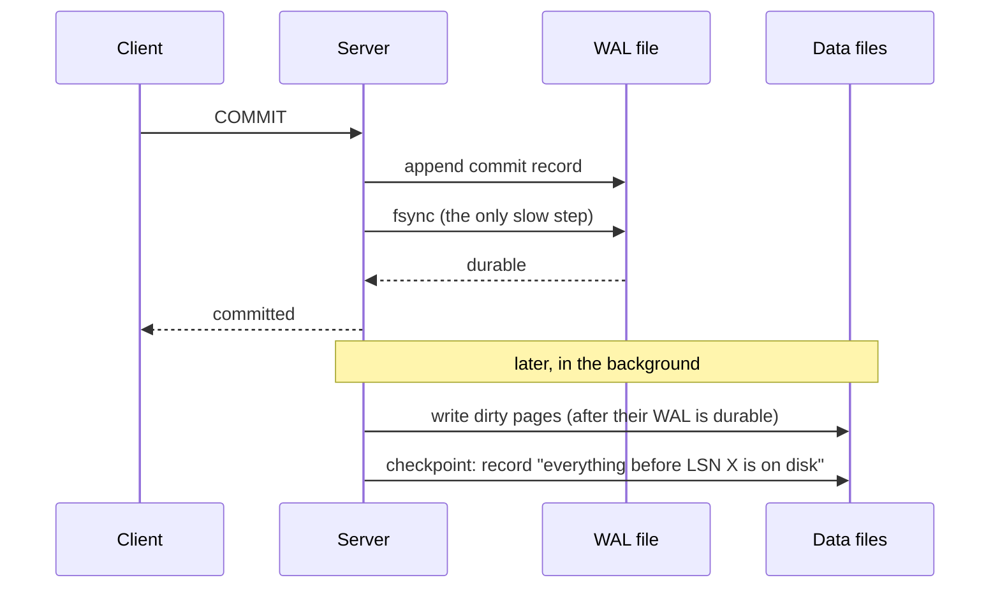
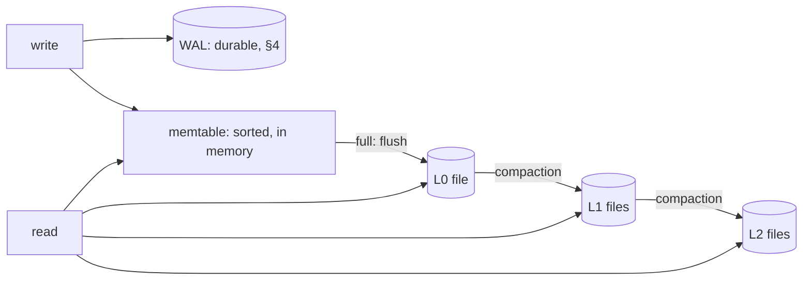
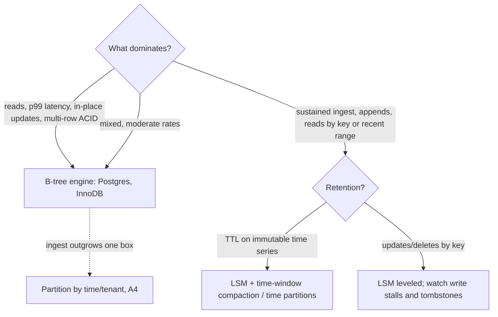

# A2 Unit 2 — Write paths: WAL, LSM trees and the B-tree trade-off

> Time: ~6 h · CORE: §4–§6 · STRETCH: `labs/a2/wal` (the write-ahead log lab) and the compaction-strategy deep dive in §5 · Lab: `labs/a2/lsm` (core), `labs/a2/wal` (stretch)

A database is a promise: *once I say "committed", it stays committed*. Everything in this unit is how that promise is
kept cheaply. The expensive part is making bytes durable (§4); the clever part is arranging writes so that durability
costs a sequential append rather than a random page rewrite (§5); and the senior part is knowing which engine shape
fits which workload, in numbers (§6). You will build a log-structured merge tree with bloom filters and compaction, and
optionally a write-ahead log you can crash on purpose.

## Before you start

You should have finished Unit 1 ([`unit-1-access-patterns-indexes.md`](unit-1-access-patterns-indexes.md)). Warm-up
from earlier material, answer first:

1. (Unit 1) A B-tree has fan-out ≈ 300. How many levels does an index over 100 M rows have, and how many of the lookup's
   page reads are likely to hit disk on a warm database?
2. (Unit 1) A table has six indexes. How many B-trees does one `INSERT` modify, and why does that matter more once the
   indexes exceed memory?
3. (A1 Unit 3) An idempotency store must "reserve" a key with one atomic conditional write, and the reservation must
   survive a crash between the money movement and the response. Which two storage properties does that need?

<details data-kind="answer">
<summary>Warm-up answers</summary>

1. 300³ = 27 M < 100 M < 300⁴ = 8.1 B → **4 levels**. The root and second level (tens of pages) are always cached; the
   third level (≈ 1,200 pages ≈ 10 MB) almost certainly is; so typically ≈ 1 disk read for the leaf (+ 1 for the heap row).
2. Seven: the heap/clustered tree plus six indexes, each a random leaf update plus a log record. Once the indexes
   don't fit in memory each update is a likely cache miss and a later page write, so write cost becomes I/O-bound.
3. **Atomicity of the conditional write** (a unique constraint or `INSERT … ON CONFLICT DO NOTHING`; Unit 3 §7–§8 explains
   what makes it safe under concurrency) and **durability** (the reservation must be on disk before you acknowledge, which is
   this unit's subject).

</details>

---

## §4 Durability and the write-ahead log

### The failure story

A platform engineer needs to load 5 M historical ledger entries into a new database. The loader does one transaction per
row. Each commit forces the log to stable storage (`fsync`), which on the network volume behind the instance takes
≈ 1.2 ms. The arithmetic: 5,000,000 × 1.2 ms = 6,000 s = 100 minutes. In a hurry, the engineer sets `fsync = off` in
the config, which makes the load finish in ≈ 8 minutes, and forgets to revert it. The setting travels into the
configuration template for the new production cluster.

Four months later the host reboots after a hypervisor fault. PostgreSQL does not start cleanly: the control file
says the last checkpoint is at a log position whose pages are not what the log claims. Recovery fails with checksum
errors. The team restores last night's backup and replays what they can: ≈ 6 hours of transfers are gone, ≈ 11,000 of them
already acknowledged to members' apps and confirmed to the core.

Two lessons hide in that story. First, durability is a *cost* you can see on a stopwatch (1.2 ms per commit), which is why
people are tempted to remove it. Second, turning it off does not merely "lose the last second": it removes the ordering
guarantees that recovery depends on, so what you lose can be the whole database.

The commit rate is also a ceiling. At 1.2 ms per fsync, one connection that commits serially can do ≈ 830 commits/s.
A payroll run that posts 2,000 transfers/s on a single worker thread cannot be done with a one-commit-per-row design at
any CPU speed.

### Predict

<!-- predict id="A2-U2-P05" -->
**Predict.** Write your answers down before opening the reveal.

1. A database changes a data page in memory and also writes a log record describing the change. Which must reach stable
   storage first, and why? Describe what recovery finds, and what it does, for each crash: (a) after the log was
   fsynced, before the data page was written to its file; (b) in the middle of writing the commit record to the log;
   (c) after the data page was written, but before the log record was.
2. `fsync` takes 1 ms. How many commits per second can one connection do if each commit waits for its own fsync? If 64
   connections commit concurrently and the database lets all commits that arrive while an fsync is running share the
   *next* fsync, roughly how many commits per second can the system do, assuming CPU is not the limit?
3. Compare `synchronous_commit = off` (PostgreSQL) with `fsync = off`: what can each lose, and which of them can
   corrupt the database?
<!-- /predict -->

### Reveal

<details data-kind="reveal" data-for="A2-U2-P05">
<summary>Reveal</summary>

1. **The log first** (the *write-ahead* rule): a data page may be written only after the log records describing its
   changes are durable. Otherwise a crash could leave a page that reflects a change the log can no longer explain
   or undo or redo.
   - (a) Recovery reads the log from the last checkpoint, sees the committed change, finds the page lacks it (the page's
     LSN is older than the record), and **redoes** it. The transaction is committed and not lost.
   - (b) The commit record is torn: its checksum or length fails. Recovery treats the log as ending before it. The
     transaction **never committed**; its effects are not applied (or are undone). This is correct *because* the client
     was never acknowledged (the commit call had not returned).
   - (c) Forbidden by the rule. If it could happen, a page would carry a change with no log record: after a crash the
     database could neither redo nor properly undo it. This is exactly the ordering `fsync = off` stops guaranteeing.
2. Serial: 1 ÷ 1 ms = **1,000 commits/s** (≈ 830/s at 1.2 ms). With group commit, while one fsync runs, up to 63 other
   commits queue; the next fsync covers all of them. Each fsync still takes ≈ 1 ms but now makes ≈ 64 commits durable:
   up to ≈ 64,000 commits/s, so the limit moves from the device's flush latency to CPU, lock contention or log bandwidth.
   Real systems land at ≈ 10k–50k commits/s on good hardware, consistent with the ≈ 1k–10k write TPS in
   [`docs/NUMBERS.md`](../../docs/NUMBERS.md) for ordinary multi-statement transactions.
3. `synchronous_commit = off`: the server answers "committed" *before* flushing the log (it flushes within a short
   window, a few hundred milliseconds). A crash can lose the most recent transactions that were acknowledged, but the
   database remains **consistent** (it is as if those transactions had never run). `fsync = off`: nothing forces data
   to disk in any order, so a crash can leave the files in a state no log can repair: **it can corrupt the database**.
   One is a durability/latency trade; the other removes safety. The tempting wrong answer is "both just lose recent data".

</details>

### How it actually works

**Why a log at all.** A B-tree update changes an 8 KB page somewhere in a file. Forcing that page to disk on every
commit is slow (random write) and not even safe (a multi-page change such as a leaf split touches several pages that
cannot be written atomically together). Instead the database appends a small **redo record** describing the change to
a sequential log, forces *the log* to disk at commit, and writes the data pages lazily. After a crash, replaying the log
reproduces every committed change. This is **write-ahead logging (WAL)**:

1. A transaction changes pages in the buffer pool (memory) and appends records to the WAL buffer. Each record has a
   **log sequence number (LSN)**; each page remembers the LSN of the last record applied to it.
2. At **commit**, the commit record is appended and the log is flushed (`fsync`) up to that LSN. Only then is the client
   told "committed".
3. A background process writes dirty pages to their files later. Before writing a page it ensures the log is flushed up
   to the page's LSN.
4. A periodic **checkpoint** writes all dirty pages up to some LSN and records it. Recovery only needs to replay the log
   from the last checkpoint, so checkpoints bound recovery time (and let old log be recycled).



**Recovery** is a log scan: start at the last checkpoint, read records in order, and for each record whose LSN is newer
than the page's LSN, re-apply it (redo). The scan stops at the first record that is incomplete or fails its checksum:
that is the torn tail left by the crash. Two engines differ on *undo*: InnoDB keeps undo records so changes from
transactions that had not committed (but whose pages were written) can be rolled back; PostgreSQL's multi-version
storage keeps the old row versions in the table, so aborted changes are simply invisible and its WAL is redo-only.
(ARIES, the classic recovery algorithm, formalises analysis → redo → undo.)

**What the lab's log looks like on disk.** Each record is `crc32c | length | payload`; the checksum covers the length and
the payload. The i-th record has LSN i.

```
| crc | len=5 | "hello" | crc | len=3 | "abc" | crc | len=7 | "par... <- crash here: a partial record
```

Recovery has to tell two situations apart, and the distinction is the heart of the lab:

- **Torn tail**: the last record is incomplete (the file ends mid-record) or the *last* record fails its checksum. That
  is what an interrupted append looks like. Drop it and carry on; nobody was told it committed.
- **Corruption**: a record in the *middle* fails its checksum, with intact records after it. An interrupted append cannot
  do that. Silently truncating there would discard committed transactions, so the right behaviour is to stop and refuse
  to open (or, in engines that offer it, to recover to the last consistent point on explicit request).

**Torn pages.** Disks guarantee atomic writes only at the sector level (512 B or 4 KB). An 8 KB page write interrupted by
power loss can leave half the page new and half old, and then redo records that assume the old page contents would
produce garbage. The two common defences are **full-page writes** (PostgreSQL logs a full copy of a page the first time
it is modified after a checkpoint, so recovery can restore a clean base) and a **doublewrite buffer** (InnoDB writes
pages to a scratch area first, then to their place; recovery repairs torn pages from the scratch copy). Both cost extra
write volume, and both are why checkpoint frequency shows up in write amplification (§6).

**The cost of durability.** `fsync` waits for the device to confirm the data is on stable media. Order-of-magnitude
costs (≈; vary widely by device and cloud, TODO-VERIFY for yours): a local NVMe drive with power-loss protection tens of
microseconds up to ≈ 1 ms; a network block volume ≈ 1–a few ms; a spinning disk ≈ 5–10 ms (a seek plus rotation).
A consumer SSD without power-loss protection may report completion while data sits in a volatile cache: your durability is
only as good as the device's honesty.

**Group commit.** Because the flush cost is mostly fixed per `fsync` rather than per byte, the database batches:
commits that arrive while a flush is in progress wait for the *next* flush, which covers all of them. Throughput
scales with concurrency until the log's bandwidth or CPU becomes the limit; latency per commit stays ≈ one or two flushes.
The lab's `Commit` implements it with a leader/follower loop on a condition variable: the first committer to find no
flush in progress becomes the leader and syncs on behalf of everyone appended so far; the others wait.

**Choices along the durability axis** (what a commit means):

| Setting | What "committed" means | Can lose acknowledged commits? |
|---|---|---|
| fsync on every commit (group commit) | In the local log on stable storage | No (barring device lies) |
| Asynchronous commit (`synchronous_commit=off`, `innodb_flush_log_at_trx_commit=2`/`0`) | In the OS cache / log buffer; flushed within ≈ a second | Yes, the last moments; DB stays consistent |
| Replicate before ack (synchronous replication, A4/A5) | In memory or log of ≥ 2 machines | Not on one machine's loss; local fsync may be skipped |
| `fsync = off` | Nothing | Yes, and maybe the whole database |

**When `fsync` fails.** If an `fsync` returns an error, the kernel may already have dropped the dirty pages (and some
filesystems then report success on the next call). Retrying and carrying on can silently lose data. PostgreSQL's 2018
"fsyncgate" discussion led it to treat fsync failures as fatal and crash into recovery rather than retry (TODO-VERIFY
version and details). The lab models this: after a failed `Sync` the log refuses every further call
(`ErrLogFailed`).

### Build it

**STRETCH lab**: `labs/a2/wal` (about an hour; do it after `lsm`). `SimFile` is provided: an in-memory file with a
volatile layer, `Crash(keep)` (power loss that persists the synced bytes plus an arbitrary prefix of the unsynced
bytes), `Corrupt`, `FailNextSync` and `SetSyncDelay`. Implement:

- `EncodeRecord` (CRC-32C over length + payload; the byte layout is pinned by a test).
- `Scan`: parse bytes into records; tell a torn tail from mid-log corruption (`*CorruptError`).
- `Open`: recover, truncate the torn tail, return a log positioned after the last valid record.
- `appendLocked` and `waitDurable`: the group-commit loop (leader unlocks around `f.Sync()`; followers wait on a
  `sync.Cond`; a failed sync poisons the log and wakes everyone).

Acceptance tests: `TestScan_ATornTailAtEveryCutPointYieldsExactlyTheCompleteRecords` (every byte cut of a six-record
image), `TestScan_ADamagedLastRecordIsATornTail`, `TestScan_ADamagedMiddleRecordIsCorruptionNotATornTail`,
`TestCrash_SyncedRecordsAlwaysSurviveAndUnsyncedOnesMaySurviveAsAPrefix` (crash at every possible number of persisted
unsynced bytes, reopen, append, crash again), `TestCommit_IsDurableWhenItReturns`,
`TestCommit_GroupCommitSharesSyncsAcrossConcurrentCommitters` (16 committers behind a 2 ms fsync use at most half as many
syncs as commits), `TestSync_AFailedSyncPoisonsTheLogAndNothingAfterItIsAcknowledged` and
`TestSync_AFailedSyncWakesEveryBlockedCommitter`. Run `go test -race ./labs/a2/wal/`.

### Break it

<!-- predict id="A2-U2-P06" -->
**Predict.** The break-it test runs 200 commits against a device whose fsync takes 2 ms, with 1, 4 and 16 concurrent
committers. Write down the wall time and the number of fsyncs for each.
<!-- /predict -->

Run `go test -tags breakit -run BreakIt -v ./labs/a2/wal/`.

<details data-kind="reveal" data-for="A2-U2-P06">
<summary>Reveal</summary>

A reference run:

| committers | wall time | fsyncs | commits/s |
|---|---|---|---|
| 1 | ≈ 450 ms | 200 | ≈ 450 |
| 4 | ≈ 210 ms | ≈ 95 | ≈ 940 |
| 16 | ≈ 55 ms | ≈ 25 | ≈ 3,700 |

One committer pays one fsync per commit: 200 × 2 ms = 400 ms plus overhead. With 16 committers each fsync covers the
≈ 8 commits that arrived during the previous one. The number of fsyncs falls roughly in proportion to concurrency, until
the batch is limited by the number of committers. The tempting wrong prediction is "16 committers take the same
time because the disk is the bottleneck": the disk is the bottleneck *per flush*, not per commit.

</details>

Two code-level breaks:

1. Wire `breakSkipTruncate` into `Open` (the stub's comment shows where) and run
   `go test -tags breakit -run Crash -v ./labs/a2/wal/`.
2. In `waitDurable`, keep `l.mu` locked across `f.Sync()` and re-run the group-commit test.

<details data-kind="answer">
<summary>What you should see, and why</summary>

1. `file is 106 bytes after recovery, want 105 (torn bytes must be truncated)`. Without truncation the torn bytes stay
   in the file; the next `Commit` appends *after* them, and the following recovery sees a garbage record in the middle
   with valid data after it: either `ErrCorrupt`, or it stops at the garbage and silently loses the acknowledged commit
   that was appended after. Torn-tail truncation is what makes recovery repeatable.
2. The test still passes for correctness, but the fsync count equals the commit count (or close): with the lock held
   across `Sync`, every other committer blocks on the mutex instead of appending behind the running flush, so no batch
   ever forms. The group-commit test fails its `<= total/2` assertion. Batching requires the slow step to run
   *outside* the critical section.

</details>

### In the wild

- **PostgreSQL**: WAL with a checkpointer and background writer; `fsync`, `synchronous_commit`, `full_page_writes`,
  `wal_level`; WAL is also what streaming replication ships to followers (A4).
- **InnoDB (MySQL)**: redo log plus undo logs; a doublewrite buffer for torn pages;
  `innodb_flush_log_at_trx_commit` = 1 (flush at every commit), 2 (write to OS cache each commit, flush about once a
  second) or 0 (write and flush about once a second).
- **SQLite**: the classic rollback journal, or WAL mode (appends to a `-wal` file, readers keep reading the main file,
  a checkpoint folds the WAL back in).
- **RocksDB / LevelDB**: a write-ahead log protects the memtable (§5); writes can be synced or not per write
  (`WriteOptions.sync`); on recovery the log is replayed into a fresh memtable.
- **Kafka** takes the opposite position: it appends to log segments and relies on the page cache plus replication across
  brokers for durability rather than an fsync per message (configurable; TODO-VERIFY defaults). A6 covers the log as a
  product.
- **etcd** (and any Raft-based system, A5) fsyncs a WAL before acknowledging an entry; its commit latency is bounded by
  disk fsync latency, which is why etcd documentation stresses fast disks.

### Trade-offs

| Option | Wins when | Loses when | When the answer flips |
|---|---|---|---|
| fsync per commit with group commit | Acknowledged means durable (money movement, audit) | Single-threaded committers on slow storage | Never flip for the ledger; batch work (§4 "5 M rows") instead |
| Asynchronous commit | Loss of the last ≈ second is tolerable and recoverable (counters, caches, derived data) | Anything acknowledged to a member or the core | Flip to sync for money-moving flows; keep async for low-value tables |
| Replicate before ack, no local fsync | Cross-AZ durability matters more than one disk | Correlated failures (whole region, shared power) | Add local fsync when a single-site outage must not lose acknowledged data (A4/A5, A7 RPO) |
| Bigger batches per transaction | Bulk loads, backfills | Long transactions hold locks and bloat (Unit 3) | Keep batches ≈ 1–10 k rows; do not make one giant transaction |
| Lower checkpoint frequency | Fewer full-page writes, smoother I/O | Longer crash recovery, more WAL retained | Tighten when recovery-time objectives require it |

### Senior bar

- **Failure modes:** `fsync` disabled or neutered (`fsync=off`, a volume or hypervisor that ignores flushes, a write cache
  without power-loss protection); torn pages without full-page writes/doublewrite; WAL volume filling the disk
  (a stuck replica or archiver retaining log); ignoring fsync errors; acknowledging before durable.
- **Capacity:** commits/s ≈ concurrency ÷ flush latency until log bandwidth or CPU binds (64 / 1 ms ≈ 64 k/s theoretical);
  WAL volume ≈ write rate × record size × (1 + full-page-write overhead right after checkpoints); recovery time ≈ WAL
  since the last checkpoint ÷ replay speed (often hundreds of MB/s to a few GB/s of log; TODO-VERIFY for your engine).
- **Ops:** monitor WAL disk usage and replication slots, checkpoint frequency and duration, `fsync` latency
  (p99), time-to-recover from a crash-kill drill; practise restoring from backup and point-in-time recovery.
- **Cost:** the slowest storage on the commit path sets commit latency, which is why databases get the best (and most
  expensive) volume for the log and cheaper storage for data.

Interviewer follow-up probes:

1. "The app got `COMMIT` OK, the node crashed, and the row is gone. How?"

<details data-kind="answer">
<summary>Model answer</summary>

Either the commit was acknowledged before the log was durable (asynchronous commit, `fsync` off, or a layer ignoring
flushes: a virtual disk or controller write cache without battery/power-loss protection), or the node was a primary that
acknowledged and then failed over to a replica that hadn't received the log yet (asynchronous replication lag, A4).
For a ledger I require a synchronous local flush, on storage with power-loss protection, and I decide explicitly
whether failover may lose the tail (RPO, A7) or must wait for a synchronous replica.

</details>

2. "Why not write every update straight to its page and skip the log?"

<details data-kind="answer">
<summary>Model answer</summary>

Because a commit would need a random in-place page write per touched page, and a multi-page change (a B-tree split)
cannot be made atomic: a crash between page writes leaves a structurally broken tree. The log turns a transaction's
many random writes into one sequential append that is made durable atomically (the commit record either exists with
a valid checksum or it doesn't), and the pages can be fixed from the log after a crash. Copy-on-write designs such
as LMDB avoid the log by never overwriting, at the price of writing the changed path from leaf to root each time.

</details>

3. "How do you make a bulk load of 5 M rows fast and still safe?"

<details data-kind="answer">
<summary>Model answer</summary>

Batch many rows per transaction (thousands), use `COPY`/multi-row inserts, and load with fewer indexes then build them
afterwards. That cuts fsyncs from 5 M to a few thousand (≈ 5 s instead of 100 minutes at 1.2 ms), without weakening
durability. If the data is reproducible from its source, a load into a *new* cluster can reasonably use relaxed durability
settings, provided the cluster is rebuilt, not promoted, if it crashes mid-load, and the setting is reverted by code,
not by memory.

</details>

### Check yourself

1. State the write-ahead rule in one sentence.
2. A recovery scan finds record 7 of 10 failing its checksum, with records 8–10 intact. Torn tail or corruption, and
   what should the database do?
3. Why does group commit increase throughput without increasing the per-commit latency much?

<details data-kind="answer">
<summary>Answers</summary>

1. A data page may be written to disk only after the log records describing its changes are durable (and a transaction is
   committed only after its commit record is durable).
2. Corruption: an interrupted append can only damage the *end* of the log, but intact records follow. The database
   must not silently truncate (that would discard committed transactions 8–10); it should stop and report, leaving the
   files untouched so an operator can restore or recover to a chosen point.
3. The fsync's cost is mostly fixed per call, so one flush that makes many commits durable amortises it; each commit
   waits for at most the flush in progress plus the next one, ≈ 1–2 flush latencies, regardless of batch size.

</details>

---

## §5 LSM trees

### The failure story

Card authorisations, login events and API audit events flow into one "event store": ≈ 30,000 events/s at the daily
peak, ≈ 300 bytes each. That is ≈ 9 MB/s of user data, ≈ 2.6 B events and ≈ 780 GB a day. The first version is a table in the
main PostgreSQL cluster with three secondary indexes ("by member", "by type and time", "by device").

Each event updates the heap and three B-trees: four random leaf changes and four log records. The primary tops out at
≈ 8,000 events/s (consistent with the ≈ 1k–10k write TPS envelope of one primary, [`docs/NUMBERS.md`](../../docs/NUMBERS.md)),
four times short, and the extra load slows the ledger sharing the box. The team moves events to a store built on a
log-structured merge tree (LSM): appends go to memory and a sequential log, and ingest of 30 k events/s is suddenly easy.

Then the second-order effects arrive:

- At 10× traffic (300 k events/s) the background merging cannot keep up. The engine first slows writes, then stalls them
  when too many unmerged files pile up: p99 write latency goes from 5 ms to 2 s, in waves.
- "Show me this member's events from the last hour" reads from the memtable and from every file that might hold the
  member: with 14 files and no bloom filters, a read for a quiet member searches all 14.
- Retention deletes yesterday's data with `DELETE`, which in an LSM *writes* tombstones. A query that scans a hot range
  now steps over 200,000 tombstones before reaching live rows and times out.
- During a big merge the disk is 85% full, because merging writes new files before deleting the old ones.

None of this is a defect. They are the price of the trick that made ingest cheap.

### Predict

<!-- predict id="A2-U2-P07" -->
**Predict.** Write your answers down before opening the reveal. An LSM engine buffers writes in a memtable, flushes it as an
immutable sorted file when full, and merges files with a *tiered* policy: when a level holds 4 files, merge them into
one file at the next level.

1. After 64 equal-sized flushes (all distinct keys), how many files exist, and how many times has each entry been
   written to the data files in total (counting the flush as one)? Compare with a fanout of 8.
2. A bloom filter with 10 bits per key and the optimal number of hash functions guards each file. How much memory does it
   need per 1 M keys, what is its false-positive rate, and for a key that does *not* exist, how many of 6 files does a
   read actually search on average?
3. You delete key `k`, whose live value sits in a file three levels down. What is written, where, and when is it safe
   for compaction to discard it? What goes wrong if it is discarded early?
<!-- /predict -->

### Reveal

<details data-kind="reveal" data-for="A2-U2-P07">
<summary>Reveal</summary>

1. Fanout 4: 64 = 4³, so the cascade ends with **one file** at level 3 (0 + 0 + 0 + 1 in base 4). Each entry was
   written once by its flush and once by each of the 3 merges it took part in: **write amplification = 1 + 3 = 4**
   (the lab asserts ≈ 4.0 for this case). Fanout 8: 64 = 8², two levels, **WA = 3**, and fanout 2: six merge levels,
   **WA = 7**. More merging per level → more rewriting, fewer files to search. If the 64 flushes were not a power of the
   fanout there would be several files at several levels (the base-4 digits of the flush count): that is read
   amplification, the other side of the same dial.
2. 10 bits × 1 M = 10 Mbit = **1.25 MB** per million keys. Optimal `k = ln 2 × 10 ≈ 7` hash functions give a false-positive
   rate `(1 − e^(−kn/m))^k ≈ 0.8%`. For an absent key each file's filter lets it through with probability ≈ 0.008, so
   the expected number of files searched is `6 × 0.008 ≈ 0.05`: the miss almost never touches a data block. For a
   key that exists, the filters of the files that don't hold it say no, and only the owning file is searched
   (+ ≈ 0.05 false positives). The tempting wrong answer is "a bloom filter speeds up reads of keys that exist":
   it mostly speeds up reads of keys that *don't*, and of keys that live in an old file.
3. You write a **tombstone** `(k, deleted)` into the memtable like any other write; the old value is not touched
   (files are immutable). Reads find the tombstone first (newest wins) and answer "not found". Compaction may drop the
   tombstone **only when it is merged into the oldest data that can contain `k`**, i.e. nothing older remains below.
   Dropped earlier, a lower file still holding `k = value` becomes visible again: the **deleted account comes back to
   life**. (The lab's `TestCompaction_TombstoneSurvivesWhileOlderDataExistsThenIsDropped` is exactly this.) In a
   replicated store there is a second hazard: a tombstone discarded before a lagging replica has seen it lets that
   replica's old value resurrect (Cassandra's `gc_grace_seconds` exists for this; A4/A5).

</details>

### How it actually works

**The trick: never update in place.** A B-tree changes pages where they lie, which means random writes. An LSM instead
turns *all* writes, updates and deletes into **appends** to a sorted structure in memory and, eventually, into
immutable sorted files written sequentially.



**Write path.** (1) append to the WAL (so the memtable survives a crash; §4); (2) insert into the **memtable**, an
in-memory ordered map (a skip list or balanced tree); (3) when the memtable reaches its size limit (tens of MB), freeze
it, start a new one, and write the frozen one to disk as an **SSTable** (sorted string table), then delete the WAL
segment that covered it. The only disk writes on the hot path are the sequential WAL append and, in the background,
sequential file writes.

**An SSTable** is an immutable file: sorted key/value entries in blocks, a sparse **index** (first key of each block),
a **bloom filter**, min/max key and a footer. Because it is sorted and immutable, a lookup is: check key range → check
bloom filter → binary search the index → read one block.

**Read path.** Check the memtable, then files **from newest to oldest**; the first version found wins (a tombstone is a
version). Each file consulted costs a bloom check (in memory) and, on a pass, a block read. The cost of a read
therefore grows with the number of files, which is why compaction exists. A *range scan* cannot use bloom filters (they
answer point membership), so it merges iterators over the memtable and *every* file whose key range overlaps. This is
the lab's `Scan`, via `Merge`.

**Bloom filter.** An array of `m` bits and `k` hash functions. Adding a key sets `k` bits; a lookup says "maybe" if all
`k` bits are set and "definitely not" if any is clear. No false negatives, false-positive rate
`p ≈ (1 − e^(−kn/m))^k`, minimised at `k = (m/n) ln 2` giving `p ≈ 0.6185^(m/n)`: 10 bits/key ≈ 0.8%, 4 bits/key
≈ 15% (with `k=3`), 20 bits/key ≈ 0.007%. Cost: `m/8` bytes per file, built once at flush time. The lab derives the `k`
and bit-array size from `bitsPerKey`, and derives the probe positions from two hashes: `h1 + i·h2` (double hashing, the
Kirsch–Mitzenmacher construction).

**Compaction** merges files to bound read amplification and reclaim the space of overwritten and deleted entries. The
merge is a k-way merge of sorted runs where, for equal keys, the newest wins and (when safe) tombstones disappear. Two
families:

| | Tiered (size-tiered, "universal") | Leveled |
|---|---|---|
| Idea | Merge several files of similar size into one bigger file | Keep each level (above L0) as non-overlapping files; level L+1 is ≈ 10× larger than L; push a file down by merging it with the overlapping files below |
| Write amplification | ≈ number of levels ≈ `log_F(N / memtable)`; **low** (the lab: 1 + levels) | ≈ `F × levels` worst case, **≈ 10–30 is commonly quoted** in practice (workload dependent; TODO-VERIFY against your engine's tuning guide) |
| Read amplification | Up to `F−1` files per level may hold a key; **higher** | ≤ 1 file per level above L0; **lower** |
| Space amplification | Up to ≈ 2× or more (old versions linger; big merges need room for input and output) | ≈ 1.1× |
| Best for | Write-heavy ingest, fewer rewrites | Read-heavy or space-sensitive; update-heavy workloads where leveled drops old versions fast |
| Time-window variant | Group files by time; drop a whole file when its window passes the TTL (no tombstones) | n/a |

The lab implements the tiered policy because its behaviour can be asserted exactly: with fanout `F`, after `k` flushes of
distinct keys the number of files per level is the base-`F` representation of `k`, and write amplification is
`1 + levels`.

**Tombstones and when they die.** A merge can drop a tombstone only if no older file (in a deeper level or in an overlapping
file) could still contain the key. In the lab: only when every level below the merge output is empty. In leveled
engines: when the tombstone reaches the bottom level or no overlapping data remains below. Meanwhile it costs space and
read time (scans step over them), which is why "delete a month of data by deleting every row" is an anti-pattern in LSM
stores; TTLs, time-window compaction and dropping whole partitions are the idiom.

**Write stalls.** Compaction competes with foreground work for I/O and CPU. If ingest outruns compaction, unmerged
files accumulate (read amplification explodes), so engines deliberately slow and then stop writes when thresholds on
level-0 file count or pending compaction bytes are exceeded (RocksDB exposes `level0_slowdown_writes_trigger`,
`level0_stop_writes_trigger` and pending-compaction-bytes limits). The stall is backpressure: the honest signal that
sustained ingest exceeds what the disk can merge (this connects to backpressure in A6 and load shedding in A7).

**Three amplifications.**

- *Write amplification (WA)* = bytes written to storage ÷ bytes the application wrote. Costs SSD endurance and
  bandwidth.
- *Read amplification (RA)* = files or blocks consulted per lookup. Costs latency and IOPS.
- *Space amplification (SA)* = bytes on disk ÷ bytes of live data. Costs capacity and headroom.

You cannot minimise all three; that is §6.

### Build it

Lab `labs/a2/lsm`, file `lsm.go`. Read the package comment first: it states what the tests rely on. Provided: the locking
wrappers (`Put`, `Delete`, `Get`, `Scan`, `Flush`, `CompactAll`), `Entry`, `Options`/`Open`, `Stats`, `NewTable`,
`Table.Range`, `hashes`. Implement, in this order:

1. `NewBloom`, `Add`, `MayContain`.
2. `Merge`: k-way merge with newest-wins and optional tombstone dropping.
3. `Table.Lookup`: range check, bloom check, binary search (the outcome tells the DB which counter to bump).
4. `DB.get`, `DB.put`, `DB.flush`.
5. `DB.compact`: the tiered cascade and the tombstone-dropping rule.
6. `DB.scan` and `DB.compactAll`.

Acceptance tests: `TestBloom_NeverReportsAnAddedKeyAsAbsent`, `TestBloom_FalsePositiveRateMatchesTheory`,
`TestBloom_SizeAndProbeCountFollowTheFormulas`, `TestMerge_*`, `TestTable_LookupSkipsByRangeThenBloomBeforeSearching`,
`TestLevels_TieredShapeIsTheBaseFanoutRepresentationOfTheFlushCount`,
`TestCompaction_TombstoneSurvivesWhileOlderDataExistsThenIsDropped`, `TestCompaction_ReclaimsOverwrittenVersions`,
`TestGet_BloomFiltersKeepAbsentKeyLookupsOffTheTables`, `TestWriteAmp_FewerLevelsMeansLessRewriting` (exact
write amplification 7 / 4 / 3 for fanout 2 / 4 / 8), `TestReadAmp_*`, `TestStats_ByteAccounting`,
`TestRandomOps_MatchAMap` (random puts, deletes, scans, flushes and full compactions against a map) and
`TestConcurrent_WritersReadersAndCompactionsUnderTheRaceDetector`. Run `go test -race ./labs/a2/lsm/`.

### Break it

<!-- predict id="A2-U2-P08" -->
**Predict.** The amplification experiment runs 30,000 random overwrites of 1,000 keys (memtable of 100 entries) at fanouts
2, 3, 4, 8 and 16, once with no bloom filters and once with 10 bits per key. Before running it, write down for each fanout
the *trend* of: write amplification, space amplification (entries stored ÷ live keys), the number of files, and the
average number of files binary-searched per read of a missing key (with and without the filter).
<!-- /predict -->

Run `go test -tags breakit -run BreakIt_Amplification -v ./labs/a2/lsm/`.

<details data-kind="reveal" data-for="A2-U2-P08">
<summary>Reveal</summary>

A reference run (the exact values depend on how the base-`F` digits of the flush count fall; the trends do not):

| fanout | write amp | space amp | files | searched per miss, no filter | searched per miss, 10 bits/key |
|---|---|---|---|---|---|
| 2 | ≈ 4.3 | ≈ 2.8 | 5 | ≈ 4.9 | ≈ 0.04 |
| 3 | ≈ 2.9 | ≈ 3.1 | 5 | ≈ 5.0 | ≈ 0.05 |
| 4 | ≈ 2.4 | ≈ 3.0 | 6 | ≈ 5.9 | ≈ 0.04 |
| 8 | ≈ 1.8 | ≈ 6.2 | 12 | ≈ 11.9 | ≈ 0.11 |
| 16 | ≈ 1.5 | ≈ 3.1 | 15 | ≈ 14.7 | ≈ 0.12 |

- Write amplification falls as fanout grows: fewer merge levels, each entry rewritten fewer times. Read amplification
  and the file count rise: more files can hold a key. That is the dial.
- Space amplification is high (≈ 3×) because each overwritten key lives in several files until a merge brings the versions together.
  It spikes where many files are unmerged (fanout 8 with 12 files ≈ 6×).
- The bloom filter makes the "no filter" column (≈ one search per file) collapse to ≈ 0.05–0.1 searches per miss, at a
  cost of 10 bits per key of memory. Tiered compaction with *no* filters is nearly unusable; with them, the extra
  files cost almost nothing for point reads. (They do nothing for range scans.)

</details>

Then the correctness break: build with the tombstone switch and run `go test -tags breakit -run Tombstone -v ./labs/a2/lsm/`
(the files `breakit_on.go`/`breakit_off.go` define `breakAlwaysDropTombstones`; your `compact` must pass
`!deeper || breakAlwaysDropTombstones` to `Merge`).

<details data-kind="answer">
<summary>What you should see, and why</summary>

`TestCompaction_TombstoneSurvivesWhileOlderDataExistsThenIsDropped` fails with `Get("a") = "1", true; want "", false`: the
deleted key is back. The merge in round 2 combined the tombstone with newer files but an *older* table (level 1) still held
`a = 1`; an always-drop policy discards the only record that said "deleted". Every other behaviour of the store is
unchanged, which is what makes this bug so dangerous: it shows up weeks later as a ghost account or a refunded
transfer reappearing. The safe rule is conservative: keep a tombstone until the merge covers everything older.

</details>

### In the wild

- **LevelDB** (Google) and **RocksDB** (Meta's fork and extension) are the reference LSM libraries; RocksDB defaults to
  leveled compaction and also offers a "universal" (tiered-like) style; it exposes write-stall triggers and rate
  limiting. Many databases embed one of them.
- **Cassandra** (and ScyllaDB) use LSM storage with memtable + commit log + SSTables; compaction strategies are
  pluggable (size-tiered, leveled, time-window); deletes are tombstones kept for `gc_grace_seconds` (default 10 days;
  TODO-VERIFY) so that repairs can propagate them; tombstone thresholds make queries fail rather than scan millions of
  them (TODO-VERIFY defaults).
- **HBase** and **Bigtable** use the same memtable/SSTable idea (the Bigtable paper introduced "SSTable" and
  "memtable" in this sense).
- **CockroachDB** uses Pebble (a RocksDB-inspired LSM written in Go); **TiKV** (under TiDB) uses RocksDB; **MyRocks**
  runs RocksDB under MySQL. A SQL surface does not mean B-tree underneath.
- **InfluxDB**'s TSM engine and many time-series stores are LSM-flavoured with time-partitioned files.

### Trade-offs

| Option | Wins when | Loses when | When the answer flips |
|---|---|---|---|
| Tiered compaction | Ingest-heavy; low write amplification matters (SSD endurance) | Read-heavy, space-constrained, many overlapping files | Flip to leveled when reads or disk headroom hurt more than write cost |
| Leveled compaction | Read latency and space matter; update-heavy data | Sustained high ingest (WA ≈ 10–30 saturates disk) | Flip to tiered/time-window if compaction can't keep up |
| Time-window compaction + TTL | Immutable time-series with retention; drops whole files | Out-of-order writes into old windows; deletes by key | Flip to leveled if you update old data |
| Bloom filters on | Point reads, many files, many misses | Range-scan-only workloads; memory-constrained | Prefix/partition-key blooms, or off, for scans |
| Large memtable | Fewer, bigger flushes; absorbs overwrites | Longer WAL replay, more memory | Smaller memtables on memory-tight nodes |

### Senior bar

- **Failure modes:** write stalls and compaction debt under sustained ingest; tombstone storms on scans; disk full
  during a big merge (space amplification); read-latency spikes while compaction competes for I/O; tombstones
  dropped too early (resurrection); huge keys/values (large values multiply WA: key-value separation exists for this);
  bloom filters sized for the wrong key counts.
- **Capacity:** WA × user write rate = device write rate (30 MB/s of user data with WA 15 ≈ 450 MB/s of disk writes
  plus the WAL); SA × live data = disk to provision, plus headroom for the largest compaction (≈ 2× for tiered; plan
  ≈ 20–50% free for leveled); bloom memory ≈ `bits/key × keys ÷ 8` (10 bits × 1 B keys = 1.25 GB).
- **Ops:** alert on pending-compaction bytes, level-0 file count, write-stall time and p99 write latency; throttle
  compaction I/O; schedule bulk deletes and migrations off-peak; for replicated stores, repair within the tombstone
  grace period.
- **Cost:** you pay in write bandwidth and SSD wear (WA), and in over-provisioned disk (SA). In exchange, ingest is
  sequential and cheap.

Interviewer follow-up probes:

1. "Why is a delete a write in an LSM, and what does that imply for TTLs?"

<details data-kind="answer">
<summary>Model answer</summary>

Files are immutable, so a delete must be recorded as a new entry (tombstone) that shadows older versions; space is only
reclaimed when compaction merges the tombstone with the data it covers. Mass deletes therefore *increase* disk usage and
slow scans until compaction catches up. For retention I'd use TTLs on time-windowed data, so a window expires as a whole
file with no per-key tombstones, or partition the data so I can drop a partition, not delete rows.

</details>

2. "Where do bloom filters help, and where don't they?"

<details data-kind="answer">
<summary>Model answer</summary>

They help point lookups: for each file that doesn't contain the key, the filter (in memory) avoids the disk read, which
matters most for keys that don't exist and for keys in old files. They don't help range scans, which must visit every
overlapping file anyway; for scans you rely on compaction keeping the file count low, or on prefix blooms when scans are
within a known prefix. Cost is ≈ 10 bits per key for ≈ 1% false positives.

</details>

3. "Compare leveled and tiered compaction in one sentence each, with numbers."

<details data-kind="answer">
<summary>Model answer</summary>

Tiered merges same-size files when there are `F` of them, so each byte is rewritten about once per level (WA ≈ `log_F`
of the data-to-memtable ratio, single digits), at the price of up to `F−1` files per level to search and up to ≈ 2× space.
Leveled keeps each level sorted and non-overlapping and ≈ 10× bigger than the previous, so reads touch ≤ 1 file per level
and space is ≈ 1.1×, but pushing data down rewrites it against ≈ 10 neighbours, so WA is commonly on the order of 10–30.

</details>

### Check yourself

1. In the lab's tiered policy with fanout 3, what do the levels look like after 11 flushes of distinct keys?
2. Why must a read check the memtable and files newest to oldest?
3. Name two situations in which a compaction must *keep* a tombstone.

<details data-kind="answer">
<summary>Answers</summary>

1. 11 in base 3 is `102`: (least significant digit first) level 0 holds 2 files, level 1 holds 0, level 2 holds 1.
2. Overwrites and deletes are new entries; the newest version is the truth and older ones are stale or shadowed. The
   first version found while going from newest to oldest is therefore the answer, and a tombstone is an answer
   ("deleted").
3. When an older file (deeper level or overlapping range) might still contain the key, so dropping it would let the old
   value reappear; and, in replicated stores, until all replicas have seen the delete (the grace period).

</details>

---

## §6 B-tree or LSM: the amplification decision

### The failure story

Two teams, two mistakes, one quarter.

**The events team** kept its event store (§5: ≈ 30,000 events/s, ≈ 300 B each) on a B-tree database with three secondary
indexes. They tuned until it kept up. Then finance asked why the storage bill had tripled. The heap is appended
sequentially (≈ 27 rows per 8 KB page, cheap), but each event also dirties a *random* leaf in each of three
indexes. With the indexes larger than memory, those pages are written to disk before they can absorb a second update:
3 × 30,000 × 8 KB ≈ 720 MB/s of page writes, ≈ 62 TB a day, for ≈ 9 MB/s of data. The SSDs are rated for a fixed
number of full-drive writes per day (say 1 drive-write-per-day, a 3.84 TB drive ≈ 3.84 TB/day; TODO-VERIFY for your
hardware), so ≈ 16 drives' worth of endurance burn each day. Replacing worn SSDs became a line item.

**The ledger team** was inspired by that and moved the *ledger* to an LSM-based key-value store "because writes are
faster". The ledger does ≈ 1,000 writes/s and ≈ 20,000 reads/s, mostly point reads and short ranges, with a p99 target
of 10 ms. Writes were never the problem. The reads now consult up to one file per level, compaction I/O competes with
foreground reads, and month-end statement scans (large range reads) evict the block cache. p99 read latency, ≈ 6 ms
before, moves to ≈ 40 ms with spikes while compaction runs; and the new store has no multi-row transactions, so the
double-entry posting needs an application-level protocol (Unit 3 explains why that is a bad trade).

Each team picked an engine for a property it did not need, and paid for the property it did.

### Predict

<!-- predict id="A2-U2-P09" -->
**Predict.** Write your answers down before opening the reveal.

Workloads: **A** ledger OLTP (1,000 writes/s, 20,000 reads/s, p99 read < 10 ms, multi-row transactions, 300 B rows,
ranges for statements). **B** the event store above (30,000 inserts/s; each event also adds ≈ 40 B of entry to each of 3
secondary indexes; reads are rare, by member over the last hour). **C** metrics: 200,000 points/s, 40 B each, kept 7 days,
never updated, read by time range.

1. Pick B-tree or LSM for each, with one sentence of reason.
2. For B, compute the device write rate under (i) the B-tree with 3 random index pages per event and no coalescing
   (8 KB pages), and (ii) a leveled LSM with write amplification ≈ 15 (count user bytes as the row plus the three index
   entries). Convert each to TB/day.
3. For C, what compaction approach and what retention mechanism would you use, and why is a per-row `DELETE` the wrong tool?
<!-- /predict -->

### Reveal

<details data-kind="reveal" data-for="A2-U2-P09">
<summary>Reveal</summary>

1. **A: B-tree.** Reads dominate, tail latency matters, rows are updated in place, multi-row ACID is required. A B-tree
   gives ≈ 1 I/O per point read, ordered ranges, and mature transactional engines. **B: LSM.** Write-dominated,
   append-like, reads rare and mostly recent: sequential writes with a modest write amplification win. **C: LSM with
   time-window compaction.** Write-heavy, immutable, range-by-time reads, bulk expiry.
2. (i) B-tree: 3 pages × 8 KB × 30,000/s = 720 MB/s ≈ 62 TB/day (plus WAL and full-page images, plus the heap's
   ≈ 9 MB/s). Realistically checkpoints coalesce some updates; treat this as the *ceiling* when indexes exceed memory.
   (ii) LSM: user bytes = 300 B + 3 × 40 B = 420 B per event × 30,000 = 12.6 MB/s; × WA 15 ≈ 190 MB/s ≈ 16 TB/day
   (+ the WAL's 12.6 MB/s). With tiered compaction (WA ≈ 5) it is ≈ 63 MB/s ≈ 5.4 TB/day. Against 3.84 TB/day of
   endurance per drive that is ≈ 16 drives' worth for the B-tree ceiling versus ≈ 4 (leveled) or ≈ 1.5 (tiered). The
   tempting wrong answer is "LSMs are always faster at writes": they are faster at *this* kind of write because
   they change a random write per index into sequential bulk writes, at the price of rewriting data several times.
3. **Time-window compaction** (Cassandra's TWCS, or time-partitioned tables): files are grouped by the time window of their
   data, and when every point in a window is past the 7-day TTL, the **whole file** is dropped, with no tombstones, no
   merge and no read-time cost. A per-row `DELETE` in an LSM writes ≈ 200,000 × 86,400 tombstones a day (≈ 17 B of them)
   that scans must step over until a compaction clears them: the retention job becomes a second write workload.

</details>

### How it actually works

**Three amplifications, per engine.** Use these as napkin formulas, then measure.

| | B-tree (update in place) | LSM, leveled | LSM, tiered |
|---|---|---|---|
| **Write amplification** (device bytes ÷ user bytes) | A whole page is dirtied for a small change: up to `page size ÷ row size` (8 KB ÷ 300 B ≈ 27×) *per index* if updates don't coalesce, plus WAL and, after checkpoints, full-page images | ≈ 10–30 (commonly quoted; TODO-VERIFY) | ≈ `1 + levels`, single digits (lab: 7 / 4 / 3 for fanout 2 / 4 / 8) |
| **Read amplification** | ≈ 1 disk I/O per point read once the upper levels are cached (+1 heap fetch in a heap-organised engine); ranges are sequential | ≤ 1 file per level (+ L0 files); bloom filters make a miss ≈ free; ranges merge `levels` iterators | up to `F−1` files per level; filters carry the load; ranges merge many iterators |
| **Space amplification** | `1 ÷ fill ≈ 1.4×` at ≈ 69% fill, plus bloat after deletes | ≈ 1.1× (+ headroom for compaction) | ≈ 2×+ (versions linger; merges need input + output) |
| **Latency shape** | Smooth; spikes at checkpoints | Spiky during compaction and write stalls | Spiky; big merges |
| **Memory** | Upper index levels (tens of pages) | Bloom filters + index blocks ≈ 10 bits/key | Same |
| **Transactions and ranges** | Mature; ordered scans are leaf-chain walks | Possible but layered on top (CockroachDB, TiKV do it) | Same |

The **RUM conjecture** (Athanassoulis et al.) says the same thing in general form: an access method can optimise two of
read overhead, update overhead and memory/space overhead only at the expense of the third. B-trees favour reads; LSMs favour
updates; bloom filters buy back read cost with memory; compaction trades update cost for space and reads.



**What the SQL layer hides.** CockroachDB (Pebble), TiDB (TiKV/RocksDB) and MySQL with MyRocks all put SQL on an LSM;
MongoDB's WiredTiger offers a B-tree and (optionally) an LSM engine. The choice at the engine layer still leaks
through: compaction stalls, tombstone-heavy scans and space headroom with LSMs; bloat, vacuum and checkpoint spikes
with B-trees. When an interviewer asks "why that database?", the right answer names the *engine-level* property
(amplification, latency shape) behind the product name.

**Worked capacity for B (events).** 30,000/s × 300 B = 9 MB/s = 780 GB/day raw; with three index entries per event
12.6 MB/s ≈ 1.1 TB/day. Retain 14 days: ≈ 15 TB; compress ≈ 3× → ≈ 5 TB; replication ×3 → ≈ 15 TB of disk; provision ≈ 2× for tiered compaction
headroom → ≈ 30 TB. Say the number, then say what you would drop (secondary indexes, retention) to cut it.

**What does *not* decide it.** "NoSQL scales" (so does partitioned SQL, A4); "SQL is slow" (it is mostly the same
engines); developer familiarity (a legitimate tie-breaker, never the first argument). Decide on the three
amplifications and the latency shape under your own workload, then **measure with your data**, because the quoted
ranges differ by an order of magnitude between workloads.

### Build it

No new lab: use the two you built. A scratch comparison (in `labs/a2/lsm`, file `scratch_test.go`, do not commit; it
uses the test file's `tRandKey` helper) shows the read side of the table on 100,000 random keys:

```go
package lsm

import (
	"fmt"
	"testing"
)

func TestScratchReadAmp(t *testing.T) {
	for _, bits := range []int{0, 10} {
		db, _ := Open(Options{MemtableEntries: 1000, Fanout: 4, BloomBitsPerKey: bits})
		for i := 0; i < 100_000; i++ {
			db.Put(tRandKey(i), "v")
		}
		before := db.Stats()
		for i := 0; i < 10_000; i++ {
			db.Get(tRandKey(1_000_000 + i)) // keys that do not exist
		}
		after := db.Stats()
		fmt.Printf("bits=%d tables=%d write-amp=%.2f tables searched per missing key=%.2f\n",
			bits, after.Tables, after.WriteAmp(), float64(after.TableLookups-before.TableLookups)/10_000)
	}
}
```

Predict the three numbers for each line, then compare with the B-tree from §2, where every lookup, found or not, costs
exactly `Height()` page reads (`Reads()` delta).

### Break it

Simulate **compaction debt**: set `Fanout: 1000` so nothing is ever merged (what happens when a write stall is *not*
applied and ingest outruns compaction), then ingest 100,000 keys with 1,000 per memtable and measure the same missing-key
reads, with and without a bloom filter. Predict first.

<details data-kind="answer">
<summary>What you should see, and why</summary>

Reference runs (100,000 keys, 1,000 entries per flush, 10,000 missing-key reads):

| fanout | bloom | tables | write amp | tables searched per missing key |
|---|---|---|---|---|
| 4 | none | 4 | ≈ 3.6 | ≈ 4.0 |
| 4 | 10 bits/key | 4 | ≈ 3.6 | ≈ 0.04 |
| 1000 (never merged) | none | 100 | 1.0 | ≈ 99.8 |
| 1000 (never merged) | 10 bits/key | 100 | 1.0 | ≈ 0.8 |

Without compaction, write amplification is the minimum possible (1.0: each entry is written once) and read
amplification is the maximum (every file searched). That is the trade the engine makes when it *stalls writes* to let
compaction catch up: it sacrifices ingest latency to protect reads. Bloom filters rescue point reads (100 files × 0.8% ≈ 0.8
searches) but not range scans, which must still merge 100 iterators, and not memory: 100 filters at 10 bits/key. The B-tree
in §2 has no such dial: its read cost is `Height()` at all times, and its writes pay the bill immediately, in place.

</details>

### In the wild

- **PostgreSQL, MySQL/InnoDB, SQL Server, Oracle** are B-tree engines; this is why they are the default for OLTP
  with transactions and tail-latency targets.
- **RocksDB-based systems** (TiKV, CockroachDB via Pebble, MyRocks, many embedded uses) trade higher write amplification
  and compaction jitter for ingest and compression; MyRocks was built to cut storage and SSD wear at Facebook
  (TODO-VERIFY the motivation as stated in their papers/blogs).
- **Cassandra / ScyllaDB** for write-heavy partitioned data; **TWCS** is the idiom for time-series with TTL.
- **WiredTiger** (MongoDB's default engine) is a B-tree by default; an LSM mode exists (TODO-VERIFY availability in current
  releases).
- **Hybrid in one system:** PostgreSQL range-partitioned by time (B-trees per partition, old partitions detached and
  archived) behaves, for retention and write locality, like a poor man's time-window scheme; it is often enough.

### Trade-offs

| Option | Wins when | Loses when | When the answer flips |
|---|---|---|---|
| B-tree engine | Mixed read/write OLTP, tail latency, in-place updates, transactions, ad-hoc queries | Write-dominated ingest with several indexes on large data (SSD wear, cache misses) | Flip toward LSM when write volume × page-level amplification exceeds the disk budget |
| LSM, leveled | Reads and space matter, updates and deletes by key, bounded read amplification | Sustained ingest near the compaction limit; SSD endurance | Flip to tiered/time-window when WA is the bottleneck and reads are cache-friendly |
| LSM, tiered / time-window | Highest ingest, TTL'd immutable data | Read-heavy, space-constrained | Flip to leveled when reads or disk headroom bind |
| Partitioned B-tree DB (by time/tenant) | Moderate ingest, strong SQL needs, simple ops | A single hot partition; cross-partition queries | Flip to a dedicated LSM store when the ingest stream becomes its own system |
| Dual path (OLTP B-tree + event stream into LSM/analytics) | Different SLOs for different data | Two systems to run, keep consistent (A6 outbox/CDC) | Collapse to one when volumes are small enough |

### Senior bar

- **Failure modes:** picking by slogan; no measured WA/RA/SA; ignoring SSD endurance and write stalls; LSM for
  read-latency-critical OLTP; B-tree for a firehose with many indexes; assuming SQL implies B-tree underneath.
- **Capacity:** device write rate = user rate × WA (state WA, not just throughput); provision disk = live data × SA ×
  replication + compaction headroom; memory = hot index levels (B-tree) or bloom + index blocks (LSM, ≈ 10 bits/key).
- **Ops:** B-tree: bloat, vacuum, checkpoint tuning, online reindex. LSM: compaction backlog, stall alarms,
  tombstone/TTL discipline, free-space reserve, repair windows. Both: rehearse restore.
- **Cost:** SSD endurance (WA), capacity (SA), memory, and operator expertise; the cheapest design is the one whose
  amplification matches the workload.

Interviewer follow-up probes:

1. "Why not use an LSM for everything, since writes are faster?"

<details data-kind="answer">
<summary>Model answer</summary>

Because OLTP is mostly reads and short transactions with tail-latency targets, and an LSM's read path (several files,
block cache churn) and background compaction make latency spikier. B-trees give ≈ 1 I/O per point read and predictable
ranges. LSM wins when writes dominate or when SSD wear and bandwidth are the binding constraint. I'd decide by estimating
WA, RA and SA for the workload, and I'd measure before committing.

</details>

2. "How do you estimate SSD wear for a design?"

<details data-kind="answer">
<summary>Model answer</summary>

User write rate × write amplification = device write rate; × 86,400 = bytes per day; divide by the drive's
rated drive-writes-per-day × capacity to get how many drives' endurance per day it burns; multiply by the lifetime I need.
For the event store: 12.6 MB/s × 15 ≈ 190 MB/s ≈ 16 TB/day versus 3.84 TB/day of endurance on a 1-DWPD 3.84 TB drive. I'd
cut WA (tiered or time-window compaction, fewer indexes), or buy higher-endurance drives, or reduce what we store.

</details>

3. "What would make you move the ledger to an LSM store?"

<details data-kind="answer">
<summary>Model answer</summary>

Nothing about writes alone: at 175 writes/s peak the ledger isn't write-bound. I'd consider it if the platform's own data
volume made the B-tree database's size, bloat or checkpoint behaviour unmanageable and a partitioned B-tree design
couldn't fix it, and only through an LSM-based system that still gave me multi-row transactions and secondary indexes
(a distributed SQL database). The motive would be scale-out and operations, not raw write speed.

</details>

### Check yourself

1. Which amplification does a bloom filter reduce, at what cost?
2. A B-tree update changes 300 bytes in an 8 KB page. If the page is flushed after that single change, what is its
   write amplification, ignoring the log?
3. Why does time-window compaction need no tombstones for TTL expiry?

<details data-kind="answer">
<summary>Answers</summary>

1. Read amplification for point lookups (it avoids reading files that cannot hold the key), at the cost of memory
   (≈ 10 bits per key for ≈ 1% false positives). It does not help range scans.
2. 8 KB ÷ 300 B ≈ 27× (the whole page is written for a 300-byte change). In practice several changes to the same page
   between flushes share that cost.
3. Files are grouped by the time window of their contents, so when a whole window is older than the TTL the file is deleted
   outright. No per-key delete entries are written, so there is nothing to scan past or compact away.

</details>

---

## Unit wrap-up

| Decision | Use X when… | Flip to Y when… |
|---|---|---|
| Commit durability | Local fsync per commit with group commit for anything acknowledged to a member | Async commit only for data you can lose a second of; sync replication when a single node's loss must not lose acks (A4/A5) |
| Recovery behaviour | Truncate a torn tail; refuse mid-log corruption | Point-in-time recovery from backups when corruption is found |
| Page-oriented B-tree | Reads, tail latency, in-place updates, transactions | LSM when write volume × page amplification blows the disk budget |
| LSM compaction | Leveled when reads/space matter | Tiered or time-window when ingest and write amplification bind |
| Deletes in an LSM | TTL or time-window drops | Never mass `DELETE`: tombstones are writes |
| Bloom filters | Point-read-heavy workloads over many files | Off/prefix-only for scan-only workloads |

Now run `go test -race ./labs/a2/lsm/` and, if time allows, `go test -race ./labs/a2/wal/` (STRETCH). Then: `sd review`
for Unit 1 items, and `sd estimate -n 5 -kind storage`. Retrieval for next time, from memory: the write-ahead rule, torn tail
versus corruption, the base-`F` shape of tiered levels, and one situation each where B-tree and LSM win.
