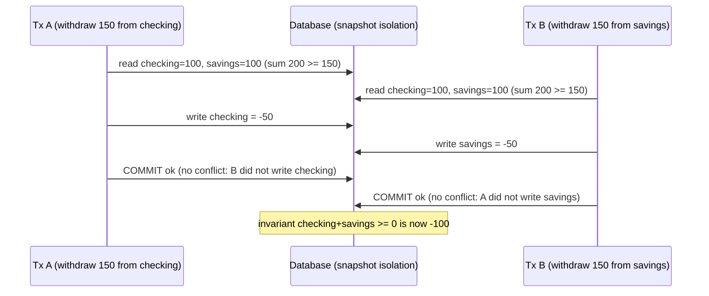
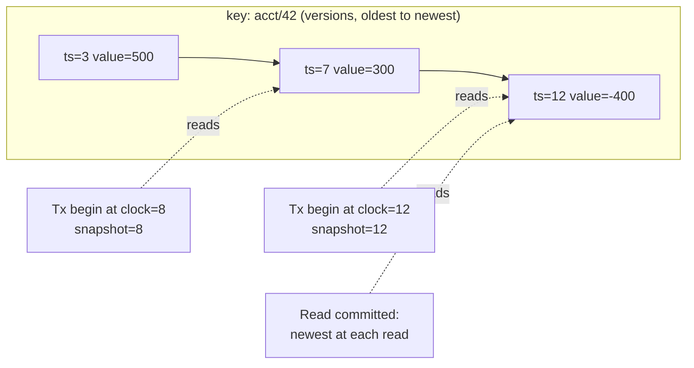
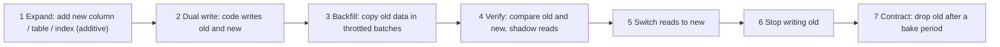

# A2 Unit 3 — Transactions, isolation and schema evolution

> Time: ~6 h (including ≈ 1.5 h of gate work: design exercise and teach-back) · CORE: §7–§9 · STRETCH: the serializable-snapshot-isolation details in §8 and the online-index-build internals in §9 · Lab: `labs/a2/isolation`

Unit 1 chose the data model and the indexes. Unit 2 made writes durable and cheap. This unit is about what happens when
*many writers touch the same rows at the same time*, which in a banking platform is every day at 09:00 on payday, and
about changing the schema underneath a system that never gets to stop. The first half is the part of this module
interviewers ask most: "walk me through two concurrent withdrawals". The lab is a small multi-version store in which you
will watch a lost update, a write skew and a phantom happen, and then prevent them.

## Before you start

You should have finished Units 1–2 ([`unit-1-access-patterns-indexes.md`](unit-1-access-patterns-indexes.md),
[`unit-2-write-paths.md`](unit-2-write-paths.md)). Warm-up, answer first:

1. (Unit 2) A member's app showed "transfer complete", then the database node crashed and the transfer was gone. Name two
   different ways that can happen.
2. (Unit 1) The ledger keeps a denormalised `balance_cents` on the `accounts` row, updated on every posting. What does
   that do to concurrent postings to the *same* account?
3. (A1 Unit 3) Two requests with the same idempotency key arrive together. "Look for the key; if absent, insert it" is a
   race. What database feature makes the reservation atomic?

<details data-kind="answer">
<summary>Warm-up answers</summary>

1. (i) The commit was acknowledged before the log reached stable storage (asynchronous commit, `fsync` off, a device that
   lies about flushes); (ii) the primary acknowledged and then failed over to a replica that had not yet received the log
   (asynchronous replication lag, A4).
2. It makes the account row a hot spot that serialises them: each posting holds the row's lock from its `UPDATE` until it
   commits (which includes an `fsync`, ≈ 1 ms), so a single account can absorb at most ≈ 1 ÷ (lock hold time) ≈ several
   hundred updates/s. Unit 3 §7 explains why that lock is also what makes the update *correct*.
3. A unique constraint on the key, used through a single conditional write (`INSERT … ON CONFLICT DO NOTHING`): the
   database decides the winner atomically. "Check then insert" fails because under weak isolation both transactions see
   "absent" (this unit's write-skew and phantom anomalies).

</details>

---

## §7 ACID in practice and the isolation anomalies

### The failure story

Checking accounts have an overdraft limit of $500. The transfer service posts a withdrawal like this:

```sql
BEGIN;                                              -- default isolation: READ COMMITTED
SELECT balance_cents, overdraft_cents FROM accounts WHERE id = 42;   -- 30000, 50000 (i.e. $300, $500)
-- application: if 30000 + 50000 >= 70000 then proceed
UPDATE accounts SET balance_cents = 30000 - 70000 WHERE id = 42;     -- -40000 (the new balance, computed in Go)
INSERT INTO ledger_entries (...) VALUES (...);
COMMIT;
```

The member taps "pay" twice on two devices (or a card authorisation and an ACH debit arrive within the same
milliseconds). Two transactions each read `$300 + $500 ≥ $700`, both pass, both write a computed balance of `-$400`. The
account ends at `-$400`, the ledger shows two $700 debits, and the member received $1,400 against an overdraft limit that
allowed $800. The database reported success both times. No error, no log line.

It is rare per transaction and common at scale. The platform does ≈ 1.2 M such postings a day. Suppose 3% hit an account
that another posting touched within the same few milliseconds (payroll, rent day, accounts with card plus ACH plus
bill-pay): ≈ 36,000 close calls a day, ≈ 340 of which interleave exactly badly. At an average of $212 each that is
≈ $72,000 a day in silent drift, found the next morning by reconciliation. At 10× traffic it is ≈ $720,000, and the
reconciliation team is now the bottleneck.

There is a second version of the same bug. Two accounts, one *shared* overdraft limit: `checking + savings ≥ −$500`.
Two concurrent withdrawals each read both balances, each decides the rule still holds, and each debits a *different*
account. No row is written twice; no lock conflicts; the rule is broken anyway.

### Predict

<!-- predict id="A2-U3-P10" -->
**Predict.** Write your answers down before opening the reveal.

Name the anomaly in each timeline (T1–T5, T3b) and say whether it can occur under **PostgreSQL READ COMMITTED**, **PostgreSQL
REPEATABLE READ** (which is snapshot isolation) and **SERIALIZABLE**.

- **T1.** A: `UPDATE accounts SET balance = 0 WHERE id = 1` (not yet committed). B: `SELECT balance FROM accounts WHERE id = 1`. What does B see?
- **T2.** A: reads balance of account 1 (= $300). B: updates it to $0 and commits. A: reads it again.
- **T3.** A: `SELECT count(*) FROM accounts WHERE member_id = 9` (= 1). B: inserts a second account for member 9 and commits.
  A: runs the same count again. (Then the variant **T3b**: a member may have at most 2 accounts; A and B each count 1 and
  each insert a *different* new account.)
- **T4.** A and B both read balance = $300, each writes `300 − 70 = 230` and `300 − 50 = 250`, A commits, then B commits.
- **T5.** A and B both read `checking + savings = $200`; A debits checking by $150; B debits savings by $150; both commit.

Also: (i) which of these does `UPDATE accounts SET balance_cents = balance_cents - 70000 WHERE id = 42 AND balance_cents + overdraft_cents >= 70000`
(one statement, then checking the affected row count) prevent under READ COMMITTED, and why? (ii) MySQL/InnoDB's default is
REPEATABLE READ. Does T4 behave the same there as in PostgreSQL's REPEATABLE READ?
<!-- /predict -->

### Reveal

<details data-kind="reveal" data-for="A2-U3-P10">
<summary>Reveal</summary>

| | Anomaly | PG READ COMMITTED | PG REPEATABLE READ (SI) | SERIALIZABLE |
|---|---|---|---|---|
| T1 | **Dirty read** (reading uncommitted data) | Prevented (B sees the old value; PostgreSQL has no read-uncommitted) | Prevented | Prevented |
| T2 | **Non-repeatable read** | **Occurs**: each statement sees the latest commit | Prevented: one snapshot per transaction | Prevented |
| T3 | **Phantom read** (a new row appears in a repeated predicate read) | **Occurs** | Prevented in the reads: the snapshot is fixed | Prevented |
| T3b | **Phantom-based write skew** (the rule "at most 2 accounts" is checked against a count that the other insert invalidates) | **Occurs** | **Occurs**: two inserts of different rows conflict on nothing | Prevented (one transaction aborts with a serialization failure) |
| T4 | **Lost update** (the second write overwrites the first, based on a stale read) | **Occurs** (final balance $250; the $70 debit is lost) | Prevented: the second committer fails ("could not serialize access due to concurrent update") | Prevented |
| T5 | **Write skew** (disjoint writes, shared invariant) | **Occurs** | **Occurs** (the write sets are disjoint: no write-write conflict to detect) | Prevented |

(i) The single-statement conditional update prevents the lost update *and* the overdraft violation under READ COMMITTED: a
concurrent updater of the same row blocks on the row lock until the first commits, then PostgreSQL **re-evaluates the
`WHERE` clause against the newly committed row version** before applying the update. The second `$700` sees the balance
already reduced, the predicate fails, zero rows are affected, and the application reports "insufficient funds". The
unsafe part of the original code is not READ COMMITTED itself, it is *reading in one statement and writing a value
computed from that read in another*.

(ii) No. InnoDB's REPEATABLE READ gives a consistent snapshot for plain `SELECT`s, but `UPDATE`, `DELETE` and
`SELECT … FOR UPDATE` use "current reads" of the latest committed data, and there is no first-committer-wins check.
A read-modify-write with the new balance computed in the application **can still lose an update on MySQL's REPEATABLE
READ**, while the same sequence fails safely on PostgreSQL's. The names of isolation levels are not portable; the
behaviour is. The tempting wrong answers are "REPEATABLE READ means no lost updates everywhere" and "the standard
tells you what each level allows".

</details>

### How it actually works

**ACID, read with a sceptic's eye.**

| Letter | Promise | What actually provides it | What it does *not* give you |
|---|---|---|---|
| **A**tomicity | All of a transaction's writes happen or none do | WAL/undo (§4), with a commit record as the atomic switch | Atomicity across *services* or databases (that is sagas, A6, or 2PC) |
| **C**onsistency | Constraints and invariants hold after commit | `NOT NULL`, `CHECK`, `UNIQUE`, `FOREIGN KEY`, triggers, *and your application code* | An invariant the database does not know about. "C" is mostly the application's job |
| **I**solation | Concurrent transactions don't see each other's partial work | Locks and/or multi-versioning, at a chosen *level* (below) | Serializability, unless you ask for it |
| **D**urability | Committed data survives crashes | WAL + fsync (§4), replication (A4) | Survival of correlated failures without replicas and backups |

**Anomalies.** An anomaly is an outcome that no serial execution of the same transactions could produce. The catalogue,
with a banking example each:

| Anomaly | What happens | Banking example |
|---|---|---|
| Dirty read | Reading another transaction's uncommitted write | Show a balance that is later rolled back |
| Non-repeatable read | The same row read twice returns different values | A statement shows a header total that differs from the sum of its lines |
| Phantom | The same predicate returns different *sets* of rows | `count(accounts) < 2` is true when checked, false by the time you insert |
| Lost update | Two read-modify-writes of one row; the later write overwrites the earlier | The $700 / $700 double-spend above |
| Write skew | Two transactions read overlapping data and write *different* rows, jointly breaking an invariant | Shared overdraft limit across two accounts; two ATMs; two admins removing "the last" approver |



**Isolation levels: the standard versus reality.** The SQL standard defines levels by which anomalies they forbid:
READ UNCOMMITTED (dirty reads allowed), READ COMMITTED (dirty reads forbidden), REPEATABLE READ (also forbids
non-repeatable reads), SERIALIZABLE (forbids everything). Berenson et al. ("A Critique of ANSI SQL Isolation Levels",
1995) showed these definitions are ambiguous and miss anomalies such as lost update and write skew. Real engines implement
other things behind the same names, most importantly **snapshot isolation (SI)**: every transaction reads a snapshot taken
at its start and a write-write conflict aborts one writer. SI is not in the standard's list, prevents more than
standard REPEATABLE READ, and still allows write skew.

| Engine | Default level | What its "REPEATABLE READ" / "SERIALIZABLE" really are |
|---|---|---|
| PostgreSQL | READ COMMITTED | REPEATABLE READ = snapshot isolation; SERIALIZABLE = SSI (snapshot isolation plus conflict detection, §8) |
| MySQL / InnoDB | REPEATABLE READ | Snapshot for plain reads, current reads for writes and locking reads (gap locks); SERIALIZABLE turns plain reads into locking reads |
| Oracle | READ COMMITTED | "SERIALIZABLE" = snapshot isolation (can raise "ORA-08177: can't serialize access") |
| SQL Server | READ COMMITTED (locking; optional read-committed snapshot) | SNAPSHOT is SI; SERIALIZABLE uses range locks |
| CockroachDB, Spanner | SERIALIZABLE (Spanner: externally consistent) | The default is the strong one; you pay with retries (A5) |

(Defaults as documented by the vendors at the time of writing; TODO-VERIFY against the version you run.)

**Why READ COMMITTED double-spends.** A READ COMMITTED transaction gets a *new snapshot for every statement*. The
`SELECT` and the later `UPDATE` therefore see different worlds, and nothing ties the decision ("balance is enough") to
the write. The fix is to make the check and the write one atomic step (a conditional `UPDATE`), to lock the row you
decided on (`SELECT … FOR UPDATE`), to detect the conflict (version column or SI), or to ask the database for
SERIALIZABLE and retry. §8 covers each.

**Hot rows.** The conditional update works because a row lock serialises writers of that row. That is also a ceiling: a
row updated by every transaction (a fee-collection account, a global counter) can sustain ≈ 1 ÷ (time the lock is held)
updates per second. If a transaction holds the lock for ≈ 2 ms (the `UPDATE`, a second statement, and the commit's
`fsync`), the row tops out at ≈ 500 updates/s, however many cores you have. Remedies: shorten the transaction, make the
hot value an append-only table summed or rolled up periodically, or shard the counter across N rows.

### Build it

Lab `labs/a2/isolation`, file `isolation.go`. Read the package comment first: it states the semantics of the three levels
that the tests pin. Provided: types and errors, `NewStore`, `Begin`, `Run` (a retry loop on conflicts), `Clock`,
`Versions`, `latestTs`, `finish`. For §7, implement (in this order):

1. `readAt(key, ts)`: the newest version with commit timestamp ≤ `ts`; deleted counts as absent.
2. `readTs()`: the timestamp this transaction reads at. This single function is the difference between read committed and the
   snapshot levels.
3. `Tx.Get`, `Put`, `Delete`, `Rollback`: own writes first; nothing visible to others until commit.
4. `Tx.Commit` for read committed: assign `clock+1` and append versions. No validation yet.

Acceptance tests so far: `TestTx_ReadsItsOwnWritesAndRollbackDiscardsThem`,
`TestNoDirtyReads_UncommittedWritesAreInvisibleToOthers`, `TestSnapshotIsolation_RepeatableReadsFromTheSnapshotTakenAtBegin`,
`TestSnapshotIsolation_TheSnapshotIsTakenAtBeginNotAtFirstRead`, `TestReadCommitted_NonRepeatableReadsAreAllowed`,
`TestLostUpdate_HappensUnderReadCommitted` (yes, a test that *demonstrates* the anomaly: the final balance is $50, not
$20), `TestDeletedKeysAreInvisibleToLaterSnapshotsButNotToEarlierOnes`. Run `go test -race ./labs/a2/isolation/`
(`-run 'NoDirty|Snapshot|ReadCommitted|LostUpdate_Happens'`). §8 continues with the conflict checks.

### Break it

<!-- predict id="A2-U3-P11" -->
**Predict.** The break-it test runs 8 workers, each incrementing one counter 200 times (read, yield, write) at each
isolation level, and then 8 workers withdrawing from a shared pair of accounts under the rule `checking + savings ≥ 0`,
starting from $100 + $100. For each level, write down: the final counter (the correct value is 1,600), the number of
transaction attempts, and the lowest combined balance ever observed.
<!-- /predict -->

Run `go test -tags breakit -race -run BreakIt -v ./labs/a2/isolation/` (after §8's checks are implemented; the read-committed rows
already work now).

<details data-kind="reveal" data-for="A2-U3-P11">
<summary>Reveal</summary>

A reference run (the lost-update count varies with scheduling; the pattern does not):

| level | final counter (want 1,600) | attempts | lowest combined balance (rule: ≥ 0) |
|---|---|---|---|
| read committed | ≈ 280 (≈ 1,300 increments lost) | 1,600 | ≈ −19 |
| snapshot isolation | 1,600 | ≈ 6,800 | ≈ −9 |
| serializable | 1,600 | ≈ 6,300 | 0 |

- **Read committed** never aborts and loses most increments: every attempt succeeds, with wrong results. The two-account
  rule is also broken (by lost updates and by skew).
- **Snapshot isolation** keeps every increment (conflicting writers abort and retry: ≈ 6,800 attempts for 1,600 increments,
  the price of contention on one hot row), but the shared-limit rule is still violated: write skew. Your exact lowest
  value varies.
- **Serializable** keeps both, with a similar abort rate. Correctness costs retries, not wrong answers.

The tempting wrong prediction is "snapshot isolation fixes everything because it is called repeatable read".

</details>

### In the wild

- **PostgreSQL** defaults to READ COMMITTED; its REPEATABLE READ is snapshot isolation and raises SQLSTATE `40001`
  (`serialization_failure`) when a concurrent update is detected; its SERIALIZABLE is SSI (§8).
- **MySQL/InnoDB** defaults to REPEATABLE READ with next-key (gap) locks for locking reads; behaviours differ from
  PostgreSQL's at the same name, as in the reveal above.
- **Hermitage** (Martin Kleppmann) is a test suite that runs the classic anomalies against many databases and tabulates
  the results; it is the quickest way to see the gap between the standard and your engine. **Jepsen** analyses test
  distributed databases' claimed isolation under failures (A5).
- **CockroachDB** and **Spanner** default to serializable isolation (Spanner: external consistency; A5), which is why
  clients of CockroachDB are told to expect and retry `40001` errors.
- **DynamoDB** `TransactWriteItems` and condition expressions give atomic conditional writes: the DynamoDB equivalent
  of the single-statement conditional `UPDATE`.

### Trade-offs

| Option | Wins when | Loses when | When the answer flips |
|---|---|---|---|
| READ COMMITTED + conditional single-statement `UPDATE` | The invariant concerns one row; fast, no retries | Invariants over several rows; reads that inform later decisions | Flip to locking or SERIALIZABLE when the decision reads more than the row you write |
| READ COMMITTED + `SELECT … FOR UPDATE` | You must read, compute and write one or few rows; contention moderate | Lock ordering mistakes (deadlocks), long lock holds, phantoms (no row to lock) | Flip to SI/SERIALIZABLE if the rule spans rows you cannot enumerate |
| REPEATABLE READ / snapshot isolation + retry | Long consistent reads (statements, reports), lost-update safety | Write skew and phantom-based rules | Flip to SERIALIZABLE (or guard rows) for multi-row invariants |
| SERIALIZABLE + retry | Complex invariants you don't want to hand-analyse | High-contention hot rows (many aborts); engines with weaker implementations | Flip to targeted locks for the few hot paths |
| Application-level optimistic version column | Works on any engine; no long locks | Retry storms under contention | Flip to row locks when the same rows conflict constantly |

### Senior bar

- **Failure modes:** read-modify-write across statements at READ COMMITTED; "SELECT then INSERT" uniqueness checks; shared
  invariants over several rows (write skew); trusting a level's *name* across engines; swallowing `40001`/deadlock errors
  instead of retrying; long transactions holding locks and snapshots.
- **Capacity:** a hot row sustains ≈ 1 ÷ (lock hold time) updates/s (≈ 500/s at 2 ms); optimistic retries under contention
  scale with the number of concurrent writers of the same row (the lab: ≈ 4× attempts for 8 workers on one key);
  serialization-failure rates should be metered per transaction type.
- **Ops:** make the default level a conscious choice; set `statement_timeout`, `lock_timeout` and
  `idle_in_transaction_session_timeout`; alert on idle-in-transaction sessions and lock waits; log serialization
  failures and deadlocks with the transaction type; test critical flows with concurrent load, not only unit tests.
- **Cost:** retries burn CPU and double-run side effects, so transactions must be *retryable*: no external calls inside
  them (A6 outbox) and idempotent (A1).

Interviewer follow-up probes:

1. "Does READ COMMITTED prevent a double spend?"

<details data-kind="answer">
<summary>Model answer</summary>

Not for read-modify-write across statements: each statement sees the latest commit, so two transactions can both read a
sufficient balance and both write. It *does* prevent it if the check and write are one statement (`UPDATE … SET balance =
balance − x WHERE id = ? AND balance + limit ≥ x`, checking the affected rows) because the second updater waits for the
row lock and re-evaluates the predicate on the new row version. So I either write it that way, lock the row first, or
use SERIALIZABLE with retry.

</details>

2. "Name an anomaly that snapshot isolation allows, with a banking example."

<details data-kind="answer">
<summary>Model answer</summary>

Write skew: a shared overdraft limit across checking and savings. Two transactions read both balances, each sees enough
combined funds, each debits a different account. The write sets are disjoint so there is no write-write conflict, both
commit, and the combined balance goes negative. Fixes: SERIALIZABLE (one aborts), lock a guard row for the member (both
transactions lock the same row first), or restructure so a single row holds the shared limit.

</details>

3. "What is the difference between a lost update and a write skew?"

<details data-kind="answer">
<summary>Model answer</summary>

Lost update: two transactions write the *same* row based on stale reads, so the later write overwrites the earlier;
snapshot isolation's first-committer-wins catches it. Write skew: they write *different* rows based on overlapping reads,
so no single row is overwritten but a multi-row invariant breaks; snapshot isolation does not catch it, serializable does.
Both are a decision made on data that changed before the write landed.

</details>

### Check yourself

1. Which of the five anomalies can PostgreSQL's REPEATABLE READ still produce?
2. Why is `UPDATE … SET balance = balance − 700 WHERE id = 42 AND balance ≥ 700` safe at READ COMMITTED while
   `SELECT balance … ; UPDATE … SET balance = <value computed in the app>` is not?
3. A fee account is updated by every transfer, each transaction holding its lock for ≈ 4 ms. What is the ceiling on
   transfers per second, and what are two ways to raise it?

<details data-kind="answer">
<summary>Answers</summary>

1. Write skew (and phantom-style violations of rules spanning several rows). Dirty reads, non-repeatable reads and lost
   updates are prevented.
2. The first is one atomic statement: the row lock plus predicate re-evaluation ties the decision to the write. The second
   splits decision and write across statements that see different snapshots.
3. ≈ 1 ÷ 4 ms = 250/s. Shorten the lock hold (move other work out of the transaction, keep the update last), make the fee
   column append-only (insert a fee entry, roll up later), or shard the account into N sub-accounts summed on read.

</details>

---

## §8 MVCC, snapshot isolation, locks and serializable

### The failure story

After the double-spend incident the team fixes the visible bug: transfers now run `SELECT … FOR UPDATE` on the *source*
account, and the database is switched to REPEATABLE READ "to be safe". For two weeks the reconciliation report is clean.
Then three new problems appear, each a consequence of a fix applied without a model of what it protects:

- **Deadlocks.** Two members who split rent send money to each other. Transfer A→B locks A then B; transfer B→A locks B then
  A. If they overlap, each holds the lock the other wants. PostgreSQL notices after `deadlock_timeout` (1 s by default) and
  aborts one; for that second both members' requests hang. At ≈ 200 transfers/s with ≈ 0.5% of them meeting an opposite-
  direction transfer inside the same few milliseconds, that is ≈ 1 deadlock a second at peak, each costing ≈ 1 s of
  stalled requests, and the retry then re-runs the transaction.
- **Write skew survives.** A joint-account rule (`checking + savings ≥ −$500`) is still broken: the transfers debit different
  rows, so neither `FOR UPDATE` on the source nor snapshot isolation sees a conflict. Two disbursements a day get through.
- **Bloat from a long snapshot.** A statement-generation job runs one transaction for 40 minutes under REPEATABLE READ,
  so its snapshot pins every old row version newer than its start. The `accounts` table is updated 5 M times a day (every
  posting rewrites a row); with a stuck job those dead versions cannot be cleaned. After two days the 300 MB table is
  ≈ 1.8 GB, every balance read touches more pages, and the buffer cache no longer fits it. Nobody changed any query.

### Predict

<!-- predict id="A2-U3-P12" -->
**Predict.** Write your answers down before opening the reveal. For each technique, say which of these it prevents:
**(L)** lost update on one row, **(S)** write skew over several rows (the shared overdraft limit), **(P)** the phantom
variant ("at most 2 accounts per member"), and what it costs (blocking, deadlock risk, retries).

- (a) a single atomic conditional `UPDATE … WHERE balance + limit >= x`;
- (b) `SELECT … FOR UPDATE` on the rows you read, then update;
- (c) an optimistic version column: `UPDATE … SET …, version = version + 1 WHERE id = ? AND version = ?`, retry on 0 rows;
- (d) snapshot isolation (PostgreSQL REPEATABLE READ) with retry on serialization failure;
- (e) SERIALIZABLE with retry;
- (f) before the checks, lock a single "guard" row for the member (`SELECT … FROM members WHERE id = ? FOR UPDATE`);
- (g) a `UNIQUE` or exclusion constraint that encodes the rule (when it can be expressed that way).

Also: how do you avoid the A→B / B→A deadlock without any isolation-level change?
<!-- /predict -->

### Reveal

<details data-kind="reveal" data-for="A2-U3-P12">
<summary>Reveal</summary>

| Technique | (L) lost update | (S) write skew | (P) phantom skew | Cost / risk |
|---|---|---|---|---|
| (a) atomic conditional `UPDATE` | Yes (row lock + predicate re-check) | No | No | None beyond the row lock; only expresses single-row rules |
| (b) `FOR UPDATE` on rows you read | Yes | Only for rows you actually read and lock | No (nothing to lock for rows that don't exist yet) | Blocking; **deadlocks** if locks are taken in inconsistent order |
| (c) version column | Yes (detects, doesn't block) | No | No | Retries under contention; every writer must follow the convention |
| (d) snapshot isolation + retry | Yes (first committer wins) | **No** | **No** | Retries; long snapshots pin old versions |
| (e) SERIALIZABLE + retry | Yes | **Yes** | **Yes** | More aborts (including false positives in SSI); retries everywhere |
| (f) guard row lock | Yes for what it serialises | **Yes** (all withdrawals of that member serialise on the guard) | **Yes** (inserts take the guard too) | Serialises more than strictly necessary; deadlocks if the order is inconsistent |
| (g) constraint | n/a | **Yes** if expressible (e.g. exclusion/unique) | **Yes** | Needs the rule to be a constraint; PostgreSQL exclusion constraints, unique indexes |

The A→B / B→A deadlock needs no level change: **always acquire locks in a canonical order**, e.g. lock both accounts
in one statement ordered by id (`SELECT … WHERE id IN (a, b) ORDER BY id FOR UPDATE`) so both transactions queue on the
lower id first and one simply waits. Add `lock_timeout` and a bounded retry. The tempting wrong answers: "use a higher
isolation level for deadlocks" (a deadlock is a lock-ordering fact, not an isolation fact), and "SELECT FOR UPDATE
prevents write skew" (only for rows it locks; here the rows are different, and for phantoms there is no row to lock).

</details>

### How it actually works

**MVCC: readers don't block writers.** A multi-version store never overwrites a row in place. Each update creates a **new
version** stamped with the transaction that created it (and the old one is stamped with the transaction that superseded
it). A reader works against a **snapshot**, a definition of "which commits count", and picks the newest version visible
to it. PostgreSQL appends the new row version to the table (`xmin`/`xmax` on each tuple; old versions stay until
`VACUUM`); InnoDB updates in place and keeps old versions in an undo log reachable through a rollback pointer. The lab is
the minimal model: per key, a list of `(commit timestamp, value, deleted)` versions in timestamp order, and a snapshot is
just one number, the timestamp of the newest commit at `Begin`.



Visibility is the whole rule: a version is visible to a transaction if it was committed at or before its snapshot, and
the transaction sees its own uncommitted writes first. Dirty reads are impossible because uncommitted writes are not
versions yet; repeatable reads fall out for free because the snapshot never moves.

**Snapshot isolation (SI) and first-committer-wins.** SI adds one rule: two concurrent transactions may not both
commit a write to the same key. PostgreSQL does this eagerly: the second updater blocks on the row lock; when the first
commits, the second fails with "could not serialize access due to concurrent update" (when the first rolls back, the
second proceeds). The lab does the equivalent lazily at commit: for each key in the write set, if the newest committed
version has a timestamp later than my snapshot, someone committed it after I started, so abort. Same outcome, simpler
bookkeeping.

**What SI does not stop.** Each transaction reads its snapshot and writes elsewhere. If the invariant spans both, nothing
conflicts (write skew, §7). SI also cannot protect a predicate such as "no two accounts for this member" because the
conflicting object is a row that does not exist yet.

**Getting serializability.** There are four families:

1. **Two-phase locking (2PL)**: take shared locks on everything read and exclusive locks on everything written, including
   *predicate* or gap locks that block inserts into a scanned range, and hold them until commit. Correct and pessimistic: readers
   block writers, deadlocks are routine. (InnoDB SERIALIZABLE; SQL Server SERIALIZABLE uses range locks.)
2. **Serializable snapshot isolation (SSI)** *(STRETCH)*: run SI, and additionally track **read-write dependencies**: if T1
   read something T2 later overwrote, there is an edge T1 →rw T2. A cycle in the serialization graph needs a "dangerous
   structure": two consecutive rw edges T1 →rw T2 →rw T3 inside concurrent transactions (Cahill, Röhm and Fekete). When one
   is detected, one transaction is aborted. It can abort transactions that would have been fine (false positives), and
   requires retries, but readers still don't block writers. PostgreSQL's SERIALIZABLE (since 9.1; TODO-VERIFY) is SSI.
3. **Optimistic read validation** (the lab's `Serializable`, and the idea behind several optimistic engines such as
   FoundationDB's resolver, TODO-VERIFY details): remember what you read (keys, and predicates such as "everything under
   `acct/m1/`"); at commit, abort if anything you read has a version newer than your snapshot. A transaction that wrote
   nothing never aborts. This catches both write skew (you read `checking` and a concurrent commit changed it) and phantoms
   (a new key appeared under the prefix you scanned). It is stricter than SSI: it aborts on any read-write overlap, not only
   on dangerous structures.
4. **Serial execution**: run transactions one at a time per partition (VoltDB, Redis scripts). No isolation problem if there
   is no concurrency, but the transaction must be short and confined to a partition.

**Row locks and the idioms around them.**

```sql
-- lock in a canonical order so opposite-direction transfers cannot deadlock
BEGIN;
SELECT id, balance_cents FROM accounts WHERE id IN (42, 77) ORDER BY id FOR UPDATE;
-- decide in the application, then:
UPDATE accounts SET balance_cents = balance_cents - 70000 WHERE id = 42;
UPDATE accounts SET balance_cents = balance_cents + 70000 WHERE id = 77;
INSERT INTO ledger_entries (...) VALUES (...), (...);
COMMIT;
```

```sql
-- optimistic: no lock, detect the conflict
UPDATE accounts
SET balance_cents = $new, version = version + 1
WHERE id = $id AND version = $version_i_read;
-- 0 rows affected => someone else wrote first: re-read and retry (bounded, with jitter, A7)
```

```sql
-- guard row: one lock that serialises everything that touches the member's shared rule
BEGIN;
SELECT 1 FROM members WHERE id = $member FOR UPDATE;
SELECT sum(balance_cents) FROM accounts WHERE member_id = $member;   -- now stable against other withdrawals
-- check the shared overdraft rule, then update one account
COMMIT;
```

`SELECT … FOR UPDATE` locks existing rows; it cannot lock a row that doesn't exist (phantoms) or guard a rule that spans
rows you didn't read. A "guard" row (the member, the credit union's limit row) turns a multi-row rule into a single-row lock
conflict. That technique is called **materialising the conflict**.

**Retries are part of the design.** Serialization failures (`40001`), deadlocks (`40P01`) and lock timeouts are
*expected*. Retry the whole transaction (never just the failing statement), a bounded number of times, with jitter; and
make everything inside it safe to re-run: no external calls, no non-idempotent side effects (use the outbox, A6; use
idempotency keys, A1). The lab's `Run` is that loop.

**Long transactions are the quiet cost of MVCC.** An old snapshot pins old versions. `VACUUM` (PostgreSQL) or undo purge
(InnoDB) can only remove a version when no active snapshot can see it. The lab's `Vacuum` keeps, per key, every version
newer than the oldest active snapshot plus the newest one at or before it; a single forgotten transaction keeps
the version count growing without bound. In production: `idle_in_transaction_session_timeout`, a max transaction age
alert, and run reports on a replica.

**Scope.** Everything here is about one database node. Across shards or services there are no cross-node locks to
lean on; use idempotent steps, sagas and compensations (A6), or a database that implements distributed transactions
(and read A5 for what "serializable" costs there).

### Build it

Continue in `labs/a2/isolation`. Implement, in order:

1. **First-committer-wins** in `Commit` for `SnapshotIsolation` and above: for each written key, if
   `latestTs(key) > tx.snapshot`, return `ErrWriteConflict`; a failed commit installs nothing.
2. **`Tx.Scan(prefix)`**: versions visible at the transaction's read timestamp, overlaid with its own writes and deletions,
   sorted; record the prefix for validation.
3. **`Serializable`** in `Commit`: after the write check, fail with `ErrSerialization` if any key in the read set, or any
   key under a scanned prefix, has `latestTs > tx.snapshot`. A transaction with no writes always commits.
4. **`Store.Vacuum`**: drop versions no active snapshot can see.

Acceptance tests (the names tell you which anomaly): `TestLostUpdate_PreventedBySnapshotIsolationFirstCommitterWins`,
`TestFirstCommitterWins_AlsoCoversBlindWritesAndDeletes`, `TestFirstCommitterWins_NoConflictWithoutOverlap`,
`TestFailedCommitInstallsNothing`, `TestWriteSkew_IsPossibleUnderSnapshotIsolation` (the test *asserts the anomaly*:
both commit and the combined balance ends at −$100), `TestWriteSkew_PreventedBySerializable`,
`TestSerializable_DoesNotAbortTransactionsThatReadNothingThatChanged`, `TestSerializable_ReadOnlyTransactionsNeverFail`,
`TestPhantom_InvariantBreaksUnderSnapshotIsolation`, `TestPhantom_PreventedBySerializablePredicateValidation`,
`TestScan_*`, `TestVacuum_*`, and three concurrent tests under `-race`: `TestConcurrent_CounterIncrementsAreNeverLost`,
`TestConcurrent_BankTransfersConserveMoneyAndNeverOverdraw` (8 goroutines, 6 accounts, conservation of money) and
`TestConcurrent_SerializableKeepsTheJointOverdraftRuleUnderLoad`. Run `go test -race ./labs/a2/isolation/`.

### Break it

Delete the write-conflict check from `Commit` in your copy and run the whole suite. Then restore it and instead drop the
*scan-prefix* validation from the Serializable branch. Predict which tests fail each time before you run them.

<details data-kind="answer">
<summary>What you should see, and why</summary>

- **Without the write-conflict check**, snapshot isolation silently becomes "snapshot reads, last writer wins": the
  lost-update tests fail (`TestLostUpdate_PreventedBySnapshotIsolationFirstCommitterWins`,
  `TestFirstCommitterWins_AlsoCoversBlindWritesAndDeletes`, `TestFailedCommitInstallsNothing`), and so do the concurrent counter and bank-transfer tests (increments vanish, money is
  created or destroyed), while the write-skew tests still pass: they never relied on write-write detection. This
  is the lab version of an application that read-modify-writes under REPEATABLE READ on MySQL.
- **Without scan-prefix validation**, point-read skew is still caught (`TestWriteSkew_PreventedBySerializable`) but
  `TestPhantom_PreventedBySerializablePredicateValidation` and `TestPhantom_DeletionsUnderAScannedPrefixAlsoInvalidate`
  fail: a new (or removed) row under a range you scanned conflicts with nothing you recorded by key. That is why real
  serializable implementations lock or validate *ranges and predicates*, not just rows.

</details>

<!-- predict id="A2-U3-P13" -->
**Predict.** A transaction `T` begins when the clock is 8, reads `acct/m1/checking`, and does nothing for an hour. Meanwhile the
store receives 10,000 commits that each update some key, including 3,000 updates of `acct/m1/checking`. Without running
anything: (a) how many versions of `acct/m1/checking` must `Vacuum` keep while `T` is open, (b) what does `T` read if it reads
the key again, and (c) what changes the moment `T` finishes?
<!-- /predict -->

<details data-kind="reveal" data-for="A2-U3-P13">
<summary>Reveal</summary>

(a) All 3,001: the version `T` can see (the newest at or before its snapshot) plus the 3,000 newer ones, because `Vacuum`'s
horizon is the oldest active snapshot, 8. The other 7,000 updates to other keys are likewise retained wherever they are
newer than the snapshot. (b) The same value as before: its snapshot has not moved, and the version it saw still exists. (c)
The horizon jumps to the current clock; the next `Vacuum` removes 3,000 of the 3,001 versions of that key. The lab's
`TestVacuum_ALongRunningTransactionHoldsBackTheHorizon` is this scenario in miniature, and it is the mechanism behind
table bloat under a stuck PostgreSQL transaction (and a growing undo log in InnoDB).

</details>

### In the wild

- **PostgreSQL** SSI (SERIALIZABLE): tracks rw-dependencies with predicate locks that never block, and raises `40001`;
  documentation recommends running serializable transactions with a retry loop and short transactions. `FOR UPDATE`,
  `FOR SHARE`, advisory locks, exclusion constraints and `INSERT … ON CONFLICT` give the toolbox in this section.
- **MySQL/InnoDB**: gap locks and next-key locks give phantom protection for locking reads at REPEATABLE READ; deadlocks
  are detected and the victim rolled back (`SHOW ENGINE INNODB STATUS` prints the last one).
- **Oracle** has no dirty reads, statement-level read consistency by default and a snapshot-based "serializable".
- **FoundationDB** is an ordered key-value store with optimistic transactions: reads and writes are recorded as ranges
  and a resolver rejects a commit whose read ranges overlap newer writes, the same shape as the lab's `Serializable`
  (TODO-VERIFY architecture details).
- **CockroachDB** runs serializable by default with automatic client-visible retries (`40001`); **Spanner** uses locking
  plus TrueTime for external consistency (A5).
- **Stripe, GitHub and most payment systems** keep money movement in one relational database with explicit locking or
  conditional writes, and use idempotency keys (A1) around it, rather than relying on a distributed transaction.

### Trade-offs

| Option | Wins when | Loses when | When the answer flips |
|---|---|---|---|
| Pessimistic row locks (`FOR UPDATE`) | Conflicts are frequent; you can order locks | Long holds, deadlocks, hot rows serialise everything | Flip to optimistic when conflicts are rare and transactions are short |
| Optimistic (version column / SI first-committer-wins) | Conflicts are rare; reads dominate | Hot rows: retry storms, wasted work | Flip to locks for known-hot rows (fee accounts, counters) |
| SERIALIZABLE (SSI/validation) | Many different rules touch overlapping data and you want one safe default | Very high contention; engines with coarse implementations | Flip to targeted guards when only one or two rules need it |
| Guard-row locking | One identifiable entity owns the rule (a member, a credit union limit) | The guard is globally hot | Flip to serializable or sharded guards |
| Serial execution per partition | Tiny transactions, partitioned data | Cross-partition work | Flip to MVCC databases for ad-hoc multi-row work |

### Senior bar

- **Failure modes:** deadlocks from inconsistent lock order; lock waits piling into pool exhaustion; retry storms on hot
  rows; write skew from "SELECT then decide"; long snapshot bloat; swallowing serialization errors; side effects inside
  retried transactions.
- **Capacity:** a hot row saturates at ≈ 1000 ÷ t updates/s when each transaction holds its lock for t ms (≈ 500/s at
  2 ms); optimistic attempts per commit grow roughly with the number of concurrent writers of that row (the lab: ≈ 4×
  attempts with 8 workers on one key); deadlock rates grow faster than linearly with contention.
- **Ops:** per-transaction-type counters for `40001`, deadlocks and lock waits; `lock_timeout`, `statement_timeout`,
  `idle_in_transaction_session_timeout`; max transaction age alerts; run long reads on replicas; load-test money flows
  with concurrent clients (the lab's concurrency tests are the pattern).
- **Cost:** pessimistic locking costs latency and deadlocks; optimistic costs CPU for retries; both cost engineering
  discipline: ordered locks, retryable transactions, idempotency.

Interviewer follow-up probes:

1. "Walk me through two concurrent withdrawals from the same account, step by step."

<details data-kind="answer">
<summary>Model answer</summary>

With the unsafe code: both read $300 under READ COMMITTED, both pass the check, both write; one overwrites the other.
Safe options in order of preference for a single-row rule: a conditional `UPDATE … WHERE balance + limit ≥ x` (the second
waits on the row lock, re-evaluates the predicate on the new version, affects 0 rows, and we return "insufficient funds");
or `SELECT … FOR UPDATE` then update; or an optimistic version column, or snapshot isolation, so the second commit fails
and retries. Then the ledger entry is inserted in the same transaction and the idempotency key protects the whole thing
from client retries.

</details>

2. "How do you stop two debits from different accounts breaking a shared overdraft limit?"

<details data-kind="answer">
<summary>Model answer</summary>

Snapshot isolation won't (disjoint writes). I'd make the rule one row's problem: lock a per-member guard row first in
every transaction that debits any of the member's accounts, so they serialise; or store the shared limit's usage in one row
updated by a conditional `UPDATE`; or run those transactions SERIALIZABLE and retry. The guard row is the least magical and
the easiest to reason about; SERIALIZABLE is the broadest safety net.

</details>

3. "Why not run everything SERIALIZABLE?"

<details data-kind="answer">
<summary>Model answer</summary>

It's the right default for correctness and the wrong one for hot paths: higher abort rates under contention (and false
positives in SSI), so every transaction needs a retry loop and a bounded latency story, and long transactions get
expensive. I'd use it where invariants are complex or I haven't proven them safe at lower levels, use conditional updates
for hot single-row paths, and keep long reports on a replica at snapshot isolation.

</details>

### Check yourself

1. Why can the lab's `Serializable` abort a transaction that is "innocent" (it would have been fine), and is that
   acceptable?
2. What is the minimum a version store must remember to implement snapshot reads?
3. Two transfers A→B and B→A deadlock. State the fix that doesn't involve changing the isolation level.

<details data-kind="answer">
<summary>Answers</summary>

1. It aborts on any read-write overlap with a newer commit, not only on actual cycles, so some aborted transactions
   would have been serialisable. It is acceptable because aborts are safe (retry), and the cost is throughput under
   contention; SSI reduces but doesn't eliminate false positives.
2. Per key, the versions with their commit timestamps (and deletion markers), plus for each transaction the snapshot
   timestamp; a read picks the newest version at or before the snapshot.
3. Acquire both locks in a canonical order (e.g. ascending account id) so the transactions queue instead of cross-waiting.

</details>

---

## §9 Schema design and zero-downtime migrations

### The failure story

The ledger table needs two changes: a new `currency` column (the platform is adding a credit union that holds foreign-currency
accounts) and `amount_cents` widened from `int` to `bigint` (a commercial member crossed $21 M, the `int` limit in cents).
`ledger_entries` has ≈ 450 M rows in its hot window, ≈ 54 GB, with three indexes.

The widening is a table rewrite: PostgreSQL rewrites all 54 GB and rebuilds the three indexes while holding an exclusive
lock, ≈ 15–30 minutes of no reads or writes at ≈ 200 MB/s of rewrite and index build (an estimate; TODO-VERIFY on your
hardware). That is a planned outage on a system whose members expect to pay rent at 09:00. So the team schedules it at
02:00 on Sunday and warns the credit unions. Annoying, but survivable.

The `currency` change looks safe: adding a column with a constant default is a catalog-only change in current PostgreSQL
and finishes in milliseconds. The team runs it at 14:00 on a Tuesday. The statement itself needs only ≈ 10 ms, but it needs
an `ACCESS EXCLUSIVE` lock on the table, and an analyst's 3-minute reporting query holds a conflicting `ACCESS SHARE`
lock. The `ALTER` waits. **Every query that arrives after it now queues behind it**, including trivial `SELECT`s that
would otherwise have run alongside the report. At ≈ 600 requests/s a 200-connection pool is exhausted in 200 ÷ 600 ≈ 0.33
seconds; health checks fail; the load balancer ejects backends (A1 Unit 1). Three minutes later the report ends, the `ALTER`
runs for 10 ms, and everything drains. The outage lasted exactly as long as the longest transaction that was already
running when the migration started.

### Predict

<!-- predict id="A2-U3-P14" -->
**Predict.** Write your answers down before opening the reveal.

1. Three services read `ledger_entries.memo`. You want to rename it to `description`. Deploys are rolling: for ≈ 30 minutes
   both the old and the new version of each service are running, and you must be able to roll back. List the steps, in
   order, including which are schema changes and which are code deploys, and say when the old column can finally be dropped.
2. Add `currency char(3) NOT NULL` to the 450 M-row table with no outage. Give the steps. Estimate the backfill time if
   each batch updates 5,000 rows in ≈ 50 ms and you pause ≈ 50 ms between batches, and name two ways the backfill can hurt
   the production system.
3. Why did a 10 ms `ALTER` cause a 3-minute outage, and what two changes to the migration process prevent it?
<!-- /predict -->

### Reveal

<details data-kind="reveal" data-for="A2-U3-P14">
<summary>Reveal</summary>

1. **Expand / migrate / contract**, one compatible step at a time:
   1. *Schema:* `ADD COLUMN description text` (nullable, no default). Old code ignores it.
   2. *Deploy v2:* writes **both** `memo` and `description`; reads prefer `description`, falling back to `memo`.
   3. *Backfill:* copy `memo` into `description` for existing rows, in batches (below). Verify that no row has
      `description IS DISTINCT FROM memo`.
   4. *Deploy v3:* reads only `description`; still writes both (so v2 can still be rolled back to).
   5. *Deploy v4:* stops writing `memo`.
   6. *Contract:* after a bake period (days), `DROP COLUMN memo`.

   At every moment the running code version(s) and the schema are compatible, and rollback is possible until step 6. The
   tempting wrong answer is a single `RENAME COLUMN` deployed together with the new code: during the rolling deploy,
   half the fleet queries a column that does not exist.
2. Add a nullable `currency` column; set a **default for new rows** (`ALTER COLUMN … SET DEFAULT 'USD'`: catalog-only)
   and deploy code that writes it; **backfill** old rows in keyset batches; then enforce with
   `ADD CONSTRAINT … CHECK (currency IS NOT NULL) NOT VALID` followed by `VALIDATE CONSTRAINT` (which scans the table
   but does not block writes); then `SET NOT NULL` (which, in current PostgreSQL, can use the validated check and skip
   the scan; TODO-VERIFY version) and drop the check. Backfill time: 450 M ÷ 5,000 = 90,000 batches × (50 + 50 ms) =
   9,000 s ≈ **2.5 hours** on one worker. It can hurt production by (i) generating ≈ 450 M new row versions: WAL volume
   (tens of GB), dead tuples that autovacuum must clean, and replication lag on every replica (A4); and (ii) holding row
   locks and competing for I/O, raising p99 latency of normal traffic, which is why the pause adapts to measured latency or
   replica lag.
3. `ALTER TABLE` needs `ACCESS EXCLUSIVE`, which conflicts with every other lock; the lock manager is a **queue**,
   so a waiting exclusive request blocks all later requests even though it hasn't acquired anything. The duration of the
   outage is the length of the longest conflicting transaction. Prevent it with (i) `SET lock_timeout = '3s'` (or
   shorter) around the DDL so it gives up instead of queueing everyone, with a bounded retry loop; and (ii) process: check for
   long-running transactions first, run DDL off-peak, and keep analyst/report queries on replicas with a statement timeout.

</details>

### How it actually works

**The rule: every step must be compatible with the code before it and after it.** In a rolling deploy, blue/green cut-over
or rollback, two code versions run against the same schema. So a migration is never "change the schema, then deploy". It
is a sequence of small steps, each safe on its own, interleaved with deploys:



Rollback is trivial until step 7; the drop is the only irreversible step, so make it a separate, later change.
(Stripe's "online migrations" write-up describes this four-phase shape for moving data between tables: dual write,
switch reads, switch writes, remove old data.)

**What DDL costs, in PostgreSQL terms** (other engines differ; always read your version's documentation):

| Change | Lock and cost | Zero-downtime approach |
|---|---|---|
| `ADD COLUMN` nullable, no default | Brief `ACCESS EXCLUSIVE`, catalog only | Safe with `lock_timeout` |
| `ADD COLUMN … DEFAULT <constant>` | Catalog only in current PostgreSQL (rewrote the table before version 11; TODO-VERIFY) | As above; a *volatile* default (e.g. `now()` per row) still rewrites |
| `ALTER COLUMN … TYPE` | Usually a full rewrite under `ACCESS EXCLUSIVE` (some widenings are binary-compatible; check) | Expand/contract: new column, dual write, backfill, switch |
| `ADD CONSTRAINT CHECK/FOREIGN KEY` | Scans the table while blocking writes | `NOT VALID` first (cheap), then `VALIDATE CONSTRAINT` (scans without blocking writes) |
| `SET NOT NULL` | Scans the table under lock unless a validated `CHECK (col IS NOT NULL)` exists (version-dependent; TODO-VERIFY) | Validated check first |
| `CREATE INDEX` | Blocks writes for the whole build (minutes to tens of minutes at this size) | `CREATE INDEX CONCURRENTLY`: two table scans and a wait for older transactions; takes longer, doesn't block writes; can fail and leave an `INVALID` index to drop; cannot run inside a transaction block |
| `DROP COLUMN` / `RENAME` | Fast, but breaks any code that still uses the old name | Contract step only, after nothing references it |

For MySQL, online DDL (`ALGORITHM=INSTANT`/`INPLACE` where the operation supports it) and external tools (GitHub's
`gh-ost` reads the binlog; Percona's `pt-online-schema-change` uses triggers) build a shadow copy of the table, keep it in
sync with the live one, then swap names atomically. The shadow-table approach works in any engine at the price of
double storage and copy time.

**Lock timeouts and retries.** The queueing hazard disappears if the DDL never waits long: `SET lock_timeout = '3s'`
makes it fail fast, and a loop retries. The Go analogue is a `sync.RWMutex`: a pending `Lock` blocks new `RLock`s, exactly
like the exclusive lock queue; a `TryLock` loop never queues. The Break-it below runs both.

**Designing the backfill.** The backfill is a production workload. Rules: *small transactions* (1,000–10,000 rows) so locks
and WAL come in small bites; *keyset batches* (`id > last ORDER BY id LIMIT n`, as in A1 Unit 2 §2, not `OFFSET`); *idempotent*
(`WHERE new_col IS NULL`) and *resumable* (return the last id); *throttled* by measured latency or replica lag, not a fixed
sleep; *observable* (rows/s, remaining, errors) with a pause switch; and never one giant `UPDATE` (a multi-hour transaction
pins snapshots, §8). A compact version:

```go
package migrate

import (
	"context"
	"database/sql"
	"time"
)

// Backfill sets ledger_entries.currency for rows that still have NULL, in small
// keyset batches. It is idempotent (it only touches NULL rows), resumable (pass
// the last id it returned) and throttled (the pause is a function of how long
// the last batch took, so a slow database slows the backfill, not the app).
func Backfill(ctx context.Context, db *sql.DB, from int64, batch int, pause func(took time.Duration) time.Duration) (last int64, err error) {
	last = from
	for {
		start := time.Now()
		var n int
		var maxID sql.NullInt64
		err = db.QueryRowContext(ctx, `
			WITH todo AS (
			  SELECT id FROM ledger_entries
			  WHERE id > $1 AND currency IS NULL
			  ORDER BY id LIMIT $2
			), upd AS (
			  UPDATE ledger_entries e SET currency = 'USD'
			  FROM todo WHERE e.id = todo.id
			  RETURNING e.id
			)
			SELECT count(*), max(id) FROM upd`, last, batch).Scan(&n, &maxID)
		if err != nil {
			return last, err
		}
		if n == 0 {
			return last, nil
		}
		last = maxID.Int64
		t := time.NewTimer(pause(time.Since(start)))
		select {
		case <-ctx.Done():
			t.Stop()
			return last, ctx.Err()
		case <-t.C:
		}
	}
}
```

**Schema design for a money system.** The earlier units chose engines and indexes; these are the schema decisions that are
expensive to change later (so the migration rules above apply to every one of them):

- **Money** is an integer count of minor units (`bigint` cents) plus an ISO 4217 currency code; `numeric(19,4)` when
  sub-cent precision is needed (interest accrual); never floating point. Widths matter: the `int` overflow above.
- **Time** is `timestamptz` in UTC for events; keep a separate **business date** (`date`) for posting and cut-off
  rules, because credit unions have business days and per-tenant time zones; statement boundaries use the tenant's.
- **Append-only ledger**: corrections are new entries that reverse old ones; never `UPDATE` or `DELETE` posted rows.
  That is both the audit story and the concurrency story (inserts don't conflict, §7).
- **Constraints in the database**, not only in services: `NOT NULL`, `CHECK (amount_cents <> 0)`, foreign keys,
  `UNIQUE (tenant_id, idempotency_key)`, and state machines enforced by conditional updates
  (`UPDATE transfers SET status = 'completed' WHERE id = $1 AND status = 'pending'`). Several services and scripts
  write to these tables over their lifetime; the database is the one place all of them pass through.
- **Multi-tenancy** (A9): `tenant_id` on every table, first in indexes that are queried per tenant, and in unique
  constraints; composite foreign keys `(tenant_id, account_id)` make cross-tenant references impossible at the data layer.
- **Semi-structured vendor payloads** (adapter request/response bodies) go in `jsonb`, with the fields you query promoted to real,
  indexed columns; avoid entity-attribute-value tables.
- **Soft deletes** interact with uniqueness: use partial unique indexes (`WHERE deleted_at IS NULL`) and remember that
  every query needs the filter.
- **Normalisation as a baseline, denormalisation as a deliberate, reconciled exception** (the balance column of §1).
- **Retention and partitioning**: time-partition large append-only tables (monthly), so retention is a metadata operation
  (detach/drop partition) and index sizes stay bounded (§2, §6).
- **Enum-like columns**: `CHECK` constraints or lookup tables; adding a value is itself a migration to plan.

**Many tenants, one schema.** A shared schema with a `tenant_id` column migrates once. Schema-per-tenant (or
database-per-tenant) multiplies every migration by the tenant count (40 credit unions = 40 migrations, with partial-failure
states where 37 are done and 3 are not); you then need tooling that tracks per-tenant schema versions and code that
tolerates mixed versions. That is a legitimate isolation trade-off (A9) with a real migration tax.

**Testing migrations.** Run them against a production-sized copy and record: lock wait, duration, WAL generated,
replica lag, p99 impact. Lint migrations in CI for the dangerous patterns in the table above (several open-source
linters exist for PostgreSQL and Rails; TODO-VERIFY specific tools). Keep migrations separate from application deploys
so you can pause one without the other.

### Build it

No lab for this section; the lab is `isolation` (§7–§8). Practise by writing the migration plans: for each of the three
changes below, produce the ordered step list (schema steps, deploys, backfills, validations, the contract step), name the
lock each step takes, and estimate the duration at 450 M rows: (1) rename `ledger_entries.memo` to `description`;
(2) change `transfers.status` from a free-text column to a `CHECK`-constrained value set; (3) replace the index on
`(account_id, posted_at)` with one that `INCLUDE`s `amount_cents`. Compare with the reveal, then with a teammate's plan.

### Break it

Reproduce the outage with the lock queue. This program (save it as `main.go` in an empty directory with a `go.mod` for Go 1.22)
models a table lock with a `sync.RWMutex`: a long analytics query holds a read lock, a migration wants the write lock,
and short application queries keep arriving.

```go
package main

import (
	"fmt"
	"sync"
	"time"
)

var table sync.RWMutex // the table lock: queries take it shared, DDL takes it exclusive

func query(name string, d time.Duration, start time.Time) {
	t0 := time.Now()
	table.RLock()
	waited := time.Since(t0)
	time.Sleep(d)
	table.RUnlock()
	fmt.Printf("%5.1fs  %-14s waited %4dms for the lock\n", time.Since(start).Seconds(), name, waited.Milliseconds())
}

func main() {
	start := time.Now()
	var wg sync.WaitGroup
	run := func(f func()) { wg.Add(1); go func() { defer wg.Done(); f() }() }

	run(func() { query("analytics (3s)", 3*time.Second, start) }) // long-running reader
	time.Sleep(100 * time.Millisecond)
	run(func() { // the migration: ALTER TABLE needs the exclusive lock
		t0 := time.Now()
		table.Lock()
		waited := time.Since(t0)
		time.Sleep(10 * time.Millisecond) // the ALTER itself is fast
		table.Unlock()
		fmt.Printf("%5.1fs  %-14s waited %4dms for the lock\n", time.Since(start).Seconds(), "ALTER TABLE", waited.Milliseconds())
	})
	time.Sleep(100 * time.Millisecond)
	for i := 1; i <= 5; i++ { // ordinary 5 ms application queries arriving behind the ALTER
		i := i
		run(func() { query(fmt.Sprintf("app query %d", i), 5*time.Millisecond, start) })
		time.Sleep(50 * time.Millisecond)
	}
	wg.Wait()
}
```

Predict when each of the seven operations finishes and how long each waited. Then replace `table.Lock()` with
`for !table.TryLock() { time.Sleep(100 * time.Millisecond) }` (a retry loop that never queues: the analogue of
`lock_timeout` plus retry) and predict again.

<details data-kind="answer">
<summary>What you should see, and why</summary>

With `Lock()`: everything finishes at ≈ 3.0 s. The `ALTER` waits ≈ 2.9 s for the analytics query. The five application
queries, each needing 5 ms, each wait **2.6–2.8 s** even though a read lock is *compatible* with the running read: a
waiting writer blocks new readers (Go's `RWMutex` documents this: a blocked `Lock` call excludes new readers, which
prevents writer starvation). That is the PostgreSQL lock queue: the exclusive request is not holding anything, but it
makes everyone behind it wait for the report. The 5 ms queries are slowed by ≈ 500×.

With the `TryLock` loop: the five application queries finish at ≈ 0.2–0.4 s with **0 ms** waiting, the analytics query
finishes at 3.0 s, and the `ALTER` runs after it (waiting ≈ 2.9 s in total, but not blocking anyone). The migration is
slower to start and nobody noticed it. In PostgreSQL the same effect comes from `lock_timeout` (give up after a few
seconds so the queue drains) and a retry loop. Exact timings vary by a few tens of ms.

</details>

### In the wild

- **PostgreSQL** documents the lock mode taken by every `ALTER TABLE` form; `lock_timeout`, `statement_timeout`,
  `CREATE INDEX CONCURRENTLY`, `ADD CONSTRAINT … NOT VALID` / `VALIDATE CONSTRAINT` and `REINDEX CONCURRENTLY` are the
  standard tools. Rails' `strong_migrations`-style linters (and similar tools elsewhere) encode these rules.
- **MySQL**: online DDL algorithms; **gh-ost** (GitHub) and **pt-online-schema-change** (Percona) for shadow-table
  migrations; **Vitess** orchestrates online schema changes across shards.
- **Stripe** published a widely read description of zero-downtime data migrations (dual write, change reads, change
  writes, remove old data); the shape is in the diagram above.
- **Flyway, Liquibase, Atlas, golang-migrate** are migration runners that track which versioned changes have been applied;
  they run the SQL but cannot make an unsafe change safe.
- **Google Spanner** and **CockroachDB** perform schema changes online as background jobs with staged states; the
  application-compatibility rules still apply (TODO-VERIFY for specifics).

### Trade-offs

| Option | Wins when | Loses when | When the answer flips |
|---|---|---|---|
| Expand / migrate / contract | Large or hot tables; any rolling deploy | Small tables where a fast `ALTER` suffices; more steps and more deploys | Flip to a direct `ALTER` with `lock_timeout` for tiny or cold tables |
| Maintenance window + direct `ALTER` | Rewrites are unavoidable and the window is acceptable | 24×7 banking; windows that overrun | Flip to online approaches as soon as the table is on a critical path |
| Shadow-table tools (gh-ost, pt-osc) | The engine lacks a cheap online DDL; table rewrite needed | Disk space and copy time; foreign keys, triggers complicate | Flip to native online DDL where the operation supports it |
| Backfill in batches with throttle | Any large data fix | Takes hours; competes for I/O | Flip to a one-shot `UPDATE` only inside a maintenance window on an isolated copy |
| Schema-per-tenant | Hard isolation, per-tenant restore | Migration fan-out, version skew, connection overhead | Flip to shared schema + `tenant_id` unless isolation requirements demand otherwise (A9) |

### Senior bar

- **Failure modes:** `ACCESS EXCLUSIVE` queued behind a long transaction; incompatible code/schema during a rolling
  deploy; a backfill that saturates I/O or replica lag; `VALIDATE` failing in production because bad data exists; an
  `INVALID` index left by a failed concurrent build; drop-column without a rollback path; schema drift between environments or
  tenants; a migration tied to the app deploy that cannot be paused.
- **Capacity:** backfill time = rows ÷ (batch size ÷ (batch time + pause)): 450 M ÷ (5,000 ÷ 0.1 s) = 9,000 s; WAL ≈ rows ×
  ≈ 150 B of new row version + index changes ≈ tens of GB; dead tuples ≈ table size until vacuumed (budget free space ≈
  1× the table); a rewrite ALTER needs disk for a full copy.
- **Ops:** migrations as a separate pipeline step with a dry run on a production-sized copy; `lock_timeout`, retries, a
  check for long-running transactions before DDL; throttling tied to replica lag and p99; feature flags for read/write
  switches; dashboards and a kill switch for backfills; an explicit contract step on a later date.
- **Cost:** engineering time per step (a "simple rename" becomes 5–7 changes), temporary double storage, extra WAL and
  replica load. The alternative is downtime on a payments platform.

Interviewer follow-up probes:

1. "How would you rename a column with zero downtime?"

<details data-kind="answer">
<summary>Model answer</summary>

Don't rename. Add the new column, deploy code that writes both and reads the new one with fallback, backfill in throttled
batches, verify, deploy code that stops using the old one, wait for a bake period, then drop the old column in a separate
change. Every step is compatible with the code version before and after it, so rolling deploys and rollbacks are safe.

</details>

2. "Why would a fast `ALTER TABLE` take your service down?"

<details data-kind="answer">
<summary>Model answer</summary>

DDL needs a strong lock; if any long transaction holds a conflicting lock, the DDL queues, and every later query queues
behind it, so the app's connection pool fills while a 10 ms statement waits for a 3-minute report. I'd set a short
`lock_timeout` and retry, check for long transactions first, run reports on replicas with statement timeouts, and
monitor lock waits.

</details>

3. "You must backfill 500 M rows in production. Plan it."

<details data-kind="answer">
<summary>Model answer</summary>

Keyset batches of a few thousand rows, each its own short transaction, idempotent (only rows still unmigrated) and resumable;
throttle on measured replica lag and p99 rather than a constant sleep; start with one worker and scale up while watching
WAL volume, autovacuum, replica lag and latency; run off-peak with a pause switch; verify counts and sample comparisons
afterwards. At 5,000 rows per 0.1 s (50,000 rows/s) that is 10,000 s ≈ 2.8 hours on one worker if the throttle never
bites, and several times that if it does; I'd accept the elapsed time (the old path keeps working during the backfill)
or add workers over disjoint id ranges only if replica lag and p99 show headroom.

</details>

### Check yourself

1. Which migration step is the only irreversible one in expand/contract, and how do you make it safe?
2. Why use `CREATE INDEX CONCURRENTLY` on a hot table, and what are two of its costs?
3. Why must the backfill use `id > last` rather than `OFFSET`?

<details data-kind="answer">
<summary>Answers</summary>

1. The contract step (dropping the old column/table). Make it a separate, later change after a bake period during which
   nothing reads or writes the old structure (verified by metrics or by revoking access), with a backup or the ability to
   restore from it.
2. A plain `CREATE INDEX` blocks writes for the whole build (a long outage at this table size); the concurrent build
   doesn't. Costs: it scans the table twice and waits for older transactions, so it takes longer; it can fail and leave an
   `INVALID` index; it can't run inside a transaction block.
3. `OFFSET` would re-read and discard all earlier rows on every batch (O(n²) total work), and the row set shifts as the
   backfill itself modifies rows. Keyset batches seek directly to the next id, in O(log N) each, and are stable and
   resumable.

</details>

---

## Unit wrap-up

| Decision | Use X when… | Flip to Y when… |
|---|---|---|
| Single-row invariant (balance ≥ 0) | Atomic conditional `UPDATE` | Row lock or version column when you must read before deciding |
| Multi-row invariant (shared limit, max accounts) | Guard-row lock, or SERIALIZABLE with retry | Constraint (unique/exclusion) if the rule can be expressed as one |
| Long consistent reads (statements, reports) | Snapshot isolation on a replica | Never hold a primary snapshot for hours |
| Hot rows | Shorten the lock hold; append-only entries with periodic rollup | Sharded counters when one row's ceiling (≈ 1000/t updates/s) is too low |
| Retries | Bounded, jittered, whole-transaction, idempotent | Escalate to a queue (A6) if the work cannot be made retryable |
| Schema change on a hot table | Expand/migrate/contract with `lock_timeout` | Direct `ALTER` in a window only for small or cold tables |
| Backfill | Throttled keyset batches | Shadow-table tools when the engine must rewrite the table |

### Gate work (≈ 1.5 h of this unit)

The module gate needs all four components; Unit 3 is where you finish them.

1. **Labs.** `go test -race ./labs/a2/btree/ ./labs/a2/lsm/ ./labs/a2/isolation/` must all pass (this is what `sd lab A2`
   records; `wal` is reported separately and does not gate).
2. **Quiz.** `sd quiz A2` twice, on different days, each ≥ 85%. The pool covers all three units; use `sd review` for the
   cards you miss.
3. **Design exercise** ([`design-exercise.md`](design-exercise.md)): 45 minutes, no notes, then self-score and send it to
   the tutor.
4. **Teach-back** ([`teachback.md`](teachback.md)): write 400–800 words for a mid-level engineer; the tutor checks it
   against the must-hit list.

Retrieval for next time, from memory: the five anomalies and which level each prevents in PostgreSQL; why `READ
COMMITTED` double-spends and the one-statement fix; the guard-row technique; the seven steps of expand/contract; why a
waiting `ALTER` blocks everyone.
