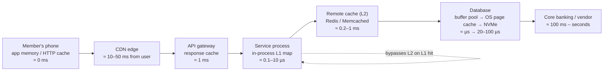
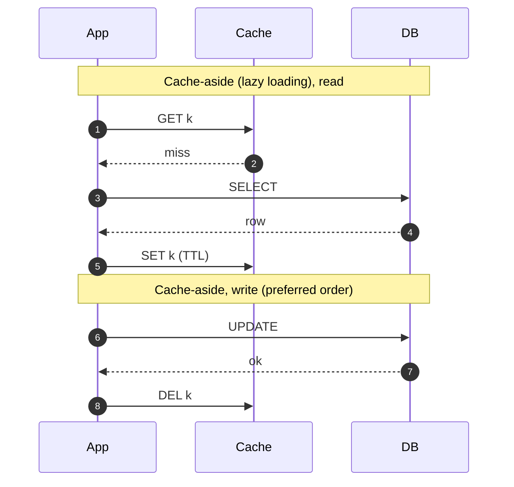
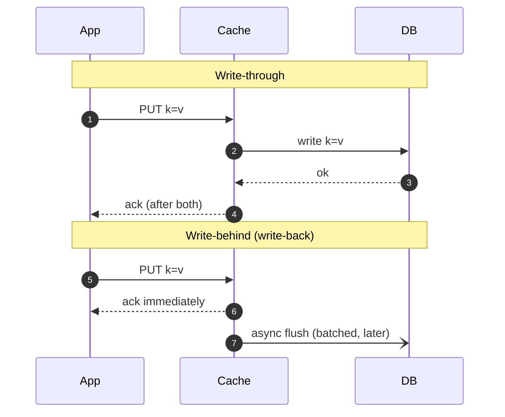
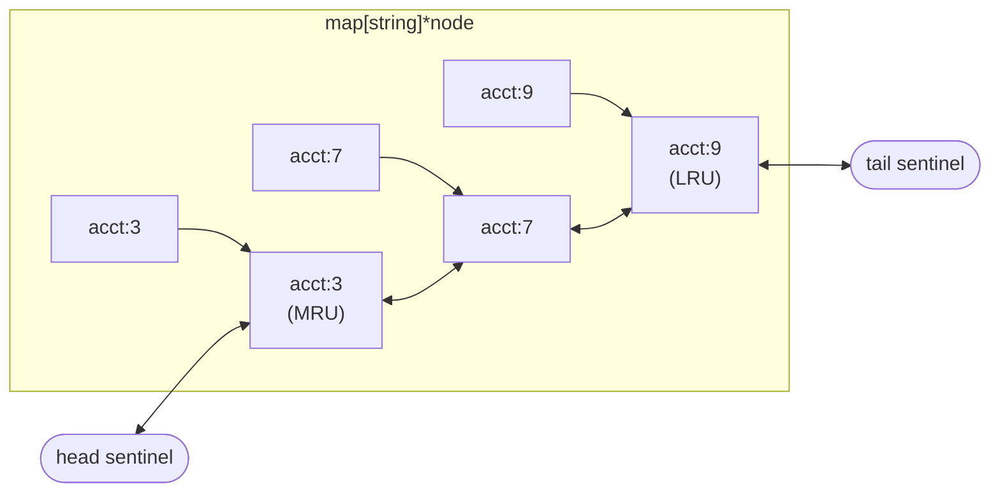

# A3 Unit 1 — Why, where and how much

> Time: ~6 h · CORE: §1–§4 · STRETCH: the "W-TinyLFU, ARC and the doorkeeper" part of §3 and `labs/a3/lfu` · Lab: `labs/a3/lru`, `labs/a3/lfu` (stretch)

A cache is a bet that the next request looks like a recent one. When the bet pays, a member's balance comes back in
a millisecond and the database sleeps. When it fails, the cache turns a database that was comfortably sized for 3% of
the traffic into one that must absorb 100% of it, in the worst possible minute. This unit is about the bet: what it
buys, where along the request path you can place it, which entries to keep when memory runs out, and how to size it
with arithmetic instead of hope. Unit 2 is about keeping the cached answer correct.

You already met caching twice: CDNs in [A1 Unit 1 §6](../A1-networking-api/unit-1-request-path.md#6-cdns) (HTTP
caches with TTLs you set in headers) and the buffer pool in A2 (the database's own cache of pages). This module
generalises both and adds the one in the middle that you write yourself.

## Before you start

You should have finished A1 and A2. Keep [`docs/NUMBERS.md`](../../docs/NUMBERS.md) open for the latency ladder.

Warm-up (spaced retrieval from A0, A1 and A2). Answer on paper first.

1. (A0) A credit-union app does 20 M balance reads a day with a peak factor of 3. What is the peak read QPS, to
   within napkin accuracy?
2. (A1) Which `Cache-Control` extension lets a shared cache hand out a stale copy while it refetches in the
   background, and what must you never put on a response that contains one member's balance?
3. (A2) A Postgres primary serves ≈ 30k indexed point reads per second while the working set fits in memory. Why does
   throughput fall off a cliff when it does not, and which component was doing the caching?

<details data-kind="answer">
<summary>Warm-up answers</summary>

1. 20 M / 86,400 ≈ 230 req/s average (napkin: 20 M / 10^5 = 200). × 3 ≈ 700 req/s peak. You will use this to size
   cache and database load in §4.
2. `stale-while-revalidate` (RFC 5861), usually next to `max-age`/`s-maxage`. Responses with personal data must not be
   stored by shared caches: `Cache-Control: private` or `no-store`, never a CDN rule that ignores it. Unit 2 §8
   generalises this to every cache layer.
3. Every read that misses the buffer pool (and the OS page cache under it) becomes a random 4 KB read from NVMe at
   ≈ 20–100 µs instead of a memory access at ≈ 100 ns, and misses also take locks and evict other pages. The buffer
   pool is a cache with an eviction policy, which is exactly what §3 builds.

</details>

---

## §1 What a cache buys, and where caches sit

### The failure story

The platform's "account summary" endpoint backs the home screen of 40 credit unions' mobile apps. Each call runs three
queries and one call to the core banking system: p50 ≈ 180 ms, p99 ≈ 900 ms. At the payday peak the endpoint does
≈ 6,000 req/s, so the database sees ≈ 18,000 queries/s, and the core is rate-limited to a few hundred calls per second
by contract. The team adds a Redis cache keyed by account. Hit ratio settles at 97%. The numbers are lovely: p50
drops to 12 ms, the database goes from 18,000 to ≈ 540 queries/s, and finance asks why the database instance is so
large. It is downsized to a box that comfortably serves ≈ 2,000 queries/s. Nobody writes this decision down.

Four months later the cache cluster needs a security patch. Operations restarts the nodes at 08:55 on a payday, "one at
a time, it's only a cache". The hit ratio on each restarted node is 0%. The summary endpoint's misses go straight to a
database that can do 2,000 queries/s and is now asked for ≈ 6,000 × 3 = 18,000. Connection pools fill, queries queue,
request timeouts fire at 1 s, clients retry, and the retries are more load. Misses that time out never populate the
cache, so the cache cannot warm. The incident lasts 40 minutes, and ends only when someone turns the feature off.

Nothing was *wrong* with the cache. The database was sized for the cache's good day.

### Predict

<!-- predict id="A3-U1-P01" -->
**Predict.** Write your answers down before opening the reveal. Use the numbers above: cache hit ≈ 1 ms (network +
Redis), database path ≈ 30 ms for the summary's queries, 97% hit ratio, 6,000 req/s.

1. What is the mean latency of a request with the cache, and what is it without? Is a *miss* faster or slower than
   having no cache at all?
2. By what factor does database load increase when the cache is emptied, and what single expression of the hit ratio
   gives that factor?
3. The team could have kept the old database size. Name two properties a cache has that make it a poor justification
   for removing capacity, and one way to make downsizing safe.
<!-- /predict -->

### Reveal

<details data-kind="reveal" data-for="A3-U1-P01">
<summary>Reveal</summary>

1. With the cache: 0.97 × 1 ms + 0.03 × (1 ms lookup + 30 ms database + ≈ 1 ms to write the entry back) ≈ 0.97 + 0.96
   ≈ **1.9 ms**. Without it: ≈ 30 ms. A miss costs ≈ 32 ms: *slower* than no cache by the cost of the lookup and the
   fill. That is the price of the bet, and it is why a cache with a low hit ratio is worse than none (at a 3% hit
   ratio you pay the lookup on every request and save almost nothing).
2. The database sees `(1 − h) × load` in steady state, so at h = 0.97 it sees 3% of the traffic. Emptied, it sees 100%:
   the factor is `1 / (1 − h)` = 1 / 0.03 ≈ **33×**. The better the cache, the bigger the cliff. A 99% cache is a
   100× multiplier on failure. "The hit ratio is 99%!" is a statement about how much you depend on it.
3. (a) A cache is **volatile** by design: restarts, evictions, node loss, failovers and deploys empty it, often at
   the worst time. (b) Its hit ratio is **workload-dependent**: a new feature, a scan, a changed key format or an
   attack with unique keys can crater it without any outage. Safe downsizing requires one of: capacity for the cold
   case, or a *tested* mechanism that bounds the cold case, namely request coalescing (§6 of Unit 2), admission control
   or load shedding on the database path (A7), a warm standby cache or pre-warming before traffic moves, and staggered
   restarts that never take more than a small slice of the keyspace cold at once. Do the arithmetic for "cache
   empty" and decide which of these closes the gap; do not assume the gap away.

</details>

### How it actually works

A cache buys two different things, and people conflate them.

**Latency.** A hit is served from something closer or faster than the source of truth. Expected latency is a
weighted average where the miss path is *longer* than the no-cache path:

```
T_eff = h · T_hit + (1 − h) · (T_lookup + T_source + T_fill)
```

**Load shedding.** The source of truth sees only the misses: `Q_source = Q · (1 − h)`. For a database with a fixed
capacity this is the real prize, because it converts an expensive resource (primary write capacity, vendor calls
you pay for per request, a rate-limited core system) into a cheap one (memory).

The two matter at different times. Latency matters on every request, every day. Load shedding matters when something
is saturated, and it also has a dark side: the **cold factor** `1 / (1 − h)`. If a cache reduces source load by 33×
you *depend* on it 33×. A useful rule: **write down, for every cache, what the source does when the cache is empty.**
If the answer is "falls over", then the cache is not an optimisation, it is a load-bearing wall, and it needs the
treatment of one (redundancy, staged restarts, warming, request coalescing, load shedding).

#### Where caches sit

A request to the platform can be answered at many points on its way in. Each layer has a different owner, a
different failure mode and a different way to be wrong.



| Layer | What it caches | Typical latency saved | Shared by | Who invalidates | Classic way it goes wrong |
|---|---|---|---|---|---|
| Client (app memory, HTTP cache, mobile DB) | Whole responses, images, config | Whole round trip (50–300 ms on mobile) | One device | TTL, `ETag` revalidation, app version | Old app versions pin old data; user sees yesterday's balance after a transfer |
| CDN / edge | Public, cacheable HTTP responses | RTT to origin (≈ 80–150 ms across oceans) | Everyone behind that edge | Purge API, TTL | Personal data cached under a shared key ([A1 §6](../A1-networking-api/unit-1-request-path.md#6-cdns)) |
| API gateway / reverse proxy | Whole responses keyed by URL + selected headers | Service + DB time | All users of that gateway | TTL, purge | Auth header not in the key; stale 200 hides a backend outage |
| In-process (L1) | Parsed objects, lookup tables, computed results | Network hop (≈ 0.2–1 ms) | One process only | TTL, pub/sub | N processes hold N different versions; memory competes with the heap/GC |
| Remote cache (L2) | Serialised values, shared across instances | Database query (≈ 1–30 ms) | The whole fleet | Application code | Stampede on expiry; cold start; hot key saturates one node |
| Database buffer pool / OS page cache | Pages | Disk read (≈ 20–100 µs NVMe) | Everything on that DB node | The database | Sequential scan flushes it; working set outgrows RAM |
| Result of a vendor/core call | Vendor responses with their own limits | Seconds of latency and per-call fees | Fleet | TTL, events | Caching a response that was an error; masking vendor outage |

Three principles fall out of the table:

1. **The nearer the user, the bigger the win and the harder the invalidation.** A browser cache saves the whole round
   trip but you cannot reach in and delete its entry; you can only set a TTL up front. The nearer the data, the more
   control you have and the smaller the win.
2. **Layers multiply.** If L1 hits 60% of requests and L2 hits 90% of what's left, the database sees
   `0.4 × 0.1 = 4%`. But the layers also stack their staleness: an entry can be `TTL_L1 + TTL_L2 + CDN max-age` old
   when it reaches a user. Add the TTLs when you promise freshness.
3. **The database has a cache too.** The Postgres/InnoDB buffer pool already keeps hot pages in RAM. An application
   cache in front of it does not replace that; it saves the *query* (parsing, planning, locking, serialisation, the
   network hop and the connection) and the *page lookups* it would have done. The reason an app-level cache wins even
   when the data is "already in RAM" is that a database point read costs ≈ 0.5–2 ms at the client (network + query
   work), while a Redis `GET` costs ≈ 0.2–0.5 ms in the same availability zone and a map lookup costs well under a
   microsecond.

#### The cache lookup itself is not free

A remote cache is a network service. Every lookup pays an RTT (≈ 0.1–0.5 ms in the same AZ per
[`NUMBERS.md`](../../docs/NUMBERS.md)), serialisation and deserialisation (JSON can cost more than the network), and
a connection from a pool (A1 §3). A request that makes 20 cache lookups sequentially spends ≈ 5–10 ms just asking.
Batch (`MGET`, pipelining) and parallelise lookups, or put an in-process L1 in front for the hottest items.

### Build it

No lab for this section; the eviction mechanism you build in §3 and the loader you build in Unit 2 are the
components every layer in the table shares.

### Break it

Reproduce the cold-cache cliff on your laptop. This is a deliberately simple model: 6,000 requests/s, keys drawn from
a Zipf distribution (a few keys are very popular), a warm cache holding the popular half of 200,000 keys, a database
that serves a fixed number of queries per second from a FIFO queue, and clients that give up after one second (the
work is still done by the database, and nothing is cached for a request that timed out). At t = 10 s the cache is
emptied.

```go
// coldcache: what a cache restart does to a database sized for the miss rate.
// A discrete-time model (100 ms ticks). Run: go run .
package main

import (
	"fmt"
	"math/rand"
)

const (
	tick      = 100 // ms
	reqPerSec = 6000
	keys      = 200_000
	timeoutMs = 1000
)

type job struct {
	key     int
	arrived int // tick
	waiters int // extra requests coalesced onto this load
}

func run(coalesce bool, dbPerSec int) {
	rng := rand.New(rand.NewSource(1))
	zipf := rand.NewZipf(rng, 1.1, 1, keys-1)
	cached := map[int]bool{}
	for i := 0; i < 100_000; i++ {
		cached[i] = true // warm: the popular keys are cached
	}
	var queue []*job
	pending := map[int]*job{}
	var ok, total int
	for t := 0; t < 600; t++ { // 60 s
		if t == 100 {
			cached = map[int]bool{} // t = 10 s: the cache restarts empty
		}
		for i := 0; i < reqPerSec*tick/1000; i++ {
			k := int(zipf.Uint64())
			if t >= 100 {
				total++
			}
			switch {
			case cached[k]:
				if t >= 100 {
					ok++
				}
			case coalesce && pending[k] != nil:
				pending[k].waiters++
			default:
				j := &job{key: k, arrived: t}
				queue = append(queue, j)
				if coalesce {
					pending[k] = j
				}
			}
		}
		for served := 0; served < dbPerSec*tick/1000 && len(queue) > 0; served++ {
			j := queue[0]
			queue = queue[1:]
			if pending[j.key] == j {
				delete(pending, j.key)
			}
			if (t-j.arrived)*tick > timeoutMs {
				continue // the callers gave up; the database did the work for nothing
			}
			cached[j.key] = true
			if j.arrived >= 100 {
				ok += 1 + j.waiters
			}
		}
	}
	fmt.Printf("coalescing=%-5v db capacity %5d/s: %5.1f%% of requests after the restart answered in time\n",
		coalesce, dbPerSec, 100*float64(ok)/float64(total))
}

func main() {
	for _, c := range []bool{false, true} {
		for _, db := range []int{300, 600, 1200, 6000} {
			run(c, db)
		}
	}
}
```

Predict first: with the warm cache the database sees ≈ 3% of 6,000 ≈ 170 queries/s. For database capacities of 300,
600 and 1,200 queries/s (≈ 2×, 3.5× and 7× the steady miss load), what fraction of requests are answered in time
over the 50 seconds after the restart? Does coalescing identical misses fix it? Then run the program (`go run .` in a
scratch directory) and vary `timeoutMs` and the Zipf exponent.

<details data-kind="answer">
<summary>What you should see, and why</summary>

Without coalescing: ≈ 50%, 56% and 66% of requests succeed after the restart; with coalescing ≈ 56%, 62% and 74%;
only the 6,000/s database (full capacity) answers everything. Your numbers will match closely because the random
source is seeded; a different Zipf exponent or timeout moves them.

Why even a 7× headroom does not save you: after the restart, hit ratio is 0% and the database receives 6,000
queries/s of misses for *distinct* keys as well as popular ones. The long tail of keys is much too large to reload
at 1,200/s, so a third of requests keep missing, queue, and time out; each timed-out request wastes database work and
leaves the cache unfilled. Coalescing helps because the popular keys are requested many times per second and each
should be loaded once; it removes duplicates but cannot remove the long tail. Timeouts amplify the problem: a queue
that contains already-abandoned work is pure waste (see load shedding and deadline propagation in A7).

Real fixes, in the order you would apply them: (1) stagger restarts so only a slice of the keyspace is cold; (2) warm
the cache from a replica or a snapshot before it takes traffic; (3) coalesce duplicate loads; (4) bound database
concurrency and shed load deliberately instead of queueing it; (5) keep the database sized for the case you
cannot rule out.

</details>

### In the wild

- **Facebook** ran memcached as the first tier in front of MySQL and describes in "Scaling Memcache at Facebook"
  (NSDI 2013) why it protects the database from cold clusters: a regional cache pool, and a *cold cluster warmup*
  procedure that fills a new cluster from a warm one rather than from MySQL. `TODO-VERIFY: exact name and mechanism of
  the cold-cluster warmup in the paper`.
- **Redis** is documented as usable as a cache with `maxmemory` plus an eviction policy; the same server can be a
  durable-ish store with persistence (RDB snapshots, AOF). The configuration decides which one you operate, and the
  team must know which one they are on-call for.
- **Memcached** has no persistence by design: restart = empty. Its operational model assumes the database can
  survive that.
- **CDNs** are the same bet at the edge: a purge or a new deploy produces a wave of misses at the origin, the reason
  some CDNs offer an "origin shield" or request-collapsing tier. `TODO-VERIFY: vendor-specific names`.
- **Postgres** relies on its own `shared_buffers` plus the OS page cache; restarting Postgres loses the former but not
  the latter, and tools such as `pg_prewarm` exist to reload it. `TODO-VERIFY: pg_prewarm behaviour and autoprewarm
  availability in your version`.

### Trade-offs

| Option | Wins when | Loses when | When the answer flips |
|---|---|---|---|
| Cache in front of a database sized for the cold case | Latency matters and the database is cheap relative to the risk | Database is the expensive component (large clusters, per-call vendor fees) | Flip to a smaller database + engineered cold-start protection once you have coalescing, warming and shedding *and test them* |
| Cache as load-bearing (database sized for misses only) | The source is rate-limited or very expensive (core banking calls, paid APIs) | Cache loss is plausible and the cold path has no protection | Flip to over-provisioning the source when the cost of a cold-start incident exceeds years of the saved capacity |
| Many layers (client + CDN + L1 + L2) | Read-mostly data with tolerant freshness | Staleness budgets are tight; many places to invalidate | Flip to fewer layers when freshness requirements shrink to seconds: drop the CDN/client TTLs first |
| No cache | Writes dominate, data must be perfectly fresh, or traffic is low | Read-heavy and the source is the bottleneck or far away | Flip to a cache when `Q · (1 − h)` fits the source's capacity and the staleness is acceptable |

### Senior bar

- **Failure modes**: cold start and restart storms; the cache as a hidden dependency (a rollout that changes the key
  format empties it just as surely as a restart does); hit ratio decay after a feature launch; misses that are *more*
  expensive than no cache (large values, slow serialisation, lookups on every layer); stale data masking backend
  outages.
- **Capacity numbers**: Redis ≈ 100k+ simple ops/s per instance, same-AZ RTT ≈ 0.1–0.5 ms, Postgres primary ≈ 10k–50k
  point reads/s ([`NUMBERS.md`](../../docs/NUMBERS.md)). A cache that sheds 97% of reads from a 30k QPS database moves
  ≈ 900 QPS back to it, a 33× reduction, and the same cache emptied is a 33× increase.
- **Ops**: restarts and deploys are rolling, one failure domain at a time; alert on hit ratio *dropping*, not on a
  low absolute value; have a runbook for "the cache is gone" and exercise it; keep the cache cluster's capacity
  planning in the same document as the database's.
- **Cost**: RAM is ≈ an order of magnitude cheaper per byte than a database's provisioned IOPS but is not free
  (`TODO-VERIFY` current managed-Redis pricing); the cheapest cache entry is the one you do not store. Sometimes a
  cache is a way to avoid paying for a bigger source; sometimes it is the way you pay for both.

Interviewer follow-up probes:

1. "You cache account summaries and the hit ratio is 98%. What happens if the cache is empty at peak?"

<details data-kind="answer">
<summary>Model answer</summary>

The database sees 1 / (1 − 0.98) = 50× its steady load. I'd first check whether that fits the database's capacity;
if not, I'd treat the cache as load-bearing and add: coalescing of identical in-flight loads so each hot key is
loaded once; a bounded concurrency/queue on the database path so overload turns into fast failures or stale
responses rather than a timeout spiral; rolling restarts; and a way to warm a new cache from a warm one. I'd also
size the database for the traffic I can't shed (writes, uncacheable reads) plus a realistic cold-start share.

</details>

2. "Why not put a cache in front of everything?"

<details data-kind="answer">
<summary>Model answer</summary>

Each cache is extra latency on misses, extra memory, a new consistency problem and a new failure mode. It pays
only when reads dominate, the data is reused, and the source is the bottleneck or far away. For write-heavy or
low-reuse data (unique reports, one-time statements) the hit ratio is low and the cache just adds cost and
complexity.

</details>

3. "Where would you cache a member's balance?"

<details data-kind="answer">
<summary>Model answer</summary>

Not at the CDN or in a shared gateway cache (personal, must not leak), and not for long anywhere: the product
requirement is usually "fresh within seconds, and always correct right after the member's own transfer". So:
a short-TTL remote cache or none at all for the balance itself, keyed by tenant and account, invalidated by the
event that changes it, with the member's own writes bypassing or refreshing the cache (Unit 2 §5 and §8). The
account *product name* and branch details are different: they can sit in an in-process cache for minutes.

</details>

### Check yourself

1. Write the expression for the load increase when a cache with hit ratio `h` is emptied.
2. A request makes 12 sequential Redis lookups at 0.4 ms each. What is the cost, and name two ways to reduce it.
3. Why does adding an in-process cache in front of Redis not simply "add" the two hit ratios?

<details data-kind="answer">
<summary>Answers</summary>

1. `1 / (1 − h)`; at h = 0.9 it is 10×, at h = 0.99 it is 100×.
2. 12 × 0.4 ≈ 4.8 ms of pure lookup latency. Batch the keys into one `MGET` (or pipeline), issue lookups in
   parallel, or serve the hottest keys from an in-process L1.
3. Layers multiply the *miss* rates: the database sees `(1 − h1)(1 − h2)` of the traffic, and the L2 hit ratio is
   measured on what L1 let through, so it is lower than it was before L1 existed (the easy hits were taken).

</details>

---

## §2 Caching patterns: aside, through, behind, around, ahead

### The failure story

The card-controls service lets members freeze and unfreeze a debit card from the app. Reads dominate (the card list
screen loads the state; the authorisation path checks it on every swipe), but toggles are bursty: ≈ 2,000 writes/s
during a fraud-alert push notification. An engineer, keen to cut database writes, puts the card state behind a
"write-behind" cache: the service updates Redis, returns `200` immediately, and a background job flushes dirty keys to
Postgres every 5 seconds. The toggle latency drops from 18 ms to 2 ms.

On a Tuesday a Redis primary fails over to its replica. Replication to the replica is asynchronous, so the replica is
missing the last second or so of writes, and the flush buffer, which lived only in the dead primary's memory, is
gone. ≈ 2,000 writes/s × 5 s ≈ 10,000 acknowledged toggles are at risk, among them 31 members who froze a lost
card in the previous few seconds. The card is unfrozen again, because the database never heard. Three of those cards
are used fraudulently within the hour. The fraud team's question is simple: *"you told the member it was frozen."*

### Predict

<!-- predict id="A3-U1-P02" -->
**Predict.** Write your answers down before opening the reveal.

1. For each of cache-aside (write to DB, then invalidate the cache), write-through (write to cache and DB
   synchronously before acking) and write-behind (ack after the cache write, flush later): what is the worst thing that
   can happen to an *acknowledged* write if the cache node dies at the worst moment?
2. Which of the three gives the member read-your-writes with the lowest write latency, and what is the hidden price?
3. Which pattern would you pick for the card-freeze flag, and for a "last seen on" timestamp? Why different?
<!-- /predict -->

### Reveal

<details data-kind="reveal" data-for="A3-U1-P02">
<summary>Reveal</summary>

1. **Cache-aside:** nothing is lost; the database is written first and is the source of truth. The worst case is a
   *missed invalidation*: the DB write succeeded, the process died (or the delete failed) before the cache entry was
   removed, and readers see the old value until the TTL. **Write-through:** the database write is part of the ack,
   so the write is durable; the worst case is a partial failure between the two writes (cache updated but DB failed,
   or the reverse) which must be ordered so the cache never claims more than the database holds. **Write-behind:**
   the acknowledged write exists only in cache memory until the flush; a node death loses everything not yet
   flushed. It is the only one of the three that can lose acknowledged data.
2. **Write-behind** has the lowest latency (one memory write) and gives read-your-writes *through the cache*, but
   the price is durability and a stale database: reports, other services reading the DB, backups and analytics
   all see old data until the flush, and ordering between keys is not preserved. Write-through gives
   read-your-writes with DB-write latency; cache-aside gives it only if the cache entry is dropped before the
   next read, which is a race (§5 of Unit 2).
3. The freeze flag is a **safety-critical** value: write-through at best, more likely plain cache-aside with a
   database write in the request path and a very short TTL or event-driven invalidation, and the authorisation path
   should not trust a cache that can be minutes stale. "Last seen" is **loss-tolerant and high-volume**: write-behind
   (or just a batched async update) is fine, because losing 5 seconds of timestamps harms nobody and coalescing
   repeated writes to the same key cuts DB load by an order of magnitude.

</details>

### How it actually works

There are six named patterns. They differ in *who talks to the database* and *when a write is acknowledged*.





| Pattern | Read path | Write path | Ack after | Loses acknowledged writes? | Typical use |
|---|---|---|---|---|---|
| **Cache-aside** (lazy loading) | App: get; on miss load from DB and set | App writes DB, then deletes (or updates) the key | DB write | No (missed invalidation → stale) | Default for application caches (Redis/Memcached in front of SQL) |
| **Read-through** | App asks the cache; the *cache* loads on miss through a configured loader | Usually combined with write-through or aside | n/a | No | Loading caches inside a process or a managed layer; one place for coalescing |
| **Write-through** | Reads hit the cache (always populated by writes) | App → cache → DB, synchronously | Both | No (but partial failure between the two) | Read-heavy data that must be fresh; small hot sets |
| **Write-behind / write-back** | Reads hit the cache | App → cache; cache flushes to DB later in batches | Cache write | **Yes** (anything unflushed) | High-rate, loss-tolerant counters, timestamps; page caches with a log |
| **Write-around** | Aside on read | Write to DB only; do not populate or touch cache (invalidate if present) | DB write | No | Write-once / read-rarely data (statements, audit exports) so writes don't pollute the cache |
| **Refresh-ahead** | Serve cached; reload *before* expiry if the key is hot | As above | n/a | No | Predictable hot keys (rate tables, config) so no member ever waits on a reload |

A few distinctions that matter more than the names:

**1. Aside vs read-through is about *who owns the loader*.** In cache-aside, every call site contains "check, load,
set", so every call site can get the stampede and the invalidation wrong. Moving the loader into the cache (a
read-through loading cache) gives you one place to put coalescing (Unit 2 §6), error handling and metrics. The lab
`cacheaside` is that component: cache-aside semantics (the app owns the source), packaged as a read-through
`Get(ctx, key)`.

**2. Write-through is a dual write.** Updating "the cache and the database" is two writes to two systems without a
shared transaction (A6 covers the general problem and the outbox/CDC cure). Pick an order and a recovery story. For
caches the safe order is **database first, then cache**, because the cache is allowed to be behind but must never be
*ahead* of the truth: a cache that holds a value the DB rejected is a lie, and a cache that lacks a value the DB has
is just a miss.

**3. Write-behind is only as durable as its buffer.** The cache's memory is not durable; if the buffered writes are
the *only* copy, you have a database with the durability of a map. It becomes safe when the buffer is itself durable
and ordered: an append-only log that is fsynced before the ack (A2's WAL: **write-back is safe if and only if a
durable log precedes it**), or a queue/log (A6). Then you have reinvented the write-ahead log and the queue, which is
the point: write-behind without a log is a database bug waiting for a failover.

**4. Caches vs stores.** If the data in "the cache" is the only copy (sessions in Redis, rate-limit counters,
feature flags), then it is a *store*, and its failure semantics must be chosen like a store's: replication,
persistence, what a lost entry means (a logged-out member is acceptable; a lost freeze flag is not). Do not
inherit the "it's only a cache" mindset for data without a source of truth.

**5. Refresh-ahead trades wasted loads for tail latency.** A hot, predictable key (today's rate table, the product
catalogue) can be reloaded just before it expires so no request ever pays the reload. For cold keys it wastes work.
The probabilistic variant, which needs no timers and no coordination, is XFetch in Unit 2 §6.

**6. Read-your-writes in cache-aside.** After a member's own write, their next read should see it. With delete-on-write
the next read repopulates from the DB, which is fine, but a concurrent reader can repopulate with the *old* value in
between (the stale-set race, Unit 2 §5). Cheap mitigations: route the writer's next read to the primary, bypass the
cache for that member for a short window, or write-through the new value into the cache with a version check.

### Build it

No lab for this section — see §3 (the `lru` store that every pattern sits on) and Unit 2 §5–§7, where
`labs/a3/cacheaside` implements the read path, negative caching and safe invalidation of cache-aside.

### Break it

Lose acknowledged writes. This program models a write-behind buffer in front of a "database" and "crashes" the cache
at a random moment.

```go
// writebehind: how much acknowledged data does a crash lose?
package main

import (
	"fmt"
	"math/rand"
)

type db map[string]int

type writeBehind struct {
	cache map[string]int
	dirty map[string]bool
	db    db
	acked int
}

func (w *writeBehind) Put(k string, v int) { // acknowledged immediately
	w.cache[k] = v
	w.dirty[k] = true
	w.acked++
}

func (w *writeBehind) Flush() {
	for k := range w.dirty {
		w.db[k] = w.cache[k]
		delete(w.dirty, k)
	}
}

func main() {
	const (
		writesPerSec  = 2000
		flushEverySec = 5
		hotKeys       = 200
	)
	rng := rand.New(rand.NewSource(1))
	for trial := 0; trial < 5; trial++ {
		w := &writeBehind{cache: map[string]int{}, dirty: map[string]bool{}, db: db{}}
		crashAt := rng.Intn(60 * writesPerSec) // a crash at a random write number
		lost := 0
		for i := 0; i < 60*writesPerSec; i++ {
			if i > 0 && i%(flushEverySec*writesPerSec) == 0 {
				w.Flush()
			}
			if i == crashAt {
				lost = len(w.dirty) // distinct keys whose latest value was never flushed
				break
			}
			w.Put(fmt.Sprint("card-", rng.Intn(hotKeys)), i)
		}
		fmt.Printf("crash after %6d acked writes: %3d keys have an acknowledged value the DB never saw\n", w.acked, lost)
	}
}
```

Predict: with 2,000 writes/s spread over 200 hot keys and a 5 s flush, roughly how many writes does a crash put at
risk, and how many *keys* hold lost data? Then run it and change `hotKeys` to 100,000. What is the relationship
between flush interval, number of distinct keys and the damage? Finally, name the property that write-behind gives you
in return (hint: count database writes per second at 200 hot keys versus 2,000 acknowledged writes).

<details data-kind="answer">
<summary>What you should see, and why</summary>

Up to ≈ 10,000 acknowledged writes (2,000/s × 5 s) are at risk, but because the 200 hot keys are overwritten repeatedly
most of those writes were *superseded*: the damage is bounded by the number of distinct dirty keys, ≤ 200 here, so
you will see up to ≈ 200 keys with a lost latest value (close to 200 once the buffer has run for a second or so).
With 100,000 hot keys the damage approaches the full writes-in-window, ≈ 10,000 keys (low overlap). The upside is the
same effect: at 200 hot keys, a flush every 5 s writes ≤ 200 rows per 5 s, ≈ 40 DB writes/s instead of 2,000: a ≈ 50×
reduction (write coalescing). The better the coalescing, the less you lose per crash; the worse the coalescing, the
more you lose and the less you saved. Neither changes the fundamental rule: unflushed acknowledged writes die with
the cache unless a durable log precedes them.

</details>

### In the wild

- **Cache-aside** is how most Redis and Memcached deployments in front of SQL work. Spring's `@Cacheable` and
  Hibernate's second-level cache are application-framework forms of it.
- **Read-through / write-through** in managed form: Amazon DynamoDB Accelerator (DAX) sits in front of DynamoDB as a
  write-through, read-through cache; `TODO-VERIFY: DAX query-cache vs item-cache invalidation semantics (the query cache
  is governed by TTL, not by writes)`.
- **In-process loading caches**: Caffeine (JVM) `LoadingCache` loads each missing key once under concurrent
  requests and offers `refreshAfterWrite` for refresh-ahead; Go has `golang.org/x/sync/singleflight` for the
  coalescing half (you build your own in Unit 2).
- **Write-back done right**: the Linux page cache buffers writes in memory and flushes dirty pages later; durability is
  what `fsync` is for. A database makes write-back safe by logging first: Postgres writes dirty buffers back lazily
  (background writer, checkpoints) because the WAL record is already durable (A2).
- **CPU caches** use both write-through and write-back at different levels; the same vocabulary applies.
- **CDNs** are write-around by default: you publish to the origin and the edge learns on the next miss or purge.

### Trade-offs

| Option | Wins when | Loses when | When the answer flips |
|---|---|---|---|
| Cache-aside | You want the DB to stay the source of truth and the cache disposable | Many call sites reimplement loading; stampedes on hot keys | Flip to read-through/loading cache as soon as there are ≥ 2 call sites or you need coalescing |
| Read-through | Single place for loading policy, coalescing and metrics | The cache layer must know how to reach every source | Flip to aside when loads are heterogeneous or need request context the cache can't hold |
| Write-through | Reads must see recent writes and writes are modest | Write latency = DB latency + cache latency; dual-write failure modes | Flip to aside+invalidate when writes are frequent and mostly not re-read |
| Write-behind | High-rate, loss-tolerant, coalescable writes (counters, timestamps) | Anything where an acknowledged write must survive a failover | Flip to write-through (or log-then-cache) the moment loss becomes unacceptable |
| Write-around | Write-once, read-rarely data; protects the cache from pollution | The data is read soon after it is written | Flip to write-through if reads follow writes closely |
| Refresh-ahead | Hot, predictable keys and a latency target on the tail | Large keyspace with a long cold tail (wasted loads) | Flip to plain TTL + coalescing for the tail; keep refresh-ahead for the known-hot set |

### Senior bar

- **Failure modes**: missed invalidation after a successful DB write (the dual-write problem), write-behind loss on
  failover, cache updated but DB write rolled back, double-applied writes when a retry replays a write-through,
  reads of a half-updated multi-key aggregate, cache serving data after the source deleted it (right-to-erasure!).
- **Capacity**: write-behind coalescing ratio = acknowledged writes / distinct keys per flush interval; DB write rate
  ≈ distinct dirty keys / flush interval. With 200 hot keys and a 5 s interval that is ≈ 40 writes/s.
- **Ops**: decide per data class which pattern is allowed (write the table down in the design doc). Cache-aside
  invalidations need a retry path (a durable queue or CDC) and a TTL backstop. Never enable write-behind on a
  non-durable cache for money, entitlements, consent or anything with legal retention.
- **Cost**: write-behind saves database IOPS and often the cheapest scaling lever for high-write counters, but each
  pattern adds an operational surface: monitoring the dirty queue length, flush lag and oldest unflushed write.

Interviewer follow-up probes:

1. "Cache-aside: update the cache on write, or delete it?"

<details data-kind="answer">
<summary>Model answer</summary>

Delete (after committing the DB write), plus a TTL backstop. Updating the cache on write has two problems:
two concurrent writers can apply their DB writes and cache updates in different orders, leaving the older value in
the cache; and you pay to compute and store a value that may never be read. Deleting lets the next read repopulate
from the source of truth. The remaining race (a concurrent reader repopulating the old value) is addressed in Unit 2
§5 with short TTLs, versioned keys or leases.

</details>

2. "Why is write-behind to Redis not OK for a ledger, and what would make write-behind OK?"

<details data-kind="answer">
<summary>Model answer</summary>

Because the ack promises durability the cache can't deliver: a failover or crash loses the unflushed writes, and the
ledger needs every acknowledged entry to survive. Write-behind is OK when the buffer is durable and ordered (a
write-ahead log fsynced before the ack, or a replicated log/queue such as Kafka feeding the database writer, A6).
At that point the "cache" is a read-optimised view over a log, and the log is the source of truth.

</details>

3. "What breaks if the DB write succeeds and the process dies before the cache invalidation?"

<details data-kind="answer">
<summary>Model answer</summary>

Readers get the old value until the TTL expires, so the TTL is the staleness bound in that failure. To tighten
it: make invalidation reliable by deriving it from the committed change (transactional outbox or CDC feeding an
invalidation consumer, A6) instead of from the request handler, and keep the TTL as a backstop for lost messages.

</details>

### Check yourself

1. Which of the six patterns can lose an acknowledged write, and what makes it safe?
2. Why is "database first, then cache" the safe order for write-through?
3. A team says "our Redis session store is a cache". What question do you ask?

<details data-kind="answer">
<summary>Answers</summary>

1. Write-behind. It is safe only if the unflushed writes are held in a durable, ordered log that survives the cache
   node (fsync before ack, or a replicated log/queue).
2. The cache may lag the truth (that is just a miss) but must never lead it: a value in the cache that the database
   rejected or rolled back would be served as truth.
3. "Is there another copy of this data?" If not, it is a store; choose persistence, replication and loss semantics
   as for a store, and decide what a lost entry means (forced re-login vs lost consent).

</details>

---

## §3 Eviction: deciding what to forget

### The failure story

The monthly statement run reads every account once, in account-number order: 4 M accounts, each lookup goes through
the same cache-aside path the app uses, which populates the cache. The shared Redis holds ≈ 1 M entries (2 GB at
≈ 2 KB each) and keeps the 1 M accounts members actually open. Hit ratio during the day: 96%. The job starts at
06:30 and finishes at 07:10. The cache's policy is `allkeys-lru`.

At 07:15 the morning commute starts. Every hot account entry was evicted during the run; the cache is full of
statement-run entries nobody will read again. Hit ratio at 07:15 is ≈ 10% and climbs slowly; the database sees 9× its
normal load for the first twenty minutes, exactly when the app is busiest. An engineer opens a dashboard and says
"the cache was never restarted, why is it cold?" It was not restarted. It was *flushed by traffic that looked
recent*.

### Predict

<!-- predict id="A3-U1-P03" -->
**Predict.** Write your answers down before opening the reveal.

1. A true LRU holds 1 M entries. A scan inserts 4 M distinct keys, once each. How many of the original 1 M hot
   entries survive, and why does LRU "believe" the scan keys are valuable?
2. Name two different kinds of fix: one that changes what the *policy* does, and one that changes what the
   *application* does.
3. Pure LFU would not have been fooled by the scan. What goes wrong with pure LFU over weeks of operation?
<!-- /predict -->

### Reveal

<details data-kind="reveal" data-for="A3-U1-P03">
<summary>Reveal</summary>

1. **None.** Every insertion becomes the most recently used entry and pushes the least recently used one out;
   after 1 M insertions every original entry has been evicted, and the remaining 3 M insertions churn the scan's
   own entries. LRU's only evidence of value is *recency*, and a one-time access is the most recent thing that
   happened. That is the scan problem: sequential, one-pass access defeats recency-based policies.
2. Policy-side: make a first access insufficient for promotion. Segmented LRU / 2Q / InnoDB-style midpoint
   insertion (new entries start in a probation segment and join the protected one only on a second access), ARC,
   or TinyLFU admission (a newcomer enters only if its estimated frequency beats the victim's). Application-side:
   don't let the scan use the cache: a `bypass`/`no-populate` flag on batch reads, a separate cache (or
   keyspace/instance) for batch work, or reading from a replica directly. The application-side fix is the
   cheapest and should be your first move; the policy-side fixes are insurance against the scan you didn't predict.
3. **Stale popularity.** Counts never decay, so yesterday's viral item keeps a huge count forever and can never be
   evicted, while new items start at zero and are evicted before they can accumulate a count (the "cold start" of
   LFU). Practical LFUs age their counts (halve periodically, or decay by time) so frequency means "frequency
   *lately*".

</details>

### How it actually works

When the cache is full, an insert must evict. The optimal choice (Bélády's algorithm) is the entry whose next use is
furthest in the future. That is unknowable, so every real policy predicts the future from the past, using
**recency** (what was used lately will be used again), **frequency** (what was used often will be used again), or
some combination.

#### LRU: a hash map welded to a doubly linked list

Least-recently-used evicts the entry unused for the longest time. You need three operations to be O(1): find an
entry by key, mark it as most recently used, and find the least recently used one. A hash map gives the first;
a doubly linked list ordered by recency gives the other two.



- `Get(k)`: look up the node; **unlink** it and **push it to the front**; return the value. A `Get` therefore
  *writes* the list: this is the reason a cache needs an exclusive lock even for reads.
- `Set(k, v)`: if present, update and promote; otherwise create the node, push it to the front, and while over
  capacity evict `tail.prev`: remove it from the list *and* from the map (both, or the map leaks the node).
- Sentinel nodes at both ends remove every nil check from `unlink`/`pushFront`: the list is never empty, so
  `node.prev` and `node.next` are always valid. That is the whole trick of the "hand-rolled doubly linked list".
- Invariant to test: `len(map) == number of nodes in the list`, and walking the list from head gives exactly the
  recency order. Break either under concurrency and the cache silently leaks or evicts the wrong entry.

Per-entry cost: a key string header, a value, pointers, a map slot, cost and expiry fields. In Go that is
≈ 100–150 bytes of bookkeeping per entry on top of the payload (`TODO-VERIFY: measure with a benchmark; depends on
key length and value type`). For 2 KB values that is a 5–7% tax; for 50-byte values it triples your memory.

#### Entries are not equal: cost-based capacity

Counting entries is wrong when sizes vary by 100×: a 200 KB statement should not be treated like a 2 KB summary.
Give every entry a **cost** (bytes, or a weight you choose) and bound the sum. Inserting a big entry may evict several
small ones, and an entry larger than the whole budget must be refused (and an older value for the same key dropped,
or readers would be served a stale entry the cache now "can't" update). The `lru` lab implements exactly this.
Caveat: a large new value can evict many small, hot entries to make room for one that may never be read again; prefer
not to cache giant values at all.

#### TTL is not an eviction policy

TTL answers "how long may this answer be believed" (freshness). Eviction answers "what do I drop when memory is
full" (capacity). You need both: TTLs without eviction bounds do not bound memory, and eviction without TTLs does not
bound staleness. Expired entries are removed lazily on access (cheap, but they occupy memory until someone looks) and
by a background sweep; a sweep that scans everything is O(n), so real systems *sample* (Redis's active expiry
samples keys that have TTLs, `TODO-VERIFY: current algorithm`).

#### Cheaper approximations of LRU

A strict LRU takes a lock and touches several pointers on *every hit*, which is the contention hot spot of a
concurrent cache. Alternatives:

- **FIFO**: evict in insertion order; no work on a hit; terrible for hot keys inserted early.
- **CLOCK / second-chance**: entries sit in a circular buffer with a *reference bit*. A hit just sets the bit
  (no pointer surgery). The "hand" sweeps: if the bit is set, clear it and move on; otherwise evict. Costs one bit
  per entry and gives most of LRU's hit ratio. Operating systems use clock variants for page replacement, and
  PostgreSQL's buffer manager uses a *clock sweep* with a small usage counter per buffer.
- **Sampled LRU** (Redis): keep a last-access timestamp on every key (a few bits in the object header), and on
  eviction **sample N random keys and evict the one idle longest**. Memory overhead is tiny and quality is close to
  LRU for N around 5–10 (the Redis docs show the approximation improving with `maxmemory-samples`; the default is 5,
  `TODO-VERIFY` for your version).
- **Random**: evict a random entry. Surprisingly competitive when access is not recency-skewed, with zero metadata.
- **Sharded LRU**: split the cache into 16–256 independent LRUs by `hash(key)`; each has its own lock. Global recency
  is approximated (each shard is an exact LRU of its own keys), contention drops by the shard count. A common
  way to make an in-process LRU scale.

#### LFU and its aging

LFU evicts the entry used least often. It is scan-proof (a single access has frequency 1) and good for stable skew
(a handful of popular products). It needs a counter per entry and some form of **aging**, or it hoards the old popular
set (see the reveal). Redis implements an approximate LFU: a small logarithmic counter plus a time-based decay
(`lfu-log-factor`, `lfu-decay-time`, `TODO-VERIFY` defaults), because an exact 64-bit counter per key is too big.

#### Scan resistance by structure: SLRU, 2Q, midpoint insertion

Keep two LRU lists: **probation** (new entries) and **protected** (entries hit at least twice). A newcomer lands in
probation; a hit while in probation moves it to protected; evictions come from probation first. A scan only churns
probation, and the protected hot set survives. InnoDB's buffer pool is the textbook production example: its LRU list
is split into a "young" and an "old" sublist, new pages are inserted at the *midpoint* (the head of the old
sublist), and a page moves to the young end only if touched again after a delay (`innodb_old_blocks_pct` and
`innodb_old_blocks_time`; the docs' defaults are ≈ 37% and 1000 ms, `TODO-VERIFY`). PostgreSQL attacks the same
problem differently: large sequential scans read through a small **ring buffer** so they cannot flush
`shared_buffers` (`TODO-VERIFY: ring sizes per access strategy`).

#### STRETCH: W-TinyLFU, ARC and the doorkeeper

**ARC** (Adaptive Replacement Cache, IBM) keeps a recency list and a frequency list plus "ghost" lists of recently
evicted keys; a hit in a ghost list tells it which side deserved more room, so it adapts its split automatically.
ZFS uses an ARC; PostgreSQL briefly used one before dropping it, reportedly over patent concerns
(`TODO-VERIFY: Postgres 8.0/8.1 history`).

**TinyLFU** (Einziger, Friedman, Manes) separates two jobs: *admission* (should this newcomer be allowed in at all?)
and *eviction* (who goes if so?). It keeps approximate frequency for a huge number of keys, including keys not in
the cache, in a **count-min sketch**: `d` rows of `w` small counters; `Increment(key)` bumps one counter per row
(chosen by `d` independent hashes), `Estimate(key)` returns the minimum across rows. Collisions can only add to a
counter, so the minimum is an *upper bound* on the true count; with `d` rows and `w` counters the overestimate is
small with probability `1 − e^−d`. Counters are tiny (4 bits in the paper, saturating at 15) because only the
*order* of popularity matters. To keep frequencies recent, every `W` increments (W ≈ 10× the cache size) all counters
are **halved**. The admission rule: when the cache is full, admit the candidate only if `Estimate(candidate) >
Estimate(victim)`. A one-hit wonder (frequency 1) never displaces a resident with frequency ≥ 1.

Two refinements make it production-grade. A **doorkeeper** Bloom filter in front of the sketch absorbs the first
occurrence of each key (a key must be seen twice before it touches the sketch), so a scan of unique keys cannot even
age the sketch. And **W-TinyLFU** adds a small LRU *window* (≈ 1% of capacity) in front of the main
segmented-LRU region, so bursts of brand-new, soon-to-be-hot keys can get in before they have any frequency history.
This is the design of Caffeine, the JVM cache; Go's `ristretto` follows the same TinyLFU idea
(`TODO-VERIFY: window size, SLRU split and sketch sizing in each library`).

The `lfu` lab (STRETCH) builds the sketch, the halving and the admission rule, without window or doorkeeper, so you
can see both what it fixes (scan resistance) and what it breaks (a long scan still ages the sketch; hence the
doorkeeper).

### Build it

Lab `labs/a3/lru` (CORE). Work in `labs/a3/lru/lru.go`; the package doc lists every behaviour the tests check.

1. Implement the list primitives `unlink`, `pushFront`, `remove`.
2. Implement `Get`, `SetWithCost`, `Delete`, `Len`, `Cost`, `Keys`, `Stats` with entry-count eviction.
3. Add TTL: expiry in `Get`/`Peek`, `PurgeExpired`, the "expires when `now >= written + ttl`" boundary, "hits do not
   extend TTL".
4. Add cost weighting: several evictions per insert, oversized entries refused (and the old value dropped).
5. Call `OnEvict` after unlocking.

Acceptance tests (run `go test -race ./labs/a3/lru/`): eviction order against a naive reference model on a random
trace (this kills FIFO and a `Get` that doesn't promote), TTL boundaries on an injected clock, cost accounting,
`OnEvict` re-entering the cache without deadlock, a mixed 32-goroutine workload under `-race` that checks the list and
the map never drift apart, and a 400k-operation scale test with a generous deadline that kills any O(n) step.

STRETCH: `labs/a3/lfu` (`go test -race ./labs/a3/lfu/`): `Sketch.Increment/Estimate`, `Cache.Get/Set` with admission,
and a test that shows a scan flushing a plain LRU but not the admission-filtered cache.

### Break it

1. In your `Get`, skip the promotion and run `go test -race -run Eviction ./labs/a3/lru/`. Predict which tests fail
   and what the cache has silently become. Which production workload would *not* notice?
2. Wrap `Get` in `RLock/RUnlock` and run `go test -race -run Concurrent ./labs/a3/lru/`.
3. Measure the scan problem yourself: put this scratch test next to the lab (name it `scan_scratch_test.go` and delete
   it afterwards):

```go
package lru

import (
	"fmt"
	"testing"
)

func TestScratch_ScanFlushesLRU(t *testing.T) {
	c := New(Config[int]{MaxEntries: 100})
	for round := 0; round < 20; round++ { // hot set of 60 keys, used heavily
		for i := 0; i < 60; i++ {
			k := fmt.Sprintf("hot-%d", i)
			if _, ok := c.Get(k); !ok {
				c.Set(k, i)
			}
		}
	}
	for i := 0; i < 800; i++ { // one pass over 800 cold keys
		k := fmt.Sprintf("cold-%d", i)
		if _, ok := c.Get(k); !ok {
			c.Set(k, i)
		}
	}
	hits := 0
	for i := 0; i < 60; i++ {
		if _, ok := c.Get(fmt.Sprintf("hot-%d", i)); ok {
			hits++
		}
	}
	t.Logf("hot keys still cached after the scan: %d of 60", hits)
}
```

Predict the number, run it with `go test -v -run Scratch ./labs/a3/lru/`, then change the scan to 40 keys. Where is the
threshold, and what does it say about how much one-off traffic a cache of this size can absorb?

<details data-kind="answer">
<summary>What you should see, and why</summary>

1. With no promotion on `Get` the cache evicts in insertion order (FIFO): `TestEviction_EvictsLeastRecently…`,
   `TestKeys_OrderIsMostRecentFirst` and the reference-model test fail, and the failure message names the key that
   was wrongly evicted. A workload with no reuse skew (every key used about once) would not notice; real, skewed
   workloads notice immediately because the hottest key is as likely to be evicted as the coldest.
2. The race detector reports concurrent reads/writes of the list pointers (the `Get` writes `prev/next`). The
   lesson: a "read" that updates metadata is a write, so a cache needs an exclusive lock, sharding, or an
   approximation (CLOCK, sampled LRU) that avoids the write.
3. After 800 cold keys through a 100-entry LRU, `0 of 60` hot keys remain: any scan of at least `capacity − hot`
   unique keys that is *more recent* than the hot keys flushes them. With a scan of 40 keys all 60 hot keys survive
   (100 − 60 = 40 free slots absorb it). So a cache has a "scan budget" equal to its slack; production incidents
   happen when a batch job's scan exceeds it.

</details>

### In the wild

- **Redis** `maxmemory-policy` options: `noeviction`, `allkeys-lru`, `allkeys-lfu`, `allkeys-random`, and the
  `volatile-*` variants that only consider keys with a TTL, plus `volatile-ttl`. LRU and LFU are *approximated* by
  sampling.
- **Memcached** uses a slab allocator with a separate LRU per slab class; modern versions split each LRU into
  hot/warm/cold segments with background maintenance (`TODO-VERIFY: segmented LRU details and version`). A
  consequence: memory freed in one slab class isn't automatically usable by another, so changing value sizes
  can cause evictions with free memory elsewhere.
- **Caffeine** (JVM) and **Ristretto** (Go) are W-TinyLFU-family libraries; Caffeine records reads in a buffer and
  applies recency updates asynchronously instead of locking on every hit.
- **Linux page cache** keeps active and inactive lists, a two-level scheme, so a file read once (a scan) stays on the
  inactive list and is reclaimed first (`TODO-VERIFY: multi-gen LRU in recent kernels`).
- **InnoDB** midpoint insertion and **PostgreSQL** clock sweep + ring buffers, as above.
- **Go**: `hashicorp/golang-lru` provides LRU, 2Q and ARC variants (`TODO-VERIFY` current API); many teams use
  `container/list` + `map` as in the lab for small, bounded caches.

### Trade-offs

| Option | Wins when | Loses when | When the answer flips |
|---|---|---|---|
| LRU | Recency predicts reuse (sessions, recent items); simple and explainable | One-pass scans; strict-LRU lock contention | Flip to SLRU/TinyLFU if batch or crawler traffic shares the cache; shard or approximate if the lock is hot |
| CLOCK / sampled LRU | Hit path must be cheap and lock-light; memory for list pointers matters | You need exact eviction order for correctness or tests | Flip to exact LRU for small, low-QPS caches where determinism helps debugging |
| LFU (aged) | Stable skew: product catalogue, rate tables | Popularity shifts fast; counters cost memory; new items are starved | Flip to LRU/W-TinyLFU's window when the hot set rotates quickly |
| TinyLFU / W-TinyLFU | Mixed workloads with scans and bursts; you can adopt a library | You must implement it yourself with limited time; tiny caches where sketch memory dominates | Flip to SLRU (no sketch) when you only need scan resistance |
| Random | Metadata budget is zero; access isn't recency-skewed | Skewed workloads (hot keys evicted as often as cold) | Flip to sampled LRU the moment you can store a timestamp |
| Entry-count vs byte-cost bounds | Uniform value sizes → count is fine | Sizes vary widely → count lets giant values exhaust memory | Flip to cost-based as soon as the largest value is ≥ 10× the median |

### Senior bar

- **Failure modes**: scan flush; one giant value evicting thousands of small hot entries; memory fragmentation across
  slab classes; eviction storms when TTLs align (§5 of Unit 2); a policy that preserves the wrong set after a workload
  shift (LFU); an eviction callback that takes the cache lock (self-deadlock); O(n) maintenance work under the
  lock; counting entries when memory is the real limit.
- **Capacity numbers**: bookkeeping ≈ 100–150 B/entry in Go (`≈`, measure); a global mutex caps a Go LRU at a few
  million operations per second total regardless of core count, and degrades under contention (measure; shard or
  buffer if you need more); Redis does ≈ 100k+ ops/s per instance so the network is usually the limit before the
  policy is.
- **Ops**: watch the **eviction rate** and **the age of evicted entries**: evictions of entries younger than their TTL
  mean the cache is too small for the traffic, while zero evictions with a low hit ratio means the cache is not the
  problem (the keys are not being reused, or are being invalidated too eagerly). Memcached exposes counters such as
  `evictions` and items evicted that were never fetched (`TODO-VERIFY` counter names).
- **Cost**: a bigger cache's marginal hit ratio falls off fast (§4). Policy upgrades (LRU → TinyLFU) can buy the effect
  of a 20–50% larger cache for free on scan-heavy workloads, which is often cheaper than RAM (`≈`; workload-dependent,
  measure with a trace).

Interviewer follow-up probes:

1. "Implement an LRU cache. What are the data structures and what is each operation's complexity?"

<details data-kind="answer">
<summary>Model answer</summary>

A hash map from key to node plus a doubly linked list ordered by recency, with sentinel head/tail. `Get`: map
lookup, unlink, push front: O(1). `Set`: map lookup; update or insert at front; while over capacity unlink the
tail and delete it from the map: O(1) amortised. Both structures must be updated together, and `Get` mutates, so
it needs an exclusive lock. For concurrency I'd shard by key hash, or buffer recency updates and apply them in
batches (as Caffeine does), instead of a single global mutex.

</details>

2. "Your cache's hit ratio collapses every night at 02:00 and recovers by 09:00. How do you investigate?"

<details data-kind="answer">
<summary>Model answer</summary>

Correlate with scheduled jobs: a batch job scanning keys through a shared cache is the usual cause (scan flush).
Check eviction rate and evicted-entry age at 02:00, and the key-access pattern (unique keys, sequential IDs).
Fixes in order: make the job bypass or not populate the cache, give it a separate cache, then add scan resistance
(SLRU, TinyLFU) as insurance. Verify with a replay trace.

</details>

3. "When would you pick LFU over LRU?"

<details data-kind="answer">
<summary>Model answer</summary>

When popularity is stable and skewed (a catalogue, a rate table) and one-off scans or bursts are common: LFU keeps
the persistently popular items and ignores one-hit wonders. I'd use an aged LFU (or TinyLFU, which adds aging and
cheap counters) because a plain counter hoards stale popularity and starves new items. If the hot set rotates fast
(feeds, sessions) recency is the better predictor and LRU/W-TinyLFU with a window is the better fit.

</details>

### Check yourself

1. Why does `Get` in an LRU cache need a write lock?
2. A cache bounded by entry count holds statements (200 KB) and summaries (2 KB). What goes wrong, and what is the
   fix?
3. Explain in one sentence why a count-min sketch never *under*-estimates a key's count (before saturation or aging).

<details data-kind="answer">
<summary>Answers</summary>

1. It promotes the entry, which rewrites the list's `prev/next` pointers (and the stats counters): a mutation.
2. Memory is unbounded in practice: the count limit allows thousands of 200 KB values. Bound the sum of costs (bytes)
   instead, refuse values larger than the budget, and consider not caching giant values.
3. Every increment adds to one counter in every row, and collisions only add more, so each of the key's counters is
   ≥ its true count, and the minimum of them is still ≥ the true count.

</details>

---

## §4 Sizing a cache from hit-rate math

### The failure story

Two reviews of the same cache, six months apart. In March finance notices the Redis bill and the team doubles the
node memory from 8 GB to 16 GB "because the hit ratio is only 90% and more memory should help": the hit ratio rises
to 91.2% and the monthly bill rises by the same amount as the first 8 GB. In September a different engineer is told
to cut costs, halves the cache to 8 GB, and watches the hit ratio fall from 97% to 93%. It *looks* like four points.
The database, sized for 3% misses, now sees 7%: **2.3× its load**. The morning p99 goes from 40 ms to 310 ms, and the
on-call engineer has no graph that connects the two.

The curve that links memory to hit ratio is concave: the first gigabytes buy a great deal, the last ones almost
nothing, and what you actually care about is the *miss* ratio, because that is what the database (and the p99)
feels. Neither review did the arithmetic.

### Predict

<!-- predict id="A3-U1-P04" -->
**Predict.** Write your answers down before opening the reveal. A catalogue of N = 10 million accounts; access is
Zipf-like with exponent 1 (the k-th most popular account is requested ∝ 1/k). A cache holds the C most popular
entries. Use H(n) ≈ ln n + 0.577 for the sum of the first n terms of 1/k.

1. Estimate the hit ratio for C = 10,000, 100,000 and 1,000,000 entries (0.1%, 1%, 10% of the accounts).
2. At 10,000 requests/s, how many requests/s reach the database in each case? What does each 10× of memory buy?
3. A page makes 20 independent cache lookups. At hit ratios of 95%, 99% and 99.9%, what fraction of pages see *no*
   miss? What hit ratio do you need for 95% of pages to see no miss?
<!-- /predict -->

### Reveal

<details data-kind="reveal" data-for="A3-U1-P04">
<summary>Reveal</summary>

1. The hit ratio of an ideal cache holding the top C items is `H(C) / H(N)`. H(10^7) ≈ 16.12 + 0.58 = 16.70.
   C = 10^4: (9.21 + 0.58)/16.70 ≈ **0.59**. C = 10^5: (11.51 + 0.58)/16.70 ≈ **0.72**. C = 10^6:
   (13.82 + 0.58)/16.70 ≈ **0.86**.
2. Database load = 10,000 × (1 − h): ≈ 4,100, ≈ 2,800 and ≈ 1,400 requests/s. Each 10× of memory adds only
   ≈ 13–14 points of hit ratio and halves the miss load at best (4,100 → 2,800 → 1,400). The curve is logarithmic in
   cache size for Zipf-1: that is *why* "just give it more memory" has such quickly diminishing returns.
3. P(no miss in 20 lookups) = h^20: 0.95^20 ≈ **36%**, 0.99^20 ≈ **82%**, 0.999^20 ≈ **98%**. At 95% hit ratio, 64% of
   pages include at least one database round trip, so the *median page* is a miss page. For 95% of pages to have no
   miss you need h^20 ≥ 0.95, i.e. h ≥ 0.95^(1/20) ≈ **0.9974**. Fan-out turns small miss rates into large page-level
   effects (the same arithmetic as tail latency under fan-out in
   [`NUMBERS.md`](../../docs/NUMBERS.md#rules-of-thumb-assumptions-not-laws--state-them-out-loud)).

</details>

### How it actually works

#### Step 1: the working set, not the dataset

The dataset is everything you store (10 M accounts × 2 KB = 20 GB). The **working set** is the distinct data touched
in a window that matters (a TTL, an hour, a day). A cache needs to hold the working set's *hot part*, not the dataset.
Measure it: from an access log, count distinct keys per hour or per day. If a day touches 3 M of 10 M accounts, your
cache has never needed to hold more than 3 M.

#### Step 2: skew and the hit-ratio curve

Real key popularity is heavy-tailed, usually modelled as Zipf: popularity ∝ `1 / rank^s`. With s = 1 the closed form in
the predict gives the shape: each 10× of cache adds a roughly constant ≈ 13–14 points of hit ratio, until you
approach 100%. Heavier skew (larger s) makes small caches excellent; lighter skew makes them useless. This table was
produced by simulation (`math/rand.Zipf`, N = 1,000,000 keys, 3 M requests, a plain LRU; you will reproduce it in
Break it):

| Zipf exponent s | Cache = 0.1% of keys | 1% | 10% |
|---|---|---|---|
| 1.01 (light skew) | ≈ 0.42 | ≈ 0.60 | ≈ 0.78 |
| 1.1 | ≈ 0.60 | ≈ 0.76 | ≈ 0.88 |
| 1.3 (heavy skew) | ≈ 0.87 | ≈ 0.94 | ≈ 0.97 |

An ideal static "top-C" cache does a little better (for s = 1.1: ≈ 0.69, 0.82, 0.92) because a real LRU wastes space on
recently seen but unpopular keys; the gap is what better policies (§3) fight for.

A precise tool: the **reuse distance** (stack distance) of a request is the number of *distinct* keys accessed since
the previous access to the same key. An LRU cache of capacity C hits exactly the requests whose reuse distance is
less than C (Mattson, 1970). So the hit-ratio-versus-size curve of LRU is the CDF of the reuse-distance histogram, and
you can compute the whole curve in one pass over a trace instead of simulating each size. Because LRU is a *stack
algorithm* (a bigger LRU always contains everything a smaller one holds), a bigger LRU never has a lower hit ratio.
FIFO is not: it can get *worse* with more memory (Bélády's anomaly), one more reason not to use it.
Sampling-based tools (SHARDS, Waldspurger et al., FAST 2015, `TODO-VERIFY`) estimate the curve from a small sample of
keys when the trace is huge.

#### Step 3: bytes per entry, honestly

```
provisioned memory ≈ entries × (payload + key + per-entry overhead) × (1 + headroom)
```

- **Payload**: serialised size. JSON can be 3–5× larger than a compact binary encoding (`≈`); compression (LZ4/Snappy
  at ≈ 1–3 µs/KB per [`NUMBERS.md`](../../docs/NUMBERS.md)) can help for large values but adds CPU on every hit.
- **Overhead**: the store's per-key metadata. Redis keeps a dictionary entry, an object header and string headers,
  ≈ 50–100 bytes per key (`TODO-VERIFY` for your version; `MEMORY USAGE key` tells you); Memcached has an item header
  of ≈ 50 bytes and rounds each item up to a slab chunk size, so internal fragmentation can waste ≈ 10–25%
  (`TODO-VERIFY`).
- **Headroom**: ≈ 20–30% for fragmentation and allocator behaviour, plus whatever the persistence or replication
  machinery needs (a Redis RDB snapshot forks the process; copy-on-write pages can grow memory use under write load,
  `TODO-VERIFY`). Replicas are for availability: they do not add capacity (A4 covers sharding for capacity).

Worked example: 1 M hot accounts × (2,048 B payload + ≈ 100 B overhead) ≈ 2.1 GB; ×1.3 headroom ≈ 2.8 GB. One 8 GB node holds
it with room to spare. The binding constraint is not memory, it is **ops/s and bandwidth**: 10,000 req/s × 2 KB =
20 MB/s ≈ 160 Mbps, which is fine for one Redis (≈ 100k+ ops/s), but think about the NIC if values are 100 KB.

#### Step 4: translate hit ratio into what you feel

```
database load  = Q · (1 − h)
mean latency   = h·T_hit + (1 − h)·(T_hit + T_db + T_fill)
page miss-free = h^k           (k independent lookups per page)
```

| Hit ratio | DB load at 10k req/s | Mean latency (T_hit 1 ms, T_db 30 ms) | Pages with no miss, k = 20 |
|---|---|---|---|
| 90% | 1,000/s | ≈ 4.1 ms | 12% |
| 95% | 500/s | ≈ 2.6 ms | 36% |
| 99% | 100/s | ≈ 1.3 ms | 82% |
| 99.9% | 10/s | ≈ 1.03 ms | 98% |

Look at the DB load column: **95% → 99% is a 5× reduction in database load**, though it "only" adds 4 points; 90% → 99% is
10×. Always talk in miss ratio. And the tail: with a single lookup per request and a 95% hit ratio, 5% of requests
take ≥ 30 ms, so **p95 is already a database latency and p99 is the database's p99**; at 99% the p99 sits at the
boundary between a hit and a miss, and at 99.9% p99 is a hit. A tail-latency SLO dictates the hit ratio you need.

#### Step 5: is the next gigabyte worth it?

Marginal analysis beats rules of thumb. Let `Δh` be the hit-ratio gain from adding `ΔM` of memory. Saved database
work is `Q · Δh` queries/s; compare it with the price of the memory and with the price of the database capacity it
frees. If 8 more GB (say ≈ $100/month at illustrative managed prices, `TODO-VERIFY`) lifts h from 97.0% to 97.4%, at
Q = 10,000 it saves 40 queries/s, which is ≈ 0.1–0.4% of a Postgres primary's ≈ 10k–50k QPS: not worth buying. If
the source is a vendor you pay per call (core banking inquiry at a few cents), the same 40 calls/s is worth thousands
of dollars a day: buy memory. **Weigh hits by what a miss costs**: a *cost-weighted* hit ratio (or byte hit ratio)
can differ greatly from the plain one, because caching an 800 ms core call is worth far more than caching a 2 ms row.

#### Step 6: measure, don't believe

Put hit/miss counters on every cache, **per key prefix** (not just overall), and the evicted-entry age (§3). Capture a
trace of keys (sampled) and replay it through candidate sizes and policies offline: the Break-it does exactly that.
Beware tests with uniform random keys; they have no skew and no reuse locality, so every cache looks terrible.

### Build it

No lab for this section; the exercise uses the lab `lru` package as the simulator (below).

### Break it

Reproduce the table above with your own `labs/a3/lru` (any working implementation). Put this scratch test next to
the lab, run it, then delete it:

```go
package lru

import (
	"fmt"
	"math/rand"
	"testing"
)

func TestScratch_HitRatioCurve(t *testing.T) {
	const (
		keys = 1_000_000
		ops  = 3_000_000
	)
	for _, s := range []float64{1.01, 1.1, 1.3} {
		for _, frac := range []float64{0.001, 0.01, 0.1} {
			c := New(Config[struct{}]{MaxEntries: int(frac * keys)})
			z := rand.NewZipf(rand.New(rand.NewSource(1)), s, 1, keys-1)
			for i := 0; i < ops; i++ {
				k := fmt.Sprint(z.Uint64())
				if _, ok := c.Get(k); !ok {
					c.Set(k, struct{}{})
				}
			}
			t.Logf("s=%.2f cache=%5.1f%% of keys: hit ratio %.3f", s, frac*100, c.Stats().HitRatio())
		}
	}
}
```

Predict before running (`go test -v -run Scratch ./labs/a3/lru/`): (a) which row/column pairs reach 90%? (b) Replace
the key stream with `rand.Intn(keys)` (uniform): what do you expect at 10% of keys? (c) Change the policy to FIFO by
removing the promotion in `Get` and re-run: how much hit ratio does recency buy on a skewed workload?

<details data-kind="answer">
<summary>What you should see, and why</summary>

(a) Only heavy skew gets there cheaply: s = 1.3 reaches ≈ 0.87 with a cache of 0.1% of the keys and ≈ 0.94–0.97 at
1–10%; s = 1.1 needs ~10% of the keys for ≈ 0.88. Light skew (s = 1.01) tops out at ≈ 0.78 even at 10%. (b) With uniform
keys the hit ratio ≈ the fraction of keys cached (≈ 0.10 at 10%): there is nothing to exploit, so no amount of cleverness
helps; skew is the resource a cache mines. (c) FIFO is about 1–4 points below LRU on this skewed traffic (it evicts hot keys
that were inserted early; e.g. ≈ 0.56 vs 0.60 at s = 1.1 with a 0.1% cache) and the gap vanishes for uniform keys. The numbers you get
should be within a point or two of the table; the generator and seed are fixed, so they are reproducible.

</details>

### In the wild

- **Redis**: `INFO memory` reports `used_memory`, `maxmemory` and a fragmentation ratio; leave `maxmemory` below the
  instance's RAM to make room for client buffers and snapshots. `MEMORY USAGE <key>` gives per-key cost.
- **Memcached**: slab classes and chunk-size growth factor (default ≈ 1.25, `TODO-VERIFY`) determine fragmentation;
  `stats slabs` shows it.
- **Twitter** published an analysis of in-memory cache traces from its production clusters (OSDI 2020, "A large scale
  analysis of hundreds of in-memory cache clusters at Twitter"); `TODO-VERIFY` its specific findings about skew and TTL
  before quoting them.
- **CPU caches and page caches** are sized by the same curve; "working set fits in RAM" is the single most important
  fact about a database's performance (A2).

### Trade-offs

| Option | Wins when | Loses when | When the answer flips |
|---|---|---|---|
| Bigger cache | Hit-ratio curve still steep (working set not yet held); source is expensive | Curve has flattened; skew is heavy so a small cache already holds the head | Flip to better policy/TTL tuning once marginal Δh per GB falls below the break-even computed in step 5 |
| Better eviction (§3) | Scan-heavy or bursty traffic; trace shows a big gap to ideal | Workload is already recency-friendly | Flip to more memory if the replay shows policy gains are small |
| Compress values | Large, compressible payloads; memory is the cost driver | Small values; CPU or latency on the hit path matters | Flip to no compression when CPU/hit latency dominates cost |
| Cache partial objects / hot fields | Large objects of which few fields are read | Reads need the whole object often | Flip to whole-object when assembly cost on miss is high |
| Add an in-process L1 | A tiny set of keys takes a large share of the hits (hot keys) | Many app instances → duplicated memory, more staleness | Flip to L2-only when the keyspace is flat |

### Senior bar

- **Failure modes**: sizing from the dataset instead of the working set; ignoring fan-out (page-level miss
  probability); assuming a hit-ratio improvement is linear in memory; forgetting replicas don't add capacity;
  `maxmemory` set to total RAM, so fragmentation and buffers trigger the OOM killer; eviction churn from values
  larger than the slab class.
- **Capacity numbers**: working set × (payload + ≈ 100 B) × 1.3; one Redis ≈ 100k+ ops/s; DB load = Q(1 − h);
  page-level no-miss probability = h^k.
- **Ops**: alert on hit ratio *change*, on eviction rate, on used_memory vs maxmemory; keep a periodic trace replay as
  a capacity-planning job; re-size after each feature launch that adds a key family.
- **Cost**: price the extra gigabyte against the database capacity or vendor calls it frees (step 5). Use a cost-weighted
  hit ratio when misses have very different prices.

Interviewer follow-up probes:

1. "We have 10 M accounts, 10k req/s. How big a cache do you need?"

<details data-kind="answer">
<summary>Model answer</summary>

First the working set: ask (or estimate) how many distinct accounts are touched per day, say 3 M, and the entry size,
say 2 KB, so 6 GB for the whole day's working set but only the hot head matters: with Zipf-1 skew, caching the top 1%
(100k entries, ≈ 200 MB) gives ≈ 72% hits and 10% (1 M, ≈ 2 GB) ≈ 86%. Then decide the target from the database: at
10k req/s and a DB that comfortably does 2k QPS, I need a miss ratio ≤ 20%, so ~1% to 10% of accounts, i.e. a few GB
with headroom, one node plus a replica for availability. And I'd check the cold case: 10k QPS against that DB must
be survivable or protected (§1).

</details>

2. "Why can a 95% hit ratio feel terrible when 99% feels fine?"

<details data-kind="answer">
<summary>Model answer</summary>

Misses are 5× rarer at 99%, so database load is 5× lower, and the tail changes character: at 95% the p95+ latencies
are database latencies, and with fan-out (k lookups per page) the chance of at least one miss is 1 − h^k = 64% for
k = 20 at 95% but 18% at 99%. The metric that matters is the miss ratio and the page-level tail, not the headline
hit ratio.

</details>

3. "Can adding memory to an LRU reduce its hit ratio?"

<details data-kind="answer">
<summary>Model answer</summary>

No: LRU is a stack algorithm, a larger cache's contents are a superset of a smaller one's for the same trace, so hits
can only increase (Mattson). FIFO can show Bélády's anomaly where more memory gives fewer hits. In practice a bigger
cache can still *hurt* indirectly: longer GC pauses for an in-process cache, or longer warm-up after restarts.

</details>

### Check yourself

1. Convert: hit ratio 98% to 99.5% at 20,000 req/s. How many fewer requests/s reach the database?
2. What is the reuse distance, and what does it say about an LRU of capacity C?
3. Why does a uniform-random key stream make every cache look bad, and why should you not size a cache from such a
   load test?

<details data-kind="answer">
<summary>Answers</summary>

1. Misses fall from 2% to 0.5%: 20,000 × (0.02 − 0.005) = 300 fewer requests/s (400 → 100/s, a 4× reduction).
2. The number of distinct keys accessed since the previous access of the same key. An LRU of capacity C hits exactly
   the accesses whose reuse distance is < C.
3. No key is more likely than any other, so the best a cache can do is hit ≈ (cache size / key space); a load test
   without realistic skew and reuse yields a hit ratio (and a sizing) unrelated to production.

</details>

---

## Unit wrap-up

| Decision | Use X when… | Flip to Y when… |
|---|---|---|
| Do I need a cache? | Reads dominate, data is reused, the source is the bottleneck or far away | Writes dominate or reuse is low: fix the source or the query instead |
| Dependence on the cache | The source can absorb the cold factor `1/(1−h)` | The source can't: coalesce, warm, stagger, shed load, or size the source for the cold case |
| Write pattern | Cache-aside + delete for most data | Write-through for small, hot, must-be-fresh sets; write-behind only with a durable log underneath |
| Eviction | LRU (or sampled LRU) when access is recency-friendly and scans are controlled | SLRU/TinyLFU when scans, bursts or one-hit wonders share the cache |
| Capacity bound | Entry count when sizes are uniform | Byte-cost when sizes vary ≥ 10× |
| Sizing | Working set × (payload + overhead) × headroom, then marginal analysis | Trace replay when the decision costs real money |

Now take the lab and the quiz:

- `sd lab A3` runs the gated labs (`lru`, and `cacheaside` once you have it); work on `labs/a3/lru` first, with `lfu`
  as the stretch.
- `sd quiz A3` draws questions from this unit and the next; the first attempt is better *after* Unit 2.
- Carry these forward to Unit 2: the cold factor `1/(1−h)` (stampedes are its sharpest form), the dual-write
  problem (invalidation races), and the idea that a cache entry is a *claim about the past* whose age you must bound.
