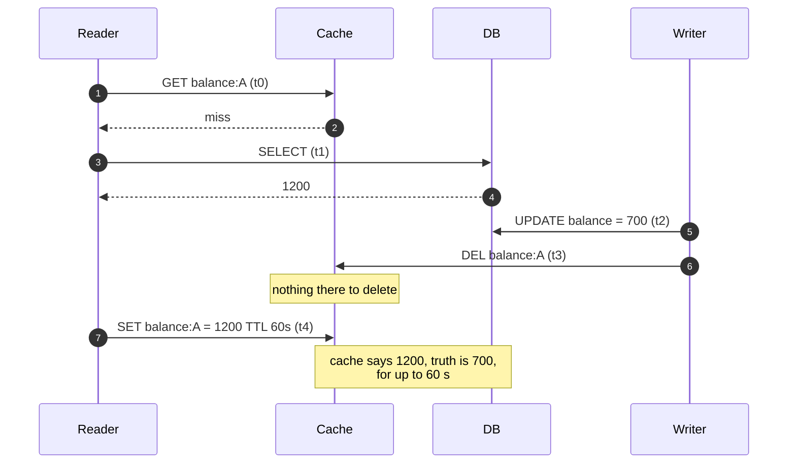
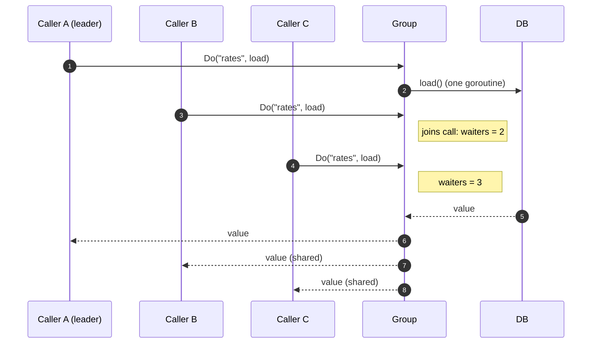
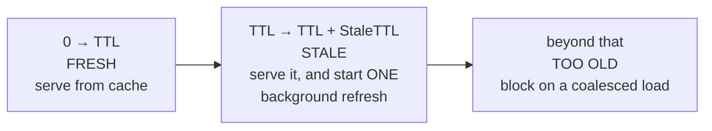

# A3 Unit 2 — Correctness: invalidation, stampedes, hot keys and consistency

> Time: ~6 h · CORE: §5–§8 · STRETCH: the XFetch derivation in §6 and the lease details in §5 · Lab: `labs/a3/cacheaside`

Unit 1 made a cache fast and the right size. This unit makes it *right*. A cache entry is a claim about the past: "the
balance was $1,200 when I looked". The whole craft is bounding how stale that claim may be, making sure a slow reader
cannot resurrect a claim that a writer already withdrew, making sure a thousand readers do not all try to renew the
same claim at once, and making sure one tenant can never be handed another tenant's claim. Four sections, one lab:
`labs/a3/cacheaside` is the loader you would actually put in front of a database.

## Before you start

You should have finished Unit 1: the cold factor `1 / (1 − h)`, the patterns in §2 (this unit is mostly about
cache-aside and what it gets wrong), eviction (§3) and sizing (§4). Keep [`docs/NUMBERS.md`](../../docs/NUMBERS.md)
open.

Warm-up (spaced retrieval from Unit 1, A1 and A2). Answer on paper first.

1. (Unit 1) A cache serves 99.5% of 20,000 req/s. The database is sized for 2,000 req/s. What happens at a full
   flush, and by what factor is the miss load multiplied?
2. (A1) The idempotency middleware reserves a key with one atomic `Reserve` instead of `Get` then run then store. What
   bug shape does that avoid, and why would the same shape be dangerous in a cache fill?
3. (A2) Under READ COMMITTED, can two `SELECT`s of one row in the same transaction return different values? What does
   that imply about how old a value is by the time you `SET` it into a cache?

<details data-kind="answer">
<summary>Warm-up answers</summary>

1. Misses go from 0.5% to 100%: a 1 / 0.005 = **200×** multiplier, i.e. ≈ 20,000 req/s against a 2,000 req/s database,
   10× over capacity. (§6 is the sharp end of this.)
2. A **check-then-act race**: two concurrent callers both see "absent" and both act. For idempotency that is a double
   charge; for a cache fill it is a stampede (N loaders) and, worse, a stale overwrite (a slow loader writes an old
   value after a newer write). The cure in both cases is to make the decision atomic.
3. Yes, non-repeatable reads are allowed at READ COMMITTED. More importantly, *any* value you read is already a
   snapshot of the past by the time you `SET` it: between the `SELECT` and the `SET` another transaction can commit.
   Isolation protects a transaction from its peers; it does nothing for a cache fill that happens after the
   transaction ended. That gap is §5.

</details>

---

## §5 Invalidation and TTL strategy

### The failure story

The platform shows the member's available balance on the home screen, served cache-aside: `GET balance:{account}`; on
a miss `SELECT` and `SET` with a 60 s TTL. The transfer service writes the new balance and then does `DEL
balance:{account}`. It looks airtight: write, then delete.

Support starts receiving tickets: "I sent $500 to my landlord, the app still shows the old balance, and when I
refresh it's *still* old." The pattern is rare (≈ 0.2% of transfers: at 1 M transfers a day, ≈ 2,000 members) and
unreproducible in staging. Each stale entry lives for the full 60 s TTL, and the member who sees the old balance
retries the transfer, which fails on insufficient funds or, worse, succeeds twice (A1's idempotency saves the money
but not the customer's trust). An engineer stares at the code for an hour. There is no bug in any single line.

### Predict

<!-- predict id="A3-U2-P01" -->
**Predict.** Write your answers down before opening the reveal. Cache-aside, TTL 60 s. Reader R: `GET` (miss) →
`SELECT` → `SET`. Writer W: `UPDATE` (commits) → `DEL`.

1. Construct an interleaving of R's three steps and W's two steps that leaves the cache holding the *old* balance for
   60 s. Give each step a timestamp.
2. Would "`DEL` first, then `UPDATE`" fix it? Would "update the cache with the new value instead of deleting" fix it?
   Find a bad interleaving for each, or argue that none exists.
3. List three different fixes and the failure each one still allows.
<!-- /predict -->

### Reveal

<details data-kind="reveal" data-for="A3-U2-P01">
<summary>Reveal</summary>

1. The reader reads the database *before* the write commits but writes the cache *after* the writer's delete:

   | t | Actor | Step | Database | Cache |
   |---|---|---|---|---|
   | t0 | R | `GET balance:A` → miss | 1,200 | — |
   | t1 | R | `SELECT` → reads **1,200** | 1,200 | — |
   | t2 | W | `UPDATE` → commit | **700** | — |
   | t3 | W | `DEL balance:A` (nothing to delete) | 700 | — |
   | t4 | R | `SET balance:A = 1200 (TTL 60 s)` | 700 | **1,200 (stale)** |

   The window is the time between R's `SELECT` and R's `SET`: a network hop, a GC pause, a slow serialiser. How often a
   write lands inside someone's window depends on how often fills are in flight, and every delete *guarantees* a fill
   soon afterwards (the key is now absent), so keys that are written and read often are exposed on every write. Across a
   million transfers a day a window of tens of milliseconds is hit thousands of times: the ≈ 0.2% above.
2. **`DEL` before `UPDATE` makes it worse:** t0 W `DEL`; t1 R `GET` miss; t2 R `SELECT` (still old, W has not committed);
   t3 W `UPDATE` commits; t4 R `SET` old. The window now spans W's whole transaction. **Updating the cache instead of
   deleting** breaks differently: two writers W1 (set 700) and W2 (set 650) commit in the order W1, W2, but their cache
   writes arrive W2, W1: the cache ends at 700 while the database holds 650, until the TTL. Updates need ordering;
   deletes at least cannot leave a *wrong* value behind, only a stale one (and see 1).
3. (a) **Short TTL as a backstop**: bounds the damage to the TTL, always worth having, still allows up to TTL of
   staleness. (b) **Versioned writes** (compare-and-set on a row version): a stale `SET` carries an older version
   and is refused; still needs a tombstone after `DEL` or the version is lost (below). (c) **Leases** (Facebook's
   memcache): the miss returns a token; `DEL` invalidates outstanding tokens; a `SET` with a dead token is refused;
   needs support in the cache and a policy for what a refused reader does. (d) **Delayed double delete**: delete again
   after a delay longer than the read-to-set window; probabilistic, it assumes you know the window. (e)
   **In-process invalidation guard** (the lab): the loader remembers "an invalidation happened while I was loading" and
   skips the `SET`; correct inside one process, blind to another process's loader.

</details>

### How it actually works

#### Why this is hard: the cache is a second copy with no transaction around it

A value in the cache is a copy of a value in the database, and nothing makes "commit the row" and "remove the copy"
atomic. Every reader that fills the cache did its read at some earlier moment. The generalised hazard:

> Any write to the cache that is based on a read of the source can be **older than a later write to the source** by
> the time it lands.

Everything in this section is a way of either ordering those writes, making the late one harmless, or bounding how long
it can hurt.



#### The toolbox

**1. TTL: the universal backstop.** Every entry gets a TTL equal to the *staleness you are willing to serve in the
worst case*. It is the only mechanism that works when everything else (a lost invalidation message, a race, a bug)
fails. Choose it from the business requirement (§8), not from how fast the loader is. Two refinements:

- **Jitter** (shorten each TTL by a random fraction) so entries written together do not expire together (§6).
- **Different TTLs per data class**: seconds for balances, minutes for transaction lists, hours for the product
  catalogue, effectively forever for immutable data (generated statements).

**2. Delete on write, not update.** Delete is idempotent and order-insensitive (a delete cannot leave a *wrong* value);
update-in-place needs the cache writes ordered the same way as the database commits, which two uncoordinated app
servers cannot guarantee. Cost of delete: the next read pays a miss.

**3. Close the stale-set window.**

- *Versioned values + compare-and-set.* Every row has a monotonically increasing version (or `updated_at`/LSN).
  The cache stores `(version, value)`, and a fill does "set only if my version is newer than what is there". In Redis
  this is a short Lua script (atomic server-side):

  ```lua
  -- KEYS[1] = cache key; ARGV[1] = version; ARGV[2] = payload; ARGV[3] = ttl in ms
  local cur = redis.call('HGET', KEYS[1], 'v')
  if cur and tonumber(cur) >= tonumber(ARGV[1]) then return 0 end
  redis.call('HSET', KEYS[1], 'v', ARGV[1], 'val', ARGV[2])
  redis.call('PEXPIRE', KEYS[1], ARGV[3])
  return 1
  ```

  **The subtlety:** if the writer *deletes* the key, the version is gone, and a stale reader's `SET` succeeds
  (it finds no key). So the writer must not delete: it must write a **tombstone** `(version = new, deleted)` with a short
  TTL, and fills must compare against tombstones too. This is the step people miss.
- *Leases (Facebook memcache).* On a miss the cache hands out a **lease token** bound to the key. The reader fills with
  `SET key value lease=token`; the cache accepts it only if the token is still valid. A `DEL` (invalidation) on the key
  voids outstanding tokens, so the stale `SET` at t4 is refused. The same token also serves as a stampede control
  (the cache hands out at most one token per key per short interval; other readers wait briefly or get stale data).
  A refused reader just returns its result without caching it and the next reader refills. `TODO-VERIFY: exact
  token rate limit and the stale-value behaviour described in the paper`.
- *Delayed double delete.* Delete after the write, and again after a delay (hundreds of ms to seconds) longer than the
  longest plausible read-to-set window. Cheap and widely used, but it is a timing assumption, not a guarantee: a
  paused reader (GC, VM stall) still beats it.
- *In-process generation guard* (what you build): every key has an "invalidation epoch" visible to the loader;
  if an invalidation lands between the loader's start and its store, the store is skipped. Perfect for the process
  doing both (a write path and a read path in one binary) and a no-op for races across processes, which is why it is a
  layer on top of TTL and (for cross-process) versions or leases, not a replacement.

**4. Event-driven invalidation.** Rather than the request handler issuing the `DEL` (which can crash between the
commit and the delete: the dual-write problem), derive invalidations from the committed change: a transactional
**outbox** table or **change data capture** (CDC) from the database log feeds a consumer that deletes (or version-bumps)
the affected keys (A6). This closes the "process died after commit" hole and also invalidates changes made by *other*
writers (batch jobs, admin tools, migrations) that never ran your handler. Messages can be delayed, duplicated or
lost: keep the consumer idempotent, keep the TTL, and treat a gap in the stream as "flush the affected key family".
Facebook describes exactly this (an invalidation daemon tailing the MySQL commit log, broadcasting deletes to the
cache clusters; `TODO-VERIFY: component name and reliability details`).

**5. Versioned keys (generation keys).** Put the version *into the key*: `catalog:{tenant}:v{gen}:{sku}`, where
`gen` comes from a small, always-fresh source (a database row, or a key you update on every change). Invalidating
everything for a tenant is then one write (`gen++`); old keys are never read again and age out through TTL/eviction.
This turns "delete 2 million keys" into "change one number", and it sidesteps stale-set races because a stale reader
writes to an *old* key nobody reads. The price: the generation lookup is on every read (cache it briefly in-process),
and orphaned keys waste memory until they expire.

**6. Reading from replicas poisons the cache.** If the fill reads from an asynchronous replica (A4) that is 300 ms
behind, the cache is populated with a value that was already stale when it was read and the invalidation that
already ran cannot help. Fill from the primary, or from a replica with a version/LSN check against the cache entry,
or accept TTL-bounded staleness explicitly.

**7. Read-your-writes for the writer.** The member who just transferred money must see it. Cheapest reliable approach:
after the write, the handler returns the new value (or the client keeps it optimistically), and for a short window
that member's reads **bypass** the cache or read from the primary (A4 covers sticky reads and session tokens).

#### Choosing

| Requirement | Mechanism |
|---|---|
| "Wrong for a minute is fine" (catalogue, avatars) | TTL only, with jitter |
| "Stale for at most seconds, rare races OK" | Delete on write + short TTL |
| "A stale value must never *outlive* a newer write" | Versioned CAS with tombstones, or leases |
| "Many writers/other systems change the data" | Event-driven (outbox/CDC) invalidation + TTL backstop |
| "Invalidate a whole family at once" | Generation keys |
| "Strict read-after-write for the actor" | Return the new value; bypass cache briefly |

### Build it

Lab `labs/a3/cacheaside` (CORE), part 3. Work in `labs/a3/cacheaside/cacheaside.go`:

- `Cache.Invalidate(key)`: delete the entry **and** mark any in-flight load of that key as invalidated, so that its
  result is returned to its callers but **not stored**. The hand-shake lives in `fill`: register a `loadState` before
  calling the loader, check `invalidated` (under the lock) before storing.
- `Config.TTL`/`Jitter`: store entries with `TTL × (1 − Jitter × Rand())` (the effective TTL only ever *shortens*, so
  the staleness promise holds).

Acceptance tests: `TestCache_InvalidateForcesReload`, `TestCache_InvalidateDuringLoadPreventsStaleStore` (a
deterministic replay of the table above), `TestCache_JitterShortensTTL`. Run `go test -race -run
'Invalidate|Jitter' ./labs/a3/cacheaside/`.

### Break it

Reproduce the race with a hand-driven interleaving, then see your guard close it. The break-it test
(`breakit_test.go`, behind the `breakit` tag) drives a naive cache-aside and your `Cache` through the t0…t4 schedule
above using channels as barriers (no sleeps, so it is deterministic):

```
go test -tags breakit -run BreakIt_StaleSetRace -v ./labs/a3/cacheaside/
```

Predict the two printed lines before running. Then wire `breakNoInvalidateGuard` into your `fill` (skip the
`invalidated` check when it is true) and run both that test and `go test -tags breakit -race -run
Cache_Invalidate -v ./labs/a3/cacheaside/`.

<details data-kind="answer">
<summary>What you should see, and why</summary>

Naive: `database=v2  cache=v1 (stale until the TTL expires)`. Your `Cache`, with the guard: `database=v2  cache=v2`;
with `breakNoInvalidateGuard` on: `cache=v1` again, and `TestCache_InvalidateDuringLoadPreventsStaleStore` fails
with the message that the slow load stored its stale result over the invalidation. The harness is deterministic because
the schedule is forced by channels, not by timing; this is the technique to use whenever you need to *prove* a race
exists: control the interleaving, don't hope for it. Note the limit of the guard: it knows only about invalidations
that reached *this* process's `Cache`. Another process's reader (or a CDC consumer in another service) needs the
versions/leases above.

</details>

### In the wild

- **Facebook** ("Scaling Memcache at Facebook", NSDI 2013): leases for stale sets and thundering herds;
  invalidations driven by the MySQL commit log; a "gutter" pool to absorb load when a cache host fails;
  regional pools that replicate invalidations across clusters. `TODO-VERIFY` any figure you quote from it.
- **Redis**: `SET key value NX PX ttl`, `WATCH/MULTI` and Lua scripts for atomic compare-and-set; **client-side
  caching** (RESP3 `CLIENT TRACKING`, Redis 6+) has the *server* push invalidations to clients that cached a key
  (`TODO-VERIFY` details), the in-process-L1 problem solved by the store.
- **HTTP caching**: `ETag` + `If-None-Match` is versioned revalidation (a cheap CAS: "give me the body only if it
  changed"); `stale-while-revalidate`/`stale-if-error` (RFC 5861); CDN purge by URL, tag or "surrogate key"
  (A1 §6, `TODO-VERIFY` vendor names).
- **CDC tooling**: Debezium (Kafka Connect) tails database logs; Postgres `LISTEN/NOTIFY` is best-effort and not
  durable, so it is a hint, not an invalidation guarantee.
- **ORMs** with second-level caches (Hibernate) invalidate on entity writes made through the ORM and are blind to
  writes made around it (a SQL migration, a DBA fix), the classic reason caches "randomly" show old data.

### Trade-offs

| Option | Wins when | Loses when | When the answer flips |
|---|---|---|---|
| TTL only | Staleness of ~TTL is acceptable; no write path to hook | Freshness requirements shorter than a TTL you can afford to miss | Flip to delete-on-write once users notice staleness after their own writes |
| Delete on write + TTL | One service owns reads and writes of the data; typical CRUD | Races (stale set), crashes between commit and delete, other writers | Flip to event-driven invalidation when other writers exist |
| Versioned CAS + tombstones | A stale value must not outlive a newer write; you control the cache API | Extra storage and logic; clients that skip the protocol break it | Flip to leases if your cache supports them and you also want stampede control |
| Leases | Hot, contended keys; both stale sets and herds are real | Cache must implement them; refused fills complicate readers | Flip to versions where the cache is a generic Redis |
| Event-driven (outbox/CDC) | Many writers; cross-service data; need reliability | Pipeline latency and ops; ordering and duplicates to handle | Flip to in-request delete when one service owns the data and misses are tolerable |
| Generation keys | Bulk invalidation (tenant, catalogue) | Per-read generation lookup; orphan keys | Flip to per-key delete when invalidations are rare and targeted |

### Senior bar

- **Failure modes**: the stale-set race; crash between commit and delete; invalidation message lost, delayed or
  reordered; fill from a lagging replica; tombstone-less versioning; a writer path that forgets to invalidate
  (batch jobs, admin tools, migrations); thundering herd on a widely invalidated key family; cache poisoning by a
  bug (stale for TTL) with no way to flush quickly.
- **Capacity numbers**: staleness bound = TTL (+ pipeline latency for event-driven); race probability ≈ (read-to-set
  window) × (reads per second of the key) per write; jittering by 10–20% is typical (`≈`, tune with the
  simulation in §6).
- **Ops**: provide a "flush this key family" tool (generation bump) and an audit trail of who used it; alert on
  invalidation consumer lag; test with a deterministic interleaving harness, not with load.
- **Cost**: events and versions add a pipeline and storage; the cheapest correct design for most CRUD data is delete
  + short TTL, and the expensive one (CAS + CDC) is reserved for data where a stale value has a price.

Interviewer follow-up probes:

1. "Walk me through how a stale value can sit in the cache for the whole TTL even though every write deletes the key."

<details data-kind="answer">
<summary>Model answer</summary>

Draw the five-step interleaving: the reader misses and reads the old row; the writer commits and deletes (nothing to
delete); the reader then sets the old value. The delete happened before the late set, so the entry survives until the
TTL. The window is the reader's read-to-set gap. Fixes: a short TTL as a backstop; versions with compare-and-set
(and tombstones so a delete doesn't erase the version); leases that the delete voids; or an event-driven
invalidation plus idempotent consumer. I'd pick by how costly a stale value is.

</details>

2. "Is 'delete the key twice, one second apart' a correct fix?"

<details data-kind="answer">
<summary>Model answer</summary>

It narrows the window but is not a guarantee: it assumes no reader's read-to-set gap exceeds the delay, and a GC
pause, a retry or a slow network can break that assumption. It's acceptable as a cheap mitigation on top of a short
TTL when a rare stale value is tolerable; for data where it isn't, use versions or leases.

</details>

3. "Why not just update the cache on write?"

<details data-kind="answer">
<summary>Model answer</summary>

Two writers' database commits and cache writes can interleave differently, leaving the older value in the cache; the
cache write can also fail after the commit, and you do work for values nobody reads. Updating is only safe with
versioned compare-and-set (reject older versions) or when a single serialised writer owns the key.

</details>

### Check yourself

1. In the t0–t4 table, which single step ordering would have saved the day, and why can't the reader control it?
2. Why must a versioned cache write a tombstone instead of deleting the key?
3. What does a generation key invalidate when you bump it, and what happens to the old entries?

<details data-kind="answer">
<summary>Answers</summary>

1. The reader's `SET` happening before the writer's `DEL` (or the reader's `SELECT` after the commit). The reader can't
   control it because the commit time of someone else's transaction is outside its knowledge; it's why you need a
   token/version/epoch that carries that information to the point of the `SET`.
2. After a plain delete, the stored version is gone, so a late stale write with an old version finds an empty key and
   succeeds. The tombstone keeps "version N happened, and it deleted" so older fills can be rejected.
3. Every key whose name embeds the old generation becomes unreachable (new reads use the new generation). The old
   entries remain in memory until their TTL expires or eviction removes them.

</details>

---

## §6 Stampedes: thundering herds, dogpiles and synchronized expiry

### The failure story

The mortgage-rate table is read by almost every screen of the member app: key `rates:{tenant}`, TTL 60 s, ≈ 8,000
reads/s across the fleet. Rebuilding it takes ≈ 1.2 s and ≈ 40 queries (products, tiers, promotions, effective dates).
At every expiry the first request starts a rebuild; for the next 1.2 s, every request also misses, because the entry is
still absent. That is ≈ 8,000 × 1.2 ≈ 9,600 requests, each starting its own rebuild: ≈ 384,000 queries in about a
second against a database that does ≈ 20,000/s. The rebuilds slow down, which lengthens the window, which admits more
requests, which starts more rebuilds. The database is saturated for tens of seconds, other endpoints time out, and the
minute-by-minute pattern shows up in the graphs as a sawtooth of outages exactly 60 s apart.

A cousin of the same bug: after a deploy that warms 50,000 account keys with `TTL = 300 s`, all 50,000 expire in the
same second five minutes later. Different keys, same disaster.

### Predict

<!-- predict id="A3-U2-P02" -->
**Predict.** Write your answers down before opening the reveal.

1. With no protection, how many times does the loader run per expiry of the rate table, and why does that number
   *grow* if the database slows down?
2. You add per-process request coalescing ("singleflight") to each of your 40 application instances. How many loader
   runs per expiry now? Is that acceptable, and what would take it to 1?
3. A colleague proposes raising the TTL from 60 s to 1 hour. What does that change about the problem, and what stays
   the same? Name two techniques that make the problem go away without lengthening the TTL.
<!-- /predict -->

### Reveal

<details data-kind="reveal" data-for="A3-U2-P02">
<summary>Reveal</summary>

1. One per request that arrives while the entry is absent: `λ × T_rebuild` ≈ 8,000 × 1.2 ≈ **9,600** (and each run is
   40 queries). It grows with database slowness because `T_rebuild` is not a constant: it is the *queueing* time of the
   database, which rises with the number of rebuilds already running. The system has a positive feedback loop, which is
   why stampedes are cliffs, not slopes.
2. One per instance: ≈ **40** loads (each of 40 processes coalesces its own callers, but they don't know about each
   other). That is a 240× reduction from 9,600 and typically acceptable (40 × 40 = 1,600 queries). To reach exactly 1
   you need a cross-process agreement: a short distributed lock/lease on the key, a leader election for the key
   (e.g. consistent routing of loads for key `k` to one instance), or serving stale data while *one* refresher
   works.
3. A longer TTL makes expiries 60× rarer, which reduces how *often* the cliff occurs but not its size, and it raises
   staleness 60×. Rates change at known times; an hour of staleness may be unacceptable. The cliff is still there
   (worse, because people stop thinking about it). Techniques that remove it: **coalescing** (collapse concurrent loads), **stale-while-revalidate** (nobody
   waits for the reload), **probabilistic early refresh** (the key is renewed *before* it expires, so there is no
   absent window), **jitter** (for the mass-expiry variant), and **warming/staggering** (for cold starts).

</details>

### How it actually works

A stampede (also "thundering herd", "dogpile", "cache stampede") needs a hot or numerous set of keys, an expensive
load, and **a moment when many readers see "absent" at once**. Three triggers:

1. **Hot key expiry**: one popular entry expires; everything asking for it rebuilds it.
2. **Mass/synchronised expiry**: many entries were written together with the same TTL and expire together.
3. **Cold start**: restart, flush, new cluster or a changed key format; everything is absent (§1's cold factor).

Defences, from cheapest to most involved. They compose.

#### 1. Coalesce identical loads (singleflight)

Per key, let the first caller start the load; later callers *join* it and share the result.



The contract that makes it production-grade (these are the lab's tests):

- **One execution per key at a time**; different keys never block each other (no global lock held while the loader
  runs).
- **No result memory in the group**: it collapses *concurrent* calls only; remembering results is the cache's job.
  If the group cached errors you would have a negative cache with no TTL.
- **Waiters can leave without killing the load.** Each caller waits with its own context. If one gives up, only that caller returns
  `ctx.Err()`. The shared load runs under a context **detached from any single caller** (it keeps values such as trace ids
  but not cancellation) and is cancelled only when the *last* waiter leaves: a count of waiters. If the load ran under the
  *leader's* context, one impatient client (a mobile app that timed out at 3 s) would cancel the work for 49 patient
  ones, and they would all fail with `context canceled`.
- **When the last waiter leaves, the call must also be removed from the group.** Otherwise a new caller would join
  a cancelled, dying load and inherit its error.
- **Panic safety:** the load runs in its own goroutine; a panic is recovered and delivered to every waiter as an error
  (with the stack), and the key is released. Otherwise waiters hang forever and the key is wedged.
- **Store the result once, in the leader's function**, not in every waiter: a waiter that leaves early would otherwise
  lose the fill.
- **Never cache context errors.** `context.Canceled` and `DeadlineExceeded` are statements about *a caller's patience*,
  not about the key. Caching them (many hand-rolled loaders do, with an "error TTL") turns one slow client into a
  minute-long outage for everyone.

Go's `golang.org/x/sync/singleflight` provides the collapse part (`Do`, `DoChan`, `Forget`); you build the full
contract, in your own code, in the lab.

#### 2. Serve stale while one refresher works (stale-while-revalidate)

Give each entry two lifetimes: a **fresh** TTL (when it should be renewed) and a **stale** window after it (how long
it may still be served if renewal is in progress or failing). Past the fresh TTL, the first reader triggers a
background refresh and **everyone, including that reader, gets the old value immediately**. Nobody waits and the
database sees one load.



Rules the lab tests: exactly one background refresh no matter how many stale reads; a failed refresh keeps the stale
value (and retries later); a refresh that says "not found" replaces the value (the thing is gone); past
`TTL + StaleTTL` a reader blocks on a fresh load. Same idea as HTTP's `stale-while-revalidate`, plus
`stale-if-error` for outages. For banking: great for rate tables and catalogues, **not** for balances unless the
product explicitly allows seconds of staleness (§8).

#### 3. Probabilistic early refresh (XFetch)

Instead of waiting for expiry, let each *hit* decide, with a probability that grows as the expiry approaches, to
renew the entry now. Vattani et al. ("Optimal Probabilistic Cache Stampede Prevention", VLDB 2015) give the rule: with
`δ` = how long the last recompute took, a reader recomputes if

```
now − δ · β · ln(rand()) ≥ expiry          (β = 1 is the usual default; larger = more eager)
```

`−ln(rand())` is exponentially distributed (usually small, occasionally large), so early refreshes are rare far from
expiry and very likely close to it; for a hot key someone almost certainly fires a refresh *before* the entry
expires. No locks, no coordination, no extra state beyond storing `δ` and the expiry with the value:

```go
// shouldRefreshEarly implements the XFetch rule. delta is how long the last
// recompute took; beta tunes eagerness (1.0 is the paper's default).
func shouldRefreshEarly(now, expiry time.Time, delta time.Duration, beta float64, rnd func() float64) bool {
	u := 1 - rnd() // rnd is in [0, 1); u is in (0, 1] so Log is finite
	lead := time.Duration(-math.Log(u) * beta * float64(delta))
	return !now.Add(lead).Before(expiry)
}
```

STRETCH: why it works. Take Poisson arrivals at rate `λ` for the key and let `r` be the time remaining. A request
at remaining time `r` triggers a refresh with probability `P(−δ ln U ≥ r) = e^(−r/δ)`, so the trigger hazard is
`λ e^(−r/δ)`. The probability that *nobody* has triggered by remaining time `r` is `≈ exp(−λδ·e^(−r/δ))`, which
drops to ½ when `λδ·e^(−r/δ) = ln 2`, i.e. at

```
r ≈ δ · ln(λδ / ln 2)       (median lead time before expiry; the mean adds ≈ 0.58·δ)
```

For `λ = 1000/s` and `δ = 1 s` the refresh starts ≈ 7 s early; for a key read once a minute (`λδ < 1`) it basically never
fires early and the key just expires normally, which is exactly right (you don't want to spend loads on cold keys).
The Break-it measures this.

#### 4. Jitter the TTLs

For mass expiry, spread entries across a window: `effectiveTTL = TTL × (1 − J × rand())`, with `J` around 0.1–0.2.
Only *shortening* keeps the promised freshness. Jitter fixes the **correlated** part; it doesn't fix a single hot key's
herd. Note also that jitter's effect is on the *next* expiry cycle: entries written at the same instant spread across the
window, and then each keeps its own phase because they renew at different times.

#### 5. Locks and leases across processes

To get from "one per instance" to "one per fleet": take a lock `SET lock:rates owner NX PX 5000` before loading
(and always release only if you still own it, with a compare-and-delete script); losers wait briefly or serve stale. Danger
list: a lock holder that dies leaves the lock until its TTL (so the TTL bounds the stall); every loser polling the lock
is a new herd (use jittered waits or just serve stale); a lock with a TTL shorter than the load can be held by two
workers (A5's fencing tokens are the proper cure). Prefer stale-serving to waiting on a lock.

#### 6. Warm up, stagger, and bound the damage

- **Warm** a new or restarted cache before it takes traffic (replay the hot key list, copy from a warm peer or replica,
  in popularity order, at a controlled rate).
- **Stagger** restarts and deploys so only a fraction of the keyspace is cold at once; ramp traffic to a cold node.
- **Bound database concurrency** for loads (a semaphore around the loader; A7's bulkhead) and return stale or degraded
  results beyond it, so a stampede becomes a slow trickle instead of an outage.
- **Pre-compute** very hot keys on a schedule (refresh-ahead from §2) so no request ever loads them.

### Build it

Lab `labs/a3/cacheaside` (CORE), parts 1–2 and 4. In `labs/a3/cacheaside/cacheaside.go`:

1. `Group.Do`, `Group.run`, `Group.Waiters`: the `TestGroup_*` tests; read the package doc for the exact rules above.
2. `Cache.Get` (hit/miss), `Cache.fill`: `TestCache_ColdKeyConcurrentGetsLoadOnce`,
   `TestCache_HitsUntilTTLThenReloads`, `TestCache_DifferentKeysLoadConcurrently`, the cancellation and panic tests.
3. Stale-while-revalidate: `Cache.refresh` and the stale branch of `Get`: `TestCache_StaleWhileRevalidate` and the two
   refresh-failure tests.

Run `go test -race ./labs/a3/cacheaside/` (or `-run TestGroup` first). The tests use gated loaders and `Waiters(key)` to
know that N goroutines have really joined, rather than sleeping, so they are deterministic under `-race` and `-count=20`.

### Break it

1. **Remove coalescing.** Wire `breakNoSingleflight` into `Cache.Get` (call `fill` directly when it is true) and run
   `go test -tags breakit -race -run Cache_ColdKey -v ./labs/a3/cacheaside/`. Expected: `loader called 50 times for 50
   concurrent Gets of one cold key`.
2. **Count the damage.** `go test -tags breakit -run BreakIt_StampedeCount -v ./labs/a3/cacheaside/`: 400 requests
   during a 30 ms "database" call; predict database queries and peak concurrency for the naive path and for `Group.Do`.
3. **Synchronised expiry.** `go test -tags breakit -run BreakIt_SynchronizedExpiry -v ./labs/a3/cacheaside/`: 2,000 keys
   warmed together, TTL 60 s, five simulated minutes, jitter 0 / 0.1 / 0.2 / 0.5. Predict the peak loads in one second
   for each, and whether jitter 0.1 behaves like jitter 0 or like jitter 0.5.
4. **XFetch.** Run this simulation (scratch directory, `go run .`) and predict the loads per expiry for 1, 10, 100 and
   1,000 requests/s with and without early refresh:

```go
// xfetch: how many loads start around an expiry, with and without
// probabilistic early refresh? One hot key, Poisson arrivals, no coalescing.
package main

import (
	"fmt"
	"math"
	"math/rand"
)

// simulate returns the average number of loader runs per expiry and (for the
// early variant) how long before expiry the refresh started.
func simulate(lambda, delta, ttl float64, early bool) (loadsPerExpiry, meanLead float64) {
	rng := rand.New(rand.NewSource(1))
	const horizon = 3600.0
	expiry := ttl // the value was loaded at t = 0
	var loads, expiries, leads int
	var leadSum, loadDone float64
	loading := false
	for t := 0.0; t < horizon; {
		t += rng.ExpFloat64() / lambda // next request
		if loading && t >= loadDone {  // the running load has finished
			loading = false
			expiry = loadDone + ttl
		}
		switch {
		case t >= expiry: // expired: every request that arrives before a load finishes loads again
			if !loading {
				loading, loadDone = true, t+delta
				expiries++
			}
			loads++
		case early && !loading:
			u := 1 - rng.Float64()             // (0, 1]
			if t-delta*math.Log(u) >= expiry { // XFetch with beta = 1
				loading, loadDone = true, t+delta
				loads++
				expiries++
				leadSum += expiry - t
				leads++
			}
		}
	}
	if leads > 0 {
		meanLead = leadSum / float64(leads)
	}
	return float64(loads) / float64(expiries), meanLead
}

func main() {
	const ttl, delta = 60.0, 1.0 // seconds; delta = how long a recompute takes
	for _, lambda := range []float64{1, 10, 100, 1000} {
		plain, _ := simulate(lambda, delta, ttl, false)
		xf, lead := simulate(lambda, delta, ttl, true)
		fmt.Printf("%5.0f req/s: plain TTL %7.1f loads per expiry | XFetch %5.2f loads per expiry, refresh starts %.1fs early\n",
			lambda, plain, xf, lead)
	}
}
```

<details data-kind="answer">
<summary>What you should see, and why</summary>

1. 50 loader calls instead of 1, and the `InFlight` poll in the test never reaches 50 because nobody joins a group.
2. Naive: 400 queries, peak concurrency ≈ 400 ("database saturated (20 slots)"). With `Group.Do`: 1 query, peak 1.
3. Jitter 0: the peak is 2,000 loads in one second, on the five expiry seconds (t = 60, 120, …). Jitter 0.1 spreads the
   first cycle over a 6 s window (≈ 355/s peak, with 11 of the 300 seconds still spiking at 250+ loads) because the entries all started in
   phase and a 6 s spread of 2,000 keys is still dense; 0.2 gives ≈ 180/s and 0.5 gives ≈ 90/s. So small jitter reduces
   the spike but does not eliminate it; the right amount comes from `keys / spread_seconds` against what the database can
   absorb.
4. Plain TTL: loads per expiry ≈ `λ × δ + 1` (about 2, 11, 100, 1,000 for 1, 10, 100, 1,000 req/s). XFetch: ≈ 1.0 for
   λ ≥ 10 (the key is renewed once, before it expires), and it starts ≈ `δ(ln λδ + 0.58)` early (≈ 3 s at 10/s, ≈ 5 s at
   100/s, ≈ 7.6 s at 1,000/s). At 1 req/s it hardly fires early (≈ 1.5 loads per expiry because the key often does
   expire first): by design it does not waste loads on cold keys.

</details>

### In the wild

- **Go**: `golang.org/x/sync/singleflight` (collapse concurrent calls; `Forget` to drop a key; `DoChan` to select with a
  timeout). The standard library has no cache.
- **Caffeine** (JVM) loading caches load each key at most once concurrently and support `refreshAfterWrite`
  (reload in the background, serve the old value meanwhile).
- **Varnish** and **nginx** collapse concurrent origin fetches for the same object and can serve stale content while
  refreshing (`TODO-VERIFY: Varnish "grace" mode and request coalescing; nginx proxy_cache_lock and
  proxy_cache_use_stale updating`); CDNs offer "request collapsing" in some form (`TODO-VERIFY` vendor terms).
- **Facebook memcache** leases double as stampede control: only the holder of the lease may refill; others get a
  "try again soon" or a stale value (`TODO-VERIFY` the exact policy).
- **HTTP**: RFC 5861 `stale-while-revalidate` and `stale-if-error` cache-control extensions.
- **XFetch** is from the VLDB 2015 paper "Optimal Probabilistic Cache Stampede Prevention"; some Redis client
  libraries and blog posts implement it.

### Trade-offs

| Option | Wins when | Loses when | When the answer flips |
|---|---|---|---|
| Per-process singleflight | Always: cheap, no coordination | Large fleets (loads = instances per expiry) | Add stale-serving or a fleet-wide lease when `instances × load cost` still hurts |
| Distributed lock / lease | Load is very expensive and must run once | Lock holder dies; waiters poll; extra round trips | Flip to stale-while-revalidate: no waiting at all |
| Stale-while-revalidate | Slightly stale is fine; availability matters | Data where stale is wrong (balances, entitlements) | Flip to blocking reload (with coalescing) when staleness has a price |
| XFetch / refresh-ahead | Hot keys with predictable, expensive recompute | Cold keys; heavy-tailed `δ` | Flip to scheduled pre-compute for the small known-hot set |
| TTL jitter | Mass expiry from bulk writes/warming | One hot key | Always combine with the others; size the spread by `keys / seconds` |
| Warming + staggering | Cold starts, deploys, failovers | Unknown or huge key sets | Flip to admission control/shedding when warming can't finish in time |

### Senior bar

- **Failure modes**: positive-feedback collapse (slow DB → longer windows → more loads); retries multiplying loads
  (A7: retry budgets); a lock TTL shorter than the load; shared error caching that outlives the incident; coalescing that
  caches a *context cancellation* for everyone; unbounded waiters (a hung loader holds every waiter, so give loads a
  deadline); a refresher that fails silently so stale data serves forever (alert on stale-served rate and refresh failures).
- **Capacity numbers**: plain TTL ⇒ `λ·T_load` loads per expiry; per-process coalescing ⇒ `instances` loads; XFetch ⇒ ≈ 1
  for hot keys; mass expiry ⇒ `keys / jitter_window_seconds` loads/s; DB budget = peak allowed loads/s, not average.
- **Ops**: metrics for coalescing ratio (`Coalesced / Misses`), stale-served, refresh failures, loader latency and
  in-flight loads per key; load-test the *expiry*, not just steady state (run a test that flushes at peak and watch the DB).
- **Cost**: coalescing and stale-serving are nearly free; locks add round trips and failure modes; warming costs reads on
  the replica or the source.

Interviewer follow-up probes:

1. "A hot key expires and 10,000 requests miss at once. What do you do?"

<details data-kind="answer">
<summary>Model answer</summary>

Collapse them: per-instance singleflight so each process loads once, ideally with stale-while-revalidate so nobody
waits, and probabilistic early refresh so the key rarely expires under load at all. To bound the fleet-wide load I'd
add a lease or rely on stale-serving. I'd also cap loader concurrency to protect the database and give loads a deadline.
Then I'd test it by flushing under load.

</details>

2. "What goes wrong with a singleflight whose loader uses the first caller's context?"

<details data-kind="answer">
<summary>Model answer</summary>

If that caller cancels or times out, the shared load is cancelled and every other waiter receives a cancellation error
for a request they didn't cancel. Run the load under a detached context (keep values), cancel it only when all waiters
have gone, and let each waiter return on its own context. Also don't cache the context error.

</details>

3. "How do you stop 50,000 keys warmed at deploy from all expiring together?"

<details data-kind="answer">
<summary>Model answer</summary>

Jitter the TTLs at write time (shorten by a random 10–20%), warm at a controlled rate rather than all at once, and
stagger deploys. Size the spread by `keys / seconds` against what the database can absorb: 50,000 keys over a 60 s
spread is ≈ 830 loads/s. Stale-while-revalidate then hides what is left.

</details>

### Check yourself

1. How many loads per expiry for a key read at 200 req/s with a 0.5 s recompute and no protection? With per-instance
   coalescing across 20 instances?
2. Why does a longer TTL not remove the stampede risk?
3. In XFetch, what happens to a key that is read once a minute?

<details data-kind="answer">
<summary>Answers</summary>

1. ≈ 200 × 0.5 = 100 (+1). With coalescing on 20 instances: ≈ 20, one per instance, assuming each instance gets traffic
   for the key.
2. It makes expiries rarer, not smaller; the cliff at each expiry is the same, and staleness grows. Cold starts and mass
   expiry are untouched.
3. It almost never refreshes early (`λδ < 1`); it expires normally and the next read reloads. Early refresh is spent
   only on keys read often enough for it to pay off.

</details>

---

## §7 Negative caching, cache penetration and hot keys

### The failure story

Two incidents, one week apart.

**Penetration.** A partner's nightly sync job has a bug and, for six hours, requests `GET /accounts/{id}` for ≈ 5,000 IDs
per second, almost all of which were closed years ago and no longer exist. Every request misses the cache (there is
nothing to cache), runs an indexed lookup that returns zero rows, and returns `404`. The database sees 5,000 extra
queries/s, ≈ 25–50% of its capacity, from a request type that the cache can never absorb because the cache only stores
things that exist. Hit ratio for the whole fleet drops from 97% to 62%; the on-call engineer sees "cache hit ratio
low" and adds memory, which does nothing.

**A hot key.** On the morning the central bank changes its policy rate, one key, `rates:cu42:mortgage` (≈ 5 KB), is
read by the app on every screen render: ≈ 120,000 reads/s. All of them go to the *one* Redis node that owns that key.
That node's single command thread tops out near ≈ 100k simple ops/s, so its latency climbs to ≈ 800 ms p99; the other
keys on that node (≈ 6% of the keyspace, hence ≈ 6% of members) time out too. Adding nodes does not help: the key
still lives on exactly one of them.

### Predict

<!-- predict id="A3-U2-P03" -->
**Predict.** Write your answers down before opening the reveal.

1. Design the **negative cache** for the nonexistent accounts: what exactly do you store, for how long, and what goes
   wrong when a new account is created a few seconds after someone looked it up and got "not found"? What must a loader
   *never* cache as "not found"?
2. A **Bloom filter** of the 10 M existing account IDs sits in front of the cache. How much memory for a 1% false
   positive rate? Can it say "no" when the account exists? What does the onboarding flow have to do?
3. For the hot key at 120,000 reads/s and 5 KB: what saturates first on the node, and what are two ways to spread
   the load? What does each cost when the rate changes and the key must be invalidated?
<!-- /predict -->

### Reveal

<details data-kind="reveal" data-for="A3-U2-P03">
<summary>Reveal</summary>

1. Store a **negative entry**: a distinguishable "known absent" marker (not an empty/null value that a reader could confuse
   with a real value) under the same key, with a **short TTL** (≈ 30–60 s, jittered): long enough to absorb a
   repeated-lookup flood, short enough that a newly created account appears soon. Better still, the **create path
   deletes the negative entry** (or writes the positive one), which closes the gap entirely; the TTL is the backstop.
   Never cache a **transient failure** as "not found": a database timeout, a `5xx` from a vendor or a cancelled context is
   *not* evidence that the account does not exist; caching it as such hides real accounts from members for the TTL
   (the lab separates `ErrNotFound` from other errors and from context errors for exactly this reason).
2. ≈ `9.6 bits × 10 M ≈ 96 Mbit ≈ 12 MB` with `k ≈ 7` hash functions (`m/n = −ln p / (ln 2)² ≈ 9.6` for `p = 0.01`). It
   has **no false negatives** for IDs that were added: "no" is always correct, "yes" means "maybe". The onboarding flow
   must **add the new ID to the filter before the account becomes visible** (otherwise a brand-new account would be
   rejected by the guard); closed accounts can stay (a false positive just means one wasted lookup), and the filter is
   rebuilt periodically from the source of truth to shed them.
3. Two limits are close together: the node's single-threaded command loop (≈ 100k+ ops/s) and the network:
   120,000 × 5 KB ≈ 600 MB/s ≈ 4.8 Gbps, ≈ half of a 10 Gbps NIC. Spread the load by (a) an **in-process L1** with a
   2 s TTL on every app instance: with 60 instances each fetches the key at most every 2 s, so the node sees ≈ 60 / 2 =
   **30 reads/s** instead of 120,000, at the price of ≤ 2 s extra staleness and 60 copies that each refresh on their
   own; or (b) **key replication/splitting**: store the value under `N` keys (`rates:cu42:mortgage#0 … #7`) on
   different nodes and have each reader pick one at random, giving each node ≈ 15k reads/s, at the price that every
   write or invalidation must touch all `N` keys (and a reader can briefly see different versions on different
   copies).

</details>

### How it actually works

#### Cache penetration and negative caching

A cache only helps with keys that exist in the source. Requests for keys that do not exist (typos, deleted records,
enumeration attacks, bugs, partners syncing stale IDs) bypass it entirely and cost the source a full lookup each. Layered
defences, cheapest first:

1. **Validate before looking up.** Account IDs have a format, a length, often a check digit. Reject malformed IDs at the
   edge with `400` before they touch cache or database. Authenticate and authorise first (A1/A9): an anonymous caller
   enumerating IDs is an authorisation problem, not a caching one.
2. **Negative caching.** Remember "not found" for a short time. Details that matter:
   - Distinguish *absent* from *error* from *cancelled*. Only a definitive "no such record" is cacheable as absent.
   - Use a **short TTL** (tens of seconds) with jitter, and **invalidate the negative entry on create**.
   - The key must be the *same* key a positive entry would use, so that creation clears it.
   - Negative entries are **attacker-controlled input**: an attacker can fill the cache with millions of unique negative
     keys and evict real entries. Give them a small separate budget (a dedicated cache instance or key prefix with its
     own `maxmemory`/eviction), a short TTL, or skip them in favour of a Bloom filter for high-cardinality
     probes.
3. **A Bloom filter of existing keys.** `MightContain(id) == false` ⇒ answer `404` without touching the cache or database.
   `true` ⇒ proceed (a small fraction are false positives and cost one wasted lookup). For `n` keys and false-positive rate `p`:
   `m = −n ln p / (ln 2)²` bits and `k = (m / n) ln 2` hash functions, i.e. ≈ 9.6 bits/key and 7 hashes for 1%,
   ≈ 14.4 bits and 10 hashes for 0.1%. Properties: no false negatives for added keys; you can't delete (use a counting
   variant or rebuild); it must be updated on create. Great when the key space is big and mostly valid, bad when keys
   change constantly.
4. **Rate-limit per caller** (A7) and alert on miss-rate-by-caller: a spike in `404`s from one client is a bug or an
   attack, and a metric tells you before the database does.

#### Hot keys, from the cache's point of view

A **hot key** is one key whose traffic exceeds what a single cache node can serve. Two ceilings:
operations per second (Redis' command execution is single-threaded: ≈ 100k+ simple ops/s) and bytes per second
(`reads × value size` against the NIC). Sharding spreads *keys*, so it cannot spread *one* key. (A4 owns the general
treatment: hot partitions, celebrities, splitting at the storage level. This section is the cache-side toolkit.)

**Detect.** You can't fix what you can't see: sample requests client-side and keep a heavy-hitters counter (a count-min
sketch, like the one in the `lfu` lab, answers "which keys are hot?" in constant memory); Redis can list hot keys when
an LFU policy is on (`redis-cli --hotkeys`), and `MONITOR` is too expensive to leave on in production. Track
the top-k keys by requests and by bytes.

**Mitigate.**

1. **Local L1 in front of L2.** A tiny in-process cache (seconds of TTL, bounded size) absorbs the hot keys per instance.
   Load on L2 for key `k` becomes `instances / L1_TTL` reads/s regardless of member traffic. Combine it with per-process
   singleflight so a miss in L1 is one L2 call. Cost: staleness is `TTL_L1 + TTL_L2`; invalidation must reach
   every instance (pub/sub broadcast or server-assisted client tracking; lost messages are covered by the short TTL);
   memory is duplicated per instance. Admit only *detected* hot keys to L1 so it stays small.
2. **Replicate or split the key.** `N` copies on different shards, readers pick randomly (or by instance id). Writes fan out
   to `N`; copies can diverge briefly. Use for read-heavy data that rarely changes (rate tables, config).
3. **Push it outward.** Public, non-personal hot data belongs at the CDN or gateway (A1 §6), which has far more edge
   capacity than your Redis. A rate table with `Cache-Control: public, s-maxage=30, stale-while-revalidate=60` takes the
   120,000 reads/s off your fleet entirely.
4. **Shrink the value.** If readers only need 3 fields of a 5 KB object, cache a 200-byte projection: bandwidth drops 25×.
5. **Pre-compute** and refresh-ahead hot keys on a schedule so the cost per read is a memory lookup.

### Build it

Lab `labs/a3/cacheaside` (CORE), part 2 (in `fill`). Implement the store policy:

| Loader returns | Store | For how long |
|---|---|---|
| value | the value | `TTL` (with jitter) |
| `errors.Is(err, ErrNotFound)` | a negative entry; later `Get`s return the same error | `NegativeTTL` (0 = don't cache) |
| `context.Canceled` / `DeadlineExceeded` | nothing, ever | n/a |
| any other error | an error entry; later `Get`s return that error | `ErrorTTL` (0 = don't cache) |

Tests: `TestCache_NegativeCaching` (one loader call for repeated lookups; the TTL boundary; found values use the
positive `TTL`), `TestCache_NegativeTTLZeroDoesNotCacheNotFound`, `TestCache_ErrorsAreNotCachedByDefault`,
`TestCache_ErrorTTLCachesFailuresBriefly`, `TestCache_ContextErrorsAreNeverCached`. Run `go test -race -run 'Negative|Error'
./labs/a3/cacheaside/`.

### Break it

1. **Penetration, measured.** In a scratch test against your `Cache`, loop 10,000 `Get`s over 100 nonexistent IDs with
   `NegativeTTL: 0` and then `NegativeTTL: 30 * time.Second`. Count loader calls (use the injected clock). Then add the
   create path: after "creating" ID 7, call `Invalidate("7")`, and show that the member sees the account on their next
   request instead of after 30 s.
2. **Cache a timeout as "not found".** Change `fill` so that *every* non-nil error (not only `ErrNotFound`) is stored as
   a negative entry for `NegativeTTL`. Run the suite and read which tests fail. Describe the production incident: a database blip for 5 s, `NegativeTTL = 60 s`.
3. **Bloom filter.** Run this program (scratch directory, `go run .`). Predict bits per key, the measured false-positive
   rate for each target, and the number of false negatives:

```go
// bloom: a guard in front of the cache for keys that cannot exist.
package main

import (
	"fmt"
	"hash/fnv"
	"math"
)

// Bloom is a fixed-size Bloom filter using double hashing.
type Bloom struct {
	bits []uint64
	m    uint64 // number of bits
	k    int    // hash functions
}

// NewBloom sizes a filter for n keys and a target false-positive rate.
func NewBloom(n int, fp float64) *Bloom {
	m := uint64(math.Ceil(-float64(n) * math.Log(fp) / (math.Ln2 * math.Ln2)))
	k := int(math.Round(float64(m) / float64(n) * math.Ln2))
	return &Bloom{bits: make([]uint64, (m+63)/64), m: m, k: k}
}

func (b *Bloom) hashes(key string) (uint64, uint64) {
	h := fnv.New64a()
	h.Write([]byte(key))
	h1 := h.Sum64()
	h.Write([]byte{0xff})
	return h1, h.Sum64() | 1 // odd, so the probe sequence covers the table
}

// Add inserts key.
func (b *Bloom) Add(key string) {
	h1, h2 := b.hashes(key)
	for i := 0; i < b.k; i++ {
		bit := (h1 + uint64(i)*h2) % b.m
		b.bits[bit/64] |= 1 << (bit % 64)
	}
}

// MightContain is false only if key was never added (no false negatives).
func (b *Bloom) MightContain(key string) bool {
	h1, h2 := b.hashes(key)
	for i := 0; i < b.k; i++ {
		bit := (h1 + uint64(i)*h2) % b.m
		if b.bits[bit/64]&(1<<(bit%64)) == 0 {
			return false
		}
	}
	return true
}

func main() {
	const n = 1_000_000
	for _, fp := range []float64{0.05, 0.01, 0.001} {
		b := NewBloom(n, fp)
		for i := 0; i < n; i++ {
			b.Add(fmt.Sprint("acct-", i))
		}
		missing := 0
		for i := 0; i < n; i++ {
			if !b.MightContain(fmt.Sprint("acct-", i)) {
				missing++
			}
		}
		falsePos := 0
		const probes = 1_000_000
		for i := 0; i < probes; i++ {
			if b.MightContain(fmt.Sprint("ghost-", i)) {
				falsePos++
			}
		}
		fmt.Printf("target %.3f: %.1f bits/key, k=%d, %.1f MB for %d keys | false negatives: %d | measured false positives: %.4f\n",
			fp, float64(b.m)/n, b.k, float64(b.m)/8/1e6, n, missing, float64(falsePos)/probes)
	}
}
```

4. **Hot key arithmetic.** For the incident above (120,000 reads/s, 5 KB, 60 instances): compute the load on the Redis node
   with a 2 s L1; with key splitting `N = 8`; with a 200-byte projection.

<details data-kind="answer">
<summary>What you should see, and why</summary>

1. With `NegativeTTL: 0`: 10,000 loader calls (every lookup hits the source). With 30 s: 100 (one per distinct ID), a
   100× cut. After `Invalidate("7")` the next `Get("7")` calls the loader and returns the new account.
2. `TestCache_ContextErrorsAreNeverCached` and `TestCache_ErrorsAreNotCachedByDefault` fail. In production a 5 s blip would
   make every account looked up during it "not found" for 60 s: login failures, "account missing" screens and
   support calls for members whose accounts are perfectly fine, long after the database recovered.
3. About 6.2 / 9.6 / 14.4 bits per key for 5% / 1% / 0.1%, `k` = 4 / 7 / 10, memory ≈ 0.8 / 1.2 / 1.8 MB for a million
   keys, **0 false negatives**, and measured false-positive rates within a few percent of the targets
   (0.050 / 0.010 / 0.001). For 10 M keys at 1% that is ≈ 12 MB.
4. L1 (2 s): 60 / 2 = **30 reads/s** on the node (plus the invalidation traffic). Splitting into 8: ≈ **15,000 reads/s**
   per node and ≈ 75 MB/s each. Projection: still 120,000 ops/s (so the CPU limit remains) but ≈ 24 MB/s instead of
   600 MB/s; it fixes bandwidth, not the op-rate. Only the L1 (or the CDN) fixes both.

</details>

### In the wild

- **Negative caching** is everywhere: DNS caches `NXDOMAIN` for the zone's negative TTL (A1 §1), HTTP caches `404`s and
  other negative statuses by default heuristics in some clients/proxies (`TODO-VERIFY` per implementation), and CDNs
  commonly cache `404`/`5xx` for short, configurable periods. The DNS case is the cautionary tale: delete a record,
  re-add it, and resolvers keep saying "no".
- **Bloom filters** guard storage engines (LSM trees use them to skip SSTables that cannot contain a key: Cassandra,
  RocksDB, HBase) and are used in front of caches/databases for existence checks; Redis has Bloom filter support
  through the RedisBloom module (`TODO-VERIFY` availability in your deployment).
- **Hot keys**: Redis documents `--hotkeys` with LFU policies; managed offerings expose hot-key reports
  (`TODO-VERIFY` per provider). Redis client-side caching (RESP3 tracking) is the store-assisted L1.
  Facebook describes replicating very hot keys across clusters and handling them with regional pools
  (`TODO-VERIFY` details in the memcache paper).
- **In-process L1**: Caffeine (JVM) and Ristretto/bigcache-style libraries (Go) are what teams put in front of Redis for
  exactly this purpose.

### Trade-offs

| Option | Wins when | Loses when | When the answer flips |
|---|---|---|---|
| Negative cache (short TTL) | Repeated lookups of the same missing keys | Attackers can use unique keys to pollute the cache; created records lag by TTL | Flip to Bloom filter for high-cardinality probing |
| Bloom filter guard | Large, mostly-valid keyspace; need to reject quickly without memory per key | Keys deleted/created constantly; need exact answers | Flip to a negative cache when the missing keys repeat |
| Input validation / auth first | Always | n/a | n/a |
| In-process L1 (seconds) | A few keys carry a large share of traffic | Many instances → duplicates; extra staleness; invalidation fan-out | Flip to key splitting when staleness must stay tight and L2 can take N× the writes |
| Key splitting (N copies) | Read-heavy, rarely invalidated hot keys | Frequent writes (cost ×N); copies diverge briefly | Flip to L1 for frequently changing data tolerant of seconds of lag |
| CDN/gateway for public hot data | Data is public and non-personal | Personal data; strict freshness | Flip to the cache tier for anything personalised |

### Senior bar

- **Failure modes**: transient errors cached as "not found"; negative entries never invalidated on create; negative-key
  flood evicting real entries; a Bloom filter that isn't updated before a new key becomes visible; hot-key detection
  absent (found out by the node falling over); L1 with no invalidation path and no TTL; split keys that diverge after a
  partial invalidation.
- **Capacity numbers**: Bloom ≈ 9.6 bits/key at 1% (≈ 12 MB per 10 M keys), 14.4 bits at 0.1%; hot-key load on L2 ≈
  `instances / L1_TTL` per key; one Redis node ≈ 100k+ ops/s and a 10 Gbps NIC ≈ 1.25 GB/s ceiling.
- **Ops**: alert on 404 rate by caller and on the negative-hit ratio; keep a top-k hot-key dashboard; rehearse the
  "rate change day" load on the real key layout; bound negative-cache memory separately.
- **Cost**: Bloom filters and L1s are very cheap compared with the database capacity they protect; key splitting costs
  `N×` memory for the hot keys only.

Interviewer follow-up probes:

1. "How would you protect the database from lookups of nonexistent keys?"

<details data-kind="answer">
<summary>Model answer</summary>

Layered: authenticate and validate the key format first; cache definitive "not found" answers for a short, jittered TTL
(and delete that negative entry when the record is created); put a Bloom filter of existing IDs in front for the
high-cardinality case; rate-limit and alert per caller. Never cache a timeout or other error as "not found".

</details>

2. "One key gets 100× more traffic than any other and the Redis node holding it is melting. What do you do?"

<details data-kind="answer">
<summary>Model answer</summary>

Confirm it with hot-key detection, then take the traffic off that node: an in-process L1 with a few seconds of TTL
(plus per-process singleflight) cuts the node's load to ≈ instances / TTL; if the data is public, push it to the CDN or
gateway; if staleness must stay tight, replicate the key under N names on different shards and read a random one.
Mention the costs: staleness, invalidation fan-out, duplicated memory. For data stored on a hot *partition* I'd also
refer to the storage-level fixes in A4.

</details>

3. "Why can't you fix a hot key by adding Redis nodes?"

<details data-kind="answer">
<summary>Model answer</summary>

Because the key maps to exactly one shard (hash partitioning decides placement by key), and more nodes only
rebalance other keys. You have to change how that key is served: copies, local caching, or moving it off the shared
tier.

</details>

### Check yourself

1. A loader returns `context.DeadlineExceeded`. Should it be cached as a negative entry? Why?
2. A Bloom filter says "not present". Can you trust it? What if it says "present"?
3. 40 app instances, L1 TTL 5 s: how many reads/s per hot key reach L2?

<details data-kind="answer">
<summary>Answers</summary>

1. No. A timeout is not evidence that the record does not exist; caching it as absent would hide real records for the
   negative TTL.
2. "Not present" is always correct (no false negatives for keys that were added). "Present" means "maybe": a small
   fraction are false positives and cost one extra lookup.
3. 40 / 5 = 8 reads/s per hot key, independent of member traffic.

</details>

---

## §8 Consistency with the source of truth, tenancy and operating the cache

### The failure story

The platform onboards two credit unions whose core systems each number accounts from 100000. The summary cache key was
written early in the project as `summary:{accountNumber}`, "because account numbers are unique". They are unique
*within a credit union*. The cache is shared by all 40 tenants.

At 10:14 on a Tuesday a member of credit union 17 sees someone else's name and balance on the home screen. Support
escalates; the engineer on call finds that for ≈ 41 minutes any account number that exists in two tenants returns
whichever tenant populated the entry first. With the cache hit ratio at 94% and heavy overlap in the low number
ranges, a fraction of the low-numbered accounts' reads are cross-tenant; ≈ 1,900 members are shown another member's
summary. This is a reportable privacy incident, not a performance bug. Dashboards never moved: a cross-tenant hit is
indistinguishable from a normal hit.

In the same post-mortem someone notices that the authorisation layer caches `canTransfer(userId)` for one hour. A member
who reported a stolen phone at 09:55 and was revoked at 10:00 could still initiate transfers from the stolen session
until 10:55.

### Predict

<!-- predict id="A3-U2-P04" -->
**Predict.** Write your answers down before opening the reveal.

1. For each of these, state the **maximum staleness** you would accept and the mechanism you would use (cache at all?
   TTL? event-driven invalidation? bypass?): available balance used to approve a transfer; balance shown on the home
   screen; posted transaction history; generated PDF statements; the mortgage rate table; a member's entitlement to use
   bill-pay; "card is frozen".
2. Design the cache key function so that tenant A can never read tenant B's entry. What *two* ways can a naive
   `tenant + ":" + id` key go wrong, and what second line of defence would have turned this incident into a metric?
3. Which metrics would you put on the cache cluster, and which one of them would have **missed** the leak?
<!-- /predict -->

### Reveal

<details data-kind="reveal" data-for="A3-U2-P04">
<summary>Reveal</summary>

1. A defensible table (the numbers are product decisions, not laws; write yours into the design doc):

   | Data | Max staleness | Mechanism | Why |
   |---|---|---|---|
   | Available balance **for approving a debit** | **0**: do not cache | Read the authoritative ledger/core, inside the transaction that debits | A stale "enough funds" is an overdraft or double spend |
   | Balance **shown** on the home screen | ≈ seconds (say ≤ 5–30 s) | Short TTL + delete on write; the member's own writes bypass or refresh | Display only; but a member who just transferred must see it |
   | Posted transaction history | Posted rows: immutable, cache long | Page-level cache keyed by (tenant, account, page, version); *merge* live pending items | Immutable data has no staleness problem; pending changes constantly |
   | Generated PDF statement | Effectively forever | Versioned key; private storage/CDN with signed URLs, never a shared public cache | Immutable once generated |
   | Mortgage rate table | Minutes to an hour | TTL + event-driven invalidation; cache `(rate, effectiveFrom)` and compare with *now* instead of invalidating at the instant | Changes at known times, public per tenant |
   | Entitlement to use bill-pay | ≤ 30–60 s | Cache the *inputs* (roles, entitlements) not the decision; push a revocation event; re-check authoritative state for high-risk actions | Revocation lag is exposure |
   | "Card is frozen" for **authorising a swipe** | **0**: authoritative | The authorisation path reads the system of record; a cache may serve the *display* | Stale "not frozen" = fraud; stale "frozen" = annoyance. Cache only in the fail-safe direction |

   The principle: **choose staleness by the cost of being wrong in each direction**, and when the two errors are
   asymmetric, only cache where staleness fails safe.
2. A key must include the tenant, built by **one function** nobody bypasses. A naive concatenation fails in two ways:
   (a) the tenant is **missing** from some key families, as here; (b) **delimiter ambiguity**: with `tenant + ":" + entity + ":" + id`,
   `("a:b", "summary", "c")` and `("a", "b:summary", "c")` build the same key, so a tenant or entity name containing the
   separator can alias another. Fix: length-prefix each component (or encode/hash it), and keep the schema version
   in the key. The second line of defence: **store the tenant (and entity type) inside the cached value and verify it
   on every read**; a mismatch is treated as a miss and increments an alarm counter that pages someone. Defence in depth
   turns a silent privacy breach into a metric.
3. Hit ratio (overall and by key prefix), miss breakdown, eviction rate and evicted-entry age, GET and loader p50/p99,
   memory and fragmentation, connections, key cardinality, hot-key top-k, stale-served and refresh-failure counts, coalescing
   ratio. The metric that would **not** have caught the leak: **the hit ratio**. A cross-tenant read is a *hit* with a
   perfectly good latency. Correctness violations need correctness metrics (the tenant-mismatch counter), not
   performance ones.

</details>

### How it actually works

#### A staleness budget per datum

Before choosing a mechanism, write down, per data class:

1. **Maximum tolerable staleness** (seconds): derived from the business rule, not from the loader's speed.
2. **Cost of staleness in each direction** (money, safety, regulation, trust). If the two directions are
   asymmetric, cache only the safe one.
3. **Read-your-writes** for the actor who changed it (§5 item 7).
4. **Monotonicity:** a member who refreshes should not see $700, then $1,200, then $700. That happens when different
   app instances read different cache nodes, replicas or L1s holding different versions. Fix with versions in values
   (never replace a newer entry with an older one), sticky routing, or reading authoritative state for the key's
   owner. (Replica lag, session guarantees and the formal models are A4/A5.)
5. **Composition:** the staleness a member can see is the **sum** across layers: `client TTL + CDN TTL + L1 TTL + L2 TTL
   + invalidation latency`. Budget the whole path, not each layer separately.

Where the source of truth is slow or rate-limited (a core banking system with a nightly batch and per-call fees),
the cache isn't an optimisation: it *is* the way you serve the platform's reads. Then make staleness explicit in the
API (`asOf` timestamps) and in the UI ("balance as of 10:14"), so staleness is a product feature rather than a bug.

#### Never cache authorisation decisions blindly

An authorisation decision is a function of **(subject, action, resource, context)**: who, what, which object, and
the circumstances (device, step-up auth, amount, time). Cache keyed by `(user, action)` ignores resource and context: a
"yes" for a $50 transfer is served for a $50,000 one (a confused-deputy bug). And a cached "allowed" outlives
revocation by its whole TTL. Rules:

- Cache **inputs** (roles, entitlements, policy documents, token introspection results) with short TTLs, and evaluate the
  policy every time; the evaluation is cheap, the lookup is what you cache.
- Make **revocation push** (an event invalidates the cached inputs for that subject) with TTL as the backstop; for
  high-risk actions (new payee, large transfer) re-check authoritative state regardless of caches.
- **Fail closed:** if the policy source and the cache are both unavailable, deny high-risk actions; do not default to
  "allowed because the last answer was allowed".
- Cache tokens' validity no longer than their remaining lifetime, and cap it (30–60 s) so revocation is timely.
  (A1 §3 on token validation; A9 owns the rest of authorisation and multi-tenancy.)

#### Multi-tenant isolation in a shared cache

- **One key-building function**, tenant first, length-prefixed or escaped components, schema version, used by every
  call site (ban raw string concatenation in review/lint). Property-test it: distinct inputs ⇒ distinct keys.
- **Verify on read**: the value carries `{tenant, entity, id, schemaVersion}`; mismatch ⇒ treat as a miss and alarm.
- **Don't put PII in keys** (SSNs, emails): keys appear in logs, metrics and `MONITOR`. Use opaque IDs or keyed hashes.
- **Noisy neighbours:** one credit union's bulk job can evict everyone's entries. Use per-tenant key prefixes with
  memory quotas (or separate cache instances for large tenants), and per-tenant rate limits (A7).
- **Per-tenant flush** via a generation key (§5), so "flush tenant 17" is one write.
- **Access control at the cache:** Redis ACLs can restrict a credential to key patterns (`~t17:*`), useful for
  services that only serve one tenant. TLS and auth are not optional for a cache that holds balances.
- **Erasure and retention:** deleting a member's data must also evict cached copies (including cache persistence files
  and replicas); TTLs are the upper bound, so choose TTLs with the retention policy in mind.

#### What breaks when the cache itself fails

| Event | What happens | Design response |
|---|---|---|
| Node restart / eviction storm | Cold factor (§1) | Staggered restarts, warming, coalescing, shed load |
| **Failover** to an asynchronous replica | The replica is missing the newest writes: **stale entries and lost "invalidations"** reappear (a deleted key may come back) | Treat failover as a partial flush: a short TTL cap, a generation bump after failover, or versioned values |
| **Split brain** (two nodes both act as primary) | Divergent keyspaces; writes to the losing side vanish when it rejoins | Acceptable for a pure cache; unacceptable for a store (A5) |
| **Memory pressure** | Evictions (good), `OOM` kills or swap (bad), latency spikes from fragmentation | `maxmemory` below instance RAM, an eviction policy, alerts on used/max and fragmentation |
| **Network slowness/partition** between app and cache | Every request waits for the cache timeout, so a cache outage becomes a latency outage | Short timeouts (tens of ms), circuit breaker, **fail open to the source with load protection** (A7) |
| Value schema change in a deploy | Old entries fail to decode or decode wrongly | Version in the key (`v2:`) or the value; old entries age out |
| **Poisoned entry** (bug cached a bad value) | Wrong answers for the full TTL | A tool to flush a key or family (generation bump), and short TTLs |
| Serialisation / key explosion | Unbounded cardinality from keys that embed timestamps or random IDs; memory fills with entries never read twice | Monitor key cardinality per prefix; reject high-cardinality key designs in review |

#### Metrics that matter

- **Hit ratio**, overall and **per key prefix**, and the **miss breakdown** (cold / expired / invalidated / evicted).
- **Eviction rate** and **evicted-entry age** (younger than the TTL means the cache is too small).
- **Latency**: GET p50/p99 and loader p50/p99 separately.
- **Memory**: used vs max, fragmentation ratio; **key cardinality** per prefix.
- **Resilience**: stale-served, refresh failures, coalescing ratio, in-flight loads, circuit-breaker state.
- **Correctness**: tenant-mismatch counter, versions-rejected counter, invalidation consumer lag, age of oldest served
  entry. A8 owns the SLO and alerting design; here, make sure the cache emits the signals.
- **Debuggability:** an `X-Cache: HIT|MISS|STALE|BYPASS` response header (and trace attribute), and an operator-only way to
  bypass the cache for one request, answer "why does this member see old data?" in minutes: check each layer (client, CDN,
  gateway, L1, L2), the key, the entry's age/version, the invalidation lag.

### Build it

No lab for this section — see §5–§7. The `cacheaside` tests exercise the correctness mechanisms this section relies on
(invalidation, negative entries, stale serving); the key-builder property test below is your add-on exercise.

### Break it

1. **Break tenant isolation, then prove the fix.** Run this program (scratch directory, `go run .`). It enumerates every
   triple of strings over a tiny alphabet that contains the separator and counts key collisions. Predict the numbers
   for the naive and the length-prefixed builder.

```go
// keys: can two different (tenant, entity, id) triples build the same cache key?
package main

import (
	"fmt"
	"strconv"
)

// naiveKey is what most first versions look like.
func naiveKey(tenant, entity, id string) string { return tenant + ":" + entity + ":" + id }

// safeKey length-prefixes every component, so no choice of components can
// produce the same string as another choice. One function builds every key.
func safeKey(tenant, entity, id string) string {
	return "v1/" + strconv.Itoa(len(tenant)) + ":" + tenant +
		"/" + strconv.Itoa(len(entity)) + ":" + entity +
		"/" + strconv.Itoa(len(id)) + ":" + id
}

// strings over a tiny alphabet that includes the separator.
func words(maxLen int) []string {
	out := []string{""}
	cur := []string{""}
	for l := 1; l <= maxLen; l++ {
		var next []string
		for _, w := range cur {
			for _, c := range []string{"a", ":"} {
				next = append(next, w+c)
			}
		}
		out = append(out, next...)
		cur = next
	}
	return out
}

func main() {
	fmt.Println("1. a key without the tenant:  acct:100234  serves every tenant that has an account 100234")
	fmt.Println("2. delimiter injection:")
	fmt.Printf("   naive (tenant \"a:b\", entity \"summary\", id \"c\")  = %q\n", naiveKey("a:b", "summary", "c"))
	fmt.Printf("   naive (tenant \"a\", entity \"b:summary\", id \"c\")  = %q\n", naiveKey("a", "b:summary", "c"))

	ws := words(3)
	for _, f := range []struct {
		name string
		fn   func(a, b, c string) string
	}{{"naiveKey", naiveKey}, {"safeKey", safeKey}} {
		seen := map[string][3]string{}
		collisions := 0
		for _, t := range ws {
			for _, e := range ws {
				for _, id := range ws {
					k := f.fn(t, e, id)
					if prev, ok := seen[k]; ok && prev != [3]string{t, e, id} {
						collisions++
					}
					seen[k] = [3]string{t, e, id}
				}
			}
		}
		fmt.Printf("3. %-8s: %d triples, %d distinct keys, %d colliding triples\n", f.name, len(ws)*len(ws)*len(ws), len(seen), collisions)
	}
}
```

2. **Revocation lag.** A member revokes a stolen device at 10:00. Entitlements are cached for 1 hour in L2 and, in each of
   20 instances, for another 5 minutes in L1. What is the worst-case time until *every* instance stops allowing the
   action, and what is the expected time if a revocation event invalidates both layers (assume ≤ 2 s delivery)? Which
   actions would you still re-check against authoritative state?
3. **Add a tenant-mismatch check to your lab `Cache`.** Wrap the loader so values carry `{tenant, id}` and verify them in
   a thin layer above `Get`; inject a bug in the key function and watch the counter rise while the hit ratio stays perfect.

<details data-kind="answer">
<summary>What you should see, and why</summary>

1. With the alphabet `{a, :}` and strings up to length 3 (15 strings), there are 15³ = 3,375 triples. The naive builder
   yields 1,787 distinct keys, i.e. **1,588 triples collide** with another triple (the exact count depends on the alphabet);
   the length-prefixed builder yields 3,375 distinct keys and **0 collisions**. Real tenant IDs rarely contain `:`, which
   is why this bug lives for years; the point is that "rarely" is not "never", and the first incident is a privacy breach.
2. Worst case: the L2 entry was refreshed at 09:59:59 and each instance's L1 refreshed just after; every layer holds the
   old entitlement until its TTL: ≈ 1 h + 5 min = **65 minutes**. With event-driven invalidation of both layers:
   ≈ 2 s typical; the TTL remains as the backstop for lost messages. Always re-check authoritative state for new
   payees, large or unusual transfers and password/limit changes: those can't wait for any cache.
3. The mismatch counter rises with every leaked read while hit ratio, latency and error rate look perfect; that is the
   demonstration that performance metrics don't see correctness bugs.

</details>

### In the wild

- **Redis** replication is asynchronous by default: `WAIT` can block until replicas acknowledge, but that is not strong
  consistency, and a failover to a replica can lose acknowledged writes. Redis Sentinel and Redis Cluster automate
  failover; managed offerings (e.g. ElastiCache with Multi-AZ) add their own failover behaviour
  (`TODO-VERIFY` details for your provider).
- **Redis ACLs** (Redis 6+) restrict credentials by command and key pattern; **TLS** and `AUTH` are available.
- **Memcached** has no replication or persistence by design; clients shard across nodes.
- **Facebook** uses a "gutter" pool to take over for failed memcached hosts so that a host failure doesn't become a
  database surge, and regional invalidation daemons; Netflix's EVCache replicates memcached across zones
  (`TODO-VERIFY` both; read the sources before quoting).
- **HTTP**: `Vary` and `Authorization`/`private` rules are the shared-cache version of tenant and user isolation
  (A1 §6); a missing `Vary` is the classic cross-user leak.
- **OAuth token introspection** (RFC 7662) responses can be cached by resource servers; the RFC discusses the trade-off
  between latency and revocation timeliness (`TODO-VERIFY` exact wording).
- **Cloud IAM and Kubernetes** authorisers cache policy decisions/inputs with short TTLs and accept revocation lag as a
  documented property (`TODO-VERIFY` per product).

### Trade-offs

| Option | Wins when | Loses when | When the answer flips |
|---|---|---|---|
| Shared cache, namespaced keys | Many small tenants; cost matters | A key-builder bug leaks across tenants; noisy neighbours | Flip to per-tenant instances/credentials for large or regulated tenants |
| Cache authorisation *inputs* with short TTL | Policy changes rarely; decisions must still use context | Policy evaluation is expensive | Flip to caching decisions only for coarse, context-free checks with seconds-level TTLs |
| Fail open to the source when the cache is down | Source can take the load (with protection) | Source can't: a cache outage becomes a database outage | Flip to serve-stale or degrade features when the source is the weaker side |
| Stale-on-error (serve stale if source fails) | Rates, catalogue, display data | Balances, entitlements, anything where wrong costs money | Flip to error/degrade for money-moving paths |
| Strict freshness (bypass cache) | Authorising money movement | High read volume | Flip to bounded staleness once a staleness budget is accepted and shown to the user (`asOf`) |

### Senior bar

- **Failure modes**: cross-tenant leaks (missing or ambiguous key components), authorisation staleness (revocation lag,
  context-free decisions), failover resurrecting deleted keys, cache outage cascading into the source, silent schema
  mismatches after a deploy, PII in keys/logs, retention violations, non-monotonic reads across instances.
- **Capacity numbers**: staleness seen by users ≈ sum of TTLs across layers + invalidation latency; cache timeout budgets
  in tens of ms against a request budget of hundreds (A7); a key-cardinality alarm per prefix.
- **Ops**: a documented staleness budget per data class; a flush-by-family tool with an audit trail; failover game days
  ("what does the platform do with an empty/rolled-back cache?"); alerting on correctness counters, not only
  performance ones; a runbook for a suspected cross-tenant leak (flush, preserve evidence, notify).
- **Cost**: isolation costs memory and operational complexity (instances per tenant); the incident it prevents is
  priced in regulators, notifications and trust.

Interviewer follow-up probes:

1. "How do you make sure one tenant can never read another tenant's cached data?"

<details data-kind="answer">
<summary>Model answer</summary>

Layers: a single key-builder with the tenant first and unambiguous encoding, used everywhere, property-tested for
injectivity; the tenant and entity stored in the value and verified on read (mismatch ⇒ miss + alarm); per-tenant
credentials or ACLs where the risk justifies it; per-tenant quotas to stop noisy neighbours; no PII in keys; and
tests that run two tenants with colliding natural IDs. Also the HTTP layers: `private`/`Vary` correct so shared
caches can't mix tenants.

</details>

2. "Redis fails over to a replica and the hit ratio drops to near zero. What do you do, and what could have gone wrong
   beyond the cold cache?"

<details data-kind="answer">
<summary>Model answer</summary>

Protect the database first (coalescing, shed load, serve stale where allowed, warm in popularity order), then watch
recovery. Beyond cold: an asynchronous replica may be *missing recent writes* or may still hold keys that were
deleted, so stale and resurrected entries may exist; treat failover as a partial flush by bumping the generation or
capping TTLs, and reconcile any write-behind data. I'd also review what the post-mortem says about timeouts: slow cache
calls during failover shouldn't turn into request timeouts.

</details>

3. "What would you refuse to cache in a banking platform?"

<details data-kind="answer">
<summary>Model answer</summary>

The authoritative inputs to a money-moving decision: the balance used to approve a debit, the frozen/locked state used to
authorise a swipe, and authorisation decisions without their context. Also unencrypted secrets and credentials, anything
whose retention rules forbid copies, and responses in shared caches that contain personal data. Display copies of these
are fine with explicit staleness budgets; the decision path reads the source of truth.

</details>

4. "A member says they see stale data. How do you debug it?"

<details data-kind="answer">
<summary>Model answer</summary>

Walk the layers: reproduce with the member's tenant/account; check the `X-Cache` header and age at the client, CDN and
gateway; look up the L2 key (built by the same function) and its version and TTL; compare with the source; check
invalidation consumer lag and whether a write path skipped invalidation (a batch job, migration); check for a lagging
replica fill. Then decide whether the TTL, the invalidation or the key is wrong.

</details>

### Check yourself

1. Why is the hit ratio useless for detecting a cross-tenant leak?
2. Give the "fail-safe direction" rule using the card-frozen flag.
3. A member sees $700, then $1,200, then $700 on successive refreshes. Name two causes and one fix.

<details data-kind="answer">
<summary>Answers</summary>

1. A cross-tenant read is a normal hit with normal latency; nothing about it is slow or an error. Only a correctness
   check (tenant verification, tests with colliding IDs) can notice.
2. Cache the direction where being stale is harmless: a stale "frozen" blocks a legitimate swipe (annoying); a stale
   "not frozen" allows a fraudulent one (costly). So authorisation reads the system of record and caches serve only the
   display.
3. Different instances (or L1s/replicas) hold different versions, or a fill from a lagging replica overwrote a newer
   entry. Fix: versioned values (never replace newer with older), sticky routing/read-your-writes for that member, or
   authoritative reads for the keys that need monotonicity.

</details>

---

## Unit wrap-up

| Decision | Use X when… | Flip to Y when… |
|---|---|---|
| Staleness mechanism | TTL + delete on write for ordinary CRUD data | Versioned CAS/leases when a stale value must not outlive a newer write; event-driven (outbox/CDC) when other writers exist |
| Stampede defence | Per-process singleflight + jitter + stale-while-revalidate | Fleet-wide lease or XFetch for a few very expensive hot keys |
| Negative lookups | Validate input, short negative TTL, invalidate on create | Bloom filter for high-cardinality probing |
| Hot keys | In-process L1 with seconds of TTL, or CDN for public data | Key splitting when staleness must stay tight and the data is read-mostly |
| Authorisation data | Cache inputs, evaluate decisions, push revocation | Never cache decisions for money-moving actions |
| Tenant safety | Namespaced keys from one builder + verify on read | Per-tenant instances for large or regulated tenants |
| Cache outage | Fail open to the source with load protection and short timeouts | Serve stale/degrade when the source is the weaker side |

Next steps:

- `sd lab A3` runs the gated labs; the full `cacheaside` suite should pass under `-race`. Do the Break-it exercises in
  §5–§7 (all in `labs/a3/README.md`), then the stretch `lfu` lab if you have the time.
- `sd quiz A3` — your first attempt, then a second on a different day.
- Design exercise ([`design-exercise.md`](design-exercise.md)) and teach-back ([`teachback.md`](teachback.md)) complete
  the gate; the README has the checklist.
