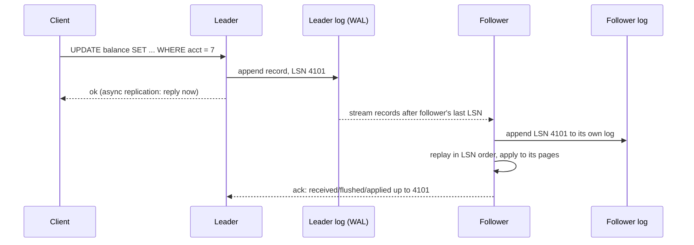
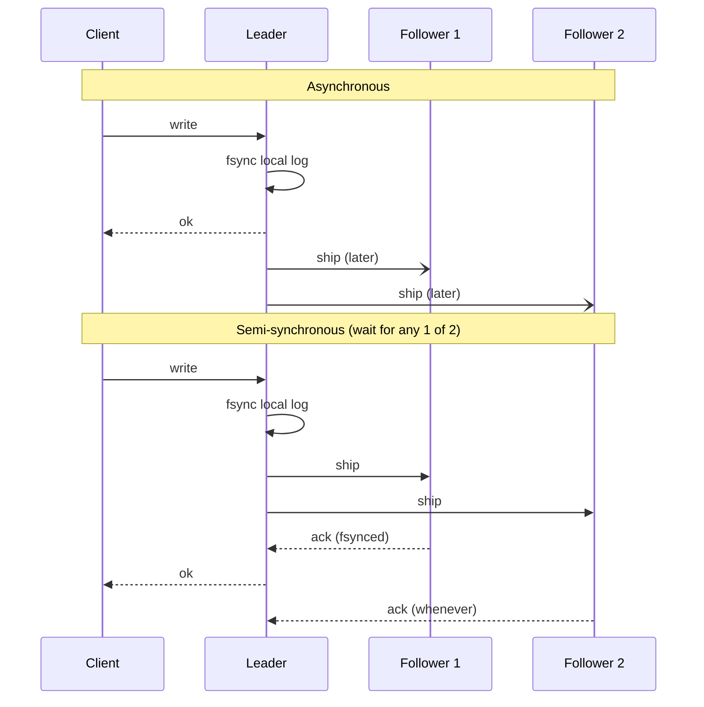
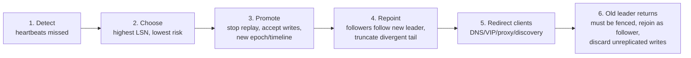
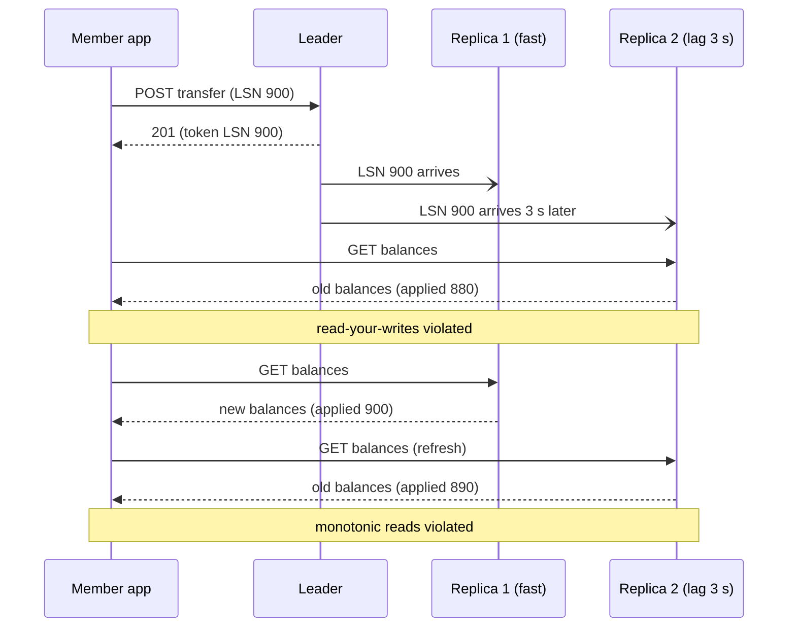
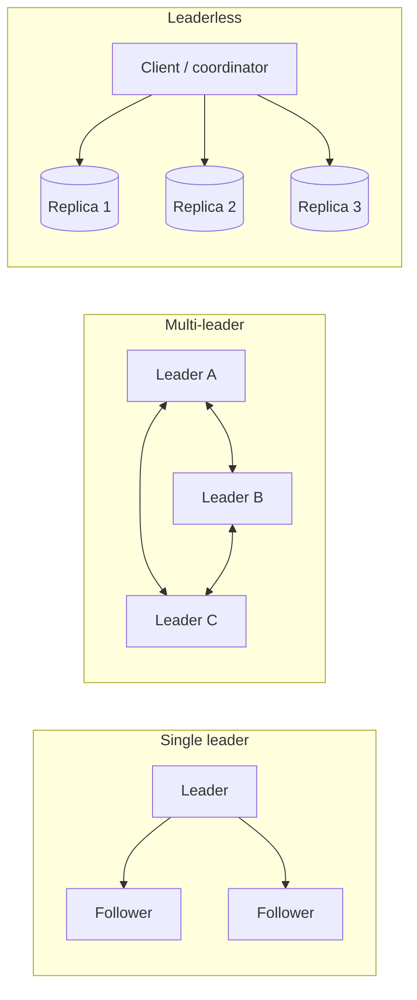

# A4 Unit 1 — Replication

> Time: ~6 h · CORE: §1–§3, and the concepts of §4 · STRETCH (≈ 1 h): the last-write-wins vs CRDT experiment and the leaderless sections of §4 · Lab: `labs/a4/replkv`

One copy of the data is a single point of failure and a single point of capacity. Replication is how you get a second
copy, and almost every interesting problem in this unit comes from one fact: **the second copy is always a little
behind the first**. Everything below is about what that gap does to durability, availability and to the member who just
moved money and reloaded the page.

This unit assumes A2: you know what a write-ahead log is, why a commit waits for an fsync, and what a snapshot read is.
Replication is mostly that log, shipped over a network.

## Before you start

You should have finished A2 (storage: WAL, B-tree/LSM, isolation) and A0 (estimation, availability math). Keep
[`docs/NUMBERS.md`](../../docs/NUMBERS.md) open for the latency and availability tables.

Warm-up (spaced retrieval from A0 and A2). Answer on paper first.

1. (A2) When a transaction commits, what has to be on durable storage before the database says "ok", and what is
   deliberately *not* yet written?
2. (A2) Under snapshot isolation, transaction T1 reads a balance, then T2 commits an update to it, then T1 reads again.
   What does T1 see, and why is that a useful model for what a lagging replica shows you?
3. (A0) Two independent replicas, each 99% available, behind a load balancer: what is the best-case availability of
   "at least one is up"? Name two reasons real replicas fail together.

<details data-kind="answer">
<summary>Warm-up answers</summary>

1. The WAL record(s) for the transaction, including the commit record, flushed with fsync. The modified data pages
   (B-tree pages, or the memtable flushing to an SSTable) can be written lazily because the log can rebuild them after a
   crash. That separation is exactly what replication exploits: the log is a compact, ordered description of every change.
2. Both reads return the same value: the snapshot taken at T1's start (or first statement, depending on level). T2's
   commit is invisible to T1. A lagging replica is similar in spirit: it shows you a consistent, older state of the
   database. The difference is that you did not *choose* the snapshot, and two replicas can be at different points.
3. 1 − 0.01² = 99.99%, if failures are independent. They are not: shared deploys, shared config, same AZ or power
   feed, the same bug triggered by the same query, a shared dependency such as DNS or the credentials service.

</details>

---

## §1 Leader/follower replication and log shipping

### The failure story

Your platform's transactions store runs on one Postgres primary. On a normal day it serves ≈ 1,200 write TPS and ≈ 30,000
read QPS (balance screens, transaction lists, partner API reads), comfortably inside the single-box range in
[`docs/NUMBERS.md`](../../docs/NUMBERS.md) (≈ 10k–50k point-read QPS, ≈ 1k–10k write TPS).

On the 1st and 15th, payroll lands for several credit unions at once. Reads triple to ≈ 90,000 QPS in the first five
minutes after 09:00 as members check whether they have been paid. The primary tops out at ≈ 50,000 QPS: p99 climbs from
40 ms to 2.4 s, the app server pools fill, and the retry storm (A1 Unit 3) makes it worse.

Three weeks later the primary's disk controller fails at 15:00. The last full backup was at 02:00 and WAL archiving was
"on the roadmap". The restore takes 4 hours and the 13 hours of transactions since the backup, at ≈ 140 TPS average
≈ 6.5 million rows, have to be re-fetched from the core banking system, one adapter call at a time.

Two different problems, one remedy: keep another copy of the data, continuously, on another machine.

### Predict

<!-- predict id="A4-U1-P01" -->
**Predict.** Write your answers down before opening the reveal.

1. You add two read replicas to the primary above (async log shipping). How many writes per second must *each replica*
   apply, and how much write capacity did you gain?
2. A replica has the same hardware as the primary. Applying the 1,200 writes/s costs it ≈ 25% of its capacity. Peak
   reads are 90,000 QPS and one machine serves ≈ 50,000 QPS when it does no writes. How many replicas do you need to
   serve peak reads, keeping the primary free of reads? What changes if writes grow 4×?
<!-- /predict -->

### Reveal

<details data-kind="reveal" data-for="A4-U1-P01">
<summary>Reveal</summary>

1. Each replica applies **all 1,200 writes/s**; it holds a full copy, so it replays every change. Write capacity did
   not increase at all (in fact the primary now also pays to ship the log to two followers). Replication multiplies
   *read* capacity and *copies*, not write capacity. Write capacity needs partitioning (Unit 2).
2. Each replica has ≈ 75% of 50,000 ≈ 37,500 QPS left for reads. 90,000 / 37,500 = 2.4, so 3 replicas (4 if you also
   want N+1, and you do: the point of this exercise was availability as well). At 4× writes (4,800 TPS) each replica
   spends ≈ 100% of its capacity on apply and has **nothing left for reads**; adding replicas does not help at all.
   The tempting answer "90,000 / 50,000 = 1.8, so 2 replicas" forgets the apply cost, which is the term that stops
   read scaling by replicas.

</details>

### How it actually works

The mechanism is the WAL you met in A2, with a network cable attached.



Ingredients, in the order they bite:

- **A log position.** Every record has a monotonically increasing position (Postgres: LSN, a byte offset into the WAL;
  MySQL: binlog file + offset, or a GTID; Mongo: oplog timestamp; Kafka: partition offset). A follower is described
  entirely by "the last position I applied". Everything in this unit (lag, tokens, failover candidates) is arithmetic on
  these positions. The lab calls it `LSN`.
- **Streaming.** The follower connects, says "I am at position P", and the leader sends everything after P and then
  keeps sending as new records are appended. If the follower disconnects it reconnects and resumes from its own position.
  The leader must therefore **retain log** until every follower has consumed it (or give up on slow ones). That is the
  origin of the classic incident "a dead replica made the primary's WAL fill the disk".
- **In-order apply.** The follower applies records in log order. Out-of-order or gappy delivery (the network can
  reorder, retransmit, duplicate) is handled with the position: ignore anything at or below what you applied, buffer
  anything beyond the next expected position. This is the `node.apply` function in the lab.
- **Bootstrapping a new follower.** You cannot start from an empty database and the log's tail. You take a **consistent
  snapshot** (base backup) *together with its log position*, restore it, then stream from that position. Get the position
  wrong by one record in either direction and you have a silently divergent replica. Time to bootstrap ≈ data size /
  copy throughput: 9 TB at 200 MB/s ≈ 12.5 h. Keep warm standbys; do not plan to build one during the incident.

**What exactly is in the log?** There are three common answers, and they have different failure modes:

| Log format | The leader ships… | Replica applies by… | Notes |
|---|---|---|---|
| **Statement-based** | the SQL text (`UPDATE ... SET fee = RAND()`) | re-executing it | Compact, but non-deterministic functions (`NOW()`, `RAND()`, `UUID()`), auto-increment ordering, triggers and side effects can make replicas diverge. Mostly abandoned as the default. |
| **Physical (WAL shipping)** | the storage engine's page-level change records | replaying byte-level changes | Replica is a bit-for-bit copy: simple, fast, exact. Tied to the same major version, same architecture and the same layout; replica cannot have different indexes or tables. |
| **Logical (row-based)** | the *row images* (insert this row, update that row from X to Y, delete this key) | decoding and applying row changes | Decoupled from storage layout: cross-version upgrades, selective tables, different indexes on the replica, and it is the basis of change-data-capture (CDC) feeds (A6). Larger for bulk updates; DDL needs care. |

Real systems mix them. Postgres streaming replication is physical, and *logical decoding* of the same WAL produces row
changes for logical replication and CDC. MySQL's binlog can be `STATEMENT`, `ROW` or `MIXED`; row-based is the safe
choice for correctness. TODO-VERIFY: which binlog format is the default in current MySQL versions.

A follower is only a **copy of a deterministic state machine** (the state is the table contents, the input is the log).
If the apply step is deterministic, same log in same order ⇒ same state. That sentence is the whole theory of
state-machine replication, and it is why the next unit's consensus protocols are about agreeing on the *log*.

**Read from followers?** A follower that is a *hot standby* (Postgres) or an ordinary read-only replica (MySQL) serves
reads while it replays. It sees a state that is some prefix of the leader's history. Which prefix is the subject of §3.
There is also a trap: a long-running query on a Postgres hot standby can conflict with replay (replay wants to remove
row versions the query still needs); Postgres either delays replay (more lag) or cancels the query. TODO-VERIFY: exact
settings (`max_standby_streaming_delay`, `hot_standby_feedback`) before you rely on them.

**Topologies.** One leader with N followers is the default. A follower can feed other followers (cascading), which
saves leader egress bandwidth and cross-region links at the cost of added lag per hop.

### Build it

Lab `labs/a4/replkv`, file `replkv.go`. This section is the *follower side* and the leader's write path:

- `node.apply`: the follower rule. Apply an entry only when its LSN is exactly `applied+1`; ignore duplicates and old
  entries; buffer entries from the future in `pending`; after applying, drain any buffered successors.
- `Cluster.write` (async part): assign `LSN = leader.applied()+1`, append and apply on the leader, then `Send` the entry
  to every other node through the provided `Network`.
- `Cluster.tickLocked`: deliver due messages to nodes.
- `Cluster.GetAtLeast` (and `Get`, which calls it with 0).

The provided `Network` is a deterministic simulator: no goroutines and no sleeps. Messages have a per-destination delay
measured in ticks, a link can be cut, and a later message can overtake an earlier one. `Tick` is the only thing that
moves time. Read the doc comment in `sim.go` first.

Acceptance tests: `TestNodeApply_InOrderOutOfOrderAndDuplicates`, `TestPut_AssignsConsecutiveLSNsAndAppendsToLeaderLog`,
`TestReplication_FollowersConvergeAfterFlush`, `TestLag_LaterEntryOvertakesEarlierOneButIsNotAppliedFirst`,
`TestPartition_HoldsEntriesAndHealCatchesUp`. Run `go test -race -run 'NodeApply|Put_|Replication|Lag|Partition' ./labs/a4/replkv/`.

### Break it

Reproduce the statement-based replication divergence in miniature. The "statement" is
`INSERT ... VALUES (id, NOW(), RAND())`; the follower applies it two seconds later with its own random stream.

```go
// Statement-based vs row-based log shipping: replaying the SQL text on a
// follower re-evaluates non-deterministic expressions; shipping the row
// image does not.
package main

import (
	"fmt"
	"math/rand"
	"time"
)

// "INSERT INTO transfers(id, created_at, fee_bucket) VALUES (?, NOW(), RAND())"
type row struct {
	ID        int
	CreatedAt time.Time
	FeeBucket int
}

func insertTransfer(id int, now time.Time, rnd *rand.Rand) row {
	return row{ID: id, CreatedAt: now, FeeBucket: rnd.Intn(100)}
}

func main() {
	leaderClock := time.Date(2026, 3, 2, 9, 0, 0, 0, time.UTC)
	followerClock := leaderClock.Add(2 * time.Second) // applies 2 s later
	leaderRand := rand.New(rand.NewSource(1))
	followerRand := rand.New(rand.NewSource(99)) // a different random stream

	// Statement shipping: the follower re-executes the statement text.
	onLeader := insertTransfer(1, leaderClock, leaderRand)
	stmtOnFollower := insertTransfer(1, followerClock, followerRand)

	// Row shipping: the follower applies the row image the leader produced.
	rowOnFollower := onLeader

	fmt.Printf("leader:              %+v\n", onLeader)
	fmt.Printf("statement-replayed:  %+v  identical=%v\n", stmtOnFollower, stmtOnFollower == onLeader)
	fmt.Printf("row-shipped:         %+v  identical=%v\n", rowOnFollower, rowOnFollower == onLeader)
}
```

Predict the output, run it in a scratch directory (`go run .`), then answer: which kinds of statements in *your*
workload (think of a statement that touches an interest-accrual date or generates a reference number) would diverge?

<details data-kind="answer">
<summary>What you should see, and why</summary>

The leader and the statement-replayed row disagree on `CreatedAt` (two seconds apart) and on `FeeBucket` (a different
random draw); the row-shipped copy is identical. In a real statement-based setup the replica has now silently diverged
from the leader: a later `SELECT SUM(...)` or a failover exposes it, possibly months later. Anything that reads the
clock, a random source, a sequence, a session variable, or a trigger that does those things is at risk. The fix is to
ship *effects* (rows or physical changes), not *intentions* (statements). Row-based logs are bigger for bulk updates
(one record per row) but correct by construction, which is the right trade for money.

</details>

### In the wild

- **Postgres** streaming replication ships WAL records over a replication connection; standbys can be *hot standbys*
  that serve read-only queries. Replication slots make the primary retain WAL a standby still needs (and can fill the
  disk if the standby dies). Logical replication (publications and subscriptions) and logical decoding provide
  row-level streams. TODO-VERIFY: the version in which built-in logical replication arrived (believed to be 10).
- **MySQL/InnoDB** writes a binary log; each replica has an I/O thread that copies the binlog to a local *relay log* and
  an SQL (applier) thread that replays it. Single-threaded apply was a classic lag source; multi-threaded appliers
  parallelise non-conflicting transactions. GTIDs identify transactions globally so a replica can be re-pointed to a
  new leader without file/offset arithmetic.
- **MongoDB** replica sets replicate an *oplog* of idempotent operations; secondaries tail it.
- **Redis** replicas connect with `PSYNC`, receive an RDB snapshot (full resync) and then the command stream; a bounded
  replication backlog allows a short disconnect to resume without a full resync. TODO-VERIFY: backlog defaults.
- **Kafka** partitions each have a leader and followers that fetch from it; the log *is* the product (A6).
- **Managed services**: RDS/Aurora, Cloud SQL and Azure Database for PostgreSQL/MySQL expose "read replicas" built on
  the engine's native replication, plus a lag metric you should alarm on. TODO-VERIFY: Aurora's storage-level
  replication differs from log shipping between instances; check the vendor docs before claiming specifics.

### Trade-offs

| Option | Wins when | Loses when | When the answer flips |
|---|---|---|---|
| Physical (WAL) shipping | You want an exact standby for failover and plain read scaling; same version everywhere | You need a different schema/index/version on the replica, or want to stream to non-database consumers | Flip to logical replication/CDC for zero-downtime major upgrades, selective tables, or feeding search/analytics |
| Logical (row) shipping | Heterogeneous consumers, upgrades, selective replication, CDC | Bulk updates and DDL are awkward; large transactions are replicated as many row events | Flip to physical for the simplest, fastest HA standby |
| Statement shipping | Rarely: tiny logs for bulk statements on deterministic workloads | Any non-determinism; triggers; ordering-dependent statements | Almost always flip to row-based. Money tables should never rely on statement replay |
| Read replicas for scale | Read-heavy, tolerant of lag, writes are a small fraction of capacity | Writes dominate (replicas spend capacity on apply), or reads must be fresh | Flip to caching (A3) for hot reads, to partitioning (Unit 2) for write scale |

### Senior bar

- **Failure modes**: replica falls behind and the leader retains log until the disk fills; a long transaction or bulk
  migration creates a lag spike on every replica at once; a replica silently diverges (statement replay, manual writes
  to a replica, a bad failover); one slow follower blocks a synchronous commit (§2); the base backup and the starting
  position do not match.
- **Capacity (≈)**: read capacity per replica = machine capacity − apply cost. Log bandwidth = write rate × bytes per
  write, **per follower**: 1,200 TPS × ≈ 1 KB of WAL ≈ 1.2 MB/s ≈ 10 Mbps each, so three followers in another region
  cost ≈ 30 Mbps of cross-region egress, which is cheap to build and not free to run. Bootstrapping a replica takes
  hours at TB scale.
- **Ops**: alert on replica lag (seconds and bytes) and on retained-WAL size; test bootstrapping a replica regularly;
  schema migrations (A2) replicate, so a slow migration is also a lag event; never allow application writes on replicas.
- **Cost**: each replica is a full copy of the storage and a machine; RF 3 means ≈ 3× storage (NUMBERS.md rule of thumb).

Interviewer follow-up probes:

1. "You add three read replicas and the primary is still at 90% CPU. Why?"

<details data-kind="answer">
<summary>Model answer</summary>

Replicas offload reads, so either the primary is still serving reads (the app routes everything to it, or
read-after-write routing from §3 sends most traffic back to the leader), or the primary's load is write-bound and
replication cannot help. Check the read/write split on the primary, whether the shipping itself is expensive (many
followers, logical decoding), and whether long transactions or maintenance dominate. If writes are the bottleneck,
the remedy is partitioning or a cheaper write path (batching, fewer indexes), not more replicas.

</details>

2. "Why can't I just copy the data directory to start a new replica?"

<details data-kind="answer">
<summary>Model answer</summary>

A file copy of a live database is not a consistent snapshot, and even a consistent one needs to be paired with the
exact log position at which it was taken. The follower must start streaming from that position. Tools such as a base
backup do both atomically (and record the position). Starting from the wrong position either loses changes (gap)
or double-applies them (non-idempotent apply), and the replica diverges without any error.

</details>

3. "What makes replaying a log on a follower safe?"

<details data-kind="answer">
<summary>Model answer</summary>

Determinism and order. The log must contain effects (or deterministic operations), it must be applied in position
order, and apply must tolerate duplicates (ignore at or below the applied position) and gaps (buffer or refuse). Given
those, same log ⇒ same state, which is the state-machine-replication argument.

</details>

### Check yourself

1. Why does adding a read replica not increase write throughput?
2. What two things must be recorded together to bootstrap a follower correctly?
3. A follower receives LSN 7 before LSN 6. What should it do, and why not apply 7 immediately?

<details data-kind="answer">
<summary>Answers</summary>

1. Every replica applies every write, so each write is executed N+1 times; total write capacity is still bounded by
   the leader (and replicas lose read capacity to apply work).
2. A consistent snapshot and the log position at which it was taken.
3. Buffer 7, wait for 6, then apply both. Applying 7 first would expose a state the leader never had (7 without 6),
   and if 7 depends on 6 (an update of a row that 6 inserted) the apply would fail or corrupt.

</details>

---

## §2 Synchronous, asynchronous and semi-synchronous replication; failover

### The failure story

Monday 02:14. The primary's host panics. The orchestrator promotes the follower with the highest LSN. The
replication lag at the moment of the crash was ≈ 1.3 s. At ≈ 1,400 write TPS (an end-of-month batch is running), that is
≈ 1,800 committed transactions that the primary acknowledged to adapters and members but that exist only on a dead
disk. The promoted follower has no trace of them. Balances are wrong, the core banking reconciliation shows 1,800
postings your side has never heard of, and audit wants to know which ones.

The team's reaction is "make it synchronous". They set the follower in the other AZ to synchronous. Three weeks later
that follower's host reboots for kernel patching. Every commit on the primary now waits for an acknowledgement that
never comes. Writes hang for 40 seconds until someone notices and switches the setting off; transfers time out at the
gateway, the idempotency layer (A1) holds hundreds of in-flight keys, and the dashboards show a total write outage
caused by a **healthy primary** and a planned reboot.

Both outcomes are the same decision made two ways. Asynchronous replication buys latency and availability with
durability. Synchronous replication buys durability with latency and availability.

### Predict

<!-- predict id="A4-U1-P02" -->
**Predict.** Write your answers down before opening the reveal.

1. Local fsync ≈ 1 ms. The follower is in another AZ (RTT ≈ 1.5 ms, same-region different-AZ in
   [`docs/NUMBERS.md`](../../docs/NUMBERS.md)) and also fsyncs ≈ 1 ms. Roughly what is the commit latency for async,
   for sync-to-one-follower, and for sync to a follower in another region (RTT ≈ 70 ms)?
2. The leader has two followers. Each of the three machines is 99.9% available (independent). What is the availability
   of *writes* if commits require acks from **both** followers? From **at least one** of the two?
3. What is the RPO (recovery point objective) of asynchronous replication, and what number do you compute it from?
<!-- /predict -->

### Reveal

<details data-kind="reveal" data-for="A4-U1-P02">
<summary>Reveal</summary>

1. Async: ≈ 1 ms (local fsync only). Sync to an in-region follower: ≈ 1 ms local fsync in parallel with
   (RTT 1.5 ms + remote fsync 1 ms) ≈ 2.5–3 ms, so a 2–3× latency increase. Cross-region sync: ≈ 70 ms + 1 ms ≈ 70+ ms
   per commit: it is the speed of light and you cannot buy it back. At that latency a session that does 3 sequential
   commits spends 0.2 s just waiting.
2. Both required: all three must be up, ≈ 0.999³ ≈ 99.7% (≈ 26 hours/year of unavailable writes). At least one of two:
   writes are blocked only if the leader is down or both followers are down: ≈ 0.999 × (1 − 0.001²) ≈ 99.9%. This
   is why "sync to every follower" is almost never what you want; the practical form is **semi-synchronous**: wait for
   *some* follower, and let the others lag.
3. RPO of async ≈ the replication lag at the moment of failure, expressed as data: lag (seconds) × write rate. A lag of
   1.3 s at 1,400 TPS ≈ 1,800 transactions. It is *not* zero and it is *not* a constant: it spikes exactly when the
   system is busiest. The tempting answer "a few milliseconds" is the median lag, not the lag at the moment things fail.

</details>

### How it actually works

Three acknowledgement policies, defined by *when the leader replies to the client*:



- **Asynchronous**: reply after the local commit. Lowest latency, and the leader never waits for a follower, so a dead
  follower costs nothing. Writes acknowledged in the last `lag` seconds are lost if the leader's disk is lost (and
  invisible to the new leader even if the old disk is recoverable; see below).
- **Synchronous (k acks)**: reply after `k` followers confirm. The word "confirm" has levels, and they matter: the
  follower has *received* the record in memory (survives a leader crash, not a follower crash), *flushed* it to its
  disk (survives both), or *applied* it so reads on that follower see it (the strongest, and the one that fixes
  read-your-writes on that follower; §3). Postgres exposes these as `synchronous_commit` levels
  (`remote_write`, `on`, `remote_apply`). TODO-VERIFY: exact level names and semantics for your version.
- **Semi-synchronous**: wait for a quorum-ish subset (typically any one of the followers), so one dead or slow follower
  does not block commits, and the data exists on at least two machines at ack time. If *no* follower acks within a
  timeout, systems differ: block (safe, unavailable) or degrade to async (available, lossy). MySQL's semi-sync
  plugin does the latter after a timeout; Postgres blocks. TODO-VERIFY both behaviours. Whichever you pick, you have
  chosen your CAP-style trade-off in the failure case (A5 formalises it).

**Failover** replaces a dead leader. The steps are the same everywhere, and each has a failure mode:



1. **Detect.** A timeout on heartbeats. Too short ⇒ false failovers under a GC pause or a network blip; too long ⇒ minutes
   of downtime. Typical detection budget ≈ 10–30 s. The detector cannot tell "dead" from "slow": that impossibility is
   the heart of A5.
2. **Choose.** The follower with the highest applied LSN (least data lost), subject to policy (same region, not a
   delayed/analytics replica). The lab does exactly this.
3. **Promote.** The follower stops replaying, becomes writable, and starts a new **epoch** (Postgres: a new timeline;
   consensus systems: a new term). Entries the old leader had beyond the new leader's position are the **lost writes**.
4. **Repoint** the other followers at the new leader. If a follower is *ahead* of the new leader, or has a divergent
   tail, it must roll back to the common prefix (`pg_rewind` in Postgres; in the lab, `Recover` truncates to the common
   prefix) or be rebuilt.
5. **Redirect clients.** Update DNS/VIP/proxy/service discovery. Clients with cached connections keep going to the dead
   or demoted node (A1 Unit 1 §1: DNS is a hint, not a switch).
6. **The old leader comes back.** If it still thinks it is the leader, you have **split brain**: two nodes accept writes
   and the histories diverge. Defence: *fence* the old leader (cut its network, power it off, revoke its storage
   access: "STONITH"), or make it unable to commit without a lease or epoch that the cluster has revoked. This
   section only introduces the idea; leases and fencing tokens are A5.

Total failover time ≈ detection (10–30 s) + promotion (1–10 s) + client redirection (5–60 s) ≈ 30 s to 2 minutes is
typical for automated setups; managed services quote similar figures (TODO-VERIFY vendor numbers before quoting). That
number belongs next to your availability SLO: 99.99% allows ≈ 4.3 min per 30 days (NUMBERS.md), so one slow failover per
month can eat the entire budget.

### Build it

Lab `labs/a4/replkv`, file `replkv.go`:

- Synchronous waiting in `Cluster.write`: with `Options.SyncAcks = k`, tick until `k` live followers have applied the
  entry; give up after `SyncTimeoutTicks` with `ErrSyncTimeout`, **returning the LSN anyway** (the write is in the
  leader's log; the client just was not told "ok").
- `Cluster.Crash`, `Cluster.Failover` and `Cluster.Recover` (with the provided `truncate` and `commonPrefix`).

Failover must: pick the live follower with the highest applied LSN (ties: earliest node); drop all in-flight messages and
every node's out-of-order buffer (they belong to the old leader's history); fence the old leader (mark it down);
catch up the other followers from the new leader's log; and report the **lost writes** (entries the old leader had
beyond the new leader's position).

Acceptance tests: `TestSyncReplication_PutWaitsForTheFastestRequiredAcks`,
`TestSyncReplication_TimesOutButTheWriteIsStillInTheLeaderLog`, `TestFailover_PromotesTheMostUpToDateFollowerAndReportsLostWrites`,
`TestFailover_PromotesTheFurtherAheadFollowerEvenWhenItIsNotTheFirst`, `TestFailover_DropsInFlightEntriesFromTheOldLeader`,
`TestFailover_DiscardsBufferedOutOfOrderEntries`, `TestFailover_FencesAnOldLeaderThatIsStillAlive`,
`TestFailover_DeposedLeaderIsFencedAndRejoinsWithoutItsDivergentWrites`,
`TestFailover_SynchronousAckedWritesSurviveAsyncOnesMayNot`. Run `go test -race -run 'Sync|Failover|Recover' ./labs/a4/replkv/`.

### Break it

Quantify the trade-off. With the solution (or your implementation) in place, run:

```
go test -tags breakit -run BreakIt_SyncVersusAsync -v ./labs/a4/replkv/
```

It writes 100 keys (one per tick) into a cluster whose followers lag by 2 and 5 ticks, crashes the leader and fails over,
for `SyncAcks` of 0, 1 and 2, and then repeats with one follower partitioned. Predict both tables before you run it:
how many **acknowledged** writes are lost, how long does a `Put` wait, and how many writes can be acknowledged at all
when a follower is unreachable?

<details data-kind="answer">
<summary>What you should see, and why</summary>

First table (solution output, ≈): async acknowledges 100 writes, waits 0 ticks, and loses **1** acknowledged write
(the one still in flight when the leader died; with a larger lag or burstier traffic it is more). Sync with 1 ack: 100
acknowledged, 0 lost, ≈ 2 ticks average wait (the nearer follower's delay). Sync with 2 acks: 0 lost, ≈ 5 ticks
(the slower follower's delay: you wait for the slowest of the set). Second table, with `n2` unreachable: async and
`SyncAcks=1` still acknowledge 100/100 (the healthy follower answers); `SyncAcks=2` acknowledges **0** and every `Put`
times out: strict synchronous replication converts one follower's failure into a write outage. That is semi-sync in two
tables: durability on at least two machines without letting one slow node veto progress.

</details>

### In the wild

- **Postgres**: `synchronous_commit` (`off`, `local`, `remote_write`, `on`, `remote_apply`) per transaction, and
  `synchronous_standby_names` to choose which standbys count (a priority list or "any k of n"). Per-transaction control
  means you can make transfers synchronous and a "last login" update asynchronous. TODO-VERIFY syntax for `ANY`/`FIRST`.
- **MySQL**: semi-synchronous replication via plugins (the leader waits for an ack from a replica's relay log, with
  a timeout after which it falls back to async); Group Replication certifies transactions across a group (consensus
  territory, A5). TODO-VERIFY defaults and the `AFTER_SYNC`/`AFTER_COMMIT` wait points.
- **Failover managers**: Patroni and repmgr (Postgres), Orchestrator (MySQL), Redis Sentinel, and the failover logic inside
  managed services. Many hold a leader lock in a consensus store (etcd, Consul, ZooKeeper) so only one node believes it
  is the leader; that is the "lease" idea of A5 in practice.
- **MongoDB**: replica sets elect a new primary automatically; with write concern `w: "majority"` an acknowledged write
  is on a majority and survives a failover, while a `w: 1` write on the old primary can be rolled back. TODO-VERIFY
  current defaults.
- **Redis**: replication is asynchronous; Sentinel promotes a replica when a quorum of sentinels agree the master is down.
  The `WAIT` command blocks until N replicas have acknowledged previous writes, giving a best-effort synchronous mode
  (not a guarantee: failover can still lose writes). TODO-VERIFY exact semantics.
- **Kafka**: `acks=all` plus `min.insync.replicas` makes a produce wait for the in-sync replica set; with too few in-sync
  replicas the broker rejects writes (a deliberate availability sacrifice).
- **GitHub, October 2018** (public post-incident analysis): a brief loss of connectivity (≈ tens of seconds,
  TODO-VERIFY: believed ≈ 43 s) between two sites made an automated failover promote MySQL primaries in the other region.
  Writes had landed on the old primaries that had not replicated across; once connectivity returned, both sides had
  data the other lacked, and reconciling it took the better part of a day. Lessons: lag is an RPO, cross-region failover
  is a data-loss decision, and automation that fails over faster than humans can judge needs a fence and a lag limit.

### Trade-offs

| Option | Wins when | Loses when | When the answer flips |
|---|---|---|---|
| Asynchronous | Latency and availability matter more than the last second of data; reads from replicas for scale | RPO must be ~0 (money postings, audit records) | Flip to semi-sync for any write you cannot re-derive from another system |
| Semi-synchronous (any 1 follower, in another AZ) | You want data on two machines at ack time without a single follower vetoing writes | Cross-region (latency), or all followers in the same failure domain (no AZ protection) | Flip to async if a write is cheap to redo; to quorum/consensus (A5) if you need automatic, safe failover with no external manager |
| Synchronous to all followers | Tiny clusters where every follower is critical and failures are rare | Any follower failure or slowness is a write outage; tail latency = slowest follower | Almost always flip to semi-sync |
| Manual failover (human decides) | Cross-region promotions, ambiguous partitions, data-loss decisions | RTO must be minutes; on-call at 02:00 | Flip to automatic within a region with fencing, keep manual for cross-region |
| Automatic failover | Single-region HA with a trustworthy fence and lag limit | Flaky networks cause false positives; split brain if the fence fails | Flip to manual when promotion would lose more than your tolerance (check lag before promoting) |

### Senior bar

- **Failure modes**: a sync follower in the *same* AZ as the leader gives no AZ protection; a sync follower that is
  slow (not dead) raises every commit's latency without tripping any alarm; false-positive failover (a GC pause is
  read as death) creates split brain if the old leader is not fenced; failover during peak with replicas lagging 30 s
  loses 30 s of money movement; clients with cached connections keep writing to the demoted node; promoting a replica
  that was *ahead* of nothing (a delayed or analytics replica) is a self-inflicted data-loss event.
- **Capacity (≈)**: commit latency ≈ local fsync (≈ 1 ms) async; ≈ +RTT + remote fsync for sync (≈ +2.5 ms in-region
  across AZs); ≈ +70 ms cross-region. Failover budget ≈ 30 s–2 min. RPO(async) = lag × write rate.
- **Ops**: rehearse failover (game days) and measure real RTO and lost-write counts; alert on lag *before* you need
  to fail over; document who may authorise a cross-region promotion; plan patching so the sync standby is not rebooted
  while the primary is also running without a second standby.
- **Cost**: a cross-AZ synchronous follower is cheap (same region); a cross-region synchronous one is mostly a latency
  tax on every write; a standby you never test is worth less than it costs.

Interviewer follow-up probes:

1. "Your RPO requirement is zero for money movement. What do you build?"

<details data-kind="answer">
<summary>Model answer</summary>

No acknowledged write may exist on only one machine. Minimum: semi-synchronous replication with at least one
synchronous follower in a different AZ (flushed, not just received), a policy that **blocks** rather than degrading to
async when no follower acks (accepting reduced availability), and failover that only promotes a follower known to
have everything acknowledged. Stronger: a majority-quorum replicated log (Raft/Paxos-style, A5), which gives automatic
and safe failover. Note "zero" also needs durable fsync on the leader and the follower, and idempotency end to end
(A1) so the client's retry after a failover cannot double-post.

</details>

2. "How do you avoid split brain?"

<details data-kind="answer">
<summary>Model answer</summary>

Make sure at most one node can commit. Fence the old leader before (or as part of) promoting a new one: cut its
network or storage access, power it off, or revoke its lease. Use an epoch/term number so followers and clients reject
writes from a stale leader. A single external lock service (etcd/ZooKeeper) holding the leader key with a lease helps,
provided the old leader stops serving when it cannot renew the lease. The details (leases, fencing tokens, consensus)
are A5.

</details>

3. "Failover at 09:00 on payday: automatic or manual?"

<details data-kind="answer">
<summary>Model answer</summary>

Within a region: automatic, because the cost of a few minutes of downtime on payday is high and the fence is local
and reliable, but with a lag guard (do not promote a follower that is more than X seconds or Y bytes behind without a
human) and a pre-agreed rule about what happens to the lost writes (report them; reconcile against the core). Cross-region:
manual, because the partition may be one-sided and promoting there creates the GitHub-2018 situation.

</details>

### Check yourself

1. Why does "synchronous replication to all followers" usually reduce availability below that of a single node?
2. What are the "lost writes" of a failover, precisely?
3. Name two things the old leader must not be allowed to do when it comes back.

<details data-kind="answer">
<summary>Answers</summary>

1. Writes need every machine to be up (availabilities multiply), and tail latency is the slowest follower's latency.
2. Entries in the old leader's log beyond the new leader's applied position: acknowledged to clients (in async mode)
   but present on no surviving node.
3. Accept writes as leader (split brain), and keep its divergent tail: it must truncate to the common prefix with the
   new leader and catch up (or be rebuilt).

</details>

---

## §3 Replication lag anomalies and how to fix them

### The failure story

A member moves $400 from savings to checking at 09:01 on payday. The app `POST`s the transfer to the API, which writes to
the primary and returns `201`. The app then navigates to the accounts screen, which issues `GET /accounts` ≈ 300 ms
later. Reads are load-balanced across three async replicas, and at 09:01 the payroll import is replaying ≈ 500,000 rows
on every replica, so replica lag is ≈ 2–8 s. The accounts screen shows the **old balances on both accounts**: savings
still has the $400, checking doesn't.

The member assumes the transfer failed and does it again. Support tickets for "transfer went through twice" or
"transfer didn't work" are ≈ 2% of payday transfers. The idempotency key (A1 Unit 3) prevents a duplicate only when
the client reuses it, and a *second deliberate tap* is a new intent with a new key.

No component is broken. Every replica is correct, just old. This is **eventual consistency in its most visible form**,
and for a banking UI it reads as a bug.

### Predict

<!-- predict id="A4-U1-P03" -->
**Predict.** Write your answers down before opening the reveal.

1. Three followers lag by 0.05 s, 0.05 s and 3 s. A client reads from a random follower 300 ms after its write.
   What fraction of such reads are stale? What if the slow follower lags by only 0.2 s?
2. The same member reloads the page twice, 1 s apart: the first read hits a fast follower, the second the slow one (lag 3 s).
   What do they see, and what is this anomaly called? Does "read your own writes" prevent it?
3. A transfers list is partitioned by account. Account A's partition replica lags 5 s, B's lags 0.1 s. Alice transfers to
   Bob, and Bob immediately sends the money onward to Carol. An observer queries both. What odd history can they see?
<!-- /predict -->

### Reveal

<details data-kind="reveal" data-for="A4-U1-P03">
<summary>Reveal</summary>

1. One in three reads (the slow follower) is stale: ≈ 33%. With a 0.2 s lag the write has arrived by 300 ms on all
   three, so ≈ 0% are stale. The shape matters more than the average: staleness is a *step function* of (time since
   write) vs (lag of the chosen replica). That is why a "read from the leader for a short window after a write" fix
   works, and why lag spikes (payroll imports) cause bursts of anomalies, not a constant trickle.
2. First read: new data (fast follower). Second read: **old data**; the member sees the transfer, refreshes, and it
   disappears. This is a **monotonic-reads** violation: time moved backwards for one user across two reads. Read-your-writes
   does not prevent it: if the member made no writes in the session, there is no write to anchor. (And if they did,
   read-your-writes only guarantees you see *your writes*, not that successive reads are ordered.)
3. The observer might see Bob→Carol (from the fast partition) but not Alice→Bob (from the slow one): an effect without
   its cause. This is a **consistent-prefix** violation: each partition replays in order, but different partitions lag
   differently, so a cross-partition reader can see a state the system never passed through. Fixes need causal
   tracking or co-locating related data (A5, and §5 here).

</details>

### How it actually works

**Where lag comes from.** Network transit (sub-ms in an AZ, tens of ms cross-region), the time to apply (a single apply
thread replaying a burst written by many leader sessions), I/O contention with the replica's own reads, a long
transaction (a 10-minute bulk update is replicated as one lump and becomes visible at commit), and the replica
being down or partitioned. Lag is not a constant; its tail is what hurts. Measure it as both **position lag** (bytes or
LSNs behind) and **time lag** (age of the newest applied record). A "seconds behind" figure that looks only at the
age of the last applied event reports 0 when the leader is idle and the replica is wedged; a heartbeat row updated every
second on the leader and read on the replica is the robust way to measure time lag. TODO-VERIFY: how MySQL's
`Seconds_Behind_Master`/`Seconds_Behind_Source` is computed and its known blind spots.

**The three anomalies**, in banking terms:

| Guarantee | Anomaly when missing | Example |
|---|---|---|
| **Read-your-writes** (read-after-write) | You write, then read from a replica that has not applied your write | Transfer, then the balance screen shows the old balance |
| **Monotonic reads** | You read newer data, then an older replica shows older data: time moves backwards | The transfer appears, then disappears on refresh |
| **Consistent prefix** | You see an effect without its cause across partitions | Bob's payment out is visible, the deposit that funded it is not |



**Fixes**, from cheap and coarse to precise:

1. **Read your own writes from the leader.** After a write, route that user's reads to the leader for a window longer than
   the lag you expect (say 5–10 s), or always read from the leader for the data the user can change (their own profile
   and balances). Simple and robust; the cost is leader load, and it breaks when lag exceeds the window.
2. **Return the write result.** The `201` already carries the new balances. The client can render them (or update its local
   cache) instead of re-reading. This removes most of the *visible* anomaly for free; it does not help a different screen
   or a different device.
3. **LSN tokens (causal tokens).** The write returns the LSN of the commit. The client (cookie, header, a field in the
   session) sends it back with later reads. The router sends the read to a replica whose applied LSN ≥ the token;
   otherwise it waits a short time or falls back to the leader. This is precise: only the reads that *need* freshness pay,
   and replicas that are fresh enough serve them. The lab's `Session` is this. Also see the Go sketch below.
4. **Floors for monotonic reads.** Track the highest LSN the session has *observed* (each read returns the replica's
   applied LSN) and treat it as a floor for the next read. Alternatively pin a user to one replica (session stickiness):
   easy, but it gives monotonic reads only until that replica dies or is rotated, and it gives *no* read-your-writes.
5. **Synchronous apply on the reader.** `remote_apply`-style commits make the write wait until the reading replica
   has applied it. Strong, but you pay on every write and a slow replica blocks writers (§2).
6. **Lag-aware routing.** Take replicas out of the read pool when their lag exceeds a threshold; shed to the leader when
   all of them do. This bounds the damage of a lag spike.
7. **Consistent prefix.** Partition so that causally related data lands in one partition (the same account's ledger), or
   carry dependency information (A5).

```go
// A read router that honours an LSN token: serve from a replica that has
// applied at least the token, wait briefly for the replica to catch up, and
// fall back to the leader.
package main

import (
	"context"
	"fmt"
	"time"
)

type Node interface {
	Name() string
	AppliedLSN() uint64 // e.g. SELECT pg_last_wal_replay_lsn() converted to a number
}

type Router struct {
	Leader   Node
	Replicas []Node
	MaxWait  time.Duration // how long a read may wait for a replica to catch up
	Poll     time.Duration
}

// Pick returns the node a read carrying token (the LSN of the caller's last
// write, 0 if none) may use.
func (r *Router) Pick(ctx context.Context, token uint64) Node {
	if token == 0 {
		return r.Replicas[0] // any replica will do (a real router would balance)
	}
	deadline := time.Now().Add(r.MaxWait)
	for {
		for _, rep := range r.Replicas {
			if rep.AppliedLSN() >= token {
				return rep
			}
		}
		if time.Now().After(deadline) || ctx.Err() != nil {
			return r.Leader // the leader always has every acknowledged write
		}
		time.Sleep(r.Poll)
	}
}

type fake struct {
	name string
	lsn  uint64
}

func (f *fake) Name() string       { return f.name }
func (f *fake) AppliedLSN() uint64 { return f.lsn }

func main() {
	leader := &fake{"leader", 120}
	slow := &fake{"replica-1", 100}
	r := &Router{Leader: leader, Replicas: []Node{slow}, MaxWait: 20 * time.Millisecond, Poll: 5 * time.Millisecond}
	fmt.Println("no token  ->", r.Pick(context.Background(), 0).Name())
	fmt.Println("token 90  ->", r.Pick(context.Background(), 90).Name())
	fmt.Println("token 120 ->", r.Pick(context.Background(), 120).Name(), "(replica stuck at 100: waited 20 ms, then the leader)")
}
```

**Where the token lives.** In a cookie or an opaque session field for browsers; in a response header the mobile client
echoes back; for multi-device or API clients, stored next to the user's record ("last write LSN"), since tokens must
travel with the *person*, not the connection. The lab's `Session.Token()` and `SessionOptions.Token` are the minimal
form of this hand-off. Token format is internal: do not let clients invent LSNs (and cap how long a read may wait for
one).

**What it costs.** Every guarantee shifts read load toward fresher nodes. The lab's break-it makes this vivid: when lag
exceeds the time between write and read, read-your-writes degenerates into "read from the leader", which is correct and
also exactly the load you added replicas to avoid. Real systems tune: wait a few ms for a replica to catch up before
falling back, and limit the guarantee to the screens that need it.

### Build it

Lab `labs/a4/replkv`, file `replkv.go`: the **`Session`** type.

- `Session.Put` writes through the leader and remembers the LSN (also when the write returns `ErrSyncTimeout`; it still
  has an LSN).
- `Session.Get`: compute the floor (`writeFloor` if `ReadYourWrites`, `readFloor` if `MonotonicReads`, max of both when
  both are on), take the first follower from `Pick` (or round-robin), try followers in order with `GetAtLeast(floor)`, fall
  back to the leader, and on success raise `readFloor` to the node's applied LSN. The two options are **independent**; the
  tests check that each one alone does not imply the other.
- `Session.Token` and `SessionOptions.Token`: carry a floor to another session.

Acceptance tests: `TestSession_WithoutGuaranteesYouMissYourOwnWrite`, `TestSession_ReadYourWritesSkipsStaleFollowersThenFallsBackToLeader`,
`TestSession_MonotonicReadsAnomalyWithoutTheGuarantee`, `TestSession_MonotonicReadsNeverGoBackwards`,
`TestSession_GuaranteesAreIndependent`, `TestSession_TokenLetsAnotherSessionContinueTheGuarantee`,
`TestSession_NoFreshReplicaWhenLeaderIsDownAndFollowersLag`, `TestSession_ConcurrentReadYourWritesHoldsWhileReplicationRuns`
(six goroutines, a concurrent ticker, `-race`). Run `go test -race -run 'Session|Lag' ./labs/a4/replkv/`.

### Break it

Measure the anomalies and the price of the fixes:

```
go test -tags breakit -run BreakIt_ReadAnomalyRates -v ./labs/a4/replkv/
```

A member updates their balance and reloads (two reads), 300 times; followers lag by 2, 4 and 7 ticks; reads rotate
across followers; one tick passes between write and reads. For the four session modes the table reports how often the
member missed their own write, how often a second read was *older* than the first, and what share of reads was served by
the leader. Predict all twelve numbers. Then edit the delays in a scratch copy (keep the `breakit` build tag, rename the
test) so the fastest follower lags only 1 tick, and rerun.

<details data-kind="answer">
<summary>What you should see, and why</summary>

With delays 2/4/7 and one tick between write and read, **no** follower has the write when the first read happens: with
no guarantees the member misses the write on 100% of reads, and ≈ two thirds of second reads go backwards (the rotation
alternates fresher and staler followers). Read-your-writes: 0% missed, 0% backwards, but **100% of reads come from the
leader**, because no follower is fresh enough; the guarantee is correct and the replicas have stopped helping. Monotonic
reads alone: still 100% missed own writes (it has no write floor) but never backwards. Both: same as read-your-writes.
With the fastest follower at 1 tick, it has the write by read time, so the guarantees can be served from followers (the
leader share drops to 0%) and the "missed write" rate with no guarantees falls to ≈ 67%, the share of reads that land on
the two slow followers; with either guarantee it is 0%. The lesson: the guarantee is free when lag is less than your read-after-write gap, and it quietly turns
into leader load when it is not, so watch the leader-read share as a metric.

</details>

### In the wild

- **Postgres**: capture `pg_current_wal_lsn()` after commit as the token and compare with `pg_last_wal_replay_lsn()` on
  standbys; `synchronous_commit = remote_apply` makes the commit wait for visibility on synchronous standbys. Lag is in
  `pg_stat_replication` (write/flush/replay lag). TODO-VERIFY column names for your version.
- **MySQL**: GTID-based waiting (`WAIT_FOR_EXECUTED_GTID_SET`) on a replica gives the token pattern; proxies such as
  ProxySQL and MaxScale offer "causal reads" style routing. TODO-VERIFY feature names and semantics.
- **MongoDB**: causally consistent sessions carry an operation time/cluster time so a read on a secondary waits until it
  has caught up (`afterClusterTime`); read preference chooses leader vs secondaries. TODO-VERIFY details.
- **DynamoDB**: reads are eventually consistent by default; `ConsistentRead=true` reads from the partition's leader at
  2× the read-capacity cost. TODO-VERIFY the cost ratio. **S3** was eventually consistent for overwrites and listings
  for years and became strongly consistent for reads after writes (announced Dec 2020).
- **Facebook's memcache-over-MySQL design** ("Scaling Memcache at Facebook", NSDI 2013) tags recently written keys with a
  marker so reads in a lagging region go to the primary region; the same idea as a read-from-leader window.
  TODO-VERIFY details.
- **RDS/Aurora read replicas** publish a replica-lag metric; alarm on it and route around replicas that fall behind.

### Trade-offs

| Option | Wins when | Loses when | When the answer flips |
|---|---|---|---|
| Read from leader after a write (time window) | Simple; works with any replica set; no client state beyond "last write time" | Lag exceeds the window; all reads shift to the leader at a lag spike | Flip to LSN tokens when lag is bursty or the window would have to be long |
| LSN/causal token | Precise: only needs-fresh reads pay; fresh replicas still serve | Needs token plumbing, replica LSN visibility, and a fallback path | Flip to leader reads if few reads follow writes (not worth the plumbing) |
| Session stickiness (pin to a replica) | Cheap monotonic reads | No read-your-writes; replica loss or rebalancing breaks it | Flip to floors/tokens when you also need RYW or replicas churn |
| Return the written state to the client | Hides most visible anomalies at zero infra cost | Other screens/devices still read stale data | Combine with tokens for everything beyond the immediate response |
| Synchronous apply on readers (`remote_apply`) | Strong visibility for a few critical writes | Every write waits; a slow replica blocks writers | Flip to tokens when writes are frequent or replicas are many |
| Accept staleness | Statements, history, analytics, partner reads that tolerate seconds | A human just acted and expects to see it | Flip per endpoint: freshness requirements are per screen, not per system |

### Senior bar

- **Failure modes**: a lag spike (payroll import, big migration, replica I/O storm) turns rare anomalies into a flood and
  raises leader load; tokens lost or expired fall back to the stale path silently; a replica "up" but wedged still
  receives reads; two devices per user; load balancers that re-pick a replica per request destroy monotonicity;
  a token from the previous leader after a failover (positions from a different timeline or epoch) is compared
  against the wrong history.
- **Capacity (≈)**: with a fraction `f` of requests being reads that follow a write within the lag window, leader read
  load becomes `f × read QPS` at minimum; if `f = 15%` of 90,000 QPS that is 13,500 reads/s on top of writes: plan for it.
  Waiting for replica catch-up should be bounded to a few × the p50 lag (tens of ms) or you convert lag into latency.
- **Ops**: dashboard replica lag p50/p99/max per replica, leader-read share, and stale-read incidents (compare a canary
  read against the leader); decide per endpoint which guarantee it needs and write it into the API contract; load-test
  with injected lag (the lab's simulator is the unit-test version).
- **Cost**: every guarantee that falls back to the leader erodes the savings of replicas. Cache (A3) and returning
  results often remove more reads than any routing cleverness.

Interviewer follow-up probes:

1. "A member transfers money and the balance doesn't change. How do you fix it without sending all reads to the primary?"

<details data-kind="answer">
<summary>Model answer</summary>

Name the anomaly (read-your-writes violated by async replica lag). Return the new balances in the transfer response so
the client can render them; for subsequent reads, carry an LSN/commit token from the write and route reads that carry
a token to a replica whose applied position is at least that, waiting up to a few tens of milliseconds, else the
leader. Only reads within the lag window of a write pay the leader cost. Add lag-aware routing and alert on the share
of reads served by the leader.

</details>

2. "Is sticky sessions the answer for monotonic reads? What does it not give you?"

<details data-kind="answer">
<summary>Model answer</summary>

It gives monotonic reads while the pinned replica lives (reads from one replica never go backwards). It gives no
read-your-writes (the replica can be behind your write) and no protection when the replica is replaced or fails and
you are re-pinned to another with a different position. A floor on the highest observed LSN works across replica
changes.

</details>

3. "Different partitions lag by different amounts. What can go wrong for a user reading across partitions?"

<details data-kind="answer">
<summary>Model answer</summary>

Consistent-prefix violations: effects visible without causes (the payment out without the deposit). Per-partition ordering
is preserved but there is no global order across partitions. Mitigations: keep causally related data in one partition
(partition by account, not by transaction id), read causally related data from the leader, or carry causal
dependencies. Full treatment belongs with consistency models (A5).

</details>

### Check yourself

1. Why does returning the new balances in the `POST` response fix only part of the problem?
2. A member reads on their phone, then on a laptop, and sees older data on the laptop. Which guarantee and what mechanism?
3. What two thresholds would you put on a replica before routing reads to it?

<details data-kind="answer">
<summary>Answers</summary>

1. It fixes the screen that consumes the response. Other screens, other devices and later reads still go to replicas that
   may be stale; they need a token or a leader window.
2. Monotonic reads across devices: store the highest observed/written LSN with the user (not the connection) and use
   it as a read floor on every device.
3. A maximum lag (seconds or bytes) and a health check that proves it is applying (heartbeat advancing); beyond either,
   take it out of the pool.

</details>

---

## §4 Multi-leader and leaderless replication (introduction)

*CORE: the concepts and trade-offs. STRETCH (≈ 1 h): the experiment in Break it and the leaderless mechanisms.*

### The failure story

To survive a regional outage, the platform goes **active-active**: a leader in us-east and a leader in us-west, each
accepting writes from its own region and replicating to the other. Latency improves for west-coast credit unions.

A member's profile is edited at 09:00:00.100 in the west (the CU back office fixes a typo) and at 09:00:00.250 in the
east (the member changes their mailing address in the app). Each leader applies its own write, then receives the other's
a round trip later (≈ 70 ms). Which write wins? The conflict resolver says "last write wins by timestamp", but the
east servers' clocks run ≈ 300 ms fast. The *older* edit wins, the newer one is silently discarded, and nobody is
told. At ≈ 1 M profile and settings writes a day, if just 0.02% touch the same record from both regions within the replication
window, that is ≈ 200 silent data losses a day. And the username-uniqueness constraint, enforced locally at each
leader, accepted `jsmith` in both regions.

### Predict

<!-- predict id="A4-U1-P04" -->
**Predict.** Write your answers down before opening the reveal.

1. An account row holds balance 100. In East a deposit of +50 is applied; concurrently in West a withdrawal of −30. Each
   leader then ships its *resulting row* (150 and 70). What does each leader end up with under last-write-wins, and
   what should it be? What changes if each leader ships the *operation* (+50, −30) instead?
2. With operation shipping, which business rule can still be broken, and why can't replication fix it?
3. For which kinds of data is multi-leader a good idea, and what is the banking-safe alternative to get low-latency
   writes in two regions?
<!-- /predict -->

### Reveal

<details data-kind="reveal" data-for="A4-U1-P04">
<summary>Reveal</summary>

1. Under LWW on the row, one leader's value wins everywhere: both leaders converge on 150 or both on 70, depending on
   timestamps, and one transaction **vanishes**. The correct result is 120. If each leader ships the operation, the
   operations are commutative (addition), so both end at 120 regardless of arrival order. Convergence by merging
   (a CRDT-style counter, or applying deltas) loses nothing.
2. The **invariant** "balance never negative / overdraft limit". Each leader checked it against its own view; each
   view was valid; the merge is not. If West withdraws −90 from 100 while East withdraws −90, both pass locally and the
   merged balance is −80. A uniqueness or non-negativity constraint needs a single point (or a consensus step) that
   sees both operations before either is accepted; replication after the fact cannot enforce it.
3. Multi-leader suits data where merges are natural or conflicts are rare and cheap: user preferences, collaborative
   documents, shopping carts, offline-capable clients, counters and sets. For money, route each account's writes to **one
   home region** (this is partitioning by account, Unit 2) and replicate the other region as followers: low latency
   for most accounts, a single writer per account, no conflicts.

</details>

### How it actually works

Three architectures, side by side:



**Multi-leader.** Each region (or device) has a leader that accepts writes and replicates asynchronously to the others.
Gains: writes stay local (low latency), a region can keep accepting writes while partitioned from the rest, and offline
clients (a phone, a calendar app) are just leaders that sync later. The cost is **write conflicts**: two leaders accept
changes to the same data concurrently, and neither knows about the other's until later.

- *Topologies*: all-to-all, circular, star. In circular/star topologies a write passes through other nodes, so each
  must tag writes with origin IDs to avoid loops; in all-to-all some updates overtake others and arrive out of
  causal order (an update to a row before the insert of the row).
- *Conflict avoidance*: the best strategy. Make every record have a single "home" leader (by tenant, by account, by
  region of the member); conflicts then occur only during a failover.
- *Resolution*: **last-write-wins** (highest timestamp; simple, converges, and silently loses data, especially with
  clock skew; clocks are A5); **merge** with data types designed for it (CRDTs: counters, sets, registers, maps, sequences
  whose merge function is commutative, associative and idempotent, so replicas converge whatever the order); **keep
  siblings** and let the application or user merge (Dynamo's shopping cart, CouchDB conflicts); **custom logic** in
  the database (stored procedures at merge time).
- *What it cannot do*: enforce cross-record invariants (uniqueness, non-negative balances, "at most one withdrawal today")
  without a coordination step. Auto-increment keys collide unless the leaders use disjoint ranges.

**Leaderless (Dynamo-style).** No node is "the" leader. A client or coordinator sends each write to several of the N replicas
and each read to several, using quorum thresholds (`W` write acks, `R` read responses, usually `W + R > N`). Failures
are absorbed without failover: a down replica is skipped, and nodes catch it up later via **hinted handoff** (another node
holds the write and delivers it when the replica returns), **read repair** (a read that notices a stale replica writes
the fresh value back) and **anti-entropy** (background comparison of replica contents, often with Merkle trees). Conflicts are
resolved with version vectors or timestamps. This section only names these: **the quorum arithmetic, what quorums do and do
not guarantee, and the read-repair details are A5's**, together with the consistency models that explain them.

| | Single leader | Multi-leader | Leaderless |
|---|---|---|---|
| Write path | One node | Any leader; async between leaders | Any N-subset; quorum acks |
| Conflicts | None (one writer) | Yes; resolve or avoid | Yes; resolve (vectors/LWW/CRDT) |
| Failover | Needed; the dangerous step | Not needed for write availability; conflicts instead | Not needed; quorum absorbs failures |
| Cross-record invariants | Easy on the leader | Hard (coordination needed) | Hard |
| Typical fit | Transactional systems, OLTP | Multi-region, offline-first, collaborative | High availability key-value, time-series, "always writable" |

### Build it

No lab for this section — see §1–§3 (single leader, which is what `replkv` builds) and A5's `quorum` lab for the
leaderless quorum mechanics.

### Break it

*(STRETCH, ≈ 30 min.)* Show last-write-wins losing data under clock skew, and a grow-only counter CRDT keeping it.

```go
// Two leaders accept concurrent updates to the same row. Last-write-wins
// (by wall clock) silently drops one; a grow-only counter CRDT keeps both.
package main

import (
	"fmt"
	"time"
)

type lww struct {
	val string
	ts  time.Time
}

func (a lww) merge(b lww) lww {
	if b.ts.After(a.ts) {
		return b
	}
	return a
}

// gcounter is a grow-only counter: one slot per replica, merge = per-slot max.
type gcounter map[string]int

func (c gcounter) inc(replica string, n int) { c[replica] += n }
func (c gcounter) merge(o gcounter) gcounter {
	out := gcounter{}
	for k, v := range c {
		out[k] = v
	}
	for k, v := range o {
		if v > out[k] {
			out[k] = v
		}
	}
	return out
}
func (c gcounter) value() (sum int) {
	for _, v := range c {
		sum += v
	}
	return
}

func main() {
	base := time.Date(2026, 3, 2, 9, 0, 0, 0, time.UTC)

	// East's clock runs 300 ms fast. West's write happens 100 ms AFTER East's
	// in real time, but carries an earlier timestamp.
	eastWrite := lww{"address=12 Oak St", base.Add(300 * time.Millisecond)}
	westWrite := lww{"address=98 Elm Ave", base.Add(100 * time.Millisecond)}
	merged := eastWrite.merge(westWrite)
	fmt.Println("LWW winner:", merged.val, "(West wrote later in real time, but loses)")

	// A counter ("members who liked the offer"): one increment on each side.
	east, west := gcounter{}, gcounter{}
	east.inc("east", 1)
	west.inc("west", 1)
	fmt.Println("CRDT counter after merge:", east.merge(west).value(), "(both increments survive)")

	// LWW applied to a counter: read 10, add 1, write 11 on both sides.
	e := lww{"11", base.Add(300 * time.Millisecond)}
	w := lww{"11", base.Add(100 * time.Millisecond)}
	fmt.Println("LWW counter:", e.merge(w).val, "(two increments became one)")
}
```

Predict the three lines, run it, then modify it: (a) make East's clock 300 ms *slow* instead and see who wins; (b) add
a `pnCounter` (an increments gcounter plus a decrements gcounter) and show a deposit and a withdrawal both survive; (c)
explain why a PN-counter still cannot stop the balance going negative.

<details data-kind="answer">
<summary>What you should see, and why</summary>

`LWW winner: address=12 Oak St` (the *earlier-in-real-time* write wins because East's timestamp is higher),
`CRDT counter after merge: 2`, `LWW counter: 11` (two increments became one, the classic lost update). With East's clock
slow the West write wins, which looks correct only by luck: LWW's outcome depends on skew, not on what happened. A
PN-counter converges to the right number (deposits − withdrawals) in any order. It still cannot prevent a negative
balance: each replica checks the invariant on its own partial view; the invariant is a property of the *merged*
state that no replica sees at decision time. Preventing it needs coordination: a single home leader per account,
reservation/escrow of part of the balance per region, or consensus (A5).

</details>

### In the wild

- **Multi-leader / multi-primary**: MySQL Group Replication in multi-primary mode (conflicts detected by certification,
  conflicting transactions are rolled back on one side), Postgres multi-master extensions such as BDR/pglogical-based setups,
  CouchDB (revision trees; conflicts surface to the application), Active Directory and calendar/contacts sync.
  TODO-VERIFY product specifics before quoting them.
- **Leaderless**: Amazon's Dynamo paper (2007) is the origin; Cassandra and Riak descend from it. Cassandra resolves
  conflicts per cell with timestamps (LWW) and exposes tunable consistency levels per query; Riak offers version
  vectors and CRDT data types. TODO-VERIFY current defaults.
- **Global tables**: DynamoDB global tables replicate across regions with an active-active model and last-writer-wins
  conflict resolution. TODO-VERIFY current semantics and whether stronger options exist.
- **Spanner/CockroachDB-style** systems are *not* multi-leader: each range has one leader chosen by consensus, which is how
  they offer multi-region transactions (A5).
- **Collaborative editing** (Google Docs-style operational transforms, CRDT-based editors) is the canonical case where
  multi-leader plus merge is the right answer (C16).

### Trade-offs

| Option | Wins when | Loses when | When the answer flips |
|---|---|---|---|
| Single leader per data item ("home region") | Money, uniqueness, anything with invariants | Cross-region write latency for remote users; failover needed | Flip to multi-leader if writes are mergeable and local latency is worth conflicts |
| Multi-leader with LWW | Low-value, idempotent, last-edit-wins data (preferences) | Anything where losing an update matters; clock skew | Flip to CRDT/merge or single-leader as soon as a lost update has a cost |
| Multi-leader with CRDT/merge | Counters, sets, collaborative data; offline clients | Cross-record invariants; engineering complexity | Flip to single leader for invariants |
| Leaderless quorum | Always-writable key-value workloads, no failover step | Weak guarantees you must understand (A5); conflict handling | Flip to single leader/consensus for transactional workloads |

### Senior bar

- **Failure modes**: silent data loss from LWW; duplicate unique keys; conflict storms after a partition heals (all
  buffered writes arrive at once); replication loops; writes out of causal order; "active-active" that is really
  active-passive because the application cannot tolerate conflicts and was never tested with two writers.
- **Capacity (≈)**: conflict rate ≈ (writes to the same record from different leaders within one replication delay).
  With 1 M writes/day, a 70 ms delay and records written at random, the rate is tiny; with hot records (a shared
  counter, a config row) it is not. Size by hot-record write rate × delay, not by averages.
- **Ops**: instrument conflicts (count, resolution type, data affected); test with partitions (A7 failure injection);
  have a reconciliation job and an owner for it; define which tables may be multi-writer and enforce it.
- **Cost**: cross-region replication traffic ×(regions−1); the engineering cost of conflict handling is the real bill.

Interviewer follow-up probes:

1. "Two regions, both must accept writes for the same customers. Design it."

<details data-kind="answer">
<summary>Model answer</summary>

Ask what must be mergeable and what has invariants. Partition customers by home region so each account has one writer
(conflict avoidance); the other region has an async follower for reads and DR; define a failover rule for a region
outage (promote with a lag check; accept RPO). Use multi-leader/CRDT only for data that merges (preferences, counters).
Money movement goes to the account's home region, with idempotency keys end to end.

</details>

2. "What is wrong with last-write-wins?"

<details data-kind="answer">
<summary>Model answer</summary>

It resolves the conflict by throwing one write away, chosen by a timestamp that depends on unsynchronised clocks, so the
result can contradict real time and a concurrent update disappears without error. It converges but not to a state that
reflects both writes. Safe only where losing the other write is acceptable.

</details>

### Check yourself

1. Why can't a CRDT enforce "balance ≥ 0"?
2. What is hinted handoff, in one sentence?
3. Why is conflict avoidance (a home region per record) usually better than conflict resolution?

<details data-kind="answer">
<summary>Answers</summary>

1. Merging is commutative and order-independent, but the invariant depends on the combined state at decision time;
   each replica decides on a partial view, so two valid local decisions can merge into an invalid state.
2. When a replica is unreachable, another node temporarily stores the write meant for it and hands it over when the
   replica returns.
3. If there is only one writer per record there is nothing to resolve; resolution always risks losing or mangling
   data and always costs engineering and operations.

</details>

---

## Unit wrap-up

| Decision | Default | Flip when… |
|---|---|---|
| Replication topology | Single leader + followers | Multi-region writes with mergeable data → multi-leader/CRDT; always-writable KV → leaderless (A5) |
| Log format | Physical for the HA standby, logical/row for CDC and upgrades | Never statement-based for money |
| Acknowledgement | Semi-sync to a follower in another AZ for writes you cannot redo; async for the rest | RPO ≈ 0 across regions → quorum/consensus (A5); latency-critical, re-derivable writes → async |
| Failover | Automatic in-region with a fence and a lag guard; manual cross-region | Tiny RTO budgets → rehearsed automation plus consensus-based election |
| Read scaling | Replicas for staleness-tolerant reads, cache for hot reads | Writes dominate → partition (Unit 2); freshness everywhere → leader reads plus caching |
| Lag anomalies | Return the write result + LSN token to route needs-fresh reads; floors for monotonic reads | Rare reads-after-writes → leader window; sticky sessions only if RYW is irrelevant |
| Conflict handling | Avoid with a home leader per record | Mergeable data → CRDT; never LWW for money |

Next: make `go test -race ./labs/a4/replkv/` pass, then run the break-its in §2 and §3. Then `sd quiz A4` (it draws from
all three units; take it after Unit 3 for the gate, but a practice run now is cheap). Unit 2 turns to the other half of
scaling: spreading data across nodes.
