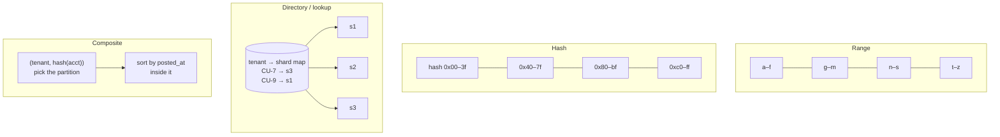
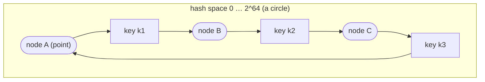
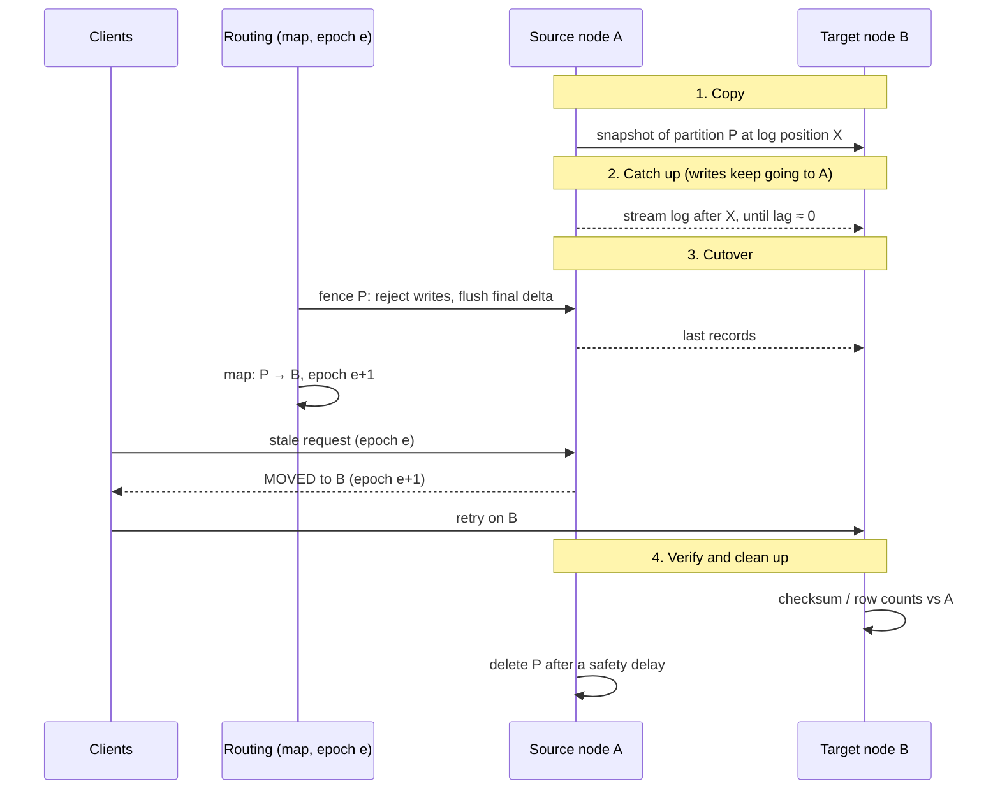

# A4 Unit 2 — Partitioning and consistent hashing

> Time: ~6 h · CORE: §5–§7 · STRETCH (≈ 1 h): the primary sources behind §6 (the bounded-loads and jump-hash papers, Maglev) and the live-migration internals of Redis Cluster and Vitess named in §7 · Lab: `labs/a4/ring`

Replication gave you more copies of the same data. It did not give you more *write capacity* or more *room*: every
node still holds everything and applies every write. **Partitioning** (sharding) splits the data so each node holds, and
writes, only a part. The difficult questions are not "how do I split it" but "how do I find a key's home afterwards",
"what happens to the placement when I add a node", and "what if one key is much busier than the rest" (Unit 3).

## Before you start

You should have finished Unit 1 (replication, lag, failover) and A2 (indexes, access patterns). Replication and
partitioning compose: every partition is itself a small replicated group (§10).

Warm-up (spaced retrieval from Unit 1, A2 and A1). Answer on paper first.

1. (Unit 1) Why does adding a read replica not help a write-bound primary?
2. (A2) A query filters on `account_id` and `posted_at` range and sorts by `posted_at` desc. Which composite index
   serves it, and what does that tell you about how data for one account should be laid out?
3. (A1) A load balancer uses round robin across four app servers; one is slow. Name the picker that mitigates this, and
   say what "affinity" load balancing (same client to same server) trades away.

<details data-kind="answer">
<summary>Warm-up answers</summary>

1. Every replica applies every write, so write capacity is still bounded by the leader, and replicas lose read capacity
   to apply work.
2. An index on `(account_id, posted_at DESC)`: equality column first, then the range/sort column. The lesson for this unit:
   rows for one account want to be *together and ordered*, so the partition key should usually be the account (or a
   prefix of it), with `posted_at` as the ordering key inside the partition.
3. Least-connections or power-of-two-choices sends less traffic to the slow server. Affinity (hash of client or
   session) gives locality and cache hits but ties load to the hash distribution and moves clients when the server
   set changes: the same problem this unit solves for data, and the reason consistent hashing is also an LB algorithm.

</details>

---

## §5 Why partition, and the partitioning schemes

### The failure story

The transactions table holds every posted and pending transaction for 40 credit unions: ≈ 12 M new rows/day, ≈ 5 years
of history, ≈ 22 B rows ≈ 9 TB with indexes. The single primary still handles the write rate (peak ≈ 1,400 TPS is inside the
≈ 1k–10k range of [`docs/NUMBERS.md`](../../docs/NUMBERS.md)), but everything *around* the writes is hurting: a full backup
takes 14 hours, building a replica takes 12 hours, a vacuum or index rebuild competes with payday, the working set no
longer fits in RAM so point reads hit NVMe, and a schema migration (A2) on a 9 TB table is a quarter-long project.

Team A shards by `hash(transaction_id) mod 8`. Writes spread evenly. But the statement screen (`WHERE account_id = ?
AND posted_at BETWEEN ...`) now has to ask **all 8 shards** and merge the results (§9). Team B partitions by
`posted_at` month, because statements are by date range and old months can be dropped cheaply. But today's writes all land
in the *current* month's partition: one shard takes 100% of 1,400 TPS while seven sit idle.

Six months later the platform needs a 9th shard. With Team A's `mod 8` scheme, ≈ 89% of rows have to move.

### Predict

<!-- predict id="A4-U2-P05" -->
**Predict.** Write your answers down before opening the reveal.

1. Range partitioning by month on `posted_at`: what share of the cluster's write capacity does the busiest partition use,
   and where do the day's writes go?
2. Hash partitioning with `hash(key) mod N`, growing from N = 8 to 9. What fraction of keys change partition? From N = 31 to
   32?
3. For the query "account 77's transactions for March", how many partitions must be consulted when the partition key is
   (a) `transaction_id` hashed, (b) `account_id` hashed with rows ordered by `posted_at` inside the partition, (c)
   `posted_at` month?
<!-- /predict -->

### Reveal

<details data-kind="reveal" data-for="A4-U2-P05">
<summary>Reveal</summary>

1. One partition (the current month) takes **all** the writes: it is the **hot tail**, and you are using 1/N of the
   write capacity you paid for. Any monotonically increasing key (timestamps, auto-increment IDs) range-partitions this way.
2. A key stays put only if `h mod N == h mod (N+1)`; over each period of N(N+1) hash values that is true for exactly N
   of them, so ≈ 1/(N+1) stay and ≈ **N/(N+1) move**: ≈ 89% for 8 → 9 and ≈ 97% for 31 → 32. The more nodes you
   have, the *worse* it gets; the optimal movement is the new node's fair share, ≈ 1/(N+1) (11% and 3%).
3. (a) **All N**: the account's rows are scattered by their own hash, so it is a scatter-gather query. (b) **One**: all of
   the account's rows are in one partition and already ordered; a single index range scan. (c) **One partition per month
   in the range** (one for March), but every account's March query hits that same partition, so it concentrates both
   the March load and the March statement-generation burst. The partition key decides which queries are cheap.

</details>

### How it actually works

**Why partition at all?** Because a node has limits on three axes, and replication fixes none of them:

| Limit | Symptom | Partitioning fixes it by |
|---|---|---|
| Data size | Backups, replicas and migrations take too long; working set exceeds RAM | Each node holds ≈ 1/N of the data |
| Write throughput | Leader CPU/WAL/lock contention saturates | Each partition has its own leader |
| Read throughput (beyond replicas/caches) | Hot working set too big or too busy | Each partition serves its own share |
| Blast radius / residency | One bad query or outage hits everyone; data must stay in a region | Failures and placement are per partition |

**Terminology** is a mess; know the synonyms: partition = shard (Mongo, Vitess, Elasticsearch) = tablet (Bigtable/Vitess) =
region (HBase, TiKV, Cockroach "range") = vBucket (Couchbase). *Vnode* is overloaded: in Cassandra/Dynamo it is a token owned by a
node (§6), in Riak a partition. Always ask what the speaker means.

**The schemes**



- **Range partitioning.** Each partition owns a contiguous key range. *Wins:* range scans and ordered iteration stay on one or a
  few partitions; cheap retention (drop the oldest partition); can split a hot range in place. *Loses:* monotonic keys create a
  hot tail; the ranges must adapt to data skew; balanced boundaries need data knowledge. *Fixes for the tail:* prefix the key
  with a salt or bucket (`bucket(0..15)#timestamp`, at the price of a 16-way scatter for scans), reverse the key, or use
  a natural prefix that already spreads load (tenant, account).
- **Hash partitioning.** Hash the key and assign hash *ranges* (or `hash mod N`, but see below) to partitions. *Wins:* near-uniform
  load for high-cardinality keys; no hot tail. *Loses:* range scans on the key become scatter-gather; neighbours in key
  space are unrelated. Always hash a key that is queried by equality (account id), not one that is scanned (timestamp).
- **Directory / lookup partitioning.** An explicit table maps a key (or tenant) to a partition. *Wins:* total control; move one
  huge tenant to its own shard; tiered tenants; residency rules. *Loses:* the directory is a critical dependency on the hot
  path (cache it, replicate it, make it small); someone has to *decide* placement. This is the natural fit for the
  tenant dimension of a multi-tenant platform (§10).
- **Composite (hash + range).** Hash the leading part to choose the partition, order by the rest inside it: Cassandra's
  partition key + clustering columns, DynamoDB's partition key + sort key. This is the workhorse for OLTP: equality on
  the partition key, ordered range on the sort key. For banking: partition key `(tenant_id, account_id)`, sort key
  `posted_at DESC`.

**Modulo is a trap.** `partition = hash(key) mod N` has perfect balance and a fatal flaw: N appears in the formula, so changing
N changes almost every key's home. Moving ≈ N/(N+1) of the data to add one node is not an operation, it is a migration
project. The two repairs are the subject of the rest of the unit: **indirection through a larger fixed set of partitions**
(many more partitions than nodes, assigned by a table; §7) and **consistent hashing** (§6).

**Choosing the key** is an access-pattern exercise (A2). Write down the top queries and make the partition key something
that appears as an equality filter in nearly all of them. Then check:

1. *Cardinality and skew.* Enough distinct values, none too big. `tenant_id` alone has 40 values and two of them hold half the
   data; `(tenant_id, account_id)` has millions.
2. *Immutability.* If the key changes, the row must move; use ids, not emails.
3. *Locality of the transaction boundary.* A transfer between two accounts in different partitions is a distributed
   transaction (§9). If most transfers are within one tenant and the tenant is the partition prefix, most are single-partition.
4. *The queries you will not be able to serve* by this key: they become scatter-gather or need a secondary index (§9). Name
   them out loud.

### Build it

No lab for this section — the placement function that fixes modulo's resharding cost is built in §6 (`labs/a4/ring`).
`ring.ModOwner` is provided there as the baseline to compare against.

### Break it

Two experiments in one program. First: a day of writes keyed by timestamp, range-partitioned into eight 3-hour
partitions versus hashed. Second: the cost of `mod N` when N grows by one.

```go
// Range partitioning on a timestamp key vs hash partitioning: where do the
// writes of one hour land? And what does N -> N+1 cost with hash mod N?
package main

import (
	"fmt"
	"hash/fnv"
)

func h(s string) uint64 {
	f := fnv.New64a()
	f.Write([]byte(s))
	x := f.Sum64()
	x ^= x >> 33
	x *= 0xff51afd7ed558ccd
	x ^= x >> 33
	return x
}

func main() {
	const parts = 8
	// Keys are ISO timestamps of the last day, partition boundaries split the
	// day into 8 equal 3-hour ranges. "Now" is 21:30, so all current writes
	// belong to the last range.
	rangeLoad := make([]int, parts)
	hashLoad := make([]int, parts)
	for s := 0; s < 3600; s++ { // one hour of traffic at 21:00-22:00, 1 write/s
		hour, min, sec := 21+s/3600, (s/60)%60, s%60
		key := fmt.Sprintf("2026-03-02T%02d:%02d:%02d", hour, min, sec)
		rangeLoad[hour/3]++
		hashLoad[h(key)%parts]++
	}
	fmt.Println("range-by-time:", rangeLoad)
	fmt.Println("hash         :", hashLoad)

	// Cost of resharding with hash mod N when N -> N+1.
	for _, n := range []int{4, 8, 16, 32} {
		moved := 0
		const keys = 100000
		for i := 0; i < keys; i++ {
			k := fmt.Sprintf("acct-%d", i)
			if h(k)%uint64(n) != h(k)%uint64(n+1) {
				moved++
			}
		}
		fmt.Printf("mod %2d -> %2d: %.1f%% of keys move (ideal %.1f%%)\n", n, n+1, 100*float64(moved)/keys, 100/float64(n+1))
	}
}
```

Predict both outputs, run it (`go run .` in a scratch directory), then change the key to
`fmt.Sprintf("%02d/%s", bucket, ts)` with `bucket = s % 8` for the range scheme and see what the salting buys and costs.

<details data-kind="answer">
<summary>What you should see, and why</summary>

`range-by-time: [0 0 0 0 0 0 0 3600]` (every write in the last range) versus a hash spread of ≈ 450 per partition. The mod
experiment prints ≈ 80%, 89%, 94% and 97% of keys moving for 4→5, 8→9, 16→17 and 32→33, against ideals of 20%, 11%, 5.9%
and 3.0%. With the salted range key the writes spread across eight buckets (one per second-mod-8), so the hot tail disappears,
but a time-range scan now has to visit all eight buckets and merge: you bought write distribution with read fan-out. That
is the trade in every salting scheme (§8 uses it for hot keys).

</details>

### In the wild

- **Postgres declarative partitioning** (range/list/hash) partitions a table *within one server*: partition pruning, cheap
  `DROP` of old partitions, smaller indexes. It is not sharding; combine it with Citus, application-level routing or Vitess-style
  middleware to spread across machines.
- **Cassandra**: partition key hashed by the partitioner (Murmur3 by default) onto a token ring; clustering columns order
  rows inside a partition; an unbounded partition (a key that grows forever) is the classic anti-pattern. TODO-VERIFY
  guidance on partition size limits.
- **DynamoDB**: the partition key is hashed to a physical partition; the optional sort key orders items within a partition
  key (item collection). Partitions split by size and throughput automatically. TODO-VERIFY per-partition throughput and
  size figures before quoting.
- **MongoDB**: you choose a shard key and either ranged or hashed sharding; a monotonically increasing `_id` as a ranged
  shard key sends all inserts to one chunk, a hashed shard key spreads them but loses range queries on that key.
- **HBase/Bigtable** are range-partitioned by row key; designing row keys (salting, reversing timestamps, tenant prefixes) to avoid
  the hot tail is the core skill.
- **Kafka**: the default partitioner hashes the record key to pick a partition, so per-key ordering holds; changing the
  number of partitions later changes which partition a key maps to, breaking per-key order across the change (A6).
- **Elasticsearch**: documents are routed to a primary shard by hash of the routing value (the `_id` by default); the
  number of primary shards is fixed when the index is created. TODO-VERIFY current resize/split options.

### Trade-offs

| Option | Wins when | Loses when | When the answer flips |
|---|---|---|---|
| Range | Ordered scans, time-based retention, locality of neighbouring keys | Monotonic keys (hot tail); skewed ranges | Flip to hash (or hash prefix) when write distribution beats scan locality |
| Hash (equality keys) | Even load, high-cardinality keys, point lookups | Range scans, ordered pagination across keys | Flip to composite when you also need ordered scans within an entity |
| Directory (lookup) | Few big units with very different sizes (tenants); explicit moves, residency | Lookup is on the hot path; operator effort | Flip to hashing when the units are many and uniform |
| Composite (hash + sort) | OLTP: equality on the entity, ordered range within it | Queries by other attributes; huge per-entity partitions | Flip to secondary indexes (§9) or a separate store for the other query patterns |
| `hash mod N` | Static N that never changes (rare) | Any change to N moves ≈ N/(N+1) of data | Flip to a ring or fixed slots (§6–§7) the moment N might change |

### Senior bar

- **Failure modes**: a hot tail from a monotonic key; one oversized tenant that does not fit one shard; the partition key
  turning out not to be in the queries (all scatter-gather); changing N with mod; a key that changes (row moves); unbounded
  partitions (one account with millions of rows in one wide partition); cross-partition uniqueness constraints that can no
  longer be enforced by the database.
- **Capacity (≈)**: partitions needed = max(data / data-per-partition, peak writes / writes-per-partition) (§10). At
  ≈ 500 GB per partition 9 TB is ≈ 18 partitions; at ≈ 2,500 TPS per primary, 1,400 TPS needs 1. **Storage, not write
  rate, forces the split here**, which says "partition for operability, not for TPS".
- **Ops**: you now operate N databases: schema migrations, backups, monitoring, upgrades fan out; the shard map is a
  piece of production configuration with its own change control; choose the number of logical partitions generously up
  front (§7) because changing the *function* is far costlier than moving partitions.
- **Cost**: partitioning itself costs nothing in storage; the cost is the operational surface and the queries that now fan out.

Interviewer follow-up probes:

1. "How would you partition the transactions table for 40 credit unions, two of which hold half the data?"

<details data-kind="answer">
<summary>Model answer</summary>

Queries are by account and date range, scoped to a tenant. Use a composite key: partition by `(tenant_id, account_id)`
(hash of the pair) with `posted_at DESC` as sort/clustering order, so one account's statement is a single-partition
range scan. Since two tenants hold half the data, tenant alone would be skewed; the account-level hash spreads even a huge
tenant across many partitions. Keep a small tenant → placement directory so a tenant with contractual isolation or a
noisy neighbour can be given dedicated shards. Cross-account queries (member search, reports) go to secondary indexes
or an analytical store (§9). Say what you give up: transfers between accounts on different partitions become
distributed operations.

</details>

2. "Why not partition by `created_at`? Statements are by date."

<details data-kind="answer">
<summary>Model answer</summary>

Because all current writes hit the newest partition (hot tail) and all current reads of recent data concentrate there too,
while a statement for one account is spread across every month partition. Use time only as the *ordering* inside an
account's partition, or as an additional level for retention (drop or archive old data per partition) after the account hash.

</details>

3. "What is wrong with `hash(key) % numShards` in production?"

<details data-kind="answer">
<summary>Model answer</summary>

Changing the shard count remaps ≈ N/(N+1) of the keys, so every capacity change is a near-full data migration, caches
go cold at once, and a rolling deploy where clients disagree on N sends the same key to different shards. Use a larger
fixed number of logical partitions with a mutable partition → node table, or consistent hashing.

</details>

### Check yourself

1. Why does a monotonically increasing key break range partitioning but not hash partitioning?
2. Give one query that a composite key `(account_id, posted_at)` serves well and one it serves badly.
3. Why is partitioning mostly done "for operability" before "for throughput" in transactional systems?

<details data-kind="answer">
<summary>Answers</summary>

1. Every new key is greater than all existing ones, so it always falls into the last range; hashing destroys the order, so
   consecutive keys scatter.
2. Well: one account's transactions in a date range. Badly: "all transactions over $10,000 across all accounts today"
   or "find by last 4 of the card number"; neither includes the partition key.
3. A single primary handles thousands of write TPS, which a banking platform rarely exceeds; backup time, restore time,
   replica build time, migrations and working-set size hit limits much sooner.

</details>

---

## §6 Consistent hashing and virtual nodes

### The failure story

The platform runs a fleet of 8 cache nodes (A3 owns what they cache; this unit owns where keys live). Clients pick a node
with `hash(key) mod 8`. Reads are ≈ 100,000/s at a 95% hit rate, so the database sees ≈ 5,000 reads/s, comfortably inside its
≈ 50,000 QPS.

At 09:05 on payday autoscaling adds a ninth node. Immediately ≈ 89% of keys map to a different node than before. Hit rate
collapses to ≈ 15%, and the database sees ≈ 85,000 reads/s: well over its capacity. p99 goes from 5 ms to seconds, the
retry storm starts (A7), and the cache fleet that was added to *help* has caused the incident. The repair, shutting
down the ninth node, remaps 89% of keys *again*.

The problem is the formula, not the load: N is in it.

### Predict

<!-- predict id="A4-U2-P06" -->
**Predict.** Write your answers down before opening the reveal.

1. Place 10 nodes on a hash ring with **one** point each. Roughly how much more traffic than the average does the busiest
   node receive? What happens as you give each node 100 points?
2. With a ring of 10 nodes and many virtual nodes, a node dies. Which nodes receive its keys, and how much extra load does
   each get? What would happen with one point per node?
3. You want 3 replicas of every key on distinct machines. Why is "the next 3 points clockwise" wrong when each node has 256 points?
<!-- /predict -->

### Reveal

<details data-kind="reveal" data-for="A4-U2-P06">
<summary>Reveal</summary>

1. With one random point per node the arcs are very unequal: the largest of 10 random arcs is ≈ H₁₀ ≈ 2.9× the average, so the busiest
   node gets ≈ **3×** the mean load and the least loaded may get a few percent. With v points per node a node's load is the sum of v
   small arcs; its relative standard deviation falls as ≈ 1/√v, so the busiest node of 10 is roughly 1 + 2/√v above the mean:
   ≈ 1.2× at v = 100, ≈ 1.1× at v = 256 (in the lab's break-it table: 1.20 at 16, 1.16 at 64 and 1.05 at 1,024 vnodes per node).
2. With many virtual nodes the dead node's arcs are scattered all over the ring, so its keys spill to **many different
   neighbours**, each getting a small share (≈ 1/9 of the dead node's load), so no single survivor takes a double load. With one
   point per node *all* of its keys go to a single successor, which doubles its load and may fail next (cascading
   failure).
3. Adjacent points are often owned by the **same** node (with 256 points per node, a node's points interleave randomly), so
   "the next 3 points" can name the same machine twice or three times and you would put three replicas on one box. Walk
   clockwise and skip points belonging to nodes you already chose; ideally also skip nodes in the same rack or AZ.

</details>

### How it actually works

**The ring.** Take a hash function with a huge output space (here 64 bits) and imagine its values arranged on a circle. Hash each
node's name onto the circle. To find a key's owner, hash the key onto the circle and walk clockwise to the first node
you meet (its **successor**).



- `k1` belongs to B (first node clockwise), `k2` to C, `k3` wraps around past the top of the circle to A.
- **Add a node** X between A and B: only keys in the arc (A, X] change hands, and they all move **to X**, from X's
  successor. Everything else stays. For N nodes with uniform arcs ≈ 1/(N+1) of the keys move. This is *monotonicity*, and the
  lab tests it: after `Add(X)` every key either keeps its owner or moves to X.
- **Remove a node**: its keys move to its successor(s); nothing else changes.

**Virtual nodes.** One point per node gives the skew in the Predict. Give each node *v* points, derived from its name and
index (`db-3#0`, `db-3#1`, …), each hashed onto the ring. The node owns the union of the arcs ending at its points.
Effects:

- *Smoothness*: load std-dev ≈ 1/√v (relative). v ≈ 100–256 gets within ≈ 10–20% of the mean for typical N.
- *Spread of work on change*: joining or leaving nodes exchange small slices with *every* other node, so rebalancing load
  is spread, and failure load is spread (§6 Predict #2).
- *Heterogeneity*: give a bigger machine more points (weight w ⇒ w × v points).
- *Cost*: N × v points in a sorted array; lookup is a binary search, O(log(N·v)). 1,000 nodes × 256 points = 256,000 points, ≈ 18 comparisons
  per lookup and a few MB of memory.
- *Determinism*: two clients must build the identical ring from the same member list: same hash function, same point labels,
  same tie-breaking on collisions. The lab's `VNodeLabel`, `Hash64` and "ties go to the smaller node name" rules exist because
  this is where real rings silently disagree.

**Replica sets.** Dynamo-style stores replicate each key on the first *R* distinct physical nodes clockwise from its
position (the **preference list**). This is `LookupN`. Rack/AZ awareness adds "…and not in a zone already used", which
Cassandra's `NetworkTopologyStrategy` does; the ring still decides the order.

**Bounded loads.** Even with vnodes, a skewed key distribution (or small N) can overload a node. *Consistent hashing with
bounded loads* (Mirrokni, Thorup & Zadimoghaddam, 2016) caps every node at `ceil((1+ε) × average)`: if a key's successor is
full, it spills clockwise to the next node with room. With ε = 0.25 no node exceeds 125% of the mean, at the price of some keys
living off their natural owner (§6 Break it measures how many). It suits load balancers and caches; for stores it
means placement depends on insertion order, so assignments must be remembered, not recomputed.

**Alternatives**

- **Rendezvous (highest-random-weight) hashing**: for each key, score every node with `hash(node, key)`; the highest wins. No ring,
  no vnodes, perfect balance, minimal movement on add/remove, trivial weights. Cost: O(N) per lookup, so it fits small N
  (tens to low hundreds; cache the result). Replicas = the top R scores.
- **Jump consistent hash** (Lamping & Veach, 2014): `bucket = jump(key, n)` in O(ln n) time with no memory, almost perfectly
  uniform, and growing n → n+1 moves exactly the keys that land in the new bucket. Limitation: buckets are
  numbered 0..n−1 and you can only add or remove the **last** bucket; no weights, no arbitrary node removal. Excellent
  for "partition number from key" when partitions only ever grow, and then a table maps partitions to machines.
- **Fixed hash slots** (Redis Cluster: 16,384 slots; many others use the same idea with other numbers): `slot = hash(key) mod S`
  with S large and *fixed forever*, then a small mutable table `slot → node`. Adding a node means reassigning some slots. This is
  indirection instead of a clever hash, and is the most operationally transparent design (§7).
- **Maglev hashing** (Google's software load balancer) builds a lookup table with minimal disruption and O(1) lookup; Envoy
  offers `ring_hash` and `maglev` policies for consistent-hash load balancing. Named only. TODO-VERIFY details if you need them.

| Scheme | Lookup | State | Move on N→N+1 | Weights / removal anywhere | Typical use |
|---|---|---|---|---|---|
| `hash mod N` | O(1) | none | ≈ N/(N+1) | no | static N only |
| Ring + vnodes | O(log Nv) | N·v points | ≈ 1/(N+1), all to new | yes / yes | Dynamo, Cassandra, cache clients |
| Rendezvous | O(N) | node list | ≈ 1/(N+1), all to new | yes / yes | small N, LB affinity |
| Jump hash | O(ln N) | none | exactly 1/(N+1), all to new | no / last only | partition numbering that only grows |
| Fixed slots + table | O(1) + table | S-entry table | you choose which slots move | yes / yes | Redis Cluster, Couchbase, Kafka, ES |

### Build it

Lab `labs/a4/ring`, file `ring.go`. Implement, in this order (the tests are in `ring_test.go`; read the package doc first):

1. `Ring.Add`, `Remove`, `Lookup`, `Nodes`, `Len`, `Clone`: virtual node `i` of a node sits at `Hash(VNodeLabel(node, i))`; keep the
   points sorted by (position, node name); lookup is `sort.Search` for the first position ≥ hash with wrap-around. `Add` with weight w creates w × `VNodes`
   points.
2. `Ring.LookupN`: clockwise walk, skipping nodes already chosen; fewer nodes than requested returns them all.
3. `Distribution`, `MovedFraction`, `Summarize`: the statistics the break-it uses.
4. `AssignBounded`: capacity `ceil((1+ε) × keys / nodes)`, each key to the first node on its `LookupN` walk with room.
5. `Rendezvous` and `JumpHash` (the constants are in the stub's doc comment).

Acceptance tests (selected): `TestLookup_ReturnsClockwiseSuccessorAndWraps`, `TestRing_PositionTieIsBrokenByNodeNameNotInsertionOrder`,
`TestAdd_KeysOnlyMoveToTheNewNode`, `TestRemove_OnlyTheRemovedNodesKeysMove`,
`TestMovedFraction_AddingNodeNPlus1MovesAboutOneOverNPlus1`, `TestBalance_ManyVirtualNodesGiveEvenLoad`,
`TestBalance_OneVirtualNodePerNodeIsBadlySkewed`, `TestWeights_HeavierNodeGetsProportionalShare`,
`TestLookupN_ReturnsDistinctNodesNotAdjacentVirtualNodes`, `TestAssignBounded_NoNodeExceedsTheCap`,
`TestJumpHash_MovesOnlyToTheNewBucketAndAboutOneOverNPlus1`, `TestRing_ConcurrentLookupDuringAddRemove` (six readers,
a writer adding and removing ten nodes, `-race`). Run `go test -race ./labs/a4/ring/`.

### Break it

Four tables, one command:

```
go test -tags breakit -run BreakIt -v ./labs/a4/ring/
```

(1) Modulo vs ring: key movement when one node is added to a cluster of N = 2…64. (2) Virtual nodes vs skew: 10 nodes,
vnodes from 1 to 4,096. (3) Who donates keys when node 11 joins, for 1, 16 and 256 vnodes. (4) Bounded loads: a deliberately skewed
ring (8 vnodes per node) and ε from 100 down to 0. Predict each table, run it, then in a scratch copy of the lab
make `Add` hash labels that include the current node count (so adding a node moves every point) and run the monotonicity test.

<details data-kind="answer">
<summary>What you should see, and why</summary>

(1) Modulo moves ≈ 67%, 75%, 80%, 89%, 94%, 97%, 98.5% of keys for N = 2, 3, 4, 8, 16, 32, 64; the ring moves
≈ 30%, 26%, 21%, 12%, 6.4%, 3.1%, 1.8%, close to 1/(N+1) (33%, 25%, 20%, 11%, 5.9%, 3.0%, 1.5%). (2) max/mean falls from ≈ 3.4
at one vnode (min/mean ≈ 0.03: one node nearly empty) to ≈ 1.2 at 16, ≈ 1.1 at 256 and ≈ 1.03 at 4,096; the cost is
points in memory (10 → 40,960). (3) With 1 vnode a single node donates everything (it is the only one adjacent); with 16
vnodes ≈ 8 of 10 donate unevenly; with 256 all 10 donate ≈ 1% of the data each, so the load of rebalancing is shared.
(4) Without a bound the busiest node holds ≈ 1.77× the mean; ε = 0.25 pins it at 1.25 with ≈ 7.5% of keys off their natural owner;
ε = 0 gives perfect balance with ≈ 18% off-owner. Bounded loads trade placement stability for balance. The scratch change
makes `TestAdd_KeysOnlyMoveToTheNewNode` fail: the "ring" has become a mod scheme in disguise, and a cache fleet built on it
has the §6 failure story.

</details>

### In the wild

- **Dynamo (2007)** introduced the combination of consistent hashing, virtual nodes (tokens), preference lists of N distinct
  physical nodes, sloppy quorums and hinted handoff. It was a design for Amazon's shopping cart, not a library.
- **Cassandra** assigns each node one or more tokens (`num_tokens` = virtual nodes) on a Murmur3 hash ring and replicates to
  the next RF distinct nodes (rack-aware under `NetworkTopologyStrategy`). Older versions defaulted to 256 tokens per node, which makes
  repair and streaming heavier; newer ones default lower with a smarter allocator. TODO-VERIFY the current default and allocator.
- **Redis Cluster** uses 16,384 fixed hash slots (`CRC16(key) mod 16384`); `{hash tags}` force related keys into one slot.
  Nodes own slot ranges; resharding moves slots. It is the fixed-slot design, not a ring.
- **MongoDB** divides the shard-key space (ranged or hashed) into chunks, a balancer migrates chunks between shards, and
  config servers hold the chunk map that `mongos` routers cache. **Vitess** maps each row's sharding-key value through a
  *vindex* to a `keyspace_id` and assigns ranges of that id space to shards; resharding splits a range.
- **DynamoDB** hashes the partition key to a physical partition managed (and split) by the service. TODO-VERIFY internals; they are not public in detail.
- **memcached client libraries** (the "ketama" scheme) place many points per server on a ring so adding a cache server
  invalidates ≈ 1/N of the keys; a widely used default is on the order of 100–200 points per server. TODO-VERIFY the exact figure.
- **Load balancers**: Envoy's ring-hash and maglev policies and HAProxy's consistent hashing (with a bounded-load balance
  factor option, TODO-VERIFY) use the same ideas for session affinity (A1 Unit 1).
- **Hash function choice**: use a fast, stable, well-mixed hash (xxHash, Murmur3, FNV+finalizer as in the lab). **Never** use a
  per-process seeded hash (Go's `hash/maphash` with a random seed, language `hashCode()` that varies across runtimes): two
  clients would build different rings.

### Trade-offs

| Option | Wins when | Loses when | When the answer flips |
|---|---|---|---|
| Ring + vnodes | Nodes join/leave often; heterogeneous nodes; replica walks | Lookup state; load imbalance needs 100+ vnodes; membership must be consistent across clients | Flip to fixed slots when you want explicit, auditable placement |
| Fixed slots + table | You want to move specific slots deliberately; clients can cache a small table | The slot count is a lifetime decision; the table must be distributed | Flip to a ring when you want placement to be computed, not stored |
| Rendezvous | Small N, simple weights, no ring bookkeeping | O(N) per lookup | Flip to ring or jump hash when N is large (thousands) |
| Jump hash | Partition numbers that only grow; zero memory; best balance | Cannot remove middle buckets; no weights | Flip to ring/slots when nodes of any position can fail or be decommissioned |
| Bounded-load ring | Load balancing/caches where a hot key must not overload one node | Assignments depend on history; more keys leave their owner | Flip to plain ring when keys are many and uniform enough |

### Senior bar

- **Failure modes**: a ring built differently by two clients (hash, labels, ties, member lists out of sync) so reads
  miss; a dead node's load dumped on one successor (few vnodes); replicas on the same host/rack; stale membership
  (a node that left still receives writes); vnode explosion (thousands of nodes × thousands of points) slowing
  membership changes; a hash function that clusters similar keys (sequential IDs hashed with a weak function).
- **Capacity (≈)**: ring memory ≈ N × v × (8–24 B); lookups ≈ 0.1–0.5 µs per binary search; v ≈ 128–256 gives ≈ 10% imbalance for
  N ≈ 10–100; expected keys moved on one change ≈ K/(N+1) (K = total keys), e.g. 9 TB over 31 → 32 nodes moves ≈ 280 GB.
- **Ops**: version the membership view and make clients converge (gossip or a coordination service); move data to a
  joining node before it serves reads (§7); decide how long to wait before declaring a node permanently dead and
  re-replicating; test ring builds across languages with golden vectors (the lab's jump-hash golden test is the pattern).
- **Cost**: virtual nodes cost memory and, in stores with per-vnode streaming and repair, operational time; more is not
  free.

Interviewer follow-up probes:

1. "Why does consistent hashing move only 1/N of the keys?"

<details data-kind="answer">
<summary>Model answer</summary>

Because a key's owner depends only on the nodes adjacent to it on the ring, not on the total count. Adding a node
inserts points that capture just the arcs immediately before them; all other arcs keep their owner. With N+1 nodes the new
node's fair share is 1/(N+1) of the ring, and that is exactly what moves, always to the new node. With `mod N`, N is in the
function, so every key's remainder changes.

</details>

2. "How many virtual nodes would you use and why?"

<details data-kind="answer">
<summary>Model answer</summary>

Enough that relative load deviation ≈ 1/√v is within the tolerance: ≈ 100–256 for ≈ 10–20% imbalance, and weight by
machine capacity. More vnodes smooth load and spread rebalancing work but cost memory and per-vnode overhead in
streaming/repair; if the store does per-vnode repair, prefer fewer vnodes plus a smarter token allocator or fixed
partitions. If exact balance matters more than minimal movement, use bounded loads or fixed slots.

</details>

3. "Compare consistent hashing to Redis Cluster's hash slots."

<details data-kind="answer">
<summary>Model answer</summary>

Both give stable key → bucket maps with cheap resizing. The ring computes placement from node names, so membership is
the only state and placement moves automatically as nodes come and go. Slots store an explicit table, so placement
is deliberate and observable: you can move exactly the slots you want, at the time you want, and audit them, at the
cost of distributing and versioning the table. Slot systems are easier to operate; rings are easier to bootstrap
without a coordinator.

</details>

### Check yourself

1. After `Add(X)` to a ring, what is the only thing a key can do?
2. Why do you hash `node#i` for vnodes rather than hashing the node name `v` times with a counter appended to the hash?
3. When would you pick jump hash over a ring?

<details data-kind="answer">
<summary>Answers</summary>

1. Stay where it was or move to X; it never moves between two old nodes.
2. Any deterministic, well-mixed function of (name, i) works as long as every client uses the same one; the point is
   stable labels that do not depend on how many other nodes exist. Re-hashing the previous hash would also work but
   is harder to reproduce across languages; the label form is the one that is easy to specify and test.
3. When you number partitions 0..n−1, only ever grow n, want zero lookup state and perfect uniformity, and keep a separate
   table from partition number to machine.

</details>

---

## §7 Rebalancing, request routing and operating a partitioned system

### The failure story

The cluster has 8 data nodes, 256 partitions of ≈ 40 GB each (≈ 10 TB), and storage is at 78%. At 10:00 on a Tuesday an engineer adds
node 9 and clicks "rebalance". The rebalancer starts copying ≈ 28 partitions (≈ 1.1 TB) as fast as it can: the source
nodes' disks and NICs saturate, p99 for normal traffic goes from 12 ms to 120 ms, and two source nodes miss their own replication heartbeats.
The failure detector declares one of them dead; the system decides to rebalance *again* to restore the replication factor,
starting another wave of copying. Meanwhile clients with a stale partition map still send requests for moved partitions to
the old owner and get errors.

Everything here is predictable. Moving data is the most dangerous routine operation in a partitioned system.

### Predict

<!-- predict id="A4-U2-P07" -->
**Predict.** Write your answers down before opening the reveal.

1. 256 fixed partitions over 8 nodes (32 each) of 40 GB. A 9th node joins and the cluster rebalances to the most even
   layout, moving whole partitions. How many partitions move, how much data, and how long at 100 MB/s with 2 streams?
2. Why is it dangerous to trigger an automatic rebalance on a failure-detector signal alone?
3. A partition is being copied from node A to node B while clients keep writing to it. What are the options for not
   losing those writes, and which step is the dangerous one?
<!-- /predict -->

### Reveal

<details data-kind="reveal" data-for="A4-U2-P07">
<summary>Reveal</summary>

1. The target is 256/9 ≈ 28.4 partitions per node, so the new node takes ≈ **28 partitions ≈ 11%** (1/(N+1)) of the data, ≈ 1,120 GB. At
   2 streams × 100 MB/s = 200 MB/s that is ≈ 1,120 × 1,024 / 200 ≈ 5,700 s ≈ **1.6 hours**. The tempting answers are "a
   third of the data" (nothing needs to move that much) or "seconds" (copying is bandwidth-bound).
2. A failure detector cannot distinguish dead from slow. A slow node triggers a rebalance that adds load (copying) to
   an already stressed cluster, which slows more nodes, which triggers more rebalancing: a rebalance storm. Moving data
   is expensive and mostly irreversible in the short term, so most systems wait a grace period (minutes to hours) before
   re-replicating, or require a human.
3. (a) Copy a snapshot, then stream the change log to B until it has caught up (the §1 bootstrap recipe), then briefly
   fence writes on A, flush the last delta, and switch the routing so writes go to B. (b) Dual-write to both during the
   copy. (c) Pause writes for the whole copy (no one does this for big partitions). The **dangerous step is the cutover**:
   between "A stops accepting writes" and "everyone has B's address", a write can go to A and be lost, or to both and diverge.
   Hence epochs and redirect responses (below).

</details>

### How it actually works

**Strategies**

1. **Fixed number of partitions** (many more than nodes). Create, say, 256–4,096 partitions up front, assign several to each
   node. Adding a node steals some whole partitions from others; removing a node hands its partitions out. Only
   the partition → node table changes; keys never change partition. Used by Redis Cluster (16,384 slots), Elasticsearch
   (shards per index), Kafka (partitions per topic), Couchbase (vBuckets), Riak (ring partitions). Choose the count to be
   ≥ the largest number of nodes you will ever have, but not so large that per-partition overhead dominates (file handles,
   replication groups, metadata). Partition size grows with data: with 256 partitions and 100 TB each partition is ≈ 400 GB,
   too heavy to move comfortably.
2. **Dynamic splitting** (range-partitioned systems). Start with one or a few partitions; when one exceeds a size or load threshold, **split** it in two at
   a good boundary; when two neighbours shrink, **merge**. Partition count follows data. HBase regions, Bigtable
   tablets, MongoDB chunks, DynamoDB partitions, CockroachDB/TiKV ranges, Spanner splits. Pre-split before a bulk load or
   the first writes all pile onto one partition. The cost is the machinery (split detection, boundary choice, metadata updates) and
   split storms during growth.
3. **Per-node tokens** (ring-based: Dynamo, Cassandra). Partitions are the arcs between tokens; the number of arcs is proportional to the
   number of nodes. Joining takes arcs from neighbours; leaving gives arcs to successors. Balance depends on token count
   and allocation (§6).

**Moving a partition while serving traffic**



Principles: copy + stream (no long pause), a short fenced cutover, reads can move first (replicas) then writes, keep the
source until the target is verified, make the whole workflow **resumable and reversible** (Vitess's `MoveTables` /
`Reshard` workflows can reverse replication to roll back after cutover; TODO-VERIFY specifics). Redis Cluster does this per slot with
`MIGRATING`/`IMPORTING` states and an `ASK` redirect for keys that have already moved while the slot is still in transit.

**Request routing**: how does a client find the partition's current leader?

| Model | How | Examples | Notes |
|---|---|---|---|
| Any-node routing | Client asks any node; it forwards or replies `MOVED` | Cassandra coordinators, Redis Cluster | Simple clients; an extra hop unless the client learns the map |
| Routing tier | Clients talk to stateless proxies that know the map | MongoDB `mongos`, Vitess `vtgate`, Envoy, application-level shard router | Clients are dumb; the proxy tier must scale and be HA |
| Smart (token-aware) client | Client caches the map and connects directly | Cassandra drivers, Kafka clients (metadata), Redis Cluster clients | Lowest latency; every client library must handle map changes |

All three need the same two things: an **authoritative map** (a coordination service such as ZooKeeper/etcd, a config
replica set, or gossip among nodes), and an **epoch/version** on requests so a node can tell "your map is stale" and
answer with a redirect rather than silently serving or dropping the request. Stale maps are normal, not exceptional; design
for "redirect and retry" (with idempotency keys, A1).

**Operations**

- *When*: off-peak, one partition (or a small, throttled number of streams) at a time; cap bandwidth and IO so foreground latency
  is protected; stop rebalancing while the cluster is degraded.
- *Triggers*: manual or scheduled for capacity; automatic only with damping (wait before re-replicating after a node loss; never
  rebalance during an incident).
- *Headroom*: you need free disk on the target *and* spare capacity on the source while copying. Plan for ≥ 30% free at all
  times; running at 85% full removes the option to rebalance.
- *Monitor skew*: per-partition size, QPS, p99 and per-node max/mean ratios. Alert on max/mean > ≈ 1.5 for size or QPS: skew is
  what turns a healthy-looking average into one overloaded node (§8).
- *Cost model*: data moved ≈ total / (N+1) for adding a node (not total/2); time ≈ data / throttled throughput, as in the Predict.

### Build it

No lab for this section — see §6: `ring.Ring.Clone`, `Add`, `Remove` and `ring.MovedFraction` are exactly the tools for
*planning* a rebalance (what moves, to whom), and `ring.AssignBounded` shows a placement that trades stability for balance.
The program below plans the fixed-partition case.

### Break it

Plan the fixed-partition rebalance from the Predict, then change the inputs.

```go
// Fixed partitions: 256 partitions over N nodes. Add a node and move whole
// partitions from the most loaded nodes until balanced. How much data moves,
// and how long does it take at a throttled copy rate?
package main

import "fmt"

func main() {
	const (
		partitions  = 256
		partitionGB = 40.0 // data per partition
		copyMBps    = 100.0
		concurrent  = 2 // partitions copied at once
		startNodes  = 8
	)
	owner := make([]int, partitions)
	for p := range owner {
		owner[p] = p % startNodes
	}
	nodes := startNodes + 1
	count := func() []int {
		c := make([]int, nodes)
		for _, o := range owner {
			c[o]++
		}
		return c
	}
	moved := 0
	for {
		c := count()
		maxN, minN := 0, 0
		for i := range c {
			if c[i] > c[maxN] {
				maxN = i
			}
			if c[i] < c[minN] {
				minN = i
			}
		}
		if c[maxN]-c[minN] <= 1 {
			break
		}
		for p := range owner { // move one partition from maxN to minN
			if owner[p] == maxN {
				owner[p] = minN
				moved++
				break
			}
		}
	}
	gb := float64(moved) * partitionGB
	hours := gb * 1024 / copyMBps / 3600 / concurrent
	fmt.Printf("%d -> %d nodes: moved %d of %d partitions (%.1f%%), %.0f GB, ≈ %.1f h at %.0f MB/s x %d streams\n",
		startNodes, nodes, moved, partitions, 100*float64(moved)/partitions, gb, hours, copyMBps, concurrent)
}
```

Predict the output, run it, then try: (a) 1,024 partitions of 10 GB (same total); (b) `startNodes = 31`; (c) double `copyMBps`
and ask what you would give up to run it unthrottled; (d) what happens to the answer if partitions have very unequal
sizes (say, one 400 GB partition)?

<details data-kind="answer">
<summary>What you should see, and why</summary>

`8 -> 9 nodes: moved 28 of 256 partitions (10.9%), 1120 GB, ≈ 1.6 h at 100 MB/s x 2 streams`. (a) Moves ≈ 114 of
1,024 partitions, the same ≈ 1,120 GB: the *volume* depends on the new node's fair share, not on partition size; smaller
partitions only make the work more granular, parallel and restartable, and balance finer. (b) Moves ≈ 8 of 256 partitions, ≈ 320 GB
(1/32 of 10 TB): a big cluster rebalances relatively *less* per added node, and in absolute terms only that. (c) Twice the
rate halves the time but competes with foreground traffic for the same disks and NIC; throttling exists to protect p99.
(d) One giant partition is a single indivisible, long-running move, may not fit on the target's free space, and means the
"balanced by count" layout is not balanced by bytes: balance by size and load, not count, and split jumbo partitions.

</details>

### In the wild

- **Redis Cluster**: `redis-cli --cluster reshard` and `rebalance` move slots between masters key by key with
  `MIGRATE`; clients get `MOVED`/`ASK` redirects and refresh their slot maps. TODO-VERIFY tooling flags.
- **MongoDB**: the balancer migrates chunks between shards, can be limited to maintenance windows, and has a "jumbo chunk"
  problem when a single shard-key value is too large to split. TODO-VERIFY default chunk size (believed 128 MB in recent versions, 64 MB earlier).
- **Kafka**: partition reassignment tooling moves replicas between brokers; throttles exist because replica fetch competes
  with consumers. Adding brokers does not rebalance existing partitions automatically; tools such as Cruise Control
  automate it. TODO-VERIFY.
- **Cassandra**: bootstrap streams data to a joining node; `nodetool cleanup` removes data a node no longer owns;
  decommission streams data away. Adding several nodes at once is discouraged. TODO-VERIFY current guidance.
- **Elasticsearch**: shard allocation honours disk watermarks and allocation throttling; the primary shard count is
  fixed per index (re-index or split to change it). TODO-VERIFY.
- **Vitess**: resharding workflows copy rows, replicate from the source shards (VReplication), allow verification, and
  switch reads then writes. **HBase/Bigtable/Spanner/CockroachDB** split and merge ranges automatically and move them
  with consensus-replicated membership changes (A5).
- **DynamoDB** hides all of this: partitions split and move behind the API, with adaptive capacity absorbing some skew.
  The price is control and some limits per partition. TODO-VERIFY current limits.

### Trade-offs

| Option | Wins when | Loses when | When the answer flips |
|---|---|---|---|
| Fixed number of partitions | Simple, predictable moves; hash keys; you can bound future cluster size | Partition size grows with data; the count is a lifetime decision | Flip to splitting if data grows many-fold or you need range scans |
| Dynamic splitting | Range data; unknown growth; skewed key space | Split/merge machinery; hot ranges before splits; bulk-load pre-splitting | Flip to fixed + hash when the key space is uniform and you value simplicity |
| Per-node tokens (ring) | Elastic membership with automatic placement | Balance relies on vnodes/allocator; streaming/repair cost per token | Flip to fixed slots if you want explicit control |
| Manual rebalancing | Risky clusters, high-value data; humans pick windows | On-call load; slow response to skew | Flip to throttled, damped automation once the process is boring |
| Automatic rebalancing | Large fleets; managed services | Rebalance storms, surprises at peak | Flip to manual or windowed when the cluster is near capacity |

### Senior bar

- **Failure modes**: rebalance storm (detector false positive → copy → more load); copy saturating IO/NIC and breaking latency SLOs;
  stale routing causing misdirected or lost writes at cutover; source deleted before the target is verified; partial
  moves left half-done after a crash; target running out of disk; two operators issuing conflicting plans; hot partitions
  that "balanced by count" does not fix.
- **Capacity (≈)**: bytes moved on add ≈ total/(N+1); time ≈ moved / (throttle × streams); keep ≥ 30% free; metadata size
  (partitions × replicas) must fit comfortably in the coordination service; per-partition fixed overhead (file handles, replication
  groups, heartbeats) caps how many you can have (thousands per node is plausible, tens of thousands needs care; TODO-VERIFY per system).
- **Ops**: runbooks for add node / remove node / replace node / split jumbo partition; change freezes around peak
  (payday, month-end); dry-run plans (`MovedFraction` before executing); progress and rollback dashboards; drills of
  "node dies mid-rebalance".
- **Cost**: cross-AZ copy traffic is billed (≈ cents/GB; TODO-VERIFY): a 1 TB move across AZs is not free; rebalancing during peak costs
  latency; overprovisioned headroom costs disk.

Interviewer follow-up probes:

1. "You need to add capacity to a sharded database during payday week. Walk me through it."

<details data-kind="answer">
<summary>Model answer</summary>

Don't, if avoidable: freeze structural changes around peak and add capacity earlier (headroom exists so payday is
boring). If it must happen: add nodes empty; plan the move with a dry run (which partitions, how many GB); move
partitions one or two at a time with a throttle that keeps foreground p99 inside the SLO; use copy + catch-up + short
fenced cutover; verify before deleting; watch lag, latency, errors and a stale-route-redirect rate; have the
abort/rollback procedure ready. Prefer relieving the hot spot with a cache or a read replica first (A3, Unit 1).

</details>

2. "How does a client find the right node after a partition moves?"

<details data-kind="answer">
<summary>Model answer</summary>

Each request carries the client's view (epoch/version of the partition map); a node that is no longer the owner rejects it
with a redirect (`MOVED`) naming the new owner and the current epoch, and the client refreshes its cache and retries.
The authoritative map lives in a coordination service or in the nodes (gossip). Writes must be idempotent (A1) because a
retry after a redirect may re-execute a request that partly succeeded.

</details>

3. "Fixed partitions or splitting?"

<details data-kind="answer">
<summary>Model answer</summary>

Hash-partitioned, high-cardinality data with predictable maximum scale: fixed partitions, generously sized (hundreds to
thousands), assigned to nodes by a table. Range-partitioned or very skewed/unknown growth: dynamic splitting with
pre-splitting for bulk loads. The deciding questions are whether you need ordered scans and whether you can bound the
growth up front.

</details>

### Check yourself

1. Adding a 9th node to 8 equal nodes: roughly what fraction of the data should move at minimum?
2. What does an epoch in the request protect against?
3. Why does "move first, delete later" matter?

<details data-kind="answer">
<summary>Answers</summary>

1. 1/9 ≈ 11%, the new node's fair share.
2. Acting on a stale partition map: a node that sees an old epoch redirects rather than serving or dropping the request,
   and a node that was demoted can recognise it is no longer the owner.
3. The source copy is your rollback and your safety net until the target has been verified (counts/checksums, replicas
   caught up); deleting early turns a bad copy into permanent data loss.

</details>

---

## Unit wrap-up

| Decision | Default | Flip when… |
|---|---|---|
| Partition key | Entity you query by equality (`(tenant, account)`), hashed | Ordered scans dominate → range with salting/bucketing; few huge tenants → directory for tenants |
| Placement function | Fixed many partitions + table, or ring with vnodes | Partition count only grows → jump hash; small N → rendezvous; static N → mod (rarely) |
| Virtual nodes | ≈ 128–256 per node, weighted by capacity | Per-vnode repair/streaming is costly → fewer vnodes + allocator, or fixed slots |
| Balance guarantee | Plain ring | Hard load cap needed (LBs, caches) → bounded loads |
| Growth strategy | Fixed partitions (hash) | Range data or unknown growth → dynamic splitting |
| Rebalancing | Manual or throttled+damped, off-peak, one stream at a time, verify before delete | Mature automation and large fleets → automatic with limits |
| Routing | Map + epoch + redirect; smart clients or a routing tier | Tiny clusters → any-node forwarding is enough |

Next: make `go test -race ./labs/a4/ring/` pass and run the four break-it tables. Unit 3 covers what the partition key cannot fix
(hot keys), the queries it cannot serve (secondary indexes, scatter-gather), and putting replication and partitioning
together with numbers.
