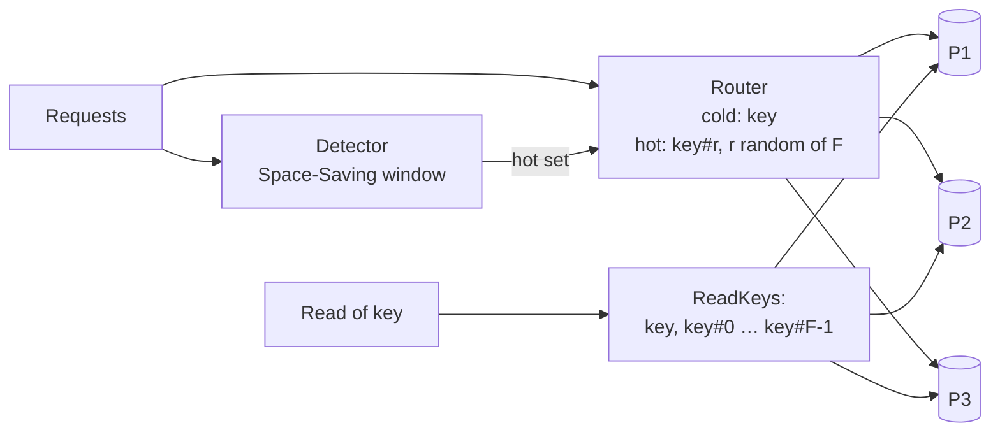
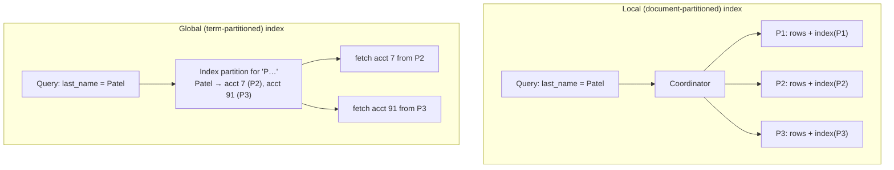
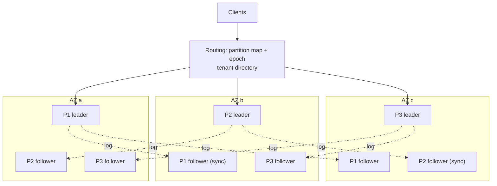

# A4 Unit 3 — Hot keys, secondary indexes and putting it together

> Time: ~6 h (includes ≈ 1.5 h of gate work: the design exercise and the teach-back) · CORE: §8 (concepts), §9, §10 and the gate work · STRETCH (≈ 1 h): the `hotkey` lab (§8 Build it and Break it) · Labs: `labs/a4/hotkey` (stretch)

Units 1 and 2 gave you copies and slices. Real systems fail at the places those two ideas do not cover: one key that is
busier than a whole partition (§8), a query that does not contain the partition key (§9), and the arithmetic of combining
partitions, replicas, failure domains and headroom into a machine count you can defend (§10).

## Before you start

You should have finished Units 1 and 2. This unit leans on lag and failover (Unit 1), the ring and fixed partitions
(Unit 2), caching from A3 for the read-hot cases, and A2's secondary indexes.

Warm-up (spaced retrieval from Units 1–2 and A2). Answer on paper first.

1. (Unit 2) A ring has 10 nodes with 1 vnode each. Name two problems that 200 vnodes per node fix.
2. (Unit 1) Which commit mode lets a write be acknowledged only after one follower in another AZ has flushed it, and
   what does it do to an acknowledged write when the leader dies?
3. (A2) A B-tree secondary index on `last_name`: what does a leaf entry hold, and what does each insert into the table
   cost in index maintenance?

<details data-kind="answer">
<summary>Warm-up answers</summary>

1. Load imbalance (one point per node leaves the busiest node ≈ 3× the mean; 200 vnodes brings it to ≈ 1.1×) and
   failure/rebalance concentration (a dead node's keys all land on one successor; with vnodes they spread over many
   nodes). Also finer-grained weighting for unequal machines.
2. Semi-synchronous replication (e.g. synchronous commit to one named standby with flush semantics). Every
   acknowledged write exists on at least two machines, so failing over to the synchronous follower loses no acknowledged
   write; the cost is added commit latency (≈ +2–3 ms across AZs) and blocked writes if no follower acks.
3. The indexed value plus a pointer to the row (the primary key, or a physical row id). Every insert (and every update of
   an indexed column) must also insert into each secondary index: write amplification ∝ number of indexes, which is
   exactly what a *distributed* index makes worse (§9).

</details>

---

## §8 Skew, hot keys and celebrity problems

### The failure story

Each credit union has internal **general-ledger (GL) accounts**: ACH settlement, fee income, interest expense. Every posting
touches one or more of them. At 09:00 on the 1st, one large credit union's payroll window posts ≈ 1,500 ACH credits/s, and *each one*
updates the same ACH-settlement GL row (`UPDATE gl SET balance = balance + ? WHERE id = 'ach-settle'`).

The cluster has 27 partitions and is idle by every metric except one: the partition holding that row is at 100% CPU,
lock waits dominate, p99 on that partition is 2 s, and the rest sit at ≈ 4%. An engineer says "add partitions". The cluster goes to 54
partitions. The hot row still lives in exactly one of them, and the incident continues.

A related read-side version: a promotional banner for the whole credit union is stored under one config key, and a push
notification sends 200,000 members to the app within a minute: ≈ 90,000 reads/s of **one key**. No amount of resharding
changes that either: one key lives on one partition.

### Predict

<!-- predict id="A4-U3-P08" -->
**Predict.** Write your answers down before opening the reveal.

1. 27 equal partitions. One key receives 30% of all traffic; the rest is uniform. How loaded is that key's partition compared to the
   average? What happens to this ratio if you double the partitions to 54?
2. A row-level lock is held ≈ 2 ms per update (including waiting for the commit's fsync). What is the maximum update rate on a single hot row,
   and what does it say about the 1,500/s above?
3. You split the hot key into 8 sub-keys `k#0…k#7` and write each update to a random sub-key. What does a read of the key's value
   now cost, and what must you do for a key that *just* became hot?
<!-- /predict -->

### Reveal

<details data-kind="reveal" data-for="A4-U3-P08">
<summary>Reveal</summary>

1. The partition gets 30% + (70% / 27 ≈ 2.6%) ≈ 32.6%, versus an average of 1/27 ≈ 3.7%: **≈ 9× the average**. With 54 partitions it
   is 30% + 1.3% ≈ 31.3% against an average of 1.9%: **≈ 17×**. The ratio got *worse*, because the hot key's share did not
   move and the average shrank. Skew from one key is independent of the partition count.
2. ≈ 1 / 0.002 s = **500 updates/s at best**, because row-lock holders serialise. 1,500/s is three times what the row can sustain even on an
   idle machine, so the queue grows without bound and everything touching that row times out. Contention on a single row is a
   limit of the *data model* before it is a limit of the hardware.
3. A read must fetch all 8 sub-keys (fan-in) and combine them: sum for counters, union for sets, latest-wins by version for
   registers, so reads cost 8× more (and you tolerate their tail latency, §9). A key that just became hot has all its history under the plain
   key, so reads must include the plain key as well as the 8 splits (9 keys), until a background step folds old data into the new layout. The
   lab's `Router.ReadKeys` does this.

</details>

### How it actually works

**Kinds of skew.** *Data skew*: some partitions hold more bytes (one tenant, one wide account). *Load skew*: some partitions get more
requests (time of day, payday). *Key skew* (hot keys): a handful of keys, often following a Zipf-like power law, take a large fraction of the traffic.
Distinguish read-hot from write-hot, because their remedies differ. And note that a **partition key choice cannot fix key skew**:
one key maps to one partition by definition.

**Read-hot keys: add copies**

- *Cache in front* (A3): a local in-process cache plus a shared cache with request coalescing (singleflight) absorbs a 90,000 reads/s
  key with ≈ one origin read per TTL per instance. This is the first answer for read-hot, immutable-ish data (banners, config, rates).
- *More replicas for the hot partition*, or hot-key replication in the cache tier (replicate the key to several cache
  nodes and read from a random one).
- *Edge/CDN* for public objects (A1).
- Remember the cost: copies imply lag (Unit 1 §3). Decide the acceptable staleness explicitly.

**Write-hot keys: split, buffer, or change the model**

1. **Key splitting (salting).** Write to `key#r` with `r` random (or round-robin) in `[0, F)`; read all F (plus the plain key) and
   merge. The merge must be commutative and associative (sum, max, union, last-by-version), the CRDT idea from Unit 1 §4. Pick
   `F ≈ ceil(hot rate / per-key capacity × headroom)`: 1,500 / 500 × 2 ≈ 6, so 8. Costs: reads fan out F-way (§9 tail latency); you
   cannot enforce a cross-split invariant ("balance ≥ 0") without coordination. Apply it only to keys *detected* as hot, not to every key.
2. **Write coalescing / buffering.** Aggregate in memory or on a queue (A6) and apply one combined update per second:
   1,500 updates/s become 1 update/s. Costs: durability and visibility delay (the buffer is lost in a crash unless it
   is itself durable), ordering across keys.
3. **Change the data model: append, don't update.** The best fix for the GL row is to *stop updating a shared row at all*: insert one immutable ledger
   entry per posting (inserts into different rows/pages do not contend) and derive the balance by summing entries plus a periodic roll-up
   (C9 builds this). Hot-row contention disappears because there is no hot row.
4. **Single writer per key.** Route all updates for a hot key through one serialised worker that batches them (actor/queue per key). It is
   key splitting's opposite: concentrate writes, but make each one cheap by batching.
5. **Per-key limits and backpressure** (A7): bound concurrency and queue length per key so one hot key cannot starve its partition's other keys;
   reject or delay the excess rather than letting it pile up. This is damage control, not a fix.

**Time-ordered keys** (timestamps, sequence numbers, auto-increment) create a hot **tail partition** under range partitioning (§5). Fix
with a hash or bucket prefix, accept the scan fan-out, and pre-split.

**Celebrity problems** are the same phenomenon in feeds: one account with 10 M followers makes fan-out-on-write explode, so systems use
fan-out on read for celebrities and fan-out on write for ordinary users (C5 designs this).

**Detecting hot keys.** You cannot keep an exact counter for every key (hundreds of millions). Streaming summaries do it in fixed memory:

- **Misra–Gries / Space-Saving**: keep `k` counters. A key already tracked increments; a new key replaces the *smallest* counter and inherits
  its count (as an upper bound). Guarantee: every key whose true frequency exceeds `N/k` is tracked; each reported count is an
  *over*-estimate by at most the inherited `Err`, so `Count − Err` is a guaranteed lower bound. 1,000 counters (≈ 50 KB) find every key above 0.1%
  of traffic.
- **Count-Min sketch**: a `depth × width` grid; each key increments one cell per row (different hashes); the estimate is the minimum across rows. Never
  under-estimates; over-estimates by at most ≈ `e/width × N` with probability `1 − e^−depth`. Good for point queries (is *this* key hot?)
  but it cannot list the heavy hitters by itself: pair it with a small candidate set.
- **Sampling**: log 1% of requests and count; good enough for dashboards, noisy for short-lived hot keys.
- **Windows and decay**: hotness is temporary. Rotate windows (last window's hot keys stay hot for one more window to avoid flapping), or decay counts.
- **Where to count**: in the proxy/router tier (it sees every request), or per partition server, or from per-partition load metrics. Alert on
  *partition* skew (max/mean), then drill down to keys.

Key splitting in miniature (compiles and runs as is): 1,000 increments arrive before the detector flags the key, 8,000 after. The
sub-keys each carry ≈ 1/8 of the later traffic, and a read has to visit nine physical keys.

```go
// Key splitting for a write-hot counter: writes go to a random sub-key once
// the key is flagged hot; reads fan in over the plain key and every sub-key.
package main

import (
	"fmt"
	"math/rand"
	"sort"
	"strconv"
)

const fanout = 8

type store map[string]int64 // physical key -> counter

func subKey(key string, i int) string { return key + "#" + strconv.Itoa(i) }

func incr(s store, key string, hot bool, rng *rand.Rand) {
	if !hot {
		s[key]++
		return
	}
	s[subKey(key, rng.Intn(fanout))]++
}

// read must visit the plain key (writes made before the key was flagged hot)
// as well as every sub-key.
func read(s store, key string) (sum int64, touched int) {
	keys := []string{key}
	for i := 0; i < fanout; i++ {
		keys = append(keys, subKey(key, i))
	}
	for _, k := range keys {
		sum += s[k]
		touched++
	}
	return sum, touched
}

func main() {
	rng := rand.New(rand.NewSource(1))
	s := store{}
	for i := 0; i < 1000; i++ { // before detection: all writes hit one physical key
		incr(s, "gl:ach-settle", false, rng)
	}
	for i := 0; i < 8000; i++ { // after the detector flags the key
		incr(s, "gl:ach-settle", true, rng)
	}
	keys := make([]string, 0, len(s))
	for k := range s {
		keys = append(keys, k)
	}
	sort.Strings(keys)
	for _, k := range keys {
		fmt.Printf("%-16s %5d\n", k, s[k])
	}
	sum, touched := read(s, "gl:ach-settle")
	fmt.Printf("read: total=%d, touched %d physical keys\n", sum, touched)
}
```

Expected output: the plain key holds exactly 1,000 and the eight sub-keys ≈ 1,000 each (the random spread varies by ±5%), and
`read: total=9000, touched 9 physical keys`. Delete the plain key from `read` and the total silently becomes 8,000: the failure from the
Predict.



### Build it

*(STRETCH, ≈ 1 h.)* Lab `labs/a4/hotkey`, file `hotkey.go`:

1. `SpaceSaving.ObserveN`, `Estimate`, `Top`, `Total`, `Reset` (heap provided): newcomers replace the minimum counter (ties: smallest key) and inherit
   its count as their error.
2. `CountMin.Add`, `Estimate`, `Total` (the column hash `cell` is provided).
3. `Detector`: `Observe`, `IsHot`, `HotKeys`, `Rotate`; hotness is judged by the *guaranteed* count `Count − Err`, against both `MinCount` and `Threshold × Total`.
4. `Router.WriteKey` and `ReadKeys`.

Acceptance tests: `TestSpaceSaving_EvictsSmallestCounterAndInheritsItsCountAsError`, `TestSpaceSaving_GuaranteesOnAZipfStream`,
`TestCountMin_NeverUnderestimatesAndIsAccurateForHeavyKeys`, `TestCountMin_DepthMattersAndAddAccumulates`,
`TestDetector_UsesGuaranteedCountSoCrowdedSummariesDoNotInventHotKeys`, `TestDetector_RotateKeepsLastWindowsHotKeysForOneMoreWindow`,
`TestRouter_HotKeysSplitOnWriteAndFanInOnRead`, `TestRouter_SplittingFlattensPartitionLoadUnderZipfSkew`. Run `go test -race ./labs/a4/hotkey/`.
The package is STRETCH: `sd lab A4` reports it separately and it does not block the gate.

### Break it

```
go test -tags breakit -run BreakIt -v ./labs/a4/hotkey/
```

(1) **Fanout vs read cost**: a Zipf stream over 8 partitions, router fanout of 1, 2, 4, 8, 16, 64: how much does the busiest
partition's share fall, and how many keys must a read of the hottest key visit? (2) **Summary size vs recall**: how many Space-Saving counters are needed
for the true top-10 to appear in `Top(10)`? Predict both tables. (No stub implemented yet? run the same command against `./solutions/a4/hotkey/`.)

<details data-kind="answer">
<summary>What you should see, and why</summary>

(1) Busiest-partition share: ≈ 38% with no splitting, ≈ 30%, 24%, 18% at fanout 2, 4, 8, and ≈ 17%, 15% at 16 and 64, against a perfect
12.5%. Diminishing returns: only the keys *above the detector's threshold* are split, and beyond ≈ 8 the remaining imbalance comes from
the moderately hot keys and the hash, not from the top key; but the read cost rises linearly (1 → 3 → 5 → 9 → 17 → 65 keys). Choose
the smallest fanout that gets the partition under its capacity. (2) With 10 counters only 3 of the true top-10 appear;
20 → 4; 50 → 8; 100 or more → all 10. Counters need to exceed the number of keys that matter, with room, because every cold key keeps
evicting the minimum counter; the guarantee only covers frequencies above `N/k`.

</details>

### In the wild

- **DynamoDB**: a partition's throughput is bounded and a hot partition key throttles requests even when the table's provisioned capacity is
  not exhausted. *Adaptive capacity* shifts some capacity toward hot partitions, and the documented design pattern for write-hot keys is
  *write sharding* (a random or calculated suffix appended to the partition key, with scatter-gather reads); CloudWatch Contributor
  Insights can show the hottest keys. TODO-VERIFY current limits and feature names.
- **Redis**: a hot key lives on one node/slot. Mitigations are client-side caching with invalidation, local replicas of hot keys, or
  splitting a key; `redis-cli --hotkeys` needs an LFU eviction policy to work. TODO-VERIFY.
- **Cassandra**: a very large or very hot partition causes latency and compaction problems; the standard fix is to
  *bucket* the partition key (add a time bucket or a random shard) so no partition is unbounded or overloaded.
- **Kafka**: a skewed record key sends most records to one partition; a custom partitioner (salting by key plus a sub-id) trades per-key ordering for spread.
- **Memcache at scale**: hot keys are replicated across several cache servers and clients pick one at random. TODO-VERIFY (see the
  public descriptions of Facebook's memcache and mcrouter).
- **Feeds** (Twitter/X-style celebrity timelines): hybrid fan-out. See C5.
- **Banking**: GL accounts, "house" accounts, fee accounts and settlement accounts are the classic hot rows; core systems often post to
  them in batch (coalescing) or from an append-only journal rather than updating a balance per transaction.

### Trade-offs

| Option | Wins when | Loses when | When the answer flips |
|---|---|---|---|
| Cache in front (read-hot) | Read-heavy, tolerant of staleness | Needs invalidation; writes still hit one key | Flip to key splitting/replication when the writes are the problem |
| Key splitting (write-hot) | Mergeable updates (counters, sets); the hot key can be detected | Reads fan in F-way; no cross-split invariants; migration for new hot keys | Flip to a data-model change when the update is not mergeable or must be exact |
| Write coalescing/queue | Bursty hot writes, tolerant of a short visibility delay | Durability and ordering of the buffer; readers see delayed values | Flip to splitting when the buffer cannot be made durable enough |
| Append-only ledger, derive balance | Money and audit trails; contention-free writes | Reads need aggregation or a roll-up; more storage | Flip to a single updated row only when write rate per row is far below ≈ 500/s |
| Per-key rate limit / shed | Protect the partition's other keys | Rejects legitimate traffic | Always paired with one of the above; never the only fix |

### Senior bar

- **Failure modes**: adding partitions to cure a hot key; detectors that flap (key hot, cold, hot) and ping-pong data between layouts; split keys
  read without the pre-split data (missing the plain key); false positives from judging by inflated counts; the per-key
  limit shedding the one key the business cares about; a celebrity event (one merchant, one promotion, one viral link)
  that no capacity plan anticipated.
- **Capacity (≈)**: single-row update ceiling ≈ 1 / (lock hold time) ≈ 500/s at 2 ms; `F ≈ hot rate / per-key capacity × 2`;
  detector memory ≈ `k` × tens of bytes (k = 1,000 ≈ tens of KB); Count-Min 2,000 × 5 cells ≈ 80 KB gives ε ≈ 0.14%, δ ≈ 0.7%.
- **Ops**: alert on partition skew (max/mean QPS and p99), not only on averages; keep a hot-key dashboard (top-k per window); runbook
  for "one key melts one partition" (cache, split, throttle, in that order of speed); load-test with a Zipf key distribution, not uniform keys.
- **Cost**: splitting multiplies read cost by F for those keys only; caches cost memory; over-eager splitting of warm keys adds fan-out for no benefit.

Interviewer follow-up probes:

1. "One account takes 30% of traffic. You have 27 shards. Adding shards doesn't help. Why, and what do you do?"

<details data-kind="answer">
<summary>Model answer</summary>

Because skew is per key: the key lives on one shard whatever the shard count, so the ratio to the average actually worsens as shards are added.
Decide read-hot vs write-hot. Reads: cache with coalescing, replicate the key. Writes: change the model to avoid a shared mutable row
(append-only ledger plus roll-up); or split the key into F sub-keys with a mergeable aggregate and fan-in reads, applied only to keys
the detector flags; or batch through a single serialised writer. Add per-key limits as a safety net and alert on partition skew.

</details>

2. "How do you know which keys are hot without a counter per key?"

<details data-kind="answer">
<summary>Model answer</summary>

A heavy-hitter summary in the router tier: Space-Saving with `k` counters finds every key above `N/k` of traffic in `O(k)` memory, and
`Count − Err` is a guaranteed lower bound, which I use for thresholds to avoid false positives. A Count-Min sketch answers "how
hot is this specific key?" in fixed memory. Windows rotate so hotness decays. Partition-level load metrics tell me where to look.

</details>

3. "What breaks if the hot key is split and a client reads only the sub-keys?"

<details data-kind="answer">
<summary>Model answer</summary>

Writes made before the key was classified hot live under the plain key, so the read misses them. Reads must include the plain key
until a backfill folds it into the split layout. Also, a client with a stale hot-set view may write to the plain key
while others write to splits; the merge must therefore always include both forms.

</details>

### Check yourself

1. Why does doubling the partition count make a 30%-of-traffic key look *worse* relative to the average?
2. Give one data-model change that removes a hot balance row.
3. Space-Saving reports Count = 500, Err = 480. Is the key hot at a 5%-of-traffic threshold when N = 2,000?

<details data-kind="answer">
<summary>Answers</summary>

1. The key's partition still receives ≈ 30%, while the average load per partition halves, so the ratio roughly doubles.
2. Append immutable ledger entries per posting and compute the balance by summing (with a periodic roll-up), so no row is updated by every request.
3. No: the guaranteed count is 500 − 480 = 20, which is 1% of 2,000, below the 5% threshold (100). The reported 500 is mostly inherited from evicted keys.

</details>

---

## §9 Secondary indexes across partitions and cross-partition queries

### The failure story

The transactions store is partitioned by `(tenant_id, account_id)`, which makes the statement screen fast (one partition). Support
now needs "find member by last name" and "find member by last four of the card number" across a credit union. Neither query contains the partition key.

The first implementation asks every one of the 27 partitions and merges the answers. Each shard answers with p99 = 100 ms. 200 searches/s means
5,400 shard queries/s; each is an index scan costing ≈ 20 point reads, so that is ≈ 100,000 point-read equivalents per second, about a
quarter of what the cluster can serve, spent on a feature used by a few hundred agents. The search's p99
is ≈ 210 ms: 24% of searches wait on at least one shard that is in its own slowest 1%. Worse, adding shards makes it slower, not faster: each query
now touches 54.

The second implementation builds a *global* index table keyed by last name, maintained asynchronously. The new member who joined
three seconds ago "cannot be found" for the duration of the lag, and a member who changed their name is found under the old name until the
index catches up. Both are tickets.

### Predict

<!-- predict id="A4-U3-P09" -->
**Predict.** Write your answers down before opening the reveal.

1. A scatter-gather query fans out to N partitions in parallel. Each partition's response time exceeds its own p99 on 1% of requests,
   independently. For N = 1, 10, 27, 100: what fraction of queries are at least as slow as that p99? What does this say about adding partitions to a
   scatter-gather workload?
2. Compare a local (document-partitioned) index and a global (term-partitioned) index on: cost of a read by indexed attribute, cost of a
   write, and consistency between index and table.
3. A global index entry lives on a different partition from its row. Name two ways to keep them in sync and the failure each has.
<!-- /predict -->

### Reveal

<details data-kind="reveal" data-for="A4-U3-P09">
<summary>Reveal</summary>

1. P(at least one slow) = 1 − 0.99^N: N=1: 1%; 10: 9.6%; 27: ≈ 24%; 100: ≈ 63% (this is the tail-latency rule of thumb in
   [`docs/NUMBERS.md`](../../docs/NUMBERS.md)). The fan-out multiplies tail exposure: the more partitions a query touches, the more it behaves like the *slowest*
   of them. Adding partitions to a scatter-gather workload makes it slower (more tail exposure) and more expensive (more sub-queries per
   query), and does not raise the number of queries per second the cluster can answer: every query still costs every partition.
2. **Local**: read must scatter to all N partitions (cost N sub-queries, tail exposure above); write touches one partition
   and the index update is atomic with the row (always consistent). **Global**: read goes to one (or few) index partitions (cost ≈ 1 sub-query, plus a fetch
   of the base rows, which may be on other partitions); write must update the index partition for the new term (and delete the old term), which is
   usually a different partition than the row: a distributed update, so either slower and less available or asynchronous and
   stale. You choose which side pays: reads (local) or writes (global).
3. (a) A distributed transaction (two-phase commit) across the row's partition and the index partition: consistent, but slower, and a coordinator
   failure can leave participants blocked holding locks; availability drops with the number of participants. (b) Asynchronous maintenance (the row's
   partition emits a change event, a consumer updates the index, ideally via an outbox and CDC, A6): fast and available, but the index lags and can be
   briefly missing new rows or showing old values, and out-of-order or duplicate events must be handled with versions and idempotency.

</details>

### How it actually works

The base table is partitioned by its key; a query on another attribute has no partition to go to. Two classic designs:



**Local index.** Each partition indexes only its own rows. *Writes* are single-partition and consistent with the data (one
node's transaction). *Reads* by the indexed attribute are scatter-gather: send to every partition, merge. Merging top-K or paginated results
needs each partition to return `offset + limit` rows (or use keyset cursors per partition, A1 Unit 2). Use when the attribute is queried
rarely, the result is small, or the query also carries part of the partition key so it can be pruned to few partitions (a tenant-scoped
search in a tenant that lives on 2 of 27 partitions is a 2-way fan-out, not 27). Examples: MongoDB shard-local indexes, Cassandra's secondary indexes,
Elasticsearch shard-local inverted indexes, Vitess queries without the sharding key.

**Global index.** The index is itself partitioned, by the *indexed term* (hash or range of `last_name`). *Reads* go to one index
partition (or a few) and then fetch the rows by primary key (possibly from several partitions). *Writes* update the row's partition **and** the term's
index partition(s) (two if the term changed: remove old, add new): a cross-partition write. Options: synchronous via distributed transaction
(2PC is named here and detailed in A5/A6; consistent but slower and less available), or **asynchronous** (DynamoDB global secondary indexes
are updated asynchronously and are eventually consistent; many systems build derived indexes from a change feed, A6). Handling the
async case properly:

- Treat the index as a **hint**: after reading candidates from the index, fetch the base row and re-check the predicate, discarding
  false positives (the row no longer matches).
- Give index updates a **version** (the row's LSN or version) so out-of-order or duplicate updates converge; make them idempotent.
- Expect **missing** entries during lag; define the staleness SLO ("searchable within 5 s") and show it in the product.
- Have a **rebuild/repair** path (scan base table, compare, fix); indexes drift.

**Paginating a scatter-gather query.** Offsets do not compose across shards (offset 1,000 means 1,000 rows from *every* shard). Use keyset cursors
(A1 Unit 2): each shard returns its next `limit` rows after the cursor, the coordinator merges them and keeps the first `limit`, and the cursor
is the sort key of the last row returned. Each page costs N sub-queries of `limit` rows however deep the user goes:

```go
// Keyset pagination across shards: each shard returns its next `limit` rows
// after the cursor; the coordinator merges them and keeps `limit`.
package main

import (
	"fmt"
	"sort"
)

type row struct {
	PostedAt int64
	ID       string
}

// before orders rows newest first, ties broken by ID.
func before(a, b row) bool {
	if a.PostedAt != b.PostedAt {
		return a.PostedAt > b.PostedAt
	}
	return a.ID < b.ID
}

// shardPage is what one shard runs:
// SELECT ... WHERE (posted_at, id) is after the cursor ORDER BY ... LIMIT n.
func shardPage(rows []row, cursor *row, n int) []row {
	var out []row
	for _, r := range rows { // rows is sorted by before()
		if cursor == nil || before(*cursor, r) {
			out = append(out, r)
			if len(out) == n {
				break
			}
		}
	}
	return out
}

func nextPage(shards [][]row, cursor *row, limit int) []row {
	var merged []row
	for _, s := range shards { // in production: parallel calls with per-shard timeouts
		merged = append(merged, shardPage(s, cursor, limit)...)
	}
	sort.Slice(merged, func(i, j int) bool { return before(merged[i], merged[j]) })
	if len(merged) > limit {
		merged = merged[:limit]
	}
	return merged
}

func main() {
	shards := [][]row{
		{{100, "a"}, {90, "b"}, {50, "c"}},
		{{95, "d"}, {94, "e"}, {10, "f"}},
		{{99, "g"}, {60, "h"}, {55, "i"}},
	}
	var cursor *row
	for page := 1; page <= 3; page++ {
		rows := nextPage(shards, cursor, 3)
		fmt.Printf("page %d: %v\n", page, rows)
		if len(rows) == 0 {
			break
		}
		last := rows[len(rows)-1]
		cursor = &last
	}
}
```

Output: `page 1: [{100 a} {99 g} {95 d}]`, `page 2: [{94 e} {90 b} {60 h}]`, `page 3: [{55 i} {50 c} {10 f}]`. The order is global, no row is repeated or
skipped, and every shard answered three rows per page. Sign the cursor (A1) and bind it to the tenant, since it is a pointer into
every shard.

**Derived search systems.** For rich search (prefix, fuzzy, multiple attributes) the usual answer is a separate engine
(Elasticsearch/OpenSearch) fed by CDC from the source of truth, which is a global index with the staleness property made explicit (C12).

**Scatter-gather tail latency.** The Predict formula, with simulated data (log-normal service time, median 20 ms, p99 100 ms):

| Fan-out N | p50 of the slowest (ms) | p99 of the slowest (ms) | P(> 100 ms) | 1 − 0.99^N |
|---|---|---|---|---|
| 1 | 20 | 100 | 1.0% | 1.0% |
| 10 | 57 | 171 | 9.7% | 9.6% |
| 27 | 77 | 206 | 23.7% | 23.8% |
| 100 | 110 | 260 | 63.7% | 63.4% |

Mitigations: bound fan-out (route by tenant or by another prefix), *hedged requests* (send a duplicate to another replica after the p95 and
take the first answer; "The Tail at Scale", Dean & Barroso, 2013), per-shard timeouts with partial results where the product allows,
caching, reducing the number of partitions that scatter-heavy queries touch (fewer, larger partitions), or moving the query to a global index or a
search engine.

**Cross-partition queries beyond lookups**

- *Joins*: avoid by **co-locating** rows that are joined on the same partition key (accounts and their transactions by
  `(tenant, account)`), and replicate small reference tables (product catalog, fee schedules) to every partition.
- *Aggregates*: compute partial aggregates per partition and combine (sum, count, min/max combine exactly; medians and distinct counts need sketches).
- *Transactions across partitions*: a transfer between accounts on different partitions needs atomicity across two nodes. Options: a
  distributed transaction (two-phase commit: a coordinator asks all participants to *prepare*, then *commit*; it blocks if the coordinator dies at the wrong
  moment and costs several round trips: named here, studied in A5/A6), a **saga** of local transactions with compensations (A6), or a design that avoids it:
  post an immutable transfer record in one partition and let an idempotent consumer post the other leg (outbox, A6; C9 builds a ledger this way).

### Build it

No lab for this section — see §8's `hotkey` lab for the key-routing logic and A6's `outbox` lab for the reliable index-update pipeline. The
experiment below makes the tail-latency formula concrete.

### Break it

Simulate scatter-gather latency and compare with the formula.

```go
// Scatter-gather tail latency: a query fans out to N partitions and waits for
// all of them. Each partition answers in a log-normal time with p99 ~ 100 ms.
package main

import (
	"fmt"
	"math"
	"math/rand"
	"sort"
)

func main() {
	rng := rand.New(rand.NewSource(7))
	// log-normal with median 20 ms; sigma chosen so that p99 = 100 ms:
	// p99 = median * exp(2.326*sigma) -> sigma = ln(5)/2.326
	sigma := math.Log(5) / 2.326
	sample := func() float64 { return 20 * math.Exp(sigma*rng.NormFloat64()) }

	pct := func(xs []float64, p float64) float64 {
		sort.Float64s(xs)
		return xs[int(p*float64(len(xs)-1))]
	}
	const trials = 100000
	fmt.Printf("%6s %10s %10s %14s %16s\n", "fanout", "p50 (ms)", "p99 (ms)", "P(>100ms) sim", "1-0.99^N")
	for _, n := range []int{1, 2, 5, 10, 20, 27, 50, 100} {
		lat := make([]float64, trials)
		slow := 0
		for i := range lat {
			worst := 0.0
			for j := 0; j < n; j++ {
				if v := sample(); v > worst {
					worst = v
				}
			}
			lat[i] = worst
			if worst > 100 {
				slow++
			}
		}
		fmt.Printf("%6d %10.0f %10.0f %13.1f%% %15.1f%%\n", n, pct(lat, 0.5), pct(lat, 0.99), 100*float64(slow)/trials, 100*(1-math.Pow(0.99, float64(n))))
	}
}
```

Predict the p99 column for N = 20 and 100, run it, then add *hedging*: when a shard's first answer `v` takes longer than 60 ms, pretend a
second request was sent at 60 ms to another replica and take `min(v, 60 + sample())`. Observe how the p99 of the slowest changes at N = 27 and 100.
What does hedging cost in extra load?

<details data-kind="answer">
<summary>What you should see, and why</summary>

The simulated `P(>100ms)` matches `1 − 0.99^N` to within noise (≈ 18% at N=20, ≈ 64% at N=100), and the p99 of the slowest grows from 100 ms at
N=1 to ≈ 196 ms at N=20, ≈ 206 ms at N=27 and ≈ 260 ms at N=100: the median of the *max* also drifts up (20 → 71 → 110 ms) because
the max of many draws is a high percentile of one. With hedging after 60 ms, the p99 of the slowest shard falls from ≈ 207 ms to ≈ 116 ms at N = 27 and from ≈ 260 ms to
≈ 132 ms at N = 100, for ≈ 5.6% extra requests (the share of calls slower than 60 ms). It works because the chance that *both* copies are
slow is small if they are independent; correlated slowness (a noisy neighbour, a GC pause on a shared host, a lagging replica set)
weakens the benefit, and hedging a non-idempotent request is a bug (A1 Unit 3).

</details>

### In the wild

- **DynamoDB**: global secondary indexes are maintained asynchronously (eventually consistent reads only) and have their own throughput;
  local secondary indexes share the base partition key and are consistent but constrained. TODO-VERIFY current limits and options.
- **Cassandra**: local secondary indexes scatter to all nodes (discouraged on high-cardinality or large clusters);
  the usual advice is query-driven denormalised tables (one table per query pattern, written together). Materialised views
  attempted a global index and have had a poor operational record. TODO-VERIFY current status and SAI (storage-attached indexes).
- **MongoDB**: secondary indexes are per-shard; a query without the shard key is broadcast to all shards by `mongos`.
- **Elasticsearch**: each shard has its own inverted index; every search is a scatter-gather over the index's shards, merged
  by a coordinating node; replicas can serve reads.
- **Vitess**: *lookup vindexes* maintain a mapping from a secondary attribute to the sharding key in a separate table, giving a global index; queries by the
  attribute become single-shard after one lookup. TODO-VERIFY consistency options.
- **Spanner/CockroachDB**: secondary indexes are global and transactionally consistent because writes are distributed transactions over
  consensus groups (A5), with the latency that implies.
- **Postgres + Citus**: queries filtering by the distribution column route to one shard; others fan out; co-located joins on the distribution column stay local, and
  small reference tables are replicated everywhere. TODO-VERIFY.

### Trade-offs

| Option | Wins when | Loses when | When the answer flips |
|---|---|---|---|
| Local index + scatter-gather | Rare queries, few partitions, or queries carrying a partition prefix; need consistency with the row | Fan-out grows with partitions; tail latency; query throughput does not scale with N | Flip to a global index as the query becomes frequent |
| Global index, synchronous (2PC) | Strong consistency needed on the indexed lookups; lowish write rate | Write latency/availability; coordinator failure | Flip to async when staleness is acceptable |
| Global index, asynchronous | High write volume; lookups tolerate seconds of staleness | Stale/missing entries; repair/rebuild; versioning | Flip to sync or to leader-verified reads when "not found" is a bug the user sees |
| Separate search engine via CDC | Rich search, ranking, many attributes | Another system to run; explicit staleness | Flip to the database index if the query set is tiny and fixed |
| Co-location/denormalised tables per query | Known, stable query set | Write amplification; keeping copies consistent | Flip to indexes as query patterns multiply |

### Senior bar

- **Failure modes**: scatter-gather on the hot path; one slow shard stalling every query; merge/pagination bugs (offsets across shards);
  an async index returning deleted/renamed rows; index drift after a bug or a replay; unbounded fan-out from an unpartitioned query exposed in a
  public API (an easy denial of service); the global-index write path becoming the availability bottleneck.
- **Capacity (≈)**: query cost = number of partitions touched; scatter-gather throughput of the cluster ≈ one partition's query throughput (not N×);
  tail exposure `1 − 0.99^N`; global-index write cost ≈ (1 + number of indexes) partition writes per row change.
- **Ops**: expose a "query touched N partitions" metric and alarm on high fan-out; rate-limit scatter endpoints per tenant (A7); track
  index lag (age of newest indexed change); schedule index verification; load-test with the real partition count.
- **Cost**: scatter-gather multiplies read cost by N; global indexes multiply write cost and storage; search engines cost a cluster and a pipeline.

Interviewer follow-up probes:

1. "Member search by name across 40 credit unions, 27 shards. Design it."

<details data-kind="answer">
<summary>Model answer</summary>

Scope searches to a tenant: the tenant prefix restricts the shard set, often to one or a few partitions. For the
tenant-scoped query use a local index with a bounded scatter and a per-tenant rate limit; for rich/fuzzy matching feed a search engine from CDC with a
stated staleness (a few seconds) and re-check hits against the source before showing sensitive data. Partner/exact lookups
(last four digits + tenant) can use a small global lookup table, maintained via outbox with versioned idempotent updates and a rebuild job.
Avoid unscoped cross-tenant search except in an analytical store.

</details>

2. "Why doesn't adding shards speed up a scatter-gather query?"

<details data-kind="answer">
<summary>Model answer</summary>

Each query still costs one sub-query per shard, so the cluster's capacity for such queries is about that of one shard, not N shards
combined, and latency is the max over N responses, so the tail gets worse as N grows. More shards help *data size* and *single-key* throughput, not
broadcast queries. Fix by bounding the fan-out (partition prefix in the query), using a global index or search engine, or hedging.

</details>

3. "What can go wrong with an async global index, and how do you mitigate it?"

<details data-kind="answer">
<summary>Model answer</summary>

Missing new entries, stale entries pointing at rows that changed or were deleted, out-of-order updates, and silent drift after bugs. Mitigate with
version-stamped idempotent updates (apply only if newer), re-verifying the predicate against the base row on read, a defined staleness
SLO with monitoring on indexing lag, read-your-writes for the writer (return the created entity directly or query the leader by primary key), and a reconciliation
job that scans and repairs.

</details>

### Check yourself

1. Which side pays in a local index, and which in a global index?
2. Why is "offset 1000, limit 20" expensive on a scatter-gather query?
3. A transfer touches accounts on two partitions. Name three approaches.

<details data-kind="answer">
<summary>Answers</summary>

1. Local: reads pay (fan-out); writes are cheap and consistent. Global: writes pay (distributed or async update); reads are cheap.
2. Each of the N partitions must return its first 1,020 rows so the coordinator can merge and discard 1,000; the work is ≈ N × 1,020 rows to deliver 20. Use keyset cursors.
3. A distributed transaction (2PC), a saga with compensations, or an immutable transfer record in one partition with an idempotent consumer posting the other leg (outbox).

</details>

---

## §10 Combining replication and partitioning: sizing, failure domains and a cheat-sheet

### The failure story

The design review ends with a diagram: 27 partitions, each a leader plus two followers, 81 replicas across 3 availability zones. It looks
done. Then three things happen in the same week. Payroll day arrives with 3× the average write rate. An AZ has a network event that
takes a third of the machines away. And the autoscaler, seeing 33% less capacity, triggers re-replication of everything that was in that AZ.

Nine leaders were in the lost AZ, so nine partitions fail over at the same time (≈ 60 s each, in parallel). The survivors now carry peak load on two thirds of
the machines. Re-replication wants to copy ≈ 9 TB (a third of 27 TB raw) onto disks that are already ≈ 80% full, competing with foreground traffic. Disks
reach 100%, replicas go read-only, and a degraded-but-working cluster becomes an outage. Nothing was individually wrong; the plan never said what
happens when the failure, the peak and the maintenance coincide.

### Predict

<!-- predict id="A4-U3-P10" -->
**Predict.** Write your answers down before opening the reveal.

1. Data is 9 TB (including indexes); a partition should hold ≤ 500 GB and be kept ≤ 70% full; peak writes are 1,400 TPS and one primary sustains
   ≈ 2,500 TPS with headroom. How many partitions do you need, and which constraint decides it? If data is going to grow ≈ 40% a year, how many
   do you provision for two years out?
2. With replication factor 3, how much raw storage and how many partition replicas? If one replica of each partition is placed in each of 3 AZs and an AZ is lost,
   what fraction of leaders must fail over at once, and what fraction of read capacity remains?
3. What should the cluster's steady-state utilisation be so that losing an AZ at peak is survivable?
<!-- /predict -->

### Reveal

<details data-kind="reveal" data-for="A4-U3-P10">
<summary>Reveal</summary>

1. By storage: 9 TB × 1,024 / (500 GB × 0.7 = 350 GB) ≈ 26.3, so **27 partitions**. By writes: 1,400 / 2,500 ≈ 0.56, so 1. Storage decides; write
   capacity is nowhere near binding. Two years of 40% growth is ×1.96, so ≈ 17.6 TB, ≈ **52 partitions** worth of data. Provision many *logical* partitions up front
   (e.g. 64–128, §7) and start with them packed onto fewer machines, then spread as data grows, rather than splitting later.
2. Raw storage = 3 × 9 = **27 TB**, and 27 × 3 = **81 replicas**. A lost AZ takes one replica of every partition: **⅓ of leaders** (if leaders are spread evenly)
   fail over simultaneously, and ⅓ of read capacity disappears (⅔ remains), plus the load of re-replication. (If *all* leaders were in one AZ,
   losing that AZ would stop all writes until failover: spread leaders deliberately.)
3. Survivors must carry peak on ⅔ of the capacity: steady-state peak utilisation ≤ ≈ 2/3 × target (≈ 50–70% of box capacity from NUMBERS.md), so plan for
   **≈ 45% or less** at peak with three AZs, ≈ 35–45% in practice once re-replication traffic is added. N+1 (or N+AZ) is a capacity requirement, not a slogan.

</details>

### How it actually works

**Composition.** Every partition is a small replicated group (Unit 1) and the partition map (Unit 2) says which group owns which key range or slot.



Design rules that fall out of the earlier units:

1. **Each partition has a replication group** with a leader, a semi-sync follower in another AZ, and further async followers; failover is per
   partition and independent (§2).
2. **Spread leaders** evenly across nodes and AZs, so a node or AZ failure triggers many small failovers, each node hosts leaders and
   followers of different partitions, and no machine carries all the write load.
3. **Failure-domain placement**: no two replicas of a partition in the same AZ (or rack, or host). Rebalancing and re-replication must preserve this constraint.
4. **Many logical partitions on fewer machines** (fixed slots/partitions), assigned by a table, so adding machines moves whole partitions (§7).
5. **Reads**: scale with followers per partition and caches (Unit 1, A3); writes scale with partitions; hot keys need extra treatment (§8); queries without the
   partition key need indexes or accept scatter-gather (§9).
6. **Headroom**: capacity for the failure you promise to survive (AZ loss at peak), for rebalancing (≥ 30% free disk) and for growth; plus time to react.

**Sizing recipe** (do it in the interview):

```
partitions P = max( data_total / (partition_capacity × (1 − headroom)),
                    peak_write_TPS / write_TPS_per_primary,
                    peak_read_QPS  / (read_QPS_per_replica × replicas_per_partition) )
raw storage    = data_total × RF
replica count  = P × RF
survive AZ loss: (peak per surviving replica) = peak / (P × (RF − 1)) must stay within the replica's capacity budget
```

and then apply growth (design for 2–3 years of data), then the failure-domain check. The numbers: the platform's transactions store with ≈ 12 M
rows/day is ≈ 22 B rows ≈ 9 TB after 5 years (§5), ≈ 140 TPS average, ≈ 1,400 at the payday peak, ≈ 20,000 read QPS at peak.

**How real systems make these choices** (cheat-sheet; TODO-VERIFY wherever noted before quoting in an interview):

| System | Partitioning | Replication | Leader / consistency | Secondary indexes | Notes |
|---|---|---|---|---|---|
| **Postgres + Citus** | Hash on a distribution column into a fixed number of shards placed on worker nodes (TODO-VERIFY default shard count) | Each node typically has Postgres streaming standbys (HA); reference tables copied to all nodes | Single writer per shard; sync/async per your Postgres config | Per-shard indexes (local); queries without the distribution column fan out | Co-location of related tables on the same key avoids cross-shard joins |
| **Vitess (MySQL)** | Keyspace sharded by a vindex → `keyspace_id` ranges | Each shard: MySQL primary + replicas (semi-sync common) | Single primary per shard; failover orchestrated (TODO-VERIFY tooling) | Lookup vindexes = global indexes | `vtgate` routes; resharding workflows |
| **Cassandra** | Token ring of Murmur3 hashes (vnodes) | RF per keyspace, rack/DC aware | Leaderless; tunable consistency per query (A5) | Local indexes; query-driven tables | Wide partitions are a hazard |
| **DynamoDB** | Hash of partition key (+ sort key); automatic splits | Three replicas across AZs (TODO-VERIFY detail) | Leader per partition; optional strong reads | GSIs async; LSIs local | Hot partition throttling; adaptive capacity |
| **MongoDB** | Ranged or hashed shard key; chunks; balancer | Each shard a replica set (primary, secondaries, oplog) | Single primary per shard; `w: majority` for durability | Per-shard indexes | `mongos` + config servers |
| **Kafka** | Topic partitions chosen by key hash | Leader + followers per partition; ISR | Leader per partition; `acks=all` + `min.insync.replicas` | None (a log) | Ordering per partition (A6) |
| **Redis Cluster** | 16,384 hash slots | Async replicas per master | Single master per slot; `WAIT` for best-effort sync | None cross-slot; hash tags | Multi-key ops must stay in one slot |
| **Spanner / CockroachDB** | Range partitions that split/merge | Consensus group per range | Leaseholder/leader per range; strong consistency | Global, transactional | Latency for distributed commits (A5) |

**Reading the table**: every row answers the same five questions: how are keys mapped to partitions, how is each partition replicated, who is the
writer and what do acknowledged writes guarantee, how do non-key queries work, and what is the operational unit you move. That is also the
shape of your answer in a design interview.

### Build it

No lab for this section — the sizing calculator below plays the role of the lab. The three labs are the components this section composes:
`replkv` (a partition's replication group), `ring` (its placement) and `hotkey` (its skew defence).

### Break it

```go
// Sizing a sharded, replicated deployment from estimates.
package main

import (
	"fmt"
	"math"
)

type inputs struct {
	dataTB         float64 // logical data incl. indexes, before replication
	peakWriteTPS   float64
	peakReadQPS    float64
	partCapacityGB float64 // data a partition (one replica group) should hold
	partWriteTPS   float64 // sustained write capacity of one primary, with headroom
	replReadQPS    float64 // read capacity of one replica
	replicationRF  int
	headroom       float64 // fraction kept free for rebalancing/growth (0.3 = keep 30%)
}

func main() {
	in := inputs{dataTB: 9, peakWriteTPS: 1400, peakReadQPS: 20000, partCapacityGB: 500,
		partWriteTPS: 2500, replReadQPS: 8000, replicationRF: 3, headroom: 0.3}
	byStorage := in.dataTB * 1024 / (in.partCapacityGB * (1 - in.headroom))
	byWrites := in.peakWriteTPS / in.partWriteTPS
	parts := int(math.Ceil(math.Max(byStorage, byWrites)))
	readsPerPart := in.peakReadQPS / float64(parts)
	replicasForReads := int(math.Ceil(readsPerPart / in.replReadQPS)) // readers per partition
	rf := max(in.replicationRF, replicasForReads)
	fmt.Printf("by storage: %.1f partitions, by writes: %.2f -> %d partitions\n", byStorage, byWrites, parts)
	fmt.Printf("reads per partition at peak: %.0f QPS -> %d copies needed for reads, RF %d\n", readsPerPart, replicasForReads, rf)
	fmt.Printf("machines: %d partitions x %d copies = %d; raw storage %.0f TB\n", parts, rf, parts*rf, in.dataTB*float64(rf))
	// One copy of each partition per AZ (3 AZs). Lose an AZ: every partition
	// keeps 2 copies, but a third of the machines (and of the read capacity)
	// is gone, and the survivors must absorb the load.
	fmt.Printf("after losing one AZ: %d of %d machines remain; peak reads per surviving partition copy: %.0f QPS\n",
		parts*rf*2/3, parts*rf, in.peakReadQPS/float64(parts*(rf-1)))
}
```

Predict the output, run it, then: (a) multiply `peakWriteTPS` by 10 (a payroll-day burst across all tenants) and note which constraint now decides;
(b) set `dataTB` to 20 and `headroom` to 0.1 and ask what you have given up; (c) add the survivors' per-replica
capacity check yourself (`peakReadQPS / (parts × (rf−1))` against `replReadQPS`) and print whether the AZ loss is survivable; (d)
put the whole 9 TB's writes on one hot tenant (the biggest credit union holds half the data and 60% of the writes) and recompute the per-partition write load
for the partitions that tenant occupies.

<details data-kind="answer">
<summary>What you should see, and why</summary>

`by storage: 26.3 partitions, by writes: 0.56 -> 27 partitions`, `reads per partition at peak: 741 QPS -> 1 copy needed for
reads, RF 3`, `machines: 27 partitions x 3 copies = 81; raw storage 27 TB`, and `after losing one AZ: 54 of 81 machines remain; peak
reads per surviving partition copy: 370 QPS`. (a) At 14,000 TPS writes need 14,000 / 2,500 = 5.6 → 6 partitions, still below 27: storage still decides; the write burst is
absorbed with headroom, but the single-primary figure (≈ 1k–10k TPS in NUMBERS.md) should be checked per partition. (b) 20 TB at 10% headroom =
≈ 45.5 partitions at 450 GB each, but at 90% full there is no room to rebalance, re-replicate or run a migration: cheap on paper, fragile in
production. (c) 370 QPS per surviving copy is far below 8,000 QPS, so reads survive easily; the real constraints in the failure story were
disks and re-replication traffic, not read capacity. (d) Per-tenant skew changes the picture: if the partition count for the large tenant is
proportional to its data (50% → ≈ 13 partitions) but it takes 60% of the writes, those partitions carry ≈ 1.2× the average write load: tolerable
here, but a tenant with 5% of data and 30% of the writes would not be, which is why tenant-level directory placement and per-tenant monitoring exist.

</details>

### In the wild

- **DynamoDB** hides partition counts, splits and replica placement; you choose keys, capacity mode and global tables. The sizing exercise is done by the
  service, which is the product. **Aurora/Spanner-style** designs push replication into a shared storage layer (TODO-VERIFY architecture
  details) so compute nodes do not each hold a full copy.
- **Kafka** clusters are sized by partitions per broker, replication factor (commonly 3 with `min.insync.replicas=2`), broker disk (retention × ingest × RF),
  and rack awareness so a partition's replicas are spread across racks/AZs.
- **MongoDB sharded clusters** pair a shard-count decision (data and write rate) with a per-shard replica set (usually three members across zones).
  **Cassandra** commonly uses RF = 3 per datacenter with rack-aware placement and keeps nodes under a data-density limit (a few TB per node)
  so streaming and repair remain feasible. TODO-VERIFY current density guidance.
- **Multi-tenant SaaS platforms** frequently keep a tenant → cell/shard directory, place big tenants on dedicated cells, and
  cap blast radius per cell. This is the pattern for 40 credit unions of uneven size (A9 covers isolation models).
- **Cloud failure domains**: an AZ is the unit to survive; a region is the unit to *fail over* (a manual, deliberate decision, §2). Cross-AZ traffic is
  billed (TODO-VERIFY rates), which makes AZ-aware reads (prefer the local-AZ replica) a real cost lever.

### Trade-offs

| Option | Wins when | Loses when | When the answer flips |
|---|---|---|---|
| Few large partitions | Small team, simple ops, few cross-partition queries | Slow bootstrap/rebalance per partition, big blast radius, limited parallelism | Flip to more partitions as data grows past what one box handles comfortably |
| Many small logical partitions on fewer machines | Elastic growth by moving partitions; fine-grained balancing | Per-partition overhead; more metadata; more simultaneous failovers | Flip to fewer when per-partition overhead dominates |
| RF 3, one replica per AZ | Survive an AZ loss with a majority/semi-sync option | Storage ×3; cross-AZ write traffic | RF 2 only where data is cheap to rebuild; RF 5 for stricter durability (A5) |
| Dedicated shard/cell per big tenant | Isolation, predictable performance, tenant-specific compliance | Underutilised capacity; more clusters to run | Pool small tenants together; give dedicated cells only past a size/risk threshold |
| Managed service (DynamoDB, Aurora, Cosmos…) | Team is small; workload fits the service's model | Cost at scale, limits, lock-in | Flip to self-managed when the model or cost no longer fits |

### Senior bar

- **Failure modes**: coincident failure + peak + maintenance (the failure story); all leaders in one AZ; re-replication storms; disk
  fill during rebalance; partition map or directory outage (the new SPOF); simultaneous failovers overwhelming the coordination service; a "temporary" hot tenant that
  becomes permanent; replicas of one partition accidentally co-located after a rebalance.
- **Capacity (≈)**: partitions = max(storage-, write-, read-bound); raw = data × RF; replicas = partitions × RF; survive-AZ check on ⅔ capacity; keep
  ≥ 30% disk free and ≈ 50–70% CPU at peak (NUMBERS.md); failover time ≈ 30 s–2 min per partition, in parallel.
- **Ops**: capacity review each quarter against the two-year projection; game days for AZ loss; per-partition dashboards (size, QPS, lag, leader location, skew);
  runbooks for add/replace/remove node, split hot tenant, region failover; change freezes at payday; backups tested by restore.
- **Cost**: ≈ RF × storage; cross-AZ replication traffic; headroom is deliberately idle capacity: price it, and defend it with the failure it buys.

Interviewer follow-up probes:

1. "Size the storage topology for 9 TB, 1,400 write TPS and 20k read QPS in a three-AZ region."

<details data-kind="answer">
<summary>Model answer</summary>

Storage decides: 9 TB / (500 GB × 0.7) ≈ 27 partitions today; provision 64–128 logical partitions (two-year growth ≈ 17–18 TB), packed onto ≈ 27 replica
groups, to be spread as data grows. RF 3 with one replica per AZ, semi-sync follower in a second AZ, leaders spread across AZs: raw ≈ 27 TB, ≈ 81 replicas.
Writes (1,400 TPS) are well inside one primary's range, so this is partitioning for operability. Reads at 20k QPS are ≈ 740 QPS per partition, trivially served by
the followers; so keep a cache and route needs-fresh reads by token (Unit 1). AZ loss: ⅓ of leaders fail over at once; survivors carry
peak on ⅔ of capacity; check disk headroom before allowing re-replication.

</details>

2. "An AZ goes away during payday. Walk me through what happens and what you prepared."

<details data-kind="answer">
<summary>Model answer</summary>

Detection (≈ 10–30 s), then per-partition failover for the ⅓ of partitions whose leaders were in that AZ, in parallel; clients get redirects and retry with
idempotency keys. Prepared: leaders spread, a semi-sync follower in another AZ for each partition (so no acknowledged write is lost), capacity for peak on ⅔ of
machines, and a rule that re-replication is throttled and delayed (minutes) so it does not compete with traffic. Afterwards:
reconcile the failover's lost-write reports (should be empty for semi-sync partitions), restore RF when the AZ returns, and rebalance off-peak.

</details>

3. "Why not just use a bigger single node?"

<details data-kind="answer">
<summary>Model answer</summary>

Often you should, up to a point: vertical scaling plus replicas and a cache is the cheapest, simplest design until a limit is
hit: storage and operability (backup, restore, migration, replica build times), write throughput, or blast radius. Shard when
a concrete limit is in sight (state which and when), since sharding moves the system from one database to N, adds cross-partition query and transaction
problems, and makes every operation a fleet operation.

</details>

### Check yourself

1. Which of the three constraints (storage, writes, reads) usually decides the partition count for a banking transactions store?
2. Why spread leaders across AZs?
3. Why design for "many logical partitions on fewer machines"?

<details data-kind="answer">
<summary>Answers</summary>

1. Storage (and operability): write TPS is typically within one primary's capacity; reads are served by followers and caches.
2. So an AZ failure causes many small, parallel failovers instead of stopping all writes, and so no AZ carries all the write load.
3. Adding machines moves whole partitions without changing the key → partition function, so growth is a planned operation instead of a resharding project.

</details>

---

## Gate work (≈ 1.5 h)

This unit includes the gate work for the module. Do it after the three labs' tests are green (`sd lab A4`) and your first `sd quiz A4` attempt.

1. **Design exercise** ([`design-exercise.md`](design-exercise.md)): 45 minutes, solo, no notes; then ≈ 15 minutes to self-score
   against the rubric; then send the write-up to the tutor and answer the follow-up probes.
2. **Teach-back** ([`teachback.md`](teachback.md)): ≈ 30 minutes to write 400–800 words in your own words for a mid-level engineer.
3. Second `sd quiz A4` attempt on a later day.

## Unit wrap-up

| Decision | Default | Flip when… |
|---|---|---|
| Read-hot key | Cache with coalescing in front; replicate the key | Staleness unacceptable → read from the leader and accept the cost |
| Write-hot key | Change the model (append-only ledger); else split into F sub-keys with a mergeable aggregate | Exactness/invariants required → serialise through a single writer with batching |
| Hot-key detection | Space-Saving window in the router tier, judged by `Count − Err` | Only point queries needed → Count-Min; coarse dashboards → sampling |
| Query without the partition key | Bound the fan-out with a partition prefix (tenant); local index + scatter | Frequent → global index (async, versioned) or a search engine fed by CDC |
| Cross-partition writes | Avoid by co-location and ledger design | Truly atomic multi-partition updates → 2PC (A5/A6) or saga (A6) |
| Partition count | max(storage-, write-, read-bound) over 2 years, as many logical partitions as you may ever need | Few tenants/small data → fewer partitions, one replicated primary + cache |
| Replication group | RF 3, one replica per AZ, semi-sync follower in another AZ | Cheap-to-rebuild data → RF 2; strict durability → quorum/consensus (A5) |
| Capacity plan | Survive AZ loss at peak with ≥ 30% free disk | Smaller blast radius or cheaper SLO → fewer guarantees, stated explicitly |

Next: finish the labs (`ring` and `replkv` are core; `hotkey` is stretch), run `sd lab A4`, take `sd quiz A4`, then do the gate work above. After the gate
passes, A5 (consistency and distributed basics) builds the theory under everything this module used informally: quorums, clocks, ordering, consensus, leases and fencing.
