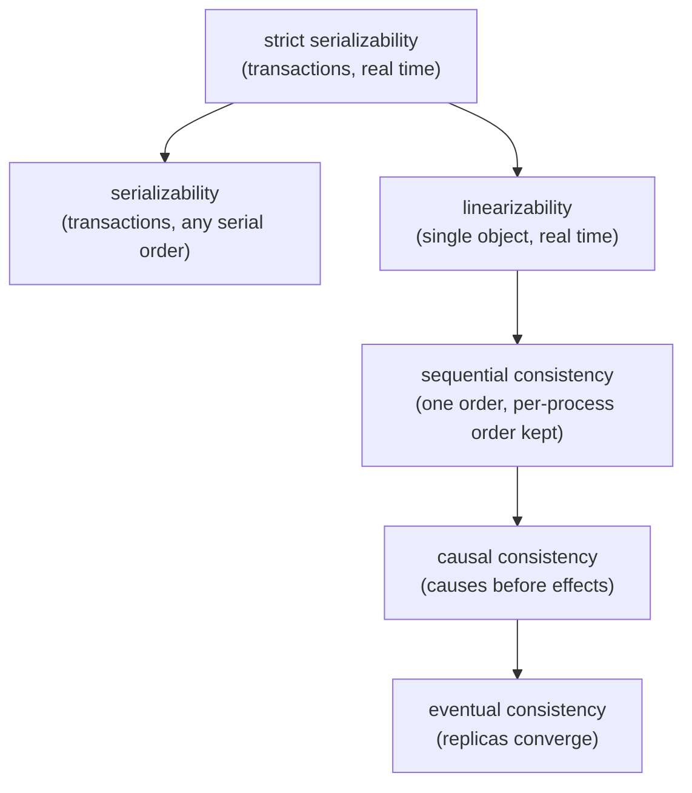
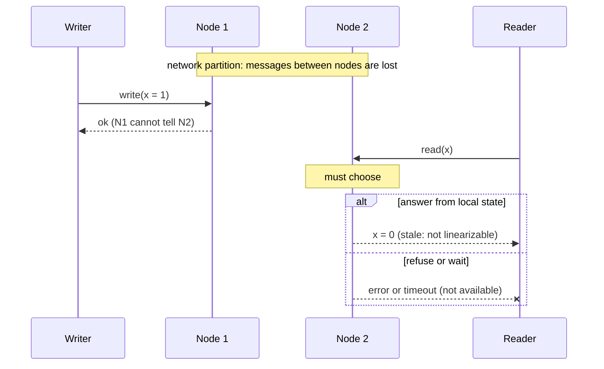
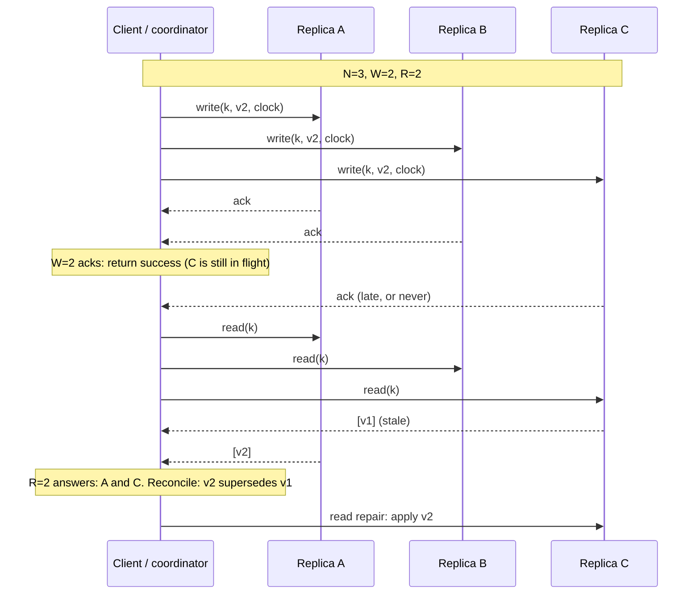
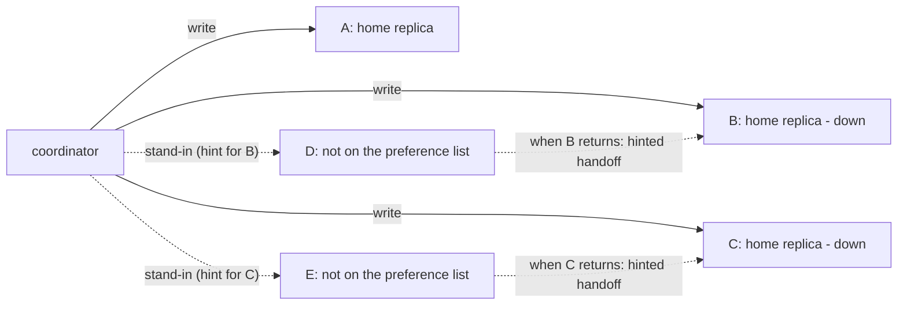
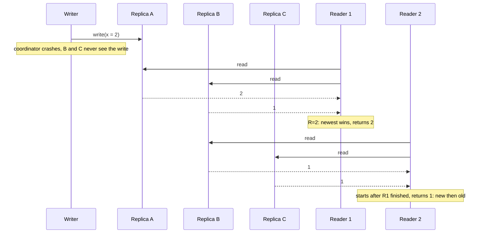

# A5 Unit 1 — Consistency models, CAP/PACELC and quorums

> Time: ~5.5 h · CORE (4.5 h): §1–§4 · STRETCH (≈ 1 h): the anti-entropy and Aurora-quorum parts of §4 · Lab: `labs/a5/quorum`

A5 is the module where "it works on my machine" turns into "it works when the network lies." Every replicated system
you have met so far (A4's read replicas, the cache in A3, the vendor callbacks in A1) has a moment when two copies of
the same fact disagree, and someone has to decide what a reader is allowed to see. This unit gives you the vocabulary
to say precisely what a system promises (§1, §2) and then builds the most common mechanism for tuning that promise,
the quorum (§3), including the ways it quietly fails to deliver what people think it does (§4).

Interviewers probe this unit with questions that sound simple: "is your read strongly consistent?", "what happens
during a partition?", "R plus W greater than N, so we're consistent, right?" Each has a precise answer and a tempting
wrong one.

## Before you start

You should have finished A4 (replication and partitioning). Warm-up, answer on paper first:

1. A leader acknowledges a write after its own disk fsync and replicates to followers asynchronously. It crashes one
   millisecond after the acknowledgement. What can a client observe after failover?
2. A client's `POST /transfers` times out after 10 s. What are the possible server states, and what makes a retry safe?
3. A request passes through three services in series, each 99.9% available. What is the best-case availability of the
   chain?

<details data-kind="answer">
<summary>Warm-up answers</summary>

1. The acknowledged write may be missing on the new leader (it never reached a follower): an acknowledged write can
   be lost. Synchronous or quorum replication closes that window at the cost of latency (that trade is this unit).
2. Not received, still running, failed with the response lost, or succeeded with the response lost: a timeout is
   ambiguous. A retry is safe only if the operation is idempotent or carries an idempotency key (A1 Unit 3). Keep that
   thought for Unit 2 §4.
3. 0.999³ ≈ 0.997, so 99.7%. Dependencies multiply, which is why "just add a synchronous replica" has an availability
   price: the write now depends on that replica too.

</details>

---

## §1 Consistency models: what a read may return

### The failure story

A member moves $2,000 from savings to checking. The app calls `POST /v1/transfers`, gets `201 Created`, and refreshes
the balances 200 ms later. Reads are load-balanced across the primary and two asynchronous replicas. A replica applies
a change about 20 ms plus, on average, another ≈ 80 ms after the primary does, with a long tail (an exponential tail
is a fair model; real lag distributions are heavier). The chance that a given replica has *not* applied the transfer
after 200 ms is e^(−180/80) ≈ 10.5%.

At 1.2 M transfers a day that is ≈ 126,000 refreshes a day that show the old balances: savings still $2,000 higher,
checking still $2,000 short. Most members shrug and pull to refresh. A couple of percent do not: they tap "Send"
again, or call support because "the money vanished". At 2% that is ≈ 2,500 contacts a day, every day, from a system in
which no component is broken. Nothing failed. The system did exactly what it promised, and the promise was wrong for
this screen.

Meanwhile the same platform has a ledger that must never show two different balances for one account at one moment.
"Consistent" cannot mean one thing for both.

### Predict

<!-- predict id="A5-U1-P01" -->
**Predict.** Write your answers down before opening the reveal.

1. Name the anomaly the member hit, and name a guarantee that fixes *this* member's experience without making every
   read in the system go to the primary.
2. A teammate says "make the database serializable and it goes away." Is that right? Why or why not?
3. Put these in order from strongest to weakest and say what each one permits that the one above forbids:
   eventual, causal, linearizable, sequential.
<!-- /predict -->

### Reveal

<details data-kind="reveal" data-for="A5-U1-P01">
<summary>Reveal</summary>

1. **Read-your-writes** was violated: the member's own acknowledged write was not visible to their next read. The fix
   is a *session guarantee*: route or gate that member's reads so they never see a state older than their last write
   (stick to the primary for a short window after a write, or carry a version token and only read from a replica that
   has reached it). It does not need global linearizability, which would make every reader of every account pay for
   freshness the other readers do not need.
2. No. **Serializability** is a property of *transactions*: the outcome is equivalent to some serial order of them.
   It says nothing about *which replica* answers a read or how stale that replica is; a serializable database can
   serve a perfectly serializable but old snapshot from a lagging replica. Recency across copies is the job of
   linearizability (or session guarantees). The two are independent axes, and the strongest combination is
   *strict serializability*.
3. Strongest to weakest: **linearizable** → **sequential** → **causal** → **eventual**. Linearizable behaves as if
   there were one copy and every operation takes effect at a single instant between its start and end (so real time
   matters). Sequential drops real time: all processes agree on one order that respects each process's own order, but
   that order may lag the wall clock. Causal only orders operations that are causally related (a reply after the post
   it replies to); concurrent operations may be seen in different orders by different readers. Eventual only promises
   that if writes stop, replicas converge, and permits anything in between.

</details>

### How it actually works

A consistency model is a contract about **which histories a system may produce**. A history is a record of operations
with their start and end times and what they returned. The model is the set of histories that are allowed. Weaker
models allow more histories, which lets the implementation be cheaper, faster or more available, and lets your
application be surprised more often.



An arrow means "is stronger than": every history the target allows, the source also allows. Serializability sits on a
different axis (transactions over many objects, no real-time promise), which is why a serializable database can still
serve an old snapshot, and why strict serializability, "serializable *and* linearizable", is the gold standard that
Spanner calls *external consistency*.

**The models, by what you can see go wrong:**

| Model | Guarantee | The surprise it still permits | Typical home |
|---|---|---|---|
| Linearizable | Behaves like one copy; an operation takes effect at one instant between start and end; once a read returns the new value, no later read returns the old one | None for a single object. Pays in latency (a round trip to a quorum) and in availability during partitions | Locks, leader election, account balances, anything where "read then decide" must see the truth |
| Sequential | Everyone sees one order, consistent with each process's program order | A read that starts *after* a write finished may still miss it (real time is not respected) | Rarely offered as such; ZooKeeper reads are close (per-client order, possibly stale) |
| Causal | If A could have influenced B, everyone sees A before B | Two concurrent writes may be seen in different orders by different readers | Social feeds, comments, collaborative data; MongoDB causal sessions |
| Eventual | Replicas converge if writes stop | Reads can be stale, reordered, or flip back and forth; concurrent writes need a merge rule | Caches, counters of likes, DNS, shopping carts built on siblings |

**Session guarantees** (Terry et al., the Bayou paper, 1994) are the small, cheap promises that make weak models
tolerable. They are scoped to one client's session, so they need state only about that client:

- **Read-your-writes**: my reads reflect my earlier writes.
- **Monotonic reads**: once I have seen a value, I never see an older one.
- **Monotonic writes**: my writes are applied in the order I issued them.
- **Writes-follow-reads**: a write I make after reading X is ordered after X everywhere.

Most "the app looks broken but the database is fine" bugs are a missing session guarantee, not a missing
linearizable store. The standard implementation is a **version token**: the write returns a position (a log sequence
number, a version, a timestamp), the client sends it with later reads, and a replica answers only if it has reached
that position (or the router falls back to the primary). The experiment in "Break it" measures what that costs.

**Linearizability, precisely.** A history is linearizable if you can pick, for each operation, a single instant between
its start and its end ("the linearization point") so that the sequence of operations ordered by those instants is a
valid history of a single copy. Two consequences matter in interviews: (1) if operation B starts after operation A
finished, B must be ordered after A, so a read that starts after a write has completed must return that write or a
later one; (2) operations that overlap in time may be ordered either way, so a read concurrent with a write may
return old or new, but once any reader has seen the new value, every read that starts after that must too.

**Banking link.** You have met these anomalies without the names. A member changes their e-mail address in the
profile service and your SSO adapter, reading a replica 150 ms behind, issues the next assertion with the old address:
read-your-writes across two services. A vendor posts a "deposit accepted" callback, your status endpoint (served by one
replica) shows `accepted`, the member refreshes and a different replica says `pending`: a monotonic-reads violation the
member reads as "it un-accepted my deposit". The fixes are the ones above (a version carried by the session, reads
pinned to the primary for a short window, or the write's response carrying the new state), and the diagnosis is
faster when you can say which guarantee is missing.

### Build it

Below is a tiny brute-force checker for a single register that starts at 0. It tries every ordering of the
operations and asks two questions: is there an order that respects real time (linearizable), and is there one that
respects only each process's own order (sequentially consistent)? Save it as `main.go` in a scratch directory
outside the repository (for example `lincheck/main.go` in your notes folder) and run `go run .`.

```go
// lincheck: brute-force checker for a single register that starts at 0.
// It answers two questions about a recorded history of completed operations:
//   - linearizable?        some total order that respects real time
//     (if a finished before b started, a comes first) and makes every read correct
//   - sequentially consistent? some total order that respects only each
//     process's own program order and makes every read correct
package main

import "fmt"

type op struct {
	proc       string
	kind       string // "w" or "r"
	val        int    // value written, or value the read returned
	start, end int    // instants on one shared wall clock
}

func (o op) String() string {
	return fmt.Sprintf("%s:%s(%d)[%d,%d]", o.proc, o.kind, o.val, o.start, o.end)
}

// explainable reports whether ops can be put in a total order that satisfies
// mustPrecede and in which every read returns the latest preceding write.
func explainable(ops []op, mustPrecede func(a, b op) bool) bool {
	used := make([]bool, len(ops))
	var place func(placed, current int) bool
	place = func(placed, current int) bool {
		if placed == len(ops) {
			return true
		}
		for i, o := range ops {
			if used[i] {
				continue
			}
			blocked := false
			for j, p := range ops {
				if !used[j] && j != i && mustPrecede(p, o) {
					blocked = true
					break
				}
			}
			if blocked || (o.kind == "r" && o.val != current) {
				continue
			}
			next := current
			if o.kind == "w" {
				next = o.val
			}
			used[i] = true
			found := place(placed+1, next)
			used[i] = false
			if found {
				return true
			}
		}
		return false
	}
	return place(0, 0)
}

func linearizable(ops []op) bool {
	return explainable(ops, func(a, b op) bool { return a.end < b.start })
}

func sequentiallyConsistent(ops []op) bool {
	return explainable(ops, func(a, b op) bool { return a.proc == b.proc && a.start < b.start })
}

func main() {
	histories := []struct {
		name string
		ops  []op
	}{
		{"A: read after the write finished sees it", []op{
			{"alice", "w", 1, 0, 10}, {"bob", "r", 1, 20, 30}}},
		{"B: read after the write finished misses it", []op{
			{"alice", "w", 1, 0, 10}, {"bob", "r", 0, 20, 30}}},
		{"C: two readers, new then old, write still in flight", []op{
			{"alice", "w", 1, 0, 100}, {"bob", "r", 1, 10, 20}, {"carol", "r", 0, 30, 40}}},
		{"D: one reader sees new then old", []op{
			{"alice", "w", 1, 0, 100}, {"bob", "r", 1, 10, 20}, {"bob", "r", 0, 30, 40}}},
		{"E: read overlapping the write may see either", []op{
			{"alice", "w", 1, 0, 100}, {"bob", "r", 0, 10, 20}, {"carol", "r", 1, 30, 40}}},
	}
	fmt.Printf("%-55s %-13s %s\n", "history", "linearizable", "sequentially consistent")
	for _, h := range histories {
		fmt.Printf("%-55s %-13v %v\n", h.name, linearizable(h.ops), sequentiallyConsistent(h.ops))
	}
}
```

Before you run it, fill in the two columns for histories A–E yourself.

<details data-kind="answer">
<summary>Output, and how to read it</summary>

```text
history                                                 linearizable  sequentially consistent
A: read after the write finished sees it                true          true
B: read after the write finished misses it              false         true
C: two readers, new then old, write still in flight     false         true
D: one reader sees new then old                         false         false
E: read overlapping the write may see either            true          true
```

- **B** is the classic stale read: Bob's read starts after Alice's write ended and still returns 0. Not
  linearizable (real time forbids it) but sequentially consistent (put Bob's read first; nothing says Bob must be
  ordered after Alice).
- **C** is what a quorum store can do while a write is in flight (Unit 1 §4): Bob sees the new value, then Carol,
  who started after Bob finished, sees the old one. Real time forbids it; sequential consistency, which orders only
  within a process, allows it.
- **D** breaks even sequential consistency, because it breaks Bob's own program order: this is a *monotonic reads*
  violation, the one a session guarantee exists to prevent.
- **E** is fine: the write overlaps both reads, so any order consistent with "old then new" explains it.

</details>

### Break it

1. Run the session-guarantee simulation below. Predict each column before you run it: with a read 200 ms after the
   write and a second read 100 ms later, how often does each routing policy return the member's old data, and what
   does the version token cost?
2. Then change `readAfter` to 50 and re-run it. Which numbers move, and which routing policy is now the only
   defensible one for the "just transferred money" screen?

```go
// session: how often do reads from asynchronous replicas break the session
// guarantees "read your writes" and "monotonic reads", and what does a
// version token in the session cost to fix it?
//
// Model: one primary and two replicas. Every second a user saves a profile
// change (version i+1). A replica applies it 20 ms + Exp(mean 80 ms) later (in
// order). The user reloads the page 200 ms after saving and again 100 ms later.
package main

import (
	"fmt"
	"math/rand/v2"
)

const (
	users      = 200_000
	readAfter  = 200.0 // ms after the write
	secondRead = 100.0 // ms after the first read
)

type policy struct {
	name   string
	choose func(rng *rand.Rand, session int) int // 0 = primary, 1..2 = replicas
	token  bool                                  // fall back to the primary when the chosen replica is behind the user's last write
}

func main() {
	policies := []policy{
		{"any of 3 nodes", func(r *rand.Rand, _ int) int { return r.IntN(3) }, false},
		{"replicas only", func(r *rand.Rand, _ int) int { return 1 + r.IntN(2) }, false},
		{"sticky replica", func(_ *rand.Rand, s int) int { return 1 + s%2 }, false},
		{"replicas + version token", func(r *rand.Rand, _ int) int { return 1 + r.IntN(2) }, true},
	}
	fmt.Printf("%-26s %10s %10s %14s\n", "read routing", "RYW viol.", "mono viol.", "primary reads")
	for _, p := range policies {
		rng := rand.New(rand.NewPCG(1, 2))
		var ryw, mono, primaryReads, reads int
		for u := 0; u < users; u++ {
			session := u % 1000 // 1000 sessions, each pinned (for "sticky") to one replica
			var applyAt [3]float64
			applyAt[0] = 0
			applyAt[1] = 20 + rng.ExpFloat64()*80
			applyAt[2] = 20 + rng.ExpFloat64()*80
			seen := func(node int, t float64) bool { return applyAt[node] <= t } // has this node applied the new version by time t?

			node := p.choose(rng, session)
			if p.token && !seen(node, readAfter) {
				node = 0 // the replica is behind my token: go to the primary
			}
			if node == 0 {
				primaryReads++
			}
			reads++
			first := seen(node, readAfter)
			if !first {
				ryw++
			}
			node2 := p.choose(rng, session)
			if p.token && !seen(node2, readAfter+secondRead) {
				node2 = 0
			}
			if node2 == 0 {
				primaryReads++
			}
			reads++
			second := seen(node2, readAfter+secondRead)
			if first && !second {
				mono++ // saw the new version, then the old one
			}
		}
		fmt.Printf("%-26s %9.1f%% %9.1f%% %13.1f%%\n", p.name,
			100*float64(ryw)/users, 100*float64(mono)/users, 100*float64(primaryReads)/float64(reads))
	}
}
```

<details data-kind="answer">
<summary>What you should see, and why</summary>

Reference run (seeded, so yours will match):

```text
read routing               RYW viol. mono viol.  primary reads
any of 3 nodes                   7.1%       1.2%          33.5%
replicas only                   10.6%       1.4%           0.0%
sticky replica                  10.7%       0.0%           0.0%
replicas + version token         0.0%       0.0%           6.8%
```

- Read-your-writes fails for ≈ 10.6% of reloads on a replica, matching the analytic e^(−180/80) ≈ 10.5%. Mixing in the
  primary dilutes it to ≈ 7.1% (two thirds of reads hit a replica) but fixes nothing.
- **Sticky replica** removes monotonic-read violations (the same replica never goes backwards) but not
  read-your-writes: the replica you are stuck to can still be behind your last write. Stickiness is a partial answer
  to one guarantee.
- **The version token** drives both to 0.0% by sending the read to the primary only when the chosen replica is behind
  your last write: ≈ 6.8% of reads. That is the price of the guarantee, and it is a price only the members who just
  wrote pay.
- With `readAfter = 50`, replicas are behind most of the time (e^(−30/80) ≈ 69%): read-your-writes violations on
  "replicas only" jump to 68.9%, and the token policy sends 44.4% of all reads to the primary. At that point
  "read-your-writes via replicas" saves little for that screen; reading the primary (or returning the new balance in
  the write's response) is the honest design.

</details>

### In the wild

- **Azure Cosmos DB** exposes five consistency levels as a product setting: strong, bounded staleness, session,
  consistent prefix, and eventual. Session is the default in the portal and is exactly the session-guarantee bundle
  above. `TODO-VERIFY: current default level for new accounts.`
- **Google Spanner** offers strict serializability ("external consistency") for read-write transactions, and
  stale reads at a chosen timestamp as an explicit, cheaper option.
- **DynamoDB** reads are eventually consistent by default; `ConsistentRead=true` asks for a strongly consistent read,
  at roughly twice the read capacity cost, and strongly consistent reads are not available on global secondary
  indexes. `TODO-VERIFY: current capacity-unit arithmetic and the GSI limitation.`
- **Amazon S3** moved to strong read-after-write consistency for object PUTs, DELETEs and LISTs in December 2020, a
  rare case of a major service strengthening its model and removing a whole class of client workarounds.
- **MongoDB** has read concerns (`local`, `majority`, `linearizable`), write concerns (`w: "majority"`) and causal
  consistency inside client sessions (since 3.6), which are the building blocks of session guarantees.
  `TODO-VERIFY: exact version for causal sessions and the current default write concern.`
- **PostgreSQL** streaming replicas are asynchronous by default; `synchronous_commit = remote_apply` makes a commit
  wait until a synchronous standby has *applied* it, which is how you buy read-your-writes on that standby.
- **ZooKeeper** gives each client a sequentially consistent view and serves reads from the local server, so reads can
  be stale; the `sync` call makes a server catch up first. **etcd** serves linearizable reads by default and offers
  a cheaper "serializable" (possibly stale) read option.
- **Google Zanzibar** (the authorization system behind Drive and YouTube) passes an opaque consistency token (a
  "zookie") from writes to subsequent checks to avoid the "new enemy problem", an access-control version of
  read-your-writes and writes-follow-reads.

### Trade-offs

| Option | Wins when | Loses when | When the answer flips |
|---|---|---|---|
| Linearizable reads and writes | A decision depends on the latest value (a balance check before a debit, a lock, a unique username) | Cross-region latency (a quorum round trip on every write), hot-key throughput, availability during partitions | Flip to session guarantees when only the *same user's* freshness matters |
| Session guarantees (token or sticky routing) | Most user-facing reads: "show me what I just did" | Needs state in the session or a router that understands positions; a replica far behind sends everyone to the primary | Flip to linearizable when *other* users must also see the write immediately (a shared balance, a seat map) |
| Causal consistency | Collaborative data and feeds where order of related events matters but global order does not | Metadata cost for tracking dependencies; concurrent writes still need a merge rule | Flip to eventual when order does not matter at all (counters) or to linearizable when decisions need a total order |
| Bounded staleness ("at most 5 s or 100 versions old") | Dashboards, reporting, read-heavy views | The bound must be monitored and enforced; "bounded" is only as good as the replica lag metric | Flip to session guarantees if the staleness is visible to the user who caused it |
| Eventual | Caches, counters, anything idempotent or mergeable; maximum availability and lowest latency | Every reader may see anything; the application owns conflict handling | Flip to anything stronger the moment a decision, not just a display, reads the value |

### Senior bar

- **Failure modes**: read-your-writes violations after replica routing; monotonic-read violations when a load balancer
  rotates across replicas of different lag; "serializable" assumed to mean fresh; a failover to a replica that was
  behind (acknowledged writes lost); caches (A3) layering their own staleness on top of the database's.
- **Capacity**: a linearizable write needs at least one round trip to a majority. Inside one region across three AZs
  that is ≈ 1–2 ms (`docs/NUMBERS.md`); with the leader in us-east and the nearest other voter in us-west it is ≈
  60–80 ms. A hot key that serialises on that round trip tops out at ≈ 1 / RTT writes per second: ≈ 500–1,000 per
  second at 1–2 ms, and only ≈ 12–16 per second at 70 ms. Plan hot accounts accordingly (A4's hot-key material).
- **Ops**: export replica lag as a first-class metric and alert on it; log which consistency level served each read
  so support can answer "why did I see the old balance?"; test failovers for lost acknowledged writes.
- **Cost**: strong reads often cost more (DynamoDB, Cosmos DB request units) or more latency; paying for it
  everywhere when only one screen needs it is the common waste.

Interviewer follow-up probes:

1. "Is a serializable database linearizable?"

<details data-kind="answer">
<summary>Model answer</summary>

Not necessarily. Serializability constrains *transactions* to be equivalent to some serial order but does not tie
that order to real time or to which replica answered. Linearizability constrains *single-object operations* to
respect real time. Together they are strict serializability (Spanner's external consistency). On a single node with
one copy the distinction nearly disappears; across replicas and snapshots it does not.

</details>

2. "Reads come from replicas that lag. How do you give a member read-your-writes without reading everything from the
   primary?"

<details data-kind="answer">
<summary>Model answer</summary>

Make the write return a position (an LSN, a version, a timestamp) and have the client carry it in a session token;
the read path serves from a replica only if it has reached that position and otherwise falls back to the primary or
waits briefly. Cost: only members who just wrote pay with a primary read. In the simulation above the primary
absorbed ≈ 6.8% of reads. Alternatives: return the new state in the write response and let the client show it, or
pin the member to the primary for a few seconds after a write.

</details>

3. "Which model would you pick for the balance on the home screen, and which for approving a transfer?"

<details data-kind="answer">
<summary>Model answer</summary>

Home-screen balance: session guarantees on replicas (or bounded staleness), labelled with an "as of" time, because
a few hundred milliseconds of staleness is invisible and the load is read-heavy. Transfer approval: the decision reads
the balance and writes the debit, so it must see the latest state and serialise with other debits on the same
account: a linearizable read-modify-write on the system of record (a single-leader transaction in the core, or
consensus), never a cached or replica value.

</details>

### Check yourself

1. Which session guarantee does a version token on reads implement, and which one does "stick to one replica" implement?
2. A read starts after a write returned success and returns the old value. Which models forbid that?
3. Why can a serializable database serve a stale read?

<details data-kind="answer">
<summary>Answers</summary>

1. The token gives read-your-writes (and, since tokens only grow, monotonic reads). Sticking to one replica gives
   monotonic reads but not read-your-writes, because the replica can still be behind the member's own last write.
2. Linearizable (it respects real time). Sequential and weaker models allow it.
3. Serializability orders transactions but says nothing about recency; a lagging replica serves a consistent but old
   snapshot.

</details>

---

## §2 CAP and PACELC

### The failure story

A platform runs the same ledger service in two data centres, East and West, and replicates every posting between them.
On a Friday at 17:40 a fibre cut isolates West from East for 40 seconds. Both sites are healthy. Both can still reach
their local database and their local users. Withdrawal requests keep arriving: say 1,000 of them in those 40 seconds
(25 per second), each a $300 withdrawal against one of 400 accounts that each hold $500.

The architects had argued about this exact moment for months. The two designs, replayed on the same 1,000 requests:

| Design | Served | Refused as "unavailable" | After the link heals |
|---|---|---|---|
| **CP**: West refuses while it cannot reach East | 298 | 526 | 0 accounts overdrawn |
| **AP**: both sites answer from their local copy | 600 | 0 | 221 accounts overdrawn, $22,100 owed |

(The remaining 176 and 400 requests were refused for the ordinary reason, insufficient funds.) Neither design is
"correct". One turns a quarter-minute of service into 526 apologies. The other turns it into $22,100 of overdrafts
that someone must reverse, explain, and possibly fee-waive. CAP is the theorem that says you cannot make that
trade-off disappear; PACELC is the observation that you make a smaller version of it on every request even when the
link is fine.

### Predict

<!-- predict id="A5-U1-P02" -->
**Predict.** Write your answers down before opening the reveal.

1. State the CAP theorem in one precise sentence. What do C, A and P each mean in it?
2. A vendor says "our database is CP, so it's down whenever there's a partition". Is that what CP means?
3. Why isn't "CA" a real third option for a distributed system?
4. There is no partition right now. Does the theorem say anything about the system's behaviour, and if not, what
   trade-off is still being made on every request?
<!-- /predict -->

### Reveal

<details data-kind="reveal" data-for="A5-U1-P02">
<summary>Reveal</summary>

1. **In an asynchronous network, a system cannot be both linearizable and available when the network partitions.**
   *C* is linearizability (the single-copy illusion from §1), not the "C" in ACID. *A* is that **every request to a
   non-failed node eventually receives a non-error response**, which is much stricter than "five nines"; a system
   that returns errors to clients on the minority side of a partition is, in CAP terms, not available. *P* is that
   the network may drop or delay arbitrary messages between nodes.
2. No. A CP system stays available on the **majority** side (consensus needs a majority, not everyone), and only
   clients that can reach nothing but the minority side get errors or timeouts. Measured availability of well-run CP
   systems can be very high. "CP" describes what the system does *when* it must choose, not how often it must.
3. Partitions are not something you opt out of; a switch failure, a misconfigured firewall, a long GC pause or a
   congested link looks like a partition to the node on the other end. "Choosing CA" means assuming the network never
   partitions, which is true only for a single node. The real choice is **C or A, if and when a partition happens**.
4. No: CAP is silent when everything is connected. But a trade-off remains: to be consistent the system must
   coordinate (replicate synchronously, or read from a leader or a quorum), and coordination costs **latency**. That
   is PACELC: if **P**artition, choose **A**vailability or **C**onsistency; **E**lse, choose **L**atency or
   **C**onsistency.

</details>

### How it actually works

**The proof, in one picture.** Two nodes, one register, a partition between them. A client writes a new value through
node 1. Another client then reads through node 2.



Node 2 cannot know about the write, so it has exactly two options: answer (and break linearizability) or refuse (and
break availability). Everything else is detail about *who* gets to be on which side and *what* each side may do.

**What CAP does not say** (each of these is a real interview trap):

- It does **not** say you "pick two of three" once per system. The choice happens only during a partition and can be
  made per operation: a card authorisation may take the available branch while a ledger posting takes the consistent
  one, in the same product.
- It says nothing about normal operation, and nothing about latency. A system can be "AP" and slow, or "CP" and fast.
- "Consistency" means linearizability. Weaker models (causal, session guarantees) can be offered *with* availability
  during partitions, which is why §1's menu matters.
- "Availability" means every non-failed node answers. A system that answers 99.99% of requests but not those that hit
  the minority partition is "CP"; the SLA-style availability number and the theorem's availability are different
  quantities.
- It is a statement about a single replicated register. Real systems mix models and add timeouts, retries and
  fallbacks that blur the line, which is why classifying a product as "AP" or "CP" is always a simplification.

**PACELC** (Abadi, 2010–2012) adds the half the theorem ignores. In the "Else" case (no partition) the choice is
between latency and consistency, because every stronger guarantee needs another round trip:

| Where the replicas are | Round trip (from `docs/NUMBERS.md`) | A write that needs a majority waits at least |
|---|---|---|
| Same datacenter | 0.1–0.5 ms | ≈ 0.5 ms |
| Three AZs in a region | ≈ 1–2 ms | ≈ 1–2 ms |
| Leader in us-east, nearest other voter in us-west | ≈ 60–80 ms | ≈ 60–80 ms |
| Leader in us-east, nearest other voter in Europe | ≈ 80–150 ms | ≈ 80–150 ms |

Going from "in region" to "across the continent" costs ≈ 40× on every write that must be consistent, with no
partition anywhere. That, not the partition, is the trade-off you live with every day, which is why PACELC's "EL vs
EC" label predicts a system's behaviour better than its "PA vs PC" label.

| Style | During a partition | Else | Typical examples (configuration matters) |
|---|---|---|---|
| PA/EL | Stay available, diverge, merge later | Answer from the nearest replica, fast | Dynamo-style stores at low consistency levels (Cassandra at `ONE`, Riak) |
| PC/EC | Minority side refuses; majority keeps going | Pay for coordination on every operation | Consensus-backed stores: etcd, ZooKeeper, Spanner, single-leader relational databases with synchronous replication |
| PA/EC | Available during partition | Consistent when connected | Hybrids; labels are approximate (`TODO-VERIFY: Abadi's published classification of MongoDB and PNUTS`) |

**Per-operation choice in a banking platform.** The skill interviewers look for is not reciting CAP but assigning a
side to each operation and saying what happens to the loser:

| Operation | During a partition or core outage | Why |
|---|---|---|
| Debit / credit posting | **Consistent**: refuse or queue | A wrong posting costs more than a delayed one; the core is the system of record |
| Account balance display | **Available**: serve the last known balance, labelled "as of 17:39" | A stale display is cheap; an error page is expensive |
| Card authorisation when the issuer's core is unreachable | **Available, bounded**: the network or processor approves small amounts up to a limit on the issuer's behalf ("stand-in processing") | Accept a small, bounded overdraft risk rather than decline every swipe. `TODO-VERIFY: exact network stand-in rules` |
| Audit-log append | **Available**: accept locally, merge later (append-only, ordered by a causal or hybrid clock) | Never lose the record; ordering is reconstructed (Unit 2) |
| Nightly batch window at the core | Not a partition, but behaves like one every night | The digital layer serves cached balances and queues transfers: a PACELC decision made years ago |

### Build it

No lab for this section; §3 builds the mechanism that lets you pick a point on this spectrum. The program below makes
the opening failure story executable. Save it outside the repository (for example `partition/main.go` in a scratch
folder) and run `go run .`.

```go
// partition: what "choosing C" and "choosing A" look like for one concrete
// operation, withdrawals, while the link between two sites is cut.
//
// 400 accounts hold $500 each at two sites, East and West. During the partition
// 1,000 withdrawals of $300 arrive, each for a random account at a random site.
//   - CP: only East (the side with the lease) may process; West refuses.
//   - AP: each site answers from its own copy and reconciles after the heal.
package main

import (
	"fmt"
	"math/rand/v2"
)

const (
	accounts = 400
	opening  = 500
	amount   = 300
	requests = 1000
)

type request struct{ account, site int } // site 0 = East, 1 = West

func main() {
	rng := rand.New(rand.NewPCG(7, 9))
	var reqs []request
	for i := 0; i < requests; i++ {
		reqs = append(reqs, request{rng.IntN(accounts), rng.IntN(2)})
	}

	for _, mode := range []string{"CP (West refuses)", "AP (both answer)"} {
		var bal [2][accounts]int // each site's own copy
		for s := range bal {
			for a := range bal[s] {
				bal[s][a] = opening
			}
		}
		var served, unavailable, insufficient int
		for _, r := range reqs {
			if mode[:2] == "CP" && r.site == 1 {
				unavailable++
				continue
			}
			if bal[r.site][r.account] < amount {
				insufficient++ // an honest business rejection
				continue
			}
			bal[r.site][r.account] -= amount
			served++
		}
		// Heal: merge the copies by applying both sites' withdrawals.
		overdrawn, shortfall := 0, 0
		for a := 0; a < accounts; a++ {
			merged := opening - (opening - bal[0][a]) - (opening - bal[1][a])
			if merged < 0 {
				overdrawn++
				shortfall += -merged
			}
		}
		fmt.Printf("%-18s served %3d, unavailable %3d, insufficient funds %3d | after heal: %3d accounts overdrawn, $%d owed\n",
			mode, served, unavailable, insufficient, overdrawn, shortfall)
	}
}
```

Expected output (the numbers in the failure story):

```text
CP (West refuses)  served 298, unavailable 526, insufficient funds 176 | after heal:   0 accounts overdrawn, $0 owed
AP (both answer)   served 600, unavailable   0, insufficient funds 400 | after heal: 221 accounts overdrawn, $22100 owed
```

### Break it

1. Raise the opening balance to $700 (so a single account can fund two $300 withdrawals) and re-run. Predict whether
   the AP overdraft disappears.
2. Replace each site's copy of the balance with a **spending budget** of `opening / 2` per account, and refuse locally
   when the budget is too small (this is *escrow*: split the right to spend so the sites never need to talk). Re-run
   with `amount = 300` and then `amount = 200`. What do you get?

<details data-kind="answer">
<summary>What you should see, and why</summary>

1. It does **not** disappear; it gets worse in absolute terms. Each site can now serve two withdrawals per account
   (700 → 400 → 100), so both sites together can take up to four ($1,200 against $700). Reference run: AP serves 879,
   leaves **152 accounts overdrawn and $44,800 owed**; CP still serves what East can (427) with 526 unavailable and
   zero overdrafts. A bigger balance moves the problem, it does not remove it. The only things that remove it are
   coordination (CP) or a design that never lets two sites spend the same dollar.
2. With a $300 withdrawal and a $250 budget per site, **nothing is ever served** (0 of 1,000): perfectly safe, perfectly
   useless for that amount. With $200 withdrawals, 600 of 1,000 are served and **0 accounts are overdrawn**, because
   each site can spend at most its own $250 and the sum cannot exceed $500. Escrow turns "consistency vs availability"
   into "how much of the invariant do I hand each side", a bounded-counter idea you will meet again in the senior bar
   below. The price is that the budget can be wrong for the traffic split (a site runs dry while the other has money
   left) and needs a rebalancing protocol when connected.

</details>

### In the wild

- **Origins**: Eric Brewer stated the conjecture in a 2000 keynote; Seth Gilbert and Nancy Lynch proved a formal
  version in 2002; Brewer's "CAP Twelve Years Later" (2012) walks back the "pick two" slogan; Martin Kleppmann's
  "A Critique of the CAP Theorem" (2015) argues that the definitions are narrower than people assume and proposes
  talking about delay-sensitivity instead; Daniel Abadi's PACELC papers (2010–2012) add the latency half.
- **Spanner**: Brewer's 2017 note on Spanner and CAP argues that it is technically CP but so rarely unavailable in
  practice (private network, redundant links, operations) that it is "effectively CA". `TODO-VERIFY: exact claims and figures in that note.`
- **etcd and ZooKeeper** are CP: a member that cannot reach a quorum refuses writes (and, for etcd's default
  linearizable reads, refuses reads). Kubernetes control planes inherit exactly this behaviour: lose the etcd quorum
  and the API server stops accepting changes while already-running pods keep running.
- **Cassandra and DynamoDB-style systems** let you choose per request: Cassandra's `ONE` is AP/EL, `QUORUM` and
  `ALL` move toward C; the choice is made by the client per operation, which is the per-operation decision in the table above.
- **Jepsen** (Kyle Kingsbury's distributed-systems testing) checks whether products keep the guarantees they
  advertise under partitions; its reports are the practical counterpart of this section: most surprising findings
  are a weaker guarantee than the marketing implied.
- **Card networks** run stand-in processing for issuers that are unreachable; a bank's own digital layer does the same
  with cached balances during core batch windows. Both are deliberate AP behaviour with bounded risk.

### Trade-offs

| Option | Wins when | Loses when | When the answer flips |
|---|---|---|---|
| CP for an operation (refuse or queue during a partition) | The cost of a wrong answer exceeds the cost of no answer: money movement, uniqueness, locks | Users on the minority side see errors; recovery needs operations; latency on every write | Flip to AP-with-limits when refusing is more expensive than the bounded risk (card swipes at a checkout) |
| AP for an operation (answer locally, reconcile later) | Availability dominates and conflicts are rare, mergeable or cheap to compensate: carts, presence, balance display | Divergence needs merge logic and compensations (Unit 2); invariants can break (overdrafts) | Flip to CP when an invariant ("balance ≥ 0", "one owner") must hold across sites |
| Escrow / bounded counters (AP with a safety budget) | A numeric invariant must hold but sites should keep working | Budget fragmentation, rebalancing protocol, unused budget stranded on one side | Flip to CP if the budgets must be tiny relative to demand |
| Single region, strong consistency | Most products: the partition risk between AZs is low and the latency is ≈ 1–2 ms | A region outage is a full outage | Flip to multi-region only when RPO/RTO or latency to far users demands it (A7) |
| Multi-region, strong consistency | A hard requirement for no data loss and global invariants | ≈ 60–150 ms on every write; hot-key throughput collapses | Flip to regional ownership of data (each account lives in one home region) to keep writes local |

### Senior bar

- **Failure modes**: calling a system "CA"; assuming CP means "down in a partition"; assuming AP means "no
  consistency at all" (an AP store can still give session guarantees and mergeable types); unbounded stale reads
  presented as fresh; a split-brain where both sides believe they are the leader (Unit 3); clients that retry
  against the minority side and amplify load.
- **Capacity**: a partition of 40 s at 25 requests/s is 1,000 requests; at 5,000 requests/s it is 200,000. The AP
  conflict count scales with the overlap of what both sides touched, not with traffic alone (221 of 400 accounts in
  the example, because the working set was small). Hot sets conflict most.
- **Ops**: you need to be able to *see* a partition (cross-site heartbeats, replica-lag and quorum-health metrics),
  to fence the losing side, and to run reconciliation when it heals. Rehearse it: game days that cut links between
  sites are the only way to learn which branch your system actually takes.
- **Cost**: AP's cost arrives later and in humans (reversals, support, regulators); CP's cost is paid in latency and
  availability immediately. Cross-region data transfer is itself a bill (≈ $0.02–0.09 per GB, `TODO-VERIFY`).

Interviewer follow-up probes:

1. "You said the ledger is CP. What does a member in the minority partition see, and for how long?"

<details data-kind="answer">
<summary>Model answer</summary>

Reads of balances can fall back to a labelled stale value (a deliberate AP choice for that operation); debits and
transfers fail fast with a retryable "temporarily unavailable" error or are queued with a clear pending state. The
duration is bounded by detecting the partition (heartbeats, a few seconds) plus the repair time; a majority-side
leader keeps serving everyone who can reach it. I would expose the state in the app ("we can't reach your accounts
right now") instead of letting requests hang, and I would make sure the retry path is idempotent so queued attempts
cannot double-post when the link returns.

</details>

2. "Is your system 'AP' or 'CP'?"

<details data-kind="answer">
<summary>Model answer</summary>

It depends on the operation, so I'd answer per path: posting and transfer approval are consistent (they go through the
single leader or a quorum and refuse otherwise); balance display and audit ingestion are available (cached or
append-and-merge). In the no-partition case I'd add the PACELC half: posting pays a quorum round trip (≈ 1–2 ms
in-region), reads are served from replicas with session guarantees to keep latency low.

</details>

3. "How would you let two sites both accept withdrawals without ever overdrawing?"

<details data-kind="answer">
<summary>Model answer</summary>

Don't let them spend the same dollar: give each site an escrowed share of the balance (or of the daily limit) and let
it spend only within that share without coordination, with a rebalancing protocol that moves share between sites while
connected. This is the bounded-counter pattern. It trades availability of large withdrawals (a site whose share is
too small must refuse or call home) for safety, and it needs care about stranded budget and about failed sites that
hold unspent share.

</details>

### Check yourself

1. In CAP, what does "available" require, and does a CP system meet it on the majority side?
2. Name the "E" trade-off in PACELC and give a number for it from the NUMBERS sheet.
3. Why do per-operation decisions matter more than labelling the whole system?

<details data-kind="answer">
<summary>Answers</summary>

1. Every request to a non-failed node gets a non-error response. On the majority side a CP system does answer, but it
   is not "available" in the theorem's sense for the minority side, so as a whole it is CP.
2. Latency vs consistency: a majority write across the continent costs ≈ 60–80 ms against ≈ 1–2 ms across AZs in one
   region (≈ 40×).
3. The same product contains operations with opposite costs of error (a posting vs a balance display); one label
   hides which branch each takes during a partition.

</details>

---

## §3 Quorums: N, R and W

### The failure story

A promotions service stores one flag per member per campaign, `redeemed = true`, in a three-replica key-value store
that was configured for speed: **N = 3, R = 1, W = 1**. A write is acknowledged by whichever replica answers first;
a read asks whichever replica answers first. During a one-hour campaign a rolling deploy keeps restarting replicas,
and for that hour about 30% of replicas are behind on any given write (they apply it a moment later, or after they
come back).

40,000 members redeem a $50 credit. About 3% of them double-tap, so 1,200 redemptions are followed within a
second by a second request that first *reads* the flag. In the simulation you will run at the end of this section, a
read after an acknowledged write returns the *old* value 27.4% of the time with these settings. That is ≈ 330 members
who read `redeemed = false` a second after redeeming and get paid again: ≈ $16,500 of credits that should not exist.
The store was never "down" and never "lost" a write. It simply never promised that a read would meet a write.

The fix is two changes to two integers. The reasoning behind them is the pigeonhole principle.

### Predict

<!-- predict id="A5-U1-P03" -->
**Predict.** Write your answers down before opening the reveal.

1. With N = 3, which of these settings guarantee that a read returns the latest *acknowledged* write, assuming no
   failures beyond what the setting tolerates: (R, W) = (1, 1), (2, 1), (1, 2), (2, 2), (1, 3), (3, 1)?
2. For each setting that does guarantee it, how many replica failures can reads survive and how many can writes
   survive?
3. N = 3 and each replica's latency is under 50 ms 99% of the time, independently. How often is a write slower than
   50 ms with W = 1, W = 2, and W = 3?
4. What is the smallest N, and a choice of R and W, that survives two replica failures for both reads and writes?
<!-- /predict -->

### Reveal

<details data-kind="reveal" data-for="A5-U1-P03">
<summary>Reveal</summary>

1. The rule is **R + W > N**: the set of replicas that acknowledged the write (at least W) and the set a read
   consults (R) must share at least one replica. With N = 3 that is (2, 2), (1, 3) and (3, 1). The settings
   (1, 1), (2, 1) and (1, 2) can read a stale value, including the two where R + W = N exactly: with N = 3, W = 2 and
   R = 1 the reader can pick the one replica the write skipped. **Strictly greater**, not "at least".
2. A write needs W live replicas and a read needs R: writes survive N − W failures, reads survive N − R. (2, 2) survives
   one failure for both. (1, 3) survives two failures for reads and none for writes. (3, 1) is the mirror image.
3. A write is slow when fewer than W replicas answered quickly. W = 1: all three would have to be slow, 0.01³ =
   1×10⁻⁶ (0.0001%). W = 2: at least two slow, 3 × 0.01² × 0.99 + 0.01³ ≈ 3.0×10⁻⁴ (0.03%). W = 3: any one slow,
   1 − 0.99³ ≈ 2.97% (about 3%). Waiting for the W-th fastest replica instead of the slowest cuts tail exposure by
   ≈ 100× for W = 2.
4. **N = 5, R = 3, W = 3** (R + W = 6 > 5; tolerates N − 3 = 2 failures on each side). More generally a majority
   quorum tolerates ⌊(N − 1)/2⌋ failures; this is where consensus group sizes (Unit 3) come from.

</details>

### How it actually works

A **quorum system** replicates each key on N nodes (its *preference list*: in Dynamo-style stores, the N nodes that
follow the key's position on the consistent-hashing ring from A4). A client or a coordinator node runs the protocol:



- **Write path.** The coordinator stamps the new value with a version, sends it to all N replicas in parallel, and
  returns success as soon as W acknowledge. The other replicas still receive it (unless they are down or slow); W only
  decides when the *client* hears "yes".
- **Read path.** It asks all N replicas in parallel (or the fastest R), waits for R answers, and reconciles them: if
  one answer's version supersedes the others, return it; if versions are concurrent, return all of them as *siblings*
  for the application to merge (Unit 2 builds that machinery).
- **Why R + W > N works.** Let `Wset` be any set of at least W replicas that hold the latest acknowledged write and
  `Rset` any set of R replicas a read consults. If `|Wset| + |Rset| > N`, pigeonhole says they share a replica, so
  at least one answer in the read carries the latest version. The reconcile step then returns it.
- **Latency.** A write waits for the **W-th fastest** acknowledgement, a read for the **R-th fastest** answer. With
  N = 3 and (2, 2) both wait for the median replica, not the slowest, which is the tail-latency win in the reveal.
- **Availability.** Writes need W replicas up, reads need R. If each replica is independently up 99.9% of the time,
  unavailability for N = 3 is ≈ 1×10⁻⁹ for W = 1, ≈ 3.0×10⁻⁶ for W = 2 (about 5.5 nines, ≈ 95 s a year), and ≈ 3.0×10⁻³
  for W = 3 (99.7%, which is *worse* than a single 99.9% replica). That is why W = N is rarely used and why "strict"
  quorums usually mean majorities.
- **Read repair.** When a read finds a stale replica among its responders, the coordinator writes the reconciled
  version back to it. Hot keys heal themselves; cold keys need background **anti-entropy** (Merkle-tree comparison,
  §4 STRETCH).

Common configurations:

| N, R, W | Reads | Writes | Used for |
|---|---|---|---|
| 3, 2, 2 | Sees the latest acknowledged write; survives 1 failure | Survives 1 failure | The default "quorum" setting (Dynamo's paper describes it as a common configuration; Cassandra `QUORUM`) |
| 3, 1, 3 | Fast, any replica | Slow, and unavailable if any replica is down | Read-heavy, rarely written data you can afford to block on |
| 3, 3, 1 | Slow, needs all replicas | Fast, but a single copy may be the only durable one when you return | Write-heavy ingestion where reads are rare; durability caveat |
| 3, 1, 1 | Fast; **can be stale** | Fast; durability of one replica | Caches, counters you can lose, idempotent upserts. Not for decisions |
| 5, 3, 3 | Survives 2 failures | Survives 2 failures | Higher availability at 5× storage; the shape of consensus groups |

### Build it

Lab `labs/a5/quorum`, file `quorum.go`. Read the package doc first: it is the specification. Provided: the version
bookkeeping (`VClock`, `Version`, `Reconcile`, `Node`) and the fault injector (`Sim`: `SetDown`, `SetLag`,
`SetAckLoss`, `SetLatency`). For this section implement:

- `NewCluster` (validate `1 ≤ R, W ≤ N ≤ nodes`), `PreferenceList`, `Fallbacks`, `Node`.
- `Put` for healthy and lagging replicas (a write to a `Lag` replica is *queued*, not applied, and is not an
  acknowledgement) and the `W` check; `Get` with the `R` fastest replicas (stable sort by `Latency`) and `Reconcile`;
  `Flush`, which delivers queued writes.

Acceptance tests: `TestNewCluster_ValidatesConfiguration`, `TestPreferenceList_*`,
`TestPutGet_RoundTripAndOverwriteWithContext`, `TestQuorumOverlap_ReadsSeeTheLatestAcknowledgedWrite`,
`TestOverlapRule_ExhaustiveForThreeReplicas` (every write set against every read set for N = 3: a stale read must be
possible **exactly** when R + W ≤ N), `TestQuorumWithRPlusWAtMostN_CanReadStaleUntilReplicationCatchesUp`,
`TestUnreachableReplicas_FailTheOperationWithErrQuorumNotMet`. Run `go test -race ./labs/a5/quorum/`.

### Break it

Run the measurement behind this section's failure story, after predicting the columns:

```sh
go test -tags breakit -run StaleAndPartial -v ./labs/a5/quorum/
```

N = 3, each replica independently lags (does not apply the write synchronously) with probability 30%, 20,000 trials
per row. For every (R, W) the table reports `ok writes` (share of writes that reached W acknowledgements),
`stale|ok` (share of reads that returned the *old* value after an acknowledged write) and `visible|fail` (share of
reads that returned the *new* value after a write the caller was told had **failed**; this is §4's subject). Predict
`ok writes` and `stale|ok` for (1,1), (2,1), (1,2), (2,2) and (1,3) before you look.

<details data-kind="answer">
<summary>What you should see, and why</summary>

Reference run (seeded, reproducible):

```text
R     W     R+W    ok writes     stale|ok   visible|fail
1     1     2          97.3%        27.4%           0.0%
2     1     3          97.3%         6.3%           0.0%
1     2     3          78.6%        18.3%          29.9%
2     2     4          78.6%         0.0%          58.9%
3     1     4          97.3%         0.0%           0.0%
1     3     4          34.0%         0.0%          55.5%
2     3     5          34.0%         0.0%          86.7%
```

- `ok writes` is just binomial arithmetic: W = 1 succeeds unless all three lag (1 − 0.3³ = 97.3%); W = 2 needs two
  prompt replicas (0.7³ + 3 × 0.7² × 0.3 = 78.4%, measured 78.6%); W = 3 needs all three (0.7³ = 34.3%, measured
  34.0%). Each step up in W costs availability.
- **(1,1) is the failure story**: 27.4% of reads after an acknowledged write are stale. That is the ≈ 330 double
  credits.
- **R + W = N is not enough.** (2,1) and (1,2) both sum to 3 = N and still return stale data (6.3% and 18.3%). Only
  R + W > N rows show 0.0%.
- **The guarantee is only about acknowledged writes.** Look at `visible|fail` for (2,2): 58.9% of reads after a write
  that *failed* still return the new value, because the replicas that did apply it keep it. A rejected write is not a
  rolled-back write. §4 turns this into a design rule.
- Read the (3,1) row against (1,3): both are "strict", both 0% stale, but (3,1) keeps 97.3% of writes and reads need
  all three replicas, while (1,3) loses two thirds of writes. Which is better depends entirely on the read/write mix
  and on which side must stay available.

</details>

### In the wild

- **Amazon Dynamo (SOSP 2007)** introduced the (N, R, W) vocabulary for a production store: tunable per instance, with
  (3, 2, 2) as a common configuration, vector clocks for versions, and read repair. `TODO-VERIFY: that the paper names (3,2,2) as the common configuration.`
  DynamoDB the managed service is a different system: it offers eventually consistent reads and strongly consistent
  reads (served by the partition's leader) rather than exposing N, R and W.
- **Apache Cassandra** exposes consistency levels per request: `ONE`, `TWO`, `THREE`, `QUORUM` (⌊RF/2⌋ + 1 replicas),
  `LOCAL_QUORUM` (a quorum within the local datacentre, avoiding cross-datacentre latency), `ALL`. R + W > RF gives
  the overlap property; cell-level last-write-wins timestamps resolve conflicts (Unit 2 §1 explains the cost).
- **Riak** is the Dynamo lineage with vector clocks (later dotted version vectors) and siblings, and `n_val`, `r`,
  `w` settings per bucket. `TODO-VERIFY: current Riak status and defaults.`
- **Amazon Aurora** replicates storage six ways across three AZs with a write quorum of 4 and a read quorum of 3
  (4 + 3 = 7 > 6), which tolerates the loss of an AZ plus one more node for reads (§4 STRETCH).
- **PostgreSQL** (10+) supports quorum synchronous replication: `synchronous_standby_names = 'ANY 1 (a, b, c)'` makes
  a commit wait for any one of the listed standbys. `TODO-VERIFY: exact syntax.`
- **MongoDB** write concern `w: "majority"` plus read concern `majority` is a quorum configuration over a replica
  set with a single primary.
- **Kafka** has a related but different mechanism: producers with `acks=all` wait for the in-sync replica set, and
  `min.insync.replicas` sets the floor. Queue and log semantics are A6's subject.

### Trade-offs

| Option | Wins when | Loses when | When the answer flips |
|---|---|---|---|
| (3, 2, 2) quorum | Balanced reads and writes; survives one failure; tail latency from the median replica | 3× storage and write fan-out; cross-AZ traffic; not linearizable (§4) | Flip to a leader-based store when you need linearizable operations |
| (3, 1, 3) read-optimised | Reads dominate and stay fast and local | A single down or slow replica blocks every write | Flip to (3, 2, 2) when write availability matters |
| (3, 3, 1) write-optimised | Ingestion where reads are rare | A write is acknowledged while only one replica holds it (durability risk), reads need all replicas | Flip to (3, 2, 2) when acknowledged data must survive a node loss |
| (3, 1, 1) | Idempotent, loss-tolerant data; lowest latency | Stale reads, lost acknowledged writes on failover | Flip the moment a read feeds a decision |
| (5, 3, 3) | Two simultaneous failures must be survivable; the shape of a consensus group | 5× storage, more fan-out per write | Flip to N = 3 if one failure is the real requirement |
| Quorum store vs leader-based store | Multi-region, always-writable, mergeable data | Needs conflict handling; stale reads possible | Flip to leader-based (or consensus) when you need a single order of writes |

### Senior bar

- **Failure modes**: choosing R + W = N ("it adds up to N, that's enough"); a write that returns an error but took
  effect on some replicas; correlated failures (all three replicas in one rack or AZ) that break the independence
  behind the availability numbers; changing R or W live without keeping R + W > N during the change; disk loss on a
  replica that then rejoins as empty and counts toward a quorum.
- **Capacity**: replication factor 3 triples storage and write fan-out: 1,000 writes/s of 1 KB is ≈ 3 MB/s of
  replica traffic, of which ≈ 2 MB/s crosses AZ boundaries (billed). Tail latency compounds with fan-out: a read
  that touches many keys sees at least one slow response on ≈ 63% of requests at 100-way fan-out with p99 = 100 ms
  (`docs/NUMBERS.md`).
- **Ops**: repair is a first-class operation (read repair for hot keys, scheduled anti-entropy for the rest); watch
  the queue of pending hinted writes, per-replica lag, and the rate of read-repair writes (a rising rate means
  replicas are drifting); do rolling restarts one failure domain at a time so `N − W` is never exceeded.
- **Cost**: storage ×N, cross-AZ transfer on every write, and the operational cost of repair traffic competing with
  user traffic.

Interviewer follow-up probes:

1. "You have N = 3 and set W = 2, R = 1 for fast reads. Is that consistent?"

<details data-kind="answer">
<summary>Model answer</summary>

No. R + W = 3 = N, so a read can land on the one replica the write skipped and return stale data (the breakit table
shows 18% stale with 30% lag). For overlap I need R + W > N: raise R to 2 (paying a median-replica read) or W to 3
(paying write availability). If the data is only a hint or a cache, (1, 2) may be fine, but I would say so out loud.

</details>

2. "Why not W = N so that every replica always has the data?"

<details data-kind="answer">
<summary>Model answer</summary>

Availability and tail latency. W = N makes a write fail if any one replica is down (≈ 99.7% write availability with
three 99.9% replicas versus ≈ 99.9997% for W = 2) and makes every write as slow as the slowest replica (≈ 3% of writes
exceed a single replica's p99 versus ≈ 0.03% for W = 2). And it still doesn't give linearizable reads by itself.

</details>

3. "A read asks R = 2 replicas and gets two different values. What does the coordinator do?"

<details data-kind="answer">
<summary>Model answer</summary>

Compare the versions. If one supersedes the other (its version has seen the other's), return it and repair the stale
replica. If they are concurrent (neither saw the other), neither is "newer": return both as siblings and let the
application merge, or apply a documented conflict-resolution rule such as last-write-wins, accepting that LWW can drop
a write (Unit 2 §1).

</details>

### Check yourself

1. State the overlap rule and why "R + W = N" fails it.
2. What decides a write's latency in a quorum store, and why is that better than waiting for all replicas?
3. With N = 5, how many replica failures does a majority quorum survive?

<details data-kind="answer">
<summary>Answers</summary>

1. R + W > N guarantees that any read set intersects any write set. At R + W = N there is a read set and a write set
   that are disjoint (the reader can pick exactly the replicas the write skipped).
2. The W-th fastest acknowledgement. Waiting for the median replica instead of the slowest removes most tail-latency
   exposure.
3. Two (a majority is 3 of 5, leaving 2 that may fail).

</details>

---

## §4 What quorums do not guarantee

### The failure story

A limits service keeps "amount sent today" per member in a five-node store configured as N = 3, R = 2, W = 2,
because R + W = 4 > 3 and "that's what makes it consistent". To stay writable during maintenance it also has sloppy
quorums switched on (the product default for "always accept writes"). During a maintenance window about 30% of nodes
are down at any moment.

Three things happen that the team did not expect:

1. **Acknowledged but invisible.** With sloppy quorums, the store accepts 96.9% of writes instead of 78.3%, which is
   what they wanted. But in the simulation behind this section, 7.3% of the reads that follow an acknowledged write
   still return the old counter, because the write's second and third copies sit as hints on stand-in nodes that the
   read does not ask. Of 100,000 limit checks that follow another transfer, ≈ 7,300 see a stale "amount sent today"
   and approve a transfer the limit should have refused.
2. **Rejected but visible.** A write that fails W (the client gets an error) is not undone. 58.9% of reads after a
   *failed* write at (2, 2) return the new value. The app shows "transfer failed", the member retries with a new
   key, and the limit counts both.
3. **Concurrent, both acknowledged.** Two devices of the same member update the counter at once. Both writes are
   acknowledged by a quorum. With last-write-wins one update silently disappears; with versions you get two siblings
   and a merge to write.

Nobody misconfigured anything. R + W > N is a statement about **acknowledged writes, strict quorums and a single
sequence of writes**. Take away any one of those and the statement stops being true.

### Predict

<!-- predict id="A5-U1-P04" -->
**Predict.** Write your answers down before opening the reveal.

1. List at least four ways a read in an N = 3, R = 2, W = 2 store can return something surprising even though
   R + W > N. Which of them would be fixed by raising R and W?
2. A write returns an error. Can the client conclude the write did not happen?
3. A reader sees the new value, and a second reader that starts after the first has finished sees the old one, in a
   store where R + W > N. Is that possible? Draw a timeline.
<!-- /predict -->

### Reveal

<details data-kind="reveal" data-for="A5-U1-P04">
<summary>Reveal</summary>

1. (a) **Sloppy quorums**: a write accepted by stand-in nodes is not on the preference list that reads consult.
   (b) **Partial and failed writes**: a write that reached fewer than W replicas is reported as failed but is not
   rolled back; reads may see it, or not. (c) **Concurrent writes**: both acknowledged, neither saw the other; without
   versions one is lost. (d) **Clock-based conflict resolution** (last-write-wins) can pick the *older* write when
   clocks disagree. (e) **Membership changes** mid-flight: preference lists computed from different ring views overlap
   less than you think. (f) **A replica that lost its data or was restored from an old backup** rejoins, counts toward
   R, and answers with old state. (g) **Deletes**: without tombstones kept long enough, repair can resurrect a deleted
   value. Raising R and W does not fix (a), (c), (d), (e), (f) or (g); (b) is about acknowledgements, not about R and W.
2. No. The client saw an error (or a timeout), which is exactly the ambiguous outcome from A1: the write may have
   been applied on some replicas, on all of them, or on none, and may become visible later through repair or hinted
   handoff. The safe client behaviour is to retry with the **same** idempotency key or version identity, or to read
   and reconcile before deciding. (Unit 2 §4.)
3. Yes. That is the **non-linearizable quorum read**. Timeline: a write is in flight and has reached replica A only.
   Reader 1 asks A and B, A has the new version, the reconcile returns the new value. Reader 2 starts after
   reader 1 finished, asks B and C, neither has the write yet, and returns the old value. R + W > N guarantees that a
   read overlaps a *completed* write; it says nothing about a write that has not completed yet, and the reads in the
   middle can see it appear and disappear.

</details>

### How it actually works

**Sloppy quorums and hinted handoff.** In a strict quorum the write goes to the N nodes on the key's preference list
and fails if W of them are unreachable. In a *sloppy* quorum the coordinator walks further around the ring and accepts
the write from the first healthy nodes, whoever they are: the stand-ins keep the data in a separate hint store tagged
with the intended owner and forward it when the owner returns ("hinted handoff").



Writes stay available (W counts the stand-ins' acknowledgements), but the overlap argument is gone: the write set is
{A, D, E} and a read from {B, C} (both back up, both empty) misses it. The guarantee returns only after handoff has
caught up, or after a read repair. Sloppy quorums trade the consistency half of the formula for availability; they
are an AP feature layered on a CP-shaped formula.

**Partial writes.** There is no atomic commit across replicas. The coordinator sends the write to N replicas and counts
acknowledgements; if it crashes, times out or reaches fewer than W, the replicas that did apply the write keep it.



**Making the guarantee stronger**, by increasing cost:

1. **Session guarantees** on top (§1's version token): cheap, per client.
2. **Write-back on read** (the ABD register: Attiya, Bar-Noy and Dolev, 1995): a reader first writes the value it is
   about to return to a quorum, so any later reader must see it. That makes a single register linearizable at the
   price of an extra round trip on reads. It does not give compare-and-set.
3. **Consensus per key or partition** (Paxos/Raft, Unit 3): needed for compare-and-set, unique constraints and
   transactions. Cassandra's lightweight transactions and DynamoDB's strongly consistent reads and conditional writes
   take this route for the operations that need it.

**Idempotent retries by construction.** In the lab, a version is identified by `(client, counter)` plus its
context. A client that retries after a lost acknowledgement, with the same client ID, context and value, re-creates
the *same* version, and `Reconcile` collapses it to one. A retry that sends a *different* value from the same context
becomes a sibling (a client bug). This is the same idea as A1's idempotency key, applied one layer down, and it is
the template for Unit 2 §4.

**STRETCH: anti-entropy with Merkle trees.** Read repair only fixes keys that get read. Replicas also reconcile in the
background by comparing hash trees: each replica hashes its key ranges into a tree whose leaves cover small key ranges
and whose root summarises everything. Two replicas compare roots; if they match, they are identical; if not, they walk
down only the subtrees whose hashes differ. Cost is proportional to the number of differences times the tree depth, not
to the number of keys. Dynamo, Cassandra (`nodetool repair`) and Riak (active anti-entropy) do this. Deletes need
**tombstones** kept for longer than the longest repair interval, or repair can resurrect deleted data. Cassandra's
default `gc_grace_seconds` is 10 days for this reason (`TODO-VERIFY`).

**STRETCH: Aurora's quorum, as a worked example.** Aurora keeps 6 copies of each storage segment, 2 in each of 3 AZs.
A write needs 4 of 6, a read 3 of 6. 4 + 3 = 7 > 6 gives overlap; losing an entire AZ (2 copies) still leaves 4, so
**writes survive an AZ failure**; losing an AZ plus one more node leaves 3, so **reads survive AZ+1**. The numbers were
chosen to match the failure domains, which is what a good (N, R, W) choice looks like. (Described in the Aurora SIGMOD
2017 paper.)

### Build it

Back in `labs/a5/quorum`, implement the rest of the coordinator:

- `Put`'s `AckLoss` rule (applied, but not counted) and the `W` check's error: partial effects must stay.
- `Get`'s `ReadRepair` (responders only) and the `Flush` queue.
- Sloppy mode in `Put`: the first fallback not already used as a stand-in, a `Hint{Target: home}` on the stand-in
  (not an `Apply`), and `DeliverHints` that hands hints back once the target is up.

Acceptance tests: `TestFailedWrite_IsNotRolledBack`, `TestQuorumIsNotLinearizable_ReadsCanGoBackInTime`,
`TestLostAcknowledgement_WriteTookEffectAndRetryIsIdempotent`, `TestConcurrentWritesFromDifferentClientsBecomeSiblings`,
`TestReadRepair_HealsStaleResponders`, `TestReadRepair_OnlyTouchesTheRespondersAndCanBeDisabled`,
`TestFlush_SkipsDownReplicasAndKeepsTheirWritesQueued`, `TestSloppyQuorum_AcceptsWritesThatAStrictQuorumRejects`,
`TestSloppyQuorum_StandInsAreNotReusedAndRunOut`,
`TestSloppyQuorum_StrictReadsMissAnAcknowledgedWriteUntilHandoff`, `TestHintedHandoff_KeepsHintsWhileTheTargetIsStillDown`,
`TestConcurrentPutsGetsAndFlushes_NoRacesAndNoLostSiblings` (20 concurrent writers, readers and a flusher under
`-race`). Then `go test -race ./labs/a5/quorum/` is green and `sd lab A5` passes the `quorum` package.

### Break it

1. Predict, then run the sloppy-quorum measurement:

   ```sh
   go test -tags breakit -run SloppyQuorumTable -v ./labs/a5/quorum/
   ```

   Five nodes, N = 3, R = 2, W = 2, each node down with probability 30% at write time, everyone back up at read time
   but hints not yet delivered. Columns: share of writes accepted, share of reads after an accepted write that miss
   it, and the same after `DeliverHints`.
2. In your `Put`, count a lagging replica's *queued* write as an acknowledgement (`acks++` in the `Lag` branch) and run
   `go test -race ./labs/a5/quorum/`. Which tests fail, and what does each failure message say about why the
   acknowledgement semantics matter?
3. Run `go test -race -run NotLinearizable -v ./labs/a5/quorum/` and write the two reads' replica sets on paper.

<details data-kind="answer">
<summary>What you should see, and why</summary>

1. Reference run:

   ```text
   mode      ok writes    miss|ok   miss after
   strict        78.3%       0.0%         0.0%
   sloppy        96.9%       7.3%         0.0%
   ```

   Strict quorums accept 78.3% (the probability that at least 2 of the 3 home replicas are up is 0.784) and never
   miss. Sloppy quorums accept 96.9% (a stand-in takes over for each down home replica as long as one of the two
   fallbacks is up) but 7.3% of reads right after an acknowledged write miss it, until hints are delivered: then 0.0%.
   You bought ≈ 18.6 points of write availability with a window of stale reads whose length is the handoff delay.
2. `TestOverlapRule_ExhaustiveForThreeReplicas` fails (a write only one replica applied is reported as successful with
   W = 2, so the overlap theorem no longer holds for "acknowledged" writes) and
   `TestQuorumIsNotLinearizable_ReadsCanGoBackInTime` fails (it expects the partial write to be *rejected*). If an
   acknowledgement does not mean "applied", `W` stops meaning anything.
3. The balance `100` landed on every replica, then `Put(250)` reached replica A only (B and C lagged) and returned
   `ErrQuorumNotMet`. Read 1 had {A, B} as responders and returned `250`; read 2 (responders {C, B}) returned `100`.
   Both read sets are valid quorums of size R = 2.

</details>

### In the wild

- **Dynamo (2007)** describes sloppy quorums and hinted handoff as how it stays "always writable", Merkle-tree
  anti-entropy for permanent failures, and the shopping-cart example in which a deleted item can reappear after
  siblings are merged by union.
- **Cassandra** has hinted handoff with a bounded hint window (`max_hint_window`; `TODO-VERIFY: default 3 hours`),
  read repair, and scheduled anti-entropy repair (`nodetool repair`). Lightweight transactions (`IF NOT EXISTS`,
  compare-and-set) run a Paxos round per partition to get linearizable semantics for those operations only.
- **Riak** historically defaulted to sloppy quorums and offered active anti-entropy; `TODO-VERIFY: current defaults.`
- **Aurora** (see above) shows quorum parameters chosen to match failure domains.
- **ABD-style register emulation** and **consensus-based registers** appear in production as the "strong" read and
  write paths of stores that are otherwise eventually consistent by default.
- **Postgres synchronous commit with `ANY k (...)`** has the same acknowledged-vs-visible distinction: a commit is
  acknowledged when `k` standbys *received* (or flushed or applied, depending on `synchronous_commit`) the WAL, and a
  failover to a standby outside that set can lose it. `TODO-VERIFY: exact semantics per setting.`

### Trade-offs

| Option | Wins when | Loses when | When the answer flips |
|---|---|---|---|
| Strict quorum | The overlap guarantee matters more than write availability | Writes fail when `N − W + 1` home replicas are unreachable (78.3% accepted in the 30%-down scenario) | Flip to sloppy when "always writable" is a hard requirement and stale reads are tolerable |
| Sloppy quorum + hinted handoff | Always-writable data (carts, presence, event capture) | Stale reads during the handoff window (7.3% in the scenario); hint queues can grow or be lost | Flip to strict when a read feeds a decision |
| Read repair on | Hot keys converge quickly; cheap | Extra write traffic on reads; does nothing for cold keys | Flip to off only for read-latency-critical, idempotent data |
| Anti-entropy (Merkle) on a schedule | Repairs cold keys and permanent failures | Background IO and network; must outrun tombstone expiry | Flip to more frequent repair after outages or topology changes |
| Quorum register + write-back (ABD) | A linearizable single register without a leader | An extra round trip on reads; no compare-and-set | Flip to per-key consensus when you need CAS, uniqueness or transactions |
| Consensus per key / leader | Linearizability, CAS, uniqueness | Cross-region latency, leader hot spots, unavailability on the minority side | Flip to quorum or CRDT-style merging when the data tolerates conflicts and must stay writable |

### Senior bar

- **Failure modes**: treating `R + W > N` as a blanket "strong consistency" claim; sloppy quorums without monitoring
  the hint backlog; failed writes surfacing later; read repair racing with a concurrent write; restoring a replica
  from an old snapshot without repairing it first; deletes resurrected when tombstones expire before repair; clients
  that retry a failed write with a *new* identity and create a duplicate.
- **Capacity**: hints are stored data; at 5,000 writes/s of 1 KB with N = 3 and one third of home replicas down, one
  copy of every write becomes a hint: ≈ 5 MB/s, ≈ 18 GB an hour, which must fit on the stand-ins' disks and be
  replayed without starving user traffic when the owners return. Merkle trees over 100 M keys need a few levels: comparing roots is one
  hash, locating a handful of differences is on the order of depth × fan-out hash comparisons, not 100 M.
- **Ops**: dashboards for hint backlog, read-repair rate, per-replica lag and repair progress; a runbook for "node
  came back from the dead with old data" (repair before it serves reads at a consistency level that counts it);
  drills that kill nodes during writes and then audit acknowledged vs visible.
- **Cost**: repair and hint traffic competes with user traffic and cross-AZ links; budget for it, and rate-limit
  handoff.

Interviewer follow-up probes:

1. "Is a (3, 2, 2) Dynamo-style store linearizable?"

<details data-kind="answer">
<summary>Model answer</summary>

No. R + W > N guarantees that a read overlaps every *completed* write, but writes in flight (or failed, partially
applied) can be seen by one reader and not the next, so reads can go back in time. Sloppy quorums break even the
overlap, and concurrent writes need version vectors or LWW. To get linearizable operations I would add a write-back
phase on reads (ABD) for plain registers, or use consensus per key for compare-and-set, accepting latency and
minority-side unavailability.

</details>

2. "A write returned an error. Can the client assume it didn't happen?"

<details data-kind="answer">
<summary>Model answer</summary>

No. A quorum write has no rollback, so replicas that applied it keep it and repair or handoff may spread it. The
client must treat the outcome as unknown: retry with the same idempotency key (or version identity) so the retry
collapses with the original, or read and reconcile before deciding. For money movement the unknown outcome is
resolved against the system of record, never by assuming failure.

</details>

3. "How would you implement a unique-username constraint or an atomic counter on a quorum store?"

<details data-kind="answer">
<summary>Model answer</summary>

I wouldn't, directly: those need a single total order for conflicting operations, which a quorum store doesn't
provide. Either route those operations through a per-key consensus group or leader (Cassandra lightweight
transactions, DynamoDB conditional writes with strongly consistent reads, a separate coordination service), or change
the data model: counters as mergeable CRDTs when approximate-then-converge is fine, uniqueness via a reservation
record created with compare-and-set.

</details>

### Check yourself

1. Name three situations in which `R + W > N` still returns a surprising read.
2. What is a hinted handoff, and what does it cost in consistency?
3. Why does the lab's retry-after-lost-ack test end with a single version rather than two?

<details data-kind="answer">
<summary>Answers</summary>

1. Any three of: sloppy quorum stand-ins, a failed or in-flight write seen by one reader and not the next, concurrent
   writes without versions, clock-skewed last-write-wins, membership change, a replica restored with old data,
   resurrected deletes.
2. A stand-in node outside the preference list accepts a write for a down replica and delivers it when that replica
   returns. It keeps writes available but removes the read/write overlap guarantee until delivery completes.
3. The retry carries the same client, context and value, so it recreates a version with the same identity and
   `Reconcile` collapses duplicates. A different value from the same context would have been a sibling.

</details>

---

## Unit wrap-up

| Decision | Default | Flip when… |
|---|---|---|
| Model for a read | Name the guarantee you need: linearizable for decisions, session guarantees for "my own data", bounded staleness for dashboards | The reader of the value is a different person from the writer and must see it at once: linearizable |
| CAP stance | Decide per operation what loses during a partition: postings consistent, displays available | Refusing costs more than a bounded risk: available with limits (stand-in processing, escrow) |
| PACELC "else" | Same-region quorums (≈ 1–2 ms) with session guarantees on replicas | A global invariant forces cross-region consensus (≈ 60–150 ms per write): keep each entity's writes in one home region |
| N, R, W | (3, 2, 2): overlap, survive one failure, median-replica latency | One side must tolerate more failures: (5, 3, 3); reads dominate and writes are rare: (3, 1, 3); data is loss-tolerant: (3, 1, 1) |
| Quorum strictness | Strict | Always-writable is a requirement: sloppy quorum + hinted handoff, and say how long stale reads can last |
| Failed writes | Treat as unknown; retry with the same identity | The system of record can be queried: reconcile instead of retrying |
| Compare-and-set, uniqueness | Consensus per key / leader | The data is mergeable (counters, sets): CRDT-style types on a quorum store |

Next: make `go test -race ./labs/a5/quorum/` pass, then go to Unit 2. The quorum lab's versions are the opening
question there: how does a store know that one write supersedes another, and what breaks when it asks the wall clock?
