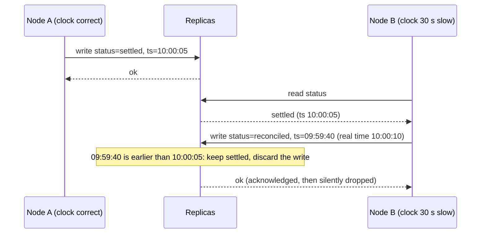
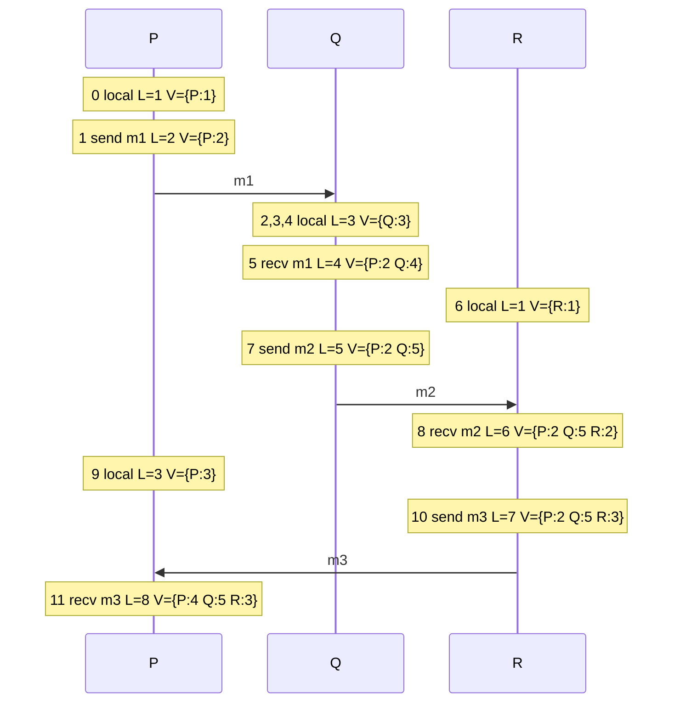
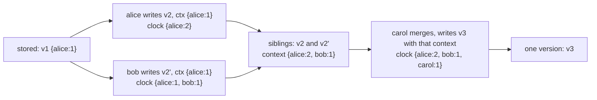
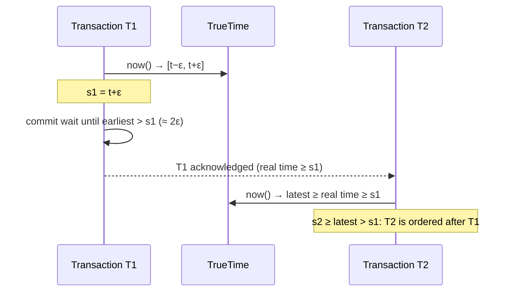
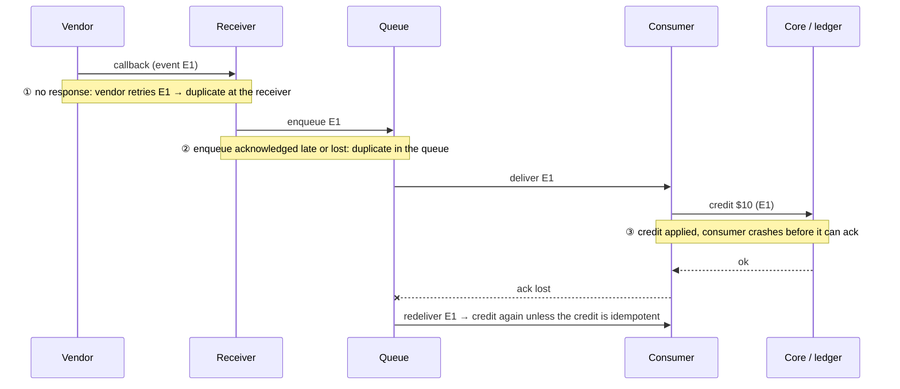

# A5 Unit 2 — Time, clocks and ordering; exactly-once as an end-to-end property

> Time: ~5.5 h · CORE (4.5 h): §1, §2, §4 · STRETCH (≈ 1 h): §3 (hybrid and bounded-uncertainty clocks) · Lab: `labs/a5/clocks`

Unit 1 ended with a question the quorum lab had to answer for you: when two replicas hold different versions of the
same key, which one wins, and how does the store know? The easy answer is "the later one", and the easy
implementation reads the wall clock. This unit is about why that easy answer loses money, what to use instead, and how
the same ideas (identity, ordering, "have I seen this before?") explain the most over-claimed phrase in the field,
*exactly-once*.

It covers four things in the order you will meet them in an interview: why wall clocks cannot order events across
machines (§1); how Lamport and vector clocks order them by causality instead (§2, the lab); how hybrid and
bounded-uncertainty clocks get timestamps that are both causal and close to real time (§3, stretch); and why
"exactly-once delivery" is really at-least-once delivery plus an idempotent, deduplicating consumer (§4). The
queue and log mechanics of delivery belong to A6; here we stay with the principle and the end-to-end argument.

## Before you start

Warm-up (spaced retrieval from Unit 1 and A1). Answer on paper first.

1. A store has N = 5 replicas. Which (R, W) pairs give overlap with the smallest total read-plus-write fan-out, and
   how many replica failures does each tolerate?
2. In CAP, what does the "C" stand for, and is it the same C as in ACID?
3. Why must an idempotency key be generated once per user intent rather than once per HTTP attempt?

<details data-kind="answer">
<summary>Warm-up answers</summary>

1. R + W > 5. Smallest fan-out is R + W = 6: (3, 3) tolerates 2 failures on each side; (1, 5) and (5, 1) tolerate 4
   failures on one side and 0 on the other. Majority quorums (3, 3) are the balanced choice.
2. Linearizability (a single-copy illusion that respects real time). ACID's C is "the database moves from one valid
   state to another", an application-level invariant; unrelated.
3. A retry is the same intent. A fresh key per attempt looks like a new request to the server and defeats the
   deduplication. (A1 Unit 3 §2.) The same idea returns in §4.

</details>

---

## §1 Physical clocks and last-write-wins

### The failure story

A reconciliation platform keeps one record per payment, replicated across three nodes of a store that resolves
conflicting writes by timestamp ("last write wins", the default in many stores). When a vendor callback arrives the
payment is marked `settled`; a few seconds to a minute later a reconciliation job on another node reads it and marks it
`reconciled`. The second write causally follows the first: the job read `settled` before writing.

A VM migration leaves the reconciliation host's clock 40 seconds slow. The gap between the two writes is uniformly
between 5 and 60 seconds. Whenever the gap is under 40 seconds, the job's `reconciled` write carries an *older*
timestamp than the `settled` write it was based on, so every replica silently discards it. The probability is
(40 − 5) / (60 − 5) ≈ 64%. At 10,000 reconciliations a day, ≈ 6,400 are dropped, each acknowledged with a success.
The job never learns it lost; it sees `settled` again tomorrow, retries, and loses again for the same reason, until
somebody notices that the dashboard's "reconciled" count has stopped growing.

Nothing in that story is a bug in the application, in the store, or in the network. It is a wrong assumption: that
two machines agree about what time it is.

### Predict

<!-- predict id="A5-U2-P01" -->
**Predict.** Write your answers down before opening the reveal.

1. A server's clock drifts by 50 ppm (parts per million) relative to true time. How far is it off after one hour, and
   after one day, if nothing corrects it?
2. Writer A (accurate clock) writes at real time 10:00:05. Writer B (clock 30 s slow) *reads that value* and writes at
   real time 10:00:10. Under last-write-wins, which value do the replicas keep? Does B's client see an error?
3. NTP notices a machine's clock is 5 s ahead. What are its two ways to correct it, and what can each do to a program
   that measures an elapsed time with `time.Now()`? What should a Go program use to measure a duration?
4. Someone proposes making LWW safe by buying better clocks. What property would the clocks need for LWW to be correct?
<!-- /predict -->

### Reveal

<details data-kind="reveal" data-for="A5-U2-P01">
<summary>Reveal</summary>

1. 50 ppm is 50 × 10⁻⁶ of elapsed time: 3,600 s × 50×10⁻⁶ = 0.18 s per hour (180 ms), and 86,400 s × 50×10⁻⁶ ≈ 4.3 s per
   day. Commodity quartz oscillators drift on the order of tens of ppm depending on temperature and age
   (`TODO-VERIFY: typical range`), which is why every serious deployment runs a sync daemon, and why unsynchronised
   clocks are minutes apart within a month.
2. B's timestamp is 10:00:10 − 30 s = 09:59:40, older than A's 10:00:05, so the replicas keep **A's** value and discard
   B's. B's write was acknowledged; nobody is told. B's causal knowledge ("I saw A's value and replaced it") is lost.
3. It can **slew** (run the clock slightly slower until it catches up, which keeps time monotonic) or **step** (jump
   it backwards by 5 s). ntpd steps when the offset exceeds a threshold, 128 ms by default (`TODO-VERIFY`), and chrony
   can be configured to step at startup. A backwards step makes `time.Now()` differences negative, which has crashed
   real services (see "In the wild"). Use `time.Since(start)` or `time.Now().Sub(start)`: Go's `time.Time` carries a
   **monotonic clock reading** since Go 1.9 that is immune to wall-clock steps.
4. The clocks would have to agree to within less than the smallest gap between causally related writes, **always**,
   and a node would have to *know* when it cannot guarantee that. Ordinary NTP gives you neither: the error is
   typically small (milliseconds to tens of milliseconds) and occasionally enormous (seconds, minutes after a
   misconfiguration, VM pause or migration), and the node cannot tell which case it is in. Spanner solves it
   differently: it exposes the *uncertainty* and waits it out (§3).

</details>

### How it actually works

**Two clocks, two jobs.** Every machine has at least two time sources:

| Clock | Answers | Properties | Use for |
|---|---|---|---|
| Wall clock (`CLOCK_REALTIME`, Go's `time.Now().Unix()`) | "What time of day is it?" | Can jump forwards or backwards (NTP steps, leap seconds, a human or a hypervisor) | Display, log lines, expiry stamps with slack |
| Monotonic clock (`CLOCK_MONOTONIC`, Go's monotonic reading in `time.Time`) | "How long since X, on this machine?" | Never goes backwards on one machine; meaningless across machines and across reboots | Timeouts, latency measurement, lease timers (locally) |

Neither can tell you the order of two events on two machines.

**Why wall clocks disagree.** Each machine's oscillator runs slightly fast or slow (*drift*); a sync daemon (NTP,
chrony, or PTP in tighter environments) periodically measures the offset to a reference and corrects it. The
correction has limits: network delay asymmetry bounds NTP's accuracy (typically a few milliseconds to tens of
milliseconds across a datacentre or the internet, sub-millisecond on a good LAN; `TODO-VERIFY` for your environment),
and anything that stops the clock (a VM pause, live migration, a laptop lid) creates an offset that is corrected only
later. **Skew** is the difference between two machines' clocks at one instant. It is a distribution with a fat tail,
not a constant. Leap seconds add a further hazard (a minute with 61 seconds); large providers *smear* the extra second
across many hours to avoid a visible step (`TODO-VERIFY: smear window per provider`).



**What last-write-wins really does.** Each value carries a timestamp; on conflict the highest timestamp wins and the
rest are discarded; ties need a deterministic tie-break (the lab uses the greater value) so replicas converge. LWW
guarantees one thing, *convergence*: every replica ends up with the same value. It does not guarantee that the value is
the latest write in any sense a user would accept. Two failure classes:

1. **Causally later writes lost** (the story above). The probability depends on skew versus the gap between the writes.
2. **Concurrent writes silently reduced to one.** If two clients write independently, the timestamps pick a winner at
   random as far as the clients are concerned, and the loser's update is gone without a trace.

Client-supplied timestamps are worse than server-side ones: a phone's clock can be set to anything. LWW with
millisecond precision also ties surprisingly often under load.

**When wall clocks are the right tool.** Expiry with slack (a token valid until `exp` ± leeway, A1 Unit 3 §3), TTLs and
caches, "last seen" and other fields where losing a concurrent update is acceptable, human-readable log lines, and
rate-limit windows. In each, an error of a few hundred milliseconds changes nothing that matters. The rule: use
wall-clock time for **human-scale decisions**, and never to order two writes that must both survive or to decide
causality.

**Banking link.** Four everyday sources of clock trouble on your platform: `processed_at` stamps written by different
services (audit trails ordered by them will be wrong by the skew); cut-off times (ACH and wire cut-offs are in a stated
time zone, and "before 5 pm" depends on whose clock); JWT `exp`/`nbf` checks (the 40-second-slow verifier in A1 Unit 3
§3 is this story); and vendor timestamps you did not generate. Treat every foreign timestamp as data to record, never
as the ordering you rely on.

### Build it

Lab `labs/a5/clocks`, file `clocks.go`. Start with the single-register last-write-wins model:

- `LWWRegister.Write(value, ts)` (accept if empty, or a higher timestamp, or an equal timestamp with the greater
  value), `Merge` and `Get`.

Acceptance tests: `TestLWW_HighestTimestampWinsAndTiesConverge`, `TestLWW_MergeConvergesInAnyOrder`,
`TestLWW_ConcurrentWritesSilentlyLoseOne`, and the data-loss story itself,
`TestLWW_CausallyLaterWriteIsLostUnderClockSkew`: a test that passes only when your register *loses* the write, so that
you see the loss as a green test. Run `go test -race -run LWW ./labs/a5/clocks/`.

### Break it

Run the measurement that turns "skew is bad" into a number, after predicting the first column:

```sh
go test -tags breakit -run LWWvsSiblings -v ./labs/a5/clocks/
```

It generates 20,000 pairs of writes in which writer B reads writer A's value and writes 1–500 ms later (so B causally
follows A), gives each writer an independent normal clock error with the standard deviation shown, and counts how many of
B's writes last-write-wins discards. (The right-hand column uses the sibling register you build in §2; ignore it until
then.) Predict the fraction lost at σ = 0.5 ms, 5 ms, 50 ms, 500 ms and 5 s.

<details data-kind="answer">
<summary>What you should see, and why</summary>

Reference run (seeded):

```text
clock error σ   LWW: later write lost   siblings: later write lost
0.5 ms                           0.0%                        0.0%
5 ms                             0.4%                        0.0%
50 ms                            5.5%                        0.0%
500 ms                          36.6%                        0.0%
5 s                             48.9%                        0.0%
```

- B's write is lost when `gap + error_B − error_A < 0`. The difference of two independent errors has standard deviation
  σ√2, and the gap is at most 500 ms, so loss climbs as σ approaches the gap range: **≈ 1 in 18 causally later writes
  vanish at only 50 ms of clock error**, a figure well inside what a mis-tuned NTP setup produces.
- At σ = 5 s the outcome is nearly a coin flip (48.9%): the timestamps carry almost no information about order, but the
  store still acts on them.
- The siblings column is 0.0% at every skew because it never consults a clock (§2). That is the whole argument for
  logical time: the answer does not depend on how good your clocks are.
- Mutation to try: in your `LWWRegister`, break ties by arrival order instead of by value and run
  `TestLWW_HighestTimestampWinsAndTiesConverge`. The two replicas now disagree forever on a timestamp tie, which is
  the opposite of what LWW promises.

</details>

### In the wild

- **Cassandra** resolves conflicts per cell by write timestamp (microseconds), supplied by the client driver or the
  coordinator; it is last-write-wins by design and expects you to run NTP everywhere and to avoid read-modify-write on
  one cell (use lightweight transactions or immutable rows for those).
- **DynamoDB global tables** reconcile concurrent writes in different regions with last-writer-wins on a timestamp
  (`TODO-VERIFY: current wording in the documentation`). **Riak** has a `last_write_wins` bucket property that trades
  siblings for LWW.
- **Cloudflare, 31 December 2016**: a leap second produced a negative duration in Go code running on DNS servers
  (wall-clock difference computed with `time.Now()`), causing panics and an outage. Go 1.9's monotonic readings in
  `time.Time` address exactly this. `TODO-VERIFY: the causal link between the incident and the Go change.`
- **NTP and friends**: `chrony` and `ntpd` for general sync, PTP (IEEE 1588) with hardware timestamping where
  microseconds matter; the **Amazon Time Sync Service** and **Google's public NTP** smear leap seconds (`TODO-VERIFY: both providers' current behaviour`); node_exporter's
  `node_timex_offset_seconds` is the metric to alert on.
- **Kubernetes and etcd** deliberately avoid wall clocks for ordering: etcd's global revision counter is assigned by
  the Raft leader, so "newer" is defined by a sequence, not a timestamp.

### Trade-offs

| Option | Wins when | Loses when | When the answer flips |
|---|---|---|---|
| LWW on wall-clock timestamps | The data is idempotent or a lost update is acceptable (last-seen, presence, cache fill); simplest | Causally later writes lost under skew; concurrent writes dropped silently | Flip the moment two writers can both matter: logical versions (§2) or a single writer |
| LWW on hybrid logical timestamps (§3) | Same simplicity, but never orders an effect before its cause | Still drops concurrent writes | Flip to siblings when concurrent writes must both survive |
| Version vectors with siblings (§2) | Concurrent writes must be detected and merged by the application | Bigger metadata, application merge code | Flip to LWW for fields where merge is meaningless |
| Single writer / single sequencer assigns order | A total order is needed (ledger postings, audit sequence) | Throughput and availability bounded by that node (or its consensus group) | Flip to partitioned sequencers (one per account) when one global order is not needed |
| Bounded-uncertainty clocks (TrueTime-style, §3) | Global external consistency with wall-clock meaning | Specialised hardware or a provider service; commit-wait latency | Flip to HLC when you cannot afford ε-sized waits |

### Senior bar

- **Failure modes**: LWW losing causally later writes; clock steps backwards breaking elapsed-time maths; expiry
  decisions (leases, tokens) made on a skewed clock; client-supplied timestamps; ties at millisecond resolution;
  leap seconds; a VM resumed after a long pause with a stale clock; mixing UTC and local time in cut-off logic.
- **Capacity**: loss probability is a function of (skew distribution, gap between causally related writes). Estimate
  both: with gaps of ≈ 250 ms and σ = 50 ms, ≈ 5% of causally later writes are discarded; at 2 M writes/day with a
  quarter of them read-modify-writes, that is ≈ 25,000 silent losses a day.
- **Ops**: monitor clock offset against several sources per host and alert on it (and on sync daemon health); keep
  at least 3–4 sources so one bad source is outvoted; test what your services do when the clock steps; put the
  *measured* skew bound in the design doc, not "NTP keeps it small".
- **Cost**: tighter time (PTP hardware, GPS receivers, atomic clocks) costs real money and operations; cloud time
  services give you most of the benefit cheaply. Lost updates cost support time and reconciliation engineering.

Interviewer follow-up probes:

1. "Cassandra is last-write-wins. How do you avoid lost updates?"

<details data-kind="answer">
<summary>Model answer</summary>

Avoid the pattern that needs ordering: don't do read-modify-write on a single cell. Use append-only or per-event rows
(each write a distinct key, aggregate on read), counters or CRDT-style merges for numeric aggregates, and lightweight
transactions (compare-and-set via Paxos) for the few operations that must be linearizable. Make timestamps come from
the servers, run NTP with monitoring, and size the damage: skew times write rate times the share of read-modify-writes.

</details>

2. "How wrong can an NTP-synchronised clock be?"

<details data-kind="answer">
<summary>Model answer</summary>

Usually milliseconds to tens of milliseconds, but there is no guarantee: network asymmetry, a bad or unreachable
source, a VM pause or migration, or a misconfiguration can produce seconds or more, and the machine cannot tell. So
correctness must not depend on a bound NTP does not promise. If you need a bound, either measure and monitor one and
build the failure policy around it, or use a system that exposes uncertainty explicitly (TrueTime, ClockBound-style).

</details>

3. "Why not put a central service in charge of timestamps?"

<details data-kind="answer">
<summary>Model answer</summary>

You can: a timestamp oracle (as in Percolator or TiDB's placement driver) hands out monotonically increasing numbers, a
total order with no skew problem. The costs are a round trip per timestamp (batchable), a bottleneck, and
availability: it must be a replicated consensus group, and every transaction depends on it. It is a good fit inside
one region; across regions the RTT bites, which is where HLC or TrueTime-style approaches come in.

</details>

### Check yourself

1. Why does last-write-wins converge but still lose causally later writes?
2. Which clock do you use to time out an HTTP call, and why not the wall clock?
3. Roughly how far apart are two machines with 100 ppm relative drift after one day without sync?

<details data-kind="answer">
<summary>Answers</summary>

1. All replicas apply the same rule to the same timestamps, so they end up with the same value (convergence). But the
   rule compares timestamps, not causality, so a write made after reading another can carry a smaller timestamp and be
   discarded.
2. The monotonic clock: it never goes backwards, so an NTP step cannot produce a negative or huge elapsed time. In Go,
   `time.Since` uses it.
3. 86,400 s × 100×10⁻⁶ ≈ 8.6 s (that is the *relative* drift between the two machines).

</details>

---

## §2 Logical time: Lamport and vector clocks

### The failure story

Three services record an audit trail for a transfer: `transfers` approves it, `fraud` scores it, `notifications`
tells the member. Each stamps its events with its own wall clock and ships them to a log that the compliance team
reads sorted by timestamp. The services' clocks are off by about 50 ms (a standard deviation, which is a good NTP
day), and the real causal gaps between an event and its consequence are anywhere from a millisecond to half a second.
The measurement from §1 applies unchanged: ≈ 5.5% of causally related pairs sort **backwards**. At 2 M audited
transfers a day that is ≈ 110,000 pairs where the log says "member notified" before "transfer approved".
A reviewer sees an effect before its cause and cannot tell whether the system is buggy or the log is.

A second story, from the quorum lab: two replicas each accepted a write to the same key while partitioned. When they
reconnect, which write is newer? Neither: the writers never saw each other's value. A timestamp cannot say so; it
always names a winner. What the store needs is a way to record *what each write had seen*.

### Predict

<!-- predict id="A5-U2-P02" -->
**Predict.** Write your answers down before opening the reveal.

1. Process P's Lamport clock reads 6 when it sends a message. Process Q's clock reads 20 when it receives it. What
   does Q's clock read right after the receive? What does P's read at its next local event?
2. If event a has Lamport time 3 and event b has Lamport time 4, did a happen before b? Give a way to tell for sure.
3. A value has the vector clock `{a:1}`. Two clients read it and write back through different coordinators,
   producing `{a:1, b:1}` and `{a:1, c:1}`. What is the relationship of the two versions, and what should the next
   reader receive?
4. A hot key is written by 10,000 different clients over its lifetime, each identified in the vector clock. How
   big can the clock get, and what do real systems do about it?
<!-- /predict -->

### Reveal

<details data-kind="reveal" data-for="A5-U2-P02">
<summary>Reveal</summary>

1. Q jumps to max(20, 6) + 1 = **21**: its time never goes backwards, and the receive is ordered after the send. P
   simply increments: its next local event is **7**.
2. **Not necessarily.** Lamport clocks guarantee only one direction: if a happened before b, then L(a) < L(b). Two
   independent events on different processes can have L(a) = 3 and L(b) = 4 and be concurrent (the table below has an
   example). To know whether a happened before b you need **vector clocks** (compare them: a happened before b iff
   a's vector is ≤ b's in every entry and different in one).
3. They are **concurrent**: neither descends the other (`a:1,b:1` has no c; `a:1,c:1` has no b). The next reader
   receives **both** as siblings, together with a context (`{a:1, b:1, c:1}`) that covers them. The application merges
   (for instance, takes the union of two edited sets), writes the merged value back with that context, and the write
   supersedes both.
4. Up to 10,000 entries: if each entry is a 16-byte client ID plus an 8-byte counter, ≈ 240 KB of clock per version,
   larger than most values. Real systems bound it: Dynamo **truncates** the oldest entries past a threshold (which can
   make old, causally-related versions look concurrent, trading correctness at the edges for size); others key the
   clock by **replica** (a handful of entries) instead of by client, and use **dotted version vectors** to avoid the
   lost-update trap of server-keyed clocks.

</details>

### How it actually works

**Happened-before** (Lamport, 1978). Define `a → b` when: a and b are on the same process and a is earlier; or a is the
sending of a message and b its receipt; or there is a chain of such steps. Two events with no chain between them are
**concurrent**. This is the only "before" a distributed system can establish without trusting clocks, and it is
exactly the information a replica needs to decide whether one write supersedes another.

**Lamport clocks** assign every event an integer such that `a → b ⇒ L(a) < L(b)`:

1. before a local event or a send, increment your counter;
2. stamp a message with your counter;
3. on receipt, set your counter to `max(yours, message's) + 1`.

Add the process ID as a tie-breaker, `(L, id)`, and you get a **total order** consistent with causality. That is
useful where everyone must agree on one order (Lamport's own use was distributed mutual exclusion: requests are
granted in `(L, id)` order), and the idea survives in Raft's *term* (Unit 3).

**Vector clocks** keep one counter per process, so they can answer the question Lamport clocks cannot:

1. before a local event or a send, increment *your own* entry;
2. stamp messages with your whole vector;
3. on receipt, take the entry-wise maximum with the message's vector, then increment your own entry.

Comparing two vectors gives four outcomes: **equal**, **before** (every entry ≤, at least one <), **after**, or
**concurrent** (neither ≤ the other). The worked example below is the script the lab's test uses; compare the Lamport
and vector columns for events 5 and 9.



Event 9 (P's local event, `L=3`, `{P:3}`) and event 5 (Q's receive, `L=4`, `{P:2, Q:4}`) are concurrent: P's counter
for itself is 3 in one and 2 in the other, and Q's entry exists only in one. Lamport says "9 before 5" (3 < 4);
the vectors say **concurrent**. Event 11 (`{P:4, Q:5, R:3}`) descends everything else, as it should: it is the receipt of a
message whose causal past includes the whole run.

**Version vectors in a store.** A *vector clock* orders events on processes; a *version vector* orders versions of a
datum. The mechanics in the lab are the same:

- A **read** returns every surviving version (the *siblings*) and a **context**: the merge of their vectors.
- A **write** carries the context it was based on. The new version's clock is `context.Tick(writer)`. It *supersedes*
  every stored version whose clock it descends and is kept alongside versions it is concurrent with.
- A replica receiving versions from another replica takes the union and drops every version dominated by another
  (`Reconcile`). Union plus "drop the dominated" is commutative, associative and idempotent, so replicas converge in
  any order of gossip.



**What counts as an actor?** If the *client* is the actor (the lab's choice), clocks grow with the number of clients
that ever wrote the key. If the *server* is the actor, clocks stay small (one entry per replica), but two clients that
read the same version and write through the same server both produce `{server: n+1}`: equal clocks, one write silently
replaces the other. Dotted version vectors repair this by naming each write with a single `(server, counter)` *dot* in
addition to the compact vector of what it had seen; Riak adopted them for exactly this reason. `TODO-VERIFY: Riak 2.0
as the release that introduced dotted version vectors.`

**Resolving siblings.** The store detects concurrency; the *application* must decide what to do. Options, in rising
order of effort: last-write-wins on the siblings (re-introduces §1's loss, but now you chose it); a domain merge (union
of two edited sets of alert channels; field-by-field newest-wins for scalars); or a **CRDT**, a data type whose merge
function is built in and always converges: grow-only and PN counters, observed-remove sets, LWW registers. CRDTs cannot
enforce invariants that need coordination (a counter that must never go below zero), which is the escrow idea from
Unit 1 §2 again. Deletes need care: the Dynamo paper's shopping cart merged siblings by union, so a removed item could
reappear. A deletion must be recorded (a tombstone with its own causal history), not implied.

| Mechanism | Detects causality? | Detects concurrency? | Size | Real-time meaning? |
|---|---|---|---|---|
| Wall-clock timestamp | No (skew) | No | 8 B | Yes, approximately |
| Lamport clock | One direction | No | 8 B | No |
| Vector clock / version vector | Yes | Yes | O(actors) | No |
| Dotted version vector | Yes | Yes | O(replicas) | No |
| Hybrid logical clock (§3) | One direction | No | 8–10 B | Yes, close to wall time |

**Banking link.** Two things you have already built. First, callbacks that arrive out of order or twice: a state
version on the entity ("this event moves the deposit from version 3 to 4; ignore it if I am already at 4 or above;
hold it if I am at 2") is a one-dimensional version vector, and it is the cheapest correct answer to "the vendor sent
`settled` before `accepted`". Second, a member's profile edited from the mobile app and the web at the same time:
siblings plus a field-level merge beats last-write-wins, which would drop one of the two edits.

### Build it

Lab `labs/a5/clocks`, file `clocks.go`. Provided: `Vector.Clone`, `Vector.String`, `Ordering`. Implement:

- `Lamport` (`Time`, `Tick`, `Observe`; safe for concurrent use, so tests call `Tick` from 50 goroutines) and
  `Stamp.Less`.
- `Vector.Tick` (copy, not mutate), `Descends`, `Compare`, `Merge`.
- `Reconcile` (drop what is strictly dominated, collapse exact duplicates, keep concurrent versions and equal
  clocks with different values), then `SiblingRegister` (`Put`, `Merge`, `Get`).

Acceptance tests: `TestLamport_*`, `TestStamp_TotalOrderBreaksTiesByNode`,
`TestClocks_CausalityImpliesSmallerLamportTime`, `TestVector_CompareMatchesTrueHappenedBefore` (the 12-event script
above against ground truth computed from message edges), `TestLamport_CannotDetectConcurrency`, `TestCompare_Table`,
`TestVectorLaws_RandomClocks` (merge is a join: commutative, associative, idempotent), `TestReconcile_*`,
`TestSibling_*`. Run `go test -race ./labs/a5/clocks/`, then `sd lab A5` runs it together with the quorum lab.

### Break it

1. Run the whole measurement again, now that `SiblingRegister` works, and read the last line too:

   ```sh
   go test -tags breakit -run LWWvsSiblings -v ./labs/a5/clocks/
   ```

   Predict the right-hand column and the last line (two truly concurrent writes, "alice" and "bob").
2. Break your implementation three ways and name the failing tests: (a) drop the `+ 1` in `Lamport.Observe`;
   (b) make `Vector.Tick` mutate its receiver; (c) make `Reconcile` drop an entry whenever *any* other entry has the
   same clock, ignoring values.
3. Compute by hand the size of a vector clock (16-byte IDs, 8-byte counters) for a document edited by 50 devices, and
   for one edited by 5,000.

<details data-kind="answer">
<summary>What you should see, and why</summary>

1. The siblings column is **0.0%** at every σ, and the last line reads
   `concurrent writes alice+bob: LWW keeps 1 value ("bob"); siblings keep 2`. LWW lost 36.6% of causally later writes
   at σ = 500 ms and one of two concurrent writes always; siblings lose none, because they never consult a clock.
2. (a) `TestLamport_ObserveJumpsPastTheSenderAndNeverGoesBackwards` and `TestClocks_CausalityImpliesSmallerLamportTime`
   fail: a receive would share the sender's time, so an effect can sort equal to its cause.
   (b) `TestVectorTick_ReturnsACopyAndNilIsEmpty` fails; in a real store, mutating a clock that is shared between
   versions corrupts other replicas' data, usually as an intermittent heisenbug under concurrent reads.
   (c) `TestReconcile_EqualClocksWithDifferentValuesAreBothKept` fails: two different values that claim the same
   history are a conflict, and dropping one is silent data loss.
3. 50 devices: 50 × 24 B = 1.2 KB. 5,000 devices: 120 KB per version. Still smaller than a photo, but per version
   and per replica, and every sibling carries one.

</details>

### In the wild

- **Amazon Dynamo** attached a vector clock to every value and returned conflicting versions to the application;
  to bound clock size it truncated the oldest `(node, counter)` pairs past a threshold of about ten
  (`TODO-VERIFY: the paper's exact threshold`).
- **Riak** exposed siblings, moved from vector clocks to dotted version vectors, and offered CRDT data types
  (counters, sets, maps) so that applications need not hand-write merges. **Voldemort** (LinkedIn) used vector clocks
  in the same way.
- **Cassandra** deliberately uses neither: per-cell timestamps and last-write-wins (§1), with lightweight
  transactions for the cases that need an order.
- **Git** is a vector-clock-like system in disguise: a commit's parent pointers record what it had seen; two commits
  whose histories do not contain each other are concurrent, and merge is the sibling resolution.
- **Collaborative editors** (Automerge, Yjs) and **Redis Enterprise's Active-Active** databases use CRDTs, so
  replicas accept writes anywhere and converge. `TODO-VERIFY: Redis CRDT naming and scope.`
- **etcd** (a global revision number) and **ZooKeeper** (`zxid`) hand out a single total order from a leader instead of
  deriving partial orders; **Kafka** offsets are a per-partition sequence. When one node may order everything, a
  counter is simpler than a vector.

### Trade-offs

| Option | Wins when | Loses when | When the answer flips |
|---|---|---|---|
| Lamport timestamps `(L, id)` | You need a total order consistent with causality and do not need to detect concurrency (locks, replicated logs, tie-breaking) | Cannot tell concurrent from ordered | Flip to vector clocks when concurrency detection is the point |
| Client-keyed vector clocks | Few, long-lived writers (devices of one user); exact causality | Clock grows with writers; needs pruning | Flip to server-keyed with dots when writers are many |
| Server-keyed + dotted version vectors | Many clients, few replicas; compact and correct | More subtle to implement | Flip to a single leader when one order is available anyway |
| Single sequencer / leader-assigned versions | You can afford one writer per key or partition | Availability tied to that writer; cross-region latency | Flip to vectors when multi-leader or leaderless writes are required |
| CRDT types | Merge is natural (counters, sets); always-writable | Cannot enforce coordination invariants; metadata growth; tombstones | Flip to consensus for invariants like uniqueness or non-negative balances |
| Siblings + application merge | The domain knows how to merge | Merge code is yours to write, test and keep correct; sibling explosion if neglected | Flip to LWW for fields where "latest" is genuinely right |

### Senior bar

- **Failure modes**: server-keyed clocks that lose concurrent writes through one coordinator; unbounded sibling growth
  when nobody writes back with a context (every blind write adds a sibling); vector clock explosion; pruning that
  invents false concurrency; merges that resurrect deleted data; Lamport timestamps misused to claim "these two
  events are ordered".
- **Capacity**: clock bytes per version = actors × (ID + 8 B). 50 actors ≈ 1.2 KB; 5,000 ≈ 120 KB. Storage
  amplification = siblings × value size; cap it (for example fail the write beyond 20 siblings) and monitor it.
- **Ops**: dashboards for siblings per key and sibling-resolution rate; a replay tool that re-runs the merge function
  on stored siblings; property tests that your merge is commutative, associative and idempotent; a policy for
  tombstone retention longer than your longest partition or repair interval.
- **Cost**: metadata bytes on every replica and every read response; engineer-time for merge code; reads that return
  several values.

Interviewer follow-up probes:

1. "Why not just use Lamport timestamps to detect conflicting writes?"

<details data-kind="answer">
<summary>Model answer</summary>

Because Lamport clocks only give one direction: if a happened before b then L(a) < L(b). Concurrent writes also get
different numbers, and the smaller one looks "earlier", so a store that compares them would treat the smaller as
superseded and drop it. Detecting concurrency needs vectors (or an equivalent causal history).

</details>

2. "Vector clock per client or per server?"

<details data-kind="answer">
<summary>Model answer</summary>

Per client is exactly right but grows with the number of clients that ever wrote the key; per server stays small but,
with plain vector clocks, two clients writing from the same context through the same server produce equal clocks and
one write replaces the other. The usual answer is per server with dotted version vectors: a compact vector for what the
write had seen plus a single dot naming the write itself. If devices per user are few, client-keyed is fine.

</details>

3. "Two devices edit a member's alert preferences while offline. How do you merge?"

<details data-kind="answer">
<summary>Model answer</summary>

Keep both as siblings (concurrent versions) and merge by field: the set of enabled channels as an observed-remove set
(union of additions, removals recorded as tombstones), scalar fields like language by latest hybrid timestamp. Write the
merge back with the sibling context so it supersedes both. I would test that merge is commutative, associative and
idempotent, and make removals explicit so a channel disabled on one device does not reappear.

</details>

### Check yourself

1. State the one-way guarantee of Lamport clocks.
2. How do you decide that two vector clocks are concurrent?
3. What is a read's *context* for, and what happens if a client writes without one?

<details data-kind="answer">
<summary>Answers</summary>

1. If a happened before b then L(a) < L(b). The converse does not hold.
2. Neither descends the other: there is an entry where the first is larger and an entry where the second is larger.
3. The context is the merge of the sibling clocks the client read; passing it back makes the new write supersede
   exactly what the client saw. A write without a context supersedes nothing and is stored as one more sibling.

</details>

---

## §3 Hybrid and bounded-uncertainty clocks

**STRETCH (≈ 1 h).** §1 showed that wall clocks mis-order causally related events; §2 showed that logical clocks order
them correctly but mean nothing to a human or to a query like "balance as of 17:00". This section is about the two ways
real systems get both. Skim it on a first pass if you are short of time; come back when the tutor asks about Spanner or
CockroachDB.

### The failure story

The ledger is split across eight shards. Finance wants a consistent report, "all balances as of 17:00:00", computed by
reading every shard at the same timestamp. Transfers between shards write a debit on one shard and a credit on another,
each stamped with that shard's wall clock. The platform handles 200 cross-shard transfers a second, average $350.

One shard's host (shard 5) comes back from a VM migration with its clock 30 seconds slow. A transfer debits shard 3 at
real time 16:59:59.9 (correct clock, stamped 16:59:59.9) and credits shard 5 at real time 17:00:00.2, which the slow
clock stamps 16:59:30.2. Run the report "as of 16:59:45": shard 3 excludes the debit (stamped after 16:59:45), shard 5
includes the credit (stamped before it). The report shows a credit with no matching debit. Every transfer whose debit
falls in the 30 seconds after the report time is affected the same way: 200 × 30 = 6,000 transfers, so the report is
out by ≈ 6,000 × $350 = $2.1 M of money that appears from nowhere. Reporting at purely logical timestamps would be
consistent, but nobody can tell an auditor what "logical time 8,812,904" means.

What the platform needs is a timestamp that (a) never orders an effect before its cause, whatever the machines'
clocks say, and (b) is close to real time, so people and range queries can use it.

### Predict

<!-- predict id="A5-U2-P03" -->
**Predict.** Write your answers down before opening the reveal.

1. A hybrid logical clock node with a correct wall clock receives one message from a node whose clock is one hour
   ahead. What do that node's timestamps look like afterwards, and for how long?
2. A TrueTime-style API says "now is between 12:00:00.000 and 12:00:00.014". A transaction picks its commit timestamp
   from that interval and must make sure no later transaction can get a smaller one. How long must it wait, in terms
   of the uncertainty ε = 7 ms?
3. Why not simply wait out your worst-case clock skew (say 500 ms) before acknowledging every write?
<!-- /predict -->

### Reveal

<details data-kind="reveal" data-for="A5-U2-P03">
<summary>Reveal</summary>

1. The receiving node's `L` jumps to the remote node's value (one hour ahead of its own wall clock) and stays there:
   later local events only increment the counter `C`, because its physical time is less than `L`, until its wall clock
   catches up an hour later. Timestamps remain causally correct but are no longer "close to now". This is why real
   systems bound the acceptable offset and refuse or alert on messages far in the future.
2. About **2ε = 14 ms**. Picking `s = latest` (12:00:00.014) and then waiting until `earliest` has passed `s` means
   waiting for real time to advance by the width of the interval, 2ε, so that `s` is certainly in the past everywhere
   before the commit becomes visible.
3. You can; that is the idea. But the wait is added to every write, and writes that conflict on the same key
   serialise behind it: at 500 ms that is at most 2 commits per second per hot key, against ≈ 70 per second at 14 ms.
   The whole value of TrueTime is making ε single-digit milliseconds.

</details>

### How it actually works

**Hybrid logical clocks (HLC)** (Kulkarni et al., 2014). A timestamp is a pair `(L, C)`. `L` tracks the largest physical
time seen anywhere in the causal past; `C` is a counter that orders events that share the same `L`.

```text
Now()            (local event or send)
    pt = physical time
    if pt > L:  L = pt; C = 0
    else:       C = C + 1
    return (L, C)

Observe(m)       (receive a message stamped m)
    pt = physical time
    L' = max(pt, L, m.L)
    if L' == L == m.L:  C = max(C, m.C) + 1
    elif L' == L:       C = C + 1
    elif L' == m.L:     C = m.C + 1
    else:               C = 0
    L = L'
```

Properties: timestamps respect causality (`a → b ⇒ ts(a) < ts(b)`), `L` is never below the node's physical time, and as
long as physical clocks are within ε of each other, `L` stays within ε of physical time and `C` stays small. The pair
packs into 8–12 bytes. HLC is last-write-wins you can trust *not to reorder a cause and its effect* (it still cannot
detect concurrent writes; §2).

**Bounded-uncertainty clocks (TrueTime).** Spanner's API does not return a number; it returns an **interval**:
`TT.now() = [earliest, latest]`, with the guarantee that absolute time lies inside it. Google builds this with GPS
receivers and atomic clocks in each datacentre and daemons that track the uncertainty ε (it grows between
synchronisations and shrinks at each one; the paper reports single-digit milliseconds, `TODO-VERIFY: the 1–7 ms figure`).
Two rules turn it into external consistency (strict serializability):

1. **Start rule**: a read-write transaction picks its commit timestamp `s ≥ TT.now().latest`, taken *after* it holds its
   locks.
2. **Commit wait**: it does not make its writes visible, or acknowledge the client, until `TT.after(s)` is true, that is
   `TT.now().earliest > s`.



Commit wait is where the 2ε comes from: at the start the interval is 2ε wide, and you wait until its *lower* edge has
passed the chosen *upper* edge. In Spanner the wait overlaps with the replication round trip, so it is mostly hidden.

**Central timestamp oracle.** The third way to get an order that is both causal and wall-clock-like is a service that
hands out increasing timestamps (Percolator, TiDB's placement driver). One round trip per transaction (batched), no skew
problem, and an availability dependency on a consensus group (Unit 3).

| Approach | Timestamp is | Needs | Cost |
|---|---|---|---|
| Wall clock | Skewed time | NTP | Misorders causal pairs |
| HLC | Close to wall time and causal | Bounded skew; alerting on offset | A few bytes; no waiting; cannot detect concurrency |
| TrueTime | Interval with a guarantee | GPS/atomic clocks or a provider's bounded-error service | Commit wait ≈ 2ε per write |
| Timestamp oracle | A counter | A replicated sequencer | A round trip per transaction; dependency on the oracle |
| Pure logical clocks | A counter or vector | Nothing | No relation to real time |

**Banking link.** "Balance as of 17:00" for end-of-day, statements and regulatory snapshots is exactly this problem. The
cheap, defensible design is to let the system of record (a single-leader core) assign the order and the as-of stamp,
and to treat timestamps from satellite services as data. If you ever build a multi-shard ledger yourself, either route
all postings for an account through one shard (so one clock stamps its history) or use HLC timestamps with an
alert on clock offset, and make the report read at one HLC timestamp.

### Build it

No lab package for this section (the `clocks` lab ends with vector clocks). Type in the program below (scratch
directory outside the repo, `go run .`). It is the HLC above with the physical clock injected, so you can make
clocks wrong on purpose.

```go
// hlc: a hybrid logical clock (Kulkarni et al., 2014). A timestamp is
// (L, C): L follows the largest physical time seen anywhere in the causal past,
// C breaks ties while L does not advance. Timestamps stay close to physical time
// yet never order an effect before its cause, whatever the machines' clocks say.
package main

import (
	"fmt"
	"sync"
)

type Timestamp struct {
	L int64  // milliseconds: the largest physical time seen so far
	C uint16 // logical counter for events within the same L
}

func (a Timestamp) Less(b Timestamp) bool { return a.L < b.L || (a.L == b.L && a.C < b.C) }
func (a Timestamp) String() string        { return fmt.Sprintf("%d.%d", a.L, a.C) }

type HLC struct {
	mu   sync.Mutex
	wall func() int64 // physical clock in ms; may be wrong, may jump backwards
	last Timestamp
}

func NewHLC(wall func() int64) *HLC { return &HLC{wall: wall} }

// Now stamps a local event or an outgoing message.
func (h *HLC) Now() Timestamp {
	h.mu.Lock()
	defer h.mu.Unlock()
	if pt := h.wall(); pt > h.last.L {
		h.last = Timestamp{L: pt}
	} else {
		h.last.C++
	}
	return h.last
}

// Observe stamps the receipt of a message carrying remote.
func (h *HLC) Observe(remote Timestamp) Timestamp {
	h.mu.Lock()
	defer h.mu.Unlock()
	pt := h.wall()
	l := max(pt, h.last.L, remote.L)
	switch {
	case l == h.last.L && l == remote.L:
		h.last.C = max(h.last.C, remote.C) + 1
	case l == h.last.L:
		h.last.C++
	case l == remote.L:
		h.last = Timestamp{L: l, C: remote.C + 1}
	default:
		h.last = Timestamp{L: l}
	}
	return h.last
}

func main() {
	var tA, tB int64 = 1_000_000, 1_000_000 - 30_000 // B's wall clock is 30 s behind A's
	a := NewHLC(func() int64 { return tA })
	b := NewHLC(func() int64 { return tB })

	e1, w1 := a.Now(), tA // A writes
	tA, tB = tA+5, tB+5
	e2, w2 := b.Observe(e1), tB // B reads A's write ...
	tA, tB = tA+5, tB+5
	e3, w3 := b.Now(), tB // ... and writes something based on it, 10 ms later in real time
	fmt.Printf("A write    hlc=%-10v wall=%d\n", e1, w1)
	fmt.Printf("B receive  hlc=%-10v wall=%d\n", e2, w2)
	fmt.Printf("B write    hlc=%-10v wall=%d\n", e3, w3)
	fmt.Printf("B's write sorts after A's?  hlc: %v   raw wall clock: %v\n", e1.Less(e3), w1 < w3)

	// A's wall clock steps back 5 s (a bad NTP correction): the HLC keeps rising.
	tA -= 5_000
	e4 := a.Now()
	e5 := a.Now()
	fmt.Printf("A's wall clock stepped back 5 s: %v then %v, still increasing: %v\n", e4, e5, e1.Less(e4) && e4.Less(e5))
}
```

Predict whether B's write sorts after A's under each clock, and what the HLC does when A's wall clock steps back.

<details data-kind="answer">
<summary>Output</summary>

```text
A write    hlc=1000000.0  wall=1000000
B receive  hlc=1000000.1  wall=970005
B write    hlc=1000000.2  wall=970010
B's write sorts after A's?  hlc: true   raw wall clock: false
A's wall clock stepped back 5 s: 1000000.1 then 1000000.2, still increasing: true
```

B's wall clock says 970,010 against A's 1,000,000 (30 s behind), so raw timestamps order the effect before its cause.
The HLC raises `L` to A's value on receipt and keeps B's later events at `(1000000, c)`, strictly increasing and
causally correct. When A's wall clock steps back, `Now` finds `pt < L` and increments `C`: no timestamp ever goes
backwards. Notice also that B's HLC timestamps are 30 s *ahead* of B's own wall clock: HLC absorbs skew, it does not
hide it, and that gap is what a monitor should watch.

</details>

### Break it

1. Replace `main` with the program below: node B's wall clock is **one hour fast** and sends one message. Predict A's
   timestamps for the next three seconds of A's real time.
2. The counter `C` is a `uint16`. What happens if a node generates more than 65,535 events within one millisecond
   of a stuck or slow physical clock? What would you change?

```go
// replace main in the program above
func main() {
	var tA int64 = 1_000_000
	tB := tA + 3_600_000 // B's wall clock is one hour fast
	a := NewHLC(func() int64 { return tA })
	b := NewHLC(func() int64 { return tB })
	m := b.Now()
	got := a.Observe(m)
	fmt.Printf("B sends %v (wall %d); A (wall %d) stamps the receipt %v\n", m, tB, tA, got)
	for i := 0; i < 3; i++ {
		tA += 1000
		e := a.Now()
		fmt.Printf("A, wall %d: next local event %v (ahead of its wall clock by %d ms)\n", tA, e, e.L-tA)
	}
}
```

<details data-kind="answer">
<summary>What you should see, and why</summary>

1. Output:

   ```text
   B sends 4600000.0 (wall 4600000); A (wall 1000000) stamps the receipt 4600000.1
   A, wall 1001000: next local event 4600000.2 (ahead of its wall clock by 3599000 ms)
   A, wall 1002000: next local event 4600000.3 (ahead of its wall clock by 3598000 ms)
   A, wall 1003000: next local event 4600000.4 (ahead of its wall clock by 3597000 ms)
   ```

   One message from the fast node drags A's logical time an hour into the future, and A's timestamps stay stuck at
   that `L` (only `C` ticks) until its own clock catches up: an hour of timestamps that no longer relate to wall time,
   and *all of A's neighbours that hear from A are dragged along too*. This is why production HLC systems enforce a
   maximum offset: they reject or alert on messages whose `L` is further ahead than the configured bound.
2. `C++` wraps to 0, so two events can get the same or a smaller timestamp: causality breaks silently. Real
   implementations either use a wider counter (CockroachDB pairs wall nanoseconds with a 32-bit logical part),
   carry into `L` (advance the logical millisecond), or block until the physical clock moves. At 65,536 events per
   millisecond (65 M/s) this is theoretical for one node, but a bug that stops the physical clock makes it real.

</details>

### In the wild

- **Google Spanner** uses TrueTime for external consistency and for lock-free read-only transactions and stale reads at
  a timestamp; commit wait is its price. `TODO-VERIFY: ε figures from the OSDI 2012 paper.`
- **CockroachDB** uses HLC timestamps and a configurable maximum clock offset (default `500 ms`;
  `TODO-VERIFY: current default`); a read that finds a value inside its *uncertainty interval* must restart at a
  later timestamp, and a node that detects its clock too far from the others' shuts itself down rather than risk
  inconsistency. `TODO-VERIFY: the exact detection rule.`
- **MongoDB** attaches a hybrid "cluster time" (seconds plus an increment) to operations to support causal consistency
  sessions. **YugabyteDB** also uses HLC.
- **Amazon**'s Time Sync Service and the open-source **ClockBound** daemon expose a clock plus an error bound, the
  provider-side analogue of TrueTime. `TODO-VERIFY: current ClockBound capabilities.`
- **Percolator** (Google) and **TiDB** use a timestamp oracle for snapshot isolation transactions.

### Trade-offs

| Option | Wins when | Loses when | When the answer flips |
|---|---|---|---|
| HLC | You want causal timestamps close to wall time with no hardware and no waiting | Needs bounded skew and an offset alarm; one wild clock can drag others | Flip to a timestamp oracle if you can afford a hop and want no dependence on clocks |
| TrueTime-style commit wait | You need strict serializability across regions without a global lock | Special clock infrastructure; every write pays ≈ 2ε | Flip to HLC with weaker guarantees (snapshot isolation, or serializability without external consistency) when ε is large |
| Timestamp oracle | Single region, transactions across shards | The oracle is a dependency, and a cross-region round trip per transaction | Flip to HLC for multi-region |
| Route a key's writes through one node | The order only needs to be per entity | Hot entities; failover complexity | Flip to timestamps when many nodes must write the same entity |

### Senior bar

- **Failure modes**: one fast clock dragging an HLC cluster into the future; counter overflow; physical clock stepped
  backwards without HLC protection; assuming HLC gives external consistency (it does not: two transactions on
  different nodes can commit in the opposite order to real time unless uncertainty is handled); commit wait mis-sized
  when ε grows (missed synchronisations).
- **Capacity**: commit wait ≈ 2ε per write: ε = 7 ms → ≈ 14 ms, ≈ 70 serialised commits/s per hot key; ε = 500 ms →
  1 s, ≈ 1 commit/s per hot key. A 64-bit HLC (48 bits of milliseconds, 16 of counter) covers ≈ 8,900 years of
  milliseconds and 65 k events per millisecond.
- **Ops**: export `L − physical_time` per node; alert on offset against a threshold well under the system's configured
  maximum; monitor sync daemon health; rehearse a clock-jump failure.
- **Cost**: GPS and atomic clocks per datacentre (Google) or a managed time service; commit wait is paid as latency on
  every write.

Interviewer follow-up probes:

1. "How does Spanner get external consistency without a global lock?"

<details data-kind="answer">
<summary>Model answer</summary>

TrueTime returns an interval guaranteed to contain absolute time. A transaction picks a commit timestamp at the top of
the interval and waits until the bottom of the interval has passed it (commit wait ≈ 2ε) before releasing locks and
acknowledging. Any transaction that starts afterwards sees a clock interval whose upper bound is beyond that timestamp,
so it gets a larger one. Order by timestamp then agrees with real-time order, without any cross-datacentre lock.

</details>

2. "What happens in an HLC system if one node's clock jumps an hour ahead?"

<details data-kind="answer">
<summary>Model answer</summary>

Its timestamps are an hour ahead, and every node that hears from it absorbs that `L` (HLC takes the max), so timestamps
across the cluster drift an hour from wall time and stay causal but stop being useful for as-of queries. Systems protect
themselves with a maximum permitted offset: reject messages beyond it, and have a node stop if it detects it is the one
out of range. In operations I would alert on `L − physical` long before the limit.

</details>

3. "Why is Spanner's commit wait 2ε and not ε?"

<details data-kind="answer">
<summary>Model answer</summary>

The timestamp is taken at the top of the uncertainty interval, ε above true time, and the transaction may release only
when the bottom of the interval has passed it, which happens when true time is ε past the timestamp. From true time t:
timestamp t + ε; release when true time − ε > t + ε, i.e. at t + 2ε. In Spanner the wait overlaps with replication, so
the added latency is smaller than a naive 2ε.

</details>

### Check yourself

1. What does an HLC timestamp guarantee that a wall-clock timestamp does not?
2. What does `TT.now()` return, and why is it an interval?
3. Name two ways to handle a node whose clock is far ahead in an HLC cluster.

<details data-kind="answer">
<summary>Answers</summary>

1. It never orders an effect before its cause (causality is preserved), regardless of skew, while staying close to
   physical time.
2. A pair `[earliest, latest]` guaranteed to contain absolute time; the width is the clock uncertainty, which the system
   makes explicit instead of pretending to know the time exactly.
3. Reject messages whose timestamp is beyond a configured maximum offset, alert on `L − physical`, and have the offending
   node shut itself down or resynchronise.

</details>

---

## §4 Exactly-once is an end-to-end property

Queue and log mechanics (acknowledgements, redelivery, partitions, consumer groups, outbox) are A6's subject. This
section is about the principle that lets you reason about all of them: what "exactly-once" can and cannot mean.

### The failure story

A vendor posts a "deposit accepted" callback for each mobile check deposit. Your receiver puts it on a queue, a
consumer reads it and credits the member's account in the core, then acknowledges the message. The team chose a broker
whose documentation says "exactly-once". For 10,000 callbacks of $10, with the consumer crashing before the
acknowledgement in 2% of deliveries and acknowledgements getting lost in 5%, here is the balance error under three
consumers (simulation in "Build it"):

| Consumer | Credits applied | Balance error |
|---|---|---|
| No deduplication | 10,757 | **+$7,570** (757 duplicate credits) |
| Dedupe row written *after* the credit | 10,219 | **+$2,190** (219 duplicates) |
| Credit and dedupe row in **one transaction** | 10,000 | **$0** |

The broker did what it promised (it never delivered a message that was *acknowledged*, twice); the credit still
happened twice, because the effect, a call into the core, sits outside anything the broker controls. At 1 M callbacks
a day the middle row is ≈ 22,000 wrong credits a day. Everyone said "exactly-once" and everyone was right about their
own box.

### Predict

<!-- predict id="A5-U2-P04" -->
**Predict.** Write your answers down before opening the reveal.

1. Can a network protocol deliver a message exactly once? Why or why not?
2. Classify each consumer as at-most-once, at-least-once, or effectively-once: (a) acknowledge, then process;
   (b) process, then acknowledge; (c) process, record the message ID in a dedupe table, then acknowledge; (d) in one
   database transaction record the ID and apply the effect, then acknowledge.
3. The effect is an HTTP call to the core banking system. Where can the dedupe record live so the guarantee holds?
4. How long must dedupe records be kept?
<!-- /predict -->

### Reveal

<details data-kind="reveal" data-for="A5-U2-P04">
<summary>Reveal</summary>

1. **No.** This is the Two Generals problem: the sender cannot distinguish "the message was lost" from "the message
   arrived but the acknowledgement was lost", so it must either retry (possible duplicate) or not (possible loss). You
   choose between at-most-once and at-least-once; there is no third network behaviour. "Exactly-once" can only mean
   exactly-once **effect**, built from at-least-once delivery plus an idempotent or deduplicating receiver.
2. (a) **At-most-once**: a crash after the ack loses the message. (b) **At-least-once**: a crash before the ack
   redelivers, so the effect can repeat. (c) **Still at-least-once**: a crash between the effect and the dedupe row
   leaves the effect applied and the event unmarked (the +$2,190 row). (d) **Effectively-once**: the effect and the
   record commit or abort together, so a redelivery either finds the record (skip) or finds nothing (and no effect had
   happened).
3. The dedupe record and the effect must be **atomic with each other**. When the effect is a call to another system you
   cannot put both in one transaction, so you pass an idempotency key to that system (A1 Unit 3 §2: the core
   deduplicates on the key), keep your own record of "request R sent" *before* the call, and reconcile by querying the
   core for R after a crash or timeout. The key makes the core's side idempotent; your record makes your side safe to
   resume.
4. At least as long as a duplicate can still arrive: broker retention + the longest retry window + dead-letter replay +
   a safety margin. For money movement, "forever" is a defensible answer: a unique constraint on the business event ID
   costs a few bytes per event, and a duplicate credit after the window costs real money.

</details>

### How it actually works

**The end-to-end argument.** Saltzer, Reed and Clark (1984) argued that a function such as reliable delivery can be
completely and correctly implemented only with the knowledge of the application at the endpoints; lower layers can
provide it only as a performance optimisation. TCP's reliable bytes do not stop a duplicate HTTP request; a broker's
"exactly-once" does not stop a duplicate side effect in a system it does not control. Reliability that matters to the
business has to be present at the ends: the producer that creates the event with a stable identity, and the consumer
that applies it at most once per identity.



Every arrow can fail ambiguously, which is why the defence is at the **effect**, not at any single hop.

**Techniques, strongest first:**

1. **Natural idempotency.** Choose operations whose repetition is harmless: `SET status = 'settled'`, `PUT`, upserts
   keyed by business ID, `max()`, adding to a set. Prefer these whenever the domain allows.
2. **Dedupe record in the same transaction as the effect**, keyed by the event's stable ID, with a unique constraint:

   ```go
   package ledger

   import (
   	"context"
   	"database/sql"
   )

   // ApplyCredit credits cents to an account exactly once per eventID, however many times it is called.
   // processed_events(event_id PRIMARY KEY) and the balance update commit or roll back together.
   func ApplyCredit(ctx context.Context, db *sql.DB, eventID, accountID string, cents int64) (applied bool, err error) {
   	tx, err := db.BeginTx(ctx, nil)
   	if err != nil {
   		return false, err
   	}
   	defer tx.Rollback() // no-op after a successful Commit

   	res, err := tx.ExecContext(ctx,
   		`INSERT INTO processed_events (event_id) VALUES ($1) ON CONFLICT DO NOTHING`, eventID)
   	if err != nil {
   		return false, err
   	}
   	if n, _ := res.RowsAffected(); n == 0 {
   		return false, tx.Commit() // duplicate: the effect already happened, ack the message
   	}
   	if _, err := tx.ExecContext(ctx,
   		`UPDATE accounts SET balance_cents = balance_cents + $1 WHERE id = $2`, cents, accountID); err != nil {
   		return false, err
   	}
   	return true, tx.Commit()
   }
   ```

3. **Versioned, conditional apply.** If events for an entity have a sequence number (§2's one-dimensional version
   vector), apply only if `event.version == entity.version + 1`; if lower, it is a duplicate or stale (ack and skip);
   if higher, an earlier event is missing (park it, or fetch the gap). This handles duplicates **and** reordering.
4. **Idempotency key to the downstream system, plus reconciliation.** When the effect lives elsewhere (the core, a card
   processor), send the event ID as the idempotency key (A1 Unit 3 §2), persist "sent" before calling, and on any
   timeout query the downstream by key instead of retrying blindly. This is the vendor-adapter pattern you already use.
5. **Broker-level exactly-once is scoped.** Kafka's idempotent producer (producer ID plus sequence numbers) removes
   duplicates between producer and broker, and its transactions make a *read-process-write loop that stays inside
   Kafka* atomic for consumers reading `read_committed`. The moment the processing step calls anything outside Kafka,
   that guarantee ends, and techniques 2–4 apply again. Stream processors such as Flink extend the idea with
   checkpoints and two-phase-commit sinks. (How the broker does this is A6.)

**Where order matters.** A deduplication table answers "have I seen this event?" It does not answer "is this the next
event?". If `settled` can overtake `accepted`, you need technique 3 or an explicit state machine that rejects illegal
transitions and parks early arrivals.

**Identity is the whole game.** Deduplication works only if the *same logical event* always carries the *same ID*: IDs
assigned by the producer when the fact is created (the vendor's event ID, a UUID persisted with the user's intent),
never IDs assigned on each delivery attempt, and never an ID derived from content that can legitimately repeat
("$600 to the landlord on the 1st"). The lab's quorum store has the same property in miniature: a retried write that
recreates the same `(client, counter)` identity collapses into the original.

**Banking link.** This is your duplicate-vendor-callback story at pipeline scale. The checklist: stable vendor event
ID stored on receipt (unique constraint); the credit applied with the dedupe record in one transaction, or with the
event ID as the core's idempotency key; reconciliation against the vendor's settlement file as the final safety net
(nightly "did every accepted deposit post exactly once?"); and an audit trail that records *both* deliveries, the one
applied and the one skipped, because regulators ask "why did the member get one credit when we received two
callbacks?".

### Build it

No lab package for this section; your quorum lab already contains a small instance of the idea
(`TestLostAcknowledgement_WriteTookEffectAndRetryIsIdempotent`) and A1's `labs/a1/idempotency` is the HTTP-layer
version. The program below reproduces the table in the failure story. Type it in (scratch directory outside the repo,
`go run .`), predict the three balance errors, then run it.

```go
// dedupe: "exactly once" is at-least-once delivery plus a consumer that makes
// repeated deliveries harmless. Where the dedupe record lives decides whether
// it works.
//
// 10,000 deposit-callback events of $10 each are delivered at least once. A
// delivery is repeated when the consumer crashes before acknowledging (2% of
// deliveries) or the acknowledgement is lost (5% of deliveries).
package main

import (
	"fmt"
	"math/rand/v2"
)

const events, amount = 10_000, 10

type db struct {
	balance int
	seen    map[int]bool
	applied int // how many times a credit was applied
}

type handler func(d *db, id int, rng *rand.Rand) (acked bool)

// 1. No dedupe: apply, then maybe crash before the ack.
func naive(d *db, id int, rng *rand.Rand) bool {
	d.balance += amount
	d.applied++
	return rng.Float64() >= 0.02
}

// 2. Dedupe table, but written AFTER the credit in a separate step: a crash
// between the two leaves the credit applied and the event unmarked.
func checkThenMark(d *db, id int, rng *rand.Rand) bool {
	if d.seen[id] {
		return true
	}
	d.balance += amount
	d.applied++
	if rng.Float64() < 0.02 {
		return false // crashed before recording the event
	}
	d.seen[id] = true
	return true
}

// 3. Credit and dedupe record in ONE transaction: a crash either loses both
// (nothing applied, redelivery does the work) or keeps both.
func atomic(d *db, id int, rng *rand.Rand) bool {
	if d.seen[id] {
		return true
	}
	if rng.Float64() < 0.01 {
		return false // crashed before commit: nothing happened
	}
	d.balance += amount
	d.applied++
	d.seen[id] = true
	return rng.Float64() >= 0.01 // crashed after commit, before the ack
}

func main() {
	fmt.Printf("%-28s %10s %10s %12s\n", "consumer", "balance", "credits", "overpaid")
	for _, c := range []struct {
		name string
		h    handler
	}{{"no dedupe", naive}, {"dedupe, marked after apply", checkThenMark}, {"dedupe in same transaction", atomic}} {
		rng := rand.New(rand.NewPCG(11, 13))
		d := &db{seen: map[int]bool{}}
		for id := 0; id < events; id++ {
			for {
				acked := c.h(d, id, rng)
				if acked && rng.Float64() >= 0.05 { // the ack can also be lost on the way back
					break
				}
			}
		}
		fmt.Printf("%-28s %10d %10d %12d\n", c.name, d.balance, d.applied, d.balance-events*amount)
	}
	fmt.Printf("expected balance %d from %d credits\n", events*amount, events)
}
```

<details data-kind="answer">
<summary>Output</summary>

```text
consumer                        balance    credits     overpaid
no dedupe                        107570      10757         7570
dedupe, marked after apply       102190      10219         2190
dedupe in same transaction       100000      10000            0
expected balance 100000 from 10000 credits
```

</details>

### Break it

1. Add a fourth consumer, `markThenApply`: it records the event ID **first** and applies the credit second (crash
   probability 2% between the two). Predict the balance error. Which semantic is it?
2. Raise every crash probability to 10% (`0.02` → `0.10` in `naive` and `checkThenMark`, and `0.01` → `0.05` in
   `atomic`). Predict the error for each consumer.
3. Find the flaw in each design: (a) "SETNX the event ID in Redis with a 5-minute TTL, then call the core"; (b) "dedupe on
   (account, amount, minute)"; (c) the producer generates a new UUID on each retry of the vendor callback; (d) a
   dead-letter queue is replayed after an hour, the dedupe table keeps 30 minutes.

<details data-kind="answer">
<summary>What you should see, and why</summary>

1. At 2% it ends **short** by about $1,990 (reference run: balance 98,010, 9,801 credits): a crash between "mark" and
   "apply" loses the credit forever, because the redelivery sees the mark and skips. That is at-most-once for that step.
   Marking first trades duplicates for losses; neither is acceptable for a deposit.
2. At 10%: no dedupe overpays by far more; "marked after apply" is **+$10,970** (reference), "marked before apply"
   (item 1) is **−$10,140**, and the atomic consumer is still **$0**, because its crash windows both leave the
   system in a consistent state: the error moves with the *placement* of the record, not with the crash rate.
3. (a) The TTL is shorter than the redelivery horizon, Redis is not in the core's transaction, and a crash between
   SETNX and the core call loses the credit (or, if set after, duplicates it): two stores, no atomicity. (b) Content-based
   keys collide on legitimate repeats (two $600 rent payments in a minute) and miss true duplicates a minute apart.
   (c) A new ID per retry defeats deduplication: identity must come from the creator of the fact. (d) The window is
   shorter than the longest replay, so the replayed message is applied again.

</details>

### In the wild

- **Kafka**: idempotent producer (producer ID plus per-partition sequence numbers) and transactions for exactly-once
  processing within Kafka; consumers use `isolation.level=read_committed`. External side effects remain your problem.
- **Amazon SQS**: standard queues are at-least-once with no ordering guarantee; FIFO queues add a message
  deduplication ID with a 5-minute deduplication interval (`TODO-VERIFY: current interval`). Anything slower than that
  window needs your own dedupe.
- **Google Cloud Pub/Sub** offers an "exactly-once delivery" feature with documented limits (acknowledgement IDs,
  regional scope); `TODO-VERIFY: current scope and limits`. Read the fine print for what "delivery" covers.
- **Stripe, Adyen and other payment APIs** use idempotency keys (A1 Unit 3 §2); their webhooks carry event IDs for
  receivers to deduplicate on.
- **Flink** uses checkpoints and two-phase-commit sinks for end-to-end exactly-once *effects* when the sink supports
  transactions.
- **Relational databases**: `INSERT … ON CONFLICT DO NOTHING` (Postgres), `INSERT IGNORE` or `ON DUPLICATE KEY` (MySQL)
  and unique indexes are the workhorse of technique 2; DynamoDB's conditional puts do the same with
  `attribute_not_exists`.
- **Payment messaging** has the same concerns built into its formats: card messages carry trace and retrieval reference
  numbers, and reversals exist because "maybe it happened" is a normal state. `TODO-VERIFY: field names (STAN, RRN) per scheme.`
- The textbook references: Saltzer, Reed and Clark, "End-to-End Arguments in System Design" (1984); the Two Generals
  problem; Kleppmann's *Designing Data-Intensive Applications*, chapter 11 for the pipeline view.

### Trade-offs

| Option | Wins when | Loses when | When the answer flips |
|---|---|---|---|
| At-most-once (ack first) | A lost message is cheaper than a duplicate (metrics, best-effort notifications) | Lost deposits, lost audit events | Flip as soon as a loss costs money or compliance |
| At-least-once + naturally idempotent effect | The effect is a set/upsert/max | The domain has additive effects (credits, counters) | Flip to a dedupe record for additive effects |
| At-least-once + dedupe record in the same transaction | The effect is a write in the same database | The effect is an external call | Flip to idempotency key + reconciliation for external effects |
| Idempotency key downstream + reconcile | Effects in other systems (core banking, card processor) | The downstream has no idempotency support | Flip to a ledger of "intent / sent / confirmed" with reconciliation |
| Broker "exactly-once" (Kafka transactions, Flink) | The whole read-process-write loop stays inside the framework | Any external side effect | Flip to application-level dedupe for the external step |
| Short dedupe window (minutes) | High volume, low replay risk | Delayed retries, DLQ replays | Flip to a unique constraint kept for the retention of the data when money is involved |

### Senior bar

- **Failure modes**: dedupe record written after (or before) the effect in a separate step; dedupe in a different store
  from the effect (Redis in front of Postgres); TTL shorter than the replay horizon; IDs regenerated on retry; content-based
  keys; consumer idempotent but producer or downstream is not; reordering handled by dedupe alone; dedupe store lost
  on failover (duplicates after promotion); poison messages that loop forever (A6).
- **Capacity**: a dedupe table row is ≈ 100 B with its index. At 1 M events/day that is ≈ 100 MB/day, ≈ 9 GB for 90 days:
  trivial. At 10,000 events/s it is ≈ 86 GB/day: time-partition the table and drop partitions at the retention horizon.
  The extra cost per message is one indexed insert in the same transaction.
- **Ops**: the *duplicate rate* is a health signal: chart dedupe hits per source; a jump means a retrying producer or
  a replay; a flat zero in a system that should see duplicates means dedupe is probably not working. Nightly reconciliation
  against the vendor or the core as a backstop. Keep the audit record of skipped duplicates.
- **Cost**: an indexed insert per event; storage for the retention horizon; reconciliation jobs. Cheap compared with a
  single reversed credit run.

Interviewer follow-up probes:

1. "Kafka has exactly-once semantics. Why do I still need idempotency?"

<details data-kind="answer">
<summary>Model answer</summary>

Kafka's transactions make the read-process-write loop atomic when input and output are Kafka topics. If the processing
step also writes to a database, calls an API or sends an e-mail, that effect is outside the transaction and can repeat
when the consumer restarts. So the external effect needs its own idempotency: a dedupe record in the same transaction as
a database write, or an idempotency key plus reconciliation for an API.

</details>

2. "Where do you put the dedupe record when the effect is a call to the core banking system over HTTP?"

<details data-kind="answer">
<summary>Model answer</summary>

I can't make the HTTP call and my record atomic, so I do three things: persist an "attempt" row with the event ID
before calling; send the event ID as the idempotency key to the core so a repeat returns the original posting; and
on timeout or restart, query the core by that ID to learn the outcome instead of guessing. If the core has no
idempotency key, my attempt row plus a lookup by reference is the dedupe, and an unresolved attempt goes to a
reconciliation queue rather than being retried blindly.

</details>

3. "How long do you keep dedupe records?"

<details data-kind="answer">
<summary>Model answer</summary>

Longer than any duplicate can arrive: queue retention, the maximum retry window, dead-letter replay, plus margin. For
money, I would keep the business event ID under a unique constraint for as long as the ledger entry exists. It costs
~100 bytes per event, and the failure it prevents is a duplicate credit. For high-volume low-stakes data, a window with
TTL partitions is fine, but I would say what duplicate rate the window leaves.

</details>

### Check yourself

1. Why can no network protocol deliver exactly once?
2. What is wrong with writing the dedupe record after applying the effect in a separate step?
3. What does a version number on an entity give you that a dedupe table does not?

<details data-kind="answer">
<summary>Answers</summary>

1. The sender cannot tell a lost message from a lost acknowledgement, so it must retry (duplicates) or not (loss).
2. A crash between the two leaves the effect applied and the event unmarked; the redelivery repeats the effect.
3. Ordering: it lets the consumer detect events that arrive early (a gap), as well as duplicates.

</details>

---

## Unit wrap-up

| Decision | Default | Flip when… |
|---|---|---|
| Ordering writes across machines | Never trust wall clocks for causality; use versions, a single writer per entity, or HLC | A bounded-uncertainty clock service is available and you need external consistency (commit wait) |
| Conflict policy for replicated data | Version vectors with siblings and a domain merge | The field is genuinely "latest wins" and a lost concurrent update is acceptable: LWW on HLC timestamps |
| Time for expiry, TTL, leases | Monotonic clock locally; wall clock with slack across machines | Correctness depends on a bound: fence with tokens (Unit 3) |
| Clock hygiene | Sync daemon with 3+ sources; alert on offset | The system's correctness assumes a bound: measure it, then design the failure policy |
| Delivery guarantee | At-least-once delivery + idempotent effect | Loss is acceptable: at-most-once; the whole loop stays inside one transactional framework: its exactly-once |
| Dedupe record | Same transaction as the effect, unique constraint on the producer-assigned event ID | The effect is external: idempotency key downstream + attempt row + reconciliation |
| Dedupe retention | Forever for money (unique constraint); redelivery horizon + margin otherwise | Volume forces a window: time-partition and state the residual risk |

Next: make `go test -race ./labs/a5/clocks/` pass and run `sd lab A5`. Unit 3 takes the next step: when you need *one*
order and *one* decision-maker that survive failures, you need consensus, and with it, leases and fencing.
