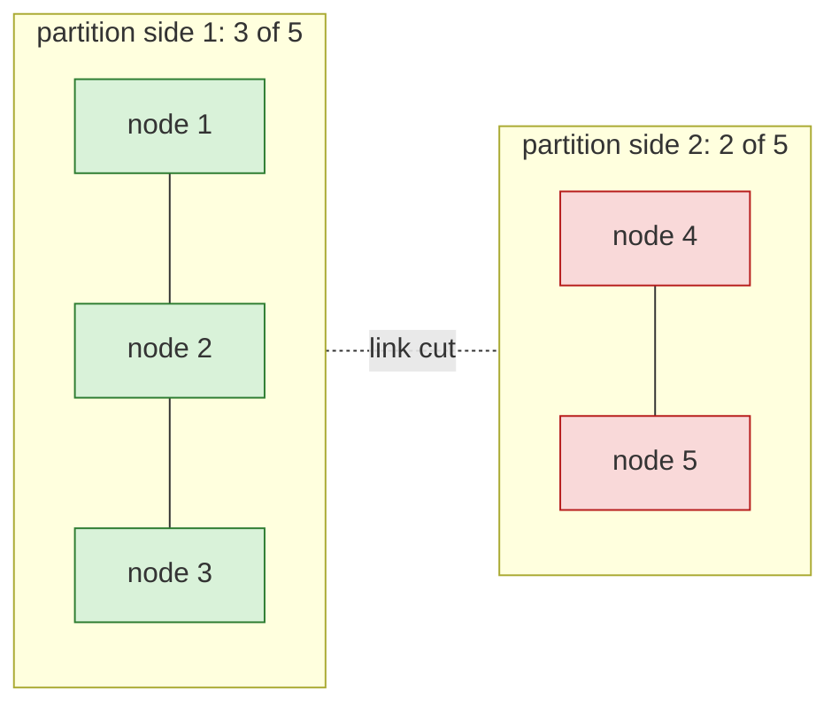
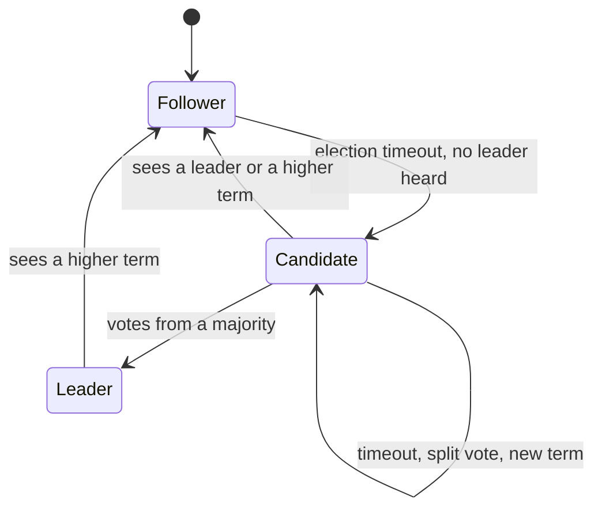
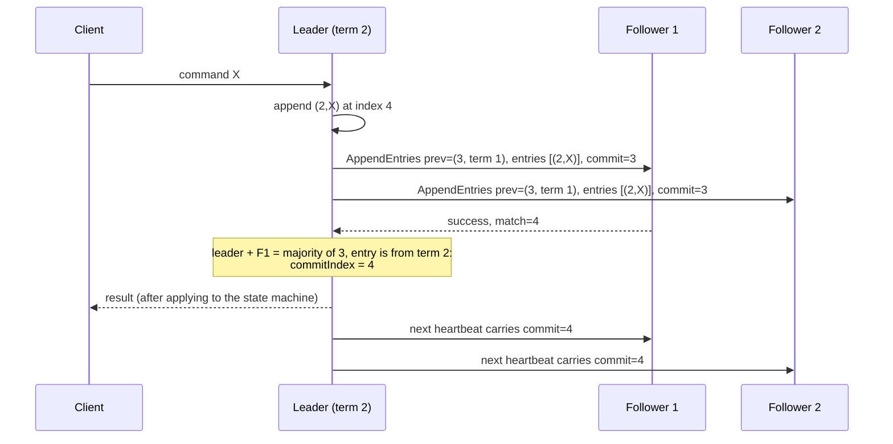
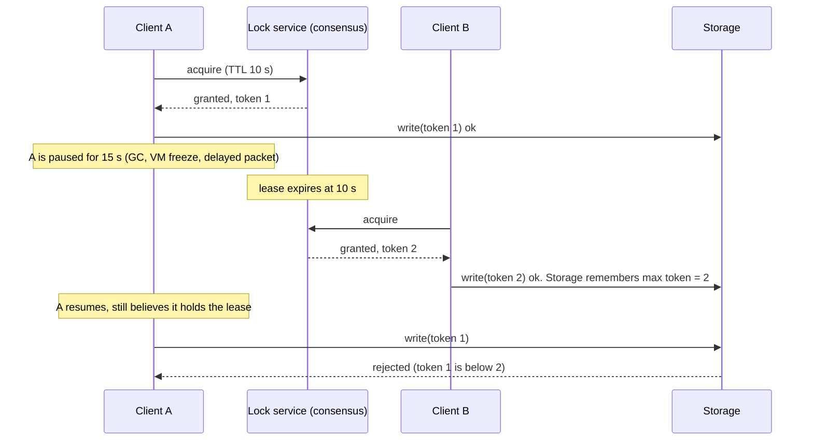
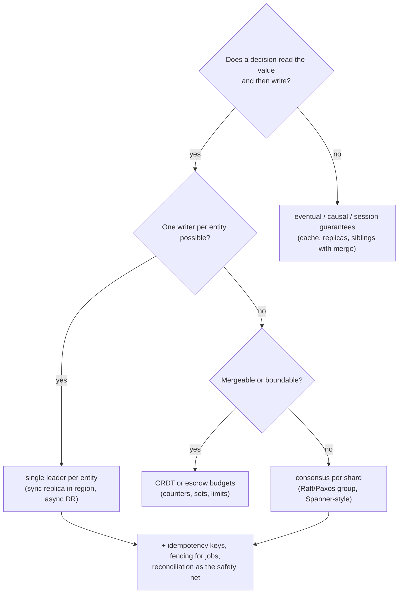

# A5 Unit 3 — Consensus, leases, fencing and choosing a model

> Time: ~7 h (includes ≈ 1.5 h of gate work: design exercise + teach-back) · CORE (5 h): §1–§4 · STRETCH (≈ 2 h): §2 "Build it" (the `raftlite` lab) · Lab: `labs/a5/raftlite` (stretch)

Units 1 and 2 were about what you can do without agreeing: quorums that are not linearizable, clocks that cannot be
trusted, versions that tolerate concurrency. Some decisions cannot tolerate disagreement: *who is the leader*, *who
holds this lock*, *what is the next entry in the ledger*. This unit is about the machinery for those: consensus (why it
needs a majority, §1; how Raft does it, §2), the leases and fencing tokens that turn consensus into safe mutual
exclusion (§3), and the judgement to use all of it only where you must (§4). The module's design exercise and teach-back
live at the end of this unit.

## Before you start

Warm-up (spaced retrieval from Units 1 and 2). Answer on paper first.

1. A five-node store uses majorities for reads and writes. How many node failures can it survive, and why is the
   overlap argument the reason it never returns stale data for acknowledged writes (outside sloppy quorums)?
2. A node measures "my lease has 3 s left" using its wall clock, then a 20 s VM pause happens. What did it do wrong, and
   which clock should it have used for the local timer?
3. An event is delivered twice to a consumer. Where must the dedupe record live for the credit to happen once?

<details data-kind="answer">
<summary>Warm-up answers</summary>

1. Two (a majority is 3 of 5). Any read majority and write majority share at least one node (3 + 3 > 5), so a read
   meets the latest acknowledged write. The same pigeonhole argument returns in §1 for leader election.
2. It trusted a wall clock that a pause (or an NTP step) invalidates, and it checked the lease before the pause rather
   than as part of the action. For local timers use the monotonic clock; but even that does not survive a pause between
   the check and the use, which is why §3 adds fencing tokens.
3. In the same transaction as the effect, keyed by the producer-assigned event ID with a unique constraint. For an
   external effect: an idempotency key to the downstream plus an attempt record and reconciliation. (Unit 2 §4.)

</details>

---

## §1 Why consensus needs a majority

### The failure story

A transfer service runs as a primary and a standby in two racks. The standby promotes itself when it misses the
primary's heartbeat for 10 seconds. One afternoon a top-of-rack switch misbehaves and the racks cannot talk to each
other for 90 seconds, while each can reach its own clients. Both sides are healthy, and each sees the other as dead.
The standby promotes itself. The old primary has not noticed anything wrong. For 90 seconds there are two primaries.

At 40 transfers a second per side that is 3,600 acknowledged transfers on each side. Each primary assigned the same
sequence numbers to different transfers (3,600 collisions in the ledger's entry numbers). Of 200,000 active accounts,
each side touched 3,600; the expected overlap is 3,600 × 3,600 / 200,000 ≈ 65 accounts whose balances were updated
independently on both sides. When the link returns, an operator must discard one side's history. Every transfer on the
discarded side (3,600 of them) was acknowledged to a member, so each needs manual reconstruction or a refund.

The design was reasonable in every local detail. The flaw is that "primary" was a belief held by each node, decided by
a timeout, with nothing forcing the two beliefs to agree. Consensus is the mechanism that forces them to.

### Predict

<!-- predict id="A5-U3-P01" -->
**Predict.** Write your answers down before opening the reveal.

1. A cluster requires a majority of its nodes to elect a leader or commit a log entry. Why can two sides of a partition
   never both have a leader that can commit?
2. How many failures does a cluster of 3 survive? Of 4? Of 5? Which sizes are worth running, and why is 4 rarely used?
3. You have two data centres and need automatic failover. Can you do it safely with 2 nodes? With 3 nodes in those
   two data centres? What do you need?
4. The FLP result (Fischer, Lynch, Paterson, 1985) is often quoted as "consensus is impossible". What does it actually
   say, and why do Raft and Paxos exist anyway?
<!-- /predict -->

### Reveal

<details data-kind="reveal" data-for="A5-U3-P01">
<summary>Reveal</summary>

1. A majority is more than half, ⌊n/2⌋ + 1. Two disjoint groups cannot each contain more than half of the same set of
   nodes, so **at most one side of any partition can hold a majority**. That side can elect a leader and commit; the
   other side cannot, so it never accepts a decision that could conflict. Further, any two majorities **overlap in at
   least one node**, and that node remembers what the earlier leader committed, which is how a later leader learns it.
2. 3 nodes survive 1 failure; 4 survive 1 (majority is 3); 5 survive 2. Four nodes tolerate no more failures than
   three but give one more node that can fail, so the probability that a majority is up is *lower* (the program in
   "Build it": 0.999408 against 0.999702 at 1% node unavailability). That is why consensus groups are 3 or 5, rarely 7,
   and almost never even.
3. **2 nodes: no.** If the link fails neither can tell "peer dead" from "peer unreachable"; to stay available you must
   promote (split-brain), to stay safe you must wait (no automatic failover). **3 nodes in 2 data centres: only half
   right.** Put 2 in one and 1 in the other and the loss of the 2-node site loses the majority. You need **three failure
   domains** (three sites, or two sites plus a small witness/tie-breaker in a third) so that no single domain holds a
   majority.
4. FLP says: in a fully **asynchronous** system (no bound on message delay) in which even **one** process may crash, no
   *deterministic* algorithm can guarantee that consensus *terminates*. It does not say consensus is unreachable in
   practice and it does not say safety is impossible. Paxos and Raft are **always safe** (never decide two
   values) and **live whenever the network is behaving** (messages arrive within some unknown but finite bound for long
   enough); they use timeouts and randomisation to make liveness failures rare, but cannot rule them out.

</details>

### How it actually works

**The goal: a replicated state machine.** If every replica starts in the same state and applies the same commands in the
same order, every replica ends in the same state. So the hard part is agreeing on the **order of commands**: a log
whose entries are chosen one by one by consensus. Once an entry is chosen it never changes.

**Consensus** asks a group of nodes to agree on a value (here: the next log entry) such that:

- **Agreement/safety**: no two nodes decide different values;
- **Validity**: the decided value was proposed by someone;
- **Termination/liveness**: nodes eventually decide, if enough of them are up and the network behaves.

**Why majorities.** Every decision (a leader for a term, a log entry) needs the consent of a majority. Consequences:



- The 3-node side can elect a leader and commit entries. The 2-node side can neither; its clients get errors (CP).
- When the link heals, the nodes on the minority side catch up. Anything the majority side committed was stored on at
  least 3 nodes; any 3 nodes include at least one node of every other possible majority, so a *future* leader, which
  needs a majority's votes, must have at least one voter who holds every committed entry. Raft's election rule
  (Unit 3 §2) uses that voter to guarantee the future leader has the committed entries.
- No timing assumption is needed for **safety**. Timeouts only affect how fast a new leader appears.

**Cluster size and failure domains.** A group of `n = 2f + 1` nodes tolerates `f` failures. The failures must be of
independent domains: five nodes in one rack tolerate two disk failures but not one switch.

| Placement | Survives | Does not survive |
|---|---|---|
| 3 nodes in 3 AZs of one region | An AZ loss | A region loss |
| 5 nodes: 2 + 2 + 1 across 3 regions | A region loss (3 of 5 remain in any case) | Two regions at once; writes pay the RTT to the *second-nearest* voter |
| 3 nodes: 2 in region A, 1 in region B | One node, region B | Region A (the majority is lost) |
| 2 nodes with automatic failover | Nothing safely | Any partition (split-brain) or any single failure (no failover) |

**Banking link.** Many core-banking deployments run an active/passive pair across two data centres with a manual
failover runbook: that is the 2-node row, with a human as the third voter, which is why failover takes minutes and
involves a call. Automating it safely means adding a third failure domain (a witness) and fencing the old primary
(§3). Your A7 module (RPO/RTO) is the same decision viewed from the recovery side.

### Build it

No lab package for this section (§2 builds the protocol). The program below checks the two facts on this page by
brute force: that any two majorities of `n` nodes overlap (for every `n` up to 9, by enumerating all subsets) and the
availability of a majority group when each node is independently unavailable with probability `p`. Save it outside the
repository (for example `majority/main.go` in a scratch folder) and run `go run .`.

```go
// majority: why consensus groups have an odd size, why any two majorities
// overlap, and what the extra nodes buy.
package main

import (
	"fmt"
	"math"
	"math/bits"
)

// choose returns the binomial coefficient C(n, k).
func choose(n, k int) float64 {
	r := 1.0
	for i := 1; i <= k; i++ {
		r = r * float64(n-k+i) / float64(i)
	}
	return r
}

// majoritiesAlwaysOverlap checks, for every pair of subsets of n nodes that
// each hold a strict majority, that they share at least one node.
func majoritiesAlwaysOverlap(n int) bool {
	need := n/2 + 1
	var subsets []uint
	for s := uint(0); s < 1<<n; s++ {
		if bits.OnesCount(s) >= need {
			subsets = append(subsets, s)
		}
	}
	for _, a := range subsets {
		for _, b := range subsets {
			if a&b == 0 {
				return false
			}
		}
	}
	return true
}

// available returns P(at least `need` of n nodes are up) when each node is
// independently down with probability p.
func available(n, need int, p float64) float64 {
	sum := 0.0
	for up := need; up <= n; up++ {
		sum += choose(n, up) * math.Pow(1-p, float64(up)) * math.Pow(p, float64(n-up))
	}
	return sum
}

func main() {
	const p = 0.01 // each node is unavailable 1% of the time, independently
	fmt.Printf("%-3s %-9s %-9s %-14s %s\n", "n", "majority", "tolerates", "overlap holds", fmt.Sprintf("P(majority up), p=%g", p))
	for n := 1; n <= 9; n++ {
		need := n/2 + 1
		fmt.Printf("%-3d %-9d %-9d %-14v %.6f\n", n, need, n-need, majoritiesAlwaysOverlap(n), available(n, need, p))
	}
}
```

Predict which sizes have the highest availability per node used, then run it.

<details data-kind="answer">
<summary>Output</summary>

```text
n   majority  tolerates overlap holds  P(majority up), p=0.01
1   1         0         true           0.990000
2   2         0         true           0.980100
3   2         1         true           0.999702
4   3         1         true           0.999408
5   3         2         true           0.999990
6   4         2         true           0.999980
7   4         3         true           1.000000
8   5         3         true           0.999999
9   5         4         true           1.000000
```

Overlap holds for every size, because it is arithmetic, not luck. Note the steps: 3 → 5 buys two more nines of
availability (0.9997 → 0.99999), and **4 is worse than 3**, **6 is worse than 5**, **2 is worse than 1**. Even sizes add a
node that can fail without adding failure tolerance. (The 1.000000 for 7 and 9 is rounding: the unavailability is
≈ 3.5×10⁻⁷ for 7 nodes and ≈ 1.3×10⁻⁸ for 9.)

</details>

### Break it

1. Change `p` to `0.05` (a node is down 5% of the time: a flaky fleet) and re-run. Which sizes change rank, and what
   does this say about adding nodes to "be safe"?
2. A team plans a 3-node group with two nodes in Mumbai and one in Pune, "for disaster recovery". What is wrong, and
   what is the smallest change that survives losing a whole city?
3. The program assumes independent failures. Why is that optimistic, and which placement decision breaks it?

<details data-kind="answer">
<summary>What you should see, and why</summary>

1. At `p = 0.05`: 3 nodes ≈ 0.99275, 4 nodes ≈ 0.98598, 5 nodes ≈ 0.99884, 6 nodes ≈ 0.99777, 7 nodes ≈ 0.99981. The
   ranking is unchanged (odd beats the even size above it) but the gaps widen: the 4-node group (98.6%) is ≈ 0.7 points
   less available than the 3-node group (99.3%). More nodes help only when they raise the number of tolerated failures; an extra node
   that does not (3 → 4) is a cost and a risk.
2. Losing Mumbai takes 2 of 3 voters and the group stops: it survives Pune's loss, not the larger city's. To survive
   either city you need a majority outside any single city: 5 voters as 2 + 2 + 1 across three sites, or 2 + 2 plus a
   lightweight witness in a third location, so that the loss of any single site leaves at least 3 of 5.
3. Failures cluster: a shared top-of-rack switch, a bad rollout that restarts every node, a common dependency such as
   DNS or a certificate that expires everywhere at once. Independence holds only across genuinely separate failure
   domains and deployment waves, so spread nodes across racks, AZs and release rings.

</details>

### In the wild

- **etcd** (the store behind Kubernetes), **Consul** servers and **ZooKeeper** ensembles are run as 3 or 5 members;
  their documentation recommends odd sizes and warns that a 7-member group slows writes (more acknowledgements per
  commit) for modest gain. `TODO-VERIFY: current wording of each project's sizing guidance.`
- **Chubby** (Google's lock service) ran as a cell of five replicas; **Spanner** replicates each shard with Paxos across
  replicas in multiple zones (`TODO-VERIFY: typical replica count and placement`).
- **Kafka** moved its cluster metadata from ZooKeeper to a Raft-based quorum controller ("KRaft", `TODO-VERIFY: the
  release in which KRaft became production-ready for new clusters`).
- **FLP** (1985) and **Paxos** (Lamport's "Paxos Made Simple", 2001; the original "Part-Time Parliament" 1998) are the
  theoretical anchors; **Viewstamped Replication** (Oki and Liskov, 1988) and **Zab** (ZooKeeper) are siblings.
- **Cloud database services** hide this: Aurora's storage quorum (Unit 1 §4) and managed Postgres HA with a witness are
  majority systems under a product name.

### Trade-offs

| Option | Wins when | Loses when | When the answer flips |
|---|---|---|---|
| 3-node consensus group | Most services: tolerates one failure, cheapest, fastest commits | A second simultaneous failure stops writes | Flip to 5 when a rolling restart plus a failure must be survivable |
| 5-node group | Maintenance on one node while surviving another failure; region-loss tolerance with 2 + 2 + 1 | More fan-out per write, slower commits, more cost | Flip back to 3 when the extra tolerance is never used |
| 7+ nodes | Rare: very high availability targets | Slower commits, more cost, little gain | Use read-only learners/observers for read scaling instead of voters |
| 2 nodes + external arbiter | You have exactly two data sites and can run a witness elsewhere | The witness is a dependency and must be independent | Flip to 3 full voters when you can afford a third site |
| Primary/standby with manual failover | Failover is rare and a human decision is acceptable (RTO of minutes to hours) | Slow RTO; operator error; the old primary can come back | Flip to consensus-based election plus fencing when RTO must be seconds |
| Single node | Dev and non-critical data | Any failure is an outage | — |

### Senior bar

- **Failure modes**: split-brain from timeout-based failover; two-site designs with a hidden single point of
  majority; correlated failures (one rollout restarts all members); members behind a disk so slow they miss heartbeats and
  trigger elections; adding or removing members incorrectly (membership change needs its own protocol).
- **Capacity**: commit latency ≈ one round trip to the fastest `f` followers plus a disk flush; in-region ≈ 1–2 ms
  RTT (`docs/NUMBERS.md`) + fsync (≈ 0.1–1 ms on NVMe), cross-region ≈ 60–150 ms. Throughput is bounded by the leader:
  a consensus group typically sustains thousands to tens of thousands of small writes per second, so it holds *coordination
  data and metadata*, not bulk traffic.
- **Ops**: alert on leader changes (a flapping leader is a health problem), proposal failures, commit and apply
  latency, member lag, fsync latency; practise losing a member, losing two, and restoring from a snapshot; never
  "just restart everything".
- **Cost**: 3–5× nodes for the group, cross-AZ and cross-region traffic, and the on-call load of running a consensus
  cluster. Use a managed one (etcd as a service, a cloud lock service) when you can.

Interviewer follow-up probes:

1. "Why do we need an odd number of nodes?"

<details data-kind="answer">
<summary>Model answer</summary>

Because failure tolerance depends on the majority size, and going from 2f + 1 to 2f + 2 nodes raises the majority
(f + 2 of 2f + 2) without raising the number of tolerated failures (still f). You pay for another node, take on more
failure probability (with p = 1% the 4-node group is less available than the 3-node one), and gain nothing. Even sizes
are not incorrect, just wasteful.

</details>

2. "Two data centres, automatic failover. Design it."

<details data-kind="answer">
<summary>Model answer</summary>

Three failure domains: a voter in each of the two data centres plus a witness (or a third site) so any single-site loss
leaves a majority. A consensus-based election decides the primary, and the old primary is **fenced**: it cannot write
after losing leadership (a term or token checked by the storage; §3). Replication is synchronous to the nearest other
voter to avoid acknowledged-write loss, and I would state the RPO/RTO that results (RPO 0 with a synchronous voter, RTO
seconds), and the latency cost of the cross-site round trip.

</details>

3. "Does FLP mean consensus doesn't work?"

<details data-kind="answer">
<summary>Model answer</summary>

No. FLP says no deterministic algorithm can guarantee termination in a fully asynchronous system with a crash fault.
Practical algorithms keep safety unconditionally and get liveness whenever the network is timely enough, using timeouts
and randomisation. The consequence for design is that liveness can fail during bad network periods (no leader for a
while), never safety.

</details>

### Check yourself

1. State the property of majorities that prevents two leaders from both committing.
2. Why is a 4-node cluster less available than a 3-node one?
3. What is the minimum number of failure domains to survive any single domain's loss?

<details data-kind="answer">
<summary>Answers</summary>

1. Any two majorities of the same set overlap, so two disjoint partitions cannot both contain a majority.
2. It tolerates the same single failure but has one more node that can fail, and needs 3 of 4 up instead of 2 of 3.
3. Three, with no domain holding a majority of the voters.

</details>

---

## §2 Raft: terms, elections and the log

### The failure story

A team writes its own leader election for a five-node job scheduler: every node runs a 150 ms election timer, and when
it fires, the node asks the others for votes. The code passes every test on a laptop. In production, a brief network
blip makes all five timers fire at almost the same instant. Every node becomes a candidate, votes for itself, and
refuses everyone else's request ("already voted this term"). Nobody gets 3 votes. All five time out again 150 ms later,
and again.

You can reproduce it with the lab harness: five healthy nodes with **identical** election timeouts, left alone for
600 ticks (6 seconds at 10 ms per tick), end with **no leader and the term at 40**. The cluster is fully connected,
fully healthy, and unable to schedule anything, while the payroll run waits.

A different team has the opposite bug: their candidates win elections too easily. A node that missed the last few
writes gets elected, starts accepting new writes, and overwrites entries that clients were already told were safe.
Nothing crashed; an acknowledged transfer simply no longer exists. Raft's two defences against these two failures
(randomised timeouts and the "up-to-date log" rule on votes) are small, and understanding exactly why they are
small is most of this section.

### Predict

<!-- predict id="A5-U3-P02" -->
**Predict.** Write your answers down before opening the reveal.

1. Why do Raft implementations choose each election timeout randomly from a range instead of using the same value
   everywhere?
2. A follower holds the log `[(1,a) (1,b) (1,c)]` (term, command) from a leader that died. The new leader, elected in
   term 2, holds `[(1,a)]` and appends `(2,X)`. What happens to `b` and `c`? Were they committed?
3. A candidate asks for a vote. The voter has a longer log than the candidate's. Does it grant the vote? What goes
   wrong if it does?
4. When may a leader consider a log entry **committed**? Why can't it simply count replicas for entries left over from an
   earlier term?
<!-- /predict -->

### Reveal

<details data-kind="reveal" data-for="A5-U3-P02">
<summary>Reveal</summary>

1. **To break symmetry.** With identical timeouts every node campaigns at the same moment, every vote is split, and the
   cluster livelocks. With a random timeout one node usually fires first, asks for votes before the others have
   campaigned, and wins before the next timer fires. The range must be wide compared to the network round trip (the
   lab's measurements are in "Break it") and the timeout must be much longer than the heartbeat interval so a healthy
   leader is never mistaken for a dead one.
2. The new leader's log wins: the follower's `b` and `c` are **deleted and replaced** by `(2,X)`. They were not
   committed (a committed entry is stored on a majority of nodes, and a leader missing it could not have been elected,
   next question), so no client was promised them. If they had been committed, this situation could not arise.
3. **No.** A voter refuses a candidate whose log is less up to date than its own (a higher last term, or the same last
   term and a longer log, is more up to date). If it granted the vote, the candidate could win with a log that lacks
   entries a majority has already stored, and then overwrite them: a committed entry would be lost. Because every
   committed entry sits on a majority, and the candidate also needs a majority of votes, at least one voter holds each
   committed entry and will refuse to elect a candidate that lacks it. That is the **Leader Completeness** property.
4. When it is stored on a **majority** of nodes **and** it belongs to the leader's **current term**. Entries from older
   terms are committed only indirectly, when a later entry of the current term commits. The reason is the Raft paper's
   Figure 8 scenario: an old-term entry can be on a majority and still be overwritten by a later leader whose last log
   term is higher, so counting replicas for it is not a safe commit signal. The leader fixes this by appending a no-op in
   its own term when elected.

</details>

### How it actually works

Raft (Ongaro and Ousterhout, 2014) splits consensus into three parts: electing a leader, replicating the leader's log,
and the safety rules that tie them together. Time is divided into **terms**, numbered integers that act as a logical
clock for leadership: a message with a higher term makes everyone who sees it step down, which is the same trick as a
Lamport clock (Unit 2 §2) applied to elections. Each term has at most one leader.



**Election.** A follower that hears nothing from a leader for one (randomised) election timeout increments its term,
becomes a candidate, votes for itself, and sends `RequestVote(term, lastLogIndex, lastLogTerm)` to everyone. A node
grants its vote if (a) it has not voted in this term (or already voted for this candidate) and (b) the candidate's log is
at least as up to date as its own. A candidate with a majority becomes leader and immediately sends `AppendEntries`
heartbeats, which also reset the followers' timers.

**Replication.** Clients send commands to the leader, which appends them to its log and sends
`AppendEntries(term, prevLogIndex, prevLogTerm, entries, leaderCommit)` to the followers. A follower accepts only if it has
an entry at `prevLogIndex` with term `prevLogTerm` (the **consistency check**); otherwise it refuses and the leader
steps back one entry (`nextIndex--`) and retries, until the logs agree, then overwrites the follower's conflicting suffix.



**Log Matching.** Two guarantees make logs comparable: if two entries in different logs have the same index and term, they
hold the same command, and all the entries before them are identical. The consistency check inductively enforces the
second property.

**Commit rule and Figure 8.** A leader may advance `commitIndex` to `N` only if `log[N].term == currentTerm` and a majority
has `matchIndex ≥ N`. The paper's example shows why: S1 is leader in term 2 and replicates index 2 to S2 only, then
crashes; S5 wins term 3 (votes from S3, S4, S5, none of which has index 2), appends its own term-3 entry at index 2, and
crashes; S1 returns as leader in term 4 and finishes replicating its **term-2** entry to S3, so it is now on S1, S2 and S3,
a majority. If S1 counted that as committed and crashed, S5 could be elected again (its last log term, 3, beats the
term-2 entries on S2 and S3 and it also gets S4's vote) and would overwrite index 2 on everyone. The rule fixes it:
S1 must first commit an entry of its own term 4; once that is on a majority, no node whose last term is below 4 can win
an election, so the old entry is safe. This is why a new leader appends a **no-op** at the start of its term.

**The five safety properties** (from the paper): *Election Safety* (at most one leader per term), *Leader Append-Only*,
*Log Matching*, *Leader Completeness* (a committed entry is present in the logs of all later leaders) and *State Machine
Safety* (no two nodes apply different commands at one index). The lab's harness checks the first and the last on every
tick.

**Timing.** The paper's rule of thumb is `broadcast time ≪ election timeout ≪ mean time between failures`. Heartbeats
are sent several times per election timeout. The paper uses 150–300 ms election timeouts (`TODO-VERIFY`);
etcd's defaults are a 100 ms heartbeat and a 1,000 ms election timeout, tuned for networks and disks that are
slower than a lab's.

**What the lab leaves out, and what real implementations add.** *Persistence*: `currentTerm`, `votedFor` and the log
must be on disk (fsynced) before replying, or a restart can vote twice in one term. *Membership change*: adding or
removing nodes safely needs joint consensus or one-at-a-time changes. *Snapshots / log compaction*: the log cannot grow
forever. *Linearizable reads*: reading from a leader's state machine can return stale data if it has been deposed
without knowing; implementations use the log, `ReadIndex` (confirm leadership with a heartbeat round) or leader leases
(§3). *Client sessions*: a client that retries a command after a timeout can apply it twice; the paper's answer is a
unique serial number per client command so the state machine can detect repeats, which is Unit 2 §4 inside the log.
*Pre-vote and check-quorum*: stop a partitioned node from inflating the term and disrupting a healthy leader on return.

### Build it

**STRETCH (≈ 2 h).** Lab `labs/a5/raftlite`, file `raftlite.go`. The harness (`sim.go`, provided) is a deterministic
in-memory network: every message arrives one tick after it was sent, nodes can be crashed, restarted and partitioned, and
after every tick it checks that no term has two leaders and that no committed entry ever changes. You implement the
`Node` state machine: `Tick` and `Step`, nothing else touches time or the network. The package doc is the full
specification. Suggested order, following the test names:

1. `Vote*` and `Election*` tests: one vote per term, the up-to-date rule, campaigns, majority counting, a single-node
   cluster.
2. `Terms*`: any higher term demotes a node; a candidate yields to a leader of its own term.
3. `Append*`: the consistency check, overwriting conflicting suffixes, never shortening a log on an old duplicate,
   `commitIndex` bounded by what was sent.
4. `Leader*`: the no-op, heartbeats, the commit rule (`TestLeader_NeverCommitsAnEarlierTermsEntryByCountingReplicas`),
   backing up `nextIndex`.
5. `Cluster*`: elections across 40 seeds, leader crash and restart, a minority partition that cannot commit and whose
   entries are discarded on heal, the stale-log candidate, and a random-fault run that checks Log Matching every tick.

Run `go test -race ./labs/a5/raftlite/` (the cluster tests take a few seconds). `sd lab A5` reports this package
separately and it does not gate.

### Break it

1. Predict, then run:

   ```sh
   go test -tags breakit -run BreakIt -v ./labs/a5/raftlite/
   ```

   First line: five nodes, identical 15-tick timeouts, 600 ticks. Then: time to first leader with randomised timeouts,
   and a table of how that changes with the width of the timeout window (5 nodes, heartbeat 3 ticks, 300 seeds per row).
2. Wire the constant `breakSkipLogCheck` into your vote handler (`if breakSkipLogCheck { upToDate = true }` before the
   grant decision) and run `go test -tags breakit -run StaleLog -v ./labs/a5/raftlite/`.
3. Remove the `log[N].Term == currentTerm` condition from your commit rule and run the normal suite.

<details data-kind="answer">
<summary>What you should see, and why</summary>

1. Reference run:

   ```text
   identical timeouts (15 ticks), 600 ticks: leader = "", highest term = 40
   randomized timeouts in [10,20), 200 seeds: first leader after median 13 ticks, p99 18, max 18

   width  no leader   median      p99      max   term > 1
   1            300        -        -        -          -
   2              0       12       33       33      23.3%
   3              0       12       24       35      11.0%
   5              0       12       22       22       1.0%
   10             0       13       18       23       0.3%
   40             0       16       38       39       0.0%
   ```

   - Identical timeouts: 600 / 15 = 40 rounds, 40 terms, zero leaders. A width-1 window is the same thing (300 of 300
     seeds never elect).
   - With randomisation the typical election takes ≈ 13 ticks: the shortest of five random timeouts (≈ 12) plus a tick
     for the vote requests and a tick for the replies.
   - A narrow window (width 2) leaves 23.3% of runs needing a second round and a p99 of 33 ticks: split votes. A wide window
     (40) almost never splits (0.0%) but is slower in the median (16) because the *shortest* timeout is now longer on
     average: detecting a dead leader takes longer. Widen enough to make splits rare, no more.
2. `TestVote_RejectsACandidateWithAStaleLog` fails on three of its cases (an empty log, a shorter log of the same term,
   and a lower last term with a longer log are all granted), and
   `TestCluster_StaleLogCandidateCannotWinElection` fails with the harness reporting a safety violation like
   `B: committed entry 2 changed from {Term:1 Cmd:x} to {Term:2 Cmd:}`: node C, which never saw the committed
   command `x` (its log is just the first leader's no-op), wins the election, appends its own no-op at index 2 and
   replicates it over B's committed `x`. One line of code removed, and an acknowledged entry is gone.
3. `TestLeader_NeverCommitsAnEarlierTermsEntryByCountingReplicas` fails: the leader commits an entry from term 2 as
   soon as two of three nodes hold it, which is the Figure 8 hazard in a unit test.

</details>

### In the wild

- **etcd** implements Raft (and exports its library); Kubernetes stores all cluster state in it. **CockroachDB** runs
  one Raft group per range (many thousands of groups per cluster, "multi-Raft") on top of etcd's Raft library;
  **TiKV** (TiDB) does the same with a Rust implementation; **Consul** uses HashiCorp's Raft library.
  `TODO-VERIFY: library lineage claims for CockroachDB and TiKV.`
- **MongoDB** replica-set elections are Raft-derived (terms, up-to-date-log rule, majority write concern for
  durability). `TODO-VERIFY: the protocol version and what differs from Raft.`
- **Kafka's KRaft** mode runs a Raft quorum for cluster metadata.
- **Paxos** family: Chubby, Spanner (Multi-Paxos per shard), and Cassandra's lightweight transactions. **ZooKeeper** uses
  Zab, a sibling protocol with the same leader-based shape.
- **Jepsen** has tested many of these implementations and found real bugs in membership changes, stale reads and
  lease handling: the protocol is simple; the engineering around it is not.
- The paper ("In Search of an Understandable Consensus Algorithm", USENIX ATC 2014), Ongaro's dissertation, and the
  interactive visualisation at raft.github.io are the standard study aids.

### Trade-offs

| Option | Wins when | Loses when | When the answer flips |
|---|---|---|---|
| Raft / Multi-Paxos group | You need one ordered log and automatic failover: metadata, coordination, small critical state, shards of a database | Throughput is bounded by the leader; latency is a round trip to a majority plus a disk flush | Flip to a quorum store or CRDTs for large, mergeable, always-writable data |
| Linearizable read via the log | Simplicity, strongest semantics | Every read pays a log write | Flip to `ReadIndex` or leader leases for read-heavy workloads |
| Lease-based reads from the leader | Fast linearizable reads (no round trip) | Depends on bounded clock drift; unsafe if the assumption breaks | Flip to `ReadIndex` when you cannot trust clock bounds |
| Follower (stale) reads | Read scaling; tolerant data | Stale data; needs session guarantees to feel right | Flip to leader reads for decisions |
| Short election timeout | Fast failover | False elections under GC pauses, slow disks, jittery networks | Flip to longer when elections flap |
| Long election timeout | Stability | Long unavailability after a real leader failure | Flip shorter on fast, quiet networks |

### Senior bar

- **Failure modes**: leader flapping from fsync stalls or GC pauses longer than the election timeout; a partitioned node
  with an inflated term disrupting the cluster on return (pre-vote fixes it); a slow follower dragging commit latency; disks
  that lie about fsync (a vote or entry acknowledged but not durable); unsafe membership changes; log growth without
  snapshots; stale reads from a deposed leader; clients that retry commands without session deduplication.
- **Capacity**: commit latency ≈ RTT to the fastest `f` followers + fsync. In-region: ≈ 1–2 ms RTT + ≈ 0.1–1 ms flush ≈
  2–3 ms per commit, and batching amortises it: thousands to tens of thousands of small commands per second per
  group. Cross-region commits ≈ 60–150 ms. A 3-member group stores 3× the data and moves 2× the log over links.
- **Ops**: alert on leader changes per hour, proposals dropped, apply lag, fsync p99, and member health; rehearse member
  loss and restore; upgrade one member at a time; never co-locate members in one failure domain; keep the data set small
  (etcd's default storage quota is a few GiB, `TODO-VERIFY`), because consensus stores are for coordination, not bulk data.
- **Cost**: 3–5 nodes of fast-disk machines, cross-AZ traffic, and operator expertise. Prefer a managed service for
  etcd/ZooKeeper-style needs.

Interviewer follow-up probes:

1. "Why does a new leader append a no-op?"

<details data-kind="answer">
<summary>Model answer</summary>

Because a leader may only commit entries of its own term by counting replicas, and it may have inherited uncommitted
entries from earlier terms (Figure 8). Appending a no-op in the new term and getting it onto a majority commits
everything before it indirectly, and also tells the new leader which of the inherited entries are really committed so it
can serve reads correctly.

</details>

2. "A leader crashes right after acknowledging a write to the client. Is the write lost?"

<details data-kind="answer">
<summary>Model answer</summary>

No, if the leader acknowledged only after the entry was committed (stored on a majority). The new leader must have
been elected by a majority, which overlaps the majority that holds the entry, and the up-to-date-log rule means
that overlapping voter will not elect a candidate lacking it. The client may not know the outcome (the ack may be lost),
so the client retries with the same serial number and the state machine deduplicates.

</details>

3. "Three or five nodes?"

<details data-kind="answer">
<summary>Model answer</summary>

Three if one failure at a time is the real requirement and cost matters; five when I must survive a failure during
maintenance or the loss of a failure domain (2 + 2 + 1 across three sites). Five costs more per write (a majority of 3
acknowledgements instead of 2), so latency is the second-nearest voter. I would not go to seven; I would add non-voting
learners for read scale.

</details>

4. "How do you serve a linearizable read from a Raft group without writing to the log?"

<details data-kind="answer">
<summary>Model answer</summary>

`ReadIndex`: the leader records its commit index, confirms it is still leader by exchanging a heartbeat round with a
majority, waits until its state machine has applied up to that index, then serves the read. Or leader leases: if the
leader has heard from a majority within a lease period shorter than the election timeout, it may serve locally, but
that makes safety depend on bounded clock drift (§3).

</details>

### Check yourself

1. What does a node check before granting a vote, besides "have I voted in this term"?
2. When is a log entry committed?
3. Why are election timeouts randomised?

<details data-kind="answer">
<summary>Answers</summary>

1. That the candidate's log is at least as up to date as its own (higher last term, or equal last term and a log at
   least as long).
2. When it is stored on a majority and belongs to the current leader's term (earlier entries commit with it).
3. To break symmetry so one candidate usually gets a head start and wins before others campaign (preventing endless
   split votes).

</details>

---

## §3 Leases and fencing tokens

### The failure story

The monthly interest run must execute on exactly one instance of the batch service, so the instances compete for a lease
(a key in a lock store with a 10-second TTL, renewed every 3 seconds). Instance A wins and starts accruing interest for
50,000 accounts, averaging $4.20 each. After 18,000 accounts, A's host is frozen by the hypervisor for 15 seconds (a
live migration; a long garbage-collection pause or a swap storm produces the same effect). A's lease expires after 10
seconds. B acquires the lease and starts the run from the beginning. At second 15, A resumes. It has no idea that
anything happened: its code checked "do I hold the lease?" a moment before the freeze, and carries on with account
18,001. For the remaining 32,000 accounts both A and B write.

32,000 accounts × $4.20 ≈ **$134,400** of interest credited twice, on the one night of the month when nobody expects to
audit it. The lock service worked exactly as designed: it expired a lease whose holder stopped responding and granted
it to someone else. The holder simply could not know it had been expelled.

This is the classic argument about distributed locks, and the answer is not a better lock service. It is to make the
*resource* refuse the stale holder.

### Predict

<!-- predict id="A5-U3-P03" -->
**Predict.** Write your answers down before opening the reveal.

1. Instance A takes a 10-second lease at t = 0 and checks "my lease is valid" at t = 9, immediately before writing.
   It is then paused for 15 seconds and writes. Does the check protect the resource?
2. What can the **storage** (the thing being protected) do, with help from the lock service, to reject A's write?
3. The lock service is a Raft-replicated store, so it is linearizable. Is a lease from it enough to guarantee mutual
   exclusion?
4. Which clock does the holder use to decide how much lease it has left, and what are the ways that clock can be wrong?
<!-- /predict -->

### Reveal

<details data-kind="reveal" data-for="A5-U3-P03">
<summary>Reveal</summary>

1. **No.** Checking and then acting is a race: the pause can fall between the check and the write (or inside the
   network, where the write is delayed 15 seconds in flight). By the time the write arrives the lease is gone. No amount
   of checking on the holder's side closes the window, because the holder is exactly the party that cannot observe
   its own pause.
2. **Fencing tokens.** Every time the lock service grants the lease it also returns a number that increases with each
   grant (A gets 1, B gets 2). The holder attaches the token to every request to the resource, and the resource remembers
   the highest token it has seen and **rejects anything lower**. After B's write (token 2), A's delayed write (token 1) is
   refused. The check lives where the data lives, atomically with the write.
3. **No, not by itself.** Linearizability makes the lock service's *grants* totally ordered (which is why the tokens can
   be monotonic), but the lease still only guarantees that the service will not *grant* it to two holders at once. It cannot
   stop a holder who has stopped noticing that its lease expired. Mutual exclusion in effect needs the fencing check at
   the resource.
4. The holder normally measures the lease with its **local monotonic clock**. That fails if the process is paused (the timer
   keeps its value but the world moved on), if the clock rate differs from the lock service's (drift), or if it uses
   the wall clock and an NTP step moves it. A lease's TTL is a **liveness** device: it lets the system recover from a dead
   holder. It must never be what **safety** depends on.

</details>

### How it actually works

A **lock** held until released is unsafe in a distributed system: a crashed holder never releases it. A **lease** is a
lock with an expiry: granted for a TTL, renewed by the holder while healthy, free to be granted to someone else if
renewals stop. Leases make locks live; they do not make them safe.



**The fencing contract.** (1) The lock service issues a strictly increasing token per grant (this needs the service
itself to be linearizable, which is why it is a consensus system). (2) Every operation on the protected resource carries
the token. (3) The resource rejects operations carrying a token lower than the highest it has accepted, and does the
check **atomically with the operation**. A token equal to the current maximum must be accepted: the legitimate holder
makes many writes.

**Where tokens come from.** ZooKeeper's `zxid` or the version of a sequential znode; etcd's revision of the lock key
(`mod_revision`) or the lease/lock `create_revision`; Chubby's *sequencer* (a string naming the lock, its generation and
mode that the client hands to servers, which can verify it); a database sequence or a row version. Any monotonic number
the lock service produces under its own consensus works.

**Fencing at a relational database.** The simplest resource-side fence is a conditional write. Give each job a fence row
and make every unit of work start by advancing it, in the same transaction as the work:

```go
package fence

import (
	"context"
	"database/sql"
	"errors"
)

// ErrFenced is returned when a newer lease holder has already written.
var ErrFenced = errors.New("fence: stale lease token")

// WithToken runs apply inside a transaction, but only if token is at least as new as the newest token this job has
// seen. The UPDATE takes a row lock on the fence row, so a stale writer cannot slip in between the check and the work:
// it either blocks until the newer holder commits and then fails the condition, or fails immediately.
// Table: job_fence(job text primary key, max_token bigint not null).
func WithToken(ctx context.Context, db *sql.DB, job string, token int64, apply func(*sql.Tx) error) error {
	tx, err := db.BeginTx(ctx, nil)
	if err != nil {
		return err
	}
	defer tx.Rollback() // no-op after Commit

	res, err := tx.ExecContext(ctx,
		`UPDATE job_fence SET max_token = $2 WHERE job = $1 AND max_token <= $2`, job, token)
	if err != nil {
		return err
	}
	if n, _ := res.RowsAffected(); n == 0 {
		return ErrFenced
	}
	if err := apply(tx); err != nil {
		return err
	}
	return tx.Commit()
}
```

This is the same idea as optimistic concurrency (`UPDATE … WHERE version = $expected`) and as the idempotency store in
A1 Unit 3 §2, where the **owner token** on a reservation made a stale worker's `Complete` fail with `ErrNotOwner`
(`TestIdempotency_StuckReservationLeaseCanBeTakenOver`): a fencing check at the store, for one key.

**Efficiency locks versus correctness locks.** If the lock only prevents *wasted work* (two instances both rebuilding a cache),
an occasional double holder costs a little; a plain lease is fine. If a double holder breaks a **correctness**
invariant (double interest, two writers on one ledger), the resource must fence. The public argument between Martin
Kleppmann ("How to do distributed locking", 2016) and Salvatore Sanfilippo (the author of Redis; "Is Redlock safe?")
about Redis's multi-instance *Redlock* algorithm is this distinction: Redlock tries to make the lease safer by asking
several independent Redis instances, but it generates no fencing token and relies on bounded clock drift and bounded
pauses, which cannot be guaranteed. For correctness, fence.

**Leases that depend on clocks.** Leader leases for fast reads (the leader serves reads locally while it holds a lease
that followers have promised not to usurp) are safe only if clocks drift less than a stated bound. Spanner's leader leases
are a long-lived example, protected by TrueTime's bounded uncertainty (`TODO-VERIFY: lease duration`). Without such
bounds, use the quorum-confirmed `ReadIndex` from §2.

**Common lease systems.** Kubernetes leader election uses a `Lease` object renewed through the API server (controller
managers default to roughly a 15-second lease, 10-second renew deadline, 2-second retry period, `TODO-VERIFY`);
ZooKeeper uses ephemeral znodes tied to a session; etcd uses leases with TTLs and keep-alives; Consul uses sessions; DynamoDB
offers a lock client library; Redis `SET key value NX PX ttl` is a lease with no token (use a counter alongside it if you must).
Postgres advisory locks are held while a session lives and vanish when it drops; a pooler or a half-open TCP
connection can leave the session alive after the client believes it is gone.

**Banking link.** Everything that must run once per interval or per account: the interest accrual in the story,
statement generation, the scheduled-transfer dispatcher, the nightly reconciliation, and the single writer for an account's
ledger in a multi-instance service. In each, the lease picks the runner and the *write path* carries the fence: the
accrual job writes `(account, period)` rows under a unique constraint (idempotency, Unit 2 §4) in a transaction that also
checks the fence token, so even a stale runner cannot double-post.

### Build it

No lab package; the program below makes the story executable in virtual time, no sleeps. It models a lock service that
issues a token per grant and a storage that optionally enforces fencing. Save it outside the repository and `go run .`.

```go
// fencing: the lease-expiry-during-a-pause story, in virtual time.
//
// Client A takes a 10 s lease on a ledger file, then stalls for 15 s (a long GC
// pause, a VM freeze, a slow disk). The lease expires, client B takes it and
// writes. A wakes up, still believes it holds the lease, and writes.
// Without a fencing token the storage cannot tell A's write is stale.
package main

import (
	"errors"
	"fmt"
)

// lockService hands out leases and a monotonically increasing token per grant.
type lockService struct {
	owner   string
	expires int // virtual seconds
	token   int
}

func (l *lockService) acquire(who string, now, ttl int) (token int, err error) {
	if l.owner != "" && now < l.expires && l.owner != who {
		return 0, errors.New("lease held by " + l.owner)
	}
	l.owner, l.expires = who, now+ttl
	l.token++
	return l.token, nil
}

// storage is the protected resource.
type storage struct {
	fenced   bool
	maxToken int
	log      []string
}

func (s *storage) write(who string, token int, data string) error {
	if s.fenced {
		if token < s.maxToken {
			return fmt.Errorf("rejected: token %d is older than %d already seen", token, s.maxToken)
		}
		s.maxToken = token
	}
	s.log = append(s.log, who+": "+data)
	return nil
}

func run(fenced bool) {
	locks := &lockService{}
	disk := &storage{fenced: fenced}

	// t=0: A takes the lease (10 s) and starts working.
	tokA, _ := locks.acquire("A", 0, 10)
	// A stalls until t=15. Meanwhile, at t=12, the lease has expired and B takes it.
	tokB, _ := locks.acquire("B", 12, 10)
	errB := disk.write("B", tokB, "debit acct-7 by 100 (balance 900)")
	// t=15: A wakes up. Its own clock says the work finished; it never re-checked the lease.
	errA := disk.write("A", tokA, "debit acct-7 by 100 (balance 900, computed from stale read)")

	fmt.Printf("fencing=%-5v token A=%d token B=%d | B write: %v | A write: %v\n", fenced, tokA, tokB, errB, errA)
	fmt.Printf("               storage log: %v\n", disk.log)
}

func main() {
	run(false)
	run(true)
}
```

<details data-kind="answer">
<summary>Output</summary>

```text
fencing=false token A=1 token B=2 | B write: <nil> | A write: <nil>
               storage log: [B: debit acct-7 by 100 (balance 900) A: debit acct-7 by 100 (balance 900, computed from stale read)]
fencing=true  token A=1 token B=2 | B write: <nil> | A write: rejected: token 1 is older than 2 already seen
               storage log: [B: debit acct-7 by 100 (balance 900)]
```

Without the token both writes land (the same debit applied from a stale read). With it, the storage refuses the
stale holder, and it does so without knowing anything about time, leases or pauses.

</details>

### Break it

1. What is the longest pause for which the *unfenced* system above is still safe? Can you choose a TTL to make a pause
   "long enough" to be irrelevant?
2. In `storage.write` change `token < s.maxToken` to `token <= s.maxToken`, add a second `disk.write("B", tokB,
   "second write, same lease")` right after B's first write, and re-run. What is in the log with fencing on?
3. The team proposes: "before every write, the client asks the lock service 'am I still the holder?' and writes only if yes."
   Does this replace fencing?
4. A third-party file server stores the data and cannot check tokens. What are your options?

<details data-kind="answer">
<summary>What you should see, and why</summary>

1. Any pause shorter than the unexpired part of the TTL is safe: B cannot acquire before the lease expires. But pauses are
   unbounded in practice (a hypervisor freeze, a swapped-out process, a packet stuck in a queue), so no TTL is "long
   enough". A longer TTL tolerates longer pauses at the cost of slower recovery from a *real* failure, since nobody can take over
   until it expires. The TTL is a liveness/failover knob; it cannot buy safety.
2. The log contains only B's first write: the second write from the legitimate holder is rejected because its token equals
   the stored maximum. A fence must accept **equal** tokens and reject only **lower** ones, or the holder locks itself out.
3. No. It is the same check-then-act race with a network round trip inserted: the answer "yes, you hold it" can be
   correct when sent and stale when the write lands, because the pause can fall right after the reply. Only a check made
   at the resource, atomically with the write, closes the gap.
4. Fence somewhere else: write through a service you control that checks tokens and talks to the file server; make
   the operation idempotent and conditional (write to a new object name keyed by token and atomically swap a pointer, or
   use compare-and-swap on a version); or accept the risk explicitly and call the lock an efficiency lock, with a
   reconciliation job as the safety net.

</details>

### In the wild

- **Chubby** (Burrows, OSDI 2006) introduced *sequencers* for exactly this reason: a lock-holding client passes a
  sequencer to servers, which verify it with Chubby or against a recent one. The paper also notes that Chubby locks are
  advisory and coarse-grained.
- **Kleppmann's "How to do distributed locking"** and the **Redlock rebuttal** are required reading; the lasting lesson
  is the efficiency-versus-correctness split and that fencing needs a monotonic token.
- **Kubernetes** leader election, **etcd** leases and locks, **ZooKeeper** ephemeral nodes and recipes (Curator), and
  **Consul** sessions all give you the lease half; the fencing half (using `mod_revision`, a zxid or a sequence number as
  a token) is on you.
- **Patroni** (Postgres HA) keeps a leader key in a consensus store (etcd, Consul or ZooKeeper) with a TTL and
  demotes a primary that cannot renew; it also relies on fencing the old primary at the database or network level.
  `TODO-VERIFY: Patroni's fencing mechanisms (watchdog).`
- **Fencing in HA clusters** has a long name: *STONITH* ("shoot the other node in the head") powers off a node that may
  still be running, so it cannot write: the hardware-level fence.
- **Idempotent writes with a version column** (`UPDATE … WHERE version = ?`), DynamoDB conditional writes and Google
  Cloud Storage's generation-match preconditions are fencing tokens in other clothes.

### Trade-offs

| Option | Wins when | Loses when | When the answer flips |
|---|---|---|---|
| Plain lease (TTL, no token) | Efficiency locks: duplicate work is cheap and rare | Any correctness invariant | Flip to fencing the moment a stale holder can corrupt data |
| Lease + fencing token checked by the resource | Correctness locks; the resource is yours or supports conditional writes | The resource cannot check tokens | Flip to routing writes through a checker service, or STONITH-style hardware fencing |
| Conditional write / optimistic concurrency (version column) | One resource, no lock service needed | Contention retries on hot rows | Flip to a lease for long-running, multi-step work |
| Consensus-backed lock service (etcd, ZooKeeper) | Linearizable grants and monotonic tokens | Another cluster to run; latency of a quorum write per acquire/renew | Flip to a database row with a fence if you already have one |
| Redis `SET NX PX` | Cheap efficiency locks | Failover can grant the same lock to two clients; no token | Flip to etcd/ZooKeeper or a DB when correctness matters |
| Longer TTL | Fewer false expiries under pauses | Slower failover | Flip shorter when failover time dominates and pauses are rare, with fencing in place |
| Leader leases for reads | Local linearizable reads, low latency | Needs bounded clock drift | Flip to `ReadIndex` without trusted clocks |

### Senior bar

- **Failure modes**: relying on the holder's belief; check-then-act; a TTL shorter than the worst pause or than a slow
  downstream call; renewals starved by the same event loop that does the work; tokens that restart from zero after
  the lock service is rebuilt; the resource that cannot check tokens; two lock services (failover) with unrelated
  counters; fencing checked in application code outside the write's transaction.
- **Capacity**: lease churn is small: 1,000 lock holders renewing every 3 s is ≈ 330 renewals/s on a consensus group,
  fine for etcd-class systems (thousands of writes/s) but a reason not to use a lease per request. Each fenced write adds
  one conditional update on a hot row; for a job fence that is one row per job.
- **Ops**: alert on lease expiries and takeovers (they mean pauses or overload), track "writes rejected by the fence"
  (non-zero is the fence working: investigate why holders were stale), chart renewal latency against TTL, and run
  a game day that freezes a holder (`kill -STOP`) mid-run.
- **Cost**: the lock service cluster (3–5 nodes), a token column or fence row, and developer discipline: every writer
  must pass the token.

Interviewer follow-up probes:

1. "Your job runs under a distributed lock and the process gets a long GC pause. What happens?"

<details data-kind="answer">
<summary>Model answer</summary>

The lease expires, another instance takes over, and when the first resumes it can write on top of the new holder's work
unless the resource rejects it. The fix is a fencing token from the lock service (monotonic per grant) passed to the
resource and checked atomically with each write; plus making the work idempotent with a unique business key so a repeat
is harmless. I would also keep the lease renewal on its own goroutine/thread, set the TTL above normal pauses, and
alert on takeovers.

</details>

2. "Is Redlock safe?"

<details data-kind="answer">
<summary>Model answer</summary>

For efficiency locks it is a reasonable cost-saver. For correctness locks no: it depends on bounded clock drift and
bounded pauses, and it issues no fencing token, so a paused holder can act after expiry. If the invariant matters I
use a consensus-backed lock service with monotonic tokens and fence at the resource, or a conditional write in the
database that holds the data.

</details>

3. "How do you guarantee only one instance runs the nightly interest accrual?"

<details data-kind="answer">
<summary>Model answer</summary>

Layered: a lease picks the runner (etcd/DB row) for liveness; every posting is keyed by (account, period) with a unique
constraint so a repeat cannot double-post; the writes carry the lease token and a fence row rejects stale holders;
and a reconciliation query after the run checks "exactly one accrual per account per period". The lease avoids wasted
work; the unique key and fence provide the safety.

</details>

### Check yourself

1. Why can't the lease holder protect the resource by checking its lease before each write?
2. What must the resource do with a token equal to the highest it has seen?
3. What is the lease TTL for: safety or liveness?

<details data-kind="answer">
<summary>Answers</summary>

1. The holder can be paused (or its message delayed) between the check and the write, so the check can be stale at the
   moment of the write.
2. Accept it; the current holder writes many times with one token. Only strictly lower tokens are rejected.
3. Liveness: it lets the system recover from a dead holder. Safety comes from the fencing check at the resource.

</details>

---

## §4 Choosing a model for money movement

### The failure story

Two proposals reach the architecture review for the credit-union platform's next-generation ledger.

**Proposal A: "Make everything strongly consistent, everywhere."** One consensus-backed store spanning three regions,
every posting a linearizable write. A write now waits for a round trip to the nearest other voter: ≈ 70 ms (us-east to
us-west, `docs/NUMBERS.md`). The platform's 2 M transfers a day are only ≈ 23 per second on average and ≈ 70 per second
at a 3× peak, which the store can carry. But the 09:00 payroll file credits a partner's settlement account 50,000 times.
Postings to one account serialise, so the file takes about 50,000 × 0.070 s ≈ 3,500 s, **nearly an hour**, because
each posting waits a continental round trip for a decision that only one account cares about. The same file in one region,
with a ≈ 1–2 ms commit, takes ≈ 50–100 seconds.

**Proposal B: "Eventually consistent for scale."** A Dynamo-style store, last-write-wins on timestamps, balances as
read-modify-write cells. Every posting reads a balance, adds to it, writes it back. With the clock-error model from Unit 2 §1
(σ ≈ 50 ms, successive writes to an account a few hundred milliseconds apart), ≈ 5.5% of causally later updates are
silently discarded, and two postings at the same moment are concurrent writes where one disappears. Balances drift
from the truth by amounts nobody can reconstruct.

Both teams used a true principle ("consistency is expensive", "availability matters") on the wrong data. The senior move
is to refuse the global answer and assign a model **per piece of state**.

### Predict

<!-- predict id="A5-U3-P04" -->
**Predict.** Write your answers down before opening the reveal.

For each piece of state, choose the consistency model, the mechanism that provides it, and what happens during a
partition or an outage. Be specific.

1. Ledger postings (debits and credits).
2. The account balance on the home screen.
3. Idempotency keys for the transfers API.
4. SSO session and profile state.
5. The audit trail.
6. Feature flags and tenant configuration.
7. The leader/runner for nightly batch jobs.
8. The "recent activity" feed and notification preferences.
<!-- /predict -->

### Reveal

<details data-kind="reveal" data-for="A5-U3-P04">
<summary>Reveal</summary>

One defensible answer; the reasoning matters more than matching every cell.

| State | Model | Mechanism | During a partition or outage |
|---|---|---|---|
| 1. Ledger postings | Linearizable per account; serializable transactions across the entries of one posting | Single writer per account (one leader per shard) in one region, synchronous replica in another AZ; the core banking system is the system of record | Refuse or queue; never post on both sides |
| 2. Balance on the home screen | Session guarantees / bounded staleness | Read replicas or a cache labelled "as of", version token after the member's own writes (Unit 1 §1) | Serve the last known value with its timestamp |
| 3. Idempotency keys | Linearizable per key | Conditional insert in the same database as the effect (A1 Unit 3 §2) | Fail closed (503): refusing is safer than double execution |
| 4. SSO session and profile | Read-your-writes per user | Sticky or token-gated reads; session store replicated in region | Degrade to re-login rather than serving stale claims |
| 5. Audit trail | Append-only, causally ordered, never lost | Append to a per-entity log with a sequence or hybrid timestamp; replicate; merge | Keep accepting appends (available); order is reconstructed from the sequence |
| 6. Feature flags and tenant config | Linearizable (small, rarely written, read often) | Consensus store (etcd/ZooKeeper) with local caches that tolerate staleness for seconds | Keep serving cached values; changes wait |
| 7. Nightly job runner | Mutual exclusion with fencing | Lease from a consensus store + fencing token + idempotent `(account, period)` writes (§3) | No runner until the lease can be granted; a stale runner is fenced |
| 8. Activity feed, notification preferences | Eventual / causal; mergeable | Replicated cache or quorum store with siblings, field-level merge (Unit 2 §2) | Stay writable; converge later |

The pattern: **strong where a decision is made on the value, weak where a human merely looks at it,** and
**never stronger than the data's blast radius requires**.

</details>

### How it actually works

Ask four questions in this order, for every piece of state:

1. **What invariant must hold?** ("balance ≥ 0", "one runner", "a key is processed once", "no lost audit record"). If
   there is none that spans copies, eventual consistency with a merge is on the table.
2. **Who writes it?** One writer per entity (an account, a tenant, a job) makes ordering trivial: assign the
   entity to one leader and the problem collapses to a replicated log. Many concurrent writers per entity is where
   conflicts, siblings and consensus appear.
3. **What does each failure cost?** A stale read, a lost write, a duplicate, an unavailability minute: put a rough
   dollar or incident count on each (the simulations in this module were exactly that).
4. **Where are the users and the data?** Same region: coordination costs ≈ 1–2 ms and is almost always affordable.
   Cross-region: ≈ 60–150 ms per consistent write, so keep an entity's writes in its **home region** and replicate
   elsewhere for reads and recovery.



**The default architecture for a credit-union platform.**

- The **core banking system** (or one database primary per shard of accounts) is the system of record: serializable
  transactions, one leader per shard, a synchronous standby in another AZ for RPO 0 inside the region, asynchronous
  replication to a DR region.
- The **digital banking layer** treats the core as a dependency: transfers carry idempotency keys end to end (A1), reads for
  display come from replicas or caches with session guarantees, and anything cross-service uses an outbox and
  sagas (A6, by name) instead of a distributed transaction.
- **Coordination data** (leader leases, configuration, tenant routing) lives in a small consensus group (etcd, ZooKeeper, or a
  managed equivalent), with fencing tokens on anything that writes under a lease.
- **Always-writable, mergeable data** (activity feeds, preferences, presence) can use quorum stores or CRDTs.
- A **reconciliation** layer compares your records with the core's and the vendors' settlement files, because every
  mechanism above has a failure window and reconciliation is how you find what fell through it.

**RPO as a number.** With asynchronous replication to a DR region at a replication lag of 200 ms and a peak of 70 postings
per second, a region loss at peak can lose up to ≈ 200 ms × 70/s ≈ 14 acknowledged postings. That is the honest RPO of
that design. Make it zero with synchronous replication to a nearby second site (paying its RTT on every posting) or
accept it and reconcile with the vendors and the core after failover, relying on idempotency keys to make replays
safe. A7 covers the recovery side in depth.

**Hot accounts.** Single-writer-per-account means one account's throughput is bounded by its commit time: 1/commit-latency
(≈ 500–1,000 per second at 1–2 ms; ≈ 14 per second at 70 ms). Fixes are structural: batch postings to the hot account,
split it into sub-accounts that are summed (a sharded counter, A4's hot-key material), or queue postings and apply them
in order (A6).

**Banking link.** This table is what a design interviewer wants when they say "now it has to work in two regions": say
which operations stay single-region, which become home-region-per-entity, what the RPO is and why it is not zero,
where idempotency keys and reconciliation catch the residue, and what each member sees during a failover.
Multi-tenancy adds one rule: the home region and the shard are properties of the **tenant** (credit union) and the account, chosen
once, so a tenant's data and its batch leases move together.

### Build it

No lab for this section: the module's design exercise ([`design-exercise.md`](design-exercise.md)) is the build. It
asks you to produce exactly this table, with numbers, for a concrete product, and to defend it under follow-up probes.
Draft it now from the Predict table above, then re-read §1–§3 for the numbers you will quote.

### Break it

Find the flaw in each design; write your answer before opening the reveal.

1. Two regions each run the transfers service against a local database and replicate asynchronously both ways; every
   account can be debited in either region; conflicts resolved by last-write-wins.
2. A two-node Postgres pair fails over automatically when the standby misses 10 seconds of heartbeats.
3. The nightly interest run is guarded by a Redis `SET lock NX PX 30000` and the runner writes balances directly.
4. The mobile app reads its balance from the nearest read replica after a transfer, and "sticks" the session to that
   replica for 5 minutes.
5. A consumer reads callbacks from a Kafka topic with exactly-once semantics enabled, then calls the core banking API
   to post the credit.
6. The team stores idempotency keys in a Redis cluster with asynchronous replication to protect the transfers API.

<details data-kind="answer">
<summary>Flaws</summary>

1. Active-active on the same accounts with LWW: concurrent debits in two regions are concurrent writes; one is lost or both
   apply and overdraw (the AP half of §2's overdraft table), and clock skew drops causally later writes (Unit 2 §1). Fix:
   give each account a home region that is its single writer (the other region reads and takes over only through a fenced
   failover), or use escrow budgets for limits.
2. Two nodes cannot tell a dead peer from a partition (§1): the standby promotes while the primary is alive, giving split-brain.
   Fix: a third voter or witness, consensus-based leader election, and fencing of the old primary (STONITH or a token
   checked by storage).
3. A lease without fencing: a paused runner resumes and double-posts (§3). Redis failover can also grant the lock twice. Fix:
   a consensus-backed lease plus fencing token and unique `(account, period)` postings.
4. Stickiness gives monotonic reads but not read-your-writes: the replica can still be behind the member's own transfer
   (the "sticky replica" row of the Unit 1 §1 table: 10.7% violations). Fix: a version token, or serve post-write reads from the
   primary, or return the new balance in the write response.
5. The exactly-once guarantee ends at Kafka's boundary: a crash after the core call and before the offset commit repeats
   the credit. Fix: the event ID as the core's idempotency key, an attempt record, and reconciliation (Unit 2 §4).
6. Asynchronous replication can lose the most recent keys on failover, so a retry after promotion executes again; Redis
   persistence settings change the window but do not close it. For money movement, store keys in the transfers database,
   in the same transaction as the effect (A1 Unit 3 §2), or fail closed.

</details>

### In the wild

- **Relational HA with consensus-managed leadership**: Postgres with synchronous replication orchestrated by Patroni
  (leader key in etcd/Consul/ZooKeeper), or managed offerings such as Aurora (storage quorum) and cloud-managed HA pairs with a
  witness, which is the "single leader + consensus-managed failover" pattern in products.
- **Spanner and CockroachDB**: multi-region SQL with consensus per range and (Spanner) TrueTime or (Cockroach) HLC; used
  when global consistency is a requirement and the latency is acceptable, with "home region"/locality features to keep
  an entity's writes close.
- **TigerBeetle** is a purpose-built financial-transactions database that replicates with a consensus protocol
  (Viewstamped Replication) and treats double-entry and idempotency as built-in primitives. `TODO-VERIFY: protocol and guarantees as currently documented.`
- **Event-sourced ledgers**: an append-only log per account or per shard as the source of truth, with balances as derived
  views: ordering comes from one writer per log (the Kafka-partition pattern; A6).
- **Card networks and payment rails** assume duplicates and reversals: idempotent messages, reversal flows, daily
  settlement and reconciliation files are the safety net behind every real-time authorisation.

### Trade-offs

| Option | Wins when | Loses when | When the answer flips |
|---|---|---|---|
| Single leader per shard/account, sync replica in-region, async DR | Almost every ledger: simple, ≈ 1–2 ms commits, RPO 0 in-region | A region loss costs the async window (RPO > 0) and a failover | Flip to cross-region sync or multi-region consensus when RPO must be 0 across regions |
| Multi-region consensus database (Spanner/Cockroach-style) | Global invariants, RPO 0 across regions, a managed product | ≈ 60–150 ms commits; hot-account throughput; cost | Flip to home-region-per-entity if latency or hot accounts hurt |
| Active-active with escrow / CRDTs | Always-writable limits and counters | Not for arbitrary invariants; operational complexity | Flip to single leader when the invariant is a hard balance rule |
| Event-sourced log per entity | Auditability, replay, easy single-writer ordering | Query complexity; snapshots; rebuild time | Flip to a relational ledger with an outbox when queries dominate |
| Quorum / eventual store | Feeds, preferences, caches, presence | Any decision on the value | Flip to a consistent store as soon as the value drives a decision |
| Reads from replicas with session guarantees | Display paths | Needs token plumbing; fallback load on the primary | Flip to primary reads for the few screens that need the latest |

### Senior bar

- **Failure modes**: one consistency choice applied to every data class; cross-region synchronous commits on hot accounts;
  automatic failover without fencing or a witness; LWW on money; idempotency in an unreplicated or asynchronous store;
  exactly-once claims that stop at a framework boundary; read-your-writes broken by a replica-routing layer nobody
  considered.
- **Capacity** (using this module's numbers): 2 M transfers/day ≈ 23/s average, ≈ 70/s at a 3× peak, against a single
  relational primary that can do ≈ 1k–10k small transactions/s (`docs/NUMBERS.md`): 15–150× headroom, so scale comes
  from sharding by account (A4), not from consensus-everywhere. Hot account: ≈ 1/commit-latency postings/s.
  RPO ≈ replication lag × peak rate (200 ms × 70/s ≈ 14 postings).
- **Ops**: failover drills with a *fenced* old primary; split-brain detection and a runbook; replication-lag and
  quorum-health dashboards; reconciliation reports reviewed daily; game days that cut links, freeze a leaseholder
  and expire a certificate.
- **Cost**: each synchronous cross-region hop buys RPO at ≈ 60–150 ms per write; DR regions and consensus groups cost
  nodes; reconciliation costs people. Compare with the cost of one reversed batch.

Interviewer follow-up probes:

1. "The platform grows 100×. What changes?"

<details data-kind="answer">
<summary>Model answer</summary>

Peak goes from ≈ 70 to ≈ 7,000 postings/s: at or beyond one primary's range. I would shard by account (consistent hashing or ranges,
A4) so each shard has one leader and per-account ordering is preserved; cross-shard transfers become two ledger entries
with an outbox/saga and idempotency (A6), or I move to a database that runs consensus per range (Spanner/Cockroach
class) if I need cross-shard atomicity. Hot accounts get sub-accounts or batching. Consensus stays where it is cheap:
coordination and metadata.

</details>

2. "Can the ledger be active-active across two regions?"

<details data-kind="answer">
<summary>Model answer</summary>

Not for arbitrary accounts with LWW (lost updates, overdrafts). Two honest options: give each account a home region as
its single writer and let the other region read and serve as a fenced failover target (active-active across the
*platform*, active-passive per account); or use escrow so each region spends from a budget without coordination, accepting
refusals when a budget runs out. A true multi-writer ledger needs consensus across regions and its 60–150 ms commits.

</details>

3. "After an asynchronous failover you've lost ~14 acknowledged transfers. What do you tell compliance, and what do you do?"

<details data-kind="answer">
<summary>Model answer</summary>

State the RPO up front (it was the design's measured replication lag times the rate, here ~14 postings at peak) and
how the loss is detected: the surviving ledger's last sequence number against the pre-failure log, the core's and
vendors' records, and member-facing confirmations. Recover by replaying from the transfer service's idempotent request
log and the vendors' settlement files, which is safe because every posting is keyed by an idempotency key and a unique
business ID, and record everything in the audit trail. Afterwards I would revisit whether the business wants
synchronous replication to a nearby second site to make the RPO zero, at a latency cost.

</details>

### Check yourself

1. What are the four questions to ask of each piece of state?
2. Why is an account's posting throughput bounded by its commit latency?
3. When is asynchronous cross-region replication an acceptable ledger design?

<details data-kind="answer">
<summary>Answers</summary>

1. Which invariant holds, who writes it, what each failure costs, and where the users and data are.
2. Postings to one account are serialised through its single writer; each waits for the previous commit, so the rate is
   about 1 / latency (≈ 14/s at 70 ms; ≈ 500–1,000/s at 1–2 ms).
3. When the business accepts an RPO equal to replication lag × rate, can detect and replay lost postings through
   idempotent logs and reconciliation, and gains the latency of local commits in return.

</details>

---

## Unit wrap-up

| Decision | Default | Flip when… |
|---|---|---|
| Who decides leadership or order | A consensus group (3 nodes; 5 for a failure plus maintenance, or a region loss with 2 + 2 + 1) | The decision is per entity and one writer is enough: a single leader per shard with a managed failover |
| Group size and placement | Odd, three independent failure domains | Two sites only: add a witness; never automatic failover with 2 nodes |
| Election timeout | Randomised, ≫ heartbeat, ≫ worst fsync/GC pause | Elections flap: lengthen it and fix the pause; failover too slow on a quiet network: shorten it |
| Commit rule | Majority replication **and** current-term entry (no-op at term start) | Never flip: this is a safety rule |
| Locks | Lease for liveness + fencing token checked at the resource for safety | The lock only prevents wasted work: a plain lease is enough |
| Reads from a consensus group | `ReadIndex` or the log for linearizable; follower reads for tolerant data | A trusted bounded-drift clock exists: leader leases for fast reads |
| Consistency per data class | Strong where a decision reads the value; session guarantees for display; eventual/merge for feeds | A value starts driving a decision: move it up a level |
| Multi-region | Home region per entity, async DR with a stated RPO | RPO must be 0 across regions: cross-region synchronous or consensus, and pay 60–150 ms |
| Safety net | Idempotency keys + unique business keys + reconciliation | — (always) |

You are ready for the module's gate: `sd quiz A5` twice on different days, `sd lab A5` (the `raftlite` lab is
stretch), the design exercise ([`design-exercise.md`](design-exercise.md)) and the teach-back
([`teachback.md`](teachback.md)). Before moving on, run `sd review`; the tags `consistency`, `quorum`, `clocks`,
`consensus` and `idempotency` come back in every case study.
