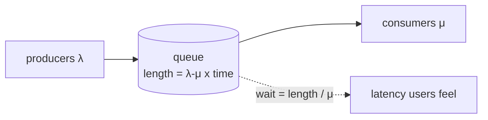
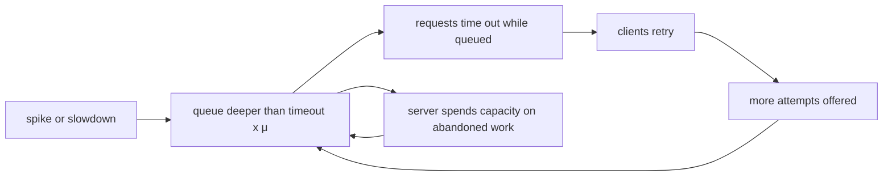
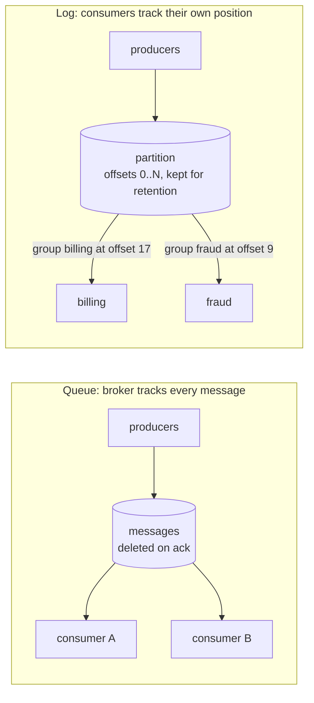
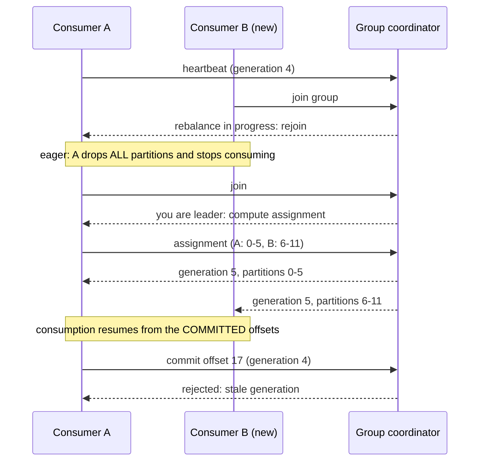
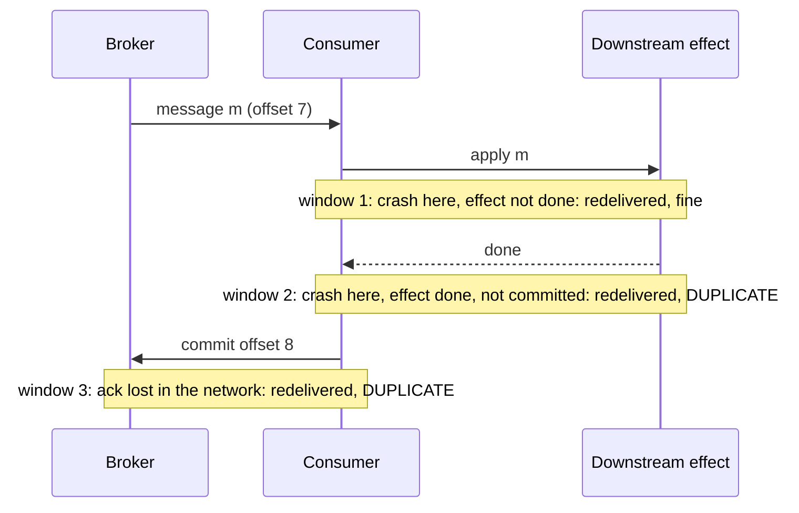

# A6 Unit 1 — Queues, logs and delivery guarantees

> Time: ~6 h · CORE: §1–§4 · STRETCH: the metastable-failure experiment in §1 and the Kafka-transactions part of §4 · Lab: `labs/a6/tinylog`

A queue is the first tool people reach for when a synchronous call is slow, flaky or bursty. Used well, it decouples
two systems in time. Used by reflex, it turns a loud failure (a timeout the caller sees) into a quiet one (a backlog
nobody is looking at). This unit is about telling the two apart, about the two storage models behind almost every
messaging product (the queue and the log), and about what "delivered once" can and cannot mean when processes crash
between doing the work and saying so.

Everything here is mechanics you can build in an afternoon, which is the point: you will write a small partitioned log
with consumer groups (`labs/a6/tinylog`) and then watch it lose, repeat and reorder messages on purpose. A5 states the
principle that "exactly-once" is a property of a whole pipeline; here you build the parts that make it true.

## Before you start

You should have finished A2 (storage: write-ahead logs, transactions) and A4 (replication and partitioning). Keep
[`docs/NUMBERS.md`](../../docs/NUMBERS.md) open for the single-box throughput figures.

Warm-up (spaced retrieval from A0, A2, A4). Answer on paper first.

1. A service handles 400 jobs/s and each job takes 50 ms. How many jobs are in flight on average?
2. Why can a write-ahead log accept durable writes much faster than a B-tree can update pages in place?
3. You spread keys over N partitions with `hash(key) mod N`. What happens to key placement when N becomes N+1?

<details data-kind="answer">
<summary>Warm-up answers</summary>

1. Little's law: L = λ × W = 400 × 0.05 = 20 in flight. Hold on to this: it sizes worker pools and, in §1, queue
   lengths.
2. The WAL is append-only, so writes are sequential (no seeks, large batched `fsync`s) while page updates are random
   I/O. A message log is the same trick promoted to a data model.
3. Almost every key moves. For a key with a uniformly random hash, `h mod N` equals `h mod (N+1)` only for a small
   fraction of residues (1/(N+1) for adjacent N). Consistent hashing exists to avoid this. §2 measures it on a log.

</details>

---

## §1 When a queue helps and when it hides a problem

### The failure story

Members start a transfer in the app; the platform posts it to the core banking system through an adapter. The adapter
can sustain 100 posts/s (20 concurrent calls × 200 ms each; Little's law again). On payday the app's traffic runs at
60 transfers/s and the posting path is fine. Last quarter the team decided to make the API "resilient": it now writes
the transfer to a queue, returns `202 Accepted` in 15 ms, and workers post to the core in the background.

The first payday afterwards, between 08:00 and 08:30, transfers arrive at 150/s. Posting capacity is still 100/s.

- The backlog grows by 50/s for 1,800 s: **90,000 queued transfers** at 08:30.
- The last of them waits 90,000 / 100 = **900 s = 15 minutes**.
- At 08:30 the load drops back to 60/s. Spare capacity is 100 − 60 = 40/s, so the backlog drains at 40/s:
  90,000 / 40 = 2,250 s ≈ **37 minutes**.

A 30-minute surge at 1.5× capacity produced about **68 minutes** of degraded posting. Meanwhile every dashboard was
green: the API returned 202s, p99 latency was 15 ms and the error rate was 0%. The app's own timeout for "transfer
completed" is 10 s, so from about 08:01 on, members saw a spinner, gave up and tapped "Send" again. The duplicates
(A1 Unit 3 protects the API; this unit protects what's behind it) joined the queue and made the backlog longer.

The queue did exactly what a queue does. The problem is that it moved the failure from a place where someone would see
it (a 503 at the API) to a place where nobody was looking (the age of the oldest message).

### Predict

<!-- predict id="A6-U1-P01" -->
**Predict.** Write your answers down before opening the reveal.

The posting path handles 100 transfers/s. Arrivals are 110/s for 10 minutes, then 90/s.

1. How many transfers are queued at minute 10, and how long does the last one wait?
2. How many minutes after minute 10 until a new transfer is posted without delay?
3. Same surge, but afterwards arrivals are 99/s instead of 90/s. How long now?
4. A colleague says "we'll just autoscale the workers". When does that fail?
<!-- /predict -->

### Reveal

<details data-kind="reveal" data-for="A6-U1-P01">
<summary>Reveal</summary>

1. Excess = 10/s × 600 s = **6,000 queued**. The last waits 6,000 / 100 = **60 s**.
2. Spare capacity after the surge is 100 − 90 = 10/s, so 6,000 / 10 = 600 s = **10 minutes**: recovery takes as long
   as the surge did, because the surge's excess (10/s) equals the later spare capacity (10/s).
3. Spare is now 1/s: 6,000 / 1 = 6,000 s = **100 minutes**. Recovery time is backlog ÷ headroom, so it blows up as
   utilisation approaches 100%. The tempting wrong answer is "the surge was only 10 minutes, so about 10 minutes".
4. Autoscaling workers only helps if the workers are the bottleneck. Here the bottleneck is the core adapter (or the
   vendor's rate limit, or the database): more workers deepen the pile-up on the next hop, and scale-up takes minutes
   (instance start, warm-up) while the surge is already over. Scaling the *bottleneck* or *shedding* is what changes
   the arithmetic.

</details>

### How it actually works

A queue is a buffer between a producer rate λ and a consumer rate μ. Little's law (L = λW) says the same thing from
the other side: **queue length is waiting time in disguise**. 6,000 messages at 100/s *is* 60 seconds of latency. A
queue is therefore only ever one of two things:

- A **latency buffer**: it absorbs a burst that is shorter than the delay you're willing to add, and it drains
  afterwards. Average arrival rate over the burst window is below capacity.
- **Debt**: arrivals exceed capacity for long enough that waiting time exceeds what anyone can use. The queue doesn't
  fix anything; it defers the failure and adds latency to every request behind the backlog.



Three numbers decide which one you have:

| Quantity | Formula | Example (μ = 100/s) |
|---|---|---|
| Backlog after a surge | (λ_surge − μ) × duration | (110 − 100) × 600 = 6,000 |
| Recovery time | backlog ÷ (μ − λ_after) | 6,000 ÷ (100 − 90) = 600 s |
| Largest queue worth having | latency budget × μ | 10 s budget × 100/s = 1,000 messages |

The last row is the sizing rule: **bound a queue by age, not just by count**. If the user abandons the request after
10 s, any message that has waited longer is worthless work, and a queue deeper than 1,000 messages can only hold
worthless work.

Even before you reach 100% utilisation, random arrivals make queues form. For a simple single-server model with
Poisson arrivals and exponential service (M/M/1), mean time in the system is `service time / (1 − ρ)`, where ρ =
λ/μ:

| Utilisation ρ | 50% | 80% | 90% | 95% | 99% |
|---|---|---|---|---|---|
| Time in system, in service times (≈, M/M/1) | 2× | 5× | 10× | 20× | 100× |

Real traffic is burstier than Poisson in some ways and smoother in others; treat the table as a shape, not a
prediction. The shape is why capacity planning targets 50–70% utilisation ([`docs/NUMBERS.md`](../../docs/NUMBERS.md))
and why the last 10% of a box is not capacity you can sell.

**When a queue genuinely helps.**

| Use | Why it works | The condition that must hold |
|---|---|---|
| Decouple availability | The producer stays up while the consumer is down or deploying | The outage is shorter than the queue's retention and the backlog is drainable |
| Absorb a burst | Peak ≫ average, but the burst is short | Average over the burst window < capacity, and latency during the burst is acceptable |
| Work the user does not wait for | Emails, statements, thumbnails, webhooks to partners | Nobody needs the result inside a tight deadline |
| Smooth load onto a fragile dependency | A bounded consumer pool protects a vendor or a core | The queue is bounded, and callers get a real signal when it's full |
| Fan-out and retry isolation | One slow subscriber doesn't block the producer | Each consumer has its own backlog and its own limits (§2, Unit 2 §4) |

**When it hides a problem.** A user-facing operation whose result the user is waiting for (the transfer above): the
queue turns "this is failing" into "this is slow, silently". Consumers that are the bottleneck with nothing pushing
back on producers. A queue used as the place where permanently failing messages wait to be retried forever (Unit 2
§3). Any queue you cannot bound by age.

**Metastable failures.** The sharpest version of "queue as debt" is a *metastable failure* (Bronson et al., "Metastable
Failures in Distributed Systems", HotOS 2021; the follow-up study "Metastable Failures in the Wild", OSDI 2022):
a trigger (a surge, a slow dependency, a cache flush) pushes the system into a bad state that a feedback loop then
sustains **after the trigger is gone**. The loop with queues and retries looks like this:



Once the queue is deeper than `timeout × μ`, **every request the server finishes is already abandoned**, so goodput
is zero while the server is 100% busy. Retries then add attempts faster than the stale ones drain. Removing the
trigger does not help; you have to break the loop (shed load, drop expired work, or restart with an empty queue).

### Build it

No lab package for this section; the tools are in §2–§4 and Unit 3 §3. The experiment below is the build: a
60-second deterministic simulation of the loop above. For Little's-law arithmetic on queues, `sd estimate -kind
concurrency` gives you drills, and the STRETCH lab `labs/a6/backpressure` (`Simulate`) turns today's formulas into
tests in Unit 3.

### Break it

STRETCH (0.5 h). The program simulates a server that finishes 100 requests/s behind a FIFO queue. Clients time out
after 1 s; the load is 80/s, except for a 5-second spike at 200/s between seconds 10 and 15. Three variants: (A) no
retries, (B) up to two immediate retries after each timeout, (C) two retries, but the server skips requests that have
already expired. Copy it into a scratch directory with a `go.mod` (`go mod init sim`) and run it with `go run .`.

```go
// A queue in front of a server that can finish 100 requests/s. Clients give
// up after 1 s and retry (up to 2 retries). A 5 s spike pushes the offered
// load from 80/s to 200/s. Does the system recover when the spike ends?
package main

import "fmt"

const (
	timeout = 100  // ticks of 10 ms = 1 s client timeout; the server finishes one request per tick (100/s)
	seconds = 60   // simulated seconds
	base    = 80.0 // normal offered load, calls per second
)

type attempt struct {
	call int // which client call this attempt belongs to
	sent int // tick when it was sent
}

type result struct {
	good, wasted, depth [seconds]int
}

func run(retries int, dropExpired bool) result {
	var r result
	var queue []attempt
	done := map[int]bool{}     // calls that got a timely answer
	tries := map[int]int{}     // attempts sent per call
	retryAt := map[int][]int{} // tick -> calls whose current attempt times out then
	nextCall, carry := 0, 0.0
	for t := 0; t < seconds*100; t++ {
		sec := t / 100
		rate := base
		if sec >= 10 && sec < 15 {
			rate = 200.0
		}
		carry += rate / 100
		for carry >= 1 { // fresh calls arriving this tick
			carry--
			queue = append(queue, attempt{nextCall, t})
			tries[nextCall] = 1
			retryAt[t+timeout] = append(retryAt[t+timeout], nextCall)
			nextCall++
		}
		for _, c := range retryAt[t] { // client timeout fires: resend if still waiting
			if !done[c] && tries[c] <= retries {
				tries[c]++
				queue = append(queue, attempt{c, t})
				retryAt[t+timeout] = append(retryAt[t+timeout], c)
			}
		}
		delete(retryAt, t)
		for len(queue) > 0 { // the server finishes one attempt this tick
			a := queue[0]
			queue = queue[1:]
			expired := t-a.sent > timeout
			if expired && dropExpired {
				continue // skip work nobody is waiting for; costs no service time
			}
			if expired || done[a.call] {
				r.wasted[sec]++
			} else {
				done[a.call] = true
				r.good[sec]++
			}
			break
		}
		if t%100 == 99 {
			r.depth[sec] = len(queue)
		}
	}
	return r
}

func main() {
	variants := []struct {
		name    string
		retries int
		drop    bool
	}{
		{"A: no retries", 0, false},
		{"B: 2 retries", 2, false},
		{"C: 2 retries + server drops expired work", 2, true},
	}
	cols := []int{5, 9, 12, 14, 16, 20, 25, 30, 35, 40, 59}
	for _, v := range variants {
		r := run(v.retries, v.drop)
		fmt.Println(v.name)
		row := func(label string, vals [seconds]int) {
			fmt.Printf("  %-12s", label)
			for _, s := range cols {
				fmt.Printf("%7d", vals[s])
			}
			fmt.Println()
		}
		row("second", func() (a [seconds]int) {
			for i := range a {
				a[i] = i
			}
			return
		}())
		row("good/s", r.good)
		row("wasted/s", r.wasted)
		row("queue depth", r.depth)
		recovered := -1
		for s := 15; s < seconds; s++ {
			if float64(r.good[s]) >= 0.85*base {
				recovered = s
				break
			}
		}
		if recovered < 0 {
			fmt.Println("  goodput never recovered (the spike ended at second 15)")
		} else {
			fmt.Printf("  goodput back to normal at second %d (the spike ended at second 15)\n", recovered)
		}
	}
}
```

Predict before running: for each variant, what is the goodput (calls completed within the timeout) at second 20, and
at second 40? Does variant B ever recover?

<details data-kind="answer">
<summary>What you should see, and why</summary>

Measured output of the program above (deterministic):

```text
A: no retries
  second            5      9     12     14     16     20     25     30     35     40     59
  good/s           80     80      1      0      0      0      0      0      4     80     80
  wasted/s          0      0     99    100    100    100    100    100     96      0      0
  queue depth       0      0    300    500    460    380    280    180     80      0      0
  goodput back to normal at second 36 (the spike ended at second 15)
B: 2 retries
  second            5      9     12     14     16     20     25     30     35     40     59
  good/s           80     80      1      0      0      0      0      0      0      0      0
  wasted/s          0      0     99    100    100    100    100    100    100    100    100
  queue depth       0      0    501   1500   2140   2700   3400   4100   4800   5500   8160
  goodput never recovered (the spike ended at second 15)
C: 2 retries + server drops expired work
  second            5      9     12     14     16     20     25     30     35     40     59
  good/s           80     80    100    100     80     80    100     80     80     80     80
  wasted/s          0      0      0      0     20     20      0      0      0      0      0
  queue depth       0      0    402    504    263    101      0      0      0      0      0
  goodput back to normal at second 15 (the spike ended at second 15)
```

- **A (no retries)**: goodput is ≈ 0 from second 12 until second 35, then back to 80. The spike lasted 5 s but the
  damage lasted ≈ 21 s longer. The queue passed 100 entries (1 s of work) at about second 11; from then on every
  request the server finished had already waited longer than the client's timeout, so the server was 100% busy and
  produced no goodput ("wasted/s" ≈ 100).
- **B (two retries)**: goodput never returns. Each abandoned attempt spawns a new one, so the offered attempts are
  ≈ 80 × 3 = 240/s against a capacity of 100/s, and the queue keeps growing (≈ 8,000 deep at second 59) with the
  fresh load back at 80/s. This is a metastable failure: the trigger is long gone. With `retries = 2` the sustaining
  loop appears whenever the base load exceeds capacity ÷ 3 ≈ 33/s (try `base = 30` and `45`: at 45 the queue grows, at
  30 it shrinks by only ≈ 10/s, so recovery takes minutes).
- **C (drop expired work)**: goodput is back to normal the second the spike ends. Skipping work nobody waits for is
  free, so capacity goes to live requests. The cost is visible and bounded: ≈ 20 requests/s are wasted for a few
  seconds.

The general lessons: a deep FIFO queue under a client timeout is a machine that converts load into abandoned work;
retries turn a transient overload into a permanent one; and deadline-aware consumers (or bounded queues) are what
break the loop.

</details>

### In the wild

- **Amazon Builders' Library** has an article on avoiding insurmountable queue backlogs (`TODO-VERIFY: exact title and
  author`) arguing for exactly this: bound the age of work, prefer processing fresh messages, and keep a way to
  drain a backlog without hurting new traffic.
- **Google's SRE book** covers overload and cascading failures in its "Handling Overload" and "Addressing
  Cascading Failures" chapters: queues kept short, deadline propagation, and load shedding when the queue is
  deep. `TODO-VERIFY: chapter numbers`.
- **SQS** exposes `ApproximateNumberOfMessagesVisible` (depth) and `ApproximateAgeOfOldestMessage` (age) as
  CloudWatch metrics. Alarm on age, which is what users feel; depth alone cannot tell a healthy burst from debt.
- **Kafka** consumer lag is measured in offsets; time lag (how old is the message at the committed offset) is the
  number that maps to user impact. LinkedIn's Burrow computes lag status from the offset history instead of a
  threshold on one number (`TODO-VERIFY: current Burrow behaviour`).
- **Metastable failures** have been reported at large operators; the HotOS 2021 paper's examples include retry
  storms and cache-miss feedback loops, and the OSDI 2022 study analyses real incidents. Read the abstract before an
  interview that mentions "retry storms".

### Trade-offs

| Option | Wins when | Loses when | When the answer flips |
|---|---|---|---|
| Synchronous call with a deadline and fast failure | The user needs the result now; failure must be visible | The dependency is slow or down for long; every caller holds a thread | Flip to a queue when the user doesn't need the result inline |
| Unbounded queue | Prototype; strictly offline batch work with no deadline | Any deadline exists; consumers can fall behind | Never for user-visible work; for batch, still alarm on age |
| Bounded queue, reject when full (429/503 at the edge) | Interactive work with a latency budget; protects the dependency | Producers can't retry sensibly; bursts above the bound are lost | Flip to a bigger bound or a durable log when losing a burst costs more than delaying it |
| Bounded by age: drop or fast-fail expired work | Request/response over a queue; stale results are useless | Work whose value doesn't decay (ledger postings must happen eventually) | Flip to "never drop, alarm and scale" for must-process work |
| Queue plus autoscaling on lag | The consumer is the bottleneck and elastic | The bottleneck is downstream, or scale-up is slower than the surge | Flip to shedding or rate-limiting at the edge when the dependency is the limit |

### Senior bar

- **Failure modes**: unbounded growth and silent latency; stale work processed after the client left; retry
  feedback loops (metastable failure); head-of-line blocking behind slow messages; broker disk filling; a backlog so
  large that the drain itself overloads the dependency.
- **Capacity numbers**: size from `latency budget × μ` (a 10 s budget at 100/s = 1,000 messages). Broker storage is
  `rate × size × retention × replication`: 5,000 msg/s × 1 KB × 3 days × 3 replicas ≈ 5 MB/s × 259,200 s × 3 ≈ 3.9 TB.
  Recovery time = backlog ÷ (μ − λ_after): a 30-minute overload at 120% of a 100/s capacity leaves 36,000 queued,
  and if load then settles at 95% (spare 5/s) the drain takes 36,000 ÷ 5 = 7,200 s = 2 hours.
- **Ops**: alert on age of the oldest message and on time-lag, not just depth; runbook for draining a backlog
  (rate-limit the replay, process fresh traffic first, skip expired work); dashboards per queue with in-rate,
  out-rate and age.
- **Cost**: storage and replication of the backlog; the engineering cost of a second failure mode (operating the
  queue) that the synchronous call didn't have.
- **Banking link**: a transfer submitted in the app is not "accepted" until it is durable and will be posted within a
  stated time. If you return 202 you owe the member a status (`pending → posted/failed`) and an alert when pending
  exceeds the promise. Month-end and payday are the surges; the vendor or core adapter is the bottleneck, so the
  bound belongs at the adapter's front door.

Interviewer follow-up probes:

1. "Why not put a queue between the API and the core and call it a day?"

<details data-kind="answer">
<summary>Model answer</summary>

A queue helps only if the average arrival rate over a burst is below the core's capacity and the added latency fits the
product promise. Otherwise it converts a visible failure into hidden debt. I'd put a **bounded** queue (bound =
latency budget × capacity; for a 10 s promise at 100/s that's ≈ 1,000 messages), return 429/503 with `Retry-After`
beyond it, expose the transfer's status so the app can show "pending", and alert on the age of the oldest message.
Expired work gets failed fast, not processed late.

</details>

2. "The queue shows 2 million messages. Is that bad?"

<details data-kind="answer">
<summary>Model answer</summary>

Depth alone doesn't say. At a 10,000/s drain it's 200 s of work, which may be fine; at 100/s it's 5.5 hours, which is an
incident. I look at age of the oldest message, the drain rate versus the arrival rate (is it shrinking?), and whether
the work still has value. Then I decide between scaling the bottleneck, shedding, or skipping expired messages.

</details>

3. "After a 2-hour dependency outage the queue has 4 million messages. How do you drain it?"

<details data-kind="answer">
<summary>Model answer</summary>

Don't just let all workers loose: the dependency has just recovered and a full-speed drain can knock it over again. Drain
at a controlled rate (≈ 70–80% of its measured capacity), keep headroom for live traffic, and process fresh messages
first if their value decays (a separate lane or LIFO for new traffic). Drop or fail messages past their deadline.
Idempotent consumers (§4, Unit 2) make a replay safe, and I watch the dependency's latency and error rate during the
drain.

</details>

4. "What is a metastable failure and how would you design against one?"

<details data-kind="answer">
<summary>Model answer</summary>

A trigger pushes the system into a bad state that a feedback loop sustains after the trigger is gone, typically retries
plus a queue full of abandoned work. Design against it by breaking the loop: bounded queues, deadline-aware consumers
that drop expired work, retry budgets and backoff with jitter at one layer only (A7 covers these), load shedding at the
edge, and the ability to cut load to zero and restart with an empty queue.

</details>

### Check yourself

1. A queue drains at 200/s and receives 260/s for 15 minutes, then 180/s. Backlog at minute 15? Minutes until it is
   empty?
2. Why is "queue depth" a poor primary alert compared to "age of the oldest message"?
3. A client times out after 5 s and the server's queue holds 2,000 items at 200/s. What fraction of the work the
   server does is useful once the queue is that deep?

<details data-kind="answer">
<summary>Answers</summary>

1. Backlog = (260 − 200) × 900 s = 54,000. Net drain after = 200 − 180 = 20/s, so 54,000 / 20 = 2,700 s = **45
   minutes**.
2. The same depth means very different things at different drain rates; age is directly what a user waits, and it
   exposes stuck consumers (age grows even when depth is flat).
3. 2,000 / 200 = 10 s of queue against a 5 s timeout: everything at the head has already expired. Useful fraction ≈ 0
   until the depth falls below 5 s × 200/s = 1,000.

</details>

---

## §2 Queues versus logs, and partitions

### The failure story

Two teams, two incidents, one root cause: each picked the wrong storage model for the job.

**Team Events** publishes `TransferPosted` to a queue (ack-and-delete, like SQS or a classic RabbitMQ queue). Billing,
notifications, audit and analytics each need every event, so they set up four queues behind a fan-out. Three weeks
later the fraud team finds a bug in how their model consumed events and wants to rebuild features from the last 7
days. The events are gone: each was deleted when its consumer acknowledged it. Reconstructing them from the transfers
table takes a week, because the table has the final state, not the event history.

**Team Jobs** puts image-processing tasks (50 ms each, but one in 10,000 takes 30 s) on a Kafka-style log, one
consumer per partition. When a 30 s task shows up, everything behind it in that partition waits 30 s. At 100 tasks/s
per partition that is 3,000 tasks delayed by up to 30 s, and the same thing happens somewhere in the topic every few
seconds. On a queue with 10 competing consumers, the same slow task would have occupied one of the ten and the others
would have carried on.

A log is the right model for the first team; a queue for the second.

### Predict

<!-- predict id="A6-U1-P02" -->
**Predict.** Write your answers down before opening the reveal.

1. Fraud wants the last 7 days of `TransferPosted` events at 8,000 events/s × 1 KB. With a queue, what do you have? With
   a log, what do you need to provision? How much storage is that (before replication)?
2. A 30 s message arrives among 50 ms messages. Compare the blast radius on (a) a queue with 10 competing consumers and
   a 30 s visibility timeout, and (b) a log with 10 partitions and one consumer per partition. What goes wrong in (a)
   if processing takes 31 s?
3. Average 8,000 events/s, peak ≈ 2.5× the average, each consumer instance handles 200 events/s. How many partitions do
   you create, and why is the answer hard to change later?
<!-- /predict -->

### Reveal

<details data-kind="reveal" data-for="A6-U1-P02">
<summary>Reveal</summary>

1. A queue has nothing: delivered-and-acked messages are deleted. A log keeps records until retention removes them,
   so you add a new consumer group, point it at the earliest offset and read. Retention must cover 7 days: 8,000/s ×
   1 KB = 8 MB/s ≈ 691 GB/day, so 7 days ≈ **4.8 TB**, and about three times that with replication factor 3
   (≈ 14.5 TB). Replay is not free; it's a storage bill you choose.
2. (a) The slow message blocks **one consumer** for 30 s; 9 others keep going (throughput dips ≈ 10%), and other
   messages overtake it (order isn't preserved, but nobody waited). If the work takes 31 s and the visibility timeout
   is 30 s, the queue makes the message visible again at 30 s and a second consumer starts the same work: **duplicate
   concurrent processing**. (b) The slow message blocks **its whole partition** for 30 s (head-of-line blocking): all
   later messages in that partition queue up, in order. The other 9 partitions are unaffected. The log gave you
   ordering and replay and took away per-message independence.
3. Peak = 8,000 × 2.5 = 20,000/s; 20,000 / 200 = **100 consumers**, and a partition can be read by only one consumer
   in a group, so you need **≥ 100 partitions**; 128 leaves ≈ 28% headroom and divides evenly among 2, 4, 8, 16… group
   sizes. The tempting wrong answers are "one per broker" and "as many as possible": too few caps your parallelism for
   the life of the topic, too many costs files, replication traffic and rebalance time. And it's hard to change: you
   can't shrink the partition count, and growing it changes which partition a key maps to (the experiment below).

</details>

### How it actually works

The two models differ in one decision: **who remembers how far each consumer has got**.



| | Queue (SQS standard, RabbitMQ classic queue) | Log (Kafka, Kinesis, Pulsar topic, Redis Stream) |
|---|---|---|
| Unit of progress | each message: in flight, acked, redelivered | one offset per partition per consumer group |
| After a message is processed | deleted (or hidden until acked) | stays until retention removes it |
| Replay / new consumer reads history | no | yes, from any retained offset |
| Fan-out to N independent consumers | N queues (copy per consumer) | N consumer groups on the same data |
| Ordering | usually best-effort; strict only in special modes | total order within a partition, none across partitions |
| Parallelism | add consumers freely | at most one active consumer per partition per group |
| One slow message | blocks one consumer | blocks the partition behind it |
| Per-message delay, priority, retry | natural (visibility timeout, TTL, DLX) | awkward; you build retry topics (Unit 2 §3) |
| Where cost grows | with backlog | with retention × rate × replication |

Neither is better. A queue models *work to be done*; a log models *things that happened*. Systems blur the lines:
Pulsar offers queue-like shared subscriptions on a log, SQS FIFO adds ordering per message group, RabbitMQ has had
log-style streams since 3.9 (`TODO-VERIFY: version`), and Kafka has a proposal to add queue-style share groups
(KIP-932, `TODO-VERIFY: release status`).

**How a log is stored.** A partition is a directory of **segment files**, each an append-only sequence of records,
plus a sparse **offset index** per segment. Writing is `append` to the active segment (sequential I/O); reading offset
`k` is a binary search of the index to the nearest entry, then a sequential scan. Recent data is served from the OS
page cache; sequential access is why one broker can sustain hundreds of MB/s (see [`docs/NUMBERS.md`](../../docs/NUMBERS.md)).
Retention deletes whole old segments by age or size. **Compaction** (`cleanup.policy=compact` in Kafka) keeps only the
latest record per key, turning a log into a changelog you can rebuild a table from.

**Partitions and keys.** One log can't scale past one machine's disk, and one reader can't scale past one thread, so
a topic is split into partitions. A producer picks the partition, usually `hash(key) mod partitions`:

- **Ordering guarantee, precisely**: records in the *same partition* are totally ordered by offset. Records in
  different partitions have no defined order relative to each other. "Per-key ordering" is therefore "same key → same
  partition → ordered" (the lab's `TestPerKeyOrdering_HoldsUnderConcurrentProducers` and
  `TestPoll_NoCrossPartitionOrderIsPromised`).
- **Retries can reorder**: a producer that sends batch 1 and batch 2 concurrently and retries batch 1 after batch 2
  succeeds appends them out of order. Idempotent producers with a bounded number of in-flight requests keep order
  (`TODO-VERIFY: Kafka's exact limit, ≤ 5 in-flight with enable.idempotence`).
- **Keyless messages** go round robin: even load, no ordering.
- **Partition count is a one-way door**: you can add partitions but not remove them, and adding changes
  `hash mod N`, so existing keys move and their new records land in a different partition from their history.

**Sizing the partition count** (an estimation you'll be asked to do aloud):
`partitions ≥ max(peak throughput ÷ per-partition producer throughput, peak throughput ÷ per-consumer throughput)`,
then round up for headroom. With the numbers above the consumer side dominates (100), not the byte rate (20 MB/s at
peak, well inside what a handful of partitions can write; `TODO-VERIFY` per-partition throughput on your hardware).

### Build it

Lab `labs/a6/tinylog`, file `tinylog.go`, part 1: the log itself. Implement `New`, `Partitions`, `PartitionFor`,
`Append` (non-empty key → `Hash(key) % Partitions`; empty key → round robin), `AppendTo`, `Read`, `StartOffset`,
`EndOffset`, `ApplyRetention` and the retention enforcement after each append. The package doc lists every rule.

Acceptance tests: `TestAppend_AssignsDenseOffsetsPerPartition`, `TestAppend_SameKeyAlwaysLandsInSamePartition`,
`TestAppend_EmptyKeySpreadsRoundRobin`, `TestAppendTo_RejectsUnknownPartition`,
`TestRead_ReturnsMessagesFromOffsetInOrder` (including "the result must be a copy"),
`TestRead_EndOffsetIsEmptyButBeyondItIsAnError`, `TestRetention_MaxMessagesDropsOldestAndKeepsOffsetsStable`,
`TestRetention_MaxAgeDropsOldMessagesOnApply` (fake clock), and `TestPerKeyOrdering_HoldsUnderConcurrentProducers`
(8 producers, 2,400 messages, under `-race`). Run `go test -race -run 'Append|Read|Retention|PerKey' ./labs/a6/tinylog/`.

### Break it

1. Run `go test -tags breakit -run PartitionCount -v ./labs/a6/tinylog/`. It hashes 20,000 account keys into P and P+1
   partitions and counts how many change partition. Predict the fraction for 3 → 4 and for 24 → 25 first.
2. Read `Read` in your implementation, then write a scratch test that appends 10 messages with `MaxMessages: 5` and
   reads offset 0. What do you get, and what would a consumer that was at offset 3 do? (§3 builds that consumer.)

<details data-kind="answer">
<summary>What you should see, and why</summary>

1. Measured (20,000 keys, FNV-1a):

   | partitions | keys moved | fraction |
   |---|---|---|
   | 3 → 4 | 15,059 | 75.3% |
   | 6 → 7 | 17,146 | 85.7% |
   | 12 → 13 | 18,456 | 92.3% |
   | 24 → 25 | 19,181 | 95.9% |
   | 48 → 49 | 19,575 | 97.9% |

   A key stays only if `h mod P == h mod (P+1)`, which happens for a fraction ≈ 1/(P+1) of hash values. Adding one
   partition to a 24-partition topic re-homes ≈ 96% of keys. For per-key ordering this is the real hazard: key
   `acct-42`'s history sits in partition 5, its next event goes to partition 17, and a consumer of partition 17 can
   process the new event before another consumer has finished the old ones. Mitigations: over-provision partitions up
   front; create a new topic with more partitions, dual-publish, and cut over after draining the old one; use a
   consistent-hashing scheme in the producer (A4) instead of `mod N`.
2. `Read(0, 0, …)` returns `ErrOffsetOutOfRange`: offsets 0–4 were truncated and `StartOffset` is 5. The error is a
   feature: a reader that fell behind retention must learn that it lost data instead of silently continuing.

</details>

### In the wild

- **Kafka**: topics split into partitions, each an ordered log of segment files with a sparse index; retention by time
  or size (`TODO-VERIFY: log.retention.hours default 168`, i.e. 7 days); `cleanup.policy=compact` for changelogs;
  partitions can be added but not removed.
- **Amazon Kinesis Data Streams**: shards instead of partitions; a record's partition key is hashed into a shard's
  hash-key range; resharding is done by splitting and merging shards. Per-shard write and read limits are small and
  fixed (`TODO-VERIFY: ≈ 1 MB/s or 1,000 records/s write and 2 MB/s read per shard`, retention 24 h by default and up
  to 365 days).
- **Amazon SQS**: standard queues are at-least-once with best-effort ordering; FIFO queues order within a message
  group ID and deduplicate by deduplication ID inside a 5-minute window. `TODO-VERIFY: current FIFO throughput
  quotas, default 30 s visibility timeout, default 4-day and max 14-day retention`.
- **RabbitMQ**: classic and quorum queues with competing consumers, per-message acks and a prefetch limit; streams for
  log semantics.
- **Apache Pulsar**: a log-like topic with four subscription types (exclusive, failover, shared, key_shared), so one
  system gives both models. `TODO-VERIFY: subscription type names and semantics in the current version`.
- **Redis Streams**: `XADD` appends, `XREADGROUP` reads as part of a consumer group, `XACK` acknowledges, and `XPENDING`
  lists delivered-but-unacked entries, so it's a log with a queue-style pending list.
- **A relational database as a queue**: `SELECT … FOR UPDATE SKIP LOCKED` lets workers claim rows without blocking each
  other. Fine at modest rates and when you already have Postgres (`TODO-VERIFY: practical ceiling, commonly quoted in
  the low thousands of jobs/s`), and it gives you transactional enqueue for free (Unit 2 §1).

### Trade-offs

| Option | Wins when | Loses when | When the answer flips |
|---|---|---|---|
| Queue (ack and delete) | Work distribution; per-message retry/delay; variable-duration tasks; backlog per consumer | You need replay, several independent consumers of the same events, or strict ordering | Flip to a log when events are facts that several systems consume, or history must be replayable |
| Log with partitions | Event streams, fan-out, replay, per-key ordering, very high throughput | Tasks of very uneven duration; per-message delay/priority | Flip to a queue (or a shared-subscription mode) when head-of-line blocking per partition hurts |
| Database table as a queue | Low rate; already transactional; one less system | High rate, long backlogs, many consumers (hot rows, vacuum) | Flip to a broker beyond a few thousand ops/s or when you need fan-out |
| More partitions up front | Headroom for consumers; fewer re-partitions | Per-partition overhead, slower rebalances, more files | Fewer partitions when the stream is small and consumers few; remember you can't shrink |
| `hash mod N` placement | Simple, stateless | Partition count changes | Flip to consistent hashing or a new topic when you must resize live |

### Senior bar

- **Failure modes**: wrong model for the workload (the two incidents above); hot partition (§3); consumer falls
  behind retention and loses data silently; partition count too low to scale consumers; key choice that mixes
  unrelated entities or defeats ordering; producer retries reordering within a partition; disk full on the broker.
- **Capacity numbers**: storage = rate × size × retention × replication (8,000 msg/s × 1 KB × 7 days ≈ 4.8 TB, ≈ 14.5 TB
  with RF 3); a broker sustains ≈ hundreds of MB/s of sequential writes, so the byte rate is rarely the constraint, the
  consumers' processing rate is; partitions ≥ peak rate ÷ per-consumer rate.
- **Ops**: partition count and key choice are design-time decisions that are expensive to change; retention is a
  capacity-planning knob (and a compliance one: "how long may we keep member data?"); monitor under-replicated
  partitions, disk, lag per partition and time lag.
- **Cost**: replicated storage for retention; cross-AZ replication traffic is billed in most clouds
  (`TODO-VERIFY: inter-AZ transfer pricing`); the operational cost of running a broker cluster versus a managed
  service.
- **Banking link**: an audit trail is a log. "Who changed what, in what order, can we replay it?" is a retention-plus-
  ordering question, and an append-only, per-account-ordered stream is a natural source for statements, fraud
  features and reconciliation. Retention that must satisfy regulators (years) is usually served by archiving the log
  to object storage, not by keeping it on broker disks.

Interviewer follow-up probes:

1. "Queue or log for the notification service?"

<details data-kind="answer">
<summary>Model answer</summary>

Depends on what a notification is. If it's a *task* ("send this SMS") with independent, variable-duration work,
retries and delays per message, a queue fits and a slow vendor call doesn't block others. If notifications are
*derived from events* that other systems also consume (audit, analytics, fraud), the events belong on a log, and the
notification service is one consumer group that turns them into tasks, perhaps onto its own queue. I'd split the two
concerns: the log is the source of truth, the queue holds the sending work.

</details>

2. "How many partitions, and what if you got it wrong?"

<details data-kind="answer">
<summary>Model answer</summary>

Peak rate ÷ per-consumer rate, with headroom: 20,000/s ÷ 200/s = 100, so 128. If it's too low I can add partitions but
keys remap, so for ordered streams I'd do it by creating a new topic, dual-writing, draining the old one and cutting
consumers over. If it's too high I live with it, since partitions can't be removed; the cost is overhead and
slower rebalances.

</details>

3. "How do you guarantee all events for one account are processed in order?"

<details data-kind="answer">
<summary>Model answer</summary>

Key by account ID so they share a partition, make the producer idempotent with bounded in-flight requests so retries
can't reorder, and process each partition sequentially (or shard by key within the consumer, committing only the
contiguous watermark; §3). Failures need a policy: a poisoned message either blocks that key (keeping order) or is
parked and the key reordered (Unit 2 §3). I can't offer order across accounts, and I'd say so.

</details>

### Check yourself

1. Why does a log support adding a new consumer after the fact, and a queue not?
2. A topic has 12 partitions. You start 20 consumers in the same group. How many do work?
3. Why does appending a partition change where an existing key lands?

<details data-kind="answer">
<summary>Answers</summary>

1. A log keeps records until retention removes them and tracks position per consumer group, so a new group starts at an
   old offset. A queue deletes on ack; there is nothing left to read.
2. 12. A partition is consumed by at most one member of a group; the other 8 are idle standbys.
3. `hash(key) mod N` depends on N; with N+1 almost every key maps somewhere else.

</details>

---

## §3 Consumer groups, ordering and rebalancing

### The failure story

The notification service reads `TransferPosted` from a 12-partition topic with a group of 12 pods. Load is 4,800
events/s (400 per partition on average) and each pod can do 600/s, so there is 1.5× headroom. Two things go wrong
within a month.

**The deploy.** Every pod restart makes the group rebalance. With the classic "eager" protocol, every member gives up
all its partitions, the group re-forms, and nothing is consumed until the new assignment lands: say 20 s
(`TODO-VERIFY`: the pause depends on session timeout and the slowest member to rejoin). That's 20 s × 4,800/s =
**96,000 events** of lag per restart. With spare capacity of 7,200 − 4,800 = 2,400/s, catching up takes 96,000 / 2,400
= 40 s. A rolling deploy restarts a pod every ≈ 35 s, so the group is paused for 20 of every 35 seconds and never gets
ahead: push notifications arrive minutes late for the length of the deploy.

**The big tenant.** Events are keyed by `tenant_id` so a credit union's events stay ordered. The largest credit union
generates 40% of all events: 1,920/s land on one partition, and the pod that owns it needs ≈ 2,180/s (that plus its
share of the rest) against a capacity of 600/s. Its lag grows by ≈ 1,580/s, forever. The other 11 pods idle at ≈ 44%
utilisation (262 of 600 events/s). Someone adds four more pods. Nothing changes.

### Predict

<!-- predict id="A6-U1-P03" -->
**Predict.** Write your answers down before opening the reveal.

1. A 13th consumer joins the 12-partition group. What changes in throughput? What if the 40% tenant is the problem?
2. A consumer hands polled messages to 8 worker goroutines and commits the offset of the highest message any worker has
   finished. The worker for offset 7 finishes before the one for offset 5, then the process crashes. What does the
   next owner of the partition do, and what has been lost?
3. A rebalance pauses the group for 20 s at 4,800 events/s with 7,200/s of capacity. How much lag does it create and how
   long until the lag is gone?
<!-- /predict -->

### Reveal

<details data-kind="reveal" data-for="A6-U1-P03">
<summary>Reveal</summary>

1. Nothing: a partition has at most one consumer in a group, so the 13th is an idle standby (useful for failover, not
   for throughput). With the hot tenant, adding consumers is pointless; the unit of parallelism is the partition and
   all of that tenant's traffic is in one. The fix is in the key (`tenant_id + account_id` spreads a tenant over many
   partitions while keeping each account ordered), or a dedicated topic for the big tenant.
2. The next owner starts at the committed offset 8 (highest finished + 1) and **never processes offsets 5 and 6**.
   Committing the highest finished offset skips unfinished work. You must commit the *contiguous watermark*: the
   largest offset below which everything has finished. Here that's 5, so 5, 6, 7 are redelivered and 7 is processed
   twice, which is fine for an idempotent consumer.
3. 20 s × 4,800/s = **96,000** events of lag; at 2,400/s of spare capacity, 96,000 / 2,400 = **40 s** to clear, per
   rebalance. Rebalance frequency matters more than any single pause.

</details>

### How it actually works

**Membership and generations.** A **group coordinator** (a broker, in Kafka) tracks the members of each group. Members
join, one is elected leader and computes who owns which partitions, and the coordinator distributes the result. Each
completed rebalance increments a **generation** (epoch) number. Heartbeats prove liveness; a member that stops
heartbeating or stops polling is evicted, which triggers another rebalance.



Things this protocol makes true, all of which the lab reproduces:

- **Stale members are fenced.** A consumer that was paused (long GC, slow downstream call) and resumes after a
  rebalance still *thinks* it owns its partitions. Its commit carries the old generation and is rejected
  (`ErrStaleGeneration` in `tinylog`; `CommitFailedException` in Kafka's Java client). Fencing protects the *offset
  bookkeeping*. It does **not** undo the side effects the zombie already produced, which is why consumers must be
  idempotent (§4).
- **Rebalance resets position to the committed offset.** Anything polled but not committed is read again, possibly by
  a different member (`TestRejoin_RewindsToCommittedSoUncommittedWorkIsRepeated`).
- **The committed offset means "next offset to read".** Committing message 17 stores 18.
- **Where offsets live.** Kafka stores group offsets in an internal compacted topic, `__consumer_offsets`; the Kinesis
  Client Library keeps shard leases and checkpoints in a DynamoDB table.

**Eager versus cooperative rebalancing.** Eager rebalancing revokes every partition from every member before
reassigning (stop-the-world, as in the failure story and in `tinylog`). Cooperative (incremental) rebalancing, KIP-429
in Kafka, revokes only the partitions that actually move, so unaffected members keep consuming. **Static membership**
(KIP-345, `group.instance.id`) lets a restarting member rejoin within the session timeout without triggering a
rebalance at all, which is what makes rolling deploys cheap. Both exist to attack the 20-seconds-per-restart cost
above.

**Parallelism inside a consumer, and the commit watermark.** If one partition's throughput exceeds what a single
thread can do, you can fan messages out to a worker pool, but then three things must be true: messages for the same key
go to the same worker (or per-key order is lost); workers finish out of order, so you may only commit the
**contiguous watermark**; and the pool must drain (or the uncommitted tail must be safe to repeat) before a rebalance
completes.

```go
// Commit only what is contiguous: workers finish offsets out of order, but
// the committed offset may only advance past offsets whose predecessors are
// all done. Committing "the highest finished offset" skips work.
package main

import "fmt"

// Watermark tracks finished offsets of ONE partition.
type Watermark struct {
	next int64              // every offset < next has finished
	done map[int64]struct{} // finished offsets >= next
}

// NewWatermark starts at the first offset that has not been processed.
func NewWatermark(start int64) *Watermark {
	return &Watermark{next: start, done: map[int64]struct{}{}}
}

// Done records that offset off finished and returns the offset to commit
// (the next offset to read after a restart).
func (w *Watermark) Done(off int64) int64 {
	if off < w.next {
		return w.next // duplicate completion
	}
	w.done[off] = struct{}{}
	for {
		if _, ok := w.done[w.next]; !ok {
			return w.next
		}
		delete(w.done, w.next)
		w.next++
	}
}

func main() {
	w := NewWatermark(0)
	// Offsets 0..5 are handed to a worker pool; they finish in this order.
	for _, off := range []int64{2, 1, 4, 0, 3, 5} {
		fmt.Printf("offset %d finished -> safe to commit %d\n", off, w.Done(off))
	}
}
```

Run it: offsets 2, 1 and 4 finish first and the safe commit stays at 0 (offset 0 is still running); when 0 finishes
the watermark jumps to 3; when 3 finishes it jumps to 5 (offset 4 was already done); and 5 finishes last → 6.

```text
offset 2 finished -> safe to commit 0
offset 1 finished -> safe to commit 0
offset 4 finished -> safe to commit 0
offset 0 finished -> safe to commit 3
offset 3 finished -> safe to commit 5
offset 5 finished -> safe to commit 6
```

**Skew.** Partition load follows key popularity. Credit-union traffic is Zipf-shaped: a few large tenants, a long tail.
Options, in the order I'd reach for them: (1) a finer key (tenant + account) so a tenant spreads across partitions and
only per-account order is kept; (2) dedicated topics or partitions for known giants; (3) salting a key
(`key + rand(0..k)`) when you need parallelism and can give up ordering for that key; (4) per-tenant quotas so one
tenant's batch file doesn't starve everyone's notifications.

**What to monitor.** Lag **per partition** (a sum hides the hot one), time lag, rebalance count and duration, and
the number of members versus partitions.

### Build it

Lab `labs/a6/tinylog`, file `tinylog.go`, part 2: groups. Implement `Group` (get or create), `Join` (duplicate id →
`ErrDuplicateMember`; rebalance: generation +1, assignment `members[p % len(members)]` over sorted ids), `Evict`,
`Close`, `Rejoin`, `Poll` (round-robin across assigned partitions, one message at a time; stale generation →
`ErrRebalance`; retention jump counted in `Skipped`), `Commit` (stale → `ErrStaleGeneration`; gone → `ErrFenced`;
unassigned partition → `ErrNotAssigned`; never moves backwards), `Committed`, `Lag`, `TotalLag`, `ResetOffset`.

Acceptance tests: `TestGroup_SingleMemberGetsEveryPartition`,
`TestGroup_PartitionsAreSplitWithExactlyOneOwnerEach`, `TestGroup_MoreMembersThanPartitionsLeavesSomeIdle`,
`TestGroup_DuplicateMemberIDIsRejected`, `TestGroup_RebalanceBumpsGenerationAndStopsStaleMembers`,
`TestGroup_EvictedConsumerIsFencedEverywhere`, `TestPoll_TakesFairlyFromEveryAssignedPartition`,
`TestPoll_NoCrossPartitionOrderIsPromised`, `TestCommit_AdvancesCommittedOffsetAndNeverMovesBackwards`,
`TestCommit_RejectsPartitionsTheConsumerDoesNotOwn`, `TestCommit_StaleGenerationIsRejectedAndMessageIsRedelivered`,
`TestRejoin_RewindsToCommittedSoUncommittedWorkIsRepeated`, `TestGroups_AreIndependentSubscriptions`,
`TestRetention_ConsumerThatFellBehindSkipsAheadAndTheLossIsCounted`, `TestResetOffset_ReplaysHistory`, and two
concurrent tests: `TestGroup_ConcurrentProducersAndConsumersDeliverEverythingOnceWhenNothingFails` and
`TestGroup_RebalanceChurnStillDeliversEveryMessageAtLeastOnce` (a fourth member joins and leaves 25 times while three
consumers work). Run `go test -race ./labs/a6/tinylog/`.

### Break it

1. `go test -tags breakit -run HotKey -v ./labs/a6/tinylog/`. Ten consumers each process 100 messages per tick; the
   test sends 20,000 messages with 0%, 30% and 60% of them on one key. Predict how many ticks the group needs in each
   case.
2. In your `Rejoin`, stop resetting positions to the committed offset (keep the old in-memory position), then run
   `go test -race -run 'Rejoin|Churn' ./labs/a6/tinylog/`. Which tests fail and what would production look like?
3. In the watermark program, change `Done` to return the highest finished offset + 1 and rerun it. What would a
   crash after the first three completions lose?

<details data-kind="answer">
<summary>What you should see, and why</summary>

1. Measured:

   | hot key share | fullest partition | ticks to drain | balanced would take |
   |---|---|---|---|
   | 0% | 2,024 msgs | 21 | 20 (1.1× slower) |
   | 30% | 7,391 msgs | 74 | 20 (3.7× slower) |
   | 60% | 12,792 msgs | 128 | 20 (6.4× slower) |

   The group finishes when its slowest partition finishes. 10 consumers are only 10× faster than one if the load is
   spread evenly; with 60% on one key the whole group runs at 1.6× a single consumer.
2. `TestRejoin_RewindsToCommittedSoUncommittedWorkIsRepeated` and `TestResetOffset_ReplaysHistory` fail (the consumer
   carries on from its in-memory position and skips messages it never committed), and the churn test fails after its
   10 s deadline because messages polled by a member that lost its partition mid-batch are never re-read by anyone:
   **loss**, not duplication. In production this is the quiet failure: lag looks fine, a slice of events is simply
   missing.
3. After offsets 2, 1, 4 complete it would report 5; a crash then resumes at 5 and offsets 0 and 3 are never processed.
   Committing the highest finished offset is the classic way to lose messages with a worker pool.

</details>

### In the wild

- **Kafka consumer groups** implement exactly this model: coordinator, generations, `__consumer_offsets`, the
  `RangeAssignor`, `RoundRobinAssignor`, `StickyAssignor` and `CooperativeStickyAssignor`, static membership.
  Commonly cited defaults: `session.timeout.ms` 45 s (10 s before Kafka 3.0), `heartbeat.interval.ms` 3 s,
  `max.poll.interval.ms` 5 min, `max.poll.records` 500 (`TODO-VERIFY` all of these against the version you run).
- **Kinesis Client Library**: one lease per shard in a DynamoDB table; workers renew leases and take over expired
  ones, which is a lease-based assignment instead of a coordinator-driven rebalance.
- **Pulsar Key_Shared** subscriptions route a key to a consumer within a subscription; **SQS FIFO** lets several
  consumers read as long as each message group is handled by one at a time; **Google Pub/Sub** ordering keys give the
  same per-key guarantee. `TODO-VERIFY: exact semantics under consumer failure for each`.
- **Redis Streams** consumer groups track a per-consumer pending list, and `XAUTOCLAIM` lets a healthy consumer take
  over entries a dead one never acknowledged.
- **Hot partitions** are a standard interview topic for any keyed system (feeds, chat, payments): the answer is
  always "a finer key, a split for the giants, or give up ordering for that key".

### Trade-offs

| Option | Wins when | Loses when | When the answer flips |
|---|---|---|---|
| One thread per partition, sequential | Simple; order and commits are trivial | A partition's rate exceeds one thread | Flip to key-sharded workers with a watermark commit |
| Worker pool per partition with key-sharded dispatch | More throughput than one thread per partition; per-key order kept | More machinery: watermark, drain on rebalance | Flip to more partitions if you can afford the re-keying |
| Eager rebalance | Simple; fine for small, rarely changing groups | Frequent restarts, big groups | Flip to cooperative + static membership for anything deployed continuously |
| Key = tenant | Per-tenant order; simple routing | Skewed tenants create hot partitions | Flip to tenant + account when any tenant exceeds ≈ a partition's capacity |
| Dedicated topic for a giant tenant | Isolation, own scaling, own retention | More topics to operate | Flip back to shared when the giant shrinks or the ops cost dominates |

### Senior bar

- **Failure modes**: rebalance storms (a slow consumer exceeding the poll interval gets evicted, rejoins, is evicted
  again); zombie consumers committing or producing side effects after losing their partition; hot partitions; uneven
  assignment; deployments that trigger a rebalance per pod; consumer slower than producer on one partition only.
- **Capacity numbers**: consumers ≤ partitions; per-partition rate = total ÷ partitions only if keys are uniform;
  catch-up time = lag ÷ (capacity − arrival); pause cost = pause × arrival rate (20 s × 4,800/s = 96,000).
- **Ops**: static membership and cooperative rebalancing for rolling deploys; alert on per-partition lag and time lag;
  keep `max.poll.interval` above worst-case batch time and lower `max.poll.records` to bound it; a runbook for
  "one partition is stuck".
- **Cost**: idle standby consumers; more partitions mean more files, replication traffic and longer rebalances
  (`TODO-VERIFY` any broker-level guidance on partitions per broker before quoting one).
- **Banking link**: the "big credit union" is your noisy neighbour. A batch file from one tenant must not delay another
  tenant's notifications, so choose the key and the topic layout for isolation first: per-tenant quotas, a dedicated
  lane for giants, tenant ID in every message for audit and for routing.

Interviewer follow-up probes:

1. "Consumers look idle but lag is growing. What do you check?"

<details data-kind="answer">
<summary>Model answer</summary>

Per-partition lag: if a single partition is far behind, it's skew (hot key) or a stuck consumer (poison message, long
processing), not a lack of consumers. Then members versus partitions (idle consumers beyond the partition count),
rebalance frequency (members evicted for exceeding the poll interval), and whether the slow partition's consumer is
blocked on a downstream call. Fixes: finer key, a split for the giant, a fix or park for the poison message, or raise the
poll interval and shrink the batch.

</details>

2. "How do you deploy this consumer without lag spikes?"

<details data-kind="answer">
<summary>Model answer</summary>

Cooperative rebalancing so only moved partitions pause, static membership so a restarted pod gets its partitions back
within the session timeout without a rebalance, `maxUnavailable: 1` and readiness gating on "partitions assigned", and
graceful shutdown that finishes the in-flight batch and commits before leaving the group. I'd also verify headroom:
with 1.5× capacity a short pause is recoverable; with 1.05× it isn't.

</details>

3. "What stops a paused consumer from corrupting state after it loses its partition?"

<details data-kind="answer">
<summary>Model answer</summary>

The generation check rejects its offset commits, and (Kafka transactions) producer epochs fence its writes to Kafka.
It doesn't stop side effects to external systems (a database write, an HTTP call), so those need their own fencing: an
idempotency key, a version/epoch check in the write, or a lease with a fencing token (A5). The consumer must be safe to
run twice.

</details>

4. "You need more parallelism than partitions allow. Options?"

<details data-kind="answer">
<summary>Model answer</summary>

Key-sharded worker pool inside each consumer with a watermark commit (keeps per-key order); more partitions (re-keying
cost, so a new topic plus cutover for ordered streams); or relax ordering for the keys that allow it and use a
queue-style subscription. I'd pick based on whether ordering is per-key or not needed, and on how hard re-partitioning
is for this topic.

</details>

### Check yourself

1. Why can a consumer group never have more useful members than partitions?
2. What does the generation number protect against, and what does it not?
3. A topic has 6 partitions; one key carries 50% of the traffic. What is the best possible speed-up from 6 consumers over
   1, if each consumer handles the same rate?

<details data-kind="answer">
<summary>Answers</summary>

1. A partition is read by one member of a group at a time (to keep its order), so extra members have nothing to own.
2. It protects the committed offsets (a stale member's commit is rejected). It doesn't undo or prevent the stale
   member's external side effects; those need idempotency or fencing tokens.
3. The hot partition holds ≥ 50% of the load plus its share of the rest, so the group is limited by that one consumer:
   speed-up ≤ 1 / 0.5 = **2×**, however many consumers you add.

</details>

---

## §4 Delivery guarantees and commit timing

### The failure story

A consumer reads `TransferPosted` and does two things per event: credit the destination account in the ledger service
and send a push notification. The first version uses the client library's default auto-commit: offsets are committed
on a timer, whatever the code has finished. Pods are restarted ≈ 20 times a day (deploys, autoscaling, OOM kills). Each
time, up to 5 s of polled-but-unprocessed events at ≈ 400/s per partition, ≈ 2,000 events, are dropped on the floor:
members are never notified. Nobody notices for two weeks because the lag graph is flat.

The team switches to manual commits *after* processing, one commit per batch of up to 500. Now a crash replays up to
500 events, and the ledger credit isn't idempotent: ≈ 20 restarts/day × up to 500 events is **up to ≈ 10,000
double-credits a day** in the worst case. Reconciliation catches them a day later. Moving the commit before the
processing "to be safe" brings the first bug back.

Neither ordering of "do the work" and "record that it's done" is safe on its own, because the process can die in
between and the two things aren't atomic. That gap is the whole subject of this section.

### Predict

<!-- predict id="A6-U1-P04" -->
**Predict.** Write your answers down before opening the reveal.

A consumer polls a batch of 10 messages and processes them one at a time. It crashes right after finishing the side
effect of the 6th message. A replacement takes over the partition.

1. Strategy A: commit all 10 right after polling, then process. How many messages never get processed? How many are
   processed twice?
2. Strategy B: process each message, then commit it. Lost and repeated?
3. Strategy C: process all 10, then commit once. Lost and repeated?
4. Can you get "exactly once" for a side effect in an external system (say a core banking post) just by choosing the
   right one of A, B and C?
<!-- /predict -->

### Reveal

<details data-kind="reveal" data-for="A6-U1-P04">
<summary>Reveal</summary>

1. **A (commit first, at-most-once)**: 6 processed, **4 lost**, 0 repeated. The replacement starts after offset 10.
2. **B (commit after each, at-least-once)**: nothing lost; the 6th message's effect happened but its commit didn't, so
   **1 repeated**. The window is one message wide.
3. **C (commit after the batch, at-least-once)**: nothing lost, **6 repeated**: the window is the whole batch.
4. No. Every ordering leaves a crash window between "effect" and "commit". Choosing the order only chooses *which*
   error you get (loss or duplication) and how wide the window is. To get an exactly-once *effect* you need the
   effect and the record of it to be atomic (a dedupe record in the same database transaction, Unit 2 §2), or the
   effect to be idempotent, or a downstream that deduplicates on a key you send. The tempting wrong answer is "commit
   and process in the right order".

</details>

### How it actually works

Three delivery semantics, defined by what the pipeline does when it crashes between the work and the acknowledgment:

| Semantics | Order of operations | A crash in the window causes | Needs |
|---|---|---|---|
| At-most-once | ack, then work | **loss** | nothing; fine for metrics, best-effort notifications |
| At-least-once | work, then ack | **duplicates** | the work must tolerate repeats |
| Effectively-once ("exactly-once effect") | at-least-once delivery + idempotent or atomic effect | neither, as seen from the effect | a dedupe record or natural idempotence, atomic with the effect |

"Exactly-once delivery" over an unreliable network is not a thing a broker can promise by itself: it can't tell a lost
ack from a lost message, the producer can't tell a lost request from a lost response, and so on (A5 states this as the
end-to-end argument: Saltzer, Reed and Clark, 1984). What you can build is exactly-once *effects*: at-least-once
delivery plus a consumer that makes repeats harmless.



**Where duplicates (and reordering) really come from.** A crash is only one source. In practice, expect all of these:

| Source | Mechanism | Who must handle it |
|---|---|---|
| Producer retry | A timeout is ambiguous: the broker may have appended the first attempt | Idempotent producer (broker dedupes by producer ID + sequence) or consumer-side dedupe |
| Consumer crash or restart | Window 2 above | Idempotent consumer |
| Rebalance | Partition moves to another member that restarts at the committed offset (§3) | Idempotent consumer |
| Visibility timeout / ack deadline shorter than processing | The queue gives the message to a second worker while the first is still running | Longer timeout + heartbeat extension + idempotent consumer |
| Relay republish | Outbox relay crashes between publish and mark-sent (Unit 2 §1) | Idempotent consumer |
| Upstream retries and replays | A vendor re-sends a callback; an operator replays a topic | Idempotent consumer, keyed by a stable event ID |

Reordering comes from different sources: multiple partitions, producer retries without idempotence, redelivery of an
older message after a newer one was processed, and parallelism inside a consumer.

**Producer-side durability** is the same trade-off one hop earlier. A Kafka producer's `acks` setting chooses how many
replicas must have the record before the producer is told it's done: `0` (don't wait: loss on any failure), `1`
(leader only: loss if the leader dies before replication), `all` (every in-sync replica, with `min.insync.replicas`
setting the floor). This is the replication material from A4 seen from the application. An idempotent producer
adds a producer ID and per-partition sequence numbers so the broker can discard a retried batch it already has
(`TODO-VERIFY: enable.idempotence default, true since Kafka 3.0`).

**Consumer commit strategies.**

| Strategy | What happens | Use when |
|---|---|---|
| Auto-commit on a timer | Commits the positions of records returned by `poll`, not records you finished | Only if processing is synchronous and loss is acceptable; dangerous with async processing |
| Manual commit after each message | Smallest duplicate window; one commit per message is costly | Low rates or expensive-to-repeat effects |
| Manual commit after each batch | Window = batch; cheap | The default for idempotent consumers |
| Commit contiguous watermark | Safe with parallel workers (§3) | Worker pools |
| **Offset in the database** | Store the offset with the effect in one DB transaction; on start, seek to the stored offset | The effect is a DB write; you want effectively-once without broker transactions |

The last row removes the gap entirely, because the effect and the position are the same atomic write:

```go
// Effectively-once without broker transactions: apply a record's effect and
// advance the stored offset for its partition in ONE database transaction.
// Postgres-flavoured SQL; any *sql.DB works. This file only needs to compile
// here: wire in a driver to run it.
package main

import (
	"context"
	"database/sql"
	"errors"
	"fmt"
)

// Record is one message from one partition of a log.
type Record struct {
	Partition int
	Offset    int64
	Account   string
	Cents     int64
}

// ErrGap means the record is not the next one expected for its partition.
var ErrGap = errors.New("offset gap")

// ApplyWithOffset credits the account and records Offset+1 as the next offset
// to read, atomically. If the process dies before COMMIT neither happened;
// after COMMIT both did. A redelivered record (Offset < stored) is skipped.
func ApplyWithOffset(ctx context.Context, db *sql.DB, group string, r Record) error {
	tx, err := db.BeginTx(ctx, nil)
	if err != nil {
		return err
	}
	defer tx.Rollback() // no-op after Commit

	var stored int64
	err = tx.QueryRowContext(ctx,
		`SELECT next_offset FROM consumer_offsets WHERE grp = $1 AND part = $2 FOR UPDATE`,
		group, r.Partition).Scan(&stored)
	if err != nil && !errors.Is(err, sql.ErrNoRows) {
		return err
	}
	switch {
	case r.Offset < stored:
		return nil // duplicate delivery: already applied
	case r.Offset > stored:
		return fmt.Errorf("%w: partition %d expected %d, got %d", ErrGap, r.Partition, stored, r.Offset)
	}
	if _, err := tx.ExecContext(ctx,
		`UPDATE accounts SET balance_cents = balance_cents + $1 WHERE id = $2`,
		r.Cents, r.Account); err != nil {
		return err
	}
	if _, err := tx.ExecContext(ctx,
		`INSERT INTO consumer_offsets (grp, part, next_offset) VALUES ($1, $2, $3)
		 ON CONFLICT (grp, part) DO UPDATE SET next_offset = EXCLUDED.next_offset`,
		group, r.Partition, r.Offset+1); err != nil {
		return err
	}
	return tx.Commit()
}

func main() {
	_ = ApplyWithOffset // compile-checked example; see the lesson text
	fmt.Println("wire in a database/sql driver to run ApplyWithOffset")
}
```

On start the consumer reads `consumer_offsets` and seeks each partition to the stored `next_offset` (ignoring the
broker's committed offset); the broker's commit becomes optional bookkeeping. Duplicates are skipped (`r.Offset <
stored`) and gaps are loud. This works for one in-order consumer per partition; for unordered queues you need a
message-ID dedupe table instead (Unit 2 §2).

**Queue-style acknowledgment.** The same windows exist with per-message acks: a message is *in flight* from delivery
until acked; if the ack doesn't arrive within the **visibility timeout** (SQS) or **ack deadline** (Pub/Sub), or the
channel closes (RabbitMQ requeues unacked messages), it is delivered again. Set the timeout above your p99
processing time and extend it while you work; otherwise a slow message is processed twice **concurrently**.

**STRETCH (0.5 h): Kafka transactions, and what they do and do not cover.**

A transactional Kafka producer (`transactional.id` set) can `beginTransaction`, write to several topic-partitions, call
`sendOffsetsToTransaction` with the consumer's offsets and `commitTransaction`. The brokers' **transaction
coordinator** records the transaction's state in an internal topic and writes **commit or abort markers** into every
partition involved. Consumers with `isolation.level=read_committed` see only committed transactions (they read up to
the "last stable offset"). A new producer with the same `transactional.id` bumps an **epoch** that fences the old
one (zombie fencing).

- **What this gives you**: a *read-process-write* loop inside Kafka (consume from topic A, write results to topic B,
  commit the input offsets) happens atomically and exactly once. Kafka Streams' exactly-once mode
  (`exactly_once_v2`, `TODO-VERIFY: name and minimum version`) is this machinery.
- **What it does not cover**: any side effect outside Kafka. A database write, an HTTP call to the core, an email: if
  the process dies after the call and before the commit, the transaction aborts and the call is repeated. The
  transaction can't roll back what it can't see. Consumers still on `read_uncommitted` see aborted data. It doesn't
  help across clusters, and it costs latency (commit markers; `read_committed` consumers wait for open transactions)
  and throughput (commit interval versus duplicate window).
- **So for banking**: transactions are a good fit for Kafka-to-Kafka pipelines (enrich, aggregate, route). For
  "credit the account", you still need an idempotent effect keyed by a stable ID (Unit 2 §2).

### Build it

Lab `labs/a6/tinylog`: the delivery-semantics tests run on the group you built in §3, so there's nothing new to
implement. Read them as specifications and make sure your implementation passes them:

- `TestAtLeastOnce_CrashBeforeCommitRedeliversTheUncommittedTail`: six messages, three committed, the member "crashes"
  (closes); the replacement receives exactly the last three.
- `TestAtMostOnce_CommitBeforeProcessingLosesMessagesOnCrash`: commit-first, crash, nothing is redelivered.
- `TestCommit_StaleGenerationIsRejectedAndMessageIsRedelivered`: the zombie's commit is refused and the message is
  processed a second time by the new owner.

Run `go test -race ./labs/a6/tinylog/`; `sd lab A6` runs the whole module's gate. The offset-in-database function above
is a good scratch-file exercise: write a test with an in-memory fake of the three statements and check that a replayed
batch changes balances once.

### Break it

Run `go test -tags breakit -run CommitTiming -v ./labs/a6/tinylog/`. It reproduces strategies A, B and C from the
Predict block with a real group: a worker polls 10 messages, completes the side effect of the 6th and dies.

Then edit the constants at the top of `TestBreakIt_CommitTiming` in a scratch copy (keep the `//go:build breakit` line
and rename the function; the shared test files must stay identical to the solution's) and predict the table for a crash
after 3 effects and after 9.

<details data-kind="answer">
<summary>What you should see, and why</summary>

Measured, crash after 6 effects in a batch of 10:

| strategy | lost | repeated |
|---|---|---|
| commit before processing (at-most-once) | 4 | 0 |
| commit after each message (at-least-once) | 0 | 1 |
| commit once after the batch (at-least-once) | 0 | 6 |

Crash after 3: lost 7 / 0, repeated 0 / 1 / 3. Crash after 9: lost 1, repeated 0 / 1 / 9. The formulas: commit-first loses
`batch − k`; per-message commit repeats 1 (the message whose effect completed but whose commit didn't); batch commit
repeats `k`. The window you accept is the number of duplicates you must be able to absorb, which is exactly what makes
idempotency a requirement rather than a nicety.

</details>

### In the wild

- **Kafka**: `enable.auto.commit` (default true with a 5 s interval, `TODO-VERIFY`), `commitSync`/`commitAsync`,
  `acks`, `min.insync.replicas`, idempotent producer, transactions with `read_committed`. Kafka's own documentation
  describes the delivery semantics as at-most-once, at-least-once and exactly-once within Kafka's boundary.
- **SQS**: standard queues deliver at least once; the visibility timeout (default 30 s, up to 12 h,
  `TODO-VERIFY`) hides a message while a consumer works; `ChangeMessageVisibility` extends it; FIFO queues add
  deduplication by ID within a 5-minute window, which dedupes *producer* retries only.
- **Google Cloud Pub/Sub**: at-least-once by default with an ack deadline (`TODO-VERIFY: default 10 s, max 600 s`);
  an exactly-once delivery option exists for pull subscriptions (`TODO-VERIFY: scope and limits`).
- **RabbitMQ**: manual acks with a `prefetch` limit (`basic.qos`), requeue of unacked messages when a channel closes,
  publisher confirms for the producer side.
- **Stripe and most payment vendors' webhooks** are at-least-once with retries over days (`TODO-VERIFY: Stripe's retry
  window`), and Stripe's documentation tells receivers to make processing idempotent, for example by logging
  processed event IDs; your adapters live on the receiving end of this contract.
- **Your adapters**: "deposit accepted" arriving twice is window 3 with a vendor playing the broker.

### Trade-offs

| Option | Wins when | Loses when | When the answer flips |
|---|---|---|---|
| At-most-once (commit first) | Loss is cheap, duplicates are annoying (metrics, best-effort push) | Anything a member would notice missing | Flip to at-least-once the moment a missing event has a cost |
| At-least-once + idempotent consumer | The default for money, state changes, integrations | Effects that can't be made idempotent (some vendors) | Flip to reconciliation + compensation for non-idempotent vendors (Unit 3) |
| Offset stored with the effect (same DB tx) | The effect is a DB write; in-order per partition | Effects outside the DB; unordered queues | Flip to a message-ID dedupe table for queues |
| Kafka transactions | Kafka-to-Kafka read-process-write | Side effects outside Kafka | Flip to idempotent effects keyed by ID when the sink isn't Kafka |
| Commit per message | Expensive-to-repeat effects, low volume | High volume (commit cost) | Flip to per-batch commits with an idempotent effect |

### Senior bar

- **Failure modes**: auto-commit committing past unfinished work; processing time above the poll interval or
  visibility timeout (eviction, duplicate concurrent processing); commit failing after a successful effect (window 2);
  consumers that "retry" by re-reading and re-applying non-idempotent effects; assuming a broker's "exactly-once"
  covers the database.
- **Capacity numbers**: duplicates per day ≈ restarts/day × messages per uncommitted window (20 × 500 = up to 10,000);
  per-message commits multiply broker round trips by the batch size; a commit round trip is ≈ 1–5 ms within a region
  (`TODO-VERIFY`), so 1 commit per message caps a single-threaded partition at a few hundred messages/s.
- **Ops**: expose "redelivered" counts and duplicate-skipped counts as metrics (a rising duplicate-skip rate
  is the early warning for rebalance storms or timeout misconfiguration); chaos-test by killing consumers mid-batch;
  document each consumer's guarantee in its README.
- **Cost**: idempotency storage (Unit 2 §2), commit traffic, transactional overhead.
- **Banking link**: money movement is at-least-once + idempotent end to end, with a stable ID from the original
  request (A1 Unit 3's idempotency key) carried in every event. Notifications are the classic place to accept
  at-most-once or at-least-once duplicates deliberately.

Interviewer follow-up probes:

1. "Can you guarantee exactly-once processing?"

<details data-kind="answer">
<summary>Model answer</summary>

Not delivery; effects, yes. I'd make delivery at-least-once (commit after the effect) and make the effect idempotent:
a dedupe record keyed by the event ID written in the same transaction as the effect, or an offset stored with it. The
crash window between effect and ack then produces a redelivery that is recognised and skipped. Anyone who says a broker
gives exactly-once end to end is describing the part of the pipeline inside the broker.

</details>

2. "Kafka says it supports exactly-once. Why do you still dedupe?"

<details data-kind="answer">
<summary>Model answer</summary>

Kafka's guarantee covers writes and offset commits inside Kafka: idempotent producers dedupe retries, and transactions
make read-process-write across topics atomic. My side effect (a ledger write, a core call) is outside that boundary: a
crash after the call and before the transaction commits aborts the transaction and repeats the call. The producer's
upstream (a vendor webhook, an operator replay) can also send the same business event twice with different offsets.

</details>

3. "Commit per message or per batch?"

<details data-kind="answer">
<summary>Model answer</summary>

Per batch with an idempotent consumer: the duplicate window equals the batch, which is harmless when repeats are
no-ops, and it cuts commit round trips by the batch size. Per message only when repeating is expensive and the volume
is low. If the effect is a DB write I'd store the offset with it and make the question moot.

</details>

4. "A consumer takes 90 s for some messages but the visibility timeout is 30 s. What happens?"

<details data-kind="answer">
<summary>Model answer</summary>

After 30 s the queue makes the message visible again and a second worker starts the same job while the first is still
running: duplicate concurrent processing, and the second ack/delete may fail. Fix: set the timeout above p99 or extend
it periodically while working (heartbeat), make the job idempotent (and ideally claim it with a lease/lock), and cap
retries with a DLQ so a genuinely slow message doesn't loop forever.

</details>

### Check yourself

1. Which two orderings of "work" and "commit" exist and what does each risk?
2. Why does auto-commit break when processing is asynchronous?
3. Name three sources of duplicates other than a consumer crash.

<details data-kind="answer">
<summary>Answers</summary>

1. Commit then work (at-most-once): loses messages on a crash between. Work then commit (at-least-once): repeats them.
2. It commits the positions of messages returned by `poll`, not the ones your goroutines finished, so a crash loses
   everything that was polled but still in flight.
3. Any three of: producer retry after an ambiguous timeout, rebalance, visibility timeout/ack deadline shorter than
   processing time, relay republish after a crash between publish and mark-sent, upstream (vendor) retries, operator
   replay.

</details>

---

## Unit wrap-up

| Decision | Default | Flip when… |
|---|---|---|
| Queue in front of a slow dependency? | Bounded by age (latency budget × capacity), reject or shed beyond it, status visible to the user | The result isn't time-critical and the average is below capacity: a larger buffer is fine |
| Queue or log | Queue for tasks; log for events several systems read or that need replay | Uneven task durations on a log → queue or shared subscription; need history → log |
| Partition count | Peak rate ÷ per-consumer rate, rounded up with headroom; treat as one-way | Small, slow streams: fewer partitions; giants: dedicated topics |
| Partition key | The entity whose order matters (account), finer than tenant | Order not needed: no key, even spread |
| Rebalance protocol | Cooperative + static membership | Tiny, static group: eager is fine |
| Parallelism inside a consumer | One thread per partition | Partition rate > one thread → key-sharded workers with a watermark commit |
| Commit timing | After the effect, per batch, with an idempotent consumer | Loss is acceptable → commit first; DB effect → store the offset with it |
| Exactly-once | At-least-once + idempotent effect | Kafka-to-Kafka pipeline → Kafka transactions |

Next: run `sd quiz A6` once all three units are done (the pool covers them all), and make sure `go test -race
./labs/a6/tinylog/` passes before moving to Unit 2.
