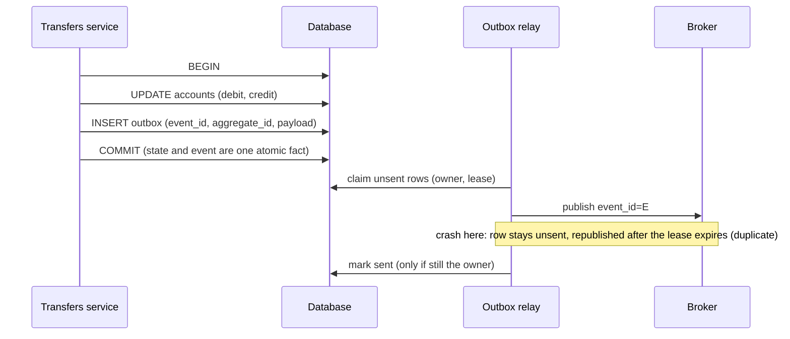
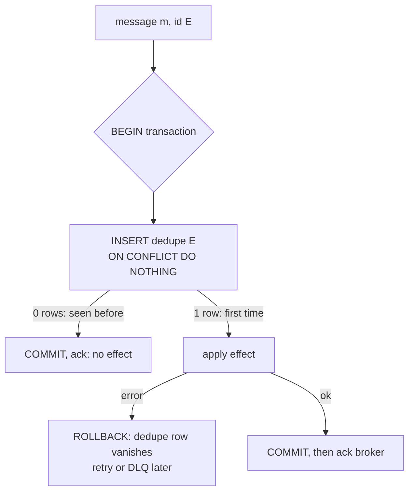
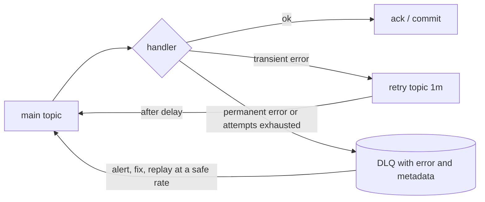
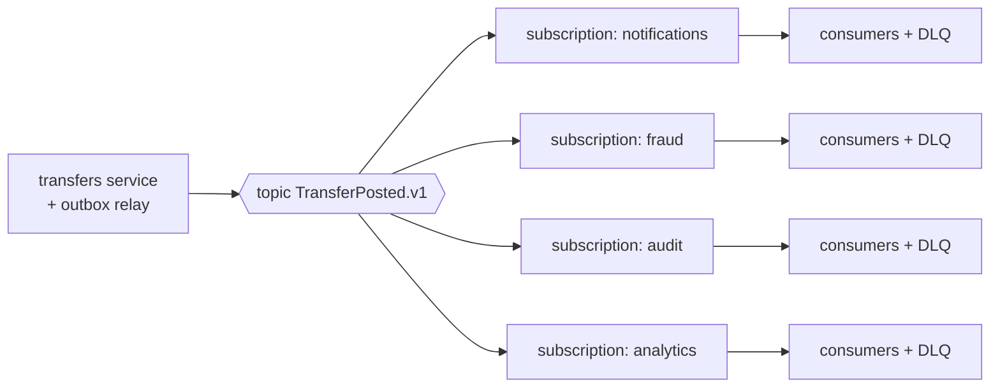

# A6 Unit 2 — Reliable events: outbox, idempotent consumers, DLQs and fan-out

> Time: ~6 h · CORE: §1–§4 · STRETCH: the CDC (log-tailing) deep dive in §1 and the replay-tooling discussion in §3 · Lab: `labs/a6/outbox`

Unit 1 ended with a rule: delivery is at-least-once, so effects must be idempotent. This unit builds the two halves of
that sentence. On the sending side, **how does a service change its own state and announce the change without ever
losing or inventing an announcement?** (The transactional outbox.) On the receiving side, **how does a consumer make a
repeated message harmless?** (Dedupe atomic with the effect.) Then the two operational realities of any event pipeline:
**messages that can never be processed** (poison messages and dead-letter queues) and **many consumers of one stream**
(fan-out).

Everything in the lab is a toy of the real thing: an in-memory transactional store with crash points you can inject, a
relay that publishes from it, and a consumer with a dedupe table. The tests kill the process at every awkward moment and
check that no transfer is lost or applied twice.

## Before you start

You should have finished Unit 1 (especially §4, delivery guarantees) and A1 Unit 3 (idempotency keys). Keep
[`docs/NUMBERS.md`](../../docs/NUMBERS.md) open.

Warm-up (spaced retrieval from A1, A2 and Unit 1). Answer on paper first.

1. In A1's idempotency middleware, why must the key be *reserved* before the handler runs, with one atomic conditional
   write, instead of "check, then act"?
2. A transaction updates two tables in the same database. What does the database guarantee about a crash in the middle?
   What does it guarantee about a message you also send to a broker in that transaction's code path?
3. Commit-after-processing gives at-least-once delivery. What property must the consumer's effect have for the pipeline
   to behave like exactly-once?

<details data-kind="answer">
<summary>Warm-up answers</summary>

1. Two concurrent requests with the same key both "check", both see nothing, and both run the handler (the 50-way
   duplicate in the lab). One conditional write (`INSERT … ON CONFLICT DO NOTHING`, `SET NX`) lets exactly one request win;
   the others see its record.
2. The database makes the two updates atomic: both or neither survive a crash (that's the point of the WAL). It says
   nothing about the broker call: that is a second system outside the transaction. If the process dies between the DB
   commit and the send, the send never happens.
3. Idempotence: applying the same message twice must leave the same state as applying it once, either naturally or
   because a dedupe record is written atomically with the effect (§2).

</details>

---

## §1 The dual-write problem and the transactional outbox

### The failure story

The transfers service, simplified:

```text
BEGIN; debit alice; credit bob; COMMIT;
producer.Send("TransferPosted", {alice, bob, $500})
```

At 1,000,000 transfers a day (≈ 12/s on average) nothing looks wrong. But the process can die, or the broker connection
can time out, between those two lines: during deploys (the pod is killed with SIGKILL after the grace period), on OOM,
on a leader election at the broker (10–30 s of publish errors, `TODO-VERIFY` typical). Assume only 0.05% of transfers
hit that window: **500 transfers a day** are committed but never announced. Downstream, notifications don't go out, the
fraud model misses a transaction, the analytics warehouse drifts from the ledger, and a reconciliation job (which now
has to exist forever) finds the gap the next morning.

"Fix" it by swapping the lines (publish, then commit) and you get the mirror image: a deadlock or constraint failure
at commit time leaves an event for a transfer that **never happened**. The member gets "You sent $500" for money that
did not move. Phantom events are worse than lost ones.

Neither order works because the database and the broker are two systems, and there is no instant at which both
commit. This is the **dual-write problem**.

### Predict

<!-- predict id="A6-U2-P01" -->
**Predict.** Write your answers down before opening the reveal.

1. For "commit, then publish" and for "publish, then commit": which crash points exist, and which gives lost events and
   which gives phantom events? Roughly how many of each out of 1,000 operations if 10% of operations crash at the worst
   moment?
2. Why not make the database commit and the broker send one distributed transaction (two-phase commit / XA)?
3. Design an alternative where only the database is involved at commit time. What do you store, where, and what has
   to read it?
4. Two copies of the thing that reads it are running. What goes wrong, and what stops it?
<!-- /predict -->

### Reveal

<details data-kind="reveal" data-for="A6-U2-P01">
<summary>Reveal</summary>

1. Commit-then-publish: a crash between the lines loses the event (state changed, no announcement). Publish-then-commit:
   a failed commit leaves an announcement for a change that didn't happen (phantom). With a 10% crash rate at the worst
   moment, about 90 of 1,000 operations lose their event in the first design and about 90 become phantoms in the
   second (the lab's `TestBreakIt_DualWriteLosesOrInventsEvents` prints 90 and 90).
2. 2PC needs every participant to support prepare/commit, and most brokers don't expose it (SQS, Pub/Sub and managed
   Kafka services generally don't, `TODO-VERIFY` per product). It also makes your availability the product of both
   systems', adds a blocking coordinator whose failure can leave transactions in doubt holding locks, and is slow. In
   practice teams avoid it for service-to-broker flows.
3. Write the *event itself* as a row in an **outbox table in the same database and the same transaction** as the state
   change. Now the commit is atomic: either both the balance change and the event exist, or neither. A separate
   **relay** process reads unsent rows, publishes them and marks them sent. The announcement is no longer a side effect
   of the request; it's data.
4. Both relays publish the same rows (duplicates) and, worse, may interleave one account's events. They need to
   **claim** rows (a conditional write that sets an owner and a lease) so each row goes to one relay at a time, and
   claims must expire so a dead relay doesn't block its rows forever. Even then a relay can crash after publishing and
   before marking, so the outbox is **at-least-once**, and consumers dedupe by the event's ID.

</details>

### How it actually works



**The table.** Enough columns to dedupe, order, route and operate:

```sql
CREATE TABLE outbox (
  id           bigserial PRIMARY KEY,          -- relay ordering only; NOT commit order
  event_id     uuid        NOT NULL UNIQUE,    -- consumers' dedupe key, stable forever
  aggregate_id text        NOT NULL,           -- partition key: keeps one account's events in order
  tenant_id    text        NOT NULL,           -- credit union, for routing, audit and per-tenant ordering
  type         text        NOT NULL,           -- 'TransferPosted.v1'
  payload      jsonb       NOT NULL,
  created_at   timestamptz NOT NULL DEFAULT now(),
  claimed_by   text,                           -- relay instance that holds the lease
  lease_until  timestamptz,
  sent_at      timestamptz                     -- NULL until published
);
CREATE INDEX outbox_unsent ON outbox (id) WHERE sent_at IS NULL;
```

**The write path** is ordinary application code: the business change and `INSERT INTO outbox` in one transaction.

```go
// The producer side of a transactional outbox: the balance change and the
// event commit together or not at all. Postgres-flavoured SQL; any *sql.DB
// works. This file only needs to compile here: wire in a driver to run it.
package main

import (
	"context"
	"database/sql"
	"encoding/json"
	"fmt"
)

// Transfer is the business request. OpID is the client's idempotency key.
type Transfer struct {
	OpID     string
	Tenant   string
	From, To string
	Cents    int64
}

// PlaceTransfer moves money and records the TransferPosted event in the same
// transaction. There is no publish call here: a separate relay reads the
// outbox table and publishes.
func PlaceTransfer(ctx context.Context, db *sql.DB, t Transfer) error {
	tx, err := db.BeginTx(ctx, nil)
	if err != nil {
		return err
	}
	defer tx.Rollback() // no-op after Commit

	// Idempotency: the same OpID twice changes nothing (A1 Unit 3).
	res, err := tx.ExecContext(ctx,
		`INSERT INTO transfer_ops (op_id, tenant_id) VALUES ($1, $2) ON CONFLICT DO NOTHING`,
		t.OpID, t.Tenant)
	if err != nil {
		return err
	}
	if n, _ := res.RowsAffected(); n == 0 {
		return nil // already done
	}
	if _, err := tx.ExecContext(ctx,
		`UPDATE accounts SET balance_cents = balance_cents - $1 WHERE id = $2 AND tenant_id = $3 AND balance_cents >= $1`,
		t.Cents, t.From, t.Tenant); err != nil {
		return err
	}
	if _, err := tx.ExecContext(ctx,
		`UPDATE accounts SET balance_cents = balance_cents + $1 WHERE id = $2 AND tenant_id = $3`,
		t.Cents, t.To, t.Tenant); err != nil {
		return err
	}
	payload, err := json.Marshal(map[string]any{"from": t.From, "to": t.To, "cents": t.Cents})
	if err != nil {
		return err
	}
	// The event: event_id doubles as the consumers' dedupe key, and the
	// aggregate id is the partition key that keeps one account's events in order.
	if _, err := tx.ExecContext(ctx,
		`INSERT INTO outbox (event_id, aggregate_id, tenant_id, type, payload)
		 VALUES (gen_random_uuid(), $1, $2, 'TransferPosted.v1', $3)`,
		t.From, t.Tenant, payload); err != nil {
		return err
	}
	return tx.Commit()
}

func main() {
	_ = PlaceTransfer // compile-checked example; see the lesson text
	fmt.Println("wire in a database/sql driver to run PlaceTransfer")
}
```

**The polling relay** claims a batch with a lease so that several relays can run safely:

```sql
WITH batch AS (
  SELECT id FROM outbox
  WHERE sent_at IS NULL AND (lease_until IS NULL OR lease_until < now())
  ORDER BY id LIMIT 100
  FOR UPDATE SKIP LOCKED)
UPDATE outbox o SET claimed_by = $1, lease_until = now() + interval '30 seconds'
FROM batch WHERE o.id = batch.id
RETURNING o.*;
```

then publishes each row (with `event_id` as the message ID and `aggregate_id` as the partition key) and runs
`UPDATE outbox SET sent_at = now() WHERE id = $1 AND claimed_by = $2`. The `AND claimed_by = $2` is the guard that stops
a relay that lost its lease from finishing rows now owned by someone else (`TestTx_MarkSentRequiresTheCurrentClaim`).
`FOR UPDATE SKIP LOCKED` lets concurrent relays pass over each other's locked rows instead of blocking.

**Three subtle points interviewers like:**

1. **Auto-increment order is not commit order.** Transaction A takes `id = 41` and is slow to commit; transaction B takes
   42 and commits. A relay that tracks "last id seen" reads 42, advances its high-water mark to 42, and A's row 41
   commits afterwards: it is **never published**. That is why the relay above polls on `sent_at IS NULL`, not on a
   watermark, and why log-tailing (CDC) is attractive: it reads in commit order.
2. **Per-key ordering is not automatic with several relays.** Relay 1 claims events 1–100 and relay 2 claims 101–200;
   relay 2 can publish account A's event 150 before relay 1 publishes A's event 3. The lab's rule: a row is not
   claimable while an *earlier unsent row with the same key* exists that this claim didn't take
   (`TestRelay_DoesNotJumpAheadOfAnEarlierRowForTheSameKey`,
   `TestRelay_ConcurrentRelaysPublishEachRowExactlyOnceAndKeepPerKeyOrder`). Even so, a *stalled* relay whose lease
   expired can publish late; consumers that care about order compare a per-aggregate version.
3. **The outbox is at-least-once, always.** The relay can crash after publishing and before marking sent. The same
   `event_id` goes out again (`TestRelay_CrashAfterPublishBeforeMarkRepublishesTheSameMessageID`). That's why `event_id` exists.

**Log-tailing (CDC) instead of polling.** Rather than querying the table, a connector reads the database's own
transaction log (Postgres logical decoding through a replication slot, MySQL binlog) and turns each inserted outbox row
into a message, in commit order. Debezium is the best-known implementation and ships an "outbox event router"
transformation that maps outbox columns to message key, headers and topic. Compared with polling: lower latency and no
polling load, and commit order for free; but another moving part (Kafka Connect or a standalone connector), schema
evolution to manage, and a classic operational trap: **an inactive Postgres replication slot makes the server retain
WAL**, so a stalled connector can fill the database's disk. Monitor slot lag.

**Cleanup.** Sent rows pile up. Delete in batches after a retention period, or partition the table by day and drop old
partitions; watch autovacuum and index bloat on a hot insert/delete table.

**Alternatives and where they fit.** *Event sourcing* makes the event log the source of truth and derives state from it
(the "outbox" is the primary store; much bigger commitment). *Listen to yourself* publishes first to the broker, then
consumes your own event to update the database (the write is not visible to the requester immediately). *2PC/XA* is
rarely available. *Transactional messaging brokers* that share your database (a queue table) are the outbox with the
relay replaced by consumers.

### Build it

Lab `labs/a6/outbox`, file `outbox.go`, part 1. Implement the toy transactional store and the relay:

- `NewDB`, `(*DB).Do` (serializable; the function sees its own writes; an error rolls back; the hook is called at
  `PointBeforeCommit` and `PointAfterCommit`; the simplest atomic design is to run the function against a copy of the
  state and swap the copy in on success), `Get`, `Rows`, `Pending`, `Seen`.
- On `Tx`: `Get`, `Put`, `Enqueue` (IDs are `msg-<seq>`, no gaps after a rollback), `Seen`, `MarkSeen`, `Claim`
  (lease, expiry on the injected clock, per-key rule), `MarkSent` (only for the current claimant), `Release`.
- `NewRelay` and `RunOnce`: claim, hook, publish, hook, mark, hook, in that order; a publish failure releases the
  claims of the rest of the batch; losing a lease returns `ErrLeaseLost`; any hook error is a crash.

Acceptance tests: `TestDB_CommitAppliesStateAndOutboxRowTogether`,
`TestDB_ErrorRollsBackStateAndOutboxRowAndConsumesNoSequenceNumber`, `TestDB_TransactionSeesItsOwnWrites`,
`TestDB_CrashBeforeCommitLeavesNothingBehind`, `TestDB_CrashAfterCommitStillCommitsAndRetryDoesNotDuplicate`,
`TestDB_ConcurrentTransactionsAreSerializableNoLostUpdates`, `TestTx_MarkSentRequiresTheCurrentClaim`,
`TestRelay_PublishesInCommitOrderAndMarksRowsSent`, `TestRelay_BatchSizeLimitsEachRun`,
`TestRelay_BrokerFailureKeepsRowsPendingAndReleasesTheirClaims`, `TestRelay_CrashBetweenCommitAndPublishLosesNothing`,
`TestRelay_RolledBackTransactionPublishesNothing`,
`TestRelay_CrashAfterClaimLeavesRowsForTakeoverOnlyAfterTheLeaseExpires`,
`TestRelay_CrashAfterPublishBeforeMarkRepublishesTheSameMessageID`,
`TestRelay_RelayThatLostItsLeaseStopsInsteadOfFinishingTheBatch`,
`TestRelay_DoesNotJumpAheadOfAnEarlierRowForTheSameKey`,
`TestRelay_ConcurrentRelaysPublishEachRowExactlyOnceAndKeepPerKeyOrder` (4 relays, 200 rows, under `-race`).
Run `go test -race -run 'DB|Tx|Relay' ./labs/a6/outbox/`. The consumer tests come in §2.

### Break it

1. `go test -tags breakit -run DualWrite -v ./labs/a6/outbox/` runs three designs over 1,000 operations with a 10%
   crash probability at the worst moment. Predict the lost, phantom and duplicate counts of each.
2. In your `MarkSent`, drop the check that the caller still owns the claim and run `TestTx_MarkSentRequiresTheCurrentClaim`.
   Then describe the production incident this enables.
3. Set the relay lease to a value shorter than your slowest publish (change `Lease` in a scratch test with a hook that
   advances the fake clock during `PointRelayAfterPublish`, like `TestRelay_RelayThatLostItsLeaseStopsInsteadOfFinishingTheBatch`).
   What do consumers see?

<details data-kind="answer">
<summary>What you should see, and why</summary>

1. Measured (1,000 operations, seeded):

   | approach | state changes | events published | lost | phantom | duplicates |
   |---|---|---|---|---|---|
   | commit, then publish | 1000 | 910 | 90 | 0 | 0 |
   | publish, then commit | 910 | 1000 | 0 | 90 | 0 |
   | outbox + relay | 1000 | 1000 | 0 | 0 | 108 |

   The outbox trades loss and phantoms for duplicates (here ≈ 10%, the injected rate of crashes after publish and before
   mark-sent). Duplicates are a problem you can solve with an ID; lost and invented events are not.
2. The test fails: a relay that lost its lease marks rows "sent" that another relay has claimed and not yet published. If
   that second relay then crashes, the row is marked sent and **never published**: a lost event, in the one component
   that exists to prevent lost events. The ownership guard turns that race into `ErrLeaseLost`.
3. The lease expires mid-publish, a second relay publishes the same rows, and the first one wakes up and continues.
   Consumers see each such message twice, possibly out of order relative to later messages for the same key. Keep the
   lease well above the worst-case publish time (including broker retries) and treat "lease lost" as a metric.

</details>

### In the wild

- **Debezium** (Red Hat) is the common CDC engine; its outbox event router SMT implements this pattern on Kafka
  Connect for Postgres, MySQL and others. `TODO-VERIFY: current connector names and routing options`.
- **Postgres logical decoding** with `pgoutput`/`wal2json` feeds CDC tools through a replication slot; a slot that isn't
  consumed forces the server to keep WAL (documented behaviour; size alerts on `pg_replication_slots` lag).
- **MySQL** exposes row changes through the binlog; Debezium and others read it.
- **DynamoDB Streams** gives an ordered per-item change feed with 24-hour retention, commonly wired to Lambda to publish
  (an outbox without a table: the stream is the relay's source). **MongoDB change streams** and **Cosmos DB's change
  feed** are similar.
- **Kafka Connect's JDBC source connector** polls tables, so it has the high-water-mark pitfall above unless configured
  carefully (`TODO-VERIFY`).
- The pattern is described on microservices.io (Chris Richardson) as "transactional outbox", and appears in most
  microservice reference architectures; the name for the polling relay there is "polling publisher" and for CDC
  "transaction log tailing".
- **Your platform**: whenever a service says "after the transfer posts, send a webhook to the partner" (A1 Unit 2 §5),
  that is an outbox, whether or not it has a table by that name.

### Trade-offs

| Option | Wins when | Loses when | When the answer flips |
|---|---|---|---|
| Dual write (commit, then publish) | Loss is acceptable (metrics, caches) | Anything reconciled by humans or money | Never for business events; use only where a periodic reconcile already exists |
| Outbox + polling relay | Simple; works on any SQL database; low to moderate rate | Very high rate (polling load); ordering across relays; latency tied to poll interval | Flip to CDC beyond a few thousand events/s or when commit-order matters |
| Outbox + CDC (log tailing) | High rate, low latency, commit order | You can't run connectors; slot/WAL operations; schema evolution | Flip to polling when the platform can't host CDC or volume is low |
| 2PC / XA | Both sides support it, low rate | Brokers that don't; availability and in-doubt locks | Rarely; prefer outbox |
| Event sourcing | You want the log to be the truth and rebuild state | Big commitment: projections, schema evolution, learning curve | Pick it for the domain (ledgers), not to avoid a dual write |

### Senior bar

- **Failure modes**: relay down (events delayed; alert on *oldest unsent age*); outbox growth and table bloat; relay
  duplicates; out-of-order publish across relays or after lease takeover; the id-vs-commit-order gap; a poison row (an
  unserialisable payload) that blocks its key's later events behind it; CDC slot lag filling the disk.
- **Capacity numbers**: 1 M events/day ≈ 12/s average, ≈ 35/s at a 3× peak: trivial for polling. At 5,000 events/s a
  100 ms poll interval and batches of 500 put real read/write load on the primary; that's where CDC wins. Storage:
  1 M events/day × ≈ 1 KB ≈ 1 GB/day; 7 days of unsent-or-recent rows ≈ 7 GB. Latency: polling adds up to the poll
  interval (100–500 ms typical) to end-to-end delay; log-tailing is typically tens to low hundreds of ms
  (`TODO-VERIFY`).
- **Ops**: metrics for oldest-unsent age, claim conflicts, lease-lost count, publish error rate; a replay tool that
  clears `sent_at` for a range (consumers dedupe by `event_id`); rollout of schema changes to the outbox payload
  (versioned types); per-tenant routing and per-tenant ordering keys.
- **Cost**: one extra insert per transaction (a few hundred bytes to ≈ 1 KB of WAL), relay compute, CDC infrastructure.
- **Banking link**: "transfer posted" is both a ledger fact and an obligation to tell the member, the partner (webhook),
  fraud and the audit trail. Putting the event in the same transaction as the ledger entry means the audit trail can't
  disagree with the ledger, which is a regulatory property, not just an engineering one. Tenant ID on every row lets you
  route and rate-limit per credit union.

Interviewer follow-up probes:

1. "Why not just publish to Kafka inside the database transaction?"

<details data-kind="answer">
<summary>Model answer</summary>

Because the broker isn't part of the transaction. If the publish succeeds and the commit then fails, you have a phantom
event; if you publish after commit, a crash loses it. There's no point at which both commit atomically unless the broker
supports XA, which most don't. The outbox makes the event part of the transaction by storing it in the database, and
moves the "tell the broker" step to an at-least-once relay.

</details>

2. "How do you keep a single account's events in order?"

<details data-kind="answer">
<summary>Model answer</summary>

Use the account (aggregate) ID as the broker partition key so the broker preserves order within it, and make the relay
publish one aggregate's rows in order: a single relay per partition of aggregates, or a claim rule that never takes a
row while an earlier unsent row for the same key exists. With CDC the log is already in commit order. Also put a
per-aggregate version in the payload so a consumer can detect a gap or a late duplicate.

</details>

3. "The relay was down for an hour. What happens when it comes back?"

<details data-kind="answer">
<summary>Model answer</summary>

Rows accumulated in the outbox (≈ 12/s × 3,600 ≈ 43,000 rows at average load); the relay drains them in order at its own
throughput, then the lag returns to normal. Consumers see a burst, so they need headroom or backpressure (Unit 3). The
important points: nothing was lost because the events were committed with the state; the alert on oldest-unsent age should
have fired within minutes; and consumers' dedupe makes a catch-up replay safe.

</details>

4. "Outbox polling or CDC?"

<details data-kind="answer">
<summary>Model answer</summary>

Polling to start: no extra infrastructure, easy to reason about, enough for hundreds of events per second. CDC when the
rate, latency or ordering requirements outgrow polling, or when many services need the pattern and a platform team can
run connectors. The cost of CDC is operational: connector availability, replication slot monitoring, schema evolution.
Either way the consumer side is identical: at-least-once with dedupe on `event_id`.

</details>

### Check yourself

1. What exactly is atomic in the outbox pattern, and what isn't?
2. Why does the relay publish at-least-once rather than exactly-once?
3. A relay tracks `last_published_id` and polls `WHERE id > last_published_id`. What can it miss?

<details data-kind="answer">
<summary>Answers</summary>

1. The state change and the *creation* of the event record (one database transaction). Delivery of the event to the
   broker is not atomic with anything; it's retried until it succeeds.
2. It cannot atomically publish and mark sent (two systems); a crash between them republishes. The `event_id` lets
   consumers collapse the duplicates.
3. Rows whose transactions commit after a later-numbered row has already been read (ids are assigned at insert, not
   commit): they are skipped forever.

</details>

---

## §2 Idempotent consumers and dedupe

### The failure story

A partner payment vendor posts a "deposit accepted" callback to the platform for each remote deposit. The vendor's own
client times out on ≈ 0.3% of calls (our endpoint answered in 11 s against a 10 s timeout) and retries, so ≈ 0.3% of
the 40,000 callbacks a day, **≈ 120**, arrive twice. The first version of the handler credits the member's account on
every callback. At an average deposit of $600 that's **≈ $72,000 a day** of double credits, found only when the
vendor's settlement file doesn't match the ledger.

The first fix is "check whether we already have a deposit with that vendor ID, then credit": two copies of a callback
arriving 5 ms apart (the vendor's retry fires while the first request is still running) both pass the check. The
second fix wraps the credit and the check in one transaction but sets a flag *after* the credit in a second one; a
crash between them applies it twice on the vendor's next retry. The third is correct: the dedupe record and the credit
commit together or not at all.

The same shape sits behind every consumer of an at-least-once stream (Unit 1 §4), including your own outbox relay's
events.

### Predict

<!-- predict id="A6-U2-P02" -->
**Predict.** Write your answers down before opening the reveal.

1. Where must the dedupe record be written relative to the effect, and in which transaction? What happens when two
   copies of the same message are handled at the same time?
2. The effect is an HTTP call to the core banking system, not a write to your database. What do you do?
3. Messages are keyed by a UUID. 5,000 messages/s, the broker retains 7 days and you may replay the whole retention.
   How big is a table of every message ID? Is there a cheaper dedupe for a log with in-order processing?
<!-- /predict -->

### Reveal

<details data-kind="reveal" data-for="A6-U2-P02">
<summary>Reveal</summary>

1. In the **same database transaction as the effect**: insert the ID with a unique constraint, apply the effect, commit.
   Crash before the commit → neither exists, the redelivery applies the message. Crash after → both exist, the
   redelivery hits the unique constraint and becomes a no-op. With two concurrent copies, the unique index serialises
   them: the second insert waits for the first transaction to finish and then finds the row (`ON CONFLICT DO NOTHING`
   reports 0 rows), so exactly one applies the effect. The wrong answers are "check first, then insert" (race) and
   "mark afterwards in a second transaction" (window).
2. You can't put an HTTP call inside your database transaction. Options, in order of preference: pass an idempotency key
   to the downstream system so *it* deduplicates (the key is derived from the message ID; A1 Unit 3), as every
   well-designed payment API supports; otherwise run a small state machine in your database (`claimed → calling →
   done`) with a lease, record the downstream reference, and reconcile in doubt cases (a "calling" row older than the lease
   means ask the core what happened before retrying). If the downstream has neither, you have a non-idempotent vendor,
   and the design is "at-most-once with reconciliation", which Unit 3 treats as a saga problem.
3. 5,000/s × 604,800 s ≈ **3.0 billion** IDs. At 16 bytes each that's ≈ 48 GB raw, and with row headers and a unique
   index on the order of 3× that (≈ 150 GB, ≈). For a log processed in order per partition, store **one number per
   partition**: the next offset (the `ApplyWithOffset` pattern from Unit 1 §4). A redelivered record has an offset below
   the stored one, so it's skipped: O(partitions) rows instead of O(messages). That only works with in-order,
   one-consumer-per-partition processing; with queues, unordered delivery or a replay that re-keys messages, you need
   the ID table (or natural idempotence).

</details>

### How it actually works

There are five ways to make a repeated message harmless, from cheapest to heaviest:

| Pattern | How | Use when |
|---|---|---|
| **Natural idempotence** | The operation is a function of its inputs: `SET balance_version = 17`, `PUT /x`, upsert by key, "set status to `posted`" | The domain allows it; always prefer it. Increments (`balance += x`) are *not* idempotent |
| **State-machine guard** | Apply a transition only from the expected state or version: `UPDATE … SET state='posted' WHERE id=$1 AND state='pending'` | Entities with a lifecycle (transfers, deposits); also handles reordering |
| **Dedupe table** | `(consumer, event_id)` unique; insert + effect in one transaction | The general case; queues; unordered delivery |
| **Offset-in-DB** | Store the next offset with the effect | Ordered log, DB effect, one consumer per partition |
| **Downstream idempotency key** | Send the event ID as the key to the system that performs the effect | The effect is outside your database (core banking, vendor APIs) |



```go
// The consumer side: record the message ID and apply the effect in ONE
// transaction. Postgres-flavoured SQL; any *sql.DB works. This file only
// needs to compile here: wire in a driver to run it.
package main

import (
	"context"
	"database/sql"
	"fmt"
)

// Event is what the consumer receives. ID is stable across redeliveries.
type Event struct {
	ID      string
	Tenant  string
	Account string
	Cents   int64
}

// HandleCredit applies the event at most once in effect, however many times
// the broker delivers it. It returns applied == false for a duplicate. Ack
// the message only after it returns nil.
func HandleCredit(ctx context.Context, db *sql.DB, consumer string, e Event) (applied bool, err error) {
	tx, err := db.BeginTx(ctx, nil)
	if err != nil {
		return false, err
	}
	defer tx.Rollback() // no-op after Commit

	// The unique key (consumer, event_id) is the dedupe record. If another
	// transaction is inserting the same key right now, this INSERT waits for it
	// to commit or roll back, so two concurrent deliveries cannot both win.
	res, err := tx.ExecContext(ctx,
		`INSERT INTO processed_events (consumer, event_id, processed_at)
		 VALUES ($1, $2, now()) ON CONFLICT DO NOTHING`, consumer, e.ID)
	if err != nil {
		return false, err
	}
	if n, _ := res.RowsAffected(); n == 0 {
		return false, tx.Commit() // duplicate: nothing to do, still ack
	}
	if _, err := tx.ExecContext(ctx,
		`UPDATE accounts SET balance_cents = balance_cents + $1 WHERE id = $2 AND tenant_id = $3`,
		e.Cents, e.Account, e.Tenant); err != nil {
		return false, err // rolls back the dedupe row too: a retry can succeed
	}
	return true, tx.Commit()
}

func main() {
	_ = HandleCredit // compile-checked example; see the lesson text
	fmt.Println("wire in a database/sql driver to run HandleCredit")
}
```

**Rules that make it work (all tested by the lab):**

- **Dedupe record and effect commit together** (`TestConsumer_CrashBeforeCommitThenRedeliveryAppliesOnce`,
  `TestConsumer_CrashAfterCommitThenRedeliveryIsSkipped`).
- **A failing handler leaves nothing behind**: the dedupe row rolls back with the effect, so the retry can succeed
  (`TestConsumer_HandlerErrorRollsBackSoTheRetryCanSucceed`). A "mark as seen first, then try" design turns every
  transient error into a permanently lost message.
- **Concurrent copies are serialised** by the unique key (`TestConsumer_ConcurrentDuplicatesApplyOnce`: 50 goroutines,
  one effect).
- **Ack after commit.** If the ack is lost, the broker redelivers, the dedupe key hits, and you ack again.
- **Scope the key per consumer.** The same event may be consumed by billing and by notifications; each has its own
  dedupe table or a `(consumer, event_id)` key, or one consumer's success will suppress another's.
- **Retention must cover the redelivery horizon.** If the broker can redeliver for 7 days, or an operator can replay
  a month of history, a dedupe table pruned at 24 h lets old duplicates through. Prune to the longest replay you
  support, or make the effect naturally idempotent so pruning is safe.

**Out-of-order and duplicate together.** Events for one aggregate can arrive late or twice. A per-aggregate version in
the payload lets the consumer apply `version == current + 1`, skip `version <= current` (duplicate) and park or
re-fetch on a gap. Thin events (just an ID and a type; the consumer fetches current state) sidestep ordering entirely
at the price of an extra read.

**Where this sits in the bigger picture.** The idempotency-key middleware in A1 Unit 3 is the same idea applied to an
HTTP request; here the "request" is a message and the "key" is its `event_id`. The outbox relay (§1) makes
the event ID stable; the consumer uses it. The whole pipeline is only exactly-once *in effect* if every stage on the
path is either idempotent or deduplicated (A5's end-to-end principle, implemented).

### Build it

Lab `labs/a6/outbox`, file `outbox.go`, part 2: `NewConsumer` and `(*Consumer).Handle`. In **one** `DB.Do` transaction
named `consume`: if `Seen`, return `(false, nil)`; otherwise run the handler (its error aborts and is returned), `MarkSeen`,
and return `(true, nil)`. The package comment also describes the deliberately wrong variant you will switch on in
Break it (`breakSplitDedupe`).

Acceptance tests: `TestConsumer_DuplicateDeliveryAppliesTheEffectOnce`,
`TestConsumer_HandlerErrorRollsBackSoTheRetryCanSucceed`, `TestConsumer_CrashBeforeCommitThenRedeliveryAppliesOnce`,
`TestConsumer_CrashAfterCommitThenRedeliveryIsSkipped`, `TestConsumer_ConcurrentDuplicatesApplyOnce` and the whole
pipeline: `TestPipeline_RandomCrashesDuplicatesAndBrokerFailuresNeverLoseOrDoubleApply`. The last one runs transfers →
outbox → relay → broker → consumer in a single goroutine for 12 seeds, crashing at random hook points (12% per point),
failing 10% of publishes and duplicating 20% of deliveries, and asserts that exactly 40 transfers are debited and
credited exactly once. Run `go test -race ./labs/a6/outbox/`.

### Break it

1. Build with the tag that switches on the broken consumer and run the measurement:
   `go test -tags breakit -run SplitDedupe -v ./labs/a6/outbox/`. In this build `Handle` applies the effect in one
   transaction and records the dedupe row in a second; the test crashes every message once in between. Predict the
   credited total for 200 messages of $1.00.
2. Run the whole suite with the tag (`go test -tags breakit ./labs/a6/outbox/`). Which tests fail and why?
3. Without changing code, work out: your dedupe rows are pruned after 24 h, the broker retains 7 days and an operator
   replays day 2. What happens?

<details data-kind="answer">
<summary>What you should see, and why</summary>

1. Measured: 200 messages of 100 cents each, credited **40,000 cents** (correct: 20,000), the effect ran **400** times
   (correct: 200). Every message hit the window once, because the test crashes each message exactly once between the
   two transactions: effect committed, dedupe row missing, redelivery applies it again. Production crash rates are
   lower, but "lower" is not "zero", and it is invisible until reconciliation.
2. Four tests fail. The two crash-injection tests (`CrashBeforeCommit…`, `CrashAfterCommit…`) target the single
   `consume` transaction, which no longer exists, so their injected crash never fires. `ConcurrentDuplicates…` fails
   because two copies both pass the `Seen` check before either records the ID, so the effect runs twice. The full
   pipeline test fails because some message gets applied twice. The duplicate-delivery test still passes: without
   crashes or concurrency the broken design behaves correctly. That is the trap: it passes every happy-path test.
   Remember it when someone argues that a window "never happens".
3. Day 2's messages are replayed with IDs the table has forgotten, so every one is applied again: a replay doubles
   a day of effects. Either keep dedupe records for the longest replay you support, or replay through a path that
   preserves idempotence another way (offset-in-DB, natural idempotence), or never replay into non-idempotent effects.

</details>

### In the wild

- **Stripe** recommends making webhook processing idempotent, for example by recording processed event IDs; its API
  accepts an `Idempotency-Key` so retried requests don't repeat charges (A1 Unit 3).
- **SQS FIFO** deduplicates by `MessageDeduplicationId` within a 5-minute window. That protects against *producer*
  retries only, and only inside the window. It does not make a consumer idempotent.
- **Azure Service Bus** offers duplicate detection by message ID within a configurable window (`TODO-VERIFY:
  default window and limits`); the same limitation applies.
- **Google Cloud Pub/Sub** has an exactly-once delivery option for pull subscriptions that prevents redelivery of
  successfully acknowledged messages (`TODO-VERIFY: scope, regional restrictions, and what happens to side effects`).
  It still doesn't cover your database writes.
- **Kafka's idempotent producer** dedupes retried batches from one producer session (producer ID + sequence number). A
  business event published twice by two different producers has two sequence numbers and two offsets.
- **Postgres** `INSERT … ON CONFLICT DO NOTHING` and **DynamoDB** conditional puts (`attribute_not_exists`) are the usual
  primitives for the dedupe write.
- **Core banking and card networks**: reversal messages (ISO 8583 reversal advices) and per-transaction reference
  numbers exist because the same problem is old: a request may have been processed even if the response was lost. Your
  adapters pass the platform's event ID through as that reference where the core allows.

### Trade-offs

| Option | Wins when | Loses when | When the answer flips |
|---|---|---|---|
| Natural idempotence (set, upsert, state guard) | The domain allows it | Counters, balances, anything cumulative | Flip to a dedupe table when the effect is an increment |
| Dedupe table (event_id unique) | General; unordered delivery; queues | Large volume × long retention; a hot table | Flip to offset-in-DB when you have ordered partitions and DB effects |
| Offset-in-DB | Ordered log, DB effect: tiny state, strong guarantee | Unordered consumers, non-DB effects, rebalancing needs a seek to the stored offset | Flip to a table for queues or multi-effect handlers |
| Downstream idempotency key | The sink supports it (payment APIs, Stripe, core adapters with a client reference) | Sink has no key | Flip to claim-call-reconcile with a state machine, or accept at-most-once with reconciliation |
| Broker-side dedupe only | Cheap protection against producer retries | Consumer crashes, replays, upstream duplicates | Never sufficient on its own |

### Senior bar

- **Failure modes**: dedupe written in a separate transaction; dedupe marked before the effect; dedupe retention shorter
  than the replay window; dedupe keyed by something unstable (a timestamp, a hash of the payload that changes with
  retries); two consumers sharing one dedupe namespace; unique violations surfacing as errors instead of being treated as
  "already done"; the effect not actually transactional (an HTTP call in the middle).
- **Capacity numbers**: a dedupe table at 5,000 msg/s × 7 days ≈ 3 billion rows (≈ 150 GB with index, ≈); at 100 msg/s ×
  7 days ≈ 60 M rows (≈ 3 GB). Prune by time partition (drop a partition instead of `DELETE`). Offset-in-DB: one row
  per partition. The extra insert costs one index lookup per message, typically small next to the effect.
- **Ops**: metrics for `duplicates_skipped` per consumer (a spike signals rebalance storms or timeout misconfiguration);
  runbooks for replay (what dedupe will do); backfills that bypass dedupe need explicit sign-off.
- **Cost**: storage and write amplification of the dedupe table; for log consumers the offset-in-DB approach costs almost
  nothing.
- **Banking link**: every vendor callback (deposit accepted, ACH status, card auth) gets a stable external ID; store it
  with the platform's own event ID so both directions dedupe. Scope by tenant if vendors reuse IDs across credit
  unions. Keep the dedupe table in the same database as the ledger entry it protects, so the auditor can see both facts
  commit together.

Interviewer follow-up probes:

1. "How do you make a consumer idempotent?"

<details data-kind="answer">
<summary>Model answer</summary>

First look for natural idempotence (set instead of increment, upsert by key, state-machine transitions). If the effect is
cumulative, store the message's stable ID in a unique-keyed dedupe table in the same transaction as the effect, ack after
commit, and treat a unique violation as "already done". For ordered partitions with DB effects, store the next offset in
the same transaction instead. If the effect is external, pass the ID as the downstream idempotency key.

</details>

2. "What if the effect is an HTTP call to the core?"

<details data-kind="answer">
<summary>Model answer</summary>

Use the core's idempotency mechanism (a client reference or request ID) with a key derived from the event ID. If it has
none, record intent in my database first (a row `calling` with a lease), make the call, record the result, and
reconcile any row stuck in `calling` by querying the core before retrying. If neither is possible, I'd say so: it's a
non-idempotent integration and the system has to run at-most-once with reconciliation, which I'd model as a saga with an
explicit "unknown outcome" state.

</details>

3. "How long do you keep dedupe records?"

<details data-kind="answer">
<summary>Model answer</summary>

At least as long as a duplicate can arrive: the broker's redelivery and retention horizon, the vendor's retry window,
and the longest replay an operator can run. If that's days, partition the table by day and drop old partitions. If it
becomes unaffordable, switch to offset-in-DB for ordered streams or to natural idempotence, which has no retention
problem.

</details>

4. "Why is a broker-level dedupe (SQS FIFO, Service Bus) not enough?"

<details data-kind="answer">
<summary>Model answer</summary>

It only covers duplicates the producer creates inside the broker's window. The consumer still sees redeliveries after its
own crashes, rebalances and timeouts, and upstream systems (vendors) can send the same business event twice with
different message IDs. Only a check in the consumer's own transaction covers the window between its effect and its ack.

</details>

### Check yourself

1. Why must the dedupe row be rolled back if the effect fails?
2. What does `ON CONFLICT DO NOTHING` returning 0 rows tell the consumer?
3. When is the offset-in-DB pattern strictly cheaper than a dedupe table, and when can't you use it?

<details data-kind="answer">
<summary>Answers</summary>

1. Otherwise the retry would be treated as a duplicate and the message would never be applied: a transient failure
   becomes a permanent loss.
2. A previous (committed) delivery already applied this message (or a concurrent one just did), so skip the effect and
   ack.
3. Cheaper for ordered partitions with DB effects (one row per partition instead of one per message). Not usable for
   unordered queues, effects outside the DB, or consumers that can't seek to the stored offset on assignment.

</details>

---

## §3 Poison messages, DLQs and replay

### The failure story

A vendor adds an optional field to its "deposit accepted" callback and starts sending `"memo": null` where it used to
omit the key. Your parser assumes a string and crashes. The callback consumer reads a 12-partition topic, one consumer per
partition, and its policy for a failed message is the simplest one: retry. Partition 7 contains the first such
message at offset 4,000,100.

- The consumer for partition 7 retries forever with a 1 s sleep. It's alive, so no restart, no alert on liveness. Lag
  on partition 7 grows at its arrival rate, ≈ 400 events/s, i.e. **≈ 1.4 million events after an hour**. The other 11
  partitions are fine, so the *total* lag graph rises only 1/12 as fast and nobody pages for 40 minutes.
- When someone restarts the pod, it crashes on the same message, and each crash-loop restart triggers a rebalance
  that pauses all 12 partitions (§3 of Unit 1): the poison message now degrades the whole group.
- Every callback behind the poison message in partition 7 is a member's deposit waiting to be credited, and the
  queue's ordering guarantee is exactly what keeps them stuck.

A message that can never succeed is called a **poison message** (or poison pill). The system's choice of what to do
with it is a design decision, not an accident of the retry loop.

### Predict

<!-- predict id="A6-U2-P03" -->
**Predict.** Write your answers down before opening the reveal.

1. Classify these failures as transient, permanent or poison, and say what each should do: the core returns 503 for 90
   s; the callback's JSON is malformed; a deposit references a member ID that doesn't exist yet (the account-created
   event is late); a bug in your new code throws on every message with a null memo.
2. In a log, if you skip the poison message at offset 4,000,100 and move on, what have you done to ordering for that
   account? What are your options?
3. What belongs in a DLQ record, who owns the DLQ, and what does "replay" have to be safe against?
<!-- /predict -->

### Reveal

<details data-kind="reveal" data-for="A6-U2-P03">
<summary>Reveal</summary>

1. 503 for 90 s: **transient**; retry with exponential backoff and jitter (A7), without blocking unrelated messages for
   long. Malformed JSON: **permanent** and will never succeed, so don't retry; park it immediately with the error.
   Missing member (late event): **transient with a different timescale**: it will succeed once the other event
   lands, so retry on a delayed schedule (minutes), not in a hot loop. The new bug: **poison by the consumer's own
   defect**: it looks permanent but the message is fine; the fix is a deploy, so parked messages must be replayable
   afterwards. The tempting wrong answer is one retry policy for all of them.
2. You've reordered that account's stream: events after the poison one are applied before it. Options: (a)
   **block the key** (park the poison message *and* hold back later messages for the same key until a human resolves
   it): keeps order, costs availability for that key; (b) **skip and accept reordering** when handlers are
   commutative or version-guarded (§2), which is the common choice; (c) **block the partition** (the default failure
   mode: everything stops). Pick explicitly per stream.
3. Original topic/partition/offset (or message ID), the payload and headers, the error and stack, attempt count,
   first-failed and last-failed times, the consumer and its version. Ownership: the team that owns the consumer, with
   an alert on DLQ depth > 0 (a DLQ nobody watches is a trash can). Replay must be rate-limited (don't re-create the
   overload), idempotent (the same event ID goes back through the dedupe path of §2), and re-validated (it may fail again for
   the same reason).

</details>

### How it actually works

**Retry tiers.** Three places a failed message can wait, with different costs:

| Where it waits | Mechanism | Cost |
|---|---|---|
| In the consumer (sleep and retry) | Backoff in the handler | **Blocks the partition** (head-of-line); ordering kept |
| Back in the queue, delayed | Visibility timeout / `x-delay` / delay queue | Per-message delay; no blocking; ordering lost |
| On **retry topics** | Publish to `orders.retry.1m`, `.10m`, `.1h`; a consumer for each waits until the message is due, then republishes to the main topic | No blocking; ordering lost; more topics |

After a bounded number of attempts (and immediately for permanent errors) a message goes to the **dead-letter queue**
(DLQ): durable storage for messages the system gave up on, with the metadata above. It is the explicit answer to
"where does the message go if we can't process it", instead of "nowhere" (dropped) or "forever blocking".



**Attempt counting.** Retry loops need a counter that survives restarts and rebalances: a header on the republished
message, or the broker's delivery count (SQS `ApproximateReceiveCount` against the queue's `maxReceiveCount`, RabbitMQ's
`x-death`, JetStream's `MaxDeliver`). Without it a crash-looping pod "retries" forever without ever counting.

**Ordering consequences** (the part interviews probe): any scheme where a message waits while later ones proceed
reorders. If order matters per key, either hold the key (parking all later messages of that key behind the failed one:
a per-key pause) or make the handlers tolerate reordering via versions. If order matters globally you cannot have
non-blocking retries.

**What the retry layer must not do:** retry at several layers at once (client, gateway, adapter, queue consumer):
the multiplication turns one failure into dozens of attempts. Decide which layer owns retries and give it a budget
(A7 covers retry budgets and backoff).

**Replay.** Re-injecting DLQ messages is an operation with a blast radius: do it after the fix is deployed, at a
controlled rate, with the original message ID preserved so consumer dedupe catches anything that actually succeeded
the first time, and with a way to stop it. Make the tooling part of the design: a CLI or admin page that lists, inspects,
redrives and deletes DLQ messages, with an audit entry for each action.

A small experiment makes the head-of-line cost concrete. One partition receives 80 messages/s and the consumer handles 100/s.
Message 100 is poison:

```go
// One partition, one consumer. Messages arrive at 80 per second and the
// consumer handles 100 per second. Message 100 is poison: handling it always
// fails. What does each failure policy do to the rest of the partition?
package main

import "fmt"

const poison = 100

type policy struct {
	name    string
	retries int // failed attempts before giving up on a message; -1 = never give up
	backoff int // ticks (10 ms each) the consumer waits after each failed attempt
}

// run returns, after `ticks` ticks: messages handled, messages parked in the
// DLQ, and the backlog (lag) still waiting.
func run(p policy, ticks int) (handled, parked, lag int) {
	next := 0 // next message to handle
	busy := 0 // ticks until the consumer is free again
	failures := 0
	carry, produced := 0.0, 0
	for t := 0; t < ticks; t++ {
		carry += 0.8
		for carry >= 1 {
			carry--
			produced++
		}
		if busy > 0 {
			busy--
			continue
		}
		if next >= produced {
			continue
		}
		if next != poison {
			handled++
			next++
			continue
		}
		failures++ // the poison message fails again
		if p.retries >= 0 && failures > p.retries {
			parked++ // give up: park it in the DLQ and move on
			next++
			failures = 0
			continue
		}
		busy = p.backoff
	}
	return handled, parked, produced - next
}

func main() {
	policies := []policy{
		{"retry forever, 1 s backoff", -1, 100},
		{"3 retries (1 s backoff), then DLQ", 3, 100},
		{"no retries: park on first failure", 0, 0},
	}
	for _, p := range policies {
		fmt.Println(p.name)
		for _, secs := range []int{5, 30, 120} {
			h, d, l := run(p, secs*100)
			fmt.Printf("  after %3d s: handled %5d  in DLQ %d  lag %5d\n", secs, h, d, l)
		}
	}
}
```

Predict first: how much lag has each policy built up after 120 s, and what does the DLQ policy cost the other messages?

### Build it

No lab package for this section. The lab's `Consumer.Handle` already gives you the property the policies below rely on
(`TestConsumer_HandlerErrorRollsBackSoTheRetryCanSucceed`): a handler error leaves **no partial effect and no dedupe
record**, so retrying, parking or replaying a message is always safe. Run the program above as the build for this
section, and extend it as the Break it asks.

### Break it

Run the program (`go run .` in a scratch directory with a `go.mod`). Then change it:

1. Move the poison message to the very start of the stream (`const poison = 0`). Does the picture change?
2. Add a second poison message at index 5,000 (change the condition `if next != poison` to
   `if next != poison && next != 5000`). What does "3 retries, then DLQ" cost now, and what would a crash-loop do to a
   real group (think back to §3 of Unit 1)?
3. Change the consumer capacity to 85/s (only 6% above the 80/s arrival rate). How long does the lag from one
   parked poison message take to clear under "3 retries, then DLQ"?

<details data-kind="answer">
<summary>What you should see, and why</summary>

Measured output of the program above:

```text
retry forever, 1 s backoff
  after   5 s: handled   100  in DLQ 0  lag   300
  after  30 s: handled   100  in DLQ 0  lag  2300
  after 120 s: handled   100  in DLQ 0  lag  9500
3 retries (1 s backoff), then DLQ
  after   5 s: handled   170  in DLQ 1  lag   229
  after  30 s: handled  2399  in DLQ 1  lag     0
  after 120 s: handled  9599  in DLQ 1  lag     0
no retries: park on first failure
  after   5 s: handled   399  in DLQ 1  lag     0
  after  30 s: handled  2399  in DLQ 1  lag     0
  after 120 s: handled  9599  in DLQ 1  lag     0
```

- **Retry forever** never moves on: 100 messages handled, lag grows at the arrival rate (≈ 80/s → 9,500 after 120 s).
  Nothing else on the partition ever runs.
- **3 retries then DLQ** pays ≈ 3 s of blocked time (four attempts with three 1 s waits), peaks at a lag of ≈ 244,
  parks 1 message and catches up: after 30 s the lag is 0. The cost is a short stall for everything behind it, plus
  the reordering of the poison message's key.
- **Park on first failure** has no stall at all (peak lag 1), which is right for *permanent* errors (malformed payload)
  and wrong for transient ones (it would DLQ every message during a 90 s core outage). Real systems classify the error
  first.
- Question 1: with `poison = 0` nothing changes in kind: retry-forever handles 0 messages, the DLQ policy still peaks at
  ≈ 244 lag. Where the poison message sits doesn't change what it costs; it only changes who is stuck behind it.
- Question 2: a second poison message at index 5,000 costs a second identical stall (peak lag again ≈ 244, 2 messages
  parked). Stalls add up, which is why *permanent* errors must skip the retry schedule altogether.
- Question 3: a stall of 3 s at 80/s builds ≈ 240 messages of lag. At 85/s the consumer has 5/s of spare capacity, so it
  takes 240 / 5 = **48 s** to catch up (this one is arithmetic, not a program run: the program's consumer is fixed at
  100/s). High utilisation turns a short stall into a long recovery, the same arithmetic as §1.

</details>

### In the wild

- **SQS** supports a redrive policy on a source queue: after `maxReceiveCount` receives a message moves to a dead-letter
  queue, and the console/API can redrive DLQ messages back (`TODO-VERIFY: current redrive features and limits`).
- **RabbitMQ** has dead-letter exchanges (`x-dead-letter-exchange`) and records why a message died in the `x-death` header
  (rejected, expired, maxlen); delayed retry is commonly built from per-queue TTLs plus DLX.
- **Kafka** has no built-in DLQ for consumers. Kafka Connect sink connectors can route failures to a dead letter queue
  topic (`errors.tolerance=all` with `errors.deadletterqueue.topic.name`), and frameworks such as Spring Kafka provide
  recoverers that publish to a `.DLT` topic. Retry topics are built by hand or by the framework. Uber Engineering has
  written about building reprocessing and dead-letter queues on Kafka (`TODO-VERIFY: title and date`).
- **Google Pub/Sub** supports dead-letter topics with a configurable maximum delivery attempts, and retry policies with
  backoff for subscriptions (`TODO-VERIFY: limits and defaults`).
- **NATS JetStream** consumers have `MaxDeliver` and ack-wait; advisories announce messages that exceeded
  max deliveries (`TODO-VERIFY`).
- **Your adapters**: a vendor callback you can't parse is a message you must still acknowledge (so the vendor stops
  retrying), store verbatim (for audit and for the vendor's support), and surface for a human. Never "log and
  return 200" without keeping the payload.

### Trade-offs

| Option | Wins when | Loses when | When the answer flips |
|---|---|---|---|
| Block the partition and retry | Strict ordering matters more than availability; failures are rare and short | One poison message stops the stream | Flip to park-and-continue as soon as one message can stall a whole stream |
| Retry topics with delay, then DLQ | Transient failures; throughput matters | Per-key ordering; more topics and republish logic | Flip to blocking the key when order must hold |
| Park immediately (no retries) | Permanent errors (malformed, unauthorised, validation) | Transient errors: you DLQ good messages | Flip to retry tiers for dependencies that fail transiently |
| Drop on failure | Disposable data (metrics, best-effort notifications) | Anything someone must be accountable for | Never for money or audit |
| Auto-replay DLQ on a schedule | Failures are known to be transient | A genuine bug: infinite loop through the DLQ | Flip to manual, rate-limited redrive after a fix |

### Senior bar

- **Failure modes**: head-of-line blocking; retry multiplication across layers; a DLQ nobody watches; replay overload;
  replay of non-idempotent handlers; a crash loop that triggers rebalances for the whole group; hot-looping retries
  that burn CPU and the dependency; losing the failure context (payload without error).
- **Capacity numbers**: stall cost = retries × backoff × arrival rate (3 s × 80/s = 240 messages of lag); recovery =
  lag ÷ spare capacity (240 ÷ 5/s = 48 s at 6% headroom); DLQ sizing = failure rate × retention (a 0.1% failure rate on
  1M messages/day is 1,000 DLQ messages/day: reviewable by a human; 0.1% of 500M/day is not).
- **Ops**: alerts on DLQ depth > 0 and on oldest DLQ message age; a dashboard of failure reasons by type; redrive
  tooling with rate limit, dry run and audit trail; versioned consumers so you can tell whether a failure is from a new deploy;
  runbooks for "the DLQ filled after a deploy".
- **Cost**: DLQ storage and retention (often longer than the main topic's), the human time to review them, and
  the extra topics/queues to operate.
- **Banking link**: a vendor payload that fails validation is a regulatory and customer-service object, not just
  noise: store it untouched, tag it with tenant and vendor, never delete before the retention period the credit union's
  compliance team sets, and give support a way to see "what did the vendor send us at 14:03" without engineering.

Interviewer follow-up probes:

1. "What happens to the stream when one message always fails?"

<details data-kind="answer">
<summary>Model answer</summary>

By default, in a log with a sequential consumer, it blocks that partition: everything behind it waits and lag grows,
and crash-loops cause group-wide rebalances. I'd classify errors: permanent ones go straight to a DLQ with context;
transient ones retry with backoff and a cap on attempts, then DLQ. For per-key ordering I'd decide explicitly whether to
hold later messages for that key or accept reordering with version-guarded handlers.

</details>

2. "How do you replay a DLQ safely?"

<details data-kind="answer">
<summary>Model answer</summary>

After the fix is deployed. Through the same idempotent consumer path with the original message IDs, so anything that
partly succeeded is deduped. Rate-limited, with the ability to pause; start with a small sample and watch the failure
rate; keep an audit trail of who redrove what and why. Messages that still fail return to the DLQ with an incremented
attempt count rather than looping.

</details>

3. "Why not retry in the consumer with exponential backoff?"

<details data-kind="answer">
<summary>Model answer</summary>

It's fine for a few short retries on transient errors, but it blocks the partition during the waits, which is wrong for
long delays: a 10-minute backoff holds everything behind it for 10 minutes. For long or repeated delays use retry
topics or delayed redelivery so other messages flow, accepting the reordering that implies.

</details>

### Check yourself

1. Why is "retry forever" a policy and not just a bug?
2. What metadata would you want on a DLQ entry six months from now?
3. Which messages should skip the retry schedule entirely?

<details data-kind="answer">
<summary>Answers</summary>

1. It decides that a single bad message may stop everything behind it indefinitely; that is sometimes right (strict
   ordering of a ledger) and usually wrong, but it should be a choice.
2. Source (topic/partition/offset or message ID), payload and headers verbatim, error and stack, attempts and
   timestamps, tenant, consumer name and version, and what was done with it (replayed, discarded, by whom).
3. Permanent failures: validation errors, malformed payloads, authorisation failures. Retrying them cannot succeed
   and only delays everything behind them.

</details>

---

## §4 Fan-out with topics and subscriptions

### The failure story

When a transfer posts, four things must happen: notify the member, update the fraud model, append to the audit store
and feed analytics. The first implementation has the transfers service call all four, in sequence, inside the request
handler.

- Each dependency has a p99 of ≈ 200 ms and an availability of 99.9%. Four in series: the request inherits the **sum of
  latencies** (≈ 800 ms at p99, before any retries) and the **product of availabilities**, 0.999⁴ ≈ **99.6%**: about
  2.9 hours of failed transfers per 30 days instead of 43 minutes (see the availability table in
  [`docs/NUMBERS.md`](../../docs/NUMBERS.md)).
- The analytics outage on a Thursday makes transfers fail, although analytics has nothing to do with moving money.
- The fifth consumer (statements) needs a change and a release of the transfers service.

The next version publishes one event to a topic and lets each consumer subscribe. Transfers are fast and independent
of consumers. The new problems are different: analytics is down for six hours and builds a backlog of
4,000 msg/s × 21,600 s = **86.4 million messages (≈ 86 GB at 1 KB)**; one badly behaved HTTP subscriber receiving
pushes is hammered with retries; and nobody can say which fields of the event are safe to change.

### Predict

<!-- predict id="A6-U2-P04" -->
**Predict.** Write your answers down before opening the reveal.

1. A topic receives 4,000 msg/s × 1 KB and has 5 subscribers. What is the ingress rate and the total delivery rate? Where
   is the data stored, and how many copies?
2. The analytics subscriber is down for 6 hours. What happens in (a) a log with consumer groups and 3-day retention,
   (b) topic → one queue per subscriber with 4-day retention, (c) the broker pushing to analytics' HTTP endpoint?
3. A new subscriber (a compliance export) needs all events from the last 30 days. How?
4. Which ordering guarantees can a subscriber rely on, and which can it not?
<!-- /predict -->

### Reveal

<details data-kind="reveal" data-for="A6-U2-P04">
<summary>Reveal</summary>

1. Ingress 4 MB/s; deliveries 5 × 4 = **20 MB/s**: fan-out multiplies *egress*, which is why cloud bills and NIC limits
   notice it before the broker's disks do. On a log the data is stored **once** (× replication), and each group is just
   an offset. With topic → queue per subscriber, each queue holds its own copy of whatever it hasn't consumed yet, so
   storage is paid per slow subscriber.
2. (a) Analytics' group has lag ≈ 86.4 M messages and catches up at its own pace; nobody else is affected. If it were down
   longer than the 3-day retention it would lose data silently (`Skipped` in the lab). (b) Its queue accumulates
   ≈ 86.4 M messages (≈ 86 GB) and works through them later; messages older than 4 days are deleted. (c) The broker retries
   with backoff for a bounded time or number of attempts and then drops or dead-letters; the endpoint gets a thundering
   herd when it returns. Pull-based consumption lets the consumer choose its own rate.
3. On a log: a new group starting at the earliest offset reads whatever retention still holds. For 30 days, retention
   must cover it, or you bootstrap from a **snapshot** of the source of truth taken at known offset X and then
   consume from X. A queue can't replay.
4. Per partition/key, in the order they were published, *within one subscription*. Not across keys, not across
   subscribers (analytics may be an hour behind notifications), and not "everyone sees it at the same time". Subscribers
   are eventually consistent with each other.

</details>

### How it actually works



A **topic** is the publish side; a **subscription** is one consumer's independent view of it, with its own progress, its
own retry and dead-letter policy and its own backlog. Two common realisations:

| | Log-based (Kafka, Kinesis, Pulsar) | Queue-per-subscriber (SNS → SQS, Service Bus topics, RabbitMQ exchange → queues) |
|---|---|---|
| Subscription is | a consumer group (an offset per partition) | a queue bound to the topic |
| Storage | once, shared; cost = retention | a copy per subscription's backlog |
| Replay / new subscriber with history | yes, within retention | no (only messages published after the queue exists) |
| Per-message delay, retry, DLQ | build it | built in |
| Backpressure on a slow subscriber | lag grows; data lost if lag exceeds retention | queue grows; messages expire at queue retention |
| Ordering | per partition | none or per message group |
| Adding a subscriber | no producer change, no extra storage | create a queue and subscribe it |

**Push versus pull.** *Push* (Pub/Sub push subscriptions, SNS → HTTP, webhooks): the broker calls the subscriber. Simple
for the subscriber, but the broker owns the retry schedule and the subscriber must absorb bursts. *Pull*: the subscriber
asks for messages when ready, so **its own capacity sets the rate** (Unit 3 §3). Between systems you run, prefer pull; at
a trust boundary (partners) you push and give them signing, retries and an event feed (A1 Unit 2 §5).

**Isolation is the point.** A subscriber's failure must not propagate: separate backlog, separate DLQ, separate consumer
group, separate alerts (lag per subscription). Add per-subscription limits where the broker allows (a maximum backlog
age or size) and decide what happens at the limit: drop the oldest (analytics can tolerate it) or alarm and stop
(audit cannot).

**Filtering.** Subscribers rarely want everything. Content-based filters (SNS filter policies, Pub/Sub filters, Service
Bus rules) let the broker drop irrelevant events before delivery, which saves egress and consumer CPU. Filter on
attributes in the message envelope (event type, tenant, schema version), not on payload internals you can't version.

**Event contracts.**

- Name and **version** the event (`TransferPosted.v1`); changes are additive; consumers ignore unknown fields (the
  tolerant reader from A1 Unit 2 §3); breaking changes ship as a new version published in parallel until the last
  consumer moves.
- An event is a public API. Don't publish your table rows; publish business facts with stable IDs (`event_id`,
  `aggregate_id`, `tenant_id`, `occurred_at`, a per-aggregate `version`).
- **Thin versus fat**: fat events let consumers act without a callback but go stale and leak data; thin events keep one
  source of truth at the price of a read. Sensitive fields (account numbers, PII) belong behind an authorised read, not
  in a topic everyone can subscribe to (A9 covers data protection).
- **Topic layout**: one topic per event type keeps schemas simple; one topic per aggregate keeps cross-event ordering for
  an entity; one topic per tenant buys isolation at high operational cost. A shared topic with the tenant in the key and
  an attribute is the default for many small tenants; dedicated topics are for the giants (§3 of Unit 1).

**Bootstrapping a new subscriber.** For data older than retention: take a consistent snapshot of the source of truth,
record the log offset (or outbox sequence) it corresponds to, load the snapshot, then consume the log from that
offset. Dedupe (§2) makes the overlap harmless.

### Build it

Lab `labs/a6/tinylog`: the consumer groups you built in Unit 1 *are* the log-based fan-out. Read
`TestGroups_AreIndependentSubscriptions`: two groups each receive all six messages, and committing in one leaves the other's
lag untouched. `TestRetention_ConsumerThatFellBehindSkipsAheadAndTheLossIsCounted` is the slow-subscriber failure mode.
No new code for this section.

### Break it

Write a scratch test in `labs/a6/tinylog` (a new `_test.go` file you don't commit; the test helpers `tJoin`, `tAppend`
and `tPoll` from `tinylog_test.go` are available): create a log with 4 partitions and `MaxMessages: 1_000` per
partition, two groups `fraud` and `analytics`, each with one consumer that has already joined. Append 10,000 messages
with keys `acct-0` … `acct-499` while only `fraud` polls and commits (after every 50 appends); then let `analytics`
poll once with a large `max`.

1. Predict `analytics.Skipped()` and the lag of each group after the producer finishes.
2. What would you alert on, and what does a "dead subscriber" look like on a dashboard in time (not just in numbers)?

<details data-kind="answer">
<summary>What you should see, and why</summary>

1. Measured with this setup: `analytics` polled 4,000 messages (what was still retained), `Skipped()` = **6,000**
   (10,000 appended − 4,000 retained), `fraud`'s lag = 0 and `analytics`'s total lag = **4,000**. Each partition ended with
   offsets ≈ 1,480–1,520 to ≈ 2,480–2,520 (the hash spreads 500 keys unevenly, but the group-wide arithmetic is exact).
   `analytics`'s *lag* is capped at what's retained because retention deleted the rest: the lag graph looks *better*
   than the reality, which is exactly why `Skipped` (data lost before being read) is the number to alert on, plus
   time-lag and "no commits in N minutes".
2. Alert on: consumer lag per subscription *in time*, committed-offset age (no progress), skipped/expired messages, DLQ
   depth, and subscription backlog size versus retention (a subscriber at 80% of its retention window is about to lose
   data). A dead subscriber looks like a flat committed offset with rising end offset. For queue-per-subscriber:
   `ApproximateAgeOfOldestMessage` approaching the queue's retention.

</details>

### In the wild

- **SNS + SQS** is the standard AWS fan-out: publish once to an SNS topic, subscribe one SQS queue per consumer service
  (with optional filter policies), and give each queue its own DLQ. `TODO-VERIFY: current FIFO topic/queue pairing rules`.
- **Amazon EventBridge** routes events from a bus to targets by rule (pattern matching on the event); good for
  integration between AWS services and SaaS sources, with lower throughput than a log (`TODO-VERIFY: limits`).
- **Google Cloud Pub/Sub**: topics and subscriptions are first-class; pull, streaming pull and push subscriptions;
  ordering keys; subscription filters; dead-letter topics; message retention and seek/replay on subscriptions
  (`TODO-VERIFY` for each limit).
- **Kafka**: topics plus consumer groups; a new group replays from the earliest offset; Kafka Connect for sinks.
- **Azure Service Bus** topics with subscriptions and rules; **RabbitMQ** fanout/topic exchanges bound to queues.
- **Redis pub/sub** and **core NATS** are fire-and-forget: a subscriber that is offline misses messages. Redis Streams
  and NATS JetStream add persistence and consumer tracking.
- **Webhooks** to partners are pub/sub across a trust boundary (A1 Unit 2 §5): per-endpoint queues, signed requests,
  retries with backoff, an event feed for catch-up.

### Trade-offs

| Option | Wins when | Loses when | When the answer flips |
|---|---|---|---|
| Synchronous calls to each consumer | One or two consumers, strict immediate consistency needed | Latency and availability multiply; every new consumer needs a producer change | Flip to pub/sub as soon as there are 3+ consumers or any non-critical one |
| Log with consumer groups | Replay, many subscribers, high throughput | Per-message retry/delay; slow subscribers can fall off retention | Flip to queue-per-subscriber for task-like consumers |
| Topic → queue per subscriber | Task-like consumers; built-in retry/DLQ; managed service | No replay; copy per backlog; no ordering (unless FIFO) | Flip to a log when history or ordering matters |
| Push delivery | Simple subscribers; managed endpoints | Subscriber can't control rate; retry storms | Flip to pull between your own services |
| Fat events | Consumers act without a callback | Staleness, PII spread, schema coupling | Flip to thin events for sensitive or fast-changing data |
| Topic per tenant | Hard isolation, per-tenant retention/keys | Thousands of topics to operate | Shared topic with tenant key until a tenant needs isolation |

### Senior bar

- **Failure modes**: slow subscriber falls off retention (silent loss); backlog fills disk (queue-per-subscriber);
  retry storm against a recovering push endpoint; schema break by a producer (all subscribers fail at once);
  subscribers coupled to internal table shape; one poison event per subscription multiplied across subscribers;
  an event with PII reaching a subscriber that shouldn't see it.
- **Capacity numbers**: egress = ingress × subscribers (4 MB/s × 5 = 20 MB/s); backlog after an outage = rate ×
  downtime (4,000/s × 6 h = 86.4 M messages ≈ 86 GB at 1 KB); catch-up time = backlog ÷ (capacity − rate) (at 2× headroom
  on 4,000/s: 86.4 M ÷ 4,000/s = 6 h again). Storage on a log = rate × size × retention × replicas, independent of the
  number of subscribers.
- **Ops**: lag (in time) per subscription; schema registry or contract tests in CI; a documented deprecation path for
  event versions; replay procedures per subscriber; capacity reviews when adding subscribers (egress and broker
  fetch load).
- **Cost**: egress (cross-AZ and cross-region transfer is billed in most clouds, `TODO-VERIFY` rates), per-message pricing on
  managed services (`TODO-VERIFY`), storage × retention.
- **Banking link**: a credit-union platform publishes *business facts* (transfer posted, deposit accepted, member
  enrolled) with the tenant ID, and subscribers include things with different guarantees: audit must never lose an event
  (alarm and stop at the limit), notifications may drop the oldest. Say which, per subscription. Partners subscribe via
  webhooks with the same events, filtered by what the member authorised.

Interviewer follow-up probes:

1. "Why not just call the other services from the transfer handler?"

<details data-kind="answer">
<summary>Model answer</summary>

Latency adds and availability multiplies: four dependencies at 99.9% make the transfer path 99.6% and as slow as the sum
of their p99s; and each new consumer is a change to the producer. Publishing a fact through an outbox decouples them in
time and in deployment. The cost is eventual consistency between consumers and the need for idempotent consumers, which
is the right trade for notifications, analytics and fraud. For anything that must be consistent with the transfer
(the ledger itself) I'd keep it in the same transaction.

</details>

2. "One consumer is very slow. What stops it hurting the others?"

<details data-kind="answer">
<summary>Model answer</summary>

Each subscription has its own offset or queue, backlog, DLQ and consumer group, so it lags alone. I bound the damage:
alert on its time-lag, set retention so it has a known recovery window, and decide what happens at the limit (drop
the oldest for analytics, page for audit). With a queue-per-subscriber design its backlog costs storage but doesn't touch
the others; on a log it costs nothing extra until it falls off retention.

</details>

3. "How do you add a consumer that needs history from before it existed?"

<details data-kind="answer">
<summary>Model answer</summary>

If retention covers it, a new consumer group starting at the earliest offset. If not, snapshot the source of truth at a known
offset and then consume the log from that offset onward, with dedupe making the overlap safe. A plain queue can't do
either, which is a reason to choose a log for event streams.

</details>

4. "How do you evolve an event schema without breaking subscribers?"

<details data-kind="answer">
<summary>Model answer</summary>

Additive changes only within a version, consumers as tolerant readers, a version in the event type, and parallel
publication of `v2` while subscribers migrate, with a tracked deprecation date for `v1`. Contract tests (consumer-driven)
in CI catch breaks before deploy. Sensitive fields are kept out of events so they don't have to be versioned and protected
in every subscriber.

</details>

### Check yourself

1. Why does fan-out multiply egress but not (on a log) storage?
2. What does ordering mean for two different subscribers of the same topic?
3. A subscriber's lag graph shows 4,000 messages and looks stable, yet it's losing data. How?

<details data-kind="answer">
<summary>Answers</summary>

1. Each subscriber reads its own copy over the network, so bytes out scale with subscribers. A log stores records once;
   subscribers are just offsets into it.
2. Nothing: each subscriber sees events in partition order independently, but they progress at different speeds, so
   there's no cross-subscriber ordering or simultaneity.
3. Retention deletes the oldest messages, capping how large the lag can ever look; the lost messages show up only in a
   "skipped/expired" metric or as time-lag exceeding the retention window.

</details>

---

## Unit wrap-up

| Decision | Default | Flip when… |
|---|---|---|
| State change + event | Transactional outbox in the same DB transaction; relay publishes at-least-once | Very high rate or strict commit order needs → CDC (log tailing) |
| Relay design | Claim rows with a lease; ownership guard on mark-sent; per-key ordering rule | A single relay per key range is simpler when volume is small |
| Consumer idempotence | Natural idempotence or a dedupe record in the same transaction as the effect | Ordered partition + DB effect → offset-in-DB; external effect → downstream idempotency key |
| Dedupe retention | ≥ the longest redelivery or replay horizon | Unaffordable → switch mechanism, don't shorten blindly |
| Failure policy | Classify: permanent → DLQ now; transient → bounded retries with backoff, then DLQ | Strict per-key order → hold the key, don't skip |
| DLQ | Alert on depth > 0, rate-limited audited redrive | Disposable data → drop with a metric |
| Fan-out | One topic of business facts, a subscription per consumer, isolated backlog and DLQ | 1–2 consumers that must be consistent → synchronous or same transaction |
| Slow subscriber limit | Alert on time-lag, decide the policy at the limit per subscriber | Audit-grade → stop and page; analytics → drop oldest |

Next: run `go test -race ./labs/a6/outbox/` (all green), then `sd quiz A6`. Unit 3 uses both ideas: a saga's commands
and events travel through outboxes, and its steps must be idempotent for exactly the reasons in §2.
