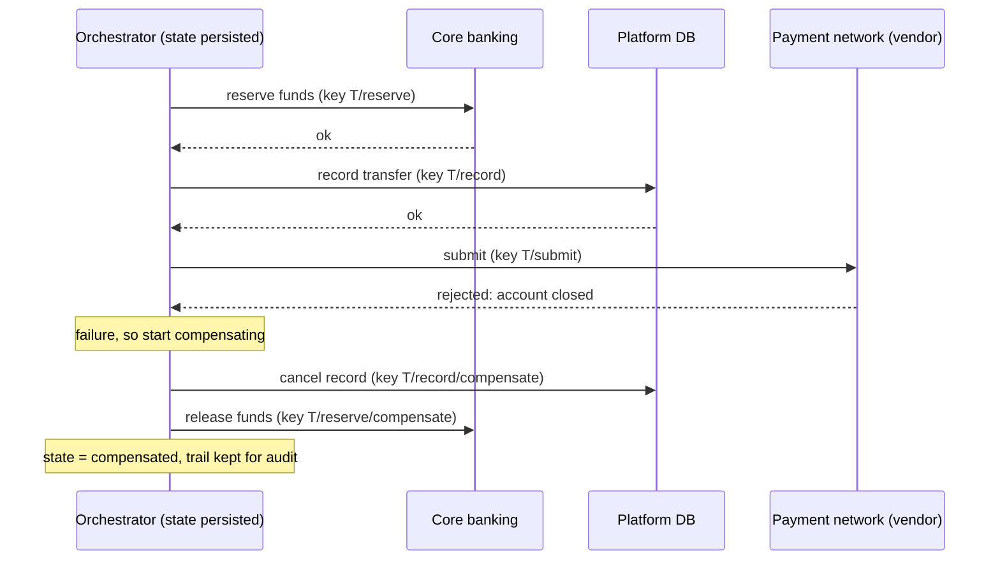
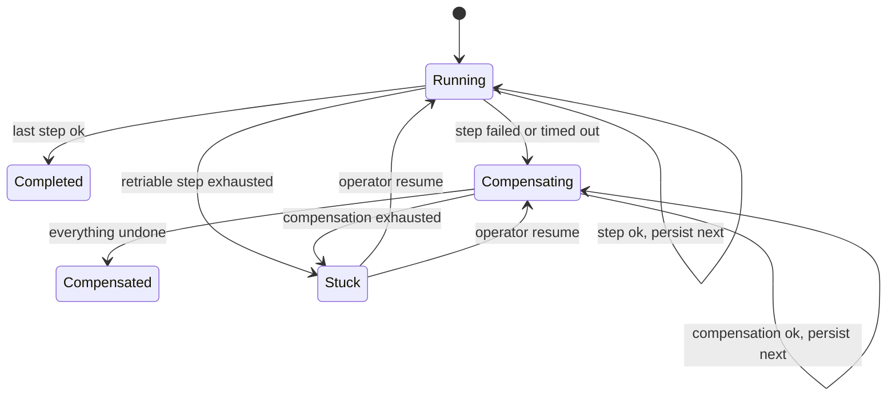
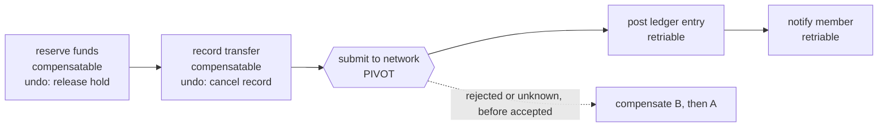
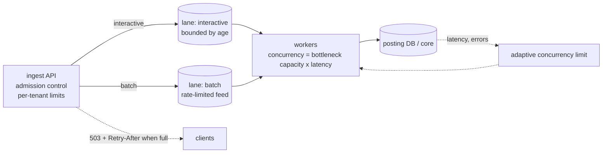

# A6 Unit 3 — Sagas, backpressure and load shedding

> Time: ~6 h · CORE: §1–§3 (including ≈ 1.5 h for the design exercise and teach-back) · STRETCH: the `labs/a6/backpressure` lab and the credit-based flow control part of §3 · Labs: `labs/a6/saga` (CORE), `labs/a6/backpressure` (STRETCH)

The first two units made a single hop reliable: a message gets from a committed state change to a consumer at least
once, and the consumer makes repeats harmless. This unit is about what happens when a business operation is *several*
hops long, each in a different system with its own database or vendor: moving money to an external account touches
the core, your ledger, a payment network and a notification channel. There is no transaction around all of them. A
**saga** is how you get a sensible outcome anyway: a sequence of local steps with an explicit undo for each.

Then the other half of asynchrony: what keeps a pipeline healthy when work arrives faster than it can be done.
**Backpressure** pushes the pressure back to the source; **load shedding** chooses what to refuse when it can't. Unit 1
§1 showed what an unbounded queue does; here you build the tools that bound it.

## Before you start

You should have finished Units 1 and 2: delivery guarantees, the outbox, idempotent consumers. A1 Unit 3 (idempotency
keys) is assumed. A7 covers retries with backoff, circuit breakers and rate-limit algorithms in depth; this unit uses
them by name and doesn't teach them.

Warm-up (spaced retrieval from Units 1 and 2 and A0). Answer on paper first.

1. A consumer commits after processing and the process dies between the effect and the commit. What happens, and what
   makes it harmless?
2. The outbox relay publishes a row and crashes before marking it sent. What reaches the consumer, and how does the consumer
   recognise it?
3. A queue drains at 100/s. Arrivals are 130/s for 10 minutes, then 80/s. How long after the surge ends is the queue
   empty?

<details data-kind="answer">
<summary>Warm-up answers</summary>

1. The message is redelivered and the effect is applied again. An idempotent consumer (a dedupe record or offset
   written atomically with the effect, or a naturally idempotent operation) makes the second application a no-op.
2. The same message ID is published again. The consumer's dedupe table (Unit 2 §2) recognises the ID and skips the
   effect, then acks.
3. Backlog = (130 − 100) × 600 s = 18,000. Net drain after = 100 − 80 = 20/s, so 18,000 / 20 = 900 s = **15 minutes**.

</details>

---

## §1 Sagas: orchestration versus choreography

### The failure story

"Send $500 to an external account" is four operations in four systems:

1. **Reserve funds** on the core banking system (a hold, so the member can't spend them twice).
2. **Record the transfer** in the platform's database (status, audit trail).
3. **Submit it** to the payment network through a vendor.
4. **Post the final ledger entry** and notify the member.

There's no distributed transaction across a mainframe-era core, your Postgres and a vendor's HTTP API. The first
implementation is a request handler with four calls and a `catch` block that tries to undo what's been done. At
1,000,000 transfers a day:

- The payment network rejects ≈ 0.5% **after** funds are reserved: **5,000 a day**. The `catch` block must release the
  hold. When the release call itself times out, the hold stays, and the member's $500 is unavailable until someone notices.
- The process dies (deploy, OOM) in the window between the network accepting the transfer (3) and the ledger being
  posted (4) in ≈ 0.01% of cases: **100 a day** transfers where money has left but the platform doesn't know. There's
  nothing left running that remembers a transfer was in flight.
- Each broken case costs ≈ 5 minutes of an engineer's or an ops analyst's time: ≈ 8 hours **every day** on 100
  incidents, before counting the stuck holds.

The handler holds the plan in its call stack. When the process dies, the plan dies with it.

### Predict

<!-- predict id="A6-U3-P01" -->
**Predict.** Write your answers down before opening the reveal.

1. With no transaction spanning the four systems, how do you get a *consistent outcome* (either fully done or fully undone)
   at all? What's given up compared with a real transaction?
2. The process executing the flow dies after step 2. Who finishes or undoes the transfer, and what must exist for
   that to be possible?
3. Orchestration (a central coordinator drives the steps) or choreography (each service reacts to the previous one's
   event): which would you use for this flow, and what would make you change your mind?
<!-- /predict -->

### Reveal

<details data-kind="reveal" data-for="A6-U3-P01">
<summary>Reveal</summary>

1. Break the operation into **local transactions**, each atomic within its own system, and give every step an explicit
   **compensating action** that semantically undoes it. If step *k* fails, run the compensations for steps *k−1 … 1* in
   reverse. That's a **saga** (Garcia-Molina and Salem, "Sagas", 1987). What you give up is **isolation**: other
   readers can see the intermediate states (a hold exists, a transfer is "pending") and may act on them (§2). You still
   get atomicity (all or nothing, eventually), consistency and durability.
2. A **persisted saga state**: which steps completed, which phase the saga is in. A recovery process (or the restarted
   orchestrator) loads the state and continues from the next step or the next compensation. For that to be safe, every
   step must be **idempotent** with a stable key, because the crash may have happened after the call but before the state
   was saved (the lab's `TestSaga_CrashAfterTheCallBeforeTheSaveRepeatsTheCallWithTheSameKey`).
3. For four steps with compensation, timeouts and an operations team that must answer "where is transfer 8841?",
   **orchestration**: one place holds the state machine and its history. Choreography fits flows of two or three
   independent steps owned by different teams, where each step naturally *is* a reaction to a business event and nobody
   needs a global view. Changing your mind: if you find the orchestrator turning into a god service that every team must
   edit for each change, or choreography growing event loops nobody can draw.

</details>

### How it actually works

A saga is a sequence of steps T₁ … Tₙ, each with a compensation C₁ … Cₙ₋₁. Forward execution runs T₁, T₂, … If Tₖ
fails, the saga runs Cₖ₋₁ … C₁ and ends **compensated**. If every step succeeds it ends **completed**.



**Orchestration versus choreography.**

| | Orchestration | Choreography |
|---|---|---|
| Who knows the flow | One coordinator (state machine + persisted state) | Nobody: each service reacts to events |
| Visibility ("where is transfer 8841?") | One query | Reconstruct from events across services |
| Adding or changing a step | Change the coordinator | Change several services, check for cycles |
| Coupling | Services are called by (and know of) the orchestrator | Services know event types, not each other |
| Failure handling (timeouts, compensation) | Centralised, explicit | Scattered; compensation events by convention |
| Single point of concern | The orchestrator must be durable and highly available | None, but also no owner of the end-to-end outcome |
| Good fit | Money movement, multi-step onboarding, anything with deadlines | Small, loosely coupled reactions (send email after signup) |

**What an orchestrator has to do** (this is what the lab builds):

1. **Persist state before and after every transition.** The persisted record says "running, next step 2" or
   "compensating, next to undo is step 1". It's saved with **optimistic concurrency** (a version number), so two
   runners can't both advance the same saga.
2. **Make calls with stable idempotency keys**: `sagaID/step` for actions and `sagaID/step/compensate` for compensations.
   The same key on every retry and every restart.
3. **Resume after a crash** by loading the state and continuing; completed steps are skipped, the interrupted step is
   repeated with the same key.
4. **Time-box every call.** A step has a deadline; at the deadline the orchestrator stops waiting even if the call hasn't
   returned (the call may still complete later: §2).
5. **Retry compensations**, with backoff, up to a limit, and then stop in a **stuck** state that alerts a human. A
   saga that silently gives up is worse than one that shouts.
6. **Never run twice concurrently**: the version check turns a second runner into a conflict instead of a duplicate.



Orchestrator commands and events usually travel through the outbox of Unit 2: the state change "step 2 done, now call
step 3" and the message that triggers step 3 are written in one transaction. **Durable execution engines** generalise
the whole mechanism: Temporal (and Uber's Cadence before it) records a workflow's event history and replays your
workflow code deterministically to rebuild its state after a crash; AWS Step Functions expresses the same state
machine declaratively. Their value is exactly the six points above, done once and operated for you.

**The audit trail is the saga's persisted history.** In banking the trail ("reserved at 10:03:11, submitted at
10:03:12, rejected, released at 10:03:14") is not debugging output; it's the record you show an auditor and a member.
Compensations are *new facts appended* (a release, a reversal entry), never deletions.

Here is the lab's API in use. It compiles against your stubs; run it once your lab passes (or point the import at
`solutions/a6/saga`):

```go
// A transfer saga on the lab's orchestrator: reserve funds, record the
// transfer, submit it to the payment network. The network rejects it, so the
// first two steps are compensated in reverse order. Then a second saga is
// killed mid-flight and resumed by a new orchestrator over the same store.
package main

import (
	"context"
	"errors"
	"fmt"
	"sync"

	"github.com/chethu007/system-design-course/labs/a6/saga"
)

// bank is a toy downstream service that is idempotent per call key.
type bank struct {
	mu                        sync.Mutex
	seen                      map[string]bool
	calls                     map[string]int
	held, recorded, submitted int
}

func newBank() *bank { return &bank{seen: map[string]bool{}, calls: map[string]int{}} }

// once runs f at most once per key, however often the key is presented.
func (b *bank) once(key string, f func()) {
	b.mu.Lock()
	defer b.mu.Unlock()
	b.calls[key]++
	if !b.seen[key] {
		b.seen[key] = true
		f()
	}
}

func (b *bank) steps(networkErr error) []saga.Step {
	do := func(counter *int, delta int) func(context.Context, saga.Call) error {
		return func(_ context.Context, c saga.Call) error {
			b.once(c.Key, func() { *counter += delta })
			return nil
		}
	}
	return []saga.Step{
		{Name: "reserve", Action: do(&b.held, +1), Compensate: do(&b.held, -1)},
		{Name: "record", Action: do(&b.recorded, +1), Compensate: do(&b.recorded, -1)},
		{Name: "submit", Compensate: do(&b.submitted, -1),
			Action: func(_ context.Context, c saga.Call) error {
				if networkErr != nil {
					return networkErr
				}
				b.once(c.Key, func() { b.submitted++ })
				return nil
			}},
	}
}

func main() {
	ctx := context.Background()

	// 1. The payment network rejects the transfer: roll back.
	b1 := newBank()
	o1, err := saga.New(saga.Config{Steps: b1.steps(errors.New("network rejected: account closed"))})
	if err != nil {
		panic(err)
	}
	st, err := o1.Run(ctx, "transfer-42")
	fmt.Printf("saga 1: %s %v err=%v\n", st.Status, st.Trail, err)
	fmt.Printf("        held=%d recorded=%d submitted=%d\n", b1.held, b1.recorded, b1.submitted)

	// 2. The process dies after "record" returned but before its state was
	// saved. A new orchestrator over the same store resumes.
	b2 := newBank()
	store := saga.NewMemoryStore()
	killed := false
	crashing, _ := saga.New(saga.Config{Store: store, Steps: b2.steps(nil), Hook: func(point string) error {
		if point == "after-action:record" && !killed {
			killed = true
			return errors.New("process killed")
		}
		return nil
	}})
	_, err = crashing.Run(ctx, "transfer-43")
	fmt.Printf("saga 2: first run: %v\n", err)
	resumed, _ := saga.New(saga.Config{Store: store, Steps: b2.steps(nil)})
	st, err = resumed.Run(ctx, "transfer-43")
	fmt.Printf("        resumed:   %s %v err=%v\n", st.Status, st.Trail, err)
	fmt.Printf("        record was called %d times with key %q, its effect happened %d time(s)\n",
		b2.calls[saga.Key("transfer-43", "record", false)], saga.Key("transfer-43", "record", false), b2.recorded)
}
```

Measured output with the reference implementation:

```text
saga 1: compensated [do:reserve do:record undo:record undo:reserve] err=<nil>
        held=0 recorded=0 submitted=0
saga 2: first run: process killed
        resumed:   completed [do:reserve do:record do:submit] err=<nil>
        record was called 2 times with key "transfer-43/record", its effect happened 1 time(s)
```

### Build it

Lab `labs/a6/saga`, file `saga.go`, part 1. Implement:

- `MemoryStore` (`Load`, `Save` with the version rule: new saga → `Version` must be 0; otherwise it must equal the stored
  version; both return copies).
- `New`: validate the step list (`ErrInvalidSteps`: no steps, empty or duplicate names, nil `Action`, a `Retriable` step
  with no pivot before it, a non-retriable step after the pivot, `Compensate` after the pivot, two pivots) and apply
  the defaults.
- `Run` for the happy path and for compensation: persist `Next`, `Trail` and `Status` after every transition; on a
  definitive failure compensate the steps *before* the failed one, in reverse; skip steps with no `Compensate`.

Acceptance tests: `TestMemoryStore_SaveRequiresTheCurrentVersion`, `TestMemoryStore_ReturnsCopies`,
`TestNew_RejectsInvalidStepDefinitions`, `TestSaga_HappyPathRunsEveryStepOnceInOrder`,
`TestSaga_TerminalSagaIsNotRunAgain`, `TestSaga_FailureCompensatesCompletedStepsInReverseOrder`,
`TestSaga_FirstStepFailingNeedsNoCompensation`, `TestSaga_StepWithoutCompensateIsSkippedWhenRollingBack`,
`TestSaga_RestartedOrchestratorSkipsStepsThatAlreadyCompleted`,
`TestSaga_ConcurrentRunnersOfTheSameSagaApplyEachEffectOnce` (8 runners, `-race`). Timeouts, compensation retries,
stuck sagas, crash sweeps and pivots are §2's part of the lab. Run `go test -race -run 'Store|New|HappyPath|Terminal|Failure|First|Without|Restarted|Concurrent' ./labs/a6/saga/`.

### Break it

Run `go test -tags breakit -run NonIdempotent -v ./labs/a6/saga/` (after the lab works). It crashes the orchestrator at
every hook point of a successful 3-step run, resumes with a fresh orchestrator, and prints the effect counts when the
downstream services are *naive* (they apply every call they receive). Predict which crash points double-apply a step
before you run it.

<details data-kind="answer">
<summary>What you should see, and why</summary>

Measured:

| crash at | reserve | record | submit | |
|---|---|---|---|---|
| #1 before-action:reserve | 1 | 1 | 1 | |
| #2 after-action:reserve | **2** | 1 | 1 | applied twice |
| #3 before-action:record | 1 | 1 | 1 | |
| #4 after-action:record | 1 | **2** | 1 | applied twice |
| #5 before-action:submit | 1 | 1 | 1 | |
| #6 after-action:submit | 1 | 1 | **2** | applied twice |

3 of 6 crash points double-apply a step: exactly the "after-action" ones, where the call has returned and the state has
not been saved yet. The orchestrator persisted its progress after every step and still can't avoid the window, because
"call the service" and "save the fact that I called it" are two systems again (the dual-write problem of Unit 2, one
level up). The only defence is on the other side of the call: services that deduplicate by the idempotency key.
With the lab's idempotent fake services every row reads `1 1 1`.

</details>

### In the wild

- **Temporal** (open-source successor of Uber's Cadence): workflows are ordinary code; the server persists the
  event history and replays the workflow to recover; activities have timeouts and retry policies; the project documents the
  saga pattern with compensations. `TODO-VERIFY: determinism constraints and current retry-policy defaults`.
- **AWS Step Functions**: state machines in Amazon States Language with `Retry` and `Catch` per state; commonly used to
  implement orchestrated sagas on AWS. `TODO-VERIFY: Standard vs Express workflow semantics (at-least-once vs exactly-once)`.
- **Camunda / Zeebe** and **Netflix Conductor** (now maintained by Orkes) are workflow engines used for orchestration
  in enterprise and e-commerce flows.
- **Seata** (Alibaba) offers saga and TCC modes for microservices on the JVM. `TODO-VERIFY: modes and maturity`.
- **Choreography in practice**: e-commerce order → payment → inventory → shipping chains over Kafka topics, where each
  service reacts to the previous service's event. They work until someone asks for the end-to-end timeout.
- **Payments**: card networks and cores define explicit reversal messages (ISO 8583) because "authorise, then maybe
  reverse" is the shape of the domain; ACH adds a twist: a transfer the network accepted can still be **returned** days
  later by the receiving bank, which you model as a new compensating saga, not as a failure of the original step
  (`TODO-VERIFY: ACH return windows`).
- **Microservices.io** (Chris Richardson) catalogues saga patterns, step types (compensatable, pivot, retriable) and
  countermeasures for the missing isolation.

### Trade-offs

| Option | Wins when | Loses when | When the answer flips |
|---|---|---|---|
| Orchestrated saga | Multi-step flows with compensation, timeouts and a need for visibility | The orchestrator becomes a bottleneck of change or a SPOF | Flip to choreography for 2–3 loosely coupled reactions |
| Choreographed saga | Few steps, independent teams, event-native domain | Compensation, deadlines and "where is it?" questions | Flip to orchestration when someone needs the end-to-end state |
| Two-phase commit | All participants support it, short transactions, one trust domain | Vendors, brokers, long-running steps, availability | Rarely for cross-service money flows |
| TCC (try-confirm/cancel) | Resources can be reserved then confirmed (holds) | Services must implement three operations | Natural for hold-based flows; simpler saga steps otherwise |
| One service, one database transaction | The steps can live together | Org boundaries, different data stores | Flip to a saga only when the boundary is real |
| Durable execution engine (Temporal, Step Functions) | Many long-running flows; you want the six mechanics operated for you | A single simple flow; platform lock-in | Flip to a hand-rolled orchestrator when the flow is tiny and the team can't run the engine |

### Senior bar

- **Failure modes**: orchestrator crash between call and save (repeated calls); duplicate runners; a compensation that
  fails forever (money stuck); timeouts treated as failures (§2); sagas that never terminate (no overall deadline);
  state loss; step order that puts an irreversible step early; lack of observability ("how many sagas are stuck?").
- **Capacity numbers**: saga state is small (hundreds of bytes to a few KB per saga); 1 M sagas/day ≈ 12/s average,
  ≈ 35/s at a 3× peak, each saga ≈ 4–8 state writes → ≈ 50–300 writes/s on the saga store: modest for a relational DB.
  A saga that waits (a vendor settles in minutes) holds *state*, not a thread: 1 M/day × 10 min average in flight ≈
  7,000 concurrent sagas (Little's law: 12/s × 600 s).
- **Ops**: dashboards for sagas by status and age; an alert for anything non-terminal after N times its p99; a
  "stuck" queue with a runbook and a `Resume` action; deploys must keep old saga definitions runnable (versioned step
  lists) because in-flight sagas outlive deploys.
- **Cost**: the state store, the engineering of idempotent steps and compensations, the operations load of stuck
  sagas.
- **Banking link**: money movement is the textbook saga. Holds are the semantic lock; reversals are compensations as
  new ledger entries; the saga trail is the audit trail; and each vendor adapter's "idempotency key or client reference"
  field is what makes the steps safe to repeat. The "stuck" queue is a real operations team's worklist.

Interviewer follow-up probes:

1. "How do you make a multi-step flow across services consistent without distributed transactions?"

<details data-kind="answer">
<summary>Model answer</summary>

A saga: local transactions with explicit compensations, driven by an orchestrator that persists its progress after every
step. Each step and compensation is idempotent under a stable key so a crash between "call" and "save" only repeats a
harmless call. I'd order steps so the irreversible one is last, give every step a timeout, retry compensations until they
succeed or the saga is marked stuck and alerts a human, and keep the trail as the audit record. I'd also say what I give
up: isolation, so intermediate states are visible and I need semantic locks like holds.

</details>

2. "Orchestration or choreography?"

<details data-kind="answer">
<summary>Model answer</summary>

Orchestration when there are more than a few steps, compensation, deadlines, or a need to answer "where is this?";
choreography for small, loosely coupled reactions. Orchestration centralises complexity in one explicit state machine that
can be tested and observed, at the price of coupling to the orchestrator and making it highly available. Choreography
removes the coordinator and pays with an implicit flow, event loops and no owner of the end-to-end result.

</details>

3. "The orchestrator crashes mid-saga. What happens?"

<details data-kind="answer">
<summary>Model answer</summary>

Its state is persisted with a version; a recovery sweep or a restarted instance picks up non-terminal sagas, loads the
state and continues from the next step or compensation. The interrupted call is repeated with the same idempotency key,
which the downstream deduplicates. Two instances racing is prevented by the version check: the loser gets a conflict
and stops. Sagas must outlive deploys, so definitions are versioned.

</details>

4. "Why not just use two-phase commit?"

<details data-kind="answer">
<summary>Model answer</summary>

It needs every participant to implement prepare/commit; vendor APIs and managed brokers mostly don't. It holds locks across
network round trips and blocks if the coordinator dies, which hurts availability, and it doesn't fit steps that take
minutes (a payment network settling). Sagas accept temporary visibility of intermediate states in exchange for
availability and compatibility with real-world systems.

</details>

### Check yourself

1. Which of atomicity, consistency, isolation and durability does a saga give up, and what is the practical effect?
2. Why must the orchestrator pass a *stable* idempotency key, and what would break with a fresh key per attempt?
3. A saga's compensation for step 1 fails permanently. What state should the saga end in, and who is told?

<details data-kind="answer">
<summary>Answers</summary>

1. Isolation: other readers can see intermediate states (a hold, a pending transfer) and act on them, so you need
   countermeasures such as semantic locks. Atomicity is preserved as "eventually all or nothing" via compensation.
2. With a fresh key, a repeated call after a crash looks like a new request and the downstream applies it again
   (double hold, double submit). The stable key makes retries and restarts recognisable.
3. `stuck` (not silently "compensated"), persisted with the error, with an alert to the owning operations team and a
   runbook; the held funds stay held until it is resolved or resumed.

</details>

---

## §2 Compensations, pivots and isolation

### The failure story

The saga from §1 exists now and works, until it meets reality. Three incidents in one quarter, all in the places the
happy path skips.

**The timeout that wasn't a failure.** The payment-network call has a 10 s timeout; the vendor's p99.9 is ≈ 12 s. About
0.2% of submissions time out: **2,000 a day**. The orchestrator treats a timeout as a failure and runs the compensations: it
releases the hold. But for roughly 40% of those timeouts the vendor *did* accept the transfer, just slowly: **800
transfers a day** where the money leaves *and* the member's funds are released, so the member can spend the same $500
again. At an average $500 that is ≈ **$400,000 a day of principal at risk** (the percentages are illustrative; the shape
is not).

**The compensation that couldn't run.** A rejection triggers "release the hold", but the core's nightly maintenance
window (02:00–04:00) makes every call fail. The orchestrator retries three times over 30 seconds, gives up and marks the
saga "failed". At 12 transfers/s the window sees ≈ 86,000 transfers, and the ≈ 0.5% rejected in it, ≈ 430, never get
their hold released; members wake up with money missing from their available balance.

**The invisible hold.** A member with $600 starts a $500 transfer (a hold is placed) and immediately pays a $400 bill;
the bill is declined for insufficient funds, though the transfer is then rejected and the hold released 6 seconds later.
Another day, two concurrent sagas on the same account both read an available balance of $600 and both reserve $500.

### Predict

<!-- predict id="A6-U3-P02" -->
**Predict.** Write your answers down before opening the reveal.

1. The submit call times out. List the options for what the orchestrator does, and say which is safe for money.
2. "Release the hold" fails for two hours. What should the saga do, and what must be true of compensations in general?
3. The transfer saga has these steps: reserve funds, record transfer, submit to network, post final ledger entry, notify
   member. Which are compensatable, which is the pivot, which are retriable, and why does the order matter?
4. Two concurrent sagas reserve funds from the same account. Which anomaly is this, and what countermeasure applies?
<!-- /predict -->

### Reveal

<details data-kind="reveal" data-for="A6-U3-P02">
<summary>Reveal</summary>

1. A timeout means the outcome is **unknown**, not failed. Options: (a) treat as failure and compensate: unsafe (the
   call may still succeed, as above); (b) retry the *same idempotent call* (same key) until you get a definitive answer;
   safe whenever the vendor deduplicates by key; (c) query the vendor by your client reference ("did you get transfer
   T-42?") and then continue or compensate on the answer; (d) compensate the timed-out step too, **and** make the
   compensation safe to arrive before the action, so a late success is refused (the lab's choice; see below). For a vendor
   that supports lookup by reference, (c) or (b) is best; (d) works when the service can hold a tombstone. The
   tempting wrong answer is "timeout = error".
2. Keep retrying with backoff, for much longer than 30 s, and when the budget is exhausted end in an explicit **stuck**
   state that pages a human, not in "failed". Compensations must therefore be (i) **idempotent**, (ii) **retriable
   until they succeed** (design them so they cannot be refused by a business rule: "release a hold" always works, "refund"
   is a new ledger entry), (iii) safe to run **before** the action they undo ever arrived, and (iv) recorded as new facts,
   not deletions.
3. Reserve funds and record transfer are **compensatable** (release, cancel). **Submit to network is the pivot**: after
   the network accepts it, money is on its way and you can no longer simply roll back. Post-ledger and notify are
   **retriable**: they must eventually succeed, so they're retried forward, never compensated. The ordering principle:
   do the steps that can fail or be undone first, put the pivot as late as possible, and put only steps that can't be
   rejected after it. Reordering the pivot earlier would turn failures of later steps into un-undoable situations.
4. A **lost update** / write-skew-style anomaly across a saga's missing isolation (A2's isolation anomalies, one level
   up). Countermeasure: make the reservation an atomic conditional operation at the owner of the balance (the core
   checks `available ≥ amount` and places the hold in one local transaction) — a **semantic lock**. Reading the balance
   and then reserving as two steps is what breaks it.

</details>

### How it actually works



**Three step types** (Richardson's terms, as in the lab's `Step`):

| Type | After it succeeds | If a later step fails | In the lab |
|---|---|---|---|
| Compensatable | The saga may still roll back | Its compensation runs | `Compensate` set |
| Pivot | The point of no return: the saga now only moves forward | Never compensated once it succeeded | `Pivot: true` |
| Retriable | (after the pivot) | Retried until it succeeds; never compensated | `Retriable: true`, no `Compensate` |

`New` rejects a definition that breaks the rules (a non-retriable step after the pivot, a `Compensate` after it), so the
mistake shows up at startup instead of in an incident. After the pivot, a retriable step that keeps failing ends the
saga **stuck**, never rolled back: the money has left.

**Timeouts are unknown outcomes.** The lab's rule for a timeout: stop waiting at the deadline *even if the action hangs*,
then compensate **including the timed-out step**, because it may have taken effect or may take effect later. That is
only safe if the compensation is correct when the action hasn't happened yet and if it prevents the action from
happening afterwards. The standard way is a **tombstone**: a service that is told to undo `key K` before it has seen
`K` records "K was cancelled" and refuses `K` when it arrives. Without it, compensation only works in the order
action → compensation, which a timeout does not guarantee.

```go
// A compensation can arrive before the action it undoes (the action timed
// out, the orchestrator rolled back, and then the hung request finally
// landed). A service that only remembers what it did cannot refuse the late
// action; a service that also remembers what it was told to undo can.
package main

import "fmt"

// Ledger is a downstream service that is idempotent per key.
type Ledger struct {
	Tombstones bool // remember compensations that arrived first
	applied    map[string]bool
	reverted   map[string]bool
	tomb       map[string]bool
	Net        int // net effect: +1 per applied action, -1 per undone action
}

// NewLedger returns an empty ledger.
func NewLedger(tombstones bool) *Ledger {
	return &Ledger{Tombstones: tombstones, applied: map[string]bool{}, reverted: map[string]bool{}, tomb: map[string]bool{}}
}

// Apply performs the action once per key, unless it was already undone.
func (l *Ledger) Apply(key string) {
	if l.applied[key] || l.tomb[key] {
		return
	}
	l.applied[key] = true
	l.Net++
}

// Revert undoes the action with this key, once. If the action never ran it
// leaves a tombstone so a late Apply is refused.
func (l *Ledger) Revert(key string) {
	if l.reverted[key] {
		return
	}
	l.reverted[key] = true
	if l.applied[key] {
		l.Net--
	} else if l.Tombstones {
		l.tomb[key] = true
	}
}

func main() {
	for _, tombstones := range []bool{true, false} {
		l := NewLedger(tombstones)
		l.Apply("t1/hold")  // normal order: action...
		l.Revert("t1/hold") // ...then compensation
		l.Revert("t2/hold") // compensation first: t2's action timed out
		l.Apply("t2/hold")  // ...and the hung request lands afterwards
		l.Revert("t3/hold") // the orchestrator retries a compensation
		l.Revert("t3/hold")
		fmt.Printf("tombstones=%-5v net effect = %d (0 is correct)\n", tombstones, l.Net)
	}
}
```

```text
tombstones=true  net effect = 0 (0 is correct)
tombstones=false net effect = 1 (0 is correct)
```

When the service can't hold a tombstone (many vendor APIs), use the other options from the Predict block: retry the same
idempotent call until it answers, or **reconcile** by looking the transfer up by your client reference before deciding.

**Compensation design rules.**

- *Idempotent*: the orchestrator retries them (`TestSaga_CompensationIsRetriedWithBackoffUntilItSucceeds`).
- *Retriable and always possible*: model the undo so a business rule can't refuse it. "Release hold" can't be refused;
  "delete the transfer" might be; "append a cancellation entry" can't.
- *Commutative with the action* (the tombstone above).
- *Semantic, not literal*: you can't unsend an email; the compensation is a correction notice. You can't un-post a
  ledger entry; you append a reversing entry. Both are *new facts*, which is what an auditor wants.
- *Observable*: every compensation is in the saga trail.

**When a compensation fails.** Retry with backoff up to a limit that matches the *dependency's* outage profile (a
two-hour maintenance window needs hours, not 30 s), then go **stuck**: persisted, alerting, with an operator action that
resumes (`TestSaga_CompensationThatKeepsFailingEndsStuckAndResumeFinishesTheJob`). Never mark it compensated or failed
silently. Where you can, avoid compensations that depend on the very system whose failure triggered the rollback.

**Isolation anomalies and countermeasures.** A saga's intermediate states are visible: the hold, the pending transfer. The
standard countermeasures (Richardson, *Microservices Patterns*):

| Countermeasure | Idea | Banking example |
|---|---|---|
| **Semantic lock** | A flag marks the data as "in flight" and other operations respect it | Holds: `available = ledger − holds`; "pending" transfers |
| **Commutative updates** | Operations that can be applied in any order | Credits and debits as ledger entries (increments), not read-modify-write of a balance |
| **Pessimistic view** | Reorder steps so the risky one comes first or last | Check eligibility (cheap, reversible) before reserving |
| **Reread value** | Check the value hasn't changed before overwriting | Optimistic version check on the account |
| **Version file** | Record operations to apply in the right order | Per-aggregate sequence numbers for out-of-order events |
| **By value** | Pick the concurrency mechanism by the risk of the operation | Small transfers: saga; large wires: stronger locking and review |

A hold is a semantic lock the member can see in the app. That is why "pending" is a first-class status in banking UIs.

### Build it

Lab `labs/a6/saga`, file `saga.go`, part 2. Complete `Run` and add `Resume`:

- **Per-step timeouts** with the injected `Config.NewTimer`: stop waiting at the deadline even if the action ignores its
  context (run it in a goroutine, abandon it, buffered result channel), `ErrStepTimeout` → compensate the timed-out step
  too. Recover panics and treat them as errors.
- **Hook points** `before-action:<step>`, `after-action:<step>`, `before-compensate:<step>`, `after-compensate:<step>`;
  a hook error is a crash and `Run` returns immediately without saving anything more.
- **Retries with `Backoff` and `Sleep`** for retriable steps and compensations; `MaxAttempts`; `Stuck` with `StuckIn`;
  `ErrStuck`; `Resume`.
- **Pivot behaviour**: failures after the pivot retry forward and never compensate; a failing pivot itself still rolls
  back.
- **Context cancellation**: return `ctx.Err()`, leave the saga `Running`, resumable.

Acceptance tests: `TestSaga_CompensationIsRetriedWithBackoffUntilItSucceeds`,
`TestSaga_CompensationThatKeepsFailingEndsStuckAndResumeFinishesTheJob`,
`TestSaga_TimeoutIsAmbiguousSoTheTimedOutStepIsCompensatedToo` (a fake timer fires on demand; the hung action then
lands late and the tombstone refuses it), `TestSaga_ContextCancellationStopsRunAndTheSagaCanBeRunAgain`,
`TestSaga_PanickingStepIsAFailureNotACrashOfTheOrchestrator`,
`TestSaga_CrashAfterTheCallBeforeTheSaveRepeatsTheCallWithTheSameKey`,
`TestSaga_CrashAtEveryPointThenResumeSucceedsWithEachEffectAppliedOnce`,
`TestSaga_CrashAtEveryPointDuringRollbackStillEndsFullyCompensated` (the sweeps crash at *every* hook point in turn
and resume),
`TestSaga_AfterThePivotFailuresAreRetriedForwardAndNeverCompensated`,
`TestSaga_RetriableStepThatNeverRecoversEndsStuckWithoutRollingBackThePivot`,
`TestSaga_PivotThatFailsStillRollsBackEarlierSteps`. Run `go test -race ./labs/a6/saga/` and, to be safe about
schedule-dependent bugs, `go test -race -count=20 ./labs/a6/saga/`.

### Break it

1. Run `go test -tags breakit -run CompensationThatCannot -v ./labs/a6/saga/`. A step times out, the saga rolls back,
   and then the hung call lands. The three rows differ only in the downstream service. Predict the net effect of each.
2. In your `Run`, delete the rule that compensates the *timed-out* step too (keep only the steps before it) and run
   `go test -race -run Timeout ./labs/a6/saga/`. Explain the failure in terms of money.
3. Run the `u3_tomb` program above with `Tombstones: false` and say which of the lab's guarantees it breaks.

<details data-kind="answer">
<summary>What you should see, and why</summary>

1. Measured:

   | network service | net effect after rollback and the late call (0 is correct) |
   |---|---|
   | idempotent + tombstone (correct) | 0 |
   | no tombstone: late call lands | 1 |
   | naive refund: call never happened | −1 |

   Without the tombstone the saga is "compensated" yet the transfer goes out afterwards (+1: money leaves with the funds
   already released). With a naive compensation that assumes the action happened, a compensation for an action that
   never ran *creates* money (−1: a refund of a payment that wasn't taken). Both are the same bug seen from the two
   sides: the compensation must not depend on the action having run.
2. `TestSaga_TimeoutIsAmbiguousSoTheTimedOutStepIsCompensatedToo` fails: the trail lacks `undo:submit`. Reason through
   what that leaves behind: the hung call is still in flight and nothing told the network service to refuse it, so when it
   lands the transfer goes out while the saga reports "compensated". In money terms: the member's funds were released
   *and* the transfer went out.
3. It breaks the "compensation before action" guarantee: in the program, `tombstones=false` leaves a net effect of 1.

</details>

### In the wild

- **Card authorisations** are holds: funds are reserved at authorisation and either captured or the authorisation
  expires or is reversed. Merchants and issuers have lived with this saga shape for decades (`TODO-VERIFY: authorisation
  hold durations by network`).
- **ACH** adds returns: a credit or debit accepted by the network can still be returned later by the receiving bank
  (insufficient funds, closed account, unauthorised). You model a return as an *event that starts a compensating saga*
  on the original transfer, not as a failure of the submit step (`TODO-VERIFY: return windows and reason codes`).
- **Stripe's PaymentIntents** model an explicit state machine (for example `processing`, `requires_action`, `succeeded`)
  because payment outcomes arrive asynchronously; webhooks, not the original call, finish the story. `TODO-VERIFY:
  current status names`.
- **Temporal** documents compensations as ordinary code in workflow functions, with activity timeouts and retry
  policies; **AWS Step Functions** uses `Catch` blocks to route to compensation states.
- **TCC (Try-Confirm/Cancel)** formalises holds: *Try* reserves, *Confirm* finalises, *Cancel* releases. Each of
  the three must be idempotent and Cancel must tolerate arriving before Try, the same tombstone rule as above.
- **Your adapters**: a vendor that returns a timeout for an accepted deposit is the §2 incident. If the vendor gives you
  a lookup-by-reference call, use it before deciding; if it gives you an idempotency key, retry with the same key.

### Trade-offs

| Option | Wins when | Loses when | When the answer flips |
|---|---|---|---|
| On timeout: retry the same idempotent call | The sink deduplicates by key | The sink is down for long; no key | Flip to query-then-decide when there's a lookup API |
| On timeout: query by reference, then continue or compensate | The vendor offers lookup | Lookup is also slow or eventually consistent | Flip to compensate-with-tombstone when you own the sink |
| On timeout: compensate including the timed-out step | You control the service and can tombstone | Third-party sinks that can't refuse a late action | Never alone with an external vendor |
| Compensation retries: bounded, then stuck + page | Money and holds | Silent best-effort (notifications) | Flip to "give up and log" for disposable steps |
| Pivot late, retriable after | Failures can be rolled back until the point of no return | Everything is irreversible early | Reorder if you can; if not, add a human review step before the pivot |
| Semantic lock (holds) | Concurrent sagas touch the same resource | Holds that never expire leak value | Add expiry and a sweeper; for large amounts use stronger locking |

### Senior bar

- **Failure modes**: treating timeouts as failures; non-idempotent steps or compensations; compensation that can be
  refused; no tombstone, so late actions escape; compensations depending on the failed system; unbounded retries without
  an alert; holds without expiry; irreversible steps early in the flow; in-flight sagas surviving an incompatible
  deploy; compensating after the pivot.
- **Capacity numbers**: the stuck-saga rate is the SLO that matters (e.g. < 1 in 100,000 sagas stuck > 1 h). A 2-hour
  core outage at 12 transfers/s leaves ≈ 86,000 sagas in flight or retrying (12/s × 7,200 s), and when the core returns
  they all retry at once unless backoff and a rate cap spread them out (A7 covers retry budgets).
- **Ops**: a stuck-saga queue and runbook; `Resume` is a privileged, audited operation; reconciliation jobs that compare
  the saga store with the vendor's settlement files; tests that kill the orchestrator at every step (the lab's sweep),
  in staging too.
- **Cost**: compensation engineering doubles the work of each step; holds immobilise member funds (a customer-experience
  cost) and sometimes interest; reconciliation staff.
- **Banking link**: your transfer flow already has these shapes. The hold is the semantic lock; "pending" in the app is its
  UI; the vendor's timeout is the ambiguous outcome; reversals are appended ledger entries; and the reconciliation file is the
  safety net you will describe in the design exercise.

Interviewer follow-up probes:

1. "The vendor call times out. Do you retry, fail or compensate?"

<details data-kind="answer">
<summary>Model answer</summary>

None of them blindly: a timeout means unknown. If the vendor accepts an idempotency key, retry with the same key until I
get a definitive answer, within the saga's overall deadline. Otherwise look the transfer up by my client reference and
continue or compensate on the answer. If I own the sink I can compensate the timed-out step too and rely on a tombstone to
refuse a late arrival. What I never do is release the member's funds on a timeout while the transfer might still go out.

</details>

2. "What if a compensation fails?"

<details data-kind="answer">
<summary>Model answer</summary>

Design compensations to be idempotent and un-refusable, retry with backoff for as long as the dependency's outage profile
suggests (hours for a maintenance window), then mark the saga stuck and page the owning team; the saga remains resumable.
It must not end as "compensated" or silently "failed", because the member's funds are still held.

</details>

3. "Where do you put the irreversible step and why?"

<details data-kind="answer">
<summary>Model answer</summary>

As late as possible: everything before the pivot can be rolled back, so I do the steps that can fail or be rejected first
(eligibility, hold, record) and only then the step that can't be undone (submit to the payment network). After the pivot
only retriable steps (post the ledger entry, notify), which are retried forward until they succeed.

</details>

4. "Sagas have no isolation. What goes wrong and how do you cope?"

<details data-kind="answer">
<summary>Model answer</summary>

Other transactions see intermediate states and can act on them, and concurrent sagas can interleave on the same data (two
reservations from one balance). Copes: semantic locks (holds with expiry, `available = ledger − holds`), commutative
ledger entries rather than read-modify-write, atomic conditional reservation at the data's owner, version checks, and for
high-value operations stronger locking or an approval step.

</details>

### Check yourself

1. Why is the timed-out step included in the rollback, and what must the service do to make that safe?
2. What distinguishes a pivot from a compensatable step?
3. Give two examples of compensations that are not literal inverses.

<details data-kind="answer">
<summary>Answers</summary>

1. The call may have taken effect or may still take effect; excluding it can leave its effect in place. The service must
   treat a compensation that arrives first as a tombstone and refuse the late action (and be idempotent on both).
2. After a pivot succeeds, the saga only moves forward (the effect can't be taken back); before it, the saga can still
   roll back. Compensatable steps have an undo; the pivot's later steps are retried, not compensated.
3. Sending a correction email instead of un-sending; appending a reversing ledger entry instead of deleting the original;
   releasing a hold (not "un-reserving" by editing history).

</details>

---

## §3 Backpressure and load shedding

### The failure story

At 09:00 on the 1st of the month a large credit union uploads a payroll file: **50,000 transfers**. The ingest API
accepts the file, splits it and enqueues one job per transfer in the same queue that interactive transfers use. Posting
workers handle 200 jobs/s in total (20 workers × 10 jobs/s, each job ≈ 100 ms against the core).

- The file arrives in ≈ 10 s (5,000 jobs/s). The queue now holds 50,000 jobs ≈ 250 s of work.
- A member who taps "Send" at 09:00:20 is behind all of them: **250 seconds** until their transfer is even started,
  against an app timeout of 10 s. They retry; the retries queue behind the batch too.
- The autoscaler sees depth > 1,000 and triples the workers to 60. The posting database can sustain ≈ 300 jobs/s; 60
  workers want 600/s. Query latency doubles, per-worker throughput halves, the total stays ≈ 300/s, and connections,
  locks and timeouts pile up. Depth stays high, so the autoscaler wants more.

Nothing was broken. Every component did what it was told: the queue accepted, the workers worked, the autoscaler
scaled. What was missing was any component whose job was to say *no*, or *slow down*, or *not you first*.

### Predict

<!-- predict id="A6-U3-P03" -->
**Predict.** Write your answers down before opening the reveal.

1. Where should the limit on the payroll file live (ingest API, queue, worker, database), and what does a member who
   submits during the burst see?
2. Interactive and batch share one FIFO queue. How long does an interactive job wait during the burst? What if they have
   separate lanes and interactive has strict priority? What new risk does strict priority create?
3. The autoscaler adds workers when depth > 1,000. The database tops out at 300 jobs/s. What should the autoscaling signal
   and cap be?
4. Which of these gives backpressure by construction: a consumer that pulls messages when it is ready, or a broker that
   pushes them? Why?
<!-- /predict -->

### Reveal

<details data-kind="reveal" data-for="A6-U3-P03">
<summary>Reveal</summary>

1. As close to the source as you can: **admission control at the ingest API**. Accept the file durably (it's an
   asynchronous batch, a `202` with a status resource), but feed work to the queue at a bounded rate and cap the
   concurrency per tenant. The queue itself is bounded by age (Unit 1 §1). Interactive members never see the burst
   because it's in a different lane; if the interactive lane is ever full they see an immediate `503`/`429` with
   `Retry-After`, not a 250 s spinner.
2. FIFO: 50,000 / 200 = **250 s**. Two lanes with strict priority for interactive: an interactive job waits for at most the
   job already in service (≈ 100 ms, plus its own queue); the batch gets the leftover capacity: with 60 interactive jobs/s
   it has 140/s, so 50,000 / 140 ≈ **357 s ≈ 6 minutes**. The new risk is **starvation**: if interactive load ever
   reaches capacity, batch never runs. Give the lower class a guaranteed minimum share (weighted fair queuing) and
   a deadline alarm.
3. Scale on **age of the oldest message** or **backlog per worker**, not raw depth, and cap the worker count at what the
   *bottleneck* can absorb (here 30 workers ≈ 300/s). Scaling a stage past the capacity of the stage after it just moves
   the queue and adds contention.
4. **Pull**. A consumer that asks for work only when it has capacity can't be flooded; the broker's queue absorbs (and the
   queue's bound is the next backpressure point). Push needs an explicit mechanism (credits, windows, `429`) or the
   receiver's buffers are its only protection.

</details>

### How it actually works

**Backpressure** is any mechanism by which a slow consumer slows its producer, so the buffer between them stays bounded.
**Load shedding** is what you do when slowing the producer isn't possible (the producer is the public internet): refuse
some work so the rest succeeds.



**Mechanisms, from gentlest to harshest:**

| Mechanism | How the producer learns | Example |
|---|---|---|
| **Blocking** on a bounded buffer | The `send` call blocks | A Go channel; `Queue` with `Block` in the lab |
| **Pull** | It isn't asked for more until the consumer is ready | Kafka `poll`, SQS `ReceiveMessage`, reactive streams `request(n)` |
| **Credits / windows** | The receiver grants permission to send N more | TCP receive window, HTTP/2 flow-control windows, AMQP link credit; `CreditGate` in the lab |
| **Reject with a signal** | An immediate error with a hint | `429`/`503` + `Retry-After`; `DropNewest` and `ErrFull` |
| **Shed** (drop) | Nothing, or an error; the work is gone | Drop low priority first; `DropOldest`; `PriorityQueue` thresholds |
| **Degrade** | The response is cheaper | Serve a cached balance instead of a live one |

**Where to put the limit.** At the **earliest point that can say no cheaply**: before parsing the body, before
authentication if possible, before a database connection is taken. A rejected request costs microseconds; a queued
one costs memory, latency and a timeout that fires after the work is done.

**How big is the limit?** Little's law again. A stage with throughput capacity μ and a target latency W can have at most
`L = μ × W` requests in flight: 200 jobs/s × 50 ms = **10 concurrent jobs**. Everything beyond that is queue, and the
queue's bound is your latency budget: `queue ≤ budget × μ` (a 2 s budget × 200/s = **400 jobs**). *Adaptive* concurrency
limits find L from observed latency instead of guessing it (Netflix's concurrency-limits library, Envoy's adaptive
concurrency filter).

**Which work to refuse.**

- **By priority/criticality**: payments and logins before balance reads before exports and statements. The lab's
  `PriorityQueue` admits an item only while the queue is shorter than that priority's threshold (critical 100%, standard
  80%, bulk 50% of capacity), so as the queue fills, bulk goes first, standard next, critical last.
- **By age (newest first under overload)**: when the queue is deep, the oldest requests have probably already timed
  out. Serving the **newest first (LIFO)** under overload spends capacity on requests someone is still waiting for;
  Facebook described "adaptive LIFO" together with controlled-delay queue management in "Fail at Scale". CoDel (Nichols and
  Jacobson) drops based on how long items *waited*, not how many are queued.
- **By tenant**: weighted fair queuing or per-tenant concurrency caps, so a single credit union's batch can't consume
  everyone's capacity. This is the noisy-neighbour defence for a multi-tenant platform.
- **By deadline**: drop requests whose deadline has passed; propagate deadlines across hops so downstream doesn't start
  work nobody awaits (Unit 1 §1, variant C).

An admission middleware with priority-dependent limits fits on one screen. The handlers hang until released so the
in-flight count builds up deterministically:

```go
// Admission control at the front door: bound the work in flight, and refuse
// low-priority requests earlier than important ones. Refusing is cheap and
// immediate; queueing is neither.
package main

import (
	"fmt"
	"net/http"
	"net/http/httptest"
	"sync/atomic"
)

// Priority classes, carried in the X-Priority header by trusted callers.
const (
	critical = "critical" // payments, authentication
	standard = "standard" // balance reads, history
	bulk     = "bulk"     // statements, exports, batch files
)

// Shed admits a request only while the number in flight is below the limit
// for its class: bulk gets 50% of the limit, standard 80%, critical all of it.
func Shed(limit int, next http.Handler) http.Handler {
	var inflight atomic.Int64
	allowed := map[string]int64{
		critical: int64(limit),
		standard: int64(limit) * 8 / 10,
		bulk:     int64(limit) * 5 / 10,
	}
	return http.HandlerFunc(func(w http.ResponseWriter, r *http.Request) {
		class := r.Header.Get("X-Priority")
		max, ok := allowed[class]
		if !ok {
			max = allowed[bulk] // unknown callers are treated as the least important
		}
		if n := inflight.Add(1); n > max {
			inflight.Add(-1)
			w.Header().Set("Retry-After", "2")
			http.Error(w, "overloaded, retry later", http.StatusServiceUnavailable)
			return
		}
		defer inflight.Add(-1)
		next.ServeHTTP(w, r)
	})
}

func main() {
	entered := make(chan struct{})
	release := make(chan struct{})
	h := Shed(10, http.HandlerFunc(func(w http.ResponseWriter, r *http.Request) {
		entered <- struct{}{} // the request is being served...
		<-release             // ...and stays in flight until the test lets it go
	}))

	// send starts a request and reports whether it was shed. Admitted
	// requests block inside the handler, so the in-flight count builds up.
	send := func(class string) (shed bool) {
		req := httptest.NewRequest("GET", "/", nil)
		req.Header.Set("X-Priority", class)
		rec := httptest.NewRecorder()
		done := make(chan struct{})
		go func() { h.ServeHTTP(rec, req); close(done) }()
		select {
		case <-entered:
			return false
		case <-done:
			return true
		}
	}

	fmt.Println("limit 10 in flight; handlers hang until released")
	for _, step := range []struct {
		class string
		n     int
	}{{bulk, 6}, {standard, 4}, {critical, 5}} {
		admitted := 0
		for i := 0; i < step.n; i++ {
			if !send(step.class) {
				admitted++
			}
		}
		fmt.Printf("  %d %-8s requests: %d admitted, %d shed\n", step.n, step.class, admitted, step.n-admitted)
	}
	close(release)
}
```

```text
limit 10 in flight; handlers hang until released
  6 bulk     requests: 5 admitted, 1 shed
  4 standard requests: 3 admitted, 1 shed
  5 critical requests: 2 admitted, 3 shed
```

Read the output. With a limit of 10, bulk is cut off at 5 in flight, standard at 8, critical at 10. The critical
requests arrive after bulk and standard have taken 8 slots, so only 2 fit and 3 are shed. That is the honest limit of
threshold-based admission: thresholds stop *new* low-priority work, but work already admitted keeps its slot. If
critical traffic can arrive while the system is already full of lower classes, reserve capacity for it (cap bulk at 30%
instead of 50%), keep admitted work short, or give lower classes deadlines so they give slots back. The order of refusal
is a policy you choose, and a real system needs a priority label that callers cannot forge (set at the edge from the
authenticated identity, never trusted from a header the client controls).

**Rejecting well.** Return fast (`503` with `Retry-After`, or `429` when it's the caller's own rate), keep shedding
off the critical path of health checks, count sheds by class as a first-class metric, and decide whether they count against the
availability SLO (A8). Shedding without a client that backs off with jitter and a retry budget just moves the load to
the retries (A7).

**Autoscaling and queues.** Scale on **age** or **backlog per worker**, with a hard cap derived from the bottleneck.
AWS's guidance for SQS-driven workers uses "backlog per instance" rather than raw depth (`TODO-VERIFY: the current
documented metric`). Scale-up takes minutes, so it handles sustained load; it can't catch a 10-second burst. Bursts
are what queues, admission control and shedding are for.

**Credit-based flow control**, the STRETCH part: the receiver, not the sender, decides how much can be in flight. It
hands out **credits** (equal to free buffer slots); each send consumes one; the receiver grants more as it drains. The
sender can never overrun the receiver because it can't send without a credit. TCP's receive window works this way
byte by byte; HTTP/2 repeats it per stream and per connection with `WINDOW_UPDATE` frames (the default initial window is
65,535 bytes); AMQP 1.0 has link credit; RabbitMQ consumers use `prefetch` (`basic.qos`) to cap unacknowledged messages. The
lab's `CreditGate` is the whole idea in 30 lines.

### Build it

STRETCH (1 h). Lab `labs/a6/backpressure`, file `backpressure.go`:

- `Queue[T]`: bounded FIFO with `Block` (waits, honours `ctx`, woken by `Close`), `DropNewest` (`ErrFull`, queue unchanged)
  and `DropOldest` (evicts the head), plus `Take`, `Close`, `Len`, `Stats`.
- `PriorityQueue[T]`: per-priority admission thresholds, `ErrShed`, highest priority first, FIFO within a priority.
- `CreditGate`: `Grant`, `Acquire` (blocks, honours `ctx`, consumes nothing on cancel), `TryAcquire`, `Available`.
- `Simulate`: a deterministic FIFO queueing simulation whose `MeanInSystem` is integrated independently from arrival and
  completion events, so it can check Little's law.

Acceptance tests: `TestQueue_IsFIFO`, `TestQueue_BlockPolicyMakesTheProducerWaitUntilThereIsRoom`,
`TestQueue_BlockedOfferHonoursContextAndEnqueuesNothing`, `TestQueue_DropNewestRejectsAndKeepsWhatIsAlreadyQueued`,
`TestQueue_DropOldestEvictsTheHeadToMakeRoom`, `TestQueue_TakeWaitsForAnItemAndHonoursContext`,
`TestQueue_CloseDrainsThenReportsClosedAndWakesBlockedProducers`,
`TestQueue_ConcurrentProducersAndConsumersLoseAndDuplicateNothing`,
`TestQueue_DropNewestUnderOverloadAccountsForEveryOffer`, the four `TestPriorityQueue_…` tests (including
`TestPriorityQueue_UnderOverloadCriticalWorkSurvivesAndBulkTakesTheLosses`), the three `TestCreditGate_…` tests,
and `TestSimulate_UnderloadedSystemNeverQueues`, `…_OverloadWithoutALimitGrowsLatencyLinearlyForever`,
`…_BoundedQueueTradesDroppedRequestsForBoundedLatency`, `…_MoreServersRemoveTheQueue`, `…_LittlesLawHoldsInEveryRegime`.
Run `go test -race ./labs/a6/backpressure/`. The lab is STRETCH: `sd lab A6` reports it separately and it does not
block the gate.

### Break it

1. Run `go test -tags breakit -run QueueGrowthVsLatency -v ./labs/a6/backpressure/`. One server finishes 100 req/s; it is
   fed at 80, 100, 110, 150 and 300 req/s for 10 s, with an unbounded queue and with a bound of 50. Predict the worst wait at
   110/s and at 300/s for each.
2. Run `go test -tags breakit -run WhatDoesTheConsumerGet -v ./labs/a6/backpressure/`: three arrivals and one service per
   tick, 3,000 ticks, three queue designs. Predict the average age of the item the consumer takes in each.
3. Which row would you choose for (a) payment instructions and (b) a live "balance" widget feed, and what must the
   producer be told in each case?

<details data-kind="answer">
<summary>What you should see, and why</summary>

1. Measured:

   | arrivals | util | queue | max queue | mean wait | max wait | dropped |
   |---|---|---|---|---|---|---|
   | 80/s | 80% | either | 0 | 0 | 0 | 0 |
   | 100/s | 100% | either | 1 | 0 | 0 | 0 |
   | 110/s | 110% | unbounded | 100 | 500 ms | 999 ms | 0 |
   | 110/s | 110% | cap 50 | 50 | 367 ms | 500 ms | 50 |
   | 150/s | 150% | unbounded | 500 | 2.498 s | 4.997 s | 0 |
   | 150/s | 150% | cap 50 | 50 | 463 ms | 500 ms | 450 |
   | 300/s | 300% | unbounded | 2000 | 9.997 s | 19.993 s | 0 |
   | 300/s | 300% | cap 50 | 50 | 482 ms | 500 ms | 1950 |

   At 110/s, only 10% above capacity, the unbounded queue's worst wait is already a second; at 300/s it's 20 s and
   growing linearly with the run time. The bounded queue's wait is capped at `50 × 10 ms = 500 ms` regardless of the
   load; the price is the dropped column. Also check the last column of the test's output (`L=λW ok`): Little's law holds
   in every row, including the overloaded ones.
2. Measured (ages are in ticks; one tick is one service time):

   | queue | accepted | dropped/evicted | mean age | max age |
   |---|---|---|---|---|
   | unbounded | 9,000 | 0 | 1000.0 | 2000 |
   | cap 20, DropNewest | 3,019 | 5,981 | 18.9 | 19 |
   | cap 20, DropOldest | 9,000 | 5,981 | 6.0 | 6 |

   The consumer is equally busy in all three. Unbounded: everything is accepted and served 1,000 ticks late on average.
   DropNewest: only what fits is accepted, but what is served has waited a full queue's worth (≈ 19 ticks).
   DropOldest accepts everything and serves the freshest items (≈ 6 ticks old) by discarding the oldest, 5,981 of them.
3. (a) Payment instructions: **DropNewest/reject with an explicit error** (or `Block` upstream of a durable buffer): the
   producer must be told "not accepted" so the client can retry or the file can be fed more slowly. Never `DropOldest`: it
   silently discards work you already acknowledged. (b) A live balance feed: **DropOldest** (only the latest value
   matters; stale values are worthless). The producer needn't be told because nothing it sent was a promise.

</details>

### In the wild

- **TCP** receive windows and **HTTP/2** flow control (per-stream and per-connection windows, `WINDOW_UPDATE`) are credit-based
  flow control built into the transport; gRPC inherits HTTP/2's. A server that doesn't read its sockets applies backpressure
  to the client automatically.
- **Go channels**: an unbuffered or full buffered channel blocks the sender, and `select` with `ctx.Done()` is how a
  producer stops waiting (B0). The `Queue` in the lab is a channel plus policies.
- **Reactive Streams** (`request(n)`, Java's `java.util.concurrent.Flow`, Project Reactor, RxJava) make demand an explicit
  part of the contract between publisher and subscriber.
- **Kafka** consumers pull; `pause()`/`resume()` stop fetching from specific partitions while downstream is saturated,
  and `max.poll.records` bounds a batch. **RabbitMQ** has per-consumer `prefetch`, publisher confirms, and flow-control
  that blocks publishing connections when the broker hits memory or disk alarms (`TODO-VERIFY: current alarm behaviour`).
  **SQS** gives producers no backpressure at all: the queue just grows, so the shedding has to be at your API.
- **Envoy** has an overload manager and an adaptive concurrency filter; **Netflix's concurrency-limits** library
  implements adaptive limits (Vegas/gradient style) for services. `TODO-VERIFY: current filter names and status`.
- **Google's SRE book** describes criticality classes (the book names levels such as critical and sheddable) and
  client-side adaptive throttling in its overload chapters; the **Amazon Builders' Library** has "Using load shedding to
  avoid overload" (`TODO-VERIFY: exact title`). Both are worth reading before an interview that includes "what do you
  shed first?".
- **Your platform**: the credit union's batch file is "bulk", member taps are "critical", nightly statement jobs are
  "sheddable", and each vendor adapter's pool (A1 Unit 1 §3) is the concurrency limit in front of that vendor.

### Trade-offs

| Option | Wins when | Loses when | When the answer flips |
|---|---|---|---|
| Block the producer (bounded buffer) | Producer is in your process or a trusted pipeline; can wait | Producer is a user or the internet: blocking ties up connections | Flip to reject + signal at the edge |
| Reject with `429`/`503` + `Retry-After` | Interactive traffic; clients that back off | Clients that retry immediately | Flip to queue for async work with a durable status |
| Pull consumers | Internal pipelines | You need push latency (chat) | Flip to push with credits/windows |
| Drop newest | Must not lose accepted work; tell the producer | Freshness matters more than completeness | Flip to drop oldest for latest-value-wins data |
| Drop oldest | Telemetry, live views | Anything promised to someone | Never for money |
| Strict priority | Interactive must always win | Starvation of low classes | Flip to weighted shares with a minimum guarantee |
| Static concurrency limit | Known, stable capacity | Capacity changes (deploys, noisy neighbours) | Flip to adaptive limits |
| Autoscale on depth | Rough capacity matching, cheap | Bottleneck downstream; slow reaction | Flip to age/backlog-per-worker with a cap |

### Senior bar

- **Failure modes**: unbounded queues; shedding the wrong thing (health checks, critical paths); retry storms against shed
  responses; priority labels that callers can forge; starvation of low classes; autoscaling a stage past its
  downstream; mixed workloads sharing one queue; no backpressure between stages; drop policies that silently discard
  acknowledged work.
- **Capacity numbers**: in-flight limit = μ × W (200/s × 50 ms = 10); queue bound = latency budget × μ (2 s × 200/s =
  400); batch completion with a priority lane = work ÷ leftover capacity (50,000 ÷ 140/s ≈ 6 min); recovery after a surge = backlog
  ÷ (μ − λ_after) (Unit 1 §1). With a 200/s stage and 10% target headroom, run at ≤ 180/s steady state.
- **Ops**: dashboards for in-flight, queue age, shed rate **by class and tenant**, downstream latency, utilisation; load
  tests that go beyond capacity on purpose (what breaks first, does it recover?); a kill switch to cut a class or tenant;
  runbooks for "queue age rising".
- **Cost**: over-provisioning to keep headroom versus the cost of shed requests (lost revenue, support calls);
  engineering of priority plumbing end to end (the label has to survive every hop).
- **Banking link**: payroll and ACH origination files are bulk with hard cut-off times, so they need a deadline-aware
  lane (`bulk` can be delayed, not dropped); interactive transfers are critical; statements and exports are sheddable.
  Per-credit-union caps are multi-tenant fairness, and the core's maintenance windows are planned zero-capacity periods
  that the queue (bounded by age) and the drain plan must handle. When you reject, the member should see "try again in a
  moment" in the app and no money should be in an unknown state.

Interviewer follow-up probes:

1. "A partner uploads 50,000 transfers at once. How do you protect the core?"

<details data-kind="answer">
<summary>Model answer</summary>

Accept the file durably and return `202` with a status resource; feed the core through a bounded, rate-limited lane
sized to a fraction of its capacity, with a per-tenant concurrency cap, separate from interactive traffic; keep interactive
traffic in a priority lane with a guaranteed minimum share for the batch so it can't starve; make every job
idempotent, since the file can be resubmitted; report progress; and alert if the batch is on course to miss its cut-off.
The queue is bounded by age and the producer gets explicit rejection beyond it.

</details>

2. "Why not autoscale the workers on queue depth?"

<details data-kind="answer">
<summary>Model answer</summary>

Depth doesn't say whether the workers or the downstream is the bottleneck. If the database is the limit, more workers add
contention and don't raise throughput, and the bigger fleet makes it worse. I'd scale on age or backlog per worker with a
cap equal to what the bottleneck absorbs, accept that scaling takes minutes, and rely on bounded queues and shedding for the
first seconds of a burst.

</details>

3. "What do you shed first, and how do the callers know?"

<details data-kind="answer">
<summary>Model answer</summary>

By criticality: exports and bulk first, then reads that can be cached or degraded, then writes that have a client waiting,
with payments and authentication last. Priority comes from trusted metadata set at the edge (a caller can't promote
itself), and the response is a fast `503` with `Retry-After` and a stable error code; sheds are counted per class and
tenant. Clients back off with jitter within a retry budget (A7), or the shed load comes right back.

</details>

4. "Push or pull between services?"

<details data-kind="answer">
<summary>Model answer</summary>

Pull between my own services: the consumer's capacity sets the rate, and the queue or log in the middle is the explicit,
bounded buffer. Push where latency matters or across trust boundaries, and then with an explicit mechanism: credits or
windows, `429` with `Retry-After`, or per-endpoint queues with backoff, so the receiver is protected. Push with an unbounded
receiver buffer is where metastable failures begin (Unit 1 §1).

</details>

### Check yourself

1. A stage can do 400 req/s at 25 ms latency. What in-flight limit does Little's law suggest, and what queue bound for a
   1 s budget?
2. Why can a bounded queue with `DropOldest` be wrong for payments?
3. Name three signals you'd autoscale on instead of depth, or alongside it.

<details data-kind="answer">
<summary>Answers</summary>

1. In flight = 400 × 0.025 = **10**; queue bound = 1 s × 400/s = **400** requests.
2. It accepts work (the producer is told "ok") and later silently discards it to make room, so an acknowledged
   instruction can vanish. For payments, reject at the door or block the producer.
3. Age of the oldest message, backlog per worker, downstream latency or error rate, and utilisation/CPU of the workers
   (each with a cap derived from the downstream's capacity).

</details>

---

## Unit wrap-up

| Decision | Default | Flip when… |
|---|---|---|
| Multi-system business operation | Saga: local steps with idempotent compensations, persisted state | A single DB can hold the data → one transaction; 2–3 loose reactions → choreography |
| Orchestration or choreography | Orchestration for money, compensation and deadlines | Small, independent reactions → choreography |
| Step order | Compensatable first, pivot as late as possible, retriable after | A human review step before an irreversible pivot when value is high |
| Timeout handling | Unknown outcome: retry with the same key, or look up by reference, or tombstone-compensate | Never: treat as failure and release funds |
| Compensation failure | Retry with backoff matched to the outage, then stuck + page + resumable | Disposable steps → log and give up |
| Isolation | Semantic locks (holds), atomic conditional reservation, commutative ledger entries | High-value operations → stronger locking or approval |
| Limit placement | Admission control at the edge; bounded lanes by age; pull between services | Trusted in-process pipelines → blocking bounded buffers |
| What to refuse | By criticality and tenant, with a guaranteed minimum for low classes | Uniform load, single class → plain bounded queue |
| Autoscaling | On age or backlog per worker, capped by the bottleneck | Stateless, uncontended workers → scale freely |

Next: run `sd lab A6` (the three core labs, `-race`), do the [design exercise](design-exercise.md) and write the
[teach-back](teachback.md), then take `sd quiz A6` on two different days.
