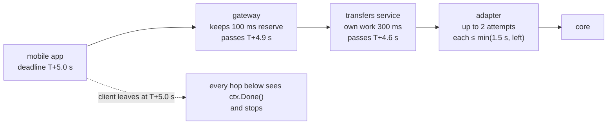
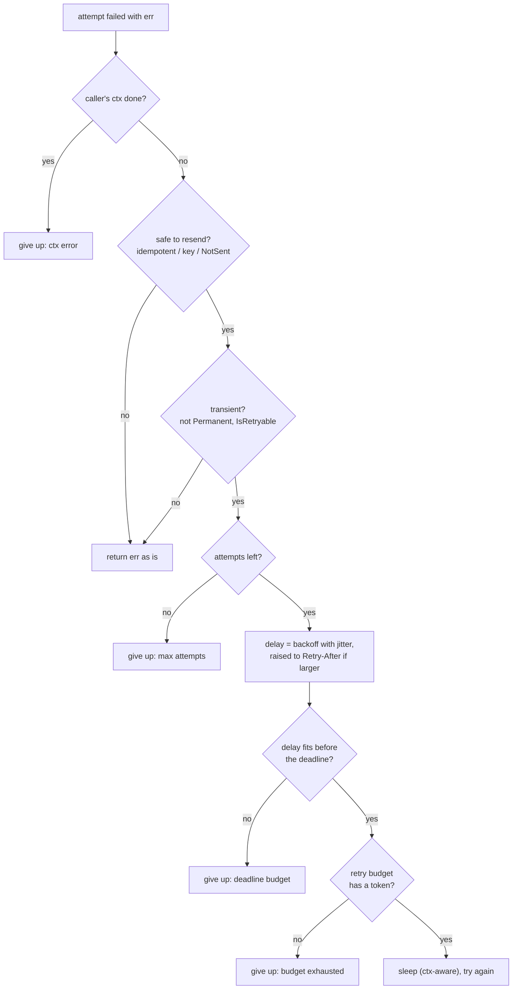
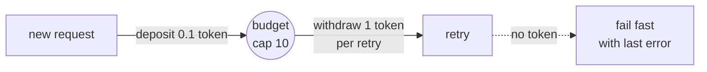
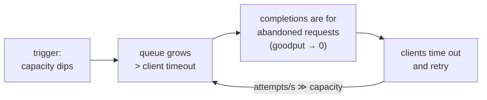

# A7 Unit 1 — Timeouts, retries and retry budgets

> Time: ~5 h (4.5 CORE + 0.5 STRETCH) · CORE: §1–§3 · STRETCH: §4 (hedged requests) · Lab: `labs/a7/retry`

Every vendor adapter you have written has the same three questions hiding in it: *how long do I wait*, *do I try
again*, and *what happens to the dependency if everybody does*. Most outages that start as "a vendor got slow" end as
"we took ourselves down", and the mechanism is nearly always the answers to those three questions. This unit builds
the answers in order: timeouts and deadline budgets (§1), retries with backoff and jitter (§2), retry budgets and the
metastable failures that appear without them (§3), and, as a stretch, hedged requests (§4).

[A1 Unit 3 §1](../A1-networking-api/unit-3-idempotency-auth.md#1-retries-timeouts-and-duplicates) told you *that* a
timeout is ambiguous and *why* retries need idempotency keys; [B0 Unit 2 §1](../B0-go-concurrency/unit-2-cancellation.md#1-context-cancellation-trees-and-deadlines)
taught you how a `context` carries a deadline through a Go program. This unit assumes both and puts numbers and a lab
on top.

## Before you start

You should have finished A1 (especially Unit 3 §1–§2) and B0 Unit 2 §1. Warm-up — answer first:

1. A `POST /v1/transfers` read-times-out after 10 s. Which failures are safe to retry *without* an idempotency key?
2. `child, _ := context.WithTimeout(parent, time.Hour)` where `parent` expires in 50 ms. What is `child`'s effective
   deadline?
3. A vendor adapter makes 150 req/s and each call takes 2 s while the vendor is degraded. How many calls are in flight?

<details data-kind="answer">
<summary>Warm-up answers</summary>

1. Only failures that prove the request was never processed: connection refused, DNS failure, TLS handshake failure.
   A read timeout, a reset after the request was sent, or a 502/504 are ambiguous (A1 Unit 3 §1).
2. 50 ms. A child context can shorten its parent's deadline but never extend it (B0 Unit 2 §1).
3. 150 × 2 = 300 (Little's law, L = λ × W; A0 Unit 2 §5). If the adapter's pool holds 150 connections, half of the
   callers are already queueing.

</details>

---

## §1 Timeouts and deadline budgets

### The failure story

The member app's "accounts overview" screen calls the platform API, which calls a transfers service, which calls the
core-banking adapter, which calls the core. Each hop was written by a different team in a different year:

| Hop | Timeout |
|---|---|
| Mobile app | 5 s |
| API gateway route | 60 s (the proxy's value, never changed) |
| Transfers service → adapter | none (`http.Client{}`, zero `Timeout`) |
| Adapter → core | 30 s |

On a Monday morning the core stalls: connections open, nothing comes back. The app gives up after 5 s and the member
taps refresh; the app's retry doubles the traffic: ≈ 400 requests/s reach the adapter. Every one of them now holds a
goroutine and a socket for 30 s, because that is the only timeout that fires. By Little's law:

> in flight = arrival rate × time in system = 400 req/s × 30 s = **12,000** connections,

against an adapter pool of 500 and a core that allows 300. After 1.25 s the pool is exhausted. The statements
screen, the notifications service and the nightly reconciliation all share that adapter and all start timing out. For
the 25 s between the member giving up (5 s) and the adapter giving up (30 s), every one of those calls is doing work
nobody will ever read. One stalled dependency has become a platform outage, and the only timeout that mattered (5 s)
was on the one hop that doesn't hold any server resources.

### Predict

<!-- predict id="A7-U1-P01" -->
**Predict.** Write your answers down first.

1. Using the table above, which timeouts would you change, and to what? The mobile app's budget stays 5 s; assume the
   edge and the service need ≈ 50 ms and ≈ 300 ms of their own time, and the core's normal p99 is 1.2 s.
2. With your numbers, how many connections are in flight when the core hangs and 400 req/s keep arriving?
3. A colleague says: "just set every timeout to p99 of that dependency". What is the false-timeout rate on a
   healthy dependency, and why is that a problem for `POST /v1/transfers` but not for `GET /v1/accounts`?
<!-- /predict -->

<!-- predict id="A7-U1-P02" -->
**Predict.** A service receives a request with **800 ms** left on its deadline and makes three sequential calls
(`balance`, `history`, `limits`). Each call has a 1 s timeout configured. Each call actually takes 300 ms. What
happens, and what should happen?
<!-- /predict -->

### Reveal

<details data-kind="reveal" data-for="A7-U1-P01">
<summary>Reveal</summary>

1. Order them so the outermost caller has the longest timeout and every inner hop gets a *share of what is left*, not a
   fresh number. One workable budget for a 5 s app timeout: gateway 4.9 s (≈ 100 ms reserve for the retry decision and
   response), transfers service 4.6 s (50 ms edge work already spent), adapter 4.3 s (300 ms of service work spent),
   core attempt ≤ 1.5 s or so (p99 1.2 s plus margin) with at most two attempts inside the 4.3 s. The key move is not
   the specific numbers: it is that the *core call* is bounded by the *member's* deadline, so it stops when the member
   does.
2. Time in system is now ≈ 1.5 s (the core attempt timeout) or less if the deadline has been spent: 400 × 1.5 =
   **600** in flight, against 12,000 before. Still above a pool of 500, which is the signal that the pool or the rate
   needs protection too (a breaker and a bulkhead, Unit 2 and Unit 3). A timeout bounds the *damage per call*; it does
   not by itself make the arrival rate sustainable.
3. A timeout at p99 kills 1% of calls that would have succeeded (1 − 0.99 = 0.01). For a `GET` that is a cheap retry.
   For a `POST /v1/transfers` the client cannot tell whether the core posted the transfer, so each false timeout is an
   ambiguous outcome that needs an idempotency key and, later, reconciliation. The more expensive an ambiguous outcome
   is, the higher the percentile (p99.9, p99.99, or the vendor's contractual maximum) and the more you rely on keys.
   Tempting wrong answer: "short timeouts are always safer". They are safer for your pool and riskier for your data.

</details>

<details data-kind="reveal" data-for="A7-U1-P02">
<summary>Reveal</summary>

Each individual call finishes inside its own 1 s timeout, so no timeout ever fires, and the handler takes ≈ 900 ms
for three calls on an 800 ms deadline. The caller has been gone for 100 ms by the time the last call returns. The
configured timeouts add up to 3 s, which is more than the budget, so they cannot protect it: only the *remaining*
budget can. What should happen: the first call gets `min(1 s, 800 ms − reserve)`, the second gets what is left after
the first, and the third is **skipped** (or served from a default) when what is left is less than it could plausibly
need. The snippet in "How it actually works" does exactly this and prints `limits skipped` for this scenario.
Tempting wrong answer: "it's fine, none of the timeouts fired".

</details>

### How it actually works

**Four timeouts, not one.** A single HTTP call can hang in four different places and each needs its own bound:

| Phase | What hangs | Go knob |
|---|---|---|
| Connect | SYN to a dead host or a full accept queue | `net.Dialer.Timeout`, `Transport.DialContext` |
| TLS | handshake with a stalled peer | `Transport.TLSHandshakeTimeout` |
| Time to first byte | server accepted, never answers | `Transport.ResponseHeaderTimeout` |
| Body / total | slow trickle, huge response | the request `ctx` deadline; `Client.Timeout` as a backstop |

Connect and TLS timeouts should be short (hundreds of ms inside a datacenter, a few seconds across the internet)
because a healthy peer answers them in a few round trips ([A1 Unit 1 §2](../A1-networking-api/unit-1-request-path.md#2-connection-setup-and-http-versions)).
The total deadline comes from the **budget**, not from a constant. A failed connect also proves the request was never
sent, which is the one case where retrying a `POST` is safe on its own (§2).

**A deadline is an absolute time; a timeout is a duration that restarts at every hop.** Three services that each use a
2 s timeout can spend 6 s on a request whose first caller gave up after 2. Propagate the *deadline* and let every hop
derive its own timeout from what is left:



gRPC does this for you (the `grpc-timeout` header carries the remaining time; Go's server context arrives with the
deadline already set). For plain HTTP there is no standard header; teams use a custom one (an absolute timestamp or
remaining milliseconds) that a middleware turns into a `context` deadline on the way in and writes on the way out.
Inside one Go program, `context` already does it (B0 Unit 2 §1).

**The per-call helper.** Three rules turn a deadline into a per-call timeout: never more than the call's own maximum,
never more than what's left minus a reserve for the work you still have to do, and refuse to start a call that cannot
plausibly finish:

```go
package main

import (
	"context"
	"errors"
	"fmt"
	"time"
)

// ErrNoBudget means the caller's deadline leaves too little time to try.
var ErrNoBudget = errors.New("not enough time left")

// callBudget derives the context for one downstream call: at most max, never
// more than what is left of the caller's deadline minus a reserve for our own
// work, and a refusal when what is left is less than the call could plausibly
// need (a call that cannot finish is only load).
func callBudget(ctx context.Context, max, reserve, minUseful time.Duration) (context.Context, context.CancelFunc, error) {
	budget := max
	if dl, ok := ctx.Deadline(); ok {
		left := time.Until(dl) - reserve
		if left < minUseful {
			return nil, nil, fmt.Errorf("%w: %v left, need %v", ErrNoBudget, left.Round(10*time.Millisecond), minUseful)
		}
		budget = min(budget, left)
	}
	cctx, cancel := context.WithTimeout(ctx, budget)
	return cctx, cancel, nil
}

func main() {
	// The member-facing request has 800 ms in total.
	ctx, cancel := context.WithTimeout(context.Background(), 800*time.Millisecond)
	defer cancel()
	for _, name := range []string{"balance", "history", "limits"} {
		cctx, cancelCall, err := callBudget(ctx, time.Second, 50*time.Millisecond, 200*time.Millisecond)
		if err != nil {
			fmt.Printf("%-8s skipped: %v\n", name, err)
			continue
		}
		dl, _ := cctx.Deadline()
		fmt.Printf("%-8s timeout %v\n", name, time.Until(dl).Round(10*time.Millisecond))
		time.Sleep(300 * time.Millisecond) // pretend the call took this long
		cancelCall()
	}
}
```

Output of that program (reference run):

```
balance  timeout 750ms
history  timeout 450ms
limits   skipped: not enough time left: 150ms left, need 200ms
```

The `limits` call is dropped instead of being started and abandoned. What "skipped" means is a product decision:
omit the widget, show a cached value, or fail the request early with a clear error. All three beat holding a
connection for a response nobody will read.

**Choosing the number.** A timeout is a bet on a percentile. Look at the dependency's latency distribution *under
normal load*; a timeout at percentile q kills a fraction 1 − q of healthy calls. The usual guidance: p99.9 or the
vendor's documented maximum when a false timeout is costly (non-idempotent calls), p99 or lower when retries are
cheap and hedging or a fallback exists. Then check the arithmetic against the budget: attempts × per-attempt timeout
+ backoff ≤ the caller's deadline. If it doesn't fit, the answer is fewer attempts or an asynchronous design (A6), not
longer timeouts.

**A timeout does not stop the other side.** When your `ctx` expires, your end of the connection closes; the
dependency may still be working, and it may still *finish*. That's the ambiguity from A1: the transfer may post after
you stopped listening. Cancellation propagation (closing the connection, HTTP/2 `RST_STREAM`, gRPC cancel) lets a
well-behaved server stop early; a server that doesn't check its context will not.

**Slow is the new down.** A dependency that answers in 30 s is, for a 5 s caller, indistinguishable from one that
never answers, and far worse than one that fails fast: a refused connection returns in a millisecond, a slow
dependency holds a slot for the whole timeout. Timeouts convert "gray failure" (partially working, slow, flapping)
into errors that retries, breakers and bulkheads can act on. Without them none of those mechanisms has anything to
count.

### Build it

No lab package for this section: the arithmetic lives in the `retry` lab (§2), where `Config.AttemptTimeout` is
capped by the time left before the caller's deadline and a wait that doesn't fit is refused
(`TestDo_AttemptTimeoutIsCappedByWhatIsLeftOfTheBudget`, `TestDo_ABackoffThatDoesNotFitInTheDeadlineIsNotSlept`).
The experiment below uses a standalone program.

### Break it

Run the three-hop experiment: a client with a 100 ms timeout and two retries, a gateway, and a core that does 200 ms
of work in 5 ms steps, checking its context between steps. In the first run the gateway gives the core a fresh 400 ms
timeout (what a handler that builds its own `context.Background()` does); in the second it passes the request context
down.

```sh
go run -tags breakit ./labs/a7/sim timeouts
go run -tags breakit ./labs/a7/sim timeouts -propagate
```

Predict, for 40 user actions × 3 attempts: how many times does the core *start* its work, how many times does it run
to completion, and how many users are served?

<details data-kind="answer">
<summary>What you should see, and why</summary>

Reference run (millisecond-scale real time; the margins are wide, so the counts are stable):

```
fresh 400 ms timeout at the gateway          request context propagated to the core
  served:                  0                   served:                  0
  gave up:                40                   gave up:                40
  core: work started:    120                   core: work started:    120
  core: ran to completion: 120                 core: ran to completion:   0
  core: abandoned early:    0                  core: abandoned early:   120
```

Nobody is served in either run, because the core needs 200 ms and the client only waits 100 ms. The difference is
what the core does about it. With a fresh timeout it finishes all 120 pieces of work (120 × 200 ms = **24 s of core
time** spent on answers that no client was waiting for) and every retry queues *more* of that work behind it. With the
context propagated it stops at the first check after the client leaves (≈ 100 ms in), so the same 120 calls cost it
about half the time and the work stops when the demand does. Neither fixes the fact that the core is too slow for
this client: that is what the circuit breaker (Unit 2) is for. What propagation fixes is the *amplification* of a slow
dependency into wasted capacity.

</details>

### In the wild

- **Go `net/http`**: `http.Client{}` has no overall timeout by default, and `http.DefaultTransport` bounds only
  some phases (TODO-VERIFY: dial 30 s, TLS handshake 10 s, idle connection 90 s in the Go version you use).
  The request context is the right tool for the total budget; `Client.Timeout` is a coarse backstop (B0 Unit 2 §1).
  `http.Server` needs its own `ReadHeaderTimeout` and friends.
- **gRPC**: deadlines are first class. A client sets one; the remaining time is sent in the `grpc-timeout` header, and
  the server's context carries it, so a Go service that passes `ctx` to its own gRPC calls propagates the budget
  without any code. `DEADLINE_EXCEEDED` is the status when it expires.
- **Envoy / Istio**: a route has an overall `timeout` and a `per_try_timeout`; Envoy also tells the upstream how much
  time is left (TODO-VERIFY: the `x-envoy-expected-rq-timeout-ms` header and the default route timeout of 15 s).
- **AWS Builders' Library, "Timeouts, retries and backoff with jitter"**: the standard write-up on choosing timeouts
  from latency percentiles and on why unbounded waits turn into outages.
- **Google SRE book, "Handling Overload"** and **"Addressing Cascading Failures"**: deadline propagation, and the
  rule that a server should not do work for a request whose deadline has passed.
- **Hystrix** defaulted a command's execution timeout to one second (TODO-VERIFY): a deliberately short number that
  forced every team to decide what to do when a dependency is slow.

### Trade-offs

| Option | Wins when | Loses when | When the answer flips |
|---|---|---|---|
| Propagated absolute deadline; each hop derives its timeout | Chains of ≥ 2 hops, callers that retry, anything on a user's critical path | Needs plumbing (context, a header); an absolute timestamp across machines inherits clock skew | At boundaries you don't control (a vendor): use a fixed timeout below the vendor's contractual maximum, capped by your own remaining budget |
| Fixed per-hop timeouts | One hop, stable latency, quick to ship | Hops don't add up; orphaned work after the caller leaves | As soon as there are two hops: derive from the budget |
| Timeout at p99 | Retries and hedges are cheap, reads, short pools | Kills 1% of healthy calls; for `POST` every kill is an ambiguous outcome | Money movement and anything non-idempotent: p99.9+ and idempotency keys |
| Timeout at p99.9 or the vendor maximum | Costly false timeouts, rare legitimate slowness | A hung dependency holds a slot for the whole timeout (Little: slots = rate × timeout) | If the dependency's failure mode is "hangs forever", pair with a breaker so the long timeout is paid only until it trips |
| Refuse to start when remaining budget < minimum useful | Saves capacity when callers are already late | Needs a defensible "minimum useful" (≈ the dependency's p50) | When partial answers have value even if late (batch jobs), skip the check |

### Senior bar

- **Failure modes.** A hop with no timeout (the whole chain inherits its stall); inner timeout longer than outer;
  connect/TLS/header phases unbounded while the total is bounded only by a coarse backstop; the budget ignores
  retries (3 × 4 s on a 5 s deadline); a queue wait that isn't counted (time in the pool queue is time spent);
  work started after the deadline; orphaned downstream work after cancellation; timeouts longer than a load
  balancer's idle timeout (the LB resets the connection before your timeout fires).
- **Numbers.** In flight when the dependency hangs = arrival rate × timeout: 400 req/s × 30 s = 12,000; × 1.5 s = 600;
  × 0.15 s = 60. A goroutine plus a socket buffer is ≈ a few KB (B0 puts a goroutine at ≈ 2.6 KB), so 12,000 stuck
  calls is ≈ tens of MB of memory but also 12,000 file descriptors (a typical default `ulimit -n` is 1,024;
  TODO-VERIFY on your platform). The binding limit is usually a pool or a descriptor cap, not memory.
- **Ops.** Count timeouts **per hop and per phase**; separate `context.DeadlineExceeded` (we ran out of time) from
  `context.Canceled` (the caller left) as B0 taught; histogram the *remaining budget at entry* of each service. If it's
  often tiny, the problem is upstream. Alert on timeouts per dependency, not just 5xx.
- **Cost.** Almost free to implement; the cost is deciding what each hop does when its budget is gone. Writing the
  "skipped" behaviour for every optional call is the real work.

Interviewer follow-up probes:

1. "How do you choose the timeout for a vendor call?"

<details data-kind="answer">
<summary>Model answer</summary>

From data and from the budget. I look at the vendor's latency under normal load: p50, p99, p99.9, and its contractual
maximum. I pick a percentile based on what a false timeout costs: for an idempotent read, p99 and a retry; for a
non-idempotent write, p99.9 or the contract maximum, plus an idempotency key. Then I check it against the caller's
deadline: attempts × timeout + backoff must fit, and if it doesn't I reduce attempts or make the operation
asynchronous. And I pair it with a breaker, because a long timeout is only affordable if the dependency stops being
called once it's clearly down.

</details>

2. "Service A has a 2 s timeout on B; B has a 3 s timeout on C. What's wrong?"

<details data-kind="answer">
<summary>Model answer</summary>

The inner timeout is longer than the outer. When C is slow, A gives up at 2 s and (probably) retries, while B keeps
holding resources for C until 3 s, and keeps working on a request nobody is waiting for. Under load that doubles the
work at B and C. The fix is to propagate A's deadline so B derives its timeout from what's left (say 1.9 s) and
cancels its call to C when A's deadline passes, with timeouts ordered outer > inner at every hop.

</details>

3. "Why not set every timeout to 30 seconds to be safe?"

<details data-kind="answer">
<summary>Model answer</summary>

"Safe" for what? A long timeout is safe for the single call's success rate and dangerous for everything else: a hung
dependency holds a connection and a goroutine for 30 s per request, so in-flight calls = arrival rate × 30 s, which
exhausts a pool within seconds at any real traffic. It also exceeds the user's patience (5–10 s), so the work is
wasted before it finishes. Timeouts are a capacity control as much as a correctness control.

</details>

4. "The vendor answers after you timed out, for a call that moves money. Then what?"

<details data-kind="answer">
<summary>Model answer</summary>

That is the ambiguous outcome. The request carried an idempotency key (A1 Unit 3 §2), so a retry returns the original
result instead of posting twice. If the vendor can call back with the result, I accept the callback and deduplicate it
by event ID. If neither exists, I record the intent *before* calling, mark it "unknown" on timeout, and reconcile
against the vendor's records by reference before telling the member anything. A timeout never becomes "failed" in my
ledger on its own.

</details>

### Check yourself

1. Why must the outermost caller have the longest timeout?
2. What's the difference between a timeout and a deadline when a request crosses three services?
3. A request arrives with 40 ms left and the dependency's p50 is 120 ms. What does a budget-aware service do?

<details data-kind="answer">
<summary>Answers</summary>

1. Otherwise inner hops keep working (and holding resources) for callers who have already given up and probably
   retried, which doubles the work exactly when the system is slow.
2. A timeout is a duration that restarts at each hop, so three 2 s timeouts can spend 6 s; a deadline is an absolute
   time that every hop shares, so each hop's timeout is whatever is left.
3. It fails fast (or serves a cached/default value) without calling: the call cannot finish, and starting it only adds
   load.

</details>

---

## §2 Retries: backoff, jitter and when retrying is safe

### The failure story

The interest-posting job runs one worker per credit-union batch. 100 workers each apply a change to the same
"posting sequence" row using optimistic concurrency: if two workers collide, one wins and the others get a
retryable conflict. The first version of the retry loop is the one every engineer writes: wait `base × 2^n`, try
again, cap at 2 s. No jitter.

On payday all 100 workers start in the same second. In the first round one worker wins and 99 collide; all 99 wait
exactly 10 ms and collide again; then 20 ms; then 40 ms. The row can serve one success per 10 ms slot, so the
contention never thins: 100 + 99 + 98 + … + 1 = **5,050 calls** to complete 100 updates, and once the backoff reaches
its 2 s cap every round costs 2 s, so the last worker finishes after about **three minutes**. The row is hammered
the whole time and the job's other queries (which share the database) slow down with it. Nothing in the code is
"wrong" in the sense of a bug; the retries are perfectly well-behaved individually and perfectly synchronised
collectively.

### Predict

<!-- predict id="A7-U1-P03" -->
**Predict.** Write your answers down first.

1. In the scenario above (100 clients, one success per 10 ms slot, base 10 ms, cap 2 s), roughly how many total calls
   and how much wall time does the job need if every loser retries with **full jitter** (a uniform random wait between
   0 and the exponential cap)? Order of magnitude is enough.
2. Of full jitter, equal jitter (half fixed, half random) and decorrelated jitter, which do you expect to need the
   fewest calls, and which the most? Why?
3. What does jitter cost?
<!-- /predict -->

<!-- predict id="A7-U1-P04" -->
**Predict.** For each failure, say whether a retry is safe **without** an idempotency key, safe **with** one, or
never useful:
(a) connection refused on `POST /v1/transfers`; (b) read timeout on `POST /v1/transfers`; (c) `503` with
`Retry-After: 30` on `GET /v1/rates`; (d) `400 invalid_account` on `POST /v1/transfers`; (e) `429` on
`POST /v1/transfers`; (f) `502` from the gateway on `PUT /v1/payees/p_1`.
<!-- /predict -->

### Reveal

<details data-kind="reveal" data-for="A7-U1-P03">
<summary>Reveal</summary>

1. About **730 calls and 2.6 s** (20-seed average from `sim backoff`: 729 calls, last worker done after 2.667 s),
   versus 5,050 calls and 3 min 5 s without jitter. A 7× reduction in load and a ≈ 70× reduction in completion time:
   the random waits spread the losers across many slots, so each slot has ≈ one caller instead of dozens.
2. Full jitter (729 calls) and decorrelated jitter (724) are essentially tied and best; equal jitter is slightly worse
   (745 calls, median completion 900 ms vs 528 ms for full, last done 3.9 s) because it keeps a floor of half the
   cap, so the retries bunch in the upper half of the interval. The ranking is robust; the exact numbers depend on the
   model.
3. A little average latency (full jitter's mean wait is cap/2, not cap) and some unpredictability: an individual
   retry can come back almost immediately. That is the point. Predictable timing is what synchronises clients.
   Tempting wrong answer: "randomness makes it flaky". The system's *aggregate* behaviour becomes smoother; any one
   client's timing is allowed to be erratic.

</details>

<details data-kind="reveal" data-for="A7-U1-P04">
<summary>Reveal</summary>

(a) **Safe without a key**: the connection was never established, so nothing reached the server. (b) **Safe only
with a key**: ambiguous outcome; the transfer may have posted. (c) **Safe** (it's a `GET`), but wait *at least* 30 s,
or fail fast if your deadline is shorter than that. (d) **Never useful**: the request is wrong and will be wrong
again; retrying is pure load. (e) **Safe only if the API documents that 429 is returned before any work is done**;
most do, but with a key it is safe regardless; honour `Retry-After`. (f) **Safe**: `PUT` replaces a resource, so
repeating it is idempotent by HTTP semantics, even though a 502 is ambiguous about whether the first attempt applied.
The pattern: safety depends on the *operation* (idempotent or keyed), usefulness depends on the *error* (transient or
permanent), and the delay depends on what the server told you.

</details>

### How it actually works

**Every retry is five questions, in this order.** The lab's `Do` function is exactly this flow:



**The delay.** Let `cap(n) = min(max, base × 2ⁿ)` for the n-th retry (n = 0 for the first). The strategies from the
AWS Architecture Blog post on jitter:

| Strategy | Wait before retry n | Mean | Notes |
|---|---|---|---|
| No jitter | `cap(n)` | `cap` | Synchronises clients. For comparison only. |
| Full jitter | `U(0, cap(n))` | `cap/2` | Best spread; can retry almost at once. |
| Equal jitter | `cap/2 + U(0, cap/2)` | `3cap/4` | Guarantees a minimum wait; spreads less. |
| Decorrelated | `min(max, U(base, 3 × prev))` | grows ≈ 2× per step | Each wait depends on the *previous wait*, not on n. |

Two implementation traps, both tested in the lab: the doubling must not overflow for large `n` (attempt 1000 with a
1 ms base must still return `max`), and decorrelated jitter needs the previous delay carried across attempts.

**Safe to resend?** [A1 Unit 3 §1](../A1-networking-api/unit-3-idempotency-auth.md#1-retries-timeouts-and-duplicates)
gave the rule; the lab encodes it. A call may be retried if it is *naturally idempotent* (`GET`, `PUT`, `DELETE`),
or carries an *idempotency key* that the server deduplicates ([A1 Unit 3 §2](../A1-networking-api/unit-3-idempotency-auth.md#2-idempotency-keys-end-to-end)),
or the error proves the request *never left* (`retry.NotSent`: connection refused, DNS failure). A read timeout on a
keyless `POST` is the ambiguous case and the lab's `Do` returns it unretried. That's deliberate: it is cheaper to
surface "unknown" than to risk a double transfer.

**`Retry-After` is a floor, never a ceiling.** `429` and `503` often carry `Retry-After: <seconds>` or an HTTP-date
(RFC 9110). The client waits `max(own backoff, Retry-After)`. If that doesn't fit before its deadline it gives up at
once rather than sleep through its own budget. Clamp absurd values (`Retry-After: 99999999999`) so a hostile or buggy
server can't park a worker for years.

**What to retry, by error class.**

| Signal | Retry? | Notes |
|---|---|---|
| Connection refused, DNS failure, TLS handshake failure | Yes, even keyless (`NotSent`) | Nothing reached the server. |
| Read/attempt timeout, connection reset after send | Idempotent or keyed only | Ambiguous outcome. |
| 408, 429, 502, 503, 504 | Idempotent or keyed; honour `Retry-After` | 429/503 usually mean "before any work". |
| 500 | Idempotent or keyed, with caution | Could be a deterministic bug: bound attempts tightly. |
| 400, 401, 403, 404, 409, 422 | No | The request or the state is the problem. |
| gRPC `UNAVAILABLE` | Yes | The canonical transient code. |
| gRPC `DEADLINE_EXCEEDED` | Idempotent only | Ambiguous, like an HTTP timeout. |
| gRPC `RESOURCE_EXHAUSTED` | Honour server pushback | The server is shedding: slow down. |

**Using the lab package from an adapter.** The adapter's whole job is translation: HTTP outcome in, a classified error
out. This program (compiled and run against the reference solution) shows the three shapes: success after transient
503s, a permanent 404, and a dial failure that's safe to retry without any key:

```go
package main

import (
	"context"
	"errors"
	"fmt"
	"io"
	"net"
	"net/http"
	"net/http/httptest"
	"sync/atomic"
	"time"

	"github.com/chethu007/system-design-course/labs/a7/retry"
)

// fetch is a GET against a vendor: idempotent, so it may be retried. The
// adapter's job is to translate what happened into what the retry package
// needs to know.
func fetch(ctx context.Context, c *http.Client, url string) (string, error) {
	cfg := retry.Config{
		MaxAttempts: 4, BaseDelay: 10 * time.Millisecond, MaxDelay: 200 * time.Millisecond,
		Idempotent: true, AttemptTimeout: 500 * time.Millisecond,
		Rand: func() float64 { return 0.5 }, // fixed so the output below is reproducible
		OnRetry: func(attempt int, err error, d time.Duration) {
			fmt.Printf("  attempt %d failed (%v); waiting %v\n", attempt, err, d)
		},
	}
	return retry.Do(ctx, cfg, func(ctx context.Context) (string, error) {
		req, err := http.NewRequestWithContext(ctx, http.MethodGet, url, nil)
		if err != nil {
			return "", retry.Permanent(err)
		}
		resp, err := c.Do(req)
		if err != nil {
			var oe *net.OpError
			if errors.As(err, &oe) && oe.Op == "dial" {
				return "", retry.NotSent(err) // nothing reached the vendor
			}
			return "", err
		}
		defer resp.Body.Close()
		switch {
		case resp.StatusCode == http.StatusOK:
			b, err := io.ReadAll(resp.Body)
			return string(b), err
		case resp.StatusCode == http.StatusTooManyRequests || resp.StatusCode == http.StatusServiceUnavailable:
			err := fmt.Errorf("vendor said %d", resp.StatusCode)
			if d, ok := retry.ParseRetryAfter(resp.Header.Get("Retry-After"), time.Now()); ok {
				return "", &retry.RetryAfterError{Err: err, After: d}
			}
			return "", err
		case resp.StatusCode >= 500:
			return "", fmt.Errorf("vendor said %d", resp.StatusCode)
		default: // 4xx: our request is wrong; sending it again will not change that
			return "", retry.Permanent(fmt.Errorf("vendor said %d", resp.StatusCode))
		}
	})
}

func main() {
	var calls atomic.Int64
	srv := httptest.NewServer(http.HandlerFunc(func(w http.ResponseWriter, r *http.Request) {
		switch {
		case r.URL.Path == "/missing":
			http.NotFound(w, r)
		case calls.Add(1) <= 2:
			w.WriteHeader(http.StatusServiceUnavailable)
		default:
			fmt.Fprint(w, "rate: 0.92")
		}
	}))
	defer srv.Close()

	fmt.Println("GET /quote (503, 503, then 200):")
	body, err := fetch(context.Background(), srv.Client(), srv.URL+"/quote")
	fmt.Printf("  -> %q, err=%v, server saw %d calls\n", body, err, calls.Load())

	fmt.Println("GET /missing (404 is permanent):")
	_, err = fetch(context.Background(), srv.Client(), srv.URL+"/missing")
	fmt.Printf("  -> err=%v\n", err)

	fmt.Println("GET against a closed port (dial error, nothing sent):")
	srv.Close()
	_, err = fetch(context.Background(), http.DefaultClient, srv.URL+"/quote")
	var g *retry.GiveUpError
	fmt.Printf("  -> gave up: %v\n", errors.As(err, &g))
}
```

Reference output (with the fixed `Rand`, so delays are `0.5 × cap`; the port in the dial error varies):

```
GET /quote (503, 503, then 200):
  attempt 1 failed (vendor said 503); waiting 5ms
  attempt 2 failed (vendor said 503); waiting 10ms
  -> "rate: 0.92", err=<nil>, server saw 3 calls
GET /missing (404 is permanent):
  -> err=vendor said 404
GET against a closed port (dial error, nothing sent):
  attempt 1 failed (Get "http://127.0.0.1:…/quote": dial tcp …: connect: connection refused); waiting 5ms
  attempt 2 failed (…); waiting 10ms
  attempt 3 failed (…); waiting 20ms
  -> gave up: true
```

**Banking link.** This is the shape of every vendor adapter you have written, with the decisions made explicit:
*classification* (the vendor's 4xx are your bug, its 5xx are its problem), *idempotency* (does the vendor accept a
client reference so a retried "submit check image" can't create two items, or must you reconcile?) and *deadlines*
(the member is waiting). The retry loop is the least interesting part; the translation layer above is where the
incidents hide.

### Build it

Lab `labs/a7/retry`, file `retry.go`. Provided: `Jitter`, the sentinel errors, `GiveUpError`, the `Permanent` /
`NotSent` markers, `RetryAfterError`, `Config` and `DoErr`. Implement, in this order: `Delay`; `Do` with
attempts/backoff only; classification (`Permanent`, the idempotency gate, `IsRetryable`); the deadline budget
(per-attempt timeout capped by what is left, and the "does the wait fit?" check); `RetryAfterError` and
`ParseRetryAfter`. (`Budget` is §3's half of the lab.)

Acceptance tests, roughly in this order: `TestDelay_NoJitterDoublesUntilTheCap`, `…FullJitterIsUniform…`,
`…EqualJitterNeverDropsBelowHalfTheCap`, `…DecorrelatedJitterGrowsFromThePreviousDelay`,
`…HugeAttemptNumbersDoNotOverflow`, `TestJitter_SpreadsASynchronisedHerd`;
`TestDo_RetriesTransientFailuresWithExponentialBackoff`, `…GivesUpAfterMaxAttemptsAndKeepsTheLastError`,
`…PermanentErrorsAreNotRetried`, `…ClassifierDecidesWhatIsRetryable`;
`TestDo_NonIdempotentCallWithoutAKeyIsNotRetried`, `…NonIdempotentCallIsRetriedWhenTheRequestNeverReachedTheServer`,
`…AnIdempotencyKeyMakesAPostRetryable`, `…ATimeoutOnANonIdempotentCallIsAmbiguousAndNotRetried`;
`TestDo_RetryAfterIsAFloorNotACeiling`, `…RetryAfterBeyondTheDeadlineFailsFastWithoutSleeping`,
`…ABackoffThatDoesNotFitInTheDeadlineIsNotSlept`, `…TotalWaitingNeverExceedsTheCallersDeadline`,
`…AttemptTimeoutIsCappedByWhatIsLeftOfTheBudget`, `…ACancelledCallerIsNotRetriedAgainst`,
`…RealSleepRespectsContext`; `TestParseRetryAfter`. Run `go test -race ./labs/a7/retry/`.

Everything is deterministic: tests inject `Sleep` (it moves a fake clock and records the request, so thirty seconds
of backoff takes microseconds), `Now` and `Rand`. If a test of yours ever needs `time.Sleep`, you've put the wait in
the wrong place.

### Break it

1. Run the jitter comparison through **your** `Delay`:
   `go test -tags breakit -run BreakIt_Jitter -v ./labs/a7/retry/`
   (or the dependency-free `go run -tags breakit ./labs/a7/sim backoff`). Predict the total calls for no jitter
   before you run it: the closed form is a one-liner.
2. Then, one at a time in your `Do`: (a) delete the idempotency gate; (b) treat `Retry-After` as a ceiling
   (`min` instead of `max`); (c) delete the "does the wait fit?" check. Run the suite after each and name the
   incident each one would cause.

<details data-kind="answer">
<summary>What you should see, and why</summary>

1. Reference run of `sim backoff` (100 clients, 20 seeds averaged):

   ```
   strategy        total calls    median done      last done
   none                   5050       1m27.06s        3m5.55s
   full                    729          528ms         2.667s
   equal                   745          900ms         3.927s
   decorrelated            724          522ms         2.349s
   ```

   `none` is exactly 100 + 99 + … + 1 = 5,050: in every round exactly one client wins and all the others retry in
   step. With 20 clients the same run gives 210 calls and 24.75 s for `none` against 95 calls and 0.4 s for full
   jitter: the damage grows with the square of the number of contenders.
2. (a) `NonIdempotentCallWithoutAKeyIsNotRetried` and `ATimeoutOnANonIdempotentCall…` fail: your adapter would now
   retry a read-timed-out transfer submission, i.e. double-post money. (b) `RetryAfterIsAFloorNotACeiling` fails (plus
   two deadline tests): the client would hammer a rate-limited vendor *sooner* than the vendor asked, and a vendor that
   asked for 30 s gets 100 ms. (c) Four deadline tests fail: the client sleeps through its own deadline and returns
   "timeout" after the caller already left, wasting the last 100–200 ms of every retry loop and, worse, spending retry
   budget on waits that cannot complete.

</details>

### In the wild

- **AWS Architecture Blog, "Exponential Backoff And Jitter"** (Marc Brooker): the experiment this section rebuilds in
  miniature, and the origin of the names "full", "equal" and "decorrelated" jitter.
- **AWS SDKs** ship a "standard" retry mode: a small fixed number of attempts, exponential backoff with jitter and a
  client-side retry quota (TODO-VERIFY: 3 total attempts, quota of 500 tokens, 5 per retry and 10 per timeout retry in
  the current SDK reference guide).
- **gRPC** service config: `retryPolicy` with `maxAttempts`, `initialBackoff`, `maxBackoff`, `backoffMultiplier` and
  `retryableStatusCodes`, jittered, plus `retryThrottling` (§3). TODO-VERIFY: the cap on `maxAttempts` (the spec
  limits it to a small number such as 5).
- **Envoy**: `retry_on` conditions (`5xx`, `reset`, `connect-failure`, `retriable-status-codes`…), `num_retries`,
  `per_try_timeout`, and a `retry_back_off` with a jittered exponential interval (TODO-VERIFY: base interval 25 ms,
  max ten times the base by default).
- **Stripe's client libraries** retry network failures and some 5xx/409 responses only because every write can carry
  an `Idempotency-Key` (TODO-VERIFY: default `maxNetworkRetries` per language).
- **Go**: the standard library does not retry for you, except for one case: `net/http.Transport` retries a request on
  a *reused* connection that failed before any response, when the request is replayable (A1 Unit 3 §1). Libraries such
  as `cenkalti/backoff` implement randomised exponential backoff (TODO-VERIFY: default randomisation factor 0.5).

### Trade-offs

| Option | Wins when | Loses when | When the answer flips |
|---|---|---|---|
| Full jitter | Many clients, shared failures, contention (the default) | A single latency-critical client that wants a floor | Equal jitter when you need a guaranteed minimum pause (protecting a slow-starting dependency) |
| Decorrelated jitter | Long-running retry loops where waits should grow smoothly | Harder to reason about (no per-attempt formula); needs state | Plain full jitter when attempts ≤ 3 and the simplicity is worth more than the smoothness |
| Fixed delay, no growth | Rare, tiny, bounded retries (≤ 2) | Anything that can persist: no relief for the dependency | Never for shared dependencies |
| Retry at the edge only | One owner of the deadline; no multiplication | Inner hops can't absorb a blip | Inner hops retry *connect* failures only (nothing sent, always safe) |
| Honour `Retry-After` | The server knows when it will recover | A hostile or buggy value parks your worker | Clamp to your deadline and a sane maximum; never ignore it |
| Retry non-idempotent calls with a key | Money movement that must be reliable | Key store is a dependency; keys need retention ≥ retry window | Surface "unknown" and reconcile when the dependency has no key support |

### Senior bar

- **Failure modes.** Synchronised retries (no jitter); retrying 4xx; retrying ambiguous outcomes without a key;
  retries that ignore the deadline; unbounded attempts; fixed `Retry-After` ignored; classifier that treats *all*
  errors as retryable, including the application's own validation failures; retry loops that `time.Sleep` and so
  can't be cancelled; a key regenerated per attempt (A1).
- **Numbers.** Expected attempts per request with failure probability p and r retries: `Σ pⁱ` for i = 0..r. For r = 2:
  p = 0.05 → 1.05×, p = 0.2 → 1.24×, p = 0.5 → 1.75×, p = 1 → 3×. Retries cost most exactly when the dependency
  can least afford them. Backoff with cap 2 s and base 10 ms reaches the cap after 8 doublings (10 ms × 2⁸ = 2.56 s).
- **Ops.** Metrics: attempts per request (the retry ratio), success-on-retry rate, give-ups by reason (max attempts /
  deadline / budget / permanent), retry delay histogram. Log the attempt number and the reason on every retry so an
  incident review can see amplification. Alert when the retry ratio exceeds ≈ 1.2 for a sustained period.
- **Cost.** Each retry is real work for the vendor, and some vendors bill per call (image-processing vendors do).
  Retries are not free resilience; they're a loan against the dependency's capacity.

Interviewer follow-up probes:

1. "Why jitter? Why not just add a random delay once?"

<details data-kind="answer">
<summary>Model answer</summary>

A single random delay spreads the *first* retry but the clients that collide again then retry on the same schedule as
each other. Exponential backoff plus jitter at *every* step re-randomises each round, so the number of clients per
time slot falls as the cap grows. In the contention experiment, 100 clients needed ≈ 730 calls with full jitter versus
5,050 without: the jitter has to be applied to each wait, not just the first.

</details>

2. "A `POST` to the core timed out. How does your client decide whether to retry?"

<details data-kind="answer">
<summary>Model answer</summary>

By asking whether the call is safe to resend. If it carries an idempotency key that the server deduplicates (and the
adapter passes a derived key to the core), a retry is safe and returns the original posting. If not, the timeout is
an ambiguous outcome and I don't retry: I return "unknown", record the intent, and reconcile against the core by
reference. Only errors that prove nothing was sent (connection refused, DNS, TLS handshake) are retried keyless.

</details>

3. "Your retries succeed 95% of the time on the second try. Is that good news?"

<details data-kind="answer">
<summary>Model answer</summary>

It's good for the user and a warning for the system. If 20% of first attempts fail and 95% of retries succeed, offered
load is 1.2× normal and the dependency has a persistent problem that retries are hiding. Hiding it is what the retry
is for; but I would still alert on the retry ratio, because that failure rate is also a capacity loss, and because the
same pattern at 50% failure becomes 1.75× load at the moment capacity is lowest. A retry budget keeps the loan
bounded.

</details>

4. "What does `Retry-After` do to the load on a recovering service?"

<details data-kind="answer">
<summary>Model answer</summary>

It converts a guess into information. Instead of every client probing on its own exponential schedule, the server tells
them when to come back, which lets it shape the return of traffic: a gradually increasing `Retry-After` (or one with
server-side jitter) spreads the recovery. Clients must treat it as a floor, add their own jitter on top so that all
clients told "30 s" don't return at exactly 30 s, and give up if the value exceeds their deadline.

</details>

### Check yourself

1. Why does the lab's `Do` refuse to retry a read timeout on a keyless `POST`, but retry a refused connection?
2. What is the expected number of attempts per request when 50% of attempts fail and r = 2?
3. Name two reasons the delay must be checked against the caller's deadline *before* sleeping.

<details data-kind="answer">
<summary>Answers</summary>

1. After a refused connection nothing reached the server, so a retry cannot duplicate anything. After a read timeout
   the server may have processed the request: the outcome is ambiguous, and only an idempotency key makes a retry safe.
2. 1 + 0.5 + 0.25 = 1.75.
3. The caller leaves when the deadline passes, so sleeping past it wastes the attempt that follows; and a retry
   budget token spent on a wait that can't complete is wasted too.

</details>

---

## §3 Retry budgets, amplification and metastable failures

### The failure story

A rates service sits behind a gateway. Normal load is **80 req/s** and its capacity is **100 req/s** (80% utilised,
healthy). Clients wait 1 s, then retry immediately, at most 2 retries (3 attempts per user request). All three
layers have "reasonable" retry settings.

At 09:00:10 a dependency of the rates service fails over and, for **5 seconds**, its capacity drops to **30 req/s**.
Requests queue up. At 09:00:15 the capacity is back to 100 req/s: higher than the 80 req/s of real demand. The
incident should be over.

It isn't. By 09:00:15 the queue holds ≈ 4,000 requests, most already abandoned by their clients, who have sent
retries. The server processes the queue in order, so every completion is for a client that left seconds ago: wasted
work. Each abandoned attempt times out and triggers another attempt, so the rates service now sees **240
attempts/s** (80 × 3) against a capacity of 100. Goodput is **zero** and stays zero for as long as anyone looks. The
trigger lasted 5 seconds. The outage lasts until a human restarts the service.

### Predict

<!-- predict id="A7-U1-P05" -->
**Predict.** Write your answers down first.

1. After the capacity returns to 100 req/s (above the 80 req/s demand), does the system recover on its own? Explain
   the mechanism in two sentences.
2. Which of these single changes would have prevented the lasting outage? (a) Double the capacity to 200 req/s.
   (b) Cut the client timeout from 1 s to 500 ms. (c) A retry budget of 10% of requests. (d) The server drops queued
   requests whose client has already given up. (e) A bounded queue that rejects when it holds more than 25 requests.
3. If a retry budget allows retries up to 10% of the request rate, what is the maximum amplification, and what does
   the client do when the budget is empty?
<!-- /predict -->

<!-- predict id="A7-U1-P06" -->
**Predict.** A request goes through 3 layers (app, gateway, adapter), each retrying twice (3 attempts per layer). The
bottom dependency always fails. How many calls reach it per user action? What if there is one shared 10% retry budget
instead? Answer for the second case as "closer to 1×, 2× or 4×".
<!-- /predict -->

### Reveal

<details data-kind="reveal" data-for="A7-U1-P05">
<summary>Reveal</summary>

1. **No: this is a metastable failure.** A *trigger* (the 5 s dip) pushed the system into a state that its own
   behaviour *sustains*: the queue is longer than the client timeout, so every completion is for an abandoned request
   (zero goodput), and every abandoned request produces a retry (more load). The loop doesn't need the trigger any
   more. Reference run of `sim metastable` for the naive mode: goodput 80 → 10 during the trigger → **0** from 15 s to
   the end of the 40 s run, with attempts at 240/s and a peak queue of 4,212.
2. In the simulation: (c) the 10% budget **helps but recovers late**: goodput is 0 until ≈ t = 31 s, 16 s after the
   trigger ended, because the FIFO queue still has to drain; (d) and (e) recover **immediately** (goodput = the
   degraded capacity during the dip, then back to demand within ≈ 2 s of the trigger ending), because they remove the
   *zombie work* instead of limiting its creation. (a) More capacity does not remove the loop: once timeouts begin,
   the loop can generate up to `(1 + retries) × demand` = 240 attempts/s, so only capacity above that is safe, and a
   deeper trigger defeats any fixed headroom (not simulated here: set `capNormal` to 2.0 in
   `labs/a7/sim/metastable.go` and see what changes). (b) A shorter timeout makes abandonment happen *sooner* and
   doesn't change the loop. The best designs combine (c) with (d) or (e): limit the amplification **and** don't do
   work nobody is waiting for.
3. Maximum amplification is 1 + 0.1 = **1.1×** per layer, however many retries the policy nominally allows. When the
   budget is empty the client fails fast with the last error (no retry), which is the correct behaviour: during a
   widespread failure, retrying is exactly what would make it worse.

</details>

<details data-kind="reveal" data-for="A7-U1-P06">
<summary>Reveal</summary>

Without a budget: 3 × 3 × 3 = **27** calls per user action ((r + 1)ᵏ, as in A1 Unit 3 §1). With one shared budget the
number depends on the traffic, but it is bounded by `retries ≤ ratio × calls + initial`: measured over 1,000 user
actions through a 3-layer stack, the dependency saw **1.30 calls per user action**: closer to 1× than 2×. The budget
turns multiplicative amplification into roughly additive (the 1- to 4-layer stacks measured 1.10, 1.20, 1.30, 1.40).
Tempting wrong answer: "a budget just caps retries per request". It caps retries relative to *traffic*, so it is
unaffected by how many layers each request crosses.

</details>

### How it actually works

**Amplification arithmetic.** With k layers each making up to r + 1 attempts against a dependency that always fails,
the dependency sees (r + 1)ᵏ calls per user action. With failure probability p at the bottom and independent
retries, the expected load multiplier at one layer is `Σ pⁱ` (§2). The dangerous region is where p is large
(everything is failing), which is exactly when clients are most numerous in retry loops.

**The retry budget.** A *token bucket for retries*, shared by all callers of one dependency:

- Every **first attempt** deposits `ratio` tokens (say 0.1), up to a cap.
- Every **retry** must withdraw one whole token first; if there is none, the call fails fast with its last error.
- Over any period, `retries ≤ ratio × requests + initial tokens`. At ratio 0.1, a healthy dependency with 1% errors
  never notices the budget; a failing one sees at most 1.1× its normal load.



Variants you will meet: gRPC's *retry throttling* (each failure takes 1 token, each success adds `tokenRatio`,
retries stop while tokens ≤ half the maximum); Finagle's *RetryBudget* (a time-windowed percentage plus a minimum
retries-per-second floor so cold clients can still retry); Envoy's `retry_budget` (retries as a percentage of active
requests). They differ in details and share the idea: *retries are paid for out of traffic*. Two design rules: keep
**one budget per dependency** (a global budget lets a failing vendor eat the retries of a healthy one), and share it
across layers if you can (§3's measurement: 1.1×–1.4× instead of 3×–81×).

**Metastable failures.** The pattern in the story has a name (Bronson et al., "Metastable Failures in Distributed
Systems", HotOS 2021; Huang et al., "Metastable Failures in the Wild", OSDI 2022). A metastable failure has a
*trigger* (a deploy, a failover, a cache flush, a load spike) and a *sustaining effect* that keeps the system in the
bad state after the trigger is gone. Common sustaining effects: retries; a request queue holding abandoned work; a
cold cache that makes every request expensive, so the recovering system can't keep up; garbage-collection death
spirals; connection storms; failovers that cascade. The signature is: **the system is overloaded at a load level
that it handled fine before the incident**, and it recovers only when load is *reduced*, not when the trigger is
removed.



The defences, in order of leverage: **(1)** don't multiply: retry at one layer, with a budget; **(2)** don't do work
nobody is waiting for: servers check the propagated deadline and drop expired requests *for free*; **(3)** keep
queues short and bounded so that waiting time never exceeds the client timeout: reject early (Unit 3 §2);
**(4)** tell clients to stand down: 429/503 with `Retry-After`, gRPC pushback, and clients that honour it;
**(5)** have enough headroom, knowing that "enough" means `(1 + retries) × load` if you don't do the others.

### Build it

Lab `labs/a7/retry`, the second half: `Budget` (`NewBudget`, `Deposit`, `Withdraw`, `Tokens`) and its use in `Do`.
Count tokens in thousandths of a token: ten deposits of 0.1 must be exactly one token, and floats won't give you
that. The deposit happens **once per call to `Do`** (not per attempt), and the withdrawal happens **after** the
deadline check, so that a token is never spent on a wait that can't happen.

Acceptance tests: `TestBudget_EarnsARatioPerRequestAndSpendsWholeTokens`, `…CapsSavingsAtMax`,
`…InitialTokensAllowAColdStart`, `…ConcurrentWithdrawalsNeverOverspend` (100 goroutines racing for 10 tokens: exactly
10 win), `TestDo_DepositsOncePerCallAndWithdrawsPerRetry`, `…ABudgetTokenIsNotSpentOnAWaitThatCannotHappen`,
`TestAmplification_NestedRetriesMultiplyWithoutABudget` (27 calls for one action), `…ASharedBudgetBoundsTheStorm`
(200 user actions through 3 layers: 5,400 calls without a budget, 260 with one), `TestDo_ManyCallersShareOneBudgetUnderRace`.
Run `go test -race ./labs/a7/retry/`, then `-count=20`.

### Break it

1. Print the amplification table through your own `Do`:
   `go test -tags breakit -run BreakIt_Amplification -v ./labs/a7/retry/`. Predict the k = 3, r = 3 cell first.
2. Run the metastable simulation and read the `naive` and `budget` rows:
   `go run -tags breakit ./labs/a7/sim metastable -v`. Then compare `-mode deadline`, `-mode lifo` and `-mode shed`.
   Predict, for each mode, the goodput between t = 15 s and t = 25 s.
3. In your `Do`, deposit once per *attempt* instead of once per call, and run
   `TestDo_ManyCallersShareOneBudgetUnderRace`.

<details data-kind="answer">
<summary>What you should see, and why</summary>

1. Reference output:

   ```
   dependency calls per user action, dependency always failing (no budget):
   layers k        r=0      r=1      r=2      r=3
   1                 1        2        3        4
   2                 1        4        9       16
   3                 1        8       27       64
   4                 1       16       81      256

   same stacks, 1000 user actions through ONE shared budget (10% of requests, burst 10):
   layers k        r=0      r=1      r=2      r=3
   1              1.00     1.10     1.10     1.10
   2              1.00     1.20     1.20     1.20
   3              1.00     1.30     1.30     1.30
   4              1.00     1.40     1.40     1.40
   ```

   Without a budget the k = 3, r = 3 cell is 4³ = 64. With one, it is 1.30 for every r ≥ 1: the budget, not the retry
   policy, decides how many calls reach the dependency. The extra 0.1 per layer is each layer's own first-attempt
   deposits spent as retries.
2. Reference output of `sim metastable` (goodput in requests/s averaged over the window; 80 req/s offered):

   ```
   mode            0-10s   10-15s   15-25s   25-40s max queue user fail    wasted
   no-retry           80       10       15       83       250       951       951
   naive              80       10        0        0      4212      2111      2601
   budget             80       10        0       51       286      1586      1755
   deadline           80       30       92       80       186       131         0
   lifo               80       30       90       80       799       149         0
   shed               80       30       83       80        25       218         0
   shed+budget        80       30       83       80        25       224         0
   ```

   `naive` never recovers. `no-retry` recovers on its own after ≈ 8 s once the queue (250) has drained: with no retries
   there is no loop, only a backlog. `budget` also eventually recovers, but late, because it still serves a stale FIFO
   queue. `deadline`, `lifo` and `shed` never waste a completion (wasted = 0) and run at the degraded capacity (30/s)
   *during* the dip: they keep doing useful work in overload. Compare the "user fail" column, the human cost: 951 for
   `no-retry`, 1,586–2,111 for `budget` and `naive`, but only 131–224 for `deadline`, `lifo` and `shed`. Not wasting
   capacity on zombie work is what lets the server finish the requests that can still succeed.
3. `TestDo_ManyCallersShareOneBudgetUnderRace` fails: the budget now earns a token for every retry attempt, so each
   retry pays for the next one and `retries ≤ ratio × requests` no longer holds. The budget silently stops bounding
   anything, while every individual test of `Budget` still passes. That's why the lab's concurrent test checks the
   *system* property (total retries across 1,000 calls) rather than the data structure's.

</details>

### In the wild

- **Google SRE book, "Handling Overload"** describes per-request retry limits and a per-client retry budget, and the
  "adaptive throttling" that clients apply to themselves (TODO-VERIFY: the quoted figures of at most three attempts
  per request and a 10% retries-to-requests ratio).
- **gRPC retry throttling** (`retryThrottling`: `maxTokens`, `tokenRatio`) is a token bucket the client library
  maintains per server (TODO-VERIFY: gRFC A6; retries are disabled while tokens ≤ maxTokens/2).
- **Finagle `RetryBudget`** and **Linkerd** retry budgets (TODO-VERIFY: defaults of a 10 s window, a minimum of 10
  retries per second and a 20% ratio); **Envoy** `retry_budget` (TODO-VERIFY: default `budget_percent` 20% and
  `min_retry_concurrency` 3).
- **Metastable failures** are named and analysed in the HotOS 2021 and OSDI 2022 papers cited above, which surveyed
  public incident reports and found retries and cache or queue effects as common sustaining mechanisms.
- **AWS Builders' Library** articles on retries and on avoiding insurmountable queue backlogs make the same
  arguments from operating AWS services.
- **AWS SDK retry quota**: a client-side token bucket in which retries cost tokens and successes give a few back
  (TODO-VERIFY: constants, as in §2).

### Trade-offs

| Option | Wins when | Loses when | When the answer flips |
|---|---|---|---|
| Retry budget ≈ 10% | Widespread failures (protects the dependency); many clients | A persistent 30% error rate: the budget runs out and requests fail that retries would have saved (the capstone, Unit 3 §5, measures 71 failures of 400 vs 11) | Raise the ratio (20–40%) when the dependency is known to be flaky but not overloaded, or add a breaker so the budget isn't the only control |
| Budget per dependency | Isolates a failing vendor's retries from healthy ones | More state to configure | A single shared budget is fine for one dependency |
| Budget in each layer separately | Simple to add | k independent budgets still allow (1 + ratio)ᵏ | Share or centralise when stacks are deep |
| Server drops expired requests (deadline check) | Any server with a queue and callers that propagate deadlines | Needs the deadline on the wire | Not possible when clients don't send one: use a bounded queue instead |
| Bounded queue / early rejection (`shed`) | Overload that exceeds capacity by a lot; latency-sensitive paths | Rejects work that would have succeeded slowly | Batch paths where eventual completion beats latency |
| Capacity headroom of (1 + r) × load | You can't change the clients | Expensive: 3× capacity for r = 2 | Almost never the right primary defence |

### Senior bar

- **Failure modes.** Retry at every layer; no budget; retry budgets that are global across vendors; FIFO queues
  that serve abandoned work; clients that retry immediately on timeout (no backoff); retries that are not counted in
  the dependency's capacity planning; recovery that depends on a restart; **a cold-start amplifier** (after a
  failover the new instance has empty caches, so it needs more capacity than steady state just when it has least).
- **Numbers.** Queue delay = queue length ÷ service rate: 100 queued requests at 100 req/s is 1 s of delay, exactly one
  client timeout. A queue of 4,000 at 100 req/s is 40 s, i.e. all work wasted. Sizing rule from the simulation: the
  queue limit must satisfy `limit ≤ degraded capacity × client timeout` (here 30 × 1 s = 30): `-qmax 5…30` kept
  goodput at the degraded capacity, `-qmax 50` and `100` wasted work, `-qmax 200` was metastable again (Unit 3 §2).
- **Ops.** Monitor attempts/request, queue delay (not queue length), the fraction of completions delivered to a client
  that was still waiting, and the retry budget's fill level. Practice the recovery: "what do we do when goodput is zero
  and load is normal?" The answer is *reduce load* (shed, disable retries, pause batch), and the runbook should say so.
- **Cost.** Budgets and deadline checks cost almost nothing; what they save is the capacity you'd otherwise provision to
  survive retry storms (up to (1 + r)ᵏ ×).

Interviewer follow-up probes:

1. "What is a metastable failure, and how is it different from an ordinary overload?"

<details data-kind="answer">
<summary>Model answer</summary>

An ordinary overload ends when the load goes away. In a metastable failure a temporary trigger pushes the system into
a state that sustains itself: retries, queued zombie work, cold caches. It stays overloaded at a load level it handled
before the trigger, so removing the trigger doesn't help; you have to remove the *amplifier* (shed load, disable
retries, drop expired work) or restart to clear the state. The design response is to eliminate the loop: retry budget,
deadline-aware servers, bounded queues, clients that honour pushback.

</details>

2. "Where do you put the retry budget: client, gateway or server?"

<details data-kind="answer">
<summary>Model answer</summary>

Where the retry decision is made: in the caller, per dependency. A server can't stop clients from retrying, only
signal (429/503, `Retry-After`, pushback). In a mesh the sidecar proxy is a good place because it sees every call to a
dependency and can share one budget per upstream cluster across all the application's threads. I'd keep one layer
doing retries and give it the budget; inner layers fail fast.

</details>

3. "Your service recovered from an incident only after a restart. What do you look for?"

<details data-kind="answer">
<summary>Model answer</summary>

A sustaining effect, because a restart clears exactly the state that persists across load: queues, caches, connection
pools, in-memory backlogs. I'd check queue delay versus client timeouts (was it serving abandoned requests?), the
attempt rate versus the request rate (retry loop), and cache hit rate after the trigger. Then I'd fix the loop rather
than the trigger: add the deadline check, bound the queue, add a retry budget, and add a runbook step that sheds load
instead of restarting.

</details>

### Check yourself

1. Why must the budget deposit per *call* and not per *attempt*?
2. Why is LIFO or a deadline check better than FIFO when a queue holds abandoned requests?
3. In the metastable simulation, what is the only difference between `naive` and `deadline`?

<details data-kind="answer">
<summary>Answers</summary>

1. Depositing per attempt lets every retry fund the next one, so retries no longer scale with *traffic* and the cap
   disappears.
2. In a FIFO queue the oldest requests are the ones whose clients have most likely left; serving them wastes capacity
   and delays the fresh requests that can still succeed. A deadline check discards them for free, and LIFO serves the
   freshest first.
3. The server skips queued requests whose client's deadline has passed. That one change turns permanent zero goodput
   into full recovery within ≈ 2 s after the trigger ends.

</details>

---

## §4 STRETCH — Hedged requests

### The failure story

The statement-search endpoint fans out to 100 shards and returns when all have answered. Each shard's p99 is 100 ms
and its p50 is 10 ms. The chance that at least one of the 100 shards is slower than its own p99 is
1 − 0.99¹⁰⁰ ≈ **63%** (the same arithmetic as in `docs/NUMBERS.md`). The endpoint's median latency is now roughly the
shards' *p99*, even though every shard is healthy. Retrying after a timeout doesn't help: you have already waited
for the timeout.

### Predict

<!-- predict id="A7-U1-P07" -->
**Predict.** A read has latency ≈ 20 ms for 97% of requests and ≈ 400 ms for the other 3% (a GC pause, a cold cache,
a noisy neighbour). You send a second copy of the request if the first hasn't answered after a delay. (a) What
happens to p99 if the delay is the original p95 (≈ 37 ms)? (b) How much extra load does that add? (c) What if the delay
is the original p99? (d) What if slowness is *correlated*: the second copy is slow whenever the first was?
<!-- /predict -->

### Reveal

<details data-kind="reveal" data-for="A7-U1-P07">
<summary>Reveal</summary>

Reference run of `sim hedge` (200,000 requests, independent slow copies): no hedge p50 20.2 ms, p99 **498 ms**,
p99.9 **1,000 ms**. (a) Hedging after 37 ms (the p95): p99 **60 ms**, p99.9 **77 ms**. (b) Only **5%** of requests
sent a second copy, i.e. +5% load for an 8× better p99. (c) Hedging after the p99 (498 ms) does almost nothing (p99 496
ms): by then the tail is already inside your latency budget. (d) With fully correlated slowness (`-corr 1`) the same
p95 hedge only brings p99 to **382 ms** and p99.9 to 639 ms: when the slowness belongs to the dependency rather than
to one replica, a second copy is just more load on a struggling system. Hedging attacks *random, independent*
slowness (a bad replica, a pause); it does nothing for systemic slowness. Hedge after ≈ p95, and measure.

</details>

### How it actually works

A **hedged request** sends the request, waits `delay` (≈ the p95 of the normal latency), then sends a second copy to
a *different replica* if there is still no answer. The first successful response wins and the other copy is
cancelled. *Tied requests* (Dean and Barroso) enqueue both copies immediately but let each cancel the other when it
starts executing, avoiding duplicate work at the cost of cross-server coordination.

Rules that make it safe:

- **Idempotent reads only.** A hedged `POST /transfers` is two transfers. Hedging a write requires the same
  idempotency discipline as retrying one, and usually isn't worth it.
- **Different replicas.** Two copies sent to the same slow replica are worth nothing.
- **Cancel the loser,** or you have doubled load for no benefit; and make sure the loser's goroutine can exit (a
  buffered result channel, B0 Unit 2 §3).
- **Budget the hedges** with the same token bucket as retries; a global slowdown makes *every* request hedge, and
  `hedge after 10 ms` in the experiment below shows +99% load.
- **Account for them in capacity planning:** hedging at the p95 adds ≈ 5% load in steady state, more during incidents.

A complete, runnable version using the rules above (output from a reference run):

```go
package main

import (
	"context"
	"fmt"
	"sync/atomic"
	"time"
)

// hedged calls fn; if it has not answered within delay, it starts a second
// copy. The first success wins and the other copy is cancelled. Only use it
// for idempotent reads.
func hedged[T any](ctx context.Context, delay time.Duration, fn func(ctx context.Context) (T, error)) (T, error) {
	ctx, cancel := context.WithCancel(ctx)
	defer cancel() // cancels whichever copy is still running

	type result struct {
		v   T
		err error
	}
	// Buffered for both copies: a loser that finishes after we returned must
	// not block forever on its send (the leak from B0 Unit 2 §3).
	results := make(chan result, 2)
	launch := func() {
		v, err := fn(ctx)
		results <- result{v, err}
	}

	go launch()
	timer := time.NewTimer(delay)
	defer timer.Stop()
	pending := 1
	var firstErr error
	for {
		select {
		case <-timer.C:
			pending++
			go launch()
		case r := <-results:
			pending--
			if r.err == nil {
				return r.v, nil
			}
			if firstErr == nil {
				firstErr = r.err
			}
			if pending == 0 {
				var zero T
				return zero, firstErr
			}
		case <-ctx.Done():
			var zero T
			return zero, ctx.Err()
		}
	}
}

func main() {
	var calls atomic.Int64
	// The first copy lands on a slow replica (300 ms); a second copy is fast (20 ms).
	read := func(ctx context.Context) (string, error) {
		d := 20 * time.Millisecond
		if calls.Add(1) == 1 {
			d = 300 * time.Millisecond
		}
		select {
		case <-time.After(d):
			return fmt.Sprintf("answer after %v", d), nil
		case <-ctx.Done():
			return "", ctx.Err()
		}
	}

	start := time.Now()
	v, err := hedged(context.Background(), 50*time.Millisecond, read)
	fmt.Printf("hedged: %q err=%v after ≈ %v, %d copies sent\n", v, err, time.Since(start).Round(10*time.Millisecond), calls.Load())

	calls.Store(1) // every copy is fast: the hedge timer never fires
	start = time.Now()
	v, err = hedged(context.Background(), 50*time.Millisecond, read)
	fmt.Printf("fast path: %q err=%v after ≈ %v, %d new copies sent\n", v, err, time.Since(start).Round(10*time.Millisecond), calls.Load()-1)
}
```

```
hedged: "answer after 20ms" err=<nil> after ≈ 70ms, 2 copies sent
fast path: "answer after 20ms" err=<nil> after ≈ 20ms, 1 new copies sent
```

(70 ms = the 50 ms hedge delay plus the second copy's 20 ms; the slow 300 ms copy is cancelled.)

### Build it

No lab package for this section: the function above is the whole mechanism, and the experiment below measures the
policy. If you want to extend the `retry` lab, a natural exercise is to give `hedged` the same `Budget` as `Do` so
that hedges and retries are paid for out of one pool.

### Break it

Run the policy comparison with independent and with fully correlated slowness:

```sh
go run -tags breakit ./labs/a7/sim hedge
go run -tags breakit ./labs/a7/sim hedge -corr 1
```

Predict which hedge delay gives the best p99.9 per unit of extra load, and what correlation does to it.

<details data-kind="answer">
<summary>What you should see, and why</summary>

Independent slowness (`-corr 0`):

```
policy                       p50 ms   p99 ms p99.9 ms   extra load
no hedge                       20.2    498.3    999.6         0.0%
hedge after p99 (498 ms)       20.2    496.1    527.8         1.0%
hedge after p95 (37 ms)        20.2     60.0     77.3         5.0%
hedge after 10 ms              20.2     36.6     53.8        99.0%
```

Fully correlated (`-corr 1`): p99 382 ms and p99.9 639 ms for the p95 hedge at the same 5% extra load; the 10 ms
hedge still doubles the load for a p99 of 369 ms. The p95 hedge is the knee: 5% load buys almost all the benefit when
slowness is independent, and hedging earlier only buys more load. With correlated slowness there's little benefit at
any delay. That's the case for a circuit breaker and load shedding rather than for more copies.

</details>

### In the wild

- **"The Tail at Scale"** (Dean and Barroso, Communications of the ACM, 2013): introduces hedged and tied requests
  and the fan-out tail arithmetic; its benchmark for a distributed storage read (TODO-VERIFY: 99.9th percentile of
  1,000-key reads falling from ≈ 1.8 s to ≈ 74 ms for ≈ 2% extra requests, hedging after the 95th percentile).
- **gRPC** supports a `hedgingPolicy` in the service config: `maxAttempts`, `hedgingDelay` and `nonFatalStatusCodes`,
  subject to the same retry throttling as ordinary retries (TODO-VERIFY: gRFC A6 details).
- **Cassandra** has "speculative retry" per table (a percentile or fixed delay), which sends a read to another replica
  when the first is slow (TODO-VERIFY: option names and defaults in your version).
- **Envoy** supports hedging on per-try timeouts via a `hedge_policy` (TODO-VERIFY: field names).

### Trade-offs

| Option | Wins when | Loses when | When the answer flips |
|---|---|---|---|
| Hedge at ≈ p95 | Idempotent reads with random slowness (bad replica, GC pause) | Systemic slowness; per-call billing; writes | Don't hedge vendors that charge per request or have strict rate limits |
| Hedge earlier (≤ p50) | Extreme latency sensitivity and spare capacity | Doubles load (+99% at 10 ms in the experiment) | Almost never |
| Tied requests (cancel on start) | You control both servers and can coordinate | Needs cross-server cancellation | Plain hedging when you don't |
| Timeout + retry instead | Tail is rare and a retry is cheap | You pay the full timeout first | Hedging when the tail latency itself breaks your SLO |
| Do nothing | Tail is within SLO | Fan-out amplifies the tail (63% at 100 shards) | Fan-out ≥ 10 usually justifies measuring |

### Senior bar

- **Failure modes.** Hedging non-idempotent calls; both copies to the same replica; not cancelling the loser; hedging
  during an overload (every request hedges: load doubles when capacity is lowest); no budget; hedging against a vendor
  with per-call fees or rate limits.
- **Numbers.** Fan-out tail: 1 − 0.99ⁿ (n = 5: 4.9%; n = 100: 63%). Hedge delay ≈ p95 ⇒ ≈ 5% extra load. The sim: p99
  498 → 60 ms (8×) for +5% load.
- **Ops.** Count hedges sent, hedges that won, and cancelled work; alert if the hedge rate rises well above ≈ 5%
  (something has become systemically slow, hedging has stopped helping and is now hurting).
- **Cost.** Extra load of the hedge rate; the engineering cost is the cancellation plumbing.

Interviewer follow-up probes:

1. "What's the difference between a retry and a hedge?"

<details data-kind="answer">
<summary>Model answer</summary>

A retry starts after the first attempt has *failed* (or timed out); a hedge starts while the first is still running
and the first to succeed wins. A retry trades latency for reliability and costs the full timeout; a hedge trades extra
load for tail latency. Both multiply load and both need idempotency and a budget.

</details>

2. "When would you not hedge?"

<details data-kind="answer">
<summary>Model answer</summary>

Writes without idempotency keys; vendors that bill per call or rate-limit tightly; during overload; when slowness is
correlated (same dependency, same bug, same overloaded database) because a second copy then just adds load. For those
I'd use a breaker and load shedding, and keep hedging for independent, random tail latency on reads.

</details>

### Check yourself

1. Why does the hedge delay sit near the p95 and not near the p50?
2. What must happen to the losing copy, and what goes wrong if it's skipped?
3. What does the 63% in the failure story depend on?

<details data-kind="answer">
<summary>Answers</summary>

1. A p50 delay hedges half the requests (+50% load); the p95 delay hedges only the 5% that are already slow, which is
   where the tail comes from.
2. It is cancelled, so it stops consuming the replica's capacity; and its goroutine must be able to exit (buffered
   result channel), otherwise it leaks.
3. Fan-out width and the per-shard tail: 1 − 0.99ⁿ for n = 100 independent shards, each with a 1% chance of being
   slower than its p99.

</details>

---

## Unit wrap-up

| Decision | Default | Flip when… |
|---|---|---|
| Per-call timeout | Derived from the propagated deadline minus a reserve; refuse to start if less than the minimum useful | The boundary is a vendor you can't propagate to: fixed timeout below their maximum, capped by your budget |
| Timeout percentile | p99.9 / vendor maximum for non-idempotent calls; p99 for idempotent reads with cheap retries | A false timeout is cheap and hedging exists → shorter |
| Who retries | One layer (the one that owns the deadline), with a budget; inner layers retry only `NotSent` | The edge can't retry (server-to-server batch) → the adapter owns it |
| Safe to resend? | Idempotent, keyed, or provably never sent; ambiguous outcomes reconcile | The dependency has no key support → surface "unknown" and reconcile |
| Backoff | Exponential, **full jitter**, capped, within the deadline | Need a guaranteed minimum pause → equal jitter |
| `Retry-After` | A floor; clamp; give up if it exceeds the deadline | — |
| Retry budget | ≈ 10% of requests per dependency, shared across layers | Persistently flaky but healthy dependency → 20–40% plus a breaker |
| Overload with a queue | Deadline-aware server + bounded queue (limit ≤ degraded capacity × timeout) | Batch paths where completion beats latency → bigger queue, no client timeout |
| Hedging | Idempotent reads, delay ≈ p95, budgeted, different replicas | Systemic slowness, writes, per-call billing → don't |

Next: make `go test -race ./labs/a7/retry/` pass, run the break-it experiments, then continue to
[Unit 2](unit-2-breakers-rate-limits.md). Run `sd quiz A7` once you have finished all three units.
