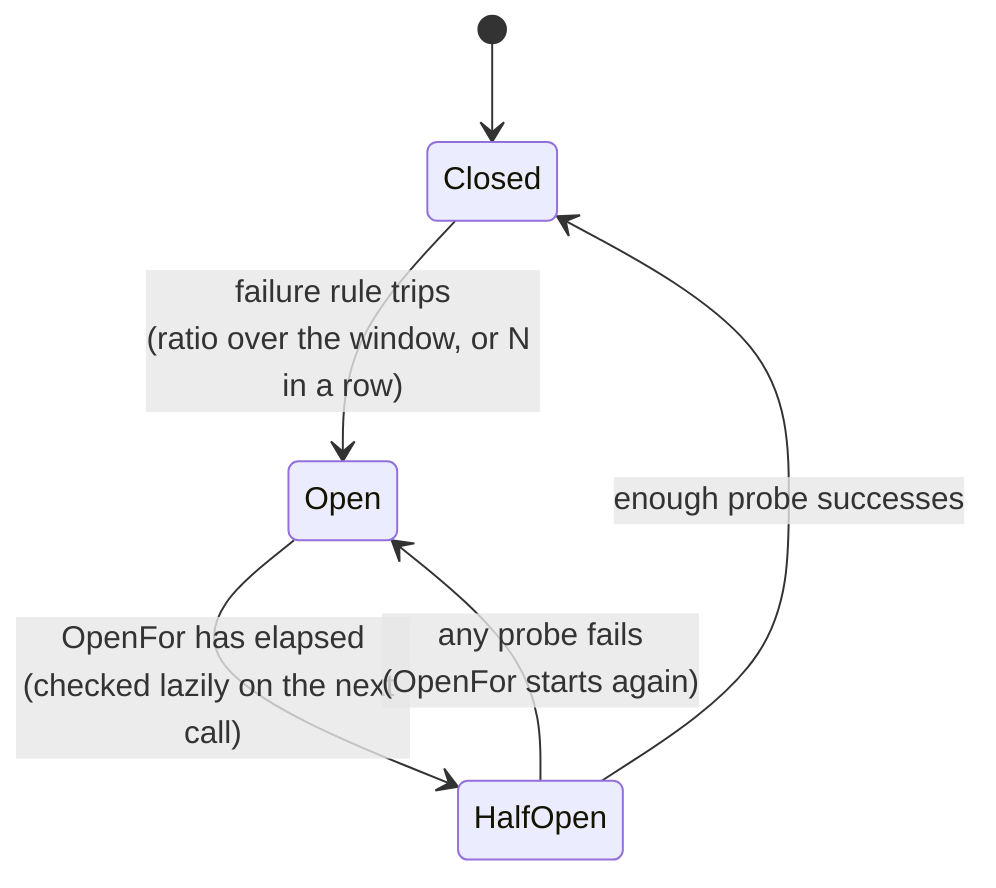
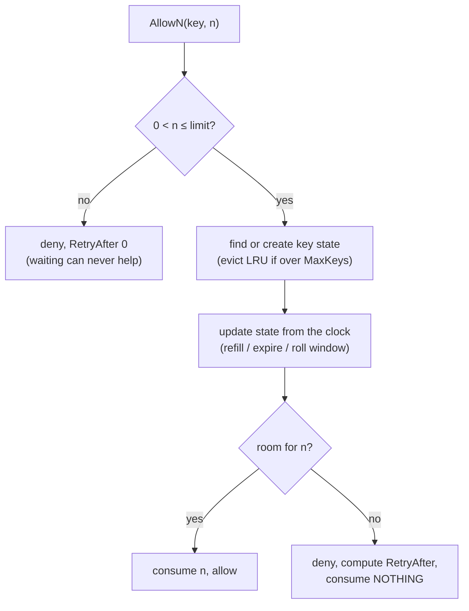
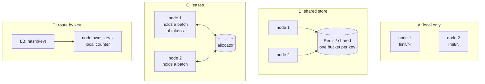

# A7 Unit 2 — Circuit breakers and rate limiting

> Time: ~5.5 h (5 CORE + 0.5 STRETCH) · CORE: §1–§3 · STRETCH: the GCRA and leaky-bucket-as-shaper parts of §2 · Labs: `labs/a7/breaker`, `labs/a7/ratelimit`

Unit 1 gave a caller good manners: bounded waits, safe retries, a budget. This unit gives it two kinds of
self-protection. A **circuit breaker** protects *you* from a dependency that has stopped working: stop calling it,
fail fast, probe for recovery. A **rate limiter** protects a dependency (yours, or a vendor's contract) from a caller
that asks for too much: admit what fits, say clearly when to come back. They look alike in code and differ in who
they protect, what they measure and what they say to the caller, and a senior answer keeps the two straight.

## Before you start

You should have finished Unit 1 and A1 Unit 1 §5 (outlier ejection). Warm-up — answer first:

1. Your retry loop gets `ErrOpen` from a breaker. Should it retry? Why or why not?
2. A shared retry budget earns 0.1 token per first attempt and every retry costs one token. After 1,000 first
   attempts, at most how many retries can it have allowed (starting empty)?
3. In A1 Unit 1 §5 a load balancer ejects a backend after 3 consecutive failures. How is that different from a
   circuit breaker in the caller?

<details data-kind="answer">
<summary>Warm-up answers</summary>

1. No. The breaker is saying "the dependency is believed down; don't send more". Retrying immediately defeats it and
   burns retry budget. Fail fast (or use the fallback) and let the breaker's own probes find the recovery.
2. 100: retries ≤ ratio × requests + initial tokens = 0.1 × 1,000 + 0 (Unit 1 §3). The budget ties retries to traffic,
   which is the same idea this unit's rate limiters apply to callers.
3. Outlier ejection works *per backend instance* inside a load-balanced pool and is about shifting traffic to healthy
   peers. A circuit breaker works *per dependency* in the caller and is about not calling a dependency at all when
   all of it is unhealthy (there is no healthy peer to shift to).

</details>

---

## §1 Circuit breakers

### The failure story

The check-image vendor behind remote deposit capture stops answering at 09:10 on payday: connections are accepted
and nothing comes back. The adapter's budget-derived timeout is 2 s (Unit 1 §1). Deposits arrive at ≈ 100 calls/s.
For the 60 seconds the vendor is down:

- every call holds a goroutine and a connection for the full 2 s: in flight = 100 × 2 = **200** (Little's law), more
  than the shared vendor-HTTP-client's `MaxConnsPerHost` of 150;
- 6,000 calls are sent to a vendor that cannot answer any of them;
- the statements service uses the same client for check-image *retrieval*, so statement pages hang too;
- when the vendor comes back it is hit by the retries of everything that timed out, while still warming up.

The timeouts did their job (each call ends after 2 s). What is missing is the memory: nothing remembers that the last
four hundred calls all failed.

### Predict

<!-- predict id="A7-U2-P01" -->
**Predict.** Write your answers down first. The vendor is down from t = 10 s to t = 70 s; calls arrive at 100/s;
each fails after 2 s. A circuit breaker uses a 10 s rolling window, trips at ≥ 50% failures with at least 20 calls in
the window, stays open 10 s, then lets one probe through.

1. How many calls reach the dead vendor over the 60 s, with and without the breaker?
2. At what time does the breaker open? Is it ≈ 10.2 s (20 failures), 12 s, or later?
3. How long after the vendor recovers (t = 70 s) does the first successful call happen, with and without the breaker?
<!-- /predict -->

<!-- predict id="A7-U2-P02" -->
**Predict.** Which of these should count as a *failure* toward tripping the breaker, which as a *success*, and which
should be *ignored*? (a) `400 invalid_account`; (b) `404` for a check image that really doesn't exist; (c) `500`;
(d) read timeout; (e) `context.Canceled` because the member closed the app; (f) `429` from the vendor; (g) connection
refused; (h) your own bulkhead rejected the call before it was sent.
<!-- /predict -->

### Reveal

<details data-kind="reveal" data-for="A7-U2-P01">
<summary>Reveal</summary>

Reference run (`go test -tags breakit -run BreakIt_VendorOutage -v ./solutions/a7/breaker/`):

```
(outage: t = 10 s .. 70 s)             no breaker      breaker
calls into the dead vendor                   6000          604
  of which before the breaker opened            -          600
breaker first opened at                         -          16s
rejected locally (fast)                         0         5800
peak requests in flight                       200          200
first success after recovery                1m10s        1m14s
```

1. **6,000 vs 604.** 600 of those 604 were sent *before* the breaker opened; the other four are probes.
2. **16 s, six seconds into the outage.** Two things delay it. Failures only become visible 2 s after their calls
   start (the vendor hangs). And the 10 s window still contains ≈ 800 successes from before the outage: the failure
   *ratio* only reaches 50% when the failures accumulated since t = 12 s outweigh the successes still inside the
   window, which happens at t = 16 s. A ratio over a window dilutes at high volume. Peak in flight is still 200 with or
   without the breaker, since those 200 were already out the door before it opened.
3. Without the breaker the first success is at 70 s (the vendor is back and every call goes to it). With the breaker it
   is at **74 s**: the breaker was open when the vendor came back, and the next probe was at 74 s (the probe at 64 s
   failed and re-opened it for another 10 s). Recovery is delayed by up to `OpenFor` plus the probe's own latency.
   That's the price of not hammering a vendor that may still be down.

Tempting wrong answer for 2: "after 20 failures, so ≈ 10.2 s". `MinRequests` is a floor, not the trigger; the ratio
has to cross the threshold too.

</details>

<details data-kind="reveal" data-for="A7-U2-P02">
<summary>Reveal</summary>

The question the breaker asks is *"is the dependency unhealthy?"*, so only evidence about the dependency counts.
(a) **Success**: the vendor answered correctly; the request was wrong. (b) **Success**, same reason. (c) **Failure**.
(d) **Failure**: slow is the most common way a vendor fails. (e) **Ignore**: the member left; it says nothing about the
vendor, and counting it lets a burst of impatient users open the circuit. (f) **Failure or ignore, by policy**: the
vendor is alive but telling you to back off; many teams count it as a failure for *this* breaker (stop calling), others
route it to the rate limiter. Decide deliberately and document it. (g) **Failure**. (h) **Ignore**: it never reached the
vendor; counting your own rejections would let your bulkhead open your breaker (a self-inflicted outage, see §5 in
Unit 3). The lab's `Classify` function returns `Success`, `Failure` or `Ignore` for exactly this reason, and `Do`
additionally ignores *any* error when the caller's own context is already done.

</details>

### How it actually works

**Three states.**



- **Closed**: everything passes; outcomes are recorded in a **rolling window**. The lab keeps a ring of `Buckets`
  counters, each `Window/Buckets` wide, identified by `now / bucketWidth`; a bucket whose id is too old is simply
  ignored and reused. No background goroutine.
- **Open**: every call is rejected immediately with `ErrOpen`, in microseconds, without touching the dependency.
- **Half-open**: after `OpenFor` the breaker admits a *limited number* of probe calls (`HalfOpenMax` at a time). Enough
  successes (`HalfOpenSuccesses`) close it; any failure re-opens it for a fresh `OpenFor`. The limit matters: a
  recovering vendor must not be greeted by the whole backlog at once. In the lab's thundering-herd test 200 callers
  arrive at the instant the breaker half-opens and exactly `HalfOpenMax` of them reach the dependency.

**When to trip.** Two common rules, and you can use both:

| Rule | Trips when | Strength | Weakness |
|---|---|---|---|
| Failure ratio over a window | failures / total ≥ r, with total ≥ `MinRequests` | Robust to occasional errors; scales with traffic | At high volume, old successes dilute new failures and detection lags (16 s in the experiment) |
| Consecutive failures | N failures in a row | Fast; works at any volume | A healthy dependency with a 5% random error rate produces a run of five failures about 0.05⁵ ≈ 3 × 10⁻⁷ of the time per call: at 100 calls/s (8.6 M calls a day) that is 2–3 spurious trips a day; N must be tuned to the base error rate |
| Slow-call ratio | calls slower than a threshold ≥ r | Catches brown-outs where nothing errors | Needs a latency threshold per dependency |

`MinRequests` exists because 1 failure out of 1 call is a 100% failure rate: without a volume floor a quiet
endpoint's first error opens it.

**State changes while calls are in flight.** A call admitted while Closed may finish after the breaker has tripped,
been reset, or half-opened. Its result describes the dependency *as it was*, so it must not close a half-open breaker
(it isn't a probe) or re-open it. Every state change bumps a **generation** number; a call remembers the generation it
was admitted under, and a result from an older generation is dropped. `TestBreaker_ResultsFromBeforeAStateChangeAreIgnored`
exists because this is the bug nearly every hand-rolled breaker has.

**What the caller does when open: the fallback.** Fail fast is already a win. Better is a *useful* answer without the
dependency: a cached value, a default, a degraded result, an alternative vendor, or "accepted and queued". Two cautions:
a fallback is code that runs rarely and so is tested rarely (the AWS Builders' Library has an article on avoiding
fallback for that reason); and the fallback must itself be safe under load, because it will be exercised by the full
traffic at the worst moment. For money movement the honest fallback is usually *"accepted as pending"*, never a fake
success.

**Where it sits.** Per dependency, in the caller, inside the retry loop (so each attempt consults it) and with its own
errors marked non-retryable (Unit 1 §2, and the composition in Unit 3 §5). Per-process breakers are the default: each
instance learns from its own traffic, with no shared state to fail. Keep the key coarse enough to have volume: a
breaker per (vendor, tenant) for 40 credit unions each sending 2 calls/s will never reach `MinRequests`; a breaker per
vendor will. Where tenants have *separate credentials* at the vendor (one tenant's expired API key shouldn't open the
circuit for everyone), classify credential errors as `Success` (the vendor answered) or `Ignore` rather than splitting
the breaker.

**Breaker, outlier ejection and health check: not the same thing.**

| Mechanism | Scope | Question it answers | Action |
|---|---|---|---|
| Circuit breaker | one dependency, in the caller | "Is the whole dependency unhealthy?" | Stop calling it, fail fast, probe |
| Outlier ejection (A1 Unit 1 §5; Envoy) | one *instance* in a pool | "Is this instance worse than its peers?" | Remove it from the pool for a while |
| Health check (active) | one instance | "Does it answer a probe?" | Mark in/out of rotation |
| Bulkhead (Unit 3 §1) | one dependency's *resources* | "How much of my capacity may this consume?" | Reject beyond a cap |

**A usage example.** A deposit flow that never fails a deposit because the image vendor is down: it accepts it as
pending. The program compiles against the lab package; the output is from the reference solution with short real
timers (the breaker opens after four failures, `OpenFor` is 100 ms):

```go
package main

import (
	"context"
	"errors"
	"fmt"
	"sync/atomic"
	"time"

	"github.com/chethu007/system-design-course/labs/a7/breaker"
)

var errVendor = errors.New("image vendor: timeout")

// analyse runs a deposit's check image through the vendor behind a breaker.
// When the vendor is unhealthy the deposit is not failed: it is accepted as
// pending and queued for later analysis, which the member sees as "received".
func analyse(b *breaker.Breaker, vendor func(context.Context) error, id int) string {
	err := b.Do(context.Background(), vendor)
	switch {
	case err == nil:
		return "analysed"
	case errors.Is(err, breaker.ErrOpen):
		return "accepted as pending (breaker open, vendor not called)"
	default:
		return "accepted as pending (vendor failed)"
	}
}

func main() {
	var down atomic.Bool
	down.Store(true)
	b := breaker.New(breaker.Config{
		Window: time.Second, Buckets: 10, MinRequests: 4, FailureRatio: 0.5,
		OpenFor: 100 * time.Millisecond, HalfOpenMax: 1, HalfOpenSuccesses: 1,
		OnStateChange: func(from, to breaker.State) { fmt.Printf("    breaker: %v -> %v\n", from, to) },
	})
	var calls atomic.Int64
	vendor := func(context.Context) error {
		calls.Add(1)
		if down.Load() {
			return errVendor
		}
		return nil
	}

	fmt.Println("vendor is down:")
	for id := 1; id <= 6; id++ {
		fmt.Printf("  deposit %d: %s\n", id, analyse(b, vendor, id))
	}
	fmt.Printf("  vendor calls so far: %d of 6 deposits\n", calls.Load())

	time.Sleep(150 * time.Millisecond) // OpenFor elapses: the next call is a probe
	fmt.Println("after 150 ms the breaker half-opens; the vendor is still down:")
	fmt.Printf("  deposit 7: %s\n", analyse(b, vendor, 7))

	down.Store(false)
	time.Sleep(150 * time.Millisecond)
	fmt.Println("vendor recovered; after another 150 ms the next call is a probe:")
	fmt.Printf("  deposit 8: %s\n", analyse(b, vendor, 8))
	fmt.Printf("  deposit 9: %s\n", analyse(b, vendor, 9))
}
```

```
vendor is down:
  deposit 1: accepted as pending (vendor failed)
  deposit 2: accepted as pending (vendor failed)
  deposit 3: accepted as pending (vendor failed)
    breaker: closed -> open
  deposit 4: accepted as pending (vendor failed)
  deposit 5: accepted as pending (breaker open, vendor not called)
  deposit 6: accepted as pending (breaker open, vendor not called)
  vendor calls so far: 4 of 6 deposits
after 150 ms the breaker half-opens; the vendor is still down:
    breaker: open -> half-open
    breaker: half-open -> open
  deposit 7: accepted as pending (vendor failed)
vendor recovered; after another 150 ms the next call is a probe:
    breaker: open -> half-open
    breaker: half-open -> closed
  deposit 8: analysed
  deposit 9: analysed
```

(The "closed -> open" line prints before deposit 4's result line because the transition callback runs inside `Do`,
as the fourth failure is recorded. Note that the callback fired *outside* the breaker's lock: the lab's
`CallbackMayInspectTheBreakerWithoutDeadlock` test calls `b.State()` from inside it.)

**Banking link.** This is your flaky image vendor, with the policy decision made explicit. *Accepted as pending* is
the right behaviour for a deposit, but it creates an obligation: the queued items must be reprocessed after
recovery (an outbox or a queue; A6), exactly once (idempotency; A1), with an audit record that the deposit was
accepted while the vendor was unavailable. The breaker's state changes themselves belong in the audit and ops trail:
"vendor X was considered down from 09:16:00 to 09:17:14" is the first thing an incident review asks for.

### Build it

Lab `labs/a7/breaker`, file `breaker.go`. Provided: `State`, `Outcome`, `ErrOpen`, `Config`. Implement `New`
(defaults), `State`, `Counts`, `Allow`, `Do`. The `Breaker` type's doc comment lists the design the tests assume
(bucketed rolling window, lazy Open → HalfOpen, generation number, window cleared on close, callbacks outside the
lock).

Acceptance tests: `TestBreaker_StartsClosedAndPassesCallsThrough`, `…ZeroConfigGetsUsableDefaults`,
`…DoesNotTripBelowMinRequestsEvenAtHundredPercentFailures`, `…StaysClosedBelowTheFailureRatio`,
`…OnlyOutcomesInsideTheRollingWindowCount`, `…ConsecutiveFailuresRuleTripsRegardlessOfVolume`,
`…OpenRejectsWithoutCallingTheDependency`, `…HalfOpensAfterOpenForAndAProbeSuccessCloses`,
`…AFailedProbeReopensForAFullOpenPeriod`, `…HalfOpenAdmitsOnlyHalfOpenMaxProbes`,
`…ThunderingHerdOnHalfOpenOnlyProbesGetThrough` (200 concurrent callers), `…CallerCancellationIsNotAFailure`,
`…CallersOwnDeadlineExpiryIsNotAFailure`, `…ADependencyTimeoutWithALiveCallerIsAFailure`,
`…ACancelledErrorWithALiveCallerIsIgnoredByDefault`, `…ClassifyCanExcludeErrorsThatAreNotTheDependencysFault`,
`…IgnoredProbeFreesTheSlotWithoutAVerdict`, `…ResultsFromBeforeAStateChangeAreIgnored`, `…ClosingStartsFromACleanWindow`,
`…DoneFunctionIsIdempotent`, `…PanicCountsAsFailureAndPropagates`, `…OnStateChangeSeesEveryTransitionInOrder`,
`…CallbackMayInspectTheBreakerWithoutDeadlock`, `…ConcurrentUseIsRaceFree`. Run `go test -race ./labs/a7/breaker/`.

Time is injected (`Config.Now`), so "open for 30 seconds" is `clock.Advance(30 * time.Second)`; the only real
concurrency is in the herd and race tests, and both have timeouts.

### Break it

1. Run the outage experiment against **your** breaker and the detection-speed comparison:
   `go test -tags breakit -run BreakIt -v ./labs/a7/breaker/`. Predict, before you run it, which of five trip rules
   opens first and how many calls each lets through.
2. Then change your implementation, one mutation at a time, and run the suite: (a) remove the generation check;
   (b) count `context.Canceled` as a failure; (c) don't clear the window when the breaker closes; (d) call
   `OnStateChange` while holding your lock.

<details data-kind="answer">
<summary>What you should see, and why</summary>

1. Detection speed (outage starts at t = 10 s; failures surface 2 s later; 100 calls/s):

   ```
   rule                                         opens at   calls before it opens
   ratio 50%, 10 s window, min 20                    16s                600
   ratio 50%, 2 s window, min 20                  12.19s                219
   ratio 20%, 10 s window, min 20                 13.51s                351
   20 consecutive failures                        12.19s                219
   5 consecutive failures                         12.04s                204
   ```

   The consecutive rules and the short window react as soon as the first failures arrive (12 s is the earliest
   physically possible: the first call fails at 10 s + 2 s). The 10 s ratio rule lets 600 calls into the dead vendor.
   Lowering the ratio to 20% helps (13.5 s) at the price of more sensitivity to ordinary noise.

   And the `OpenFor` trade-off for the same outage:

   ```
   OpenFor    probes after first trip    first success after recovery
   1s                              18                          1m11s
   5s                               7                          1m10s
   10s                              4                          1m14s
   30s                              1                          1m18s
   1m0s                             0                          1m16s
   ```

   Short `OpenFor` sends many probes into a dead vendor (18) and notices recovery quickly (1 s late); long `OpenFor`
   sends none (0) but can be open for a minute after the vendor is back. (The 1m16s/1m18s rows depend on where the
   last probe falls relative to t = 70 s.)
2. (a) `ResultsFromBeforeAStateChangeAreIgnored` fails: a straggler's success closes a half-open breaker that was
   never probed. (b) `ACancelledErrorWithALiveCallerIsIgnoredByDefault` fails: in production, a hedged request's
   cancelled loser or a user pressing "back" opens the circuit. (c) `ClosingStartsFromACleanWindow` fails: one failure
   after recovery re-trips the breaker because the old failures are still in the window. (d)
   `CallbackMayInspectTheBreakerWithoutDeadlock` fails by timing out: a logging callback that calls `b.State()` hangs
   the whole service the first time the breaker trips.

</details>

### In the wild

- **Michael Nygard, *Release It!*** (first edition 2007): the book that named the pattern (along with bulkheads and
  timeouts) from production failure case studies.
- **Netflix Hystrix** popularised it in the JVM (command wrapper, rolling window with buckets, thread-pool isolation).
  TODO-VERIFY: its defaults (a 10 s window of 10 buckets, minimum 20 requests, 50% error threshold, 5 s sleep window).
  Hystrix has been in maintenance mode since 2018 (TODO-VERIFY); **resilience4j** is the usual successor
  (TODO-VERIFY defaults: failure rate threshold 50%, count-based window of 100 calls, 60 s in the open state,
  10 permitted half-open calls, slow-call thresholds). **Polly** (.NET) and **sony/gobreaker** (Go) are the same idea.
- **Envoy** "circuit breakers" are in fact *concurrency limits* (maximum connections, pending requests, requests,
  retries per cluster: TODO-VERIFY defaults of 1024), i.e. bulkheads (Unit 3). Its **outlier detection** ejects
  instances after consecutive 5xx or gateway failures (TODO-VERIFY: default 5 consecutive 5xx, 30 s base ejection time,
  at most 10% of hosts ejected). Know which one a mesh means when it says "circuit breaker".
- **AWS Builders' Library, "Avoiding fallback in distributed systems"**: why a breaker's fallback path is itself a
  risk, and why failing fast is sometimes better.
- **Go**: `golang.org/x/time/rate` is not a breaker; there's no breaker in the standard library, which is why the
  lab exists.

### Trade-offs

| Option | Wins when | Loses when | When the answer flips |
|---|---|---|---|
| Failure-ratio rule | Moderate-to-high volume with a real base error rate | Low volume (needs `MinRequests`); high volume dilutes (use a short window) | Consecutive failures for low-volume critical dependencies, plus the ratio for noise |
| Consecutive-failures rule | Hard-down detection at any volume | Random errors in a long enough stream will trip a small N | Ratio when the base error rate is non-zero |
| Short `OpenFor` (1–5 s) | Fast recovery matters; probes are cheap | Many instances × short interval = probe storm on a recovering vendor | Longer `OpenFor`, with jitter, when the vendor is fragile on restart |
| `HalfOpenMax` = 1 | Fragile dependency | Slow recovery if the one probe is unlucky | 2–5 probes for high-traffic, robust dependencies |
| Breaker per dependency | The dependency fails as a unit | Hides a single bad instance (use outlier ejection) | Per (dependency, endpoint) when endpoints fail independently and have the volume |
| Fallback value / pending | UX continuity; vendor outages are common | The fallback is untested, or lies ("success") | Fail fast with a clear error when no honest fallback exists |

### Senior bar

- **Failure modes.** No `MinRequests` (a quiet endpoint opens on one error); counting client errors or caller
  cancellations; never closing because probes are unrepresentative (the probe call hits a heavy endpoint, or the
  breaker is keyed too coarsely); *flapping* (open/closed every few seconds); the fleet probing in lock-step;
  breaker state invisible to operators; a fallback that melts under full traffic; a breaker that opens because of
  *your* rejections (bulkhead/limiter) rather than the vendor's failures.
- **Numbers.** Detection latency ≈ time for failures to arrive (the timeout) + time for the rule to cross its
  threshold: 16 s for the 10 s ratio rule vs 12 s for 5 consecutive failures in the experiment. Calls saved: 6,000 →
  604. Probe load = instances ÷ `OpenFor`: 200 instances with `OpenFor` = 10 s is 20 probes/s into a recovering vendor.
  Jitter `OpenFor` per instance (±20%) so they don't align.
- **Ops.** Export state (gauge), transitions, rejections and probe results per dependency; alert when a breaker has
  been open for more than a few minutes (page for a critical vendor); give operators a **manual override** (force open
  to protect a vendor that is struggling, force closed to rule the breaker out during a debug). Put transitions in
  the audit trail.
- **Cost.** Almost nothing in CPU (a mutex and a few counters). The real cost is the product decision for every
  fallback, and the false positives: a breaker that opens when it shouldn't is an outage you wrote yourself.

Interviewer follow-up probes:

1. "Walk me through a circuit breaker."

<details data-kind="answer">
<summary>Model answer</summary>

Closed: calls pass through and I count outcomes in a rolling window. If failures cross a threshold (a ratio with a
minimum volume, or N in a row) it opens: calls fail immediately with a distinct error, so I stop wasting a goroutine
and a connection per call on a dependency that can't answer, and the dependency gets breathing room. After a cool-down
it half-opens and admits a small, limited number of probes; if they succeed it closes and resets the window, if one
fails it opens again for a full period. I'd pair it with a fallback appropriate to the data (cached, pending,
alternative vendor), and keep it per dependency, inside the retry loop.

</details>

2. "What counts as a failure?"

<details data-kind="answer">
<summary>Model answer</summary>

Evidence that the dependency is unhealthy: timeouts, connection errors, 5xx. Not evidence: the caller's own
cancellation or exhausted deadline, 4xx (the dependency answered correctly), and rejections by my own bulkhead or
limiter. 429s are a judgement call: the vendor is alive but pushing back, so I'd route them to the rate limiter or
treat them as backpressure, but I'd record the decision. The classification function is the most important piece of
configuration in the whole breaker.

</details>

3. "200 instances all have breakers. The vendor recovers. What happens?"

<details data-kind="answer">
<summary>Model answer</summary>

Each instance's breaker half-opens after its own `OpenFor` and sends probes. If they are aligned, 200 probes hit the
vendor in the same instant, plus whatever traffic follows the first successes. I'd jitter `OpenFor` per instance,
keep `HalfOpenMax` low, and ramp traffic back (a half-open state that admits an increasing fraction). The ramp
matters more for vendors with cold caches or autoscaling; a vendor that restarts with empty caches can need minutes of
gradual load.

</details>

4. "Why not just timeouts and retries?"

<details data-kind="answer">
<summary>Model answer</summary>

They bound the cost of *one call*; they don't remember. When the dependency is down, timeouts make each call cost the
timeout, and retries multiply the calls. A breaker adds memory across calls: after N failures it stops calling, so
the cost per request drops from "the timeout" to "microseconds", the dependency gets relief, and the caller's pool and
latency stop depending on the dependency's health. In the experiment, 6,000 calls into a dead vendor became 604.

</details>

### Check yourself

1. Why does a half-open breaker admit only a few probes?
2. Why is the generation number necessary?
3. A 10 s ratio window opened the breaker 6 s into the outage. Name two ways to open sooner.

<details data-kind="answer">
<summary>Answers</summary>

1. A recovering dependency (cold caches, warming connections) can fall over again if hit with the whole backlog; a few
   probes test recovery without risking that.
2. Calls in flight when the state changes finish later; their outcomes describe the old state and must not close,
   re-open or count against the new one.
3. A shorter window (2 s opened at 12.19 s), a consecutive-failures rule (5 in a row: 12.04 s), or a lower ratio
   threshold (20%: 13.5 s), each with the false-positive trade-off.

</details>

---

## §2 Rate-limiting algorithms

### The failure story

The platform's partner API admits ≈ 200 fintech partners. The payroll partner's batch job uploads 50,000 transfers at
09:00 on payday by calling `POST /v1/transfers` as fast as the connection allows: ≈ 2,000 req/s for 25 s. The core
adapter can sustain ≈ 300 req/s; members on the mobile app need ≈ 150 req/s of that. For 25 seconds the interactive
p99 goes from 400 ms to 12 s.

The first fix is the one in every tutorial: a limit of 100 req/s per partner, counted in fixed one-second windows.
The partner's batch client learns, within a day, to sleep until the next window and then fire everything it has.
Every boundary now brings 100 requests in the last 10 ms of one window and 100 in the first 10 ms of the next:
**200 requests in 20 ms**, twice the limit, at an instantaneous rate of 10,000 req/s. The adapter's connection cap
(50) and ≈ 300 ms service time mean the last of the 200 waits ≈ (200 − 50) ÷ (50 ÷ 0.3 s) ≈ 0.9 s for a slot, every
second, for the whole batch. The limiter is "working". The partner is within its limit. The dependency is still
suffering.

### Predict

<!-- predict id="A7-U2-P03" -->
**Predict.** Write your answers down first. A client knows the limiter's window boundaries and sends 100 requests
10 ms before a one-second boundary and 100 more 10 ms after it. The limit is 100 per second. How many are admitted
in those 20 ms by: (a) a fixed-window counter; (b) a sliding-window log; (c) a sliding-window counter
(two-window approximation); (d) a token bucket with rate 100/s and burst 100; (e) a token bucket with rate 100/s and
burst 10?
<!-- /predict -->

<!-- predict id="A7-U2-P04" -->
**Predict.** You limit 1,000,000 active API keys at 100 requests/s each. How much memory do (a) a sliding-window log
and (b) a token bucket or sliding-window counter need for the per-key state, if in the last second each key made
100 requests? Estimate for Go with `time.Time` timestamps (24 bytes) and then say whether you would still use the log.
<!-- /predict -->

### Reveal

<details data-kind="reveal" data-for="A7-U2-P03">
<summary>Reveal</summary>

Reference run (`go test -tags breakit -run BreakIt_BoundaryBurst -v ./solutions/a7/ratelimit/`):

```
limiter (limit 100/s)              admitted in the 20 ms around the boundary
fixed window                       200
sliding window log                 100
sliding window counter             101
token bucket rate 100 burst 100    102
token bucket rate 100 burst 10     12
```

(a) **200**: each window has its own count, so the boundary resets the allowance mid-burst. (b) **100**: the log
remembers every request in the last second, whatever the boundaries. (c) **101**: at 10 ms into the new window the
previous window still weighs 99%, so the estimate is ≈ 99 + a handful. (d) **102**: not a boundary effect at all.
A full bucket of 100 admits the first 100 immediately, and 20 ms of refill adds 2; a client that has been idle may
always spend a full burst. (e) **12**: a burst of 10 plus 2 refilled. The lesson for (d) and (e) is that *burst is
the parameter that bounds the damage*: the limit's rate says what you sustain, the burst says what lands at once.
Tempting wrong answer for (d): "a token bucket can't allow 2×". It allows `burst + rate × T` in any span T; with burst
equal to the rate that is 2× for T = 1 s.

</details>

<details data-kind="reveal" data-for="A7-U2-P04">
<summary>Reveal</summary>

Measured in the lab (10,000 active keys, 100 requests each inside the window, Go): the **log** retained ≈ **4,250
bytes per key** (100 timestamps × 24 B = 2.4 KB of data plus slice growth headroom, plus map and list overhead); the
**counter** ≈ **156 B** and the **token bucket** ≈ **164 B** per key. At 1,000,000 keys that is ≈ **4.2 GB** vs
≈ **160 MB**, i.e. 27× more for the log. Even with an 8-byte timestamp (int64 nanoseconds) the log is
100 × 8 = 800 B of data per key before overhead: ≈ 800 MB at a million keys, and growing linearly with the limit. For
a limit of 10/s per key the log is cheap and exact; for 1,000/s per key it is not. Choose the log when exactness
matters more than memory and `limit × keys` is small (a sensitive admin endpoint at 5/min per user), the counter or
bucket for everything else.

</details>

### How it actually works

**The five algorithms**, with what each remembers per key and how it behaves:

| Algorithm | State per key | Allows in a span T | Accuracy | Notes |
|---|---|---|---|---|
| Fixed window | window id + count | up to 2 × limit across a boundary | exact per aligned window | Simplest; Redis `INCR` + `EXPIRE` |
| Sliding window log | timestamp of every accepted request | ≤ limit in *any* window | exact | O(limit) memory; the benchmark for correctness |
| Sliding window counter | current count, previous count, window id | ≈ limit; up to 1.5× for adversarial timing (measured) | approximate | O(1); assumes the previous window was uniform |
| Token bucket | tokens + last refill time | `burst + rate × T` | exact for its definition | The default for APIs: allows controlled bursts |
| Leaky bucket (as a meter) | a level + last drain time | same decisions as a token bucket (tokens = capacity − level) | exact | |
| Leaky bucket (as a queue / shaper) | a FIFO queue | nothing above `rate`; no bursts | n/a | Smooths traffic at the cost of latency (STRETCH below) |
| GCRA | one timestamp (TAT) | same as a token bucket | exact | STRETCH below |

**Token bucket math (what the lab implements).** State: `tokens`, `last`. On each call at time `now`:

```
tokens = min(burst, tokens + rate × (now − last));  last = now
if tokens ≥ n:   tokens −= n;  allow
else:            deny;  retryAfter = (n − tokens) / rate
```

Properties worth being able to say out loud: refill is **lazy** (computed from the clock, no timer per key); idle time
**never banks more than `burst`**; a **denied call keeps its refill progress** (don't reset `last` without crediting
tokens); fractional tokens accumulate, so at 1 token/s a client polling every 400 ms is admitted every third try; if
the clock goes **backwards** you neither add nor remove tokens. And one trick: *a key that is idle long enough to be
full is indistinguishable from a key you have never seen*, so a sweeper may delete it without changing any decision.

**Sliding window counter (the approximation).** Keep the count for the current fixed window and the one before.
With `f` = the fraction of the current window that has elapsed,

```
estimate = previous × (1 − f) + current          allow iff estimate + n ≤ limit
```

This assumes the previous window's requests were spread evenly. Steady traffic: very close to the log (20 s of
40 req/s against a 10/s limit: log admitted 200, counter 182 in the lab's test). Bursty traffic: it can over-admit.
Measured with limit 100/s, `go test -tags breakit -run BreakIt_CounterVersusLog`:

```
traffic                                  limiter      admitted       worst 1 s span
steady Poisson 150/s                     log              5907                  100
steady Poisson 150/s                     counter          5905                  105
bursts of 60 every ~0.9 s                log              3483                  100
bursts of 60 every ~0.9 s                counter          3743                  120
adversary: 100 at 0.99 s, 100 at 1.5 s   log              2000                  100
adversary: 100 at 0.99 s, 100 at 1.5 s   counter          2981                  150
```

On steady traffic the two are indistinguishable. In the worst case the counter admits 1.5× the limit in a one-second
span: bounded, but not exact. Whether that matters depends on what the limit protects.

**Computing `Retry-After`.** A `429` without `Retry-After` makes clients guess. The correct wait differs per
algorithm and the lab asks for each: token bucket `(n − tokens)/rate`; log: the time until the `(c + n − limit)`-th
oldest entry expires; fixed window: the time to the next boundary; counter: solve `previous × (1 − x) + current ≤ limit − n`
for `x` within the window, otherwise carry on into the next window where `previous' = current`. The HTTP header is
whole seconds, so **round up**: telling a client to come back 400 ms early earns a second `429`.



**Bounded memory.** An unlimited map of per-key state is a denial-of-service vulnerability: an attacker (or a bug)
that varies the key creates entries forever. The lab bounds it twice: `MaxKeys` with **LRU eviction** (the cost:
evicting a key that is still being throttled forgives it), and `Sweep()`, which removes only keys whose state equals a
fresh key's. Measured with 500,000 distinct keys, one request each (`BreakIt_MemoryPerKey`):

```
fixed window (no cap)                 tracked  500000 keys,  43.9 MB retained, ≈    88 B/key
token bucket, MaxKeys 50,000          tracked   50000 keys,   9.5 MB retained, ≈   190 B/key
sliding counter, MaxKeys 50,000       tracked   50000 keys,   9.1 MB retained, ≈   182 B/key
```

The capped limiters stop at 50,000 keys and ≈ 9 MB no matter how many keys arrive. Note what the cap does *not* do: an
attacker who rotates keys gets a fresh bucket each time. A per-key limiter cannot protect a dependency from key
rotation; that needs a coarser limiter in front (per IP, per tenant, global), which is why real systems layer them.

**What to key on, and what to charge.** Key on the party you want to be fair to (API client, tenant, user, IP), and
consider several limiters at once (per client *and* per tenant *and* global). `AllowN` lets you charge by cost: a
50,000-row export costs 50 tokens, a balance check costs 1. Costs should reflect the work you're protecting.

**Headers.** Every response from a limited endpoint should say where the caller stands: `RateLimit-Limit`,
`RateLimit-Remaining` and, when denying, `Retry-After`. (The `RateLimit-*` fields are from an IETF HTTP API working
group draft; many APIs use the older `X-RateLimit-*` spelling. TODO-VERIFY: current draft status and field names.)

**STRETCH: the leaky bucket as a shaper.** The *meter* form is a token bucket seen upside down. The *queue* form is
different: requests enter a FIFO queue that drains at exactly `rate`, so the output is perfectly smooth and bursts
are absorbed as **latency**, not rejected, until the queue is full. That is traffic *shaping* rather than *policing*.
NGINX's `limit_req` is described as a leaky bucket with a `burst` queue (TODO-VERIFY: how `nodelay` changes whether
queued requests are delayed or served immediately). Use shaping for a client-side limiter in front of a vendor with a
hard req/s contract, where delaying a request is better than getting a `429`; use policing for server-side protection,
where queueing is a liability (Unit 3 §2).

**STRETCH: GCRA.** The Generic Cell Rate Algorithm (from ATM networks) is a token bucket that stores **one
timestamp** per key, the *theoretical arrival time* (TAT) of the next conforming request. With emission interval
`T = 1/rate` and burst tolerance `τ = (burst − 1) × T`, a request at `now` conforms iff `now ≥ TAT − τ`; then
`TAT = max(TAT, now) + T`. If not, the answer is "come back at `TAT − τ`". It makes the same decisions as the token
bucket, with one `int64` of state, which is why it suits a shared store: one atomic read-modify-write on one value.
Verified below on 20,000 random arrivals (10 req/s, burst 5):

```go
package main

import (
	"fmt"
	"math/rand/v2"
	"time"
)

// gcra is the Generic Cell Rate Algorithm: ONE timestamp per key, the
// "theoretical arrival time" (TAT) of the next conforming request.
//
//	emission interval T = 1/rate           (time one request "costs")
//	burst tolerance   tau = (burst-1) × T  (how far ahead of schedule we allow)
//
// A request at time now conforms iff now >= TAT − tau. If it does, TAT moves
// to max(TAT, now) + T. If not, the answer is "come back at TAT − tau".
type gcra struct {
	t, tau time.Duration
	tat    map[string]time.Time
}

func newGCRA(rate float64, burst int) *gcra {
	t := time.Duration(float64(time.Second) / rate)
	return &gcra{t: t, tau: time.Duration(burst-1) * t, tat: map[string]time.Time{}}
}

func (g *gcra) allow(key string, now time.Time) (ok bool, retryAfter time.Duration) {
	tat := g.tat[key]
	if tat.Before(now) {
		tat = now
	}
	if wait := tat.Add(-g.tau).Sub(now); wait > 0 {
		return false, wait
	}
	g.tat[key] = tat.Add(g.t)
	return true, 0
}

// bucket is the textbook token bucket: tokens refill at rate, capped at burst.
type bucket struct {
	rate, burst, tokens float64
	last                time.Time
}

func (b *bucket) allow(now time.Time) bool {
	if b.last.IsZero() {
		b.tokens, b.last = b.burst, now
	}
	b.tokens = min(b.burst, b.tokens+now.Sub(b.last).Seconds()*b.rate)
	b.last = now
	if b.tokens >= 1-1e-9 {
		b.tokens--
		return true
	}
	return false
}

func main() {
	const rate, burst = 10.0, 5
	g := newGCRA(rate, burst)
	b := &bucket{rate: rate, burst: burst}
	r := rand.New(rand.NewPCG(1, 2))

	now := time.Date(2026, 1, 1, 0, 0, 0, 0, time.UTC)
	agree, allowed, total := 0, 0, 20000
	for i := 0; i < total; i++ {
		now = now.Add(time.Duration(r.IntN(60)) * time.Millisecond) // 0..59 ms between requests
		ok, _ := g.allow("k", now)
		if ok == b.allow(now) {
			agree++
		}
		if ok {
			allowed++
		}
	}
	fmt.Printf("%d requests, GCRA and token bucket agree on %d, allowed %d (≈ %.1f/s)\n",
		total, agree, allowed, float64(allowed)/now.Sub(time.Date(2026, 1, 1, 0, 0, 0, 0, time.UTC)).Seconds())

	g2 := newGCRA(rate, burst)
	t0 := time.Date(2026, 1, 1, 0, 0, 0, 0, time.UTC)
	n := 0
	for {
		ok, wait := g2.allow("k", t0)
		if !ok {
			fmt.Printf("burst of %d admitted at once; the next request must wait %v\n", n, wait)
			break
		}
		n++
	}
}
```

```
20000 requests, GCRA and token bucket agree on 20000, allowed 5894 (≈ 10.0/s)
burst of 5 admitted at once; the next request must wait 100ms
```

### Build it

Lab `labs/a7/ratelimit`, file `ratelimit.go`. Provided: `Decision`, `Limiter`, the config types and `FixedWindow` (the
baseline with the boundary flaw). Implement `TokenBucket`, `SlidingWindowLog` and `SlidingWindowCounter`, each with
`AllowN`, `Len` and `Sweep`. Write the bounded LRU key table once as a small unexported generic type (a map plus a
`container/list`) and use it three times. The HTTP half (`RetryAfterSeconds`, `SetHeaders`, `Middleware`) is §3's.

Acceptance tests (the first group runs against all three limiters): `TestLimiters_AllowUpToTheLimitThenDeny`,
`…KeysAreIndependent`, `…AllowNIsAllOrNothing`, `…InvalidNIsDeniedWithoutSideEffects`, `…AllowanceReturnsAfterAWindow`,
`…RetryAfterIsTheTrueWait`, `…DeniedRequestsAreNotCounted`, `…ConcurrentCallersNeverExceedTheLimit` (320 goroutines,
8 keys), `…MemoryIsBoundedByMaxKeys`, `…LeastRecentlyUsedKeyIsEvictedFirst`; `TestFixedWindow_AllowsTwiceTheLimitAcrossABoundary`
and `TestSlidingWindowsAndTokenBucketFixTheBoundaryBurst`; the token-bucket group (`BurstThenSteadyRate`,
`IdleTimeNeverBanksMoreThanBurst`, `FractionalProgressSurvivesDeniedCalls`, `ABackwardsClockNeitherMintsNorDestroysTokens`,
`SweepDropsOnlyFullBuckets`); the window group (`IsExactAtTheEdgeOfTheWindow`, `AllowNWaitsForEnoughEntriesToExpire`,
`WeighsThePreviousWindowByHowMuchOfItIsStillInView`, `IsAnApproximationTheLogIsExact`, `TracksTheLogOnSteadyTraffic`,
`RetryAfterCrossesIntoTheNextWindowWhenNeeded`, `SkippedWindowsForgetEverything`, the two `Sweep…` tests). Run
`go test -race ./labs/a7/ratelimit/`.

### Break it

1. Run the three experiments against your limiters:
   `go test -tags breakit -run 'BreakIt_(BoundaryBurst|CounterVersusLog|MemoryPerKey)' -v ./labs/a7/ratelimit/`.
2. Mutations, one at a time: (a) make the sliding-window log record *denied* requests too; (b) remove the burst cap
   from the token bucket's refill; (c) make the counter ignore the previous window; (d) truncate `Retry-After`
   seconds instead of rounding up; (e) remove `MaxKeys`. Predict which tests fail before you run them.

<details data-kind="answer">
<summary>What you should see, and why</summary>

1. The reference numbers are quoted in the Reveal and in "How it actually works" above (boundary burst:
   200 / 100 / 101 / 102 / 12; counter vs log: 1.0× on steady traffic and 1.2× / 1.5× on bursty / adversarial traffic;
   memory: ≈ 4,250 B per active key for the log vs ≈ 160 B for the others). A mismatch is a bug in *your* limiter.
2. (a) The log tests fail in a distinctive way: `DeniedRequestsAreNotCounted` shows that a client retrying every 50 ms
   through its 429s is **never admitted again**, because every denied attempt refreshes its window, the opposite of
   what `Retry-After` promised. Also `AllowNIsAllOrNothing`, `IsExactAtTheEdgeOfTheWindow`. (b)
   `IdleTimeNeverBanksMoreThanBurst` fails: after an hour idle a client may spend 36,000 tokens at once. (c) the
   counter becomes a fixed window: `WeighsThePreviousWindow…`, `IsAnApproximationTheLogIsExact`,
   `SlidingWindowsAndTokenBucketFixTheBoundaryBurst/SlidingWindowCounter`, `RetryAfterIsTheTrueWait` fail. (d)
   `RetryAfterSeconds_RoundsUp`, `Decision_SetHeaders` fail: `Retry-After: 0` for a 400 ms wait means "retry now".
   (e) `MemoryIsBoundedByMaxKeys` and `LeastRecentlyUsedKeyIsEvictedFirst` fail; in production this is a memory leak
   keyed by attacker-controlled input.

</details>

### In the wild

- **`golang.org/x/time/rate`**: the standard Go limiter is a token bucket (`rate.NewLimiter(r, b)`; `Allow`,
  `Reserve` and `Wait`). `Reserve` returns a delay, which is the shaper form of §2's stretch.
- **NGINX `limit_req`** (leaky bucket with a burst queue) and `limit_conn` (a concurrency limit; a bulkhead, Unit 3).
- **Envoy**: a *local* rate limit filter (a token bucket per listener or route) and a *global* one that calls an
  external rate-limit service (§3). TODO-VERIFY: filter and field names.
- **Stripe, "Scaling your API with rate limiters"** (Paul Tarjan, 2017): four limiter types (request rate,
  concurrent requests, fleet-usage load shedder, worker-utilisation load shedder), token buckets stored in Redis, and
  the point that most of the protection comes from the *load shedders*, not the per-user limits (Unit 3 §2).
- **Cloudflare**, "How we built rate limiting capable of scaling to millions of domains" (2017): the sliding-window
  counter approximation, chosen for its O(1) memory; the post reports a very small measured error rate
  (TODO-VERIFY: ≈ 0.003% of requests wrongly allowed or limited in their sample).
- **Redis**: `INCR` + `EXPIRE` is the fixed window; Lua scripts implement token buckets atomically; the
  **redis-cell** module implements GCRA as a single command.
- **GitHub's REST API** returns `X-RateLimit-Limit/Remaining/Reset` and `Retry-After`, and distinguishes primary
  limits from "secondary" abuse limits (TODO-VERIFY: current status codes, 403 vs 429).
- **Kafka broker quotas** throttle by *delaying the response* and telling the client how long it was throttled
  (TODO-VERIFY: the `throttle_time_ms` response field), instead of rejecting: the shaping idea again.

### Trade-offs

| Option | Wins when | Loses when | When the answer flips |
|---|---|---|---|
| Token bucket | APIs where short bursts are fine and the sustained rate matters | The dependency can't tolerate a full-burst landing at once | Lower the burst; or a leaky-bucket shaper in front of a strict vendor contract |
| Sliding window log | Exactness matters and `limit × keys` is small (login attempts, admin actions) | Large limits or millions of keys: O(limit) memory per key (4.2 KB vs 160 B measured) | Counter or bucket for high-volume keys |
| Sliding window counter | High-volume per-key limits; O(1) memory; steady traffic | Adversarial bursts: up to 1.5× over (measured) | Log or bucket when bursts are the threat |
| Fixed window | Quotas that *are* calendar-aligned (1,000 calls per day/month), cheapest to run | Any protective use: 2× across the boundary | Never for protecting a dependency from bursts |
| GCRA | Shared-store limiting: one value, one atomic update | Harder to explain than a bucket | Token bucket when the implementation lives in one process |
| Policing (reject) | Server-side protection; clients can back off | Clients that can't handle 429 | Shaping (delay) for client-side limiters in front of vendors |

### Senior bar

- **Failure modes.** The fixed-window boundary burst; denied requests counted (lockout); unbounded per-key maps
  (attacker-controlled keys); rotating keys bypass per-key limits; clock jumps (use monotonic or injected time, never
  let negative elapsed time mint tokens); float drift in token counts; limits that protect the wrong thing (requests/s
  when the scarce resource is concurrency or a database).
- **Numbers.** Token bucket admits `burst + rate × T` in any span `T`. Memory per key (Go, measured): ≈ 160 B for
  bucket and counter, ≈ 4.2 KB for a log of 100. A 1M-key table is 160 MB vs 4.2 GB. Redis does ≈ 100k+ simple ops/s on one
  instance (`docs/NUMBERS.md`), so a shared limiter at 50k req/s is half an instance (§3).
- **Ops.** Export allowed/denied per key class and per limiter; the top denied keys (who is hitting the wall); the
  number of tracked keys and evictions (a rising eviction rate means the cap is too small *or* someone is rotating
  keys). Publish the limits and the headers; most "bugs" reported against a rate limiter are undocumented limits.
- **Cost.** Per-request CPU is tiny (a map lookup, a few arithmetic ops). The cost is the state: bounded as above.

Interviewer follow-up probes:

1. "Token bucket or sliding window?"

<details data-kind="answer">
<summary>Model answer</summary>

Token bucket for most APIs: O(1) state, tolerates legitimate bursts, and the two parameters have clear meanings (rate
is what you sustain, burst is what can land at once). Sliding window (log if exactness and small volumes, counter if
volume) when the requirement is literally "no more than N in any T-second window", as in a contractual or security
limit. Never fixed window for protection, because of the 2× boundary behaviour; fixed windows are for quotas that are
calendar-aligned anyway.

</details>

2. "What does `burst` mean, and how do you pick it?"

<details data-kind="answer">
<summary>Model answer</summary>

Burst is how many requests may land at once after a quiet period. I pick it from the dependency: how many
concurrent calls can it absorb without its latency degrading, which I get from its concurrency limit or Little's law
(rate × latency). A burst of 100 against a core that handles 50 concurrent calls just moves the queue from my limiter
to the core. For human-driven traffic a burst of a few seconds' worth of the rate is natural; for batch partners I
keep it tiny and rely on the sustained rate.

</details>

3. "How do you rate limit by tenant without unbounded memory?"

<details data-kind="answer">
<summary>Model answer</summary>

Per-tenant state is O(tenants) and tenants are authenticated, bounded and few (200 partners, 40 credit unions), so a
map is fine. The danger is limiting by something attacker-controlled: IP addresses, unauthenticated keys. There I cap
the table with LRU eviction and a sweeper for idle keys, accept that eviction forgives, and put a coarse global limiter
in front so key rotation can't bypass protection. Memory per key is ≈ 160 bytes for a bucket, so even 10 million
unauthenticated keys is ≈ 1.6 GB: capped, I'd keep ≈ a few hundred thousand.

</details>

4. "Why does `Retry-After` matter?"

<details data-kind="answer">
<summary>Model answer</summary>

Without it the client guesses and typically retries too early (another 429, wasting a request) or far too late. With
it, the limiter converts its internal state into a precise instruction, the client waits exactly as long as needed,
and well-behaved clients stop adding load while they wait. It must be computed from the algorithm (not a constant),
rounded up to whole seconds, and honoured as a floor by clients (Unit 1 §2).

</details>

### Check yourself

1. What does a token bucket with burst B and rate r allow in any span of length T?
2. Why is it safe for a sweeper to delete a full token bucket but not a half-empty one?
3. Why does the lab's `AllowN` leave the state unchanged when it denies?

<details data-kind="answer">
<summary>Answers</summary>

1. At most `B + r × T` requests.
2. A full bucket is indistinguishable from a brand-new key (which starts full), so deleting it changes no future
   decision. A half-empty one carries a debt that deleting would forgive.
3. If a denied request consumed or recorded anything, a client that keeps retrying through its 429s would keep
   itself throttled indefinitely (log) or drain tokens it will never use (bucket), making `Retry-After` a lie.

</details>

---

## §3 Rate limiting in a fleet: shared vs local counters, fairness, and what to tell the client

### The failure story

One tenant has a limit of **1,000 req/s**. The API runs on **10 nodes** behind a load balancer. The team enforces the
limit in each node's memory: `1,000 / 10 = 100 req/s` per node, token buckets with a burst of 10. In testing, with
the load spread evenly, it works. In production:

- A tenant sending **950 req/s** (within its limit) sees **3.1%** of requests rejected with 429, because random load
  balancing sends 105 req/s to one node in some seconds and 85 to another, and the nodes can't borrow from each other.
- The platform enables **sticky routing** by tenant for cache locality: the tenant's traffic lands on **2 of the 10
  nodes**. Now its effective limit is 2 × 100 = **200 req/s**: a tenant sending only 800 req/s is rejected **75%** of
  the time.
- A tenant genuinely sending 1,500 req/s *is* limited, to about 1,000: the one case that worked.

The limiter protected the platform from exactly one of the three situations, and punished a well-behaved tenant in
the other two.

### Predict

<!-- predict id="A7-U2-P05" -->
**Predict.** Write your answers down first. Same setup: limit 1,000 req/s, 10 nodes, Poisson arrivals.

1. With local limiters at 100 req/s per node and traffic spread randomly across all 10 nodes, roughly what fraction
   of requests is wrongly rejected at 500, 800 and 950 req/s offered?
2. With traffic pinned to 2 nodes, what rate does the tenant actually get?
3. With one shared counter, what's the cost, and what happens if the counter store is down?
<!-- /predict -->

<!-- predict id="A7-U2-P06" -->
**Predict.** The core can sustain 300 req/s. Three tenants are active: A wants 500 req/s, B wants 80, C wants 40.
(a) What does a single global FIFO allow each? (b) What would a "fair" limiter give each? (c) Which HTTP status do
you return to A when it exceeds its share: 429 or 503?
<!-- /predict -->

### Reveal

<details data-kind="reveal" data-for="A7-U2-P05">
<summary>Reveal</summary>

Reference run of `go run -tags breakit ./labs/a7/sim distlimit` (60 virtual seconds, burst 100 shared / 10 per node):

```
offered        layout       admitted/s     rejected      vs. limit
500 req/s      shared              503         0.0%
500 req/s      local               503         0.0%
500 req/s      local+2             200        60.2% wrongly rejected
800 req/s      shared              803         0.0%
800 req/s      local               799         0.3% wrongly rejected
800 req/s      local+2             200        75.0% wrongly rejected
950 req/s      shared              955         0.0%
950 req/s      local               922         3.1% wrongly rejected
950 req/s      local+2             200        78.9% wrongly rejected
1500 req/s     shared             1002        33.4% +0% vs limit
1500 req/s     local              1001        33.2% +0% vs limit
1500 req/s     local+2             200        86.6% -80% vs limit
```

1. **0%, 0.3% and 3.1%.** Local limiting is fine at low utilisation and degrades as the tenant approaches its limit,
   because every node's bucket has to absorb its own Poisson variance with no pooling. (Random imbalance is the
   *mild* case.)
2. **200 req/s**: exactly 2 × 100. The effective limit is `nodes the tenant touches × per-node limit`, so sticky routing
   silently divides the limit by 5. The tenant is rejected at 500 req/s, half of what it paid for.
3. A shared counter admits ≈ 100% of conforming traffic and caps at the limit (1,002/s at 1,500 offered). The costs
   are a network round trip per request (≈ 0.1–0.5 ms inside a datacenter, `docs/NUMBERS.md`), the store's throughput
   (one Redis ≈ 100k+ ops/s, so 50k req/s of checks is half an instance), and a new dependency whose failure you have to
   decide about: **fail open** (admit everything; the limiter's protection vanishes exactly when the store is down) or
   **fail closed** (reject everything; you've made the limiter's store a single point of failure for the API). Most
   systems fail open for protective limits and closed for security limits (login attempts).

</details>

<details data-kind="reveal" data-for="A7-U2-P06">
<summary>Reveal</summary>

(a) A global FIFO (or a single global limit) admits traffic in proportion to *demand*: of 620 req/s offered, 300 are
admitted, so A gets ≈ 242, B ≈ 39, C ≈ 19, and B and C, who are within any reasonable share, lose half their traffic
to A's flood. (b) **Max-min fairness**: satisfy the smallest demands first and share the rest equally. C gets all of
its 40, B all of its 80, and A gets what's left: 300 − 120 = **180**. (c) **429 for A**: the problem is A's traffic
relative to *A's allocation*, so A should slow down; 503 says "the server is overloaded" and is for conditions not
attributable to one caller (§ below). Per-tenant limits plus a global limit give you both behaviours: A gets 429
when above its share; if the platform is overloaded for everyone, anyone may get 503.

</details>

### How it actually works

**Where the counter lives.** Four designs, in increasing cost and accuracy:



- **A. Local only** (`limit / N` per node). No dependency, no latency; accurate only if load per key is evenly spread
  *and* stays that way when nodes are added, removed or drained. Fine for protecting a node from any single noisy
  key; wrong for enforcing a business limit.
- **B. Shared store** (Redis, a database with conditional writes, DynamoDB conditional updates). One atomic
  read-modify-write per request on the key's state. Exact. Adds a round trip and a dependency; the hot key (a big
  tenant) concentrates on one shard of the store. GCRA's single value makes this a single atomic update.
- **C. Leases / batched tokens.** Each node takes a *batch* of tokens from the shared allocator (say 10% of a second's
  share), spends them locally and refills when it runs low. Store traffic drops by the batch size (a batch of 100
  turns 50k req/s of checks into 500 store ops/s). The accuracy bound is explicit: at any moment up to `N × batch`
  tokens are held in nodes' hands, so choose the batch small relative to the limit. Nodes also return unused tokens on
  idle or shutdown, or the limit leaks.
- **D. Route by key.** Consistent hashing on the limiter key (the subject of A4) sends all of a key's traffic to the
  node that owns its counter, so a local counter *is* the global one. Accurate and fast; couples the load balancer to
  the limiter and makes a node loss reset its keys' state.

A shared-store token bucket as a Redis script, to make "one atomic update" concrete (illustrative; the lab does not
run Redis):

```lua
-- KEYS[1] = bucket key; ARGV: rate (tokens/s), burst, cost
local t = redis.call('TIME')                       -- use the store's clock, not each client's
local now = t[1] * 1000 + math.floor(t[2] / 1000)  -- ms
local rate, burst, cost = tonumber(ARGV[1]), tonumber(ARGV[2]), tonumber(ARGV[3])
local data = redis.call('HMGET', KEYS[1], 'tokens', 'ts')
local tokens = tonumber(data[1]) or burst
local ts = tonumber(data[2]) or now
tokens = math.min(burst, tokens + (now - ts) / 1000 * rate)
local allowed = tokens >= cost
if allowed then tokens = tokens - cost end
redis.call('HSET', KEYS[1], 'tokens', tokens, 'ts', now)
redis.call('PEXPIRE', KEYS[1], math.ceil(burst / rate * 1000) * 2)  -- idle keys vanish: a full bucket == absent
return { allowed and 1 or 0, tostring(tokens) }
```

(TODO-VERIFY: calling `TIME` inside a script before writing is accepted on your Redis version and replication mode;
cluster mode requires the key's hash slot to be the only one touched.) Two things to notice: the `PEXPIRE` is the
store-side version of the lab's `Sweep` (a key idle long enough to be full may vanish), and using the *store's*
clock avoids skew between clients, the distributed version of the lab's fake-clock discipline.

**Failure policy.** Decide once, per limiter: when the shared store is unreachable, **fail open** (protective limits:
the API stays up, protection degrades, and a local fallback limit at, say, 2× the fair share bounds the damage) or
**fail closed** (security limits such as login attempts). Put a short timeout on the store call: an unbounded wait for
the limiter is the limiter becoming the outage (Unit 1 §1).

**Fairness.** A limit per tenant stops one tenant from consuming the platform; *max-min fairness* (the answer to P06)
is the principled allocation of a shared resource: no tenant gets more than it asks for, and unused share flows to
those who want more. Practical forms: **hierarchical limits** (global ≥ per-tenant ≥ per-tenant-per-endpoint, checked
all, charged all); **priority classes** (interactive traffic always before batch, so the payroll partner's 50,000
transfers can use idle capacity but yield instantly to a member) with separate budgets per class; **weighted** shares
(a big credit union pays for 4× the share of a small one); **cost-based charging** (`AllowN` with the request's
weight). For the 40 credit unions on your platform this is the "noisy neighbour" control, and the one to pair with
the bulkheads and cells of Unit 3 §1.

**What to tell the client: 429 vs 503.**

| Status | Meaning | Client should | Typical cause |
|---|---|---|---|
| `429 Too Many Requests` (RFC 6585) | *You* exceeded *your* allowance | Slow down; honour `Retry-After`; do **not** retry other endpoints | Per-client limit |
| `503 Service Unavailable` (+ `Retry-After`) | *The service* cannot take this now, whoever you are | Back off with jitter; count against the breaker/budget; may try another region | Global overload, shedding (Unit 3 §2), maintenance |
| `403` (some APIs) | "secondary"/abuse limits | Stop and read the response body | Abuse detection |

Both should carry `Retry-After` when the server knows; both are safe to retry only for idempotent or keyed requests
(the server may have done *no* work, but only the API contract says so; Unit 1 §2). Client behaviour that makes
limits work: honour `Retry-After` as a floor with jitter on top (so all clients told "30 s" don't return at exactly 30
s); treat repeated 503s as a breaker input; keep a **client-side limiter** in front of vendors with contracts
(outbound: "no more than 200 req/s to the check-image vendor" is a token bucket in your adapter, with `Wait` rather
than reject); and use the `RateLimit-Remaining` header to slow down *before* hitting the wall.

**Throttle or reject?** Rejecting (429) gives a precise signal but needs client cooperation. **Delaying** the response
(Kafka brokers do this for quota violations; `rate.Limiter.Wait` does it in-process) throttles clients that ignore
signals, since a slow response slows a client that waits for it. The price is held connections and queue memory on the
server, so delay only within a bound and fall back to rejection.

### Build it

Lab `labs/a7/ratelimit`, second half: `RetryAfterSeconds`, `Decision.SetHeaders`, `Middleware`. These are small but
precise: round **up**; never output `Retry-After: 0` on a denial (at least 1, so a client can't hot-loop); never a
negative `RateLimit-Remaining`; a denied request must never reach the handler; and an empty key is a real key (all
unidentified callers share one budget, which is a decision, not an accident).

Acceptance tests: `TestRetryAfterSeconds_RoundsUp`, `TestDecision_SetHeaders`,
`TestMiddleware_Returns429WithRetryAfterAndSkipsTheHandler`. For the distributed part there is no lab (it would need a
network); the simulation below is the experiment. Run `go test -race ./labs/a7/ratelimit/`, then `-count=20`, then
`sd lab A7`.

### Break it

1. Run `go run -tags breakit ./labs/a7/sim distlimit` and read the table above against your predictions. Then run it
   with 40 nodes (`-nodes 40`: each node now enforces 25 req/s with the same burst of 10) and predict what happens
   to the `local` and `local+2` rows at 800 and 950 req/s offered.
2. In your `Middleware`, call `next.ServeHTTP` even when the request was denied (a one-line bug: a missing `return`).
   Which test fails, and what is the production symptom?

<details data-kind="answer">
<summary>What you should see, and why</summary>

1. The reference output is in the Reveal above. With `-nodes 40` (reference run):

   ```
   800 req/s      local               799         0.4% wrongly rejected
   800 req/s      local+2              50        93.7% wrongly rejected
   950 req/s      local               923         3.0% wrongly rejected
   950 req/s      local+2              50        94.7% wrongly rejected
   ```

   The randomly-spread `local` rows barely move (0.3% → 0.4%, 3.1% → 3.0%): the loss is governed by how close the
   tenant is to its limit, not by fleet size. The pinned `local+2` rows collapse: the tenant touches 2 nodes of 25
   req/s each, so its effective limit is **50 req/s** (5% of the 1,000 it was promised) and 94% of its traffic is
   rejected. Doubling the fleet to scale out *quarters* a pinned tenant's allowance. That's the real lesson: local
   limits are only as good as the routing assumption behind them. (A natural prediction is that the
   random case gets much worse with more nodes. It doesn't. Measure.)
2. `TestMiddleware_Returns429WithRetryAfterAndSkipsTheHandler` fails: the handler ran 3 times, not 2. In production the
   response says "429" while the work is done anyway: the limiter limits nothing but still annoys clients, and the
   handler's side effects (a transfer!) happen on requests the client believes were rejected, the worst combination.

</details>

### In the wild

- **Envoy global rate limiting**: a filter calls an external rate-limit service over gRPC; the reference
  implementation (`envoyproxy/ratelimit`) keeps counters in Redis (TODO-VERIFY: current repository and storage
  options). Local rate limiting in the proxy complements it.
- **Stripe** (see §2): token buckets in Redis for request-rate limits, plus concurrency limiters and load shedders
  that react to fleet and worker utilisation rather than per-user rates.
- **AWS API Gateway** throttling is described as a token bucket with a steady-state rate and a burst, with account,
  stage and method-level limits and `429 Too Many Requests` (TODO-VERIFY: current default account limits).
- **Kafka** quotas (per client-id or user, bytes/s and request-percentage) throttle by delaying responses.
- **Kubernetes API Priority and Fairness** replaces the old inflight limits with priority levels and fair queuing
  across flows: max-min-style fairness inside a server (TODO-VERIFY: feature maturity in your version).
- **Shopify and GitHub** publish cost-based and secondary limits for their GraphQL and REST APIs (TODO-VERIFY
  specifics); the pattern is *charge by cost*, not by request count.

### Trade-offs

| Option | Wins when | Loses when | When the answer flips |
|---|---|---|---|
| Local per-node (`limit/N`) | Protecting a node from one noisy key; no shared dependency allowed | Business limits; sticky routing; fleet size changes (3.1% to 79% wrongly rejected above) | Shared store or leases the moment a limit is contractual |
| Shared store (exact) | Contractual / billing limits; moderate volume | Latency (+1 round trip); store throughput; hot keys; the store is a new SPOF | Leases above ≈ 10k checks/s per key class |
| Leases / batched tokens | High volume; accuracy within a bounded error is fine | Over-admission up to `N × batch`; token leakage on node death | Exact shared store when over-admission is unacceptable (hard vendor contract) |
| Route by key | You already hash-route; need speed and accuracy | Couples LB and limiter; node loss resets state | Shared store when routing can't be keyed |
| Fail open on store outage | Protective limits | Protection disappears when load is likely highest | Fail closed for security limits |
| 429 (client's fault) vs 503 (ours) | Per-client vs global conditions | Misusing 503 for per-client limits makes clients back off globally | Whichever the contract documents; be consistent |

### Senior bar

- **Failure modes.** Local limits with sticky routing (effective limit = nodes touched × share); limit/N with
  autoscaling (limit changes as the fleet does); a shared store without timeouts (limiter latency becomes API latency);
  fail-open with no local fallback; clock skew between clients writing timestamps (use the store's clock);
  hot tenants overloading one store shard; limits that aren't documented; `429` without `Retry-After`; limiter
  state lost on deploy (every tenant gets a fresh burst).
- **Numbers.** Local limit accuracy: 3.1% wrongly rejected at 95% utilisation with 10 nodes (measured, Poisson);
  effective limit under sticky routing = touched nodes × `limit/N`. A shared limiter on Redis: ≈ one round trip
  (0.1–0.5 ms in-DC) and ≈ 100k+ ops/s per instance; leases of 100 tokens cut store ops 100×, at the cost of
  `N × 100` tokens of slack.
- **Ops.** Per-tenant dashboards of "requests vs limit"; alert on a tenant at > 80% of its limit (a sales conversation
  or an incident in the making); log which limiter denied (per-tenant vs global vs priority class) so support can
  explain a 429; test the store-down path.
- **Cost.** A shared store sized for the check rate (a few instances for tens of thousands of req/s) plus its on-call.
  Leases trade accuracy for lower cost.

Interviewer follow-up probes:

1. "Design a rate limiter for a multi-tenant API on 20 nodes."

<details data-kind="answer">
<summary>Model answer</summary>

Requirements first: limit per tenant (contractual, so accuracy matters), a global safety limit, burst allowed,
`429` with `Retry-After`, low added latency. I'd use token buckets keyed by tenant in a shared store (Redis with an
atomic script), in front of the handlers, with the store's clock; a short timeout; fail open to a local per-node
bucket sized at 2× the fair share so an outage degrades protection instead of availability. For the highest-volume
tenants I'd switch to leases (each node takes batches), accepting a bounded error. Per-tenant and per-class limits sit
under a global one for fairness, and I'd expose limits via headers and dashboards.

</details>

2. "Why not just divide the limit by the number of nodes?"

<details data-kind="answer">
<summary>Model answer</summary>

It works only if every key's load is spread evenly across nodes at all times. Random balancing adds variance (3%
false rejections at 95% utilisation in my simulation), sticky routing concentrates a tenant on few nodes (limit ÷ 5),
and autoscaling changes N, so the effective limit moves. Division is a decent *node-protection* measure and a poor
*business-limit* mechanism.

</details>

3. "429 or 503 when you're overloaded?"

<details data-kind="answer">
<summary>Model answer</summary>

429 when the client has exceeded its own allowance: the fix is for that client to slow down. 503 when the server can't
serve right now for reasons not specific to the caller (global overload, shedding, a dependency down). Clients treat
them differently: a 429 tells one client to back off; a 503 should feed the breaker and retry budget of every client.
Both get `Retry-After` when known. During load shedding I'd return 503 with a shed reason, and keep 429 for per-tenant
quota.

</details>

4. "A vendor allows us 200 req/s across all our instances. How do you stay under it?"

<details data-kind="answer">
<summary>Model answer</summary>

An outbound limiter that is shared across instances, because a per-instance share breaks as the fleet scales: a token
bucket in a shared store, or leases of tokens per instance, with `Wait` semantics so callers queue briefly instead of
getting errors. Plus a concurrency cap (a bulkhead) in case latency rises, and handling of the vendor's own `429`
(honour `Retry-After` and feed it to the breaker). I'd set my limit slightly below the contract (say 180) to leave room
for the bounded over-admission of leases.

</details>

### Check yourself

1. Why does sticky routing break per-node limits?
2. What does max-min fairness give a tenant that asks for less than its share?
3. When is fail-open the wrong policy for a rate limiter's store outage?

<details data-kind="answer">
<summary>Answers</summary>

1. The tenant only ever touches a few nodes, each enforcing `limit / N`, so its effective limit is `touched nodes ×
   limit / N`, a fraction of the limit it was promised.
2. All it asked for; unused share is redistributed to tenants that want more.
3. For security-relevant limits (login attempts, OTP sends), where an outage of the limiter must not become a
   brute-force window.

</details>

---

## Unit wrap-up

| Decision | Default | Flip when… |
|---|---|---|
| Protect against a dead dependency | Circuit breaker per dependency in the caller, inside the retry loop, `ErrOpen` not retried | Single bad instance in a pool → outlier ejection / LB health |
| Trip rule | Ratio over a short window with a volume floor, plus N consecutive failures for hard-down | Very low volume critical dependency → consecutive only |
| What counts as failure | Timeouts, 5xx, connection errors; ignore caller cancellation, own rejections; 4xx is success | The vendor's 429 should drive the limiter, not the breaker |
| Fallback | Honest degradation (pending / cached / alternative) | No honest fallback → fail fast with a clear error |
| Probe policy | `HalfOpenMax` 1–2, `OpenFor` jittered per instance | Fragile or cold-start dependency → fewer probes, longer open, gradual ramp |
| Limiter algorithm | Token bucket (burst bounded by the dependency's concurrency) | Contractual "N in any T" → sliding window; huge key counts → counter; shared store → GCRA |
| Per-key state | Bounded: `MaxKeys` + LRU + sweeper | Authenticated bounded tenants → plain map is fine |
| Where limits live | Shared store (exact) for contractual limits; local for node protection | > 10k checks/s per class → leases; already key-routed → local is global |
| Store outage | Fail open with a local fallback for protective limits | Security limits → fail closed |
| Status code | 429 per-client allowance; 503 global overload; always `Retry-After` | Contract says otherwise: be consistent and document |

Next: make `go test -race ./labs/a7/breaker/` and `./labs/a7/ratelimit/` pass, then continue to
[Unit 3](unit-3-isolation-degradation-dr.md).
