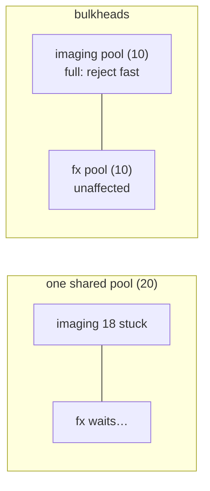
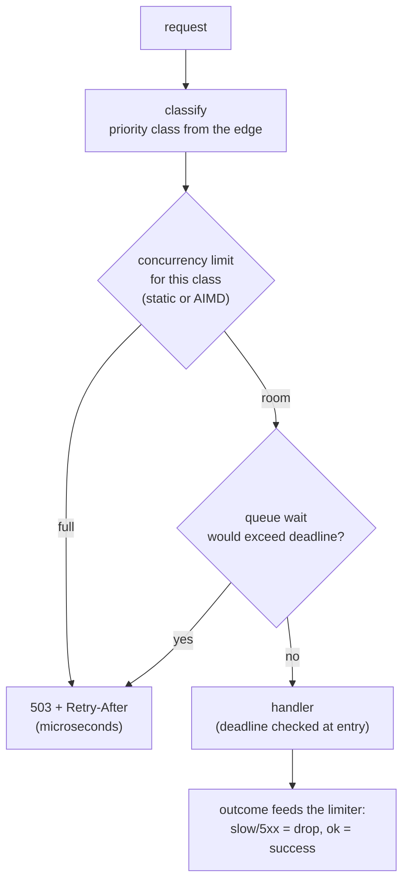
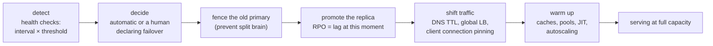
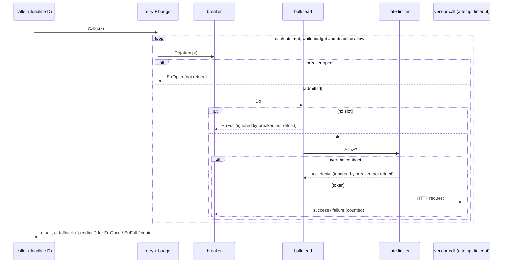

# A7 Unit 3 — Isolation, degradation and surviving failure domains

> Time: ~7.5 h (5.5 CORE, including ≈ 1.5 h of gate work: design exercise + teach-back, and 2 STRETCH) · CORE: §1–§5 as concepts · STRETCH: the "Build it" of §1–§2 (the `labs/a7/bulkhead` package) · Labs: `labs/a7/bulkhead` (stretch), `labs/a7/capstone` (break-it)

Units 1 and 2 made one caller well behaved toward one dependency. This unit widens the lens: how a failure is kept
*small* (bulkheads, cells, shuffle sharding), how a server stays *useful* when it is asked for more than it can do
(load shedding, adaptive limits, graceful degradation), how a whole *failure domain* is survived (zones, regions, RPO
and RTO), how to reason about availability when failures are *correlated*, and how to find out whether any of this
works before an incident does (chaos, game days, deploy safety). The last section assembles every piece into one
vendor adapter, which is the shape of the work you have actually done.

## Before you start

You should have finished Units 1 and 2. Warm-up — answer first:

1. A server with a 100 req/s capacity has a queue of 4,000 requests and its clients wait 1 s. What fraction of its
   completions are useful, and what is the first thing you change?
2. A circuit breaker protects your adapter from a hung vendor. Why can the vendor still take down the *rest* of your
   service during the first seconds of the outage?
3. Three replicas are each 99.9% available. Someone says the service is at "nine nines". What have they assumed?

<details data-kind="answer">
<summary>Warm-up answers</summary>

1. None: at 100 req/s a queue of 4,000 is 40 s of waiting, so every completion is for a client that left 39 s ago.
   Change what the server does with a request nobody is waiting for: drop expired requests, bound the queue so its wait
   stays below the client timeout (Unit 1 §3).
2. The breaker needs evidence before it opens (6 s in the experiment), and until then every call holds a connection
   and a goroutine; if the vendor client's pool is shared, other callers starve. A breaker limits the *duration* of
   the damage; a bulkhead (§1) limits its *reach*.
3. That the failures are independent: 1 − 0.001³ = 99.9999999%. Shared deploys, config, certificates and dependencies
   make them correlated, and the ceiling becomes the correlated part (§4).

</details>

---

## §1 Bulkheads, cells and shuffle sharding

### The failure story

The adapter service calls two vendors through one HTTP client with one pool of 20 concurrent slots: the FX-rate vendor
(5 ms per call) and the check-image vendor (normally 200 ms). Traffic is 200 req/s, half to each. At 09:12 the image
vendor starts hanging for 2 s per call, and its adapter, a raw client written years ago, ignores the request
context, so the platform's 500 ms client deadline does nothing to release the slot.

The 100 req/s heading to the image vendor fill all 20 slots within 0.2 s, and each slot is then held for 2 s, so the
pool completes about 10 image calls a second and nothing else. The FX requests, which need a slot for 5 ms, queue
behind the image calls and time out at 500 ms. **84% of FX requests fail**, although the FX vendor is perfectly healthy.
The breaker (Unit 2) opens for the image vendor after a few seconds, but the damage to FX happened in the first
second, and a second incident the following month, a month-end statement batch exhausting the *database* pool that the
interactive requests share, has the same shape: *a shared resource turns one dependency's problem into everyone's.*

### Predict

<!-- predict id="A7-U3-P01" -->
**Predict.** Write your answers down first. Same setup: 200 req/s, 500 ms client deadline, 20 slots in total.

1. If the image vendor hangs for 2 s and its adapter **ignores** the context, what fraction of the healthy FX calls
   succeed with a single shared pool? With separate pools of 10 + 10?
2. If instead the image vendor is merely **slow** (200 ms, so its demand is 100 × 0.2 = 20 concurrent calls: exactly
   the whole shared pool) does the shared pool *fail* the FX calls? What does it do to them?
3. You add a wait queue of 20 in front of each of the 10-slot pools "to be nice". The image service takes 200 ms per
   call. What happens to the image calls, and what queue size would you choose for a 500 ms deadline?
<!-- /predict -->

<!-- predict id="A7-U3-P02" -->
**Predict.** 100 workers serve 10,000 tenants. One tenant sends a "poison" request that crashes whatever worker
handles it, and its client retries on the next worker it is assigned. Compare (a) static groups (20 groups of 5
workers, tenant → group by hash) with (b) shuffle sharding (each tenant gets its own random 5 of the 100). What
fraction of the *other* tenants lose **all** their workers in each, and what fraction lose **at least one**?
<!-- /predict -->

### Reveal

<details data-kind="reveal" data-for="A7-U3-P01">
<summary>Reveal</summary>

Reference run of `go test -tags breakit -run BreakIt_SharedVersusPerVendor -v ./solutions/a7/bulkhead/` (200 req/s for
2 s, real time, a few percent of run-to-run variation):

```
imaging is slow (200 ms)
design                                     | healthy vendor (fx, 5 ms)         | degraded vendor (imaging)
                                           |       ok      p50      p99   lost |       ok rejected  timeout
one shared pool: 20 slots, queue 1000      |     100%     57ms    147ms      0 |      206        0        0
per vendor: 10 + 10 slots, no queue        |     100%      5ms      6ms      0 |       96      110        0
per vendor: 10 + 10 slots, queue 20 each   |     100%      5ms      6ms      0 |       40       71       95

imaging hangs (2 s) but its adapter honours the context
one shared pool: 20 slots, queue 1000      |     100%    311ms    356ms      0 |        0        0      206
per vendor: 10 + 10 slots, no queue        |     100%      6ms      7ms      0 |        0      166       40
per vendor: 10 + 10 slots, queue 20 each   |     100%      5ms      6ms      0 |        0       86      120

imaging hangs (2 s) and its adapter IGNORES the context
one shared pool: 20 slots, queue 1000      |      16%      6ms    501ms    162 |        0        0      206
per vendor: 10 + 10 slots, no queue        |     100%      6ms      6ms      0 |        0      196       10
per vendor: 10 + 10 slots, queue 20 each   |     100%      5ms      5ms      0 |        0      115       90
```

1. **16%** succeed with the shared pool (162 FX calls lost), **100%** with separate pools.
2. In the "slow" case the shared pool *doesn't* fail FX: it **taxes** it. FX's median latency goes from 5 ms to 57 ms
   (11×) and its p99 from 6 ms to 147 ms, with no errors to alert on. In the "hangs but honours the context" case the
   slots are released at the 500 ms deadline, so FX succeeds but at a median of **311 ms**. The cooperative adapter
   limits the damage, the uncooperative one removes the limit. This is why B0's lesson about contexts matters
   operationally: a bulkhead is only as strong as the weakest call inside it.
3. The queue makes the image vendor **worse**, not better: 95 timeouts instead of 0 (slow case) and 90 instead of 10
   (ignores-context case). A queued caller waits for ⌈position ÷ 10⌉ service times; with a 200 ms service time and a
   500 ms deadline, a waiter at position *k* finishes at ⌈k/10⌉ × 200 ms + 200 ms, so only waiters with
   ⌈k/10⌉ × 200 ≤ 300 ms, i.e. k ≤ 10 × (500 − 200)/200 = **15**, can possibly succeed. Queue 15 or fewer, and the
   rest should be rejected immediately instead of waiting to fail. Tempting wrong answer: "a queue adds capacity". It
   adds latency and converts fast rejections into slow timeouts.

</details>

<details data-kind="reveal" data-for="A7-U3-P02">
<summary>Reveal</summary>

(a) Static groups: the poison tenant takes down its own group of 5; every other tenant in that group (1/20 = **5%**)
loses everything. (b) Shuffle sharding: a tenant loses all 5 workers only if its random 5 are *exactly* the poison
tenant's 5: 1 / C(100, 5) = 1 / 75,287,520 ≈ **1.3 × 10⁻⁸**, i.e. essentially nobody out of 10,000. The price: the
chance that a tenant shares **at least one** worker with the poison tenant is 1 − C(95, 5)/C(100, 5) ≈ **23%**. Those
tenants run on 4 of their 5 workers, and a client that retries across its own 5 sees one failed attempt, not an outage.
Reference run of the program in "How it actually works" (10,000 tenants):

```
100 workers, 5 per tenant, 9999 other tenants; one tenant's poison request kills its 5 workers
static groups of 5:       499 tenants (5.0%) lose ALL their workers
shuffle sharding:            0 tenants lose all 5 workers; 2316 (23.2%) lose some and run degraded
```

So shuffle sharding trades a *small* degradation for many tenants for the near-elimination of *total* outage for any:
the blast radius of a bad tenant changes from "5% of customers are down" to "23% of customers see one failed
attempt". It only works if clients can retry elsewhere in their shard.

</details>

### How it actually works

**A bulkhead is a limit on how much of a shared resource one thing may consume**, named after the compartments in a
ship's hull: a breach floods one compartment, not the ship. The resource can be anything finite: concurrency slots,
connections, queue entries, memory, CPU share, a rate of calls. The principle is the same every time: *give each
dependency (or tenant, or priority class) its own allowance, so that exhausting it can only hurt the one that exhausted it.*



**The lab's `Bulkhead`.** A free slot is taken immediately; otherwise the caller may join a bounded FIFO queue (up to
`MaxQueue`) and wait for a slot *or for its context*; otherwise it is rejected at once with `ErrFull`. Slots are handed
to waiters in arrival order. A waiter that gives up leaves the queue and never leaks a slot, even if a slot was handed
to it in the same instant (the `select` between "granted" and "cancelled" may pick either; the code must check under
the lock). `Group` is a `map[string]*Bulkhead`: one per dependency.

**Sizing.** Slots = arrival rate × latency at the percentile you plan for × headroom (Little's law). Example: the FX
vendor, 50 req/s at 300 ms p99 → 15 concurrent; with 1.5× headroom ≈ 22; if the vendor's contract limits you to 20
concurrent calls, the bulkhead is 20, not 22. A queue is only worth having if its wait stays inside the deadline:
`queue ≤ slots × (deadline − service time) / service time` (15 in the experiment). And the bulkheads should sum to no
more than the *physical* limit they divide: three 20-slot bulkheads over a 50-connection database pool aren't isolation;
they're three ways to exhaust the same pool.

**Where bulkheads live, from fine to coarse:**

| Level | What is isolated | Example |
|---|---|---|
| Call-level semaphore | concurrency per dependency | The lab's `Group`; `errgroup.SetLimit` (B0) |
| Connection pool per dependency | sockets | `Transport.MaxConnsPerHost` (A1 Unit 1 §3), a `database/sql` pool per workload |
| Queue per class | waiting work | Separate queues for interactive and batch (A6) |
| Process / pod per workload | CPU, memory, crashes | Batch statements in their own deployment and node pool |
| **Cell** | a *complete stack* for a slice of customers | 4 cells × 10 credit unions each |
| **Shuffle shard** | a random subset of capacity per customer | The 5-of-100 example above |

**Cells.** A cell is an independent copy of the whole service (compute, data, queues) serving a fixed subset of
tenants, behind a thin router that maps tenant → cell. A failure inside a cell, whether a bad deploy, a poison tenant or
a data-layer incident, affects only that cell's tenants: blast radius = 1 / (number of cells). Cells are also the unit
of deployment (canary one cell first, §4) and of capacity (a cell has a known maximum size you have load-tested).
Costs: more infrastructure, a router that must itself be highly available and simple, tenants that don't fit in a cell
(the largest credit union gets its own), and cross-cell operations (reports across all credit unions) that need a
separate path.

**Shuffle sharding** (the P02 experiment) is cells' probabilistic cousin: instead of putting a tenant in a fixed
group, give it a random subset, so two tenants rarely share *all* the same resources. The blast radius of a bad tenant
shrinks combinatorially (C(N, k) shards), and it works with clients that retry across their k workers.

**Banking link.** You already do the first level by instinct: an adapter per vendor. The upgrade is making the limit
explicit and enforced (a bulkhead per vendor, sized from the vendor's contract and your latency), keeping the SSO
adapter's pool away from the core adapter's, running the month-end statement batch where it cannot touch interactive
capacity, and thinking of the 40 credit unions as cells: one large credit union whose traffic or data triggers a bug
shouldn't take the other 39 with it.

**A runnable group** (reference output; the `fx` call completes instantly while `imaging` is saturated):

```go
package main

import (
	"context"
	"errors"
	"fmt"
	"sync"
	"time"

	"github.com/chethu007/system-design-course/labs/a7/bulkhead"
)

func main() {
	// One bulkhead per dependency. The check-image vendor is contractually
	// limited to 2 concurrent calls here; the FX vendor gets 5.
	g := bulkhead.NewGroup(map[string]bulkhead.Config{
		"imaging": {MaxConcurrent: 2},
		"fx":      {MaxConcurrent: 5},
	})

	slow := func(ctx context.Context) error { // a vendor that is taking 200 ms per call
		select {
		case <-time.After(200 * time.Millisecond):
			return nil
		case <-ctx.Done():
			return ctx.Err()
		}
	}

	var wg sync.WaitGroup
	var mu sync.Mutex
	ok, full := 0, 0
	for i := 0; i < 6; i++ { // six simultaneous imaging calls
		wg.Add(1)
		go func() {
			defer wg.Done()
			err := g.Do(context.Background(), "imaging", slow)
			mu.Lock()
			defer mu.Unlock()
			if errors.Is(err, bulkhead.ErrFull) {
				full++
			} else if err == nil {
				ok++
			}
		}()
	}
	time.Sleep(50 * time.Millisecond) // the imaging bulkhead is now saturated

	start := time.Now()
	err := g.Do(context.Background(), "fx", func(context.Context) error { return nil })
	fmt.Printf("fx call while imaging is saturated: err=%v after %v\n", err, time.Since(start).Round(time.Millisecond))

	wg.Wait()
	fmt.Printf("imaging: %d admitted, %d rejected immediately (limit 2)\n", ok, full)
	fmt.Printf("stats: imaging=%+v fx=%+v\n", g.Stats()["imaging"], g.Stats()["fx"])
}
```

```
fx call while imaging is saturated: err=<nil> after 0s
imaging: 2 admitted, 4 rejected immediately (limit 2)
stats: imaging={InFlight:0 Waiting:0 Admitted:2 Rejected:4} fx={InFlight:0 Waiting:0 Admitted:1 Rejected:0}
```

The shuffle-sharding program that produced the numbers in the P02 reveal is short enough to read; each tenant's
workers come from a PRNG seeded with a hash of its ID:

```go
package main

import (
	"fmt"
	"hash/fnv"
	"math/rand/v2"
)

// shard returns the k workers (out of n) that serve a tenant, chosen by a
// deterministic pseudo-random draw seeded from the tenant ID: shuffle sharding.
func shard(tenant string, n, k int) []int {
	h := fnv.New64a()
	h.Write([]byte(tenant))
	r := rand.New(rand.NewPCG(h.Sum64(), 1))
	return r.Perm(n)[:k]
}

func main() {
	const workers, k, tenants = 100, 5, 10000

	// Plan A: static groups. 100 workers = 20 groups of 5; tenant → group by hash.
	// Plan B: shuffle sharding. Each tenant gets its own random 5 of the 100.
	poison := "tenant-0"
	dead := map[int]bool{}
	for _, w := range shard(poison, workers, k) {
		dead[w] = true
	}

	var groupHit, shuffleFullyDown, shuffleDegraded int
	poisonGroup := hashGroup(poison, workers/k)
	for i := 1; i < tenants; i++ {
		t := fmt.Sprintf("tenant-%d", i)
		if hashGroup(t, workers/k) == poisonGroup {
			groupHit++
		}
		lost := 0
		for _, w := range shard(t, workers, k) {
			if dead[w] {
				lost++
			}
		}
		switch {
		case lost == k:
			shuffleFullyDown++
		case lost > 0:
			shuffleDegraded++
		}
	}
	fmt.Printf("%d workers, %d per tenant, %d other tenants; one tenant's poison request kills its %d workers\n", workers, k, tenants-1, k)
	fmt.Printf("static groups of %d:     %5d tenants (%.1f%%) lose ALL their workers\n", k, groupHit, 100*float64(groupHit)/(tenants-1))
	fmt.Printf("shuffle sharding:        %5d tenants lose all %d workers; %d (%.1f%%) lose some and run degraded\n",
		shuffleFullyDown, k, shuffleDegraded, 100*float64(shuffleDegraded)/(tenants-1))
}

func hashGroup(tenant string, groups int) int {
	h := fnv.New32a()
	h.Write([]byte(tenant))
	return int(h.Sum32()) % groups
}
```

### Build it

**STRETCH.** Lab `labs/a7/bulkhead`, file `bulkhead.go`, first half: `Bulkhead` (`New`, `Acquire`, `Do`, `Stats`) and
`Group`. The `Bulkhead` doc comment spells out the semantics: free slot → immediate; else bounded FIFO queue; else
`ErrFull`; a cancelled waiter must leave without leaking a slot; an already-cancelled context is refused before
anything is consumed. The AIMD half is §2's.

Acceptance tests: `TestBulkhead_RejectsImmediatelyWhenFullAndNoQueue`, `…DoRunsInsideASlotAndReleasesOnPanic`,
`…NeverExceedsMaxConcurrentUnderLoad` (200 goroutines through 5 slots), `…QueueIsBoundedAndServedInArrivalOrder`,
`…ACancelledWaiterLeavesWithoutTakingASlot`, `…AlreadyCancelledContextIsRefusedWithoutSideEffects`,
`…CancellationRacesNeverLeakSlots` (300 goroutines with random micro-timeouts), `TestGroup_SaturatingOneDependencyDoesNotAffectAnother`,
`…UnknownDependencyIsAnError`. Run `go test -race ./labs/a7/bulkhead/`.

### Break it

1. Run the shared-vs-per-vendor experiment against **your** bulkhead (≈ 25 s):
   `go test -tags breakit -run BreakIt_SharedVersusPerVendor -v ./labs/a7/bulkhead/`. Predict the healthy vendor's
   success rate in the third scenario before you look.
2. Mutations: (a) when a waiter is cancelled while a slot is being handed to it, don't pass the slot on; (b) serve
   waiters LIFO instead of FIFO. Which tests fail, and what would (a) look like in production?

<details data-kind="answer">
<summary>What you should see, and why</summary>

1. The table in the P01 reveal. If your numbers differ by a few percent, that's timing; if the shared pool in the
   third scenario doesn't collapse FX (well below 50%), your uncooperative adapter isn't actually ignoring the
   context (it must `time.Sleep`, not `select` on `ctx.Done()`).
2. (a) `CancellationRacesNeverLeakSlots` fails: after a few hundred cancellations the bulkhead reports `InFlight > 0`
   with nothing running: slots have leaked. In production this is the worst kind of bug: a bulkhead that *slowly
   shrinks* until the service rejects everything, with no error, only a rising rejection rate days after a deploy
   that changed timeout behaviour. (b) `QueueIsBoundedAndServedInArrivalOrder` fails. (LIFO is a deliberate policy under
   overload, §2, but then it should be a decision, not an accident.)

</details>

### In the wild

- **Nygard's *Release It!*** named the pattern; **Hystrix** implemented it with a thread pool per command (TODO-VERIFY:
  default of 10 threads) or a semaphore; **resilience4j** has a semaphore `Bulkhead` and a thread-pool bulkhead
  (TODO-VERIFY: default `maxConcurrentCalls` of 25).
- **Envoy "circuit breakers"** are bulkheads in this sense: per-cluster maxima for connections, pending requests,
  requests and retries (TODO-VERIFY: default 1024). Istio exposes them as `connectionPool` settings.
- **Kubernetes**: resource requests and limits (CPU, memory), `ResourceQuota` per namespace, separate node pools for batch,
  and PodDisruptionBudgets are the process-level bulkheads.
- **Cell-based architecture**: AWS describes it in a white paper on reducing the scope of impact, and uses it in
  several services (TODO-VERIFY: title and which services); Slack has written about moving to cells after a zone-level
  incident (TODO-VERIFY: post and date).
- **Shuffle sharding**: the AWS Builders' Library article "Workload isolation using shuffle-sharding" explains it with
  Route 53 (TODO-VERIFY: the specific counts they quote) and the associated open-source library.
- **Go**: `golang.org/x/sync/semaphore` (weighted) and `errgroup.SetLimit` (B0 Unit 2 §2) are the building blocks;
  `database/sql` `SetMaxOpenConns` is the DB bulkhead.

### Trade-offs

| Option | Wins when | Loses when | When the answer flips |
|---|---|---|---|
| One shared pool | Dependencies are homogeneous and equally healthy; maximum utilisation | One slow dependency taxes all (FX p50 5 → 57 ms) or starves them (16% success) | Always separate when dependencies differ in latency or reliability |
| Pool per dependency | Mixed vendors; contracts with different limits | Idle capacity in one pool can't help another; needs sizing | Add a small shared overflow only if you can bound a bully |
| Reject when full | Latency-sensitive paths; a fallback exists | Rejects work that would have succeeded slowly | Bounded queue for batch work with long deadlines |
| Bounded queue ≤ `slots × (D − W)/W` | Smoothing bursts within the deadline | Longer queues convert fast rejections into slow timeouts (95 vs 0 in the experiment) | Queue 0 when callers can retry elsewhere |
| Cells | Strong tenant isolation, staged deploys, regulated customers | More infrastructure; router; tenants too big for a cell | Shuffle sharding for stateless worker pools with many small tenants |
| Shuffle sharding | Many tenants on a shared worker fleet; clients can retry within the shard | 23% of tenants see degraded service from one bad tenant (vs 0% fully down) | Static groups when simplicity beats the tail risk |

### Senior bar

- **Failure modes.** Shared client or pool between dependencies; bulkheads whose sum exceeds the physical resource;
  uncooperative calls that hold slots past the deadline (B0 Unit 2 §4); queues longer than the deadline can use; slots
  leaked on cancellation or panic; no sub-limit *within* a vendor's bulkhead (one tenant fills it); bulkheads sized once
  and never revisited; "fixing" an incident by raising limits, which moves the failure to the next resource.
- **Numbers.** Little's law for slots (λ × W); queue ≤ `slots × (D − W)/W` = 15 for 10 slots, W = 200 ms, D = 500 ms.
  Shuffle sharding: C(100, 5) = 75,287,520 shards; P(sharing ≥ 1 worker) ≈ 23%. Cells: blast radius 1/N, N cells ×
  per-cell headroom. AZ-style N+1: with 3 zones, run each ≤ 66% to survive losing one (§3).
- **Ops.** Per bulkhead: in-use ÷ limit (alert at ≈ 80% sustained), rejections per second, wait time, and the *reason
  mix* of timeouts. Saturation of one bulkhead is a signal about **that dependency**, so route it to that vendor's
  owners and breaker.
- **Cost.** Isolation costs utilisation: partitioned capacity can't be borrowed, so total provisioned capacity rises
  (the price of the blast radius). Cells multiply fixed costs (databases, queues, on-call surface) by N.

Interviewer follow-up probes:

1. "Why not one big pool? It's more efficient."

<details data-kind="answer">
<summary>Model answer</summary>

It's more efficient until the first slow dependency, and then it's a shared fate: in my experiment one hung vendor
took healthy FX success from 100% to 16%, and even a merely slow one raised FX's median from 5 to 57 ms with no errors
to alert on. Isolation costs some utilisation, and I'd pay it for dependencies with different latency or reliability.
Where dependencies are homogeneous, a shared pool with per-class sub-limits is fine.

</details>

2. "How do you size a bulkhead?"

<details data-kind="answer">
<summary>Model answer</summary>

From the dependency: peak arrival rate × p99 latency gives the concurrency it needs (Little), plus headroom, capped
by its contract and by the physical resource I'm dividing. For the queue, `slots × (deadline − W)/W`: anything
longer just converts fast rejections into slow timeouts. Then I watch in-use ÷ limit and rejections, and revisit when
the vendor's latency profile changes. Adaptive limits (§2) remove some of the guessing.

</details>

3. "Cells or shuffle sharding?"

<details data-kind="answer">
<summary>Model answer</summary>

Cells for stateful systems and strong tenant isolation: a complete stack per tenant group, a known blast radius of
1/N, and a natural unit for staged deploys and compliance boundaries. Shuffle sharding for stateless worker fleets
shared by many small tenants, where I want the chance that two tenants share all their capacity to be negligible
without building N complete stacks. They combine: shuffle-shard within a cell.

</details>

4. "What does a bulkhead not protect you from?"

<details data-kind="answer">
<summary>Model answer</summary>

Failures in the shared things *underneath* the partitions: a shared database, a shared network path, a shared
deploy pipeline or config store. It also doesn't stop one tenant from filling its own vendor's bulkhead, which needs a
sub-limit per tenant. And it can't help when the dependency is down for everyone; that's what the breaker, the fallback
and failover are for.

</details>

### Check yourself

1. Why does a queue in front of a bulkhead sometimes lower the success rate?
2. What is the blast radius of a poison tenant with 4 cells? With shuffle sharding of 5 of 100 workers?
3. What would make three 20-slot bulkheads over a 50-connection database pool useless?

<details data-kind="answer">
<summary>Answers</summary>

1. Queued callers wait for earlier work; if the wait exceeds what the deadline can afford, they time out after
   consuming a queue entry and a slot's time, instead of being rejected instantly and falling back.
2. 1/4 of the tenants (25%) with 4 cells; with shuffle sharding no tenant loses all its workers (1.3 × 10⁻⁸ chance of a
   full overlap), and ≈ 23% share at least one worker and run degraded.
3. The bulkheads total 60 slots against 50 physical connections: all three can be full at once, so one dependency can
   still exhaust the pool the others need. Isolation only exists if the partitions sum to ≤ the shared resource.

</details>

---

## §2 Load shedding, adaptive concurrency and graceful degradation

### The failure story

Payday, 09:00. Traffic to the transfers service is 3× its normal peak: members checking balances, a payroll partner
posting a batch, the mobile app's retries layering on top. The service has a 100 req/s capacity. Its request queue is
unbounded, which feels like a safe default ("never drop a member's request"). Latency climbs from 400 ms to 4 s to 40 s;
the load balancer's health check times out and ejects instances, which moves their load onto the others; the autoscaler
adds instances after 5 minutes, each starting cold. For the first ten minutes the service completes ≈ 100 req/s but
almost none of the completions reach a client that is still waiting: **goodput ≈ 0 at full utilisation**. The system
is saturated and useless, which is the worst combination.

### Predict

<!-- predict id="A7-U3-P03" -->
**Predict.** Using the simulation from Unit 1 §3 (capacity 100 req/s, offered 80, a 5 s dip to 30 req/s, 1 s client
timeout, 3 attempts): during the dip, how many *useful* completions per second does each server design deliver?
(a) unbounded FIFO queue, (b) FIFO that drops requests whose client has already left, (c) LIFO that drops expired
requests, (d) a FIFO queue **bounded at 25** that rejects the rest immediately, (e) the same queue bounded at **100**.

Then: for the bounded queue, how does goodput during the dip depend on the queue limit?
<!-- /predict -->

<!-- predict id="A7-U3-P04" -->
**Predict.** The platform is overloaded and must shed. Order these from "shed first" to "shed last" and say what each
should receive: (1) a payroll partner's batch of 50,000 transfers; (2) a member's `GET /balance`; (3) the marketing
banner service; (4) a member's `POST /transfer`; (5) the audit-event write for a transfer; (6) the load balancer's
health check.
<!-- /predict -->

### Reveal

<details data-kind="reveal" data-for="A7-U3-P03">
<summary>Reveal</summary>

From the Unit 1 §3 table (`go run -tags breakit ./labs/a7/sim metastable`): during the dip (t = 10–15 s) goodput is
**10 req/s for (a)**, and **30 req/s for (b), (c) and (d)**: the full degraded capacity, i.e. they spend 100% of the
server's work on requests somebody is still waiting for. Afterwards (a) never recovers; (b)–(d) are back to 80 req/s
within about two seconds. For the bounded queue the limit is the whole story
(`go run -tags breakit ./labs/a7/sim metastable -mode shed -qmax N`):

```
qmax=5    dip goodput 30/s   15-25 s: 81    wasted completions 0
qmax=10   dip goodput 30/s   15-25 s: 82    wasted completions 0
qmax=25   dip goodput 30/s   15-25 s: 83    wasted completions 0
qmax=30   dip goodput 30/s   15-25 s: 84    wasted completions 0
qmax=50   dip goodput 10/s   15-25 s: 83    wasted completions 130
qmax=100  dip goodput 10/s   15-25 s: 82    wasted completions 201
qmax=200  dip goodput 10/s   15-25 s: 0    wasted completions 2601 (metastable again: never recovers)
```

The cliff is exactly where **queue length ÷ degraded capacity exceeds the client timeout**: at 30 req/s, a queue of 30
is 1 s of work. Up to 30 every queued request is served before its client leaves; at 50 the tail of the queue is
served after its client left, and the wasted completions start. (e) is therefore the (a)-like case: bounded, but
bounded at the wrong number. Tempting wrong answer: "any bound is fine". The right bound is `capacity × timeout`, at the
*lowest* capacity you must survive.

</details>

<details data-kind="reveal" data-for="A7-U3-P04">
<summary>Reveal</summary>

Shed by **how much the loss hurts and how easily the caller can wait**. First: (3) marketing (turn the feature off:
a brownout); then (1) the batch (it's asynchronous by nature: answer `503` or `429` with `Retry-After` and let the
partner's client retry later, or queue it); then (2) reads that can be served stale from a cache, then un-cacheable
reads. Last among shed-able work: (4) the member's transfer (money movement is the product). **Never shed** (5) the
audit write: it is a compliance obligation, so protect it by shedding everything around it, or make it cheap and
asynchronous via an outbox (A6). And (6) the health check must keep answering truthfully but cheaply; if it queues
behind real work it starts failing under load, and the load balancer ejects healthy instances (the A1 lesson on
shallow health checks). The mechanism is **priority classes** attached to requests at the edge (a header the edge sets
from the authenticated principal and the route, never from the client), with each class having its own admission limit
so a flood in a low class can't consume the high class's share.

</details>

### How it actually works

**Why overload is different from slowness.** When arrivals exceed capacity a queue grows without bound; latency is
proportional to queue length; once latency exceeds the client timeout, completions are for abandoned requests and
goodput *falls* as load rises. The only stable policies make the server refuse work early and cheaply, so that the
work it accepts can finish inside the deadline. **Load shedding = rejecting excess work as early and as cheaply as
possible, preferably before expensive steps (auth, parsing, database).**



**The controls, from simple to adaptive:**

1. **Bounded queue sized from the deadline** (the sweep above): `limit ≤ degraded capacity × timeout`.
2. **Deadline check at the head of the queue:** drop requests whose deadline has passed (free work avoided).
3. **LIFO / adaptive LIFO:** under overload serve the *newest* request first: the oldest have the least chance of still
   being wanted. Facebook's "Fail at Scale" describes controlled-delay queuing with adaptive LIFO: FIFO when the queue
   is short (fair), LIFO when it is long (useful).
4. **Concurrency limits** instead of rate limits: the scarce resource under overload is usually *in-flight work*, not
   requests per second. A limit of L concurrent requests automatically admits fewer requests per second when each takes
   longer, which is exactly right.
5. **Adaptive concurrency (AIMD, gradient, Vegas-style):** the right L depends on the current health of the backend, so
   learn it. **AIMD**, the control law of TCP congestion avoidance: *additive increase* while things succeed under load
   (L += 1/L per success ⇒ ≈ +1 per round trip), *multiplicative decrease* when the backend signals overload (a timeout,
   a 503, latency over a threshold: L ×= 0.5), and **at most one decrease per cooldown** so one overload event, which
   produces many simultaneous failures, causes one halving instead of a collapse. The lab's `AIMD` also grows the
   limit only when it is actually being used (otherwise it would climb unboundedly while idle).
6. **Client-side throttling:** a client that tracks its own accepted/total ratio can reject locally before sending
   (Google SRE's adaptive throttling), keeping rejected requests off the network.
7. **Brownouts / graceful degradation:** reduce the work per request instead of rejecting requests: skip
   recommendations, serve cached balances, hide non-critical widgets, switch off expensive search filters, defer batch.
   A brownout is a lever the operator or an automatic controller can pull *before* shedding begins. It must be rehearsed
   (§4), and every degraded response should say it is degraded (a header, a field), or support will chase phantom bugs.

**What AIMD does to a changing server.** The lab's break-it feeds an `AIMD` a server whose capacity moves from 40 to 15
to 60 concurrent calls (200 callers per virtual second, cooldown 1 s). The limit saw-tooths between about half and all
of the capacity, and follows it:

```
round    capacity  limit
25       40        #######                          15.9
50       40        #############                    27.7
75       40        ###################              39.7
100      40        ###############                  30.8
125      40        ##########                       21.9
150      40        ################                 33.8
175      15        #####                            10.6
200      15        ######                           13.6
225      15        ####                              8.2
250      15        #####                            11.1
300      15        ####                              8.7
325      60        ##########                       20.1
375      60        ######################           44.1
400      60        ############################     56.2
450      60        ########################         49.7
```

(Reference run, deterministic; the full run prints every 25th round.) AIMD never sits exactly at capacity, since it
finds the limit by exceeding it; it spends its time between ≈ ½ and 1× of it, which is the price of needing no
configuration. The lab's own test checks the same property: over 100 rounds against a capacity of 40 the limit ranged
over 20.8–41.4 with a mean of 31.4.

**A server-side shedder in Go.** An `http.Handler` wrapper that admits a request only if the adaptive limiter has room,
answers overload instantly with `503` and `Retry-After`, and feeds the outcome back: a slow or failing response is a
drop, a request whose client left is ignored.

```go
package main

import (
	"fmt"
	"net/http"
	"net/http/httptest"
	"sync"
	"time"

	"github.com/chethu007/system-design-course/labs/a7/bulkhead"
)

type statusRecorder struct {
	http.ResponseWriter
	status int
}

func (s *statusRecorder) WriteHeader(code int) {
	s.status = code
	s.ResponseWriter.WriteHeader(code)
}

// shed admits a request only if the adaptive limiter has room. Overload is
// answered at once with 503 and Retry-After: the cheapest thing the server
// can do, and the signal well-behaved clients look for. What the admitted
// request reports back (slow or failed → "dropped", client left → ignore)
// is what teaches the limit its own value.
func shed(a *bulkhead.AIMD, slow time.Duration, next http.Handler) http.Handler {
	return http.HandlerFunc(func(w http.ResponseWriter, r *http.Request) {
		done, ok := a.TryAcquire()
		if !ok {
			w.Header().Set("Retry-After", "1")
			http.Error(w, "overloaded, retry later", http.StatusServiceUnavailable)
			return
		}
		rec := &statusRecorder{ResponseWriter: w, status: http.StatusOK}
		start := time.Now()
		next.ServeHTTP(rec, r)
		switch {
		case r.Context().Err() != nil:
			done(bulkhead.Ignore) // the client left: says nothing about load
		case rec.status >= 500 || time.Since(start) > slow:
			done(bulkhead.Dropped)
		default:
			done(bulkhead.Success)
		}
	})
}

func main() {
	// A limit of 4 concurrent requests (no adaptation yet: Initial = Min = Max = 4).
	limiter := bulkhead.NewAIMD(bulkhead.AIMDConfig{Initial: 4, Min: 4, Max: 4})
	handler := shed(limiter, 500*time.Millisecond, http.HandlerFunc(func(w http.ResponseWriter, r *http.Request) {
		time.Sleep(100 * time.Millisecond) // the work
		fmt.Fprint(w, "done")
	}))
	srv := httptest.NewServer(handler)
	defer srv.Close()

	var wg sync.WaitGroup
	var mu sync.Mutex
	codes := map[int]int{}
	retryAfter := ""
	for i := 0; i < 10; i++ { // ten simultaneous requests
		wg.Add(1)
		go func() {
			defer wg.Done()
			resp, err := http.Get(srv.URL)
			if err != nil {
				return
			}
			defer resp.Body.Close()
			mu.Lock()
			codes[resp.StatusCode]++
			if resp.StatusCode == 503 {
				retryAfter = resp.Header.Get("Retry-After")
			}
			mu.Unlock()
		}()
	}
	wg.Wait()
	fmt.Printf("10 simultaneous requests, limit 4: %d x 200, %d x 503 (Retry-After: %s)\n", codes[200], codes[503], retryAfter)
}
```

```
10 simultaneous requests, limit 4: 4 x 200, 6 x 503 (Retry-After: 1)
```

**Banking link.** The shedding order from P04 is a *business* decision that engineering implements: ask product and
compliance which flows can wait (statements, marketing, partner batch), which cannot (a member's transfer), and which
are non-negotiable (audit). The payroll partner's 50,000-transfer batch is the textbook low-priority class: it should
use all idle capacity, and yield to members within a request. And the shedding must be *visible*: a shed request that
isn't logged with its class and reason is, to a credit union's support team, indistinguishable from a bug.

### Build it

**STRETCH.** Lab `labs/a7/bulkhead`, second half: `AIMD` (`NewAIMD`, `TryAcquire`, `Limit`, `InFlight`). The doc comment
gives the rules: admit iff in-flight < ⌊limit⌋; on success *under load* (admitted while ≥ half the limit was in use)
add `Increase/limit`; on a drop multiply by `Decrease` at most once per `Cooldown`; ignore only frees the slot;
`done` is idempotent.

Acceptance tests: `TestAIMD_AdmitsUpToTheLimitAndNoFurther`, `…SuccessesUnderLoadRaiseTheLimitAdditively`,
`…SuccessesWhileIdleDoNotInflateTheLimit`, `…OverloadHalvesTheLimitOncePerCooldown`, `…LimitStaysWithinMinAndMax`,
`…ConvergesToTheNeighbourhoodOfTheServersCapacity`, `…ConcurrentUseIsRaceFree`. Run `go test -race ./labs/a7/bulkhead/`.

### Break it

1. Sweep the queue limit in the simulation: `go run -tags breakit ./labs/a7/sim metastable -mode shed -qmax 25`,
   then 50, 100, 200. Predict the value at which wasted completions first appear.
2. Print the AIMD trajectory: `go test -tags breakit -run BreakIt_AIMD -v ./labs/a7/bulkhead/`. Then, in your `AIMD`,
   (a) remove the cooldown, (b) let the limit grow while idle. Which tests fail, and what would each look like in
   production?

<details data-kind="answer">
<summary>What you should see, and why</summary>

1. The sweep in the P03 reveal: no waste up to `qmax = 30` (30 req/s × 1 s), waste from `qmax = 50` (130 wasted
   completions) and 100 (201), and a return to metastable failure at 200 (goodput 0 after the dip, 2,223 failed
   user requests). The shape is the point: shedding doesn't need a precise number, but the number has to be below
   `degraded capacity × timeout`.
2. (a) `OverloadHalvesTheLimitOncePerCooldown` fails: six failed calls from one overload event now multiply the limit by
   0.5⁶ ≈ 1.6%, which clamps it to `Min` and starves the service for the several seconds it takes the additive
   increase to climb back: the limiter *causes* a second outage. (b) `SuccessesWhileIdleDoNotInflateTheLimit` and
   `SuccessesUnderLoadRaiseTheLimitAdditively` fail: after a quiet night the limit has crept to `Max`, so the morning
   spike meets no limit at all until the first overload finally halves it.

</details>

### In the wild

- **AWS Builders' Library, "Using load shedding to avoid overload"** and **"Avoiding insurmountable queue backlogs"**:
  production arguments for exactly these controls (shed early and cheaply; bound queues; prefer fresh work).
- **Stripe** (the §2 rate-limiting article) describes two *load shedders* that reject lower-priority traffic when the
  fleet or workers are busy, ordered by criticality (TODO-VERIFY: their ordering of critical methods, POSTs, GETs and
  test traffic).
- **Facebook, "Fail at Scale"** (ACM Queue, 2015): controlled delay queueing and adaptive LIFO, concurrency limits,
  and the observation that most systems fail from overload rather than from bugs (TODO-VERIFY: exact claims).
- **Google SRE book, "Handling Overload"**: criticality levels on RPCs, per-customer quotas, and client-side adaptive
  throttling with rejection probability `max(0, (requests − K × accepts) / (requests + 1))` (TODO-VERIFY: K = 2).
- **Netflix `concurrency-limits`**: AIMD, gradient and Vegas-style adaptive limits for servers and clients, described in
  their "Performance Under Load" post; **Envoy** ships an adaptive concurrency HTTP filter (TODO-VERIFY: gradient
  controller details).
- **TCP congestion control** (AIMD) and **CoDel** (RFC 8289, TODO-VERIFY) are the networking ancestors.
- **Kubernetes API Priority and Fairness** applies priority levels and fair queuing to the API server's own overload.
- **Brownouts**: the research idea of reducing optional work under load (Klein et al., "Brownout: Building More Robust
  Cloud Applications", ICSE 2014; TODO-VERIFY).

### Trade-offs

| Option | Wins when | Loses when | When the answer flips |
|---|---|---|---|
| Unbounded queue | Offline batch with no deadlines | Any interactive path: queue delay > client timeout ⇒ zero goodput | Never for user-facing work |
| Bounded queue ≤ capacity × timeout | Known, stable capacity | Capacity varies a lot (the bound is wrong in the other direction) | Adaptive limit when capacity is unknown or variable |
| FIFO | Fairness when not overloaded | Overload: serves the oldest, least-wanted requests | Adaptive LIFO or deadline-drop in overload |
| Static concurrency limit | Known dependency capacity, simple | Capacity drifts (deploys, noisy neighbours, failover) | AIMD / gradient when you can't keep it tuned |
| AIMD adaptive limit | No tuning wanted; shared or changing capacity | Saw-tooth: runs at ≈ ½–1× capacity; needs a good overload signal | Static if the backend publishes its capacity |
| Shed by priority class | Mixed critical and optional traffic | Needs trustworthy classification at the edge | Single class if all traffic is equally critical |
| Brownout (degrade) | Optional work is a big share of cost | Degraded results must be flagged and tested | Reject outright if no cheap degraded form exists |

### Senior bar

- **Failure modes.** Unbounded queues; queue bound sized for normal capacity; shedding *after* expensive work;
  shedding the health check (or queueing it behind work); classes decided by the client; shed requests retried
  immediately by clients with no backoff (a self-inflicted storm; honour `Retry-After`, Unit 1 §2); autoscaling
  treated as the overload defence (it takes minutes, cold instances are slower than warm ones, and each scale-up
  may itself be the trigger); degraded modes never exercised.
- **Numbers.** Queue delay = length ÷ service rate (100 queued at 100 req/s = 1 s). Bound ≤ degraded capacity ×
  timeout (30 in the simulation). Without shedding, goodput at 100% utilisation can be 0. AIMD spends its time
  between ≈ ½ and 1× of capacity (measured mean 31.4 of 40).
- **Ops.** Dashboards for admitted / shed per class, queue delay (not length), limiter value over time, goodput vs
  throughput. Alert on "throughput high, goodput low". A runbook step: "enable brownout level 1, 2, 3" with exactly
  which features each turns off. Shed decisions go to the audit/ops log with class and reason.
- **Cost.** Shedding is nearly free at runtime; its cost is the lost revenue or UX of rejected work, which is why the
  order matters. Headroom to *avoid* shedding costs capacity; the usual answer is a modest headroom plus shedding.

Interviewer follow-up probes:

1. "Your service is overloaded. What do you do?"

<details data-kind="answer">
<summary>Model answer</summary>

Make it refuse work early so that what it accepts can finish. Immediately: bound the queue by `capacity × timeout`,
drop expired requests, and shed lowest-priority classes first (partner batch, marketing, stale-able reads) with
`503 + Retry-After`; turn on brownouts for optional features. Check that clients aren't amplifying (retry budgets,
Unit 1). Then add capacity: autoscaling is minutes away, so it's a second line, not the first. Afterwards: what
removes the trigger, and what would make this self-sustaining.

</details>

2. "Why LIFO?"

<details data-kind="answer">
<summary>Model answer</summary>

When the queue is long the oldest requests are the ones whose clients have timed out or are about to: serving them is
waste, and while we do it the fresh requests age. LIFO serves the ones most likely still wanted, which maximises
goodput during overload. It's unfair in the usual sense, so adaptive LIFO uses FIFO when the queue is short and LIFO
only when it isn't. A deadline check achieves a similar effect by dropping the expired ones for free.

</details>

3. "How does adaptive concurrency work, and when would you not use it?"

<details data-kind="answer">
<summary>Model answer</summary>

It treats the concurrency limit as a control variable: raise it slowly while requests succeed under load, cut it
sharply when the backend shows overload (timeouts, 503s, or latency rising above a baseline), at most once per
cooldown. It finds the capacity without anyone tuning it, and follows it when the backend changes. It's not ideal when
the overload signal is unreliable (errors from a bug look like overload), when capacity is known and fixed (a static
limit is simpler and doesn't saw-tooth), or on paths where even brief under-use is expensive.

</details>

4. "How do you decide what to shed?"

<details data-kind="answer">
<summary>Model answer</summary>

By cost of loss and ability to wait, agreed with product and compliance beforehand: optional features first, then
asynchronous work like partner batches (which can retry later), then stale-able reads, interactive reads, and last
money movement; audit writes are never shed. The class is set at the edge from authentication and route, never by the
client, each class has its own admission limit so a flood in a low class can't consume a higher class's share, and
every shed is logged with class and reason.

</details>

### Check yourself

1. Why must the queue bound be computed from the *degraded* capacity?
2. What does AIMD do when ten in-flight calls all fail within the same 100 ms?
3. Why is a health check that queues behind real requests dangerous under overload?

<details data-kind="answer">
<summary>Answers</summary>

1. The bound has to keep queue delay under the client timeout in the worst state you intend to survive; sized for
   normal capacity, it is too long exactly when capacity drops.
2. It treats them as one overload event: one multiplicative decrease, thanks to the cooldown, not ten.
3. It starts failing when the system is busy, so the load balancer ejects healthy instances and moves their load onto
   the rest: a cascade caused by the health check itself.

</details>

---

## §3 Multi-AZ, multi-region, RPO/RTO and DR tiers

### The failure story

A regional outage takes the platform's only region offline for 6 hours starting 09:00 on payday. The numbers behind
that sentence (1 M transfers a day, as in A1, ≈ 12/s on average, ≈ 36/s at peak):

- Transfers submitted and not processed: at the average rate, 6 h × 3,600 s × 12/s ≈ **259,000**; at the peak rate,
  more than 3×.
- The database was replicated to a second region asynchronously with ≈ 2 s of lag. If the region is lost
  rather than merely unreachable, the last 2 s of writes die with it: at the peak 36/s that is ≈ **72 transfers** that
  members were told succeeded and that no longer exist anywhere: a **reconciliation** problem with the core, and a
  trust problem with members.
- There *is* a standby region. Nobody has ever failed over to it. During the incident it takes 2 hours to discover that
  the standby's database credentials were rotated in the primary only, the vendor allow-lists contain only the primary
  region's egress IPs, and the standby's capacity is a quarter of peak.

None of this was unknowable. All of it was untested.

### Predict

<!-- predict id="A7-U3-P05" -->
**Predict.** Write your answers down first.

1. Order these DR tiers by RTO (fastest first) and by cost (cheapest first), and state a plausible RPO for each:
   backup-and-restore; pilot light; warm standby; active-active.
2. A system has: health check every 10 s with 3 failures to declare a region down; DNS TTL 60 s; database promotion
   90 s; 3 minutes before caches are warm enough to carry traffic. What is the **worst-case RTO**, ignoring clients
   that cache DNS longer than the TTL?
3. The primary region has 3 availability zones and runs at 60% utilisation per zone. A zone fails. Can the remaining
   two carry the load without any scaling action?
<!-- /predict -->

<!-- predict id="A7-U3-P06" -->
**Predict.** Two regions run active-active for a ledger with asynchronous multi-master replication and last-writer-wins
conflict resolution. A member's account (balance $1,000) gets a $700 transfer out processed in region A and, 80 ms
later, a $600 transfer out processed in region B. What can the final balance be, and what would you change?
<!-- /predict -->

### Reveal

<details data-kind="reveal" data-for="A7-U3-P05">
<summary>Reveal</summary>

1. By RTO (fastest first): **active-active** (≈ seconds to minutes, because nothing needs to start), **warm standby**
   (minutes), **pilot light** (tens of minutes to hours: compute has to be launched and scaled), **backup-and-restore**
   (hours to a day). Cost goes the other way: backup-and-restore is cheapest (storage only), then pilot light (data
   layer always replicating, compute off), warm standby (a scaled-down copy always running), active-active (a full
   copy serving traffic). Plausible RPOs: backup-and-restore = the backup interval (hours); pilot light and warm
   standby = the replication lag of the data layer (seconds to minutes for async); active-active = ≈ 0 to seconds,
   *depending on how writes are replicated* (§ below). The tier names are AWS's whitepaper vocabulary; the numbers are
   ≈ rules of thumb, and the right ones are the ones your business impact analysis produces.
2. 30 s (3 × 10 s detection) + 60 s (DNS TTL) + 90 s (promotion) + 180 s (warm-up) = **360 s ≈ 6 minutes**, assuming
   the steps are sequential and nothing goes wrong. Real RTO adds clients that pin connections or cache DNS longer than
   the TTL (A1 Unit 1 §1), and the human decision time if failover isn't automatic.
3. **No.** Losing one of three zones moves its 60% onto the other two: each goes from 60% to 90%
   (3 × 60% ÷ 2). To survive a zone loss *without scaling* ("static stability") each zone must run at ≤ 2/3 ≈ **66%**
   of its capacity with 3 zones; with 2 zones, ≤ 50%; with 4 zones ≤ 75%. The 33% headroom isn't waste: it's the capacity
   you pay for so that failure needs no control-plane action, which is the thing that tends to be unavailable during
   an incident.

</details>

<details data-kind="reveal" data-for="A7-U3-P06">
<summary>Reveal</summary>

Each region checks `balance ≥ amount` against its own copy, which has not yet seen the other write, so both succeed
locally: A writes $300, B writes $400. Replication then delivers each write to the other region, and last-writer-wins
keeps one of them: the final balance is $300 or $400, when $1,300 has left an account that held $1,000. The correct
outcomes were a balance of −$300 (an overdraft) or, with a proper check, one of the two transfers rejected. Instead one
transfer has been silently erased from the ledger and the ledger is wrong by $600–$700.
Asynchronous multi-master replication cannot enforce an invariant that spans writes ("balance ≥ 0"). What to change: give
each account a **single writer** at a time (a *home region* per account or per credit union; the other region is a
read replica or warm standby), or serialise writes through a consensus-replicated store (a ledger on a system built for
it, paying cross-region latency of ≈ 60–150 ms per write, `docs/NUMBERS.md`), or model the data as something
mergeable (counters, CRDTs) where that is acceptable (it isn't, for balances). The consistency theory behind this is
A5's topic; the design consequence for A7 is *active-active is easy for stateless tiers and hard for a ledger*.

</details>

### How it actually works

**Failure domains, small to large.** Instance → rack → **availability zone (AZ)** → **region** → provider/global
control plane. Zones in a region are separate failure domains for power, cooling and most network, and are close
enough (≈ 1–2 ms round trip, `docs/NUMBERS.md`) to replicate *synchronously*. Regions are far enough (60–150 ms across
continents) that synchronous replication per write is costly, so cross-region replication is usually asynchronous, and
its lag is your **RPO**. Failures cross domains through *shared things*: a deploy, a config, a certificate, an
authentication or DNS dependency, a vendor.

**RPO and RTO.** *Recovery Point Objective*: how much data (measured in time) you can afford to lose. *Recovery Time
Objective*: how long you can afford to be down. They are business numbers, derived from impact (what does an hour of
downtime cost in member trust, fees and regulatory attention; what does a lost transfer cost to reconcile), and then
they select an architecture and its cost.

| Tier | What runs in the DR region | Typical RPO | Typical RTO | Cost (≈ vs. one region) |
|---|---|---|---|---|
| Backup and restore | nothing; backups are copied | backup interval (hours) | hours to a day | ≈ +5–10% |
| Pilot light | data layer replicating; compute at zero or minimal | replication lag (seconds–minutes) | tens of minutes to hours | ≈ +10–25% |
| Warm standby | a scaled-down full stack, running | replication lag | minutes | ≈ +30–60% |
| Active-active (multi-site) | a full stack serving live traffic | ≈ 0 to seconds | ≈ 0 to minutes | ≈ +80–100% or more |

(Tier names follow the AWS whitepaper on disaster recovery. The cost column is an order-of-magnitude illustration,
TODO-VERIFY: it varies enormously with architecture, and cross-region data transfer and standby licences often dominate.)

**Multi-AZ is the baseline, multi-region is a business decision.** Within a region: run N+1 across ≥ 3 zones, statically
stable at ≤ (N−1)/N utilisation per zone (66% with 3), with *synchronous* replication of the primary data store to a
standby in another zone (RPO ≈ 0, failover in a minute or two; TODO-VERIFY for your managed database). That handles
instance, rack and zone failures: the common ones. Multi-region adds protection against regional events and provider
control-plane failures, and costs a great deal: replication, duplicated vendor connectivity, failover testing, and
operational complexity that can itself cause outages.

**Failover is a chain of steps, each of which can fail:**



- **Detection** trades speed for false positives: a 10 s × 3 rule detects in 30 s and flaps on a network blip; a
  human-in-the-loop declaration takes minutes and avoids a bad failover. Many organisations automate zone failover and
  require a human for regional failover.
- **Fencing and split brain.** If the old primary is only partitioned (not dead), it keeps accepting writes while the
  new primary also accepts writes: **split brain**, and for money, double-spends and irreconcilable ledgers. Prevention:
  make the old primary unable to write (revoke its credentials or network path, power it off), use a leader chosen by
  a quorum/consensus system with a lease and **fencing tokens** (A5), or require a human to confirm the old primary is
  down.
- **Traffic shift** takes the DNS TTL (60 s) plus every client that cached longer or holds a connection open
  (A1 Unit 1 §1); a global load balancer or anycast shifts faster than DNS.
- **Warm-up** is where metastable failures (Unit 1 §3) bite: a freshly promoted region with empty caches and cold
  connection pools can't carry the traffic it was built for, which is the trigger that turns a successful failover
  into a second outage. Shed (§2), ramp traffic gradually, pre-warm.
- **Failback** (returning to the original region) is a separate, usually harder, procedure: the old primary has data the
  new one doesn't, replication must run in reverse, and a second cutover carries its own risk. Plan it, and prefer
  "the old region becomes the standby" over an immediate return.

**What replicates, and what quietly doesn't.** Data replication is the obvious part. The things that sink DR drills:
**secrets and certificates** (rotated in one region only), **idempotency stores** (if the idempotency records didn't
replicate, a client retry after failover *executes the transfer again*: A1 Unit 3 §2), **queues and outboxes** (A6:
messages in flight in the failed region), **configuration and feature flags**, **DNS and identity providers** (your
SSO's own region), **third-party dependencies** (a vendor that allow-lists your egress IPs, mTLS certificates tied to the
region, private connectivity to the core banking provider), **quotas and limits** in the DR region (you can't launch
what the account isn't allowed to), and the **capacity** itself (a warm standby sized at 25% of peak is a 75% outage on
payday).

**Active-active for a ledger: partition, don't merge.** The answer to P06 in practice is *home regions*: each credit
union (or each account) has a home region where its writes are processed, and the other region holds a replica and can
take over by explicit failover. This is cells (§1) with a region attached: it gives active-active *capacity and
latency* (each region serves its own tenants) with single-writer *correctness*. Stateless tiers (API gateways, read
caches) can be truly active-active everywhere.

**Banking link.** Your RPO conversation is with compliance and the core-banking provider, not just with engineering:
what does the credit union's contract say about maximum data loss, and what does the core itself guarantee (it is
usually the system of record, so *its* DR defines the floor of the whole chain)? Your adapter layer's job in a failover
is to reconcile what you told members against the core: every in-flight transfer is a record to resolve, which is why
the intent-before-call and idempotency-key disciplines of A1 and Unit 1 are DR features, not just retry features.
Auditors will ask for the documented RTO/RPO and the date of the last *successful test* (TODO-VERIFY: the specific
regulatory guidance that applies to your institutions).

### Build it

No lab for this section: DR is architecture, not an algorithm. Its executable counterpart is the failure-path testing
in §4 and the adapter capstone in §5, which exercise the "vendor is down" half of failover.

### Break it

A tabletop exercise (no code; your answers are arithmetic and reasoning). The platform runs **warm standby** in
region B: replication lag p99 = 5 s; health checks every 10 s with 3 failures; DNS TTL 60 s; database promotion 90 s;
cache warm-up 3 min; the standby is sized at 50% of peak; peak is 36 transfers/s. The vendor integrations allow-list
region A's egress IPs only.

(a) Compute the worst-case RTO and the worst-case RPO. (b) The failover happens at peak on payday. What happens in
the first 10 minutes, and what do you do about it? (c) Which three things would you test in a drill to find the
problems this section's failure story hit? (d) The primary region comes back after 2 hours. What is the failback risk?

<details data-kind="answer">
<summary>Worked answer</summary>

(a) **RTO** = 30 s (detect) + 60 s (DNS) + 90 s (promote) + 180 s (warm-up) = **360 s = 6 min** at best; add client
pinning and the human decision if regional failover is manual. **RPO** = the lag at the moment of failure = up to 5 s
× 36/s = **180 transfers** at peak that exist only in the failed region's database. Each needs reconciliation against
the core. (b) The standby carries 50% of peak, so ≈ half the traffic cannot be served: shed by priority (§2) with the
transfer path last and partner batch first; expect cold-cache latency; and the allow-list means every vendor call from
region B is refused until someone adds its IPs, which is probably an hours-or-days process at the vendor, so
**pre-register the standby region's addresses** (or egress via a static-IP gateway) *before* an incident. (c) Drill:
fail over for real (don't simulate), with production-like load, and check (1) that every secret, certificate and
vendor allow-list exists and works in B, (2) that idempotency records and the outbox replicated so a retried transfer
isn't executed twice, (3) the capacity and warm-up under real traffic. (d) Writes accepted in B since failover don't
exist in A; A's last 5 s of un-replicated writes (if it came back with its disks) conflict with what B decided. You
reconcile instead of "switching back": make A a replica of B, let it catch up, then plan a deliberate low-traffic
cutover, or stay in B.

</details>

### In the wild

- **AWS Well-Architected / "Disaster Recovery of Workloads on AWS"**: defines the four strategies used above, and
  RPO/RTO. **Static stability** (an AWS Builders' Library article) is the N+1-across-zones argument.
- **Managed multi-AZ databases** (RDS Multi-AZ, Cloud SQL HA, Azure zone-redundant options) replicate synchronously to
  a standby in another zone with automatic failover (TODO-VERIFY: typical failover times, vendor claims vary).
  **Cross-region read replicas** and **global databases** replicate asynchronously (TODO-VERIFY: any quoted lag or RPO).
- **DynamoDB global tables** are active-active with last-writer-wins conflict resolution (TODO-VERIFY): exactly the
  behaviour in P06, which is why they suit mergeable data, not ledgers.
- **Spanner and CockroachDB-style** systems replicate with consensus across zones/regions to get serialisable writes
  at the cost of cross-region commit latency (A5's subject).
- **S3 us-east-1, February 2017**: an operator command removed far more capacity than intended; many services,
  including ones advertised as multi-region, were affected through dependencies on that region (TODO-VERIFY:
  duration ≈ 4 h and the AWS post-incident summary). The lesson is dependency mapping: what does your DR region quietly
  need from the failed one?
- **Facebook, October 2021**: a configuration change withdrew the routes to its DNS servers; internal tools needed to
  fix it depended on the same network (TODO-VERIFY: ≈ 6 h; the company's engineering post). The lesson is that
  recovery tooling must not depend on the thing being recovered.
- **Netflix** described regional evacuation drills ("Chaos Kong") that shift traffic away from a region on purpose
  (TODO-VERIFY: details), the clearest example of *testing* DR.
- **Route 53 Application Recovery Controller** and similar tools provide routing controls and readiness checks for
  failover (TODO-VERIFY).

### Trade-offs

| Option | Wins when | Loses when | When the answer flips |
|---|---|---|---|
| Multi-AZ, single region | Almost always the baseline; instance/zone failures are the common case | A regional event or control-plane failure | Add a second region when the business impact of a regional outage exceeds its cost |
| Backup and restore | RTO of hours is acceptable; low-value or rebuildable systems | A ledger on payday | Pilot light or better as soon as the RTO is < a few hours |
| Pilot light | Data matters, compute can be started on demand | Slow RTO; launch limits and quotas | Warm standby when RTO < ≈ 30 min |
| Warm standby | Minutes of RTO at moderate cost | Standby sized below peak; drift; cold caches | Active-active for sub-minute RTO or to use the capacity |
| Active-active, home-region writes | Regional latency + capacity; ledger correctness | Complexity of routing and failover; home-region outage still needs failover | Active-active with consensus writes if cross-region commit latency is acceptable |
| Active-active, multi-master LWW | Mergeable data, session/profile data | Any invariant across writes (balances) | Never for a ledger |
| Automatic regional failover | Fast RTO, trusted detection | A false positive is a self-inflicted outage; split brain | Manual (human-declared) for regional events, automatic for zonal |
| Synchronous cross-region replication | RPO = 0 required by contract | +60–150 ms per write; availability depends on both regions | Async with explicit reconciliation when the RPO of seconds is acceptable |

### Senior bar

- **Failure modes.** Untested failover; replication lag unmonitored (RPO is whatever it is); split brain after a
  partition; standby capacity below peak; secrets/certs/allow-lists/quotas missing in the standby; idempotency stores
  not replicated; recovery tools in the failed domain; automatic failover flapping on a flaky health check; failback
  that loses data; DNS TTL raised "for stability" and forgotten (RTO silently doubles); regional dependencies hidden
  in "global" services.
- **Numbers.** Zone utilisation for static stability: (N−1)/N = 66% (3 zones), 75% (4). Cross-AZ RTT ≈ 1–2 ms, US
  east↔west ≈ 60–80 ms, US↔Europe ≈ 80–150 ms (`docs/NUMBERS.md`). RPO under async replication = lag × write rate
  (5 s × 36/s = 180 transfers). RTO = Σ of the chain (30 + 60 + 90 + 180 = 360 s in the exercise). Availability: a
  single region at 99.95% is ≈ 4.4 h of downtime a year (`docs/NUMBERS.md`).
- **Ops.** Replication lag alert (the RPO gauge); a quarterly failover drill with real traffic, and the results
  recorded; a runbook with decision criteria and *who may declare*; capacity and quota checks in the DR region;
  dependency map reviewed after every architectural change; failback plan written before it is needed.
- **Cost.** Standby compute, duplicated data and cross-region transfer (egress ≈ cents per GB, TODO-VERIFY inter-region
  pricing), duplicated vendor connectivity and licences, and above all engineer time for drills. A drill costs a day;
  discovering the allow-list problem in production costs the incident.

Interviewer follow-up probes:

1. "How would you get an RPO of zero across regions?"

<details data-kind="answer">
<summary>Model answer</summary>

By not acknowledging a write until it is durable in two regions: synchronous replication or a consensus-replicated store.
That costs a cross-region round trip per write (≈ 60–150 ms) and ties availability of writes to both regions (or a
quorum of three). Usually the better answer is to ask whether RPO = 0 is needed for *all* data: the ledger and
idempotency records may need it; caches, sessions and analytics don't. And I'd say honestly that "RPO zero" depends on the
core banking system as well, since it's the system of record.

</details>

2. "How do you prevent split brain on failover?"

<details data-kind="answer">
<summary>Model answer</summary>

Make it impossible for the old primary to accept writes before the new one does: fence it by revoking its credentials,
cutting its network path or powering it off; use a quorum/lease-based leader election with fencing tokens so that a stale
leader's writes are rejected by the storage layer; and keep regional failover as a human-declared decision so that
"unreachable" isn't confused with "dead". After the fact, detect divergent histories and reconcile them against the core.

</details>

3. "Active-active or active-passive for a core ledger?"

<details data-kind="answer">
<summary>Model answer</summary>

Active-active for stateless tiers and for capacity/latency, but with a **single writer per account** (a home region per
credit union), because asynchronous multi-master can't preserve "balance ≥ 0" across concurrent writes. So each region
is active for its own tenants and passive-with-replica for the others, and failover is an explicit promotion. If the
business needs write-anywhere, I'd use a consensus-replicated ledger and accept the latency.

</details>

4. "Your failover drill passes every quarter, yet the real regional outage went badly. Why?"

<details data-kind="answer">
<summary>Model answer</summary>

Drills are easier than reality: low traffic, planned, with people ready, with the primary region still reachable for
the final replication sync and for the tools. A real event is at peak, with the control plane degraded, the primary's
last writes unreplicated, quotas hit in the DR region (everyone else is failing over too), vendor allow-lists and
certificates stale, and cold caches. I'd make drills harder: at production load, without access to the primary,
with the first few steps performed by someone who didn't write the runbook, and measure the same RTO/RPO the business
quotes.

</details>

### Check yourself

1. Which zone utilisation makes losing one of three zones a non-event, and why?
2. What decides the RPO of an asynchronously replicated database at the moment of failure?
3. Why does asynchronous multi-master LWW fail for account balances?

<details data-kind="answer">
<summary>Answers</summary>

1. ≤ 66% per zone: the remaining two carry 3 × 66% ÷ 2 = 100%. Anything higher needs scaling during the incident.
2. The replication lag at that moment: whatever the primary had acknowledged but the replica had not yet received is lost.
3. Each region validates a write against a stale copy and accepts it; last-writer-wins then silently keeps one and
   discards the other, so cross-write invariants like "balance ≥ 0" can't be enforced.

</details>

---

## §4 Availability with correlated failures, chaos engineering and deploy safety

### The failure story

The platform's SLA is **99.99%** (≈ 52.6 minutes a year; `docs/NUMBERS.md`). The design: three replicas of the API, each
measured at 99.9% availability on its own. Independent failures would make the service
1 − 0.001³ = 99.9999999%, "nine nines", comfortably above the target. The measured year: **99.93%**, about
6 hours of downtime. The post-mortems: a configuration push that broke all three replicas at once (47 minutes); an
expired internal certificate (2 hours 10 minutes); a bad deploy rolled to 100% before anyone looked (1 hour 40 minutes);
a schema migration that locked a table (58 minutes); a vendor outage with no fallback (the rest). *None of these is a
replica failure.* Every one is a **common-cause failure** that hits all replicas together.

### Predict

<!-- predict id="A7-U3-P07" -->
**Predict.** Write your answers down first. Replicas fail independently 0.1% of the time each (99.9%). A common cause
(deploys, config, certificates, shared dependency) takes *all* of them down together for a fraction `c` of the year.
What is the service availability for k = 1, 2, 3, 5 replicas if `c = 0.05%` (≈ 263 minutes a year)? What if `c = 0.01%`?
What does that say about adding a fourth region?
<!-- /predict -->

<!-- predict id="A7-U3-P08" -->
**Predict.** A canary receives 1% of 1,000 req/s = **10 req/s**. The baseline error rate is 0.1%. A bad release raises
it to (a) 5% or (b) 0.5%. You alert if the canary logs ≥ 5 errors in a minute. How likely is a false alarm on a good
release, and how likely is detection in the first minute for (a) and (b)?
<!-- /predict -->

### Reveal

<details data-kind="reveal" data-for="A7-U3-P07">
<summary>Reveal</summary>

The service is up when no common-cause event is happening and at least one replica is up:
`A = (1 − c) × (1 − uᵏ)`. Reference run of `go run -tags breakit ./labs/a7/sim availability`:

```
common-cause downtime c  \  replicas k              1              2              3              5
c = 0.00% (0 min/yr)                   99.900000%     99.999900%    100.000000%    100.000000%
c = 0.01% (53 min/yr)                  99.890010%     99.989900%     99.990000%     99.990000%
c = 0.05% (263 min/yr)                 99.850050%     99.949900%     99.950000%     99.950000%
c = 0.10% (526 min/yr)                 99.800100%     99.899900%     99.900000%     99.900000%
```

(The 100.000000% entries are 1 − 10⁻⁹ and 1 − 10⁻¹⁵ rounded.) With `c = 0.05%` the answer is 99.95% for **three
replicas and for five**; with `c = 0.01%` it is 99.99% for three and five. Once `k ≥ 3` the replicas have stopped being
the limit: the ceiling is `1 − c`. The simulation also checks the formula (a Monte-Carlo run with 5% replica downtime and
1% common cause matched it within ≈ 0.01 percentage points: simulated 94.05 / 98.75 / 99.00% vs formula 94.05 / 98.75 /
98.99% for k = 1, 2, 3). Adding a fourth region helps only against independent regional events; against a bad deploy
that goes to all regions it does nothing, and it adds a new class of common cause (a failover system that can itself
fail). Tempting wrong answer: "more replicas, more nines". The availability worth buying is in **shrinking `c`**.

</details>

<details data-kind="reveal" data-for="A7-U3-P08">
<summary>Reveal</summary>

At 10 req/s a minute is 600 requests. Baseline: 0.1% × 600 = 0.6 expected errors. (a) 5%: 30 expected errors. (b) 0.5%:
3 expected errors. Treating counts as Poisson: the false-alarm probability on a good release is P(X ≥ 5 | mean 0.6) ≈
**0.04%** per minute; detection of (a) is essentially certain (P(X ≥ 5 | 30) > 99.99%) within the first minute —
actually within the first few seconds; detection of (b) is P(X ≥ 5 | mean 3.0) ≈ **18%** per minute. The 0.5% regression
needs several minutes of canary traffic to detect reliably (after 5 minutes the mean is 15 errors vs a baseline mean of
3), or a bigger canary, or a statistical test on the *rate* instead of a fixed threshold. The practical rules: gross
regressions are caught in seconds at 1%; subtle ones need time or traffic, so the bake time between stages is not
ceremony. It's the statistics of the signal.

</details>

### How it actually works

**Availability arithmetic recap and its limits.** From A0: serial dependencies multiply (3 services at 99.9% ⇒
99.7%), independent redundancy gives `1 − Π(1 − aᵢ)`. The new term is the **common cause**: anything that touches
all replicas together puts a ceiling of `1 − c` on the result, however many replicas. For a request path that needs
several independent subsystems, each with its own common-cause ceiling, the end-to-end availability is the product of
*those*, and a vendor with a 99.9% SLA caps any flow that must call it synchronously at 99.9% unless you can degrade
(Unit 2's breaker + fallback, §2's brownouts) or make the call asynchronous (A6).

**Most outages are changes.** Google's SRE book states that roughly 70% of outages are due to changes in a live system
(TODO-VERIFY: the exact figure and wording). Whatever the true proportion at your company, a postmortem tally like the
one in the failure story will look similar: deploys, config pushes, certificate and credential rotations, schema
migrations, vendor changes. So **deploy safety is availability engineering**, and reducing `c` means reducing the
*blast radius and detection time of changes*.

**Deploy-safety toolkit:**

| Tool | What it buys | What it needs |
|---|---|---|
| **Canary** (1% → 5% → 25% → 100%) | A bad change hits few users, and is caught by comparing canary vs baseline | Enough canary traffic and bake time (P08: 18%/min for a 5× regression); automated analysis; automatic abort |
| **Ring / cell rollout** | Blast radius = one ring: internal credit union → a small one → medium → the largest | Cells or tenant routing (§1); a rollout order that matches risk |
| **Automatic rollback** | Recovery time = detection + one command, not a meeting | A previous version that still works with the *current data* (backward-compatible migrations) |
| **Feature flags** | Decouple deploy from release; a kill switch that doesn't need a deploy | Flag hygiene: the Knight Capital incident (below) is a flag reused for a different meaning |
| **Config as code, staged like code** | Config pushes are deploys; treat them as such | Validation, staged rollout, rollback for config too |
| **Expand/contract migrations** | The schema change and the code change are separately reversible (A2) | A multi-step plan: add, dual-write, backfill, switch reads, remove |
| **Certificate/credential expiry monitoring** | Turns a cliff into a ticket | Inventory; alerts at ≥ 30 days; rotation drills |
| **Change freezes and rollout windows** | Fewer simultaneous changes during peaks | Discipline; an exception path for emergency fixes |

**Rollback has to be faster than diagnosis.** The cheapest mitigation to an incident that started with a change is to
undo the change. Make "roll back" a button that works, and teach on-call to press it before understanding why. A
change you can't roll back (a destructive migration, a one-way data format) needs a stricter process: that is where
the expand/contract discipline pays.

**Chaos engineering: test the failure paths on purpose.** Every mechanism in this module is code that runs *only when
something is already wrong*: the breaker's open state, the fallback, the shed path, the failover runbook. Untested
failure paths fail when they are needed. The discipline (Netflix's *Principles of Chaos Engineering*): define the
**steady state** as a measurable output (goodput, success rate, p99), hypothesise it will hold under a specific fault,
inject the fault with a **small blast radius** (one instance, one percent of traffic, one cell), watch the metrics, and
stop if the steady state breaks. Then widen. Typical faults: kill instances or zones; add latency; return errors or
refuse connections; make a dependency hang; exhaust disk or file descriptors; skew clocks; expire a certificate; fail
DNS; fail a region over. A **game day** is the human version: a scheduled exercise where a team practises an incident
(including the people and the runbook), not only the system.

**A fault-injection transport in Go.** The cheapest chaos tool for an adapter is a `http.RoundTripper` that misbehaves
on purpose, seeded so a failing scenario replays exactly. Run your adapter's tests, a staging soak, or (carefully, behind
a flag) a production experiment through it:

```go
package main

import (
	"errors"
	"fmt"
	"io"
	"math/rand/v2"
	"net"
	"net/http"
	"net/http/httptest"
	"sync"
	"time"
)

// chaosTransport wraps a RoundTripper and injects the failures a real vendor
// link produces: extra latency on a fraction of calls, and refused
// connections on another fraction. Seeded, so a failing scenario can be
// replayed. Put it in front of your adapter's http.Client in tests, staging
// game days, or (carefully) behind a flag in production.
type chaosTransport struct {
	next        http.RoundTripper
	mu          sync.Mutex
	rnd         *rand.Rand
	errRate     float64       // fraction of calls that fail to connect
	slowRate    float64       // fraction of calls that are delayed
	slowLatency time.Duration // how much
}

func (c *chaosTransport) RoundTrip(req *http.Request) (*http.Response, error) {
	c.mu.Lock()
	slow, fail := c.rnd.Float64() < c.slowRate, c.rnd.Float64() < c.errRate
	c.mu.Unlock()
	if slow {
		select {
		case <-time.After(c.slowLatency):
		case <-req.Context().Done():
			return nil, req.Context().Err()
		}
	}
	if fail {
		return nil, &net.OpError{Op: "dial", Net: "tcp", Err: errors.New("injected: connection refused")}
	}
	return c.next.RoundTrip(req)
}

func main() {
	srv := httptest.NewServer(http.HandlerFunc(func(w http.ResponseWriter, r *http.Request) { fmt.Fprint(w, "ok") }))
	defer srv.Close()

	client := &http.Client{Transport: &chaosTransport{
		next: http.DefaultTransport, rnd: rand.New(rand.NewPCG(7, 7)),
		errRate: 0.30, slowRate: 0.10, slowLatency: 50 * time.Millisecond,
	}}

	ok, failed, slow := 0, 0, 0
	for i := 0; i < 1000; i++ {
		start := time.Now()
		resp, err := client.Get(srv.URL)
		if time.Since(start) > 40*time.Millisecond {
			slow++
		}
		if err != nil {
			failed++
			continue
		}
		io.Copy(io.Discard, resp.Body)
		resp.Body.Close()
		ok++
	}
	fmt.Printf("1000 calls through the chaos transport: %d ok, %d refused, %d slower than 40 ms\n", ok, failed, slow)
}
```

```
1000 calls through the chaos transport: 679 ok, 321 refused, 85 slower than 40 ms
```

(The injected error is a dial error on purpose: `retry.NotSent` territory, Unit 1 §2, which is the one failure a
keyless `POST` may safely retry. A second experiment worth building is the *other* kind: the response lost after the
request was processed. That is the case idempotency keys exist for.)

**Banking link.** Run the game day your vendor adapters deserve: put the chaos transport (or Toxiproxy, a TCP proxy for
injecting latency and resets) in front of the check-image vendor in staging every week, flip it to "down", and verify
the *business* behaviour, not just the code path: deposits are accepted as pending, the audit trail records the vendor
outage window, the queue drains after recovery without duplicates, and support's dashboard shows it. Then do the same
for the SSO provider (cached sessions keep working for how long?) and for the DR failover (§3). The first time you do it
you will find something.

### Build it

No lab package for this section: the artefact is the experiment above and the habit. Extension exercise (recommended):
wrap the capstone's simulated vendor (§5) in the chaos transport's logic, run the capstone for a "connection refused
30% of the time" scenario, and write the steady-state hypothesis first ("served + degraded ≥ 95%") before you look at
the numbers.

### Break it

Part 1 (arithmetic): your SLA is 99.99% (52.6 min/yr). Using `A = (1 − c) × (1 − uᵏ)`, what is the largest common-cause
downtime `c` (minutes per year) you can afford with 3 replicas at 99.9%? How does the answer change if you add a second
region that shares your deploy pipeline? Part 2 (experiment): run `go run -tags breakit ./labs/a7/sim availability` and
change the Monte-Carlo parameters (the 5% / 1% constants) to see the formula keep matching.

<details data-kind="answer">
<summary>Worked answer</summary>

Part 1: the replicas contribute `1 − 0.001³ ≈ 1 − 10⁻⁹`, negligible, so `A ≈ 1 − c`, and `c ≤ 0.01%` of a year, i.e.
**≈ 52.6 minutes per year of *all* common-cause downtime combined**: every config push, certificate, deploy and
shared-dependency failure together. The failure story's 47 + 130 + 100 + 58 minutes = 335 minutes is more than six
times the budget. A second region that shares the deploy pipeline and config store does not change `c` for changes that
go to both regions: it only helps with independent regional events. To reduce `c` you reduce the *scope* of changes
(canary, rings, cells) and their *detection and rollback time* (P08), and you remove common dependencies (separate
pipelines per region, or staged rollout *between* regions so a bad change reaches region 2 only after region 1 has
baked). Part 2: the formula should match to within sampling error for any parameters, which is the check that the
arithmetic isn't a trick.

</details>

### In the wild

- **Google SRE book**, "Introduction" / "Embracing Risk" / release engineering chapters: the claim that most outages
  come from changes, error budgets, and canarying (TODO-VERIFY: figure and chapter).
- **Netflix**: Chaos Monkey (2010–11), the Simian Army and the later *Principles of Chaos Engineering*; "Chaos Kong"
  for region evacuation (TODO-VERIFY). **AWS Fault Injection Service**, **Gremlin**, **Litmus** (Kubernetes) and
  **Toxiproxy** are tools for the same job; Google's **DiRT** (Disaster Recovery Testing) is its organisation-wide
  exercise (TODO-VERIFY naming).
- **Knight Capital, 1 August 2012**: a deploy reached 7 of 8 servers; on the eighth, a repurposed feature flag
  reactivated obsolete trading code; the firm lost ≈ $440 M in ≈ 45 minutes (TODO-VERIFY: figures; the SEC order is
  the primary source). It's the textbook case for staged rollout, flag hygiene and a working kill switch.
- **CrowdStrike, July 2024**: a content update to endpoint sensors that crashed millions of Windows hosts, widely
  analysed as a case for staged deployment of "data" updates, not just code (TODO-VERIFY: details from the company's
  root-cause analysis).
- **Certificate-expiry outages** recur at large operators (TODO-VERIFY: specific incidents); the fix is inventory and
  alerting well before expiry.
- **Progressive delivery tooling**: Argo Rollouts and Flagger on Kubernetes; Kubernetes rolling updates with
  `maxUnavailable`/`maxSurge` are the minimal form.

### Trade-offs

| Option | Wins when | Loses when | When the answer flips |
|---|---|---|---|
| Canary with automatic analysis | High traffic; metrics that separate good from bad quickly | Low traffic: subtle regressions undetected in minutes (18%/min in P08) | Ring rollout by tenant when per-tenant traffic is too thin for statistical canaries |
| Blue/green | Instant, complete rollback; simple mental model | Doubles capacity during the switch; all-at-once exposure at cut-over | Canary/rings when blast radius matters more than rollback speed |
| Rolling update | Cheap; built into the platform | Mixed versions for a while; no bake gating by default | Add gating or switch to canary for risky changes |
| Feature flags | Decouple deploy from release; per-tenant enablement | Flag debt; combinatorial states; flag changes are changes | Short-lived flags with owners and expiry |
| Chaos in production | Real conditions; builds trust | Real impact if the blast radius is wrong | Staging first; production only after the guard rails (abort, small radius) are proven |
| Staging drills only | Safe | Staging drift: passes in staging, fails in production | Production-like load and data shapes, then production at small radius |
| More replicas | Independent hardware/instance failures | Common-cause failures (the ceiling is `1 − c`) | Invest in change safety first |

### Senior bar

- **Failure modes.** All-at-once deploys; config pushed globally; certificate/credential expiry; schema migrations
  that block; rollback that doesn't work because data moved on; a canary with too little traffic to detect anything;
  alert fatigue hiding the canary signal; the failover system as a new common cause; chaos tools run without an abort;
  drills that skip the humans.
- **Numbers.** `A = (1 − c)(1 − uᵏ)`; for 99.99% the common-cause budget is 52.6 min/year in total. Canary: detection
  probability of a 5× error regression at 10 req/s is ≈ 18% per minute at a threshold of 5 errors (P08). A rollout of 4
  stages with 10-minute bakes is 40 minutes: at ten deploys a week, rollouts must be automated or they will be skipped.
- **Ops.** SLO and error-budget policy (pointer: A8), with the rule "burning budget ⇒ slow down releases"; canary
  dashboards comparing canary vs baseline on the *same* SLIs; automatic rollback on SLO burn; a changelog of every
  production change (deploys, flags, config, certificates) that on-call can correlate with an incident in seconds;
  game-day calendar and tracked findings.
- **Cost.** Progressive delivery and chaos programmes cost engineering time and some capacity; the comparison is
  against hours of downtime at the SLA's penalty and the trust cost. Cells, rings and flags are what make the
  cheaper options possible.

Interviewer follow-up probes:

1. "You have three replicas at 99.9%. What's the availability, and what's wrong with that number?"

<details data-kind="answer">
<summary>Model answer</summary>

On paper, 1 − 0.001³ ≈ 99.9999999%. It assumes independence, which fails for anything shared: the deploy, the config,
certificates, a common dependency, the region. Those put a ceiling of `1 − c` on the result no matter how many
replicas; with 263 minutes a year of common-cause downtime it's 99.95%, for three replicas and for five. So I'd spend on
reducing `c`: canaries, rings, fast rollback, certificate monitoring, separate failure domains for pipelines.

</details>

2. "How do you roll out a risky change to a banking platform with 40 credit unions?"

<details data-kind="answer">
<summary>Model answer</summary>

In rings by credit union: an internal test tenant, then a small friendly credit union, then a few small ones, then the
rest, with the largest last, each ring with a bake time and automatic comparison of error rate and latency against the
baseline. Changes go behind a flag where possible, so the release can be undone without a deploy. Migrations are
expand/contract so rollback works on current data. Rollback is automatic on SLO burn. Because per-tenant traffic is
thin, I'd rely on rings and long bake times rather than a purely statistical canary for subtle regressions.

</details>

3. "What does chaos engineering add that unit and integration tests don't?"

<details data-kind="answer">
<summary>Model answer</summary>

It tests the system's behaviour under real failure *as a whole*, including the code paths that only run when
something is already wrong (breaker open, fallback, shedding, failover) and the parts that aren't code: runbooks,
alerts, on-call. Unit tests prove a breaker's logic; a game day proves that the dashboard shows it, that the deposit
flow degrades correctly, and that someone knows what to do. It's hypothesis-driven: I state the steady state, inject a
bounded fault, and verify.

</details>

### Check yourself

1. In `A = (1 − c)(1 − uᵏ)`, which term can you reduce by adding replicas?
2. Why does a canary need a *bake time*, not just a percentage?
3. Name two things in a change that make rollback unreliable.

<details data-kind="answer">
<summary>Answers</summary>

1. Only `uᵏ`, the independent part; `c` (common cause) is untouched by replicas.
2. Rare or subtle regressions only show up as statistics over time: at 10 req/s, a 0.5% error regression is detected
   at ≈ 18% per minute, so confidence needs minutes of traffic, not just a small slice of it.
3. A one-way data change (destructive migration or format) so the old version can't read current data; and a rollback
   path that's never been exercised or depends on the thing that failed.

</details>

---

## §5 Capstone: the resilient vendor adapter

### The failure story

The check-image adapter has a history. Each mechanism was added after an incident, by a different engineer, in the
order the incidents happened, so each one was reasoned about alone:

1. **Incident 1** (vendor blips): retries added, 3 attempts, in the HTTP client wrapper.
2. **Incident 2** (vendor hangs): per-attempt timeout added.
3. **Incident 3** (vendor down 30 minutes): a circuit breaker added around the *whole retry loop*, so one open breaker
   short-circuits all three attempts: but also *counts one failure per retry sequence*, not per attempt, and a
   half-open probe is a whole 3-attempt loop.
4. **Incident 4** (the vendor's contract is 150 req/s and a retry storm exceeds it; the vendor rate-limits the whole
   platform's IP range for an hour): an outbound rate limiter added inside the retry loop, which is right (retries are
   real calls and count against the contract) but with the rejection treated as just another error: when the limiter
   says no, the retry loop retries *that*, three times, burning backoff time and retry budget on a refusal.
5. **Incident 5** (the bulkhead rejects calls during the vendor slowness; the breaker counts these rejections as vendor
   failures, opens, and stays open for 30 s after the vendor has recovered).

Each fix was locally right and the composition was wrong. Order and error taxonomy are the design.

### Predict

<!-- predict id="A7-U3-P09" -->
**Predict.** Write your answers down first. You have five mechanisms: **retry with a budget**, **circuit breaker**,
**bulkhead**, **rate limiter** (the vendor's contract), and the **HTTP call with an attempt timeout**.

1. Put them in order from outermost to innermost around the call, and say why.
2. For each of these errors, say whether the retry layer should retry it, whether the breaker should count it as a
   failure, and what the member sees: `breaker.ErrOpen`; bulkhead `ErrFull`; local rate-limiter denial; vendor timeout;
   vendor 503; vendor 400.
<!-- /predict -->

<!-- predict id="A7-U3-P10" -->
**Predict.** Compare a naive adapter ("retry 3 times, 300 ms per attempt") with the composed one on three scenarios:
a healthy vendor, a vendor failing 30% of calls, and a vendor down for 2 of the 4 seconds. Load: 100 req/s for 4 s
(400 requests), 1 s client deadline. For the composed adapter use a retry budget of 10% of requests. Which adapter
**fails more members** when the vendor is flaky (30%)? Which makes **fewer calls to the vendor** when it is down?
Which has the better p99 in the outage?
<!-- /predict -->

### Reveal

<details data-kind="reveal" data-for="A7-U3-P09">
<summary>Reveal</summary>

1. **Retry (with budget and deadline) → circuit breaker → bulkhead → rate limiter → HTTP call (attempt timeout).**
   The *retry* loop is outermost because it owns the caller's deadline and must make a fresh decision for each attempt,
   and it must consult every protective layer on each attempt: if the breaker were outside the retry, one open
   breaker check would cover three attempts and a probe would be a whole retry loop (incident 3). The *breaker* sits
   just inside so each attempt counts once and an open breaker rejects in microseconds. The *bulkhead* and the
   *limiter* are inside the breaker so that their own rejections can be classified as "not the vendor's fault" and
   can't open it (incident 5), and every layer's refusal reaches the retry layer as a distinct, non-retryable error
   (incident 4). The *attempt timeout* is the innermost bound on the call itself.
2. | Error | Retry? | Breaker counts as | Member sees |
   |---|---|---|---|
   | `ErrOpen` | No (fail fast; retrying only burns budget and adds backoff delay) | n/a (never reached) | Fallback: "received, pending" |
   | `ErrFull` | No | **Ignore** (our own limit) | Fallback |
   | Local limiter denial | No (the contract is the contract) | **Ignore** | Fallback |
   | Vendor timeout | Yes if idempotent/keyed | **Failure** | Success if a retry works, else fallback/error |
   | Vendor 503 (+ `Retry-After`) | Yes, after at least `Retry-After`, if idempotent/keyed | **Failure** | As above |
   | Vendor 400 | No (permanent) | **Success** (the vendor answered correctly) | A clear error |

</details>

<details data-kind="reveal" data-for="A7-U3-P10">
<summary>Reveal</summary>

Reference run of the capstone (`go test -tags breakit -run Capstone -v`, real time; ± a few percent between runs):

```
scenario                           adapter        served  degraded  failed vendor calls        p50        p99
healthy vendor                     naive             398         0       0          398       20ms       22ms
healthy vendor                     resilient         400         0       0          400       21ms       21ms
healthy vendor                     resilient-40      400         0       0          400       21ms       21ms
flaky vendor (30% errors)          naive             391         0       9          536       21ms      109ms
flaky vendor (30% errors)          resilient         329         0      71          445       21ms       60ms
flaky vendor (30% errors)          resilient-40      389         0      11          534       21ms      110ms
vendor down from t=1 s to t=3 s    naive             263         0     137          770       23ms      955ms
vendor down from t=1 s to t=3 s    resilient         203        89     102          334       21ms      617ms
vendor down from t=1 s to t=3 s    resilient-40      211       141      48          348       20ms      933ms
```

- **Flaky (30%):** the composed adapter with a **10% budget fails 71 of 400, against 9 for the naive one.** The budget
  is working as designed (it allows ≈ 10% × 400 + 5 initial ≈ 45 retries; with a 30% failure rate the demand for retries is
  ≈ 120 + more), and so most failures aren't retried. Nothing is overloaded; the vendor is simply unreliable, and the
  budget is too tight for *that* situation. With a 40% budget (`resilient-40`) it fails 11 of 400 at the same vendor-call
  cost as naive (534 vs 536). A retry budget protects against widespread failure; sizing it needs to reflect the
  base error rate of the dependency.
- **Outage:** the naive adapter sends **770** calls to the vendor, the composed one **334** (2.3× fewer) and with a
  40% budget 348. The composed adapter turns 89–141 requests into graceful "received, pending" answers instead of
  failures, and its p99 falls from 955 ms to 617 ms (10% budget) at the price of more outright failures than a larger
  budget produces (102 vs 48).
- **Healthy:** identical. Resilience machinery that costs nothing when things are fine is what makes it deployable.

Tempting wrong answer for the first question: "the resilient adapter must fail less everywhere". It protects the
*vendor and your pool* during bad times; whether members see fewer failures depends on how its parameters match the
failure mode.

</details>

### How it actually works

**The composition.** One call, in code order (the capstone implements exactly this):



**The error taxonomy is the design.** Every layer produces errors; every layer above needs a policy for each one:

| Produced by | Error | Retry layer | Breaker | Caller |
|---|---|---|---|---|
| Breaker | `ErrOpen` | non-retryable | (not counted: never ran) | fallback |
| Bulkhead | `ErrFull` | non-retryable | Ignore | fallback |
| Limiter | local denial | non-retryable | Ignore | fallback |
| Vendor | timeout / reset | retryable if idempotent or keyed | Failure | error or fallback after retries |
| Vendor | 429 / 503 | retryable after `Retry-After` | Failure (or limiter, by policy) | as above |
| Vendor | 4xx | `Permanent` | Success | error to member |
| Caller | `context.Canceled` | stop | Ignore | none |

**Sizing each piece from a number, not a feeling:**

| Piece | Derived from | Example (vendor: 150 req/s contract, p99 300 ms, our load 100 req/s) |
|---|---|---|
| Rate limiter | the vendor's contract, minus a margin | token bucket 150/s (burst 30) |
| Bulkhead | arrival × p99 ⇒ Little's law, capped by the contract's concurrency | 100 × 0.3 = 30 needed; capstone uses 20 to show rejection |
| Attempt timeout | vendor p99.9 or contract maximum, capped by the remaining budget | 300 ms |
| Attempts / overall deadline | the member's budget (Unit 1 §1) | 3 attempts inside 1 s |
| Retry budget | acceptable amplification; base error rate | 10% for protection; 40% for a known-flaky vendor |
| Breaker | detection speed vs noise (Unit 2) | 2 s window, ≥ 50% failures over ≥ 10 calls, `OpenFor` 500 ms, 2 probes |
| Fallback | what is honest and safe for the product | "received, pending" + outbox |

**Observability for the whole stack:** per vendor, one dashboard: requests, served / degraded / failed, vendor calls
(the *load you impose*), retry ratio, budget fill, breaker state and transitions, bulkhead in-use, limiter denials,
timeouts by phase. Tracing should show each layer's decision on the span (retry attempt number, breaker rejected,
bulkhead full). Without it, "the vendor is flaky" and "we are rejecting ourselves" look identical.

**Testing it.** Every piece has an injected clock and fake randomness (the labs), so the *logic* is unit-tested
deterministically. The *composition* is tested the way the capstone does: a simulated vendor with phases (healthy,
flaky, down, slow), real concurrency, and assertions on aggregate behaviour (vendor calls, served + degraded, p99),
then in staging with a chaos transport (§4), then in a game day with the people who will be paged.

**Banking link.** This is the vendor-adapter template. The adapter owns the vendor-specific parts (the
classification of that vendor's statuses; the idempotency or reconciliation mechanism; the contract numbers); the
resilience stack is the same for the check-image vendor, the SSO provider and the card processor, with different
parameters. The "degraded" outcome is a *product and compliance* design: for deposits it is "received, pending image
analysis" plus an outbox and an audit record of why; for balance reads it is "last known balance, as of 09:14" with a
visible staleness indicator; for money movement there is often no honest fallback, and the right degraded outcome is a
clear failure that never leaves the member wondering whether money moved.

### Build it

Run the capstone against **your** four packages: `go test -tags breakit -run Capstone -v ./labs/a7/capstone/` (≈ 40 s;
needs `retry`, `breaker`, `ratelimit` and `bulkhead` to pass). Compare your table with the reference table above. The
shape should match; the exact counts will vary with timing. Then, as the extension, add a fallback cache: when the
adapter answers "degraded", return the last successful value for that key if it is younger than 5 minutes, and count how
many degraded answers become full answers.

### Break it

Edit a copy of the adapter in `capstone_test.go` and compare with the baseline `resilient` row in the outage scenario
(reference: served 202, degraded 93, failed 105, vendor calls 336):

(a) Make the retry loop retry `ErrOpen`, `ErrFull` and local denials (`IsRetryable` returns `true`).
(b) Remove the breaker's `Classify`, so the default classification counts bulkhead and limiter rejections as vendor
failures.

Predict which of served / degraded / failed / vendor calls moves for each, and which scenario shows it.

<details data-kind="answer">
<summary>What you should see, and why</summary>

Reference runs (outage scenario, single adapter):

```
baseline                         served 202  degraded  93  failed 105  vendor calls 336
(a) retry the local rejections   served 193  degraded  77  failed 121  vendor calls 327
(b) breaker counts rejections    served 181  degraded 149  failed  70  vendor calls 276
```

(a) The vendor-call count barely changes (the rejected attempts never reach the vendor), but **16 fewer requests get
the graceful "pending" answer and 16 more fail outright**: every retried rejection spends a retry-budget token and a
backoff delay, so the budget is empty when a *real* retry would have helped, and the deadline is mostly gone by the
time the loop gives up. It looks like a small effect in one scenario and is a large one in a real incident, because the
loop turns every rejection into three. (b) Looks *better* on one axis (fewer vendor calls: 276, more graceful fallbacks:
149, fewer outright failures: 70) and is worse on the one that matters: **served drops from 202 to 181**. The breaker
now opens on the adapter's own rejections, so it stays open longer, including after the vendor has recovered at t = 3 s;
members get "pending" for requests the vendor could have served. A metric that improves while the member-visible one
degrades is the signature of a mis-classified error. In neither case does the healthy scenario change, which is why
these bugs survive until an incident.

</details>

### In the wild

- **resilience4j** composes `Retry`, `CircuitBreaker`, `RateLimiter`, `TimeLimiter` and `Bulkhead` as decorators and
  documents a default aspect order for its Spring integration, with Retry outermost and Bulkhead innermost
  (TODO-VERIFY: exact order). **Polly** (.NET) `ResiliencePipeline` makes the order explicit and significant.
  **Hystrix** wrapped timeout, breaker, thread-pool isolation and fallback in a single command.
- **Envoy / Istio** put retries, timeouts, outlier detection, circuit-breaker limits and rate limits into the proxy, so
  the same stack applies to every service without application code (and with the same ordering questions: per-try
  timeout vs route timeout, retry budgets, outlier ejection).
- **Go libraries**: `sony/gobreaker`, `failsafe-go` (composable policies; TODO-VERIFY), `golang.org/x/time/rate`,
  `golang.org/x/sync/semaphore`: none is the standard library, which is why the labs build them.
- **AWS SDKs** bundle retry with a quota and exponential backoff by default (§2), the most-deployed instance of the
  retry-budget idea.

### Trade-offs

| Option | Wins when | Loses when | When the answer flips |
|---|---|---|---|
| Resilience in the application (library) | You need vendor-specific classification, fallbacks and idempotency | Every language and team re-implements it, inconsistently | Mesh/proxy for uniform timeouts, retries, outlier ejection, and keep classification in the adapter |
| Resilience in the mesh/sidecar | Uniform policy across services; no code changes | Cannot know what's idempotent or what a fallback is | Library for semantics; mesh for plumbing |
| One policy for all vendors | Simple | Vendors differ in latency, limits and flakiness (budget 10% vs 40%) | Per-vendor policy objects, defaults for the rest |
| Retry outermost | Fresh decision per attempt; owns the deadline | Needs protective layers inside it to be retry-aware | — |
| Fallback "pending" | Product can honour it later | No honest fallback exists (money movement) | Fail clearly |
| Tight retry budget (10%) | Widespread failures; shared dependencies | Persistently flaky vendor (71 vs 11 failures) | Larger budget plus a breaker for flaky-but-alive vendors |

### Senior bar

- **Failure modes.** The composition bugs above (order and error classification); defaults copied across vendors;
  protective layers that protect against the wrong thing (a limiter set above the vendor's contract); fallbacks that
  lie; configuration drift between instances; no per-layer metrics, so every incident starts with a debate; and
  *tests that cover each layer and not the stack*.
- **Numbers.** The capstone: outage calls to the vendor 770 → 334, p99 955 → 617 ms, 89 graceful fallbacks; flaky
  vendor: a 10% budget gives 71 failures vs 11 with 40% at the same call cost. Sizing rows above. Adding any layer adds
  microseconds, never milliseconds: if you can measure its overhead against a vendor call, something is wrong.
- **Ops.** One config per vendor, reviewable and versioned; runtime-adjustable breaker overrides and shed levels;
  alerts on *symptoms* (served + degraded rate, vendor calls per request, p99) and on layer states (breaker open
  > N minutes, budget empty, bulkhead > 80%); a game day per quarter per critical vendor.
- **Cost.** The stack costs engineering time to build once and parameters to maintain per vendor. It saves vendor
  calls (bills and contract penalties), pool capacity and on-call hours.

Interviewer follow-up probes:

1. "Design the client library your 30 services use to call vendors."

<details data-kind="answer">
<summary>Model answer</summary>

One adapter shape per vendor with the vendor-specific parts isolated (status classification, idempotency or
reconciliation, contract numbers), and a shared resilience stack: retry with budget and the caller's deadline
outermost, then breaker, bulkhead, outbound rate limiter, and an attempt timeout. Local rejections are non-retryable and
ignored by the breaker; the adapter returns a typed "degraded" result the product decides how to present. Everything is
configured per vendor, instrumented per layer, and tested with a simulated vendor with failure phases and chaos
injection. A mesh handles the uniform plumbing; the library handles semantics.

</details>

2. "In what order do you stack retry, circuit breaker, bulkhead and rate limiter, and why?"

<details data-kind="answer">
<summary>Model answer</summary>

Retry outermost (it owns the deadline and must re-consult everything per attempt), then the breaker (each attempt
counted once, open ⇒ immediate rejection), then bulkhead, then limiter, then the call with its own timeout. The inner
two sit inside the breaker so their rejections can be classified as "not the vendor's fault", and the limiter spends
tokens only on calls that are really sent. All three rejection errors are non-retryable. I'd say the order matters less
than the error taxonomy: each layer needs an explicit policy for every other layer's errors.

</details>

3. "The vendor is flaky at 30%; your resilient client fails more than the naive one. Why, and what do you do?"

<details data-kind="answer">
<summary>Model answer</summary>

The retry budget (10%) is designed for widespread failure; at a persistent 30% error rate demand for retries exceeds
it, so most failures aren't retried. That protects the vendor from my retries, and costs members successes. Options: size
the budget to the vendor's actual base error rate (40% restored 389 of 400 at the same call volume), or fix the cause
(escalate to the vendor, or route to a second vendor), and keep the breaker as the control for the "down" case. The
point is that the budget is a policy parameter tied to the failure mode, not a constant.

</details>

### Check yourself

1. Why must a bulkhead's `ErrFull` be ignored by the breaker?
2. What does the retry layer do with `breaker.ErrOpen`, and why?
3. Which scenario in the capstone shows no difference between the naive and the resilient adapter, and why does that
   matter?

<details data-kind="answer">
<summary>Answers</summary>

1. It is the adapter's own limit rejecting the call, not evidence about the vendor's health; counting it lets the
   adapter open its own breaker (a self-inflicted outage, longer than the vendor's).
2. Nothing: it returns the error unretried (fail fast, fall back). Retrying wastes budget tokens and backoff time on a
   layer that is deliberately refusing.
3. The healthy vendor. It matters because resilience machinery that is invisible when everything works can be deployed
   everywhere without a performance argument.

</details>

---

## Unit wrap-up

| Decision | Default | Flip when… |
|---|---|---|
| Isolation | Bulkhead per dependency; sized by Little's law; queue ≤ `slots × (D − W)/W` | Homogeneous dependencies → shared pool with class sub-limits |
| Blast radius | Cells for stateful tenancy; shuffle sharding for stateless fleets | One tenant too big for a cell → its own cell |
| Overload | Shed early by priority class: bounded queue ≤ degraded capacity × timeout, deadline drop, `503 + Retry-After` | Capacity unknown/variable → AIMD adaptive limit |
| Queue order | FIFO normally, LIFO or deadline-drop under overload | Strict ordering required (rare) → bounded queue + reject |
| Degradation | Brownout optional features first; label degraded responses | No honest degraded form → fail clearly |
| Zones | ≥ 3 zones, ≤ 66% each (static stability), synchronous standby | Cost-sensitive non-critical tier → 2 zones at ≤ 50% |
| Regions | Pick the tier from RPO/RTO: backup → pilot → warm → active-active | Ledger: home-region writes; never multi-master LWW |
| Failover | Automatic for zones; human-declared for regions; fence the old primary | Fast RTO contract → rehearsed automation with guard rails |
| Availability planning | `A = (1 − c)(1 − uᵏ)`; budget `c` explicitly | Shrink `c` before adding replicas |
| Deploys | Canary/rings by tenant, bake time, auto-rollback, flags | Thin per-tenant traffic → longer bake, more rings |
| Failure testing | Weekly chaos in staging; quarterly game day and DR drill | Production chaos only with abort and small blast radius |
| Vendor adapter | Retry(budget) → breaker → bulkhead → limiter → timeout; local rejections non-retryable and ignored by the breaker | Mesh handles plumbing; keep classification and fallbacks in the adapter |

Next: finish the labs (`sd lab A7`; `bulkhead` is a stretch lab and reported separately), run
`go test -tags breakit -run Capstone -v ./labs/a7/capstone/` against your own code, then do the design exercise
([`design-exercise.md`](design-exercise.md)) and the teach-back ([`teachback.md`](teachback.md)), and take
`sd quiz A7` on two different days.
