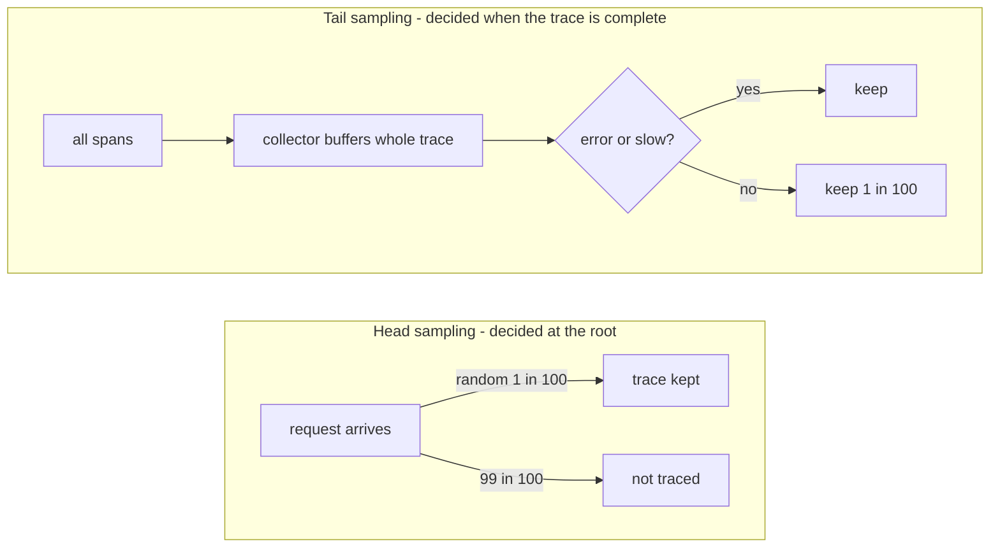
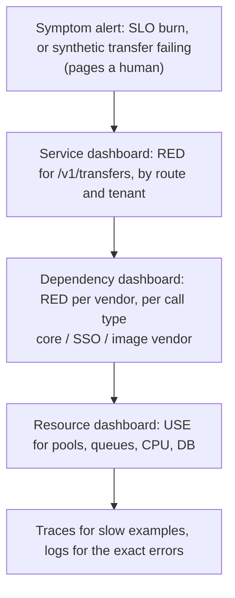
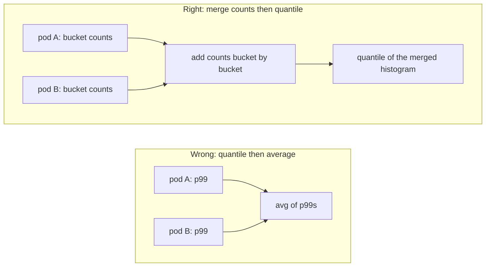
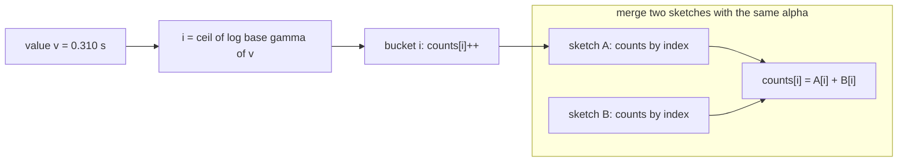
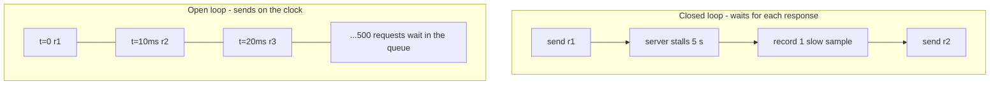
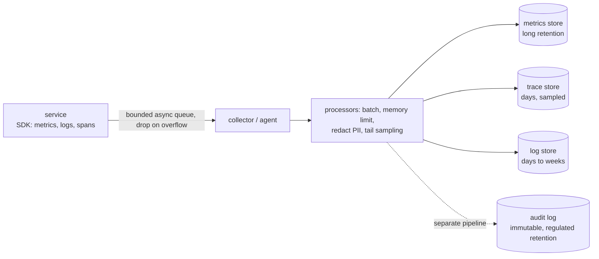

# A8 Unit 1 — Seeing the system

> Time: ~6 h · CORE: §1–§5 · STRETCH (≈ 1 h): §6 · Lab: `labs/a8/histogram`

A system you cannot see is a system you cannot promise anything about. This unit is about the instruments: what
signals exist and what each one is *for*, which few numbers deserve a page at 3 a.m., and how to measure latency
without lying to yourself. Most of the unit is about one deceptively small thing, the percentile, because nearly
every observability mistake in a design interview ("p99 latency, averaged across instances") is a percentile
mistake. By the end you will have built a mergeable, concurrency-safe latency histogram with a proven error
bound, and you will know why your dashboard's p99 was wrong.

## Before you start

You should be comfortable with the reliability toolbox from A7 (timeouts, retries with budgets, circuit breakers,
load shedding) and with Little's law from A0. Warm-up, answers written down first:

1. Your adapter handles 300 req/s to the core-banking vendor at 250 ms average latency. How many calls are in
   flight? The vendor degrades to 2.5 s at the same arrival rate and your connection pool holds 100. What happens?
2. Retries at two layers, 3 attempts each. How many calls can one user tap become at the bottom, and what do you
   change?
3. A circuit breaker opens and starts rejecting calls instantly. Does the service's average latency go up or
   down while the vendor is dead? What does that imply for what you monitor?

<details data-kind="answer">
<summary>Warm-up answers</summary>

1. Little's law: L = λ × W = 300 × 0.25 = 75 in flight. At 2.5 s: 300 × 2.5 = 750 wanted in flight. The pool caps
   it at 100, so ≈ 650 callers queue for a connection; their latency becomes (queue wait + 2.5 s), the queue grows
   until timeouts fire, and your service is now slow for *every* route that shares the pool (bulkhead!).
2. 3 × 3 = 9 attempts per tap in the worst case (the multiplication is the point). Retry at one layer, with a
   budget (A7); inner layers fail fast.
3. Down. Rejections take microseconds, so the *mean* and the median latency improve exactly when the system is
   failing. Averages of latency across all requests hide this; you need the error rate (including
   short-circuited calls), the latency of *successful* requests on its own, and the breaker state as a metric.
   This is §2's "latency of errors vs successes" in one example.

</details>

---

## §1 Metrics, logs and traces: what each is for

### The failure story

Tuesday, 02:10. The pager says "transfers slow". The platform serves 40 credit unions at ≈ 3,000 req/s at peak.
The on-call engineer opens three things:

- The dashboard: average latency 180 ms, green. (Nobody has looked at it with a tail in it.)
- The logs: ≈ 5 lines per request × 3,000 req/s × ≈ 400 B ≈ 6 MB/s, ≈ 500 GB/day, grepped for `timeout`: 40 million
  lines in the last hour, none telling which hop was slow.
- A trace: there is none. Tracing is on for 1% of requests, chosen at random at the front door, and the slow
  request they are looking for was not one of them.

Ninety minutes later someone notices that one credit union's core connector is slow; it is 1/40th of the traffic,
completely hidden in the aggregate. The post-incident action item: "add `tenant_id` and `member_id` labels to all
metrics". The next morning Prometheus is OOM-killed. The metric that had 80,000 series now has 3.2 million
(tenants) and, with `member_id`, an unbounded number. The fix for "we can't see enough" removed the ability to see
anything.

### Predict

<!-- predict id="A8-U1-P01" -->
**Predict.** Write your answers down before opening the reveal.

1. For each question, which signal do you reach for first: metrics, logs or traces?
   (a) "Is the transfers error rate above 1% right now, and on which route?"
   (b) "Why did *this member's* transfer at 02:07:13 return 502?"
   (c) "Of the 1.2 s this request took, how much was the core call and how much was our own queueing?"
2. A request counter has labels `route` (40 values) × `method` (4) × `status_class` (5) × `pod` (100). How many
   time series is that if every combination occurs? Now add `tenant_id` (40 credit unions). Now add `member_id`
   (1.2 million members, ≈ 150 k active per day). Which of these can a metrics system hold?
3. You trace 1% of requests, chosen at random when they arrive. The error rate is 0.1% at 3,000 req/s. How many
   traces per second do you store, and what fraction of the *failed* requests have a trace? What would you change?
<!-- /predict -->

### Reveal

<details data-kind="reveal" data-for="A8-U1-P01">
<summary>Reveal</summary>

1. (a) **Metrics**: a counter by route and status class, divided and compared to a threshold. That is what they
   are cheap and precise at. (b) **Logs** (or a trace if it was sampled): one structured event for that request
   with the member, route, upstream status and a request/trace ID you can search on. (c) **Traces**: a tree of
   timed spans shows the split between waiting for a connection, the core call and your own code. Metrics tell you
   *that* something is slow, traces tell you *where*, logs tell you *what happened*.
2. 40 × 4 × 5 × 100 = **80,000** series: fine. × 40 tenants = **3.2 million**: a large, expensive Prometheus (and a
   *histogram* multiplies its series count by 14: 12 buckets + sum + count). Then × 150 k active members ≈
   **4.8 × 10¹¹** possible combinations: nothing holds that, and the count is bounded only by user behaviour, so a
   product launch can crash monitoring. The rule: metric label values must come from a small, bounded set. Unbounded
   identifiers (member, request, account, IP) belong in logs and traces.
3. 1% × 3,000 = **30 traces/s**. Random sampling at the front door is independent of the outcome, so only **1% of
   the failed requests** have a trace: 99% of the interesting requests are invisible. Change: **tail-based
   sampling**: decide after the trace completes, keep every error and every slow trace plus ≈ 1% of the rest. The
   cost is that a collector must buffer all spans of all in-flight traces until the decision, and every span of a
   trace must reach the same collector (route by trace ID).

</details>

### How it actually works

The three signals are not three competing tools, they are three **data shapes** with different costs.

| | Metrics | Logs | Traces |
|---|---|---|---|
| Shape | numbers aggregated over time (a *time series* per distinct label set) | one record per event, free-form or structured fields | a tree of timed *spans* for one request across services |
| Answers | how many / how fast / how full; trends; alerting | what exactly happened, with detail | where did the time go; which hop failed |
| Cost driver | **number of series** (cardinality), not request count | bytes ingested and retained, ∝ traffic | spans × sampling rate |
| Tolerates high-cardinality fields? | no | yes | yes (that is its job) |
| Typical retention | months to years (cheap) | days to weeks | days (usually sampled) |
| Alert on it? | yes | rarely (derive a metric first) | no |

The cost gap is the whole design argument. A metrics sample compresses to roughly 1–2 bytes in a time-series
database (the Gorilla paper reports ≈ 1.37 B per point; `TODO-VERIFY` for current Prometheus TSDB figures).
Counting every request in a counter costs the same at 10 req/s and at 10,000 req/s. A log line costs 0.2–1 KB
*per request*. For 3,000 req/s at 400 B per line that is ≈ 1.2 MB/s ≈ **104 GB/day for one line per request**,
five lines per request ≈ 520 GB/day. The 80,000-series counter above, scraped every 15 s, is ≈ 5,300 samples/s ≈
7 KB/s ≈ 0.6 GB/day. So: **metrics for "how much", logs and traces for "which one"**.

**Correlation is what turns three silos into one tool.** Every signal needs a shared key:

```mermaid
sequenceDiagram
    participant App as Mobile app
    participant GW as API gateway
    participant TS as Transfers service
    participant AD as Core adapter
    participant CO as Core banking
    App->>GW: POST /v1/transfers
    Note over GW: no traceparent, so mint trace-id T, span G
    GW->>TS: traceparent: 00-T-G-01
    Note over TS: span S (parent G); every log line carries trace_id=T
    TS->>AD: traceparent: 00-T-S-01
    AD->>CO: vendor call; adapter span A (parent S)
    CO-->>AD: 504 after 8 s
    AD-->>TS: error
    TS-->>GW: 502 + X-Trace-ID: T
    GW-->>App: 502 + X-Trace-ID: T
```

- **Context propagation**: the W3C Trace Context standard defines the `traceparent` header,
  `00-<32 hex trace-id>-<16 hex parent span-id>-<2 hex flags>`, where the lowest flag bit means "sampled". Each
  hop keeps the trace ID and creates a new span ID. In Go the trace identity lives in `context.Context`, so it
  follows function calls but **not** goroutines started with `context.Background()` and **not** the network
  unless you inject it into outgoing headers. It also must cross **asynchronous** hops: put `traceparent` in the
  outbox row or the message headers (A6) so the webhook dispatcher's span links back to the request that caused it.
- **Logs carry the trace ID.** Then "show me everything that happened to this failed request" is one query, and
  the support team can ask a member for the `X-Trace-ID` printed in the app's error screen.
- **Metrics link to traces with exemplars**: a histogram bucket can carry an example trace ID for one of the
  observations in it (an OpenMetrics feature), so clicking the p99 spike on a graph opens a representative slow
  trace.
- **Structured logs**: key/value or JSON records with stable field names (`tenant`, `route`, `status`,
  `vendor_ms`), not sentences with numbers embedded. The most valuable single habit is the **canonical log line**
  (popularised by Stripe's engineering blog): one wide structured event per request, written at the end, with
  every field you might later want to group by. A wide event answers "p99 for tenant 17 on /v1/transfers
  excluding retries" after the fact, without having paid for that cardinality in metrics. For a bank, add the
  constraint: **never log credentials, full account numbers, SSNs or card PANs**; allow-list fields rather than
  dumping request bodies.

**Sampling** exists because tracing every request is expensive in CPU, network and storage.



| | Head sampling | Tail sampling |
|---|---|---|
| Decision | at the root, before anything is known | after the whole trace is seen |
| Cost | cheap: unsampled requests create no spans | every span is generated and shipped to a collector that buffers traces |
| Keeps the interesting traces? | only by luck | yes: errors, slow, specific tenants |
| Complexity | trivial (propagate the sampled flag) | stateful collectors, trace-ID routing, memory sizing |

### Build it

A tiny version of the plumbing, standard library only: take the trace ID from an incoming `traceparent` (or mint
one), put it in the context, stamp it on every log line, and forward it on outgoing calls with a fresh span ID.

```go
package main

import (
	"context"
	"crypto/rand"
	"encoding/hex"
	"log/slog"
	"net/http"
	"os"
	"strings"
)

type ctxKey struct{}

func randHex(n int) string {
	b := make([]byte, n)
	rand.Read(b)
	return hex.EncodeToString(b)
}

// traceID returns the trace-id from a W3C traceparent header
// ("00-<32 hex>-<16 hex>-<2 hex>") or mints a new one.
func traceID(r *http.Request) string {
	if p := strings.Split(r.Header.Get("traceparent"), "-"); len(p) == 4 && len(p[1]) == 32 {
		return p[1]
	}
	return randHex(16)
}

func withTrace(next http.Handler) http.Handler {
	return http.HandlerFunc(func(w http.ResponseWriter, r *http.Request) {
		id := traceID(r)
		w.Header().Set("X-Trace-ID", id) // shown to the member, searchable by support
		next.ServeHTTP(w, r.WithContext(context.WithValue(r.Context(), ctxKey{}, id)))
	})
}

// logFrom returns a logger that stamps trace_id on every record.
func logFrom(ctx context.Context) *slog.Logger {
	id, _ := ctx.Value(ctxKey{}).(string)
	return slog.Default().With("trace_id", id)
}

// propagate injects the trace into an outgoing request with a new span ID.
func propagate(ctx context.Context, out *http.Request) {
	if id, _ := ctx.Value(ctxKey{}).(string); id != "" {
		out.Header.Set("traceparent", "00-"+id+"-"+randHex(8)+"-01")
	}
}

func main() {
	slog.SetDefault(slog.New(slog.NewJSONHandler(os.Stdout, nil)))
	mux := http.NewServeMux()
	mux.HandleFunc("POST /v1/transfers", func(w http.ResponseWriter, r *http.Request) {
		out, _ := http.NewRequestWithContext(r.Context(), "POST", "http://core.internal/post", nil)
		propagate(r.Context(), out)
		// ... call the core with out ...
		// One canonical line per request, written once, with everything you may want to group by.
		logFrom(r.Context()).Info("transfer",
			"tenant", "cu_17", "route", "/v1/transfers", "status", 502,
			"vendor", "core", "vendor_ms", 8012, "amount_cents", 12500)
		http.Error(w, "bad gateway", http.StatusBadGateway)
	})
	http.ListenAndServe(":8080", withTrace(mux))
}
```

A real system uses OpenTelemetry's propagators and SDK rather than hand-rolling headers, but the shape is
exactly this. No lab for this section: §3 and §4 build the metric you would emit; the next Break it makes the
cardinality cost concrete.

### Break it

Run this toy "registry": one counter per distinct label set, which is how every metrics library works at its core.

```go
package main

import (
	"fmt"
	"runtime"
	"strconv"
	"strings"
)

type registry struct{ series map[string]*uint64 }

func (r *registry) inc(name string, kv ...string) {
	var b strings.Builder
	b.WriteString(name)
	for i := 0; i+1 < len(kv); i += 2 {
		b.WriteString("," + kv[i] + "=" + kv[i+1])
	}
	c, ok := r.series[b.String()]
	if !ok {
		c = new(uint64)
		r.series[b.String()] = c
	}
	*c++
}

func heap() uint64 {
	runtime.GC()
	var m runtime.MemStats
	runtime.ReadMemStats(&m)
	return m.HeapAlloc
}

func main() {
	before := heap()
	r := &registry{series: map[string]*uint64{}}
	for route := 0; route < 40; route++ {
		for _, m := range []string{"GET", "POST", "PUT", "DELETE"} {
			for _, c := range []string{"2xx", "3xx", "4xx", "5xx", "timeout"} {
				for pod := 0; pod < 100; pod++ {
					r.inc("http_requests_total", "route", "/v1/r"+strconv.Itoa(route), "method", m, "class", c, "pod", "p"+strconv.Itoa(pod))
				}
			}
		}
	}
	used := heap() - before // r is still referenced below, so the GC cannot reclaim it first
	fmt.Printf("bounded labels: %d series, %.1f MB\n", len(r.series), float64(used)/1e6)

	r2 := &registry{series: map[string]*uint64{}}
	before = heap()
	for u := 0; u < 200_000; u++ { // one route, one pod: only the member varies
		r2.inc("http_requests_total", "route", "/v1/transfers", "class", "2xx", "member_id", "m"+strconv.Itoa(u))
	}
	used = heap() - before
	fmt.Printf("member_id label: %d series, %.1f MB\n", len(r2.series), float64(used)/1e6)
	runtime.KeepAlive(r)
	runtime.KeepAlive(r2)
}
```

Predict the two series counts, then run it. Then (a) double the number of members and watch what happens to the
second number; (b) estimate what 4.8 × 10¹¹ series would need at the toy's per-series cost; (c) explain why a real
Prometheus uses far more memory per series than this toy, and why the *growth rate* is the part that matters.

<details data-kind="answer">
<summary>What you should see, and why</summary>

80,000 series ≈ 12 MB and 200,000 series ≈ 29 MB on the reference run (≈ 148 B per series in this toy, on Go 1.24;
yours will differ by a few percent). (a) Doubling members doubles the memory: linear, with no ceiling except user
growth. (b) At ≈ 150 B per series, 4.8 × 10¹¹ series would be ≈ 70 TB of RAM *for the toy*. (c) A real TSDB also
keeps an inverted index from labels to series, a write-ahead log, the current in-memory chunk per series and
per-query working memory; a commonly quoted figure is a few KB per active series (`TODO-VERIFY` against your
Prometheus version). The toy proves the *shape*: cost is proportional to distinct label sets, which is a function of
your label values, not of your traffic. That is why a label with an unbounded value domain is a production incident
waiting for its trigger.

</details>

### In the wild

- **Prometheus** stores one time series per unique (metric name, label set). Its status API
  (`/api/v1/status/tsdb`) lists the metrics and labels with the most series; scrape configs support
  `sample_limit` and `label_limit` to reject a target that suddenly exports too much; `metric_relabel_configs`
  can drop a label before ingestion. `prometheus_tsdb_head_series` is the number to graph.
- **Dapper** (Google, 2010) established the model of low-overhead sampled distributed tracing; the paper
  describes a uniform sampling rate of 1/1024 for its busiest services at the time (`TODO-VERIFY` the exact
  figure and how it evolved). The practical lesson is that sampling is a cost control, not a flaw.
- **OpenTelemetry** standardises SDKs, the OTLP wire protocol and context propagation (W3C Trace Context by
  default). Its Collector has a *tail sampling processor*; the documented constraint is that all spans of a trace
  must be routed to the same collector instance for tail decisions to work.
- **Jaeger, Zipkin, Grafana Tempo** are trace backends; **AWS X-Ray** uses an `X-Amzn-Trace-Id` header.
- **Loki** indexes only labels and stores log lines compressed, trading query power for cost; **Elasticsearch**
  indexes the text of every line, which is powerful and expensive. Honeycomb's pitch is the "wide event" model:
  store rich events and aggregate at query time.
- **Stripe's canonical log lines** blog post is the cleanest description of the one-wide-event-per-request habit.

### Trade-offs

| Option | Wins when | Loses when | When the answer flips |
|---|---|---|---|
| Metrics for everything, bounded labels | Alerting and SLOs; cheap long retention; you know the questions in advance | You need "which member/tenant exactly" | Flip to wide events/logs for the per-entity question; keep metrics for the aggregates |
| Per-tenant labels on metrics | Tenant count is small and bounded (40 credit unions) and tenants have different SLOs | `tenant × route × pod × buckets` multiplies out; tenant count grows with sales | Drop `pod` from the per-tenant series (aggregate it away) or restrict tenant labels to the 3–5 SLO-critical routes |
| Logs as the main source | Small system, ad-hoc debugging | Volume (hundreds of GB/day) and alerting latency/cost | Derive metrics from logs only for what you alert on; sample or drop success logs |
| Head sampling | Cheap; uniform picture of typical traffic | Misses rare failures | Flip to tail sampling when the rare failure is the thing you debug |
| Tail sampling | You must keep every error/slow trace | Collector memory and routing complexity | Flip back to head sampling at very high volume where the tail collector would be the bottleneck |
| 100% tracing | Low traffic, or a short debugging window | Cost at 3,000 req/s × dozens of spans | Always flip for steady state: sample |

### Senior bar

- **Failure modes**: a label explosion that OOMs the monitoring system (and monitoring is down exactly when
  you need it); log volume that costs more than the service; correlation lost at the first async hop (queue,
  outbox, webhook); clock skew making spans appear out of order across hosts; sampling bias (all kept traces are
  the fast ones); telemetry on the request path blocking the service when the log pipeline backs up (it must be
  asynchronous with a bounded buffer that drops, never blocks: the A6 backpressure lesson applied to your own
  instrumentation); PII in logs, traces or span attributes.
- **Capacity (≈)**: 1 B/sample metrics vs ≈ 400 B/line logs (≈ 400× per event); 3,000 req/s × 5 lines × 400 B ≈
  520 GB/day of logs; 30 stored traces/s at 1% head sampling; a few KB of Prometheus memory per active series
  (`TODO-VERIFY`).
- **Ops**: give every team a **cardinality budget** and alert on series growth, not just on the total; review new
  labels in code review ("what is the maximum number of values?"); set scrape `sample_limit`; keep telemetry
  retention aligned with audit needs (bank logs may be legal records; metrics are not).
- **Cost**: ingestion and retention dominate. Cutting log volume 10× by moving success lines to a sampled canonical
  line is usually the largest single saving.

Interviewer follow-up probes:

1. "Prometheus is OOM-killing itself right after a deploy. Walk me through it."

<details data-kind="answer">
<summary>Model answer</summary>

Check whether `prometheus_tsdb_head_series` jumped at the deploy time; use the TSDB status page to list the metric
names and label names with the most series; find the new unbounded label (a user/request ID, a raw URL path with
IDs in it, an error string). Immediate fix: drop it with `metric_relabel_configs` (or roll back), restart so
the head shrinks. Longer term: `sample_limit` per target so one bad deploy cannot take monitoring down, a
cardinality alert, and moving the high-cardinality question to logs/traces.

</details>

2. "How do you trace a transfer through the outbox, the queue and the webhook dispatcher?"

<details data-kind="answer">
<summary>Model answer</summary>

Store the `traceparent` in the outbox row and in the message headers so it survives the hop. The consumer starts
a *new* trace (the work may happen minutes later and fan out) with a **span link** to the originating span rather
than making it a child, and tags both with the business ID (`transfer_id`) so support can join them. The sampling
decision is made at the root and carried in the flags; tail sampling can keep the whole async chain when the
dispatcher records an error.

</details>

3. "Where does `tenant_id` go?"

<details data-kind="answer">
<summary>Model answer</summary>

Always in logs and traces. In metrics only if the tenant set is bounded (40 is fine) and only on the few metrics
that carry per-tenant SLOs; aggregate `pod` away on those, or use recording rules to produce per-tenant series
from per-pod ones, so the stored cardinality is `tenants × routes × classes`, not `× pods`.

</details>

### Check yourself

1. Why does a metric cost the same at 10 req/s and 10,000 req/s, and a log line does not?
2. Name two things that must be true for a trace to survive an HTTP hop and a queue hop.
3. Why does random head sampling at 1% give you a trace for only 1% of your failures?

<details data-kind="answer">
<summary>Answers</summary>

1. A metric updates one number per series; cost is the number of *distinct label sets*, not events. A log line is
   one stored record per event.
2. The `traceparent` (trace ID, parent span, sampled flag) must be injected into the outgoing headers/message
   headers and extracted on the other side; and the downstream must put the trace ID in its context and logs.
3. The sampling coin is flipped before the outcome is known, so it is independent of failure. Only tail-based
   decisions can favour failures.

</details>

---

## §2 Golden signals, RED, USE: what to look at and what to page on

### The failure story

The platform has an alert: `cpu > 80% for 5 min → page`. Over a month it fires 41 times. In 38 of them a nightly
reconciliation batch is simply busy; nothing is wrong. The team spends ≈ 40 × 20 min ≈ 13 hours a month
investigating nothing, and starts to ignore the pager. In the same month the core-banking vendor begins
returning 504 on 12% of balance inquiries for three hours. Your adapter threads sit blocked on the vendor, so
CPU is *25%*. No alert fires. At 400 req/s that is ≈ 48 failing requests per second × 10,800 s ≈ **520,000 failed
balance lookups** before support tickets reach engineering.

The alert measured the machine. The members felt the product.

### Predict

<!-- predict id="A8-U1-P02" -->
**Predict.** Write your answers down before opening the reveal.

1. You may page a human for at most three conditions on the transfers API. What are they? For each, say whether it
   is a *symptom* or a *cause* and why.
2. The adapter talks to the core through an HTTP connection pool of size 50. What would the RED view of calls to
   the core show, what would the USE view of the pool show, and which one tells you the pool is about to cause an
   outage?
3. A declined transfer returns `200 OK {"success": false, "reason": "insufficient_funds"}`. What does your
   dashboard's error rate show? Is that the right answer, and what would you change?
<!-- /predict -->

### Reveal

<details data-kind="reveal" data-for="A8-U1-P02">
<summary>Reveal</summary>

1. A good three: (i) the **error ratio** of `POST /v1/transfers` (non-2xx/accepted among valid requests) is
   burning the error budget (Unit 2 §2–§3); (ii) the **latency SLI** (share of transfers completing under the target) is
   burning budget; (iii) a **black-box synthetic transfer** (a canary member, a tiny amount to a test account)
   failing from outside the system. All three are symptoms: they describe what members experience, whatever the
   cause. "CPU high", "queue depth > N", "pod restarted" are *causes*: there are thousands of them, most are
   harmless, and none of them tells you members are hurting. Causes go on dashboards and, when they predict a
   future symptom (disk full in 4 h, certificate expiring in 10 days), into tickets.
2. **RED** for the calls: rate (req/s to the core), errors (timeouts, 5xx), duration (p50/p99 of the core call).
   **USE** for the pool: utilisation (in-use ÷ 50), saturation (callers *waiting* for a connection: queue length
   and wait time), errors (acquire timeouts). Saturation is the leading signal: utilisation sits at 100% for a
   long time while things still work; the moment wait time rises, latency for *every* caller is growing, and the
   next step is timeouts. RED shows the damage; USE shows the mechanism.
3. The error rate shows **0%** for declines, and for any 200-with-failure body. Whether that is "right" depends
   on what you want to measure: a decline for insufficient funds is a correct business outcome, not a service
   failure, so excluding it from the *availability* SLI is exactly right. The bug is when the service also uses
   `200 {"success": false}` for real failures (core timeout, internal error): then an outage is invisible
   (the A1 module's "0% errors during a 40-minute outage" story). Fix: use status codes that distinguish
   failure classes, and classify outcomes explicitly (success, client error / business decline, server error,
   timeout, shed) in one place, so metrics and SLIs read the same classification.

</details>

### How it actually works

Three vocabularies exist because they point at different things. They are compatible.

| Method | For | Signals | Where it comes from |
|---|---|---|---|
| **Four golden signals** | any user-facing service | **latency**, **traffic**, **errors**, **saturation** | Google SRE book, "Monitoring Distributed Systems" |
| **RED** | request-driven services (APIs, RPC handlers) | **R**ate, **E**rrors, **D**uration | Tom Wilkie |
| **USE** | resources (CPU, disk, pool, queue, NIC) | **U**tilisation, **S**aturation, **E**rrors | Brendan Gregg |

RED ≈ the first three golden signals for a service; USE gives you the fourth (saturation) for each resource the
service depends on. Details that matter in practice:

- **Latency of errors and of successes are different series.** A fast failure (a dead dependency answering
  "connection refused" in 1 ms, or your own breaker rejecting calls) *lowers* the average latency exactly when
  the system is sick. Track latency for successful requests separately, and treat requests slower than your
  timeout as errors even when they eventually return 200.
- **Errors can be implicit**: a 200 with a wrong or empty body, a response that arrived after the client gave up,
  a request silently dropped. Write down what counts as bad in one place and use it for dashboards and SLIs.
- **Saturation is the resource closest to its limit** and is best measured as *waiting*, not as busy-ness:
  run-queue length, connection-pool wait time, queue depth/age, thread-pool backlog, in-flight requests vs the
  limit. Little's law links them: if latency doubles at constant arrival rate, in-flight doubles.
- **Page on symptoms, ticket on causes.** The symptom is what users feel (errors, slowness, wrong answers); it is
  an *end-to-end* measure, so it catches failure causes you never thought of. Cause-based alerts only catch the
  failures you predicted. The exception is a cause that *guarantees* a future symptom with enough warning to
  act (storage will be full in 3 hours): that is a ticket, or a page if the horizon is short.
- **White-box vs black-box**: white-box monitoring reads internals (metrics your code emits); black-box probes
  behave like a user from outside (a synthetic transfer every minute through the real front door). White-box
  tells you why; black-box tells you whether the thing works at all, including the load balancer, DNS and TLS
  that your own metrics cannot see.



The drill-down order matters: a good dashboard hierarchy mirrors the diagnosis the on-call engineer will do at
3 a.m., so the same four panels appear in the same place on every service's page.

**Banking link.** Your vendor adapters are where these signals earn their keep. For each vendor, export: calls by
outcome class (ok, timeout, vendor 5xx, vendor 4xx, short-circuited by the breaker), duration histogram for
successful calls, in-flight gauge against the bulkhead limit (saturation), breaker state. Add one *cause* metric
that has bitten you before: **duplicate callbacks received** (vendor re-sent an event you already processed). It
should not page (the dedup layer handled it, no member was hurt) but a rising ratio is a leading indicator that
your acknowledgements are slow or the vendor is retrying, so it earns a ticket threshold and a dashboard panel.

### Build it

A RED middleware for `net/http`: one place that classifies every response and records rate, errors and duration.
It records into an interface so that §3's histogram can sit behind it later.

```go
package main

import (
	"fmt"
	"net/http"
	"net/http/httptest"
	"time"
)

// Outcome classes: decide once, use everywhere (dashboards, SLIs, alerts).
const (
	OK      = "ok"
	Client  = "client_error" // 4xx: the caller's problem, excluded from availability
	Shed    = "shed"         // 429/503 we chose to return: counted separately, policy decides if it burns budget
	Failure = "failure"      // 5xx: our problem
)

func classify(status int) string {
	switch {
	case status == http.StatusTooManyRequests || status == http.StatusServiceUnavailable:
		return Shed
	case status >= 500:
		return Failure
	case status >= 400:
		return Client
	default:
		return OK
	}
}

type Recorder interface {
	Observe(route, outcome string, d time.Duration)
}

type statusWriter struct {
	http.ResponseWriter
	status int
}

func (w *statusWriter) WriteHeader(code int) { w.status = code; w.ResponseWriter.WriteHeader(code) }

// RED wraps next and records one observation per request.
func RED(rec Recorder, route string, next http.Handler) http.Handler {
	return http.HandlerFunc(func(w http.ResponseWriter, r *http.Request) {
		start := time.Now()
		sw := &statusWriter{ResponseWriter: w, status: http.StatusOK} // an unset status means 200
		next.ServeHTTP(sw, r)
		rec.Observe(route, classify(sw.status), time.Since(start))
	})
}

type counts map[string]int

func (c counts) Observe(route, outcome string, _ time.Duration) { c[outcome]++ }

func main() {
	c := counts{}
	h := RED(c, "/v1/transfers", http.HandlerFunc(func(w http.ResponseWriter, r *http.Request) {
		if r.URL.Query().Get("core") == "down" {
			w.Write([]byte(`{"success": false, "reason": "core_unavailable"}`)) // BUG: status 200
			return
		}
		w.WriteHeader(http.StatusCreated)
	}))
	for i := 0; i < 90; i++ {
		h.ServeHTTP(httptest.NewRecorder(), httptest.NewRequest("POST", "/v1/transfers", nil))
	}
	for i := 0; i < 10; i++ {
		h.ServeHTTP(httptest.NewRecorder(), httptest.NewRequest("POST", "/v1/transfers?core=down", nil))
	}
	fmt.Println(c)
}
```

No lab for this section: the histogram that should sit behind `Observe` is the §3–§4 lab, and the SLI
arithmetic is Unit 2.

### Break it

Run the program above. 10% of requests fail because the core is down, but they answer `200`.

1. Predict the printed error ratio, then run it.
2. Fix the handler so a core outage returns `502` (or `504` for a timeout). Re-run and compare.
3. The handler also needs to *decline* a transfer for insufficient funds. Which status code and which outcome
   class do you give it, and why should it not burn the availability budget?

<details data-kind="answer">
<summary>What you should see, and why</summary>

1. `map[ok:100]`: 100 of 100 "ok", error ratio 0%, while 10% of members could not transfer. The classification
   cannot be smarter than the status codes it is given, so an API that reports failure inside a 200 body is
   invisible to every dashboard, load balancer health check, circuit breaker and retry policy downstream.
2. After returning 502/504: `map[failure:10 ok:90]`, an error ratio of 10%, which is what happened.
3. `422 Unprocessable Entity` (or `409`), class `client_error`: the service did exactly what it should
   (correctly refused an invalid operation). Counting it against availability would let a member with an empty
   account "burn" your error budget, and would punish the service for correct behaviour. Keep a separate
   business metric (decline rate by reason) because a *spike* in declines is still a signal, just not an
   availability one.

</details>

### In the wild

- **Google SRE book** chapter "Monitoring Distributed Systems" defines the four golden signals and the "symptoms,
  not causes" principle; Rob Ewaschuk's "My Philosophy on Alerting" is the source note it grew from.
- **Prometheus + Alertmanager** is the common open-source stack: alert rules fire into Alertmanager, which groups,
  deduplicates, routes (page vs ticket vs chat), and **inhibits** dependent alerts (do not page for "pod down"
  while "node down" is already paging). The `for:` clause requires a condition to hold for a duration before
  firing.
- **Black-box probing**: Prometheus's blackbox exporter, cloud canaries (for example AWS CloudWatch Synthetics),
  and homegrown "synthetic transaction" jobs.
- **The USE method** (Brendan Gregg) is a checklist for resources; **RED** is typically wired by default by service
  meshes and RPC frameworks (Envoy and gRPC interceptors expose request rate, status and duration).
- **Kubernetes** exposes the cause-level signals (CPU throttling, OOM kills, restarts, pending pods) you put on
  the resource dashboards, not in the pager.

### Trade-offs

| Option | Wins when | Loses when | When the answer flips |
|---|---|---|---|
| Symptom alerts (SLO burn, synthetic) | Always the first choice for pages; catches causes you did not predict | Does not tell you why; synthetic probes cover only the journeys you scripted | Add cause alerts as *tickets* once an incident repeats |
| Cause alerts (CPU, queue depth, pod restarts) | Cheap early warning for a cause that predictably becomes a symptom | Noisy; most firings are harmless; whole classes of failure invisible | Page on a cause only when the horizon to impact is shorter than ticket latency (disk full in 1 h) |
| White-box metrics | Rich, cheap, you control them | Blind to anything outside your process (DNS, LB, TLS, the network path) | Always pair with a black-box probe from outside |
| Synthetic probes | Detect total outages, certificate/DNS/LB problems, low-traffic periods | Single path, fixed data, can mask regional problems; cost of probe traffic | Probe from several regions and per critical journey; don't replace real-traffic SLIs |
| One service-level alert | Fewer, clearer pages | Hides which tenant/route is hurting | Add per-tenant or per-route SLOs for the segments with different expectations |

### Senior bar

- **Failure modes**: alerting on utilisation instead of saturation; missing *implicit* errors; mean latency
  masking the tail and fast failures; high-cardinality alert labels creating one page per tenant per pod; alert
  storms with no inhibition (one DB failure pages 40 services); dashboards that pass when the monitoring
  pipeline itself is broken (no data ≠ healthy: alert on absent data and on pipeline lag).
- **Capacity / numbers (≈)**: the SRE book's guideline is on the order of ≤ 2 incidents per 12-hour on-call
  shift (`TODO-VERIFY` the exact wording); with 41 false pages a month you have already lost the on-call's trust.
  Toil budget: each false page ≈ 20 min of context-switching for the whole team.
- **Ops**: every page links to a runbook and a dashboard; every alert has an owner; review alerts monthly: how
  many pages, how many actionable? Delete or demote the rest. Run game days to prove the alert fires.
- **Cost**: alert fatigue is the cost: the one real page gets ignored. Fewer, better alerts is a reliability
  feature.

Interviewer follow-up probes:

1. "What are the first three alerts you would create for a new payments API?"

<details data-kind="answer">
<summary>Model answer</summary>

(1) Availability SLO burn (multi-window, §U2) on the money-movement route. (2) Latency SLO burn on the same route.
(3) A synthetic end-to-end canary transfer from outside the network, so a dead load balancer or expired
certificate (where there is no traffic to burn a budget) still pages. Everything else (CPU, queue depth,
vendor breaker open, duplicate callbacks) is a dashboard panel or a ticket until an incident proves it deserves more.

</details>

2. "CPU is 25% and latency is through the roof. Where do you look?"

<details data-kind="answer">
<summary>Model answer</summary>

Low CPU with high latency means threads are waiting, not working: a saturated downstream or a connection/thread
pool. Check pool wait time and in-flight vs limit, then per-dependency duration and error rate (RED per vendor),
then a slow trace to see which span dominates. Little's law: latency × arrival rate = in-flight; if in-flight
equals a pool limit, requests are queueing in front of it.

</details>

3. "Why not alert on the error rate over 5 minutes?"

<details data-kind="answer">
<summary>Model answer</summary>

A fixed error-rate threshold either flaps on short blips (low threshold) or detects real incidents slowly (high
threshold, long window), and it ignores how much budget the errors cost. Unit 2 §3 replaces it with burn-rate
alerts over paired long and short windows, which page on "this is eating the monthly budget fast", not on "the
number is big right now".

</details>

### Check yourself

1. Give the RED signals and the USE signals, and say which one you would apply to a queue.
2. Why can a circuit breaker make average latency look *better* during an outage?
3. Name one cause-based alert that deserves to be a page, and the condition that makes it so.

<details data-kind="answer">
<summary>Answers</summary>

1. RED: rate, errors, duration (per request-driven service). USE: utilisation, saturation, errors (per resource).
   A queue is a resource: utilisation (fullness), saturation (age of the oldest message / backlog growth), errors
   (dead-lettered, failed deliveries).
2. Rejections are instantaneous, so they pull the mean down; track failures and short-circuits as errors and
   successful-request latency separately.
3. Disk or quota exhaustion with a short time-to-full (say under an hour), or a certificate expiring within
   hours: a cause that *guarantees* a near-term symptom with less warning than a ticket allows.

</details>

---
## §3 Percentiles, and why averages lie

### The failure story

The transfers dashboard shows **average latency 147 ms** against a 300 ms target: green for weeks. Support tickets
say the app "hangs". The raw data explains it: 97% of requests take ≈ 90 ms; 3% take ≈ 2 s (they hit the core's
slow retry path). The mean is 0.97 × 90 + 0.03 × 2000 ≈ **147 ms**. The median is 90 ms. The p99 is **2 s**. The
average describes nobody's experience: it is neither the typical request nor the bad one.

It is worse than a single slow request. A screen in the app calls 20 backend endpoints. If 3% of calls are slow
and independent, the share of screens that contain at least one slow call is 1 − 0.97²⁰ ≈ **46%**. Nearly half the
page loads feel slow, while "97% of requests are fast".

The team's fix is to add a p99 panel. Because each of the 12 pods exports its own p99, the panel plots the
**average of the per-pod p99s**. Two weeks later a canary pod receiving 1% of traffic gets a slow code path; the
panel jumps to 500 ms and everyone investigates the wrong thing. Later a real brownout hits two big pods and the
same panel moves by 30 ms.

### Predict

<!-- predict id="A8-U1-P03" -->
**Predict.** Write your answers down before opening the reveal.

1. Latencies: 97% of requests at 90 ms, 3% at 2,000 ms. Compute the mean, the median, the p95 and the p99. Which
   one matches the members' complaints?
2. A screen makes 20 independent calls with this distribution. What share of screens see at least one slow call?
   What if only 1% of calls were slow?
3. Two instances behind a load balancer. (a) Instance A served 990 requests this minute (p99 = 10 ms) and
   instance B served 10 requests (p99 = 1,000 ms). What is the average of the two p99s, and roughly what is the
   true fleet p99? (b) Now B served 20 and A served 980 (same per-instance p99s). What is the true fleet p99?
   What does a request-weighted average of the p99s say in each case?
<!-- /predict -->

### Reveal

<details data-kind="reveal" data-for="A8-U1-P03">
<summary>Reveal</summary>

1. Mean = 0.97 × 90 + 0.03 × 2000 = **147.3 ms**; median = **90 ms**; p95 = **90 ms** (97% of requests are at or
   below 90 ms); p99 = **2,000 ms**. The p99 matches the complaints. The mean sits where almost no request is.
2. 1 − 0.97²⁰ ≈ **45.6%**. With 1% slow: 1 − 0.99²⁰ ≈ **18.2%**. With 100 calls and 1% slow it is ≈ 63% (the
   fan-out figure in `docs/NUMBERS.md`). Tail latency of the parts is the typical latency of the whole.
3. (a) The average of the p99s is (10 + 1,000) / 2 = **505 ms**. The true fleet p99: 1,000 requests, 10 of them
   slow = exactly 1%; the 99th percentile sits at the top of the fast group, ≈ **10 ms**. The naive average is
   ≈ 50× too high; the weighted average (0.99 × 10 + 0.01 × 1000 ≈ 20 ms) is ≈ 2× too high. (b) 20 slow of 1,000 is
   2%, so the true fleet p99 is ≈ **1,000 ms**: a real SLO violation. The naive average still says 505 ms (2×
   too low) and the weighted average says 0.98 × 10 + 0.02 × 1000 ≈ **30 ms**, 30× too low: the dashboard is green
   during the incident. *Both* per-instance p99s were identical in (a) and (b); only the traffic split changed.
   **A percentile of a union is not a function of the percentiles of the parts.**

</details>

### How it actually works

**What a percentile is.** The q-quantile of a set of n observations is the value below which a fraction q of
them fall; "p99" is the 0.99-quantile. With the sorted data `x[0..n-1]`, one common definition (used by the lab)
takes the element at 0-based rank `floor(q × (n−1))`. Definitions differ by one rank; that is irrelevant when
n is large and decisive when the 99th percentile is on the boundary, as in the 990/10 example above.

**Why the mean lies about latency.** Latency distributions are long-tailed and often multi-modal (cache hit vs
miss, fast path vs retry path, healthy vs degraded vendor). The mean is dominated by the bulk, nudged by the
tail, and equal to neither mode. It is also fooled by fast failures (§2). Use the mean only for things that
*add up* (total CPU-seconds, total bytes), never as the headline latency.

**Why the tail matters more than its share.** Users do not make one request; they make sessions, and a page makes
many calls. Dean and Barroso's "The Tail at Scale" shows the arithmetic: with fan-out N and per-call slow
probability p, the chance that at least one call is slow is 1 − (1 − p)ᴺ. At N = 100, p = 1%: 63%. So the
percentile you should care about for a component is *higher* than the one the user perceives.

**Why percentiles can't be averaged (or summed, or combined from summaries).** A percentile is a property of
the whole distribution, not a linear function of its parts. Given only (p99ᴀ, nᴀ) and (p99ʙ, nʙ) you do not know
where the union's 99th percentile falls: the example above has identical per-instance numbers and fleet answers
that differ by 100×. The same trap hides in time: the "daily p99" is not the average of 1,440 one-minute p99s.

**What *can* be aggregated: counts.** If you keep, per instance, the *number of observations in each latency
bucket*, then bucket counts add across instances and across time windows, and you compute the percentile **once,
at the end, from the merged counts**:



This is exactly what Prometheus does when you write
`histogram_quantile(0.99, sum by (le) (rate(http_request_duration_seconds_bucket[5m])))`: `sum by (le)` merges the
bucket counters across all pods first, then the quantile is estimated from the merged histogram. A query that
applies `histogram_quantile` per pod and then `avg`s the result reproduces the dashboard bug in this section.
Client-side "summary" metrics (a pod computes its own p99) cannot be merged at all.

**An SLO should be a ratio of counts, not a percentile.** "p99 < 300 ms" and "99% of requests complete in under
300 ms" are the same statement, but only the second is computed from additive quantities: `good = count(≤ 300 ms)`,
`total = count(all)`. That form aggregates across pods and time, and it is what error budgets and burn rates (Unit 2)
need. Percentiles are for humans looking at a graph; the ratio is for alerting.

**Which percentile?** p50 shows the typical experience; p95/p99 show what the unlucky see; p99.9 and max matter for
fan-out. A high percentile needs enough samples: the number of observations *above* the percentile in a window is
n × (1 − q). At 10 req/s, a 1-minute window holds 600 requests: p99 rests on 6 samples (noisy), p99.9 on 0.6 (not
a statistic). Widen the window or use fewer, larger buckets of time for the high percentiles.

### Build it

Lab `labs/a8/histogram`, file `histogram.go`. Start with the `Sketch`; the package comment defines it precisely
(a log-linear histogram with relative error α, in the style of DDSketch; §4 explains why it works). Implement, in
order:

- `NewSketch(relErr)` (validate α ∈ (0,1)), `Record`/`RecordN` (reject NaN, ±Inf and negatives; exact zeros get
  their own counter; keep exact `Count`, `Sum`, `Min`, `Max`), `Mean`, `BucketCount`.
- `Quantile(q)`: rank = `floor(q·(count−1))`, walk the buckets in index order, return the bucket's representative,
  clamped to `[Min, Max]`; the extremes `q = 0` and `q = 1` return the exact `Min` and `Max`.
- `Merge`: add bucket counts, combine `Min`/`Max`/`Sum`/`Count`; reject sketches with a different α; never hold
  two sketches' locks at once.
- The fleet helpers `NaiveAverageQuantile`, `WeightedAverageQuantile` (both deliberately *wrong*) and
  `MergedQuantile` (right).

Guard the sketch with one mutex: the lab hammers it from many goroutines under `-race`. Acceptance tests:
`TestSketch_QuantileWithinRelativeError` (3 distributions × 3 values of α × 13 quantiles, against exact sorted
data), `TestSketch_ExtremeQuantilesAreExactMinAndMax`, `TestSketch_ZeroValuesAreCountedExactly`,
`TestSketch_WideDynamicRangeDoesNotBreak` (1e-300 … 1e300), `TestSketch_MemoryIsBoundedByDynamicRangeNotSampleCount`,
`TestMerge_EqualsRecordingEverythingInOneSketch` (seven instances with 1 : 937 traffic skew; the merged sketch
must give *bit-identical* quantiles to one sketch that saw everything), `TestMerge_RejectsDifferentRelativeError`,
`TestMerge_SelfMergeDoublesWithoutDeadlock`, `TestMerge_ConcurrentOppositeOrderDoesNotDeadlock`,
`TestSketch_ConcurrentRecordIsExact`, and the two `TestFleetQuantile_*` scenarios from the reveal above.

Run `go test -race ./labs/a8/histogram/` (it covers the whole package; use `-run 'Sketch|Merge|Fleet'` for just
this section).

### Break it

1. **Average the p99s of unequal-traffic instances.** After the fleet helpers pass, run

   ```
   go test -tags breakit -run BreakIt_AverageOfP99s -v ./labs/a8/histogram/
   ```

   It sweeps the slow instance's share of traffic. Before you run it: at which share does the *true* fleet p99
   jump from ≈ 10 ms to ≈ 1,000 ms, and what do the three estimators do at that point?
2. **Remove the lock.** The files `breakit_on.go`/`breakit_off.go` define a constant `breakNoLock`, true only with
   `-tags breakit`. Route your locking through two helpers (for example `lock()` with
   `if !breakNoLock { s.mu.Lock() }`, and the matching `unlock()`), then run

   ```
   go test -tags breakit -race -run Concurrent -v ./labs/a8/histogram/
   ```

   Predict what the race detector reports, and whether the test can fail *without* `-race`.
3. **Merge sketches with different α.** Comment out the compatibility check in `Merge` in a scratch copy and run
   `TestMerge_RejectsDifferentRelativeError` and `TestFleetQuantile_EdgeCases`. What does the merged sketch
   answer, and why is a plausible-looking wrong number worse than an error?

<details data-kind="answer">
<summary>What you should see, and why</summary>

1. Reference run (two instances, 100,000 requests, fast ≈ 10 ms, slow ≈ 1,000 ms):

   | slow share | true p99 | naive average | weighted average | merged sketch |
   |---|---|---|---|---|
   | 0.20% | 10.5 ms | 526.9 ms | 12.6 ms | 10.5 ms |
   | 0.99% | 10.5 ms | 526.9 ms | 20.7 ms | 10.5 ms |
   | 1.01% | 951.0 ms | 526.9 ms | 20.9 ms | 944.0 ms |
   | 2.00% | 999.3 ms | 526.9 ms | 31.1 ms | 1002.4 ms |
   | 5.00% | 1029.0 ms | 526.9 ms | 62.1 ms | 1022.7 ms |

   The true p99 flips exactly when the slow share crosses 1%: that is what "p99" means. The naive average never
   moves (it only sees two per-instance p99s). The weighted average creeps from 12 to 62 ms and is 15× low at
   the worst point. The merged sketch tracks the truth within its 1% guarantee (944 vs 951 ms). The failure is
   silent in both directions: at 0.2% the naive average screams 527 ms while nothing is wrong; at 2% the weighted
   average says 31 ms during a real violation.
2. `WARNING: DATA RACE` reports, with the read in `snapshot`/`Quantile`/`Count` and the write in `RecordN` or
   `Merge`. A Go map written concurrently can also kill the process outright with
   `fatal error: concurrent map writes`, which the runtime detects even without `-race`, so the test can fail
   (loudly) without it; an unsynchronised `count++` on its own would only produce a wrong total, silently, which
   is the dangerous version. In production this is a monitoring library corrupting itself on the hot path.
3. `Merge` would add counts of buckets that mean different value ranges: bucket 100 at α = 1% is ≈ 7.4 and
   at α = 2% is ≈ 55. The merged quantiles are plausible-looking garbage, which is why the check returns
   `ErrIncompatible` instead of trying to be helpful.

</details>

### In the wild

- **Prometheus**: `histogram_quantile` over `sum by (le) (rate(..._bucket[5m]))` is the canonical right way;
  *summaries* expose client-side quantiles that cannot be aggregated across instances (the docs say so).
- **Datadog**: its docs distinguish *histogram* metrics (per-agent percentiles, not aggregatable into global
  percentiles) from *distribution* metrics (the backend merges sketches and computes global percentiles). The
  backend sketch is DDSketch, which this lab's `Sketch` imitates.
- **StatsD-style timers** compute percentiles per host per flush interval; averaging those across hosts is the
  bug from this section. `TODO-VERIFY` the behaviour of your specific StatsD backend.
- **"The Tail at Scale"** (Dean and Barroso, CACM 2013): the fan-out arithmetic above, and mitigations such as
  hedged requests (send a second request after the p95 delay and take the first answer).
- **HdrHistogram** (Gil Tene) is the standard in-process latency recorder in benchmarking tools (§5).

### Trade-offs

| Option | Wins when | Loses when | When the answer flips |
|---|---|---|---|
| Mean latency | Quantities that add up (cost, throughput); capacity maths via Little's law | Any user-experience question | Never as a headline latency; keep it for capacity |
| p50 | Typical experience, a stable trend line | Hides the 1–5% who suffer | Add p99 as soon as you have an SLO |
| p99 | Tail the user feels; SLO conversations | Needs many samples per window; invisible to averaging mistakes | Move to p99.9 for high fan-out or when each user makes many calls |
| Max | Debugging a specific outlier | One bad packet makes it useless for alerting | Use only on dashboards for scale, never alerts |
| Fraction under threshold (SLI form) | Alerting and error budgets; aggregates across pods and time | Doesn't say *how* slow the rest are | Pair with a high percentile or a second threshold for context |
| Exact samples (raw) | Offline analysis from logs; small batches | Volume; cannot be merged cheaply online | Sketches/histograms for anything continuous |

### Senior bar

- **Failure modes**: averaging per-instance percentiles; percentiles over windows too short for the quantile;
  mixing success and failure latencies; a restart resetting per-pod histograms (counter-reset handling matters:
  Prometheus `rate()` accounts for counter resets); different bucket layouts per service version making
  fleet-wide merges impossible during a rolling deploy.
- **Capacity (≈)**: a log-linear sketch at α = 1% covering 1 ms to 100 s needs ≈ ln(10⁵)/ln(γ) ≈ 576 buckets
  (γ ≈ 1.0202). At 8 bytes per count ≈ 5 KB in memory, and a similar order on the wire if each pod ships its full
  sketch every interval. Compare with 14 floats for a classic 12-bucket Prometheus histogram.
- **Ops**: dashboards compute percentiles from merged counts, never from per-pod percentiles; document that in the
  panel description. Alert on the SLI ratio, show the p99 for humans.
- **Cost**: exact percentiles require shipping all raw samples (3,000 req/s × 8 B ≈ 2 GB/day per metric before
  indexing); sketches cost kilobytes per series per interval.

Interviewer follow-up probes:

1. "Your dashboard shows the average of the per-pod p99. What's wrong and how do you fix it?"

<details data-kind="answer">
<summary>Model answer</summary>

A percentile of a union is not a function of the parts' percentiles, so averaging (even request-weighted) can be
off by 10–100× in either direction, as the 990/10 vs 980/20 examples show. Export histogram bucket counts (or
mergeable sketches), sum them across pods and over the time window, and compute the quantile once from the merged
counts, e.g. `histogram_quantile(0.99, sum by (le) (rate(..._bucket[5m])))`.

</details>

2. "Your p99 panel is jumpy at night when traffic is 5 req/s. What do you do?"

<details data-kind="answer">
<summary>Model answer</summary>

At 5 req/s a 1-minute window has 300 requests, so p99 rests on 3 samples. Use a wider window for the quantile
(5–10 minutes), or switch to the SLI ratio (good ÷ total) which behaves better with few events, and for alerting
require a minimum request count. Don't smooth the quantile by averaging it over time: merge the underlying counts
over the longer window instead.

</details>

3. "Turn 'p99 under 300 ms' into something you can alert on."

<details data-kind="answer">
<summary>Model answer</summary>

SLI = (requests completing in ≤ 300 ms) ÷ (valid requests), which is additive across pods and time, with an SLO
of 99%. Alert on its burn rate (Unit 2). That needs a histogram bucket edge at exactly 300 ms (§4), or a sketch
whose uncertainty around 300 ms is small.

</details>

### Check yourself

1. Two datasets have p99 = 100 ms each. Can you state the p99 of their union? Why or why not?
2. What do you add, per instance, so that a fleet-wide p99 can be computed correctly later?
3. Roughly how many requests above the p99 are there in a 1-minute window at 20 req/s? Is that a stable
   estimate?

<details data-kind="answer">
<summary>Answers</summary>

1. No. It lies somewhere between the parts' values depending on their shapes and sizes; you need the
   distributions (counts per bucket), not the summaries.
2. Bucket counts (a histogram or a mergeable sketch) with identical bucket boundaries on every instance, plus
   sum and count; merge them, then take the quantile.
3. n × (1 − q) = 1,200 × 0.01 = 12. It is a noisy estimate (a handful of requests move it); use a longer window.

</details>

---

## §4 Histogram designs: fixed buckets, log-linear sketches, HDR and t-digest

### The failure story

The SLO says 99% of transfers complete in under 300 ms. The service exports a Prometheus histogram with bucket
edges at 100 ms, 250 ms, 500 ms and 1 s. For a week, the dashboard's `histogram_quantile(0.99, …)` reads about
**480 ms** and the "p99 > 300 ms" alert is red all week, yet customers are barely unhappy. A load test with every
request at exactly 310 ms reports a p99 of **497 ms**, 60% too high. When the real p99 later degrades from 310 ms to 480 ms
the panel barely moves: both values live in the same 250–500 ms bucket, so the estimate keeps interpolating inside it. The
histogram cannot see the difference between a service that is slightly over the target and one that is badly over.

A second team, asked to merge three clusters' latency graphs, finds the clusters use different bucket layouts. Their
histograms cannot be added, so the "global p99" is produced by averaging the three clusters' p99s: §3's bug again.

### Predict

<!-- predict id="A8-U1-P04" -->
**Predict.** Write your answers down before opening the reveal.

1. Every request takes exactly 310 ms. Bucket edges are 100, 250, 500, 1000 ms. What does Prometheus's
   `histogram_quantile(0.99, …)` return, and what assumption produced it?
2. You want a histogram whose quantile estimates are within 1% of the truth *whatever the value*. If bucket
   boundaries grow by a constant factor γ, what must γ be? How many buckets cover 1 µs to 1,000 s?
3. Pod A runs a histogram with 1% accuracy and pod B one with 2%. Why can't you add their bucket counts? Under
   what condition *can* two histograms with different resolutions be merged?
<!-- /predict -->

### Reveal

<details data-kind="reveal" data-for="A8-U1-P04">
<summary>Reveal</summary>

1. **0.4975 s**: the 99th percentile falls in the (250, 500] bucket, and Prometheus assumes the observations in a
   bucket are spread *uniformly* across it, so it interpolates 99% of the way from 250 to 500 ms: 250 + 0.99 × 250
   = 497.5 ms. The reality (all at 310 ms) violates the assumption. The error is bounded only by the bucket
   width (250 ms).
2. Relative error α means a bucket (lo, hi] with representative r must satisfy |r − v| ≤ α·v for all v in it. With
   boundaries γⁱ and representative 2γⁱ/(γ + 1), the worst error at *both* ends is (γ − 1)/(γ + 1), so choosing
   **γ = (1 + α)/(1 − α)** gives exactly α. For α = 1%: γ = 1.0202. Covering 10⁹ in range takes
   ln(10⁹)/ln(γ) = 20.72/0.0200 ≈ **1,036 buckets**.
3. A bucket index means a value range only relative to γ. Bucket 100 is γ¹⁰⁰ ≈ 7.4 at α = 1% and ≈ 54 at α = 2%, so
   adding counts index-by-index would mix unrelated ranges. Histograms **can** be merged if the coarser one's
   boundaries are a subset of the finer one's (OpenTelemetry's exponential histogram reduces "scale" by fusing
   adjacent buckets): you can always lose resolution, never gain it. Otherwise: pick one α fleet-wide.

</details>

### How it actually works

There are four families. All of them answer "how are values distributed?" with bounded memory; they differ in
*what error they guarantee* and *whether they merge*.

**1. Fixed buckets (the classic Prometheus histogram).** You choose upper bounds up front, for example
`.005 .01 .025 .05 .1 .25 .5 1 2.5 5 10` seconds (the default in the Go client). The metric exposes, per label
set, a *cumulative* counter for each bound (`le="0.25"` counts observations ≤ 0.25 s), plus `_sum` and `_count`.
That is `buckets + 2` series per label set, which multiplies cardinality (§1). To estimate a quantile Prometheus
finds the first bucket whose cumulative count reaches `q × total`, then interpolates linearly inside it:

```
rank   = q × total
start  = upper bound of the previous bucket (0 for the first)
result = start + (end − start) × (rank − prevCount) / (bucketCount − prevCount)
```

The estimate is always inside the right bucket, so the error is at most one bucket width, large wherever your
edges are sparse. If the quantile falls in the `+Inf` bucket, the result is capped at the largest finite bound.
Fixed buckets are **exact for counts at the edges**: `le="0.3"` gives precisely the number of requests ≤ 300 ms,
which is what an SLI needs. Their weakness is the *interior*, so the design rule is: **put a bucket edge on every
SLO threshold** (and on your timeout), and don't believe a quantile that falls in a wide bucket.

**2. Log-linear (exponential) buckets.** Make the bucket width proportional to the value: boundaries γⁱ. A value v
goes to bucket `i = ceil(log_γ v)`, covering (γⁱ⁻¹, γⁱ]. Estimating every value in the bucket as
`2γⁱ/(γ+1)` gives relative error ≤ α when γ = (1+α)/(1−α) (derivation in the reveal above). Properties that make
this the modern default:



- **Guaranteed relative error** for any distribution and any quantile (the lab's tests assert it against exact
  sorted data).
- **Memory depends on dynamic range, not sample count**: `ln(max/min)/ln(γ)` buckets; empty buckets cost nothing in
  a sparse representation (the lab uses a map).
- **Merge is addition** of counts per index, so it is exact, order-independent and cheap, provided α (hence γ) is
  the same. The lab's `TestMerge_EqualsRecordingEverythingInOneSketch` checks bit-identical results.
- It handles zero specially (log of zero is undefined) and needs a second store or a mirrored index for negatives.

Used by: DDSketch (Datadog), OpenTelemetry's exponential histogram (base 2^(2^−scale), so each scale step halves
the log-spacing), Prometheus's native histograms (same family; `TODO-VERIFY` current stability status and
default schema in your Prometheus version), and Circonus's log-linear "circllhist" histograms.

**3. HDR histogram.** Gil Tene's HdrHistogram stores integer values with a configured number of significant
decimal digits (for example 3 digits ≈ 0.1% relative error) between a lowest and highest trackable value. Memory
is fixed in advance; buckets are linear inside each power of two, which makes recording a few bit operations.
It is the standard recorder in latency benchmarks and has built-in support for the *coordinated omission*
correction in §5. Merge adds counter arrays.

**4. Rank-error sketches (t-digest, KLL).** These guarantee error in **rank space** ("the returned value's rank
is within ε of q"), not in value space. t-digest keeps more centroids near the tails, so p99.9 is accurate in
rank; merging is possible but approximate and can depend on merge order; there is no hard bound on how far the
*value* can be from the true value when the distribution has a gap. Elasticsearch's percentiles aggregation uses
t-digest by default (and offers HDR).

| Family | Error guarantee | Memory | Merges | Exact at SLO threshold? | Typical home |
|---|---|---|---|---|---|
| Fixed buckets | none inside a bucket; exact at edges | `buckets + 2` series per label set | add counters (needs identical edges) | **yes, if you put an edge there** | Prometheus classic histograms |
| Log-linear (DDSketch, OTel exp., native) | relative error α, any quantile | `ln(max/min)/ln γ` buckets | add counts (same α) | bracketed within one bucket | Datadog, OTel, Prometheus native |
| HDR | relative ≈ 10⁻ᵈⁱᵍⁱᵗˢ | fixed, set in advance | add arrays | bracketed | benchmarking, in-process recorders |
| t-digest / KLL | rank error | small, tunable | approximate | no | Elasticsearch, analytics |
| Raw samples | exact | O(n) | concatenate | exact | offline analysis |

**From a histogram to an SLI.** The SLO needs `count(≤ threshold)` and `count(all)`. With fixed buckets and an edge
at the threshold, that is exact. With a log-linear sketch, the lab's `CountAtMost(threshold)` returns a bracket
`[lo, hi]`: buckets entirely below the threshold are certainly good, the one straddling bucket is uncertain. With
α = 1% the uncertain bucket holds only values within ≈ ±1% of the threshold, which is a small share of traffic for
smooth data. The SLI is then reported as a range (or its pessimistic end is used for alerting).

### Build it

Second half of `labs/a8/histogram/histogram.go`:

- `CountAtMost(threshold)`: `lo` = zeros + counts of buckets with index below `index(threshold)`, `hi` = `lo` +
  the count in `index(threshold)` itself. Thresholds below `Min` give `(0, 0)`; at or above `Max`, `(Count, Count)`;
  `0` is exact.
- `FixedBuckets(bounds, samples)`: sort and de-duplicate the bounds, count each sample into the first bound ≥ it
  (`le` means ≤), and append a `+Inf` bucket holding the total.
- `PromQuantile(q, buckets)`: the Prometheus algorithm above, including its edge cases (q < 0 → −Inf, q > 1 → +Inf,
  no `+Inf` bucket or fewer than two buckets → NaN, quantile in the `+Inf` bucket → largest finite bound). Do not
  reorder the caller's slice.

Acceptance tests: `TestCountAtMost_BracketsTheTruthAndPinsTheStraddlingBucket` (thresholds placed exactly on
bucket boundaries γᵏ), `TestCountAtMost_EdgeCases`, `TestFixedBuckets_LeSemanticsSortingAndInf`,
`TestPromQuantile_InterpolatesLinearlyInsideTheBucket`, `TestPromQuantile_EdgeCasesMatchPrometheus`,
`TestPromQuantile_ConstantLatencyShowsInterpolationError` (the 0.4975 s from the reveal),
`TestPromQuantile_AlwaysLandsInsideTheBucketHoldingTheTrueQuantile`. Then run the whole package under the race
detector: `go test -race ./labs/a8/histogram/` (`sd lab A8` also runs the `burnrate` package; see Unit 2).

### Break it

1. **Bucket boundaries that straddle the SLO threshold.** Run

   ```
   go test -tags breakit -run BreakIt_BucketsStraddling -v ./labs/a8/histogram/
   ```

   The service's true latency is lognormal (median 200 ms); the SLO threshold is 300 ms. The test reads the SLI
   from two fixed layouts, one with no edge near 300 ms and one with an edge *on* it, and from the sketch. Predict
   the true SLI first; then predict what a dashboard reading "the nearest edge below" and "the nearest edge above"
   would report.
2. **Fixed-bucket quantile error.** Run `-run BreakIt_FixedBucketQuantileError`. Compare p50, p99 and p99.9 for
   three bucket layouts against the exact answer and the sketch.
3. **Merge mismatched layouts.** Build two `FixedBuckets` histograms with different bounds from the same samples
   and add their bucket counts by position. What do you get from `PromQuantile`?

<details data-kind="answer">
<summary>What you should see, and why</summary>

1. True share of requests ≤ 300 ms: **79.15%**. Layout without an edge near 300 ms (edges 0.1, 0.25, 0.5, 1 s):
   reading the nearest edge below gives **67.24%** and the nearest above **96.64%**; the true value is in between
   but the histogram cannot say where, and "SLO met / not met" flips depending on which you pick. Layout with an
   edge at 0.3 s: **79.15%** both ways, exact. The sketch (α = 1%) brackets it at **[78.21%, 79.38%]** with 210
   buckets. The lesson: an edge on the threshold makes the *SLI* exact, and a log-linear sketch makes it nearly
   so without choosing edges in advance.
2. Reference run, lognormal with median 50 ms (exact p99 = 411.07 ms):

   | estimator | p50 | p99 | p99.9 |
   |---|---|---|---|
   | exact | 50.30 ms | 411.07 ms | 807.17 ms |
   | sketch, α = 1% | 50.28 ms | 410.62 ms | 810.54 ms |
   | coarse edges (0.1 0.5 1 5) | 64.31 ms | 491.80 ms | 942.61 ms |
   | Prometheus default edges | 50.52 ms | 465.36 ms | 942.61 ms |
   | fine edges (×1.5 steps, 14 buckets) | 50.42 ms | 434.32 ms | 840.74 ms |

   Interpolation is good where buckets are dense and the density is roughly uniform (p50), poor in sparse tail
   buckets: p99 errors of +20%, +13%, +6%; the default layout puts p99.9 at 942.61 ms because the data falls in the
   (500, 1000] bucket and the estimate lands wherever the *bucket* says, not where the data is.
3. The merged counts correspond to no real distribution (positions have different meanings), so `PromQuantile`
   returns a plausible number that is simply wrong. Fixed-bucket histograms only merge when their edges are
   identical: standardise bucket layouts in a shared library, and version them.

</details>

### In the wild

- **Prometheus classic histograms**: cumulative `le` buckets; the Go client's default buckets are
  `.005 … 10` seconds; `histogram_quantile` interpolates exactly as above. **Native histograms** (exponential
  buckets, one series per label set instead of `buckets + 2`) are the same family as the lab's sketch.
  `TODO-VERIFY` the feature-flag/stability status for your Prometheus release.
- **OpenTelemetry** defines both explicit-bucket and *exponential* histograms; the exponential one has a `scale`
  parameter with base 2^(2^−scale) and is merged by aligning scales.
- **DDSketch** (Datadog; the VLDB 2019 paper "DDSketch: A fast and fully-mergeable quantile sketch with
  relative-error guarantees") is this lab's design, with a bucket-collapsing rule to cap memory.
- **HdrHistogram** (Gil Tene) in latency tools; **t-digest** (Ted Dunning) in Elasticsearch percentiles and other
  analytics engines; **Apache DataSketches** provides KLL.
- **Envoy** exports latency histograms (`TODO-VERIFY` which sketch it uses internally: it has used circllhist).

### Trade-offs

| Option | Wins when | Loses when | When the answer flips |
|---|---|---|---|
| Classic fixed buckets with edges at the SLO | You already run Prometheus; the SLO threshold is fixed and known | Interior quantiles are only as good as bucket density; adding an edge later loses history | Flip to log-linear when thresholds change often or you need trustworthy p99/p99.9 |
| Log-linear sketch, α = 1% | You want any quantile with a guarantee, mergeable, bounded memory | Needs backend support (native histograms, Datadog, a custom store); ~500–1,000 buckets on the wire | Flip to fixed buckets if the backend can only store classic histograms |
| HDR | In-process recording with fixed range; load tools | Integer values with preset range | Flip to a sketch for unbounded or very wide ranges |
| t-digest / KLL | Streaming analytics where tail *rank* accuracy is enough | No hard value-error bound; merge-order effects | Flip to log-linear when you must say "within 1% of the true latency" |
| Higher precision (α = 0.1%) | A tight SLO right at the threshold | ≈ 10× more buckets; more bytes per series | Stay at 1% unless more than a few percent of traffic sits within ±1% of the threshold |

### Senior bar

- **Failure modes**: no edge near the SLO threshold; a quantile read from a wide bucket and trusted;
  bucket layouts changed between releases (history becomes incomparable; rolling deploy mixes layouts);
  per-label-set explosion because every histogram is `buckets + 2` series; sketches with different α silently
  merged; negative or zero values mishandled; Inf/NaN from bad timers poisoning `_sum`; clock steps producing
  negative durations (use monotonic time in Go: `time.Since` does).
- **Capacity (≈)**: `buckets = ln(max/min)/ln γ`; α = 1%: 576 buckets for 1 ms–100 s (10⁵ range), 1,036 for
  10⁹; α = 0.5%: ≈ 1,150 for 10⁵. A 12-bucket classic histogram is 14 series per label set. At 80,000 label sets
  that is 1.1 M series versus 80,000 native/sketch series (each larger).
- **Ops**: standardise the layout in one library; add edges for the SLO threshold, 2× the threshold and the
  timeout; check histogram `+Inf` mass (anything beyond the top edge is invisible); alert if the share above the
  top finite bucket is non-trivial.
- **Cost**: classic histograms multiply series; sketches multiply bytes per sample but not series. Which is
  cheaper depends on the backend.

Interviewer follow-up probes:

1. "Why not store every latency and compute exact percentiles?"

<details data-kind="answer">
<summary>Model answer</summary>

Volume and mergeability. 3,000 req/s × 8 B ≈ 2 GB/day per metric before indexing, and an exact percentile
over many instances needs all samples in one place (sort or select over billions of values) every time a
dashboard refreshes. A 1%-accurate sketch is ≈ 5 KB, merges in microseconds, and 1% is far below the noise of
latency itself. Keep raw samples for offline analysis from logs/traces, and sketches for the online path.

</details>

2. "How do you choose bucket boundaries?"

<details data-kind="answer">
<summary>Model answer</summary>

Start from decisions: an edge on every SLO threshold and on the client timeout, then geometric spacing (×1.5–×2)
across the range you care about so relative resolution is uniform, and a top edge above the timeout so `+Inf` is
nearly empty. Better, avoid the choice: use exponential/native histograms or a sketch, which pick boundaries from
a single accuracy parameter.

</details>

3. "`histogram_quantile` says p99 = 497 ms. How would you know it is wrong?"

<details data-kind="answer">
<summary>Model answer</summary>

Compare with a count-based check that does not interpolate: the share of requests at or below a bucket edge
(`le="0.25"` / `_count`). If 99% of requests are ≤ 0.5 s and only 70% ≤ 0.25 s, the p99 lies somewhere in
(250, 500] and 497 is just the interpolation's guess. Also look at the width of the bucket the quantile falls in
relative to the value, and the share in `+Inf`.

</details>

### Check yourself

1. Which fixed-bucket quantile estimates can you trust, and which not?
2. Why does a merge of two log-linear sketches lose nothing, while a merge of two t-digests might?
3. What do you add to a Prometheus histogram so the "99% under 300 ms" SLI is exact?

<details data-kind="answer">
<summary>Answers</summary>

1. Those whose quantile lands in a narrow bucket relative to the value (dense edges), or at a bucket edge. Not
   those in a wide or the `+Inf` bucket: the position inside is an interpolation assumption.
2. Log-linear buckets are fixed value ranges, so merging is exact addition of counts; t-digest merges re-cluster
   centroids, which approximates and can depend on order.
3. A bucket edge at exactly 0.3 s: then `le="0.3"` ÷ `_count` is the exact SLI.

</details>

---
## §5 Measuring latency correctly: coordinated omission and where to measure

### The failure story

Before launch, the team load-tests the new transfers endpoint: 64 virtual users each send a request, wait for the
response, record the time, and send the next one. Ten minutes at ≈ 1,600 req/s. The report: **p99 = 38 ms**. Ship it.

In production the same endpoint shows a p99 of **900 ms**. During the load test the service had a 3-second stall
(a long GC pause, a lock held across an fsync). All 64 virtual users were stuck in that stall, so the test
recorded **64 slow samples out of ≈ 960,000** (0.007%) and carried on. In production, requests do not wait for each
other: members keep tapping. During the same 3 seconds ≈ 1,600 req/s × 3 s ≈ **4,800 requests** arrive and every
one of them waits, between 0 and 3 s, for the stall to clear. The load generator's behaviour coordinated with the
system under test and *omitted* exactly the samples that mattered. Gil Tene named this **coordinated omission**.

### Predict

<!-- predict id="A8-U1-P05" -->
**Predict.** Write your answers down before opening the reveal.

1. A client is supposed to send 100 requests per second for 60 seconds (one every 10 ms). The server answers in
   1 ms, except for one 5-second freeze starting at t = 10 s. The client is a simple loop: send, wait for the
   response, record `end − start`, then send the next request at the next 10 ms tick that is not in the past.
   How many samples does it record? What are its p50, p99, p99.9 and max? What would real users, who keep
   arriving every 10 ms whatever the server is doing, experience (p99)?
2. Name two ways to make the measurement correct.
3. You want a latency SLI for the transfers API. Compare measuring (a) inside the request handler, (b) at the load
   balancer, (c) in the mobile client. What does each one miss?
<!-- /predict -->

### Reveal

<details data-kind="reveal" data-for="A8-U1-P05">
<summary>Reveal</summary>

1. The loop records **5,500** samples (the ≈ 500 requests that should have been sent during the freeze were never
   sent). p50 = p99 = p99.9 = **1 ms**; the max is 5,001 ms: one outlier in 5,500 samples. Real users: 6,000
   requests, of which 500 (8.3%) arrive during the freeze and wait between ≈ 10 ms and 5 s; the p99 is
   **≈ 4.46 s** and the p99.9 ≈ 4.95 s. Same server, same run: 1 ms vs 4.5 s depending on the measurement.
2. (i) Make the generator **open-loop**: send on a fixed schedule (or Poisson process) regardless of whether
   earlier requests have returned, like real arrivals. (ii) Measure latency from the **intended send time**, not
   from when the request actually left; or, if you can't change the generator, back-fill the missing samples:
   HdrHistogram's `recordValueWithExpectedInterval` adds, for each recorded latency longer than the expected
   interval, the samples that would have been taken (`latency − interval`, `latency − 2 × interval`, …).
3. (a) **Handler timer**: misses time spent before the handler starts (TCP accept queue, TLS, the proxy's queue,
   waiting for a worker) and misses requests rejected before reaching it. During a stall, the requests queued in
   the kernel's accept queue have no handler timer yet, so server-side latency under-reports exactly when the server
   is sick, the same omission. (b) **Load balancer / edge**: includes queueing before your app and sees rejected
   requests; misses the client's DNS, TLS and last-mile network. This is the pragmatic place for the SLI.
   (c) **Client**: the truth for the member, but you do not control the network or the device and it is noisy;
   use it for real-user monitoring, not as the page-the-engineer signal.

</details>

### How it actually works

**The mechanism.** A closed-loop client has at most N requests in flight and sends the next only when one
completes. Its offered load therefore *falls* when the system slows down, and the missing requests are the slowest
possible ones, the ones that would have queued. Closed-loop clients make a struggling system look healthy and,
worse, they hide the queueing delay that dominates real tail latency. The same flaw appears in production
monitoring whenever the measurement starts "when we got to it" instead of "when the request arrived".



**Two time intervals, never confuse them.** *Service time* is how long the work takes once started. *Response
time* (what the user feels) is queue wait plus service time. Closed-loop and handler-timer measurements report
something between the two; open-loop measurement from arrival reports response time. Queueing theory (Unit 2 §5)
says that as utilisation rises, almost all of the growth is in the waiting term: that is the term these
measurements drop.

**Where to start the clock.**

- *In a service*: take the timestamp as early as possible. If a reverse proxy sits in front, have it stamp the
  arrival (`X-Request-Start` is a common convention in NGINX/Heroku-style stacks) and compute `now − arrival`
  at the end, so proxy queueing is included.
- *Monotonic clocks*: Go's `time.Now()` carries a monotonic reading and `time.Since` uses it, so wall-clock steps
  (NTP) don't produce negative or enormous durations. Don't subtract timestamps taken on different machines.
- *Include failures and timeouts* in the latency distribution (a request that timed out at 30 s *took* 30 s) or
  track them as a separate class, but never drop them.

**Making a load generator honest.** Run in open-loop mode (constant arrival rate), compute latency from the
scheduled send time, warm up before recording, record into a histogram that can hold the range (§4), report the
generator's own lag (if it cannot keep its schedule it is secretly closed-loop), and run for long enough to see
the rare stalls (a 3-second stall every 10 minutes needs a test of at least an hour to appear a few times).

### Build it

No lab for this section; the histogram you built in §3–§4 is the recorder. Run the simulation below instead. It
uses virtual time (no sleeping), so it is exact and repeatable.

```go
package main

import (
	"fmt"
	"math"
	"sort"
	"time"
)

const (
	svc      = 1 * time.Millisecond
	interval = 10 * time.Millisecond // intended: 100 req/s
	total    = 60 * time.Second
	stallAt  = 10 * time.Second
	stallLen = 5 * time.Second
)

// done returns when a request that starts at `start` finishes: the server
// does nothing during [stallAt, stallAt+stallLen).
func done(start time.Duration) time.Duration {
	switch {
	case start >= stallAt && start < stallAt+stallLen:
		return stallAt + stallLen + svc
	case start < stallAt && start+svc > stallAt:
		return stallAt + stallLen + (start + svc - stallAt)
	}
	return start + svc
}

func quantile(vs []float64, q float64) float64 {
	c := append([]float64(nil), vs...)
	sort.Float64s(c)
	return c[int(math.Floor(q*float64(len(c)-1)))]
}

func ms(d time.Duration) float64 { return float64(d) / float64(time.Millisecond) }

func main() {
	// Closed loop: send, wait, record service time, then wait for the next tick not in the past.
	var naive []float64
	t, next := time.Duration(0), time.Duration(0)
	for next < total {
		if t < next {
			t = next
		}
		end := done(t)
		naive = append(naive, ms(end-t))
		t = end
		for next += interval; next < t; next += interval {
			// ticks that passed while we were blocked are simply never sent
		}
	}
	// Open loop: every tick is a request; latency is measured from the intended send time.
	var open []float64
	free := time.Duration(0)
	for at := time.Duration(0); at < total; at += interval {
		start := max(at, free)
		end := done(start)
		open = append(open, ms(end-at))
		free = end
	}
	for _, r := range []struct {
		name string
		v    []float64
	}{{"closed loop", naive}, {"open loop", open}} {
		fmt.Printf("%-12s n=%d p50=%.1f p99=%.1f p99.9=%.1f max=%.1f ms\n", r.name, len(r.v),
			quantile(r.v, .5), quantile(r.v, .99), quantile(r.v, .999), quantile(r.v, 1))
	}
}
```

### Break it

1. Predict the two lines, then run the program. Check them against the reveal.
2. Shrink the stall to 500 ms and then 600 ms and 700 ms. For which stall length does the *open-loop* p99 first
   leave 1 ms? Derive the threshold before you run it. (Hint: what share of the 6,000 intended requests must be
   affected for the 99th percentile to move?)
3. Change the program to a Poisson arrival process (exponential gaps with mean 10 ms) instead of a fixed
   interval. Does the open-loop p99 change? Why would real traffic be even harsher than the fixed schedule?

<details data-kind="answer">
<summary>What you should see, and why</summary>

1. `closed loop n=5500 p50=1.0 p99=1.0 p99.9=1.0 max=5001.0 ms` and
   `open loop n=6000 p50=1.0 p99=4461.0 p99.9=4947.0 max=5001.0 ms`.
2. The 99th percentile moves once more than 1% of the 6,000 requests (60) are affected. A stall of length S
   affects S / 10 ms requests, so S must exceed 60 × 10 ms = **0.6 s**. At 500 ms the p99 stays at 1 ms; at 700 ms
   it jumps to roughly 640 ms (the 60th-largest latency). It is a cliff, not a slope: one stall moves p99 only when
   it is long enough, which is why p99.9 and max still matter for the short ones. The closed-loop recorder never
   moves at all.
3. With Poisson arrivals some arrivals cluster, so the queue after a stall is deeper and the open-loop numbers
   are somewhat worse than the fixed schedule's: bursts add queueing on top of the stall. A constant-rate generator
   is already optimistic compared with real, bursty traffic.

</details>

### In the wild

- **wrk2** (Gil Tene's fork of wrk) takes a target rate (`-R`) and records latency from the intended send time; its
  README is the canonical explanation of coordinated omission. **HdrHistogram** provides
  `recordValueWithExpectedInterval` for tools that can't be open-loop.
- **k6** has "open model" executors (`constant-arrival-rate`, `ramping-arrival-rate`) as well as closed-model ones
  (`constant-vus`); **Vegeta** attacks at a constant rate; **Gatling** offers open-workload injection;
  **JMeter** and **Locust** default to thread/user (closed) models.
- **Proxies stamp arrival times**: `X-Request-Start` (a convention from Heroku-style routers and supported by
  several APM agents), and Envoy/NGINX expose upstream timing variables (`TODO-VERIFY` the exact header and variable
  names in your proxy).
- **Cloud HTTP load balancers** (AWS ALB, Google Cloud's HTTP(S) load balancer) report request latency and 5xx counts at the edge: usable as SLI sources
  without touching application code.

### Trade-offs

| Option | Wins when | Loses when | When the answer flips |
|---|---|---|---|
| Closed-loop generator | Modelling a fixed user population (a call-centre app, 50 operators) | Capacity and tail tests: it throttles itself exactly when the system is slow | Flip to open-loop for any public or API traffic where arrivals don't depend on your response time |
| Open-loop (constant or Poisson rate) | Capacity, tail latency, overload behaviour | Needs a generator that can keep its schedule; can over-drive a small test environment | Flip to a closed loop with a think-time model only for bounded user pools |
| SLI at the handler | Simple; per-route, no infrastructure | Misses queueing before the handler and rejected requests | Flip to LB/edge measurement as soon as there is a proxy in front |
| SLI at the load balancer | Includes queueing and rejections; no code change | Per-route detail may be limited; excludes client network | Add synthetic probes and RUM for the outside-in view |
| SLI at the client | What users truly feel | Not controllable; network/device noise; privacy | Use for RUM dashboards, not as the paging signal |

### Senior bar

- **Failure modes**: closed-loop capacity tests (the system "passes" at a load it cannot sustain); server-side
  latency that starts the timer when the handler starts; dropping timeouts from the distribution; generator
  saturation (the generator is the bottleneck, so it is closed-loop in disguise); cold caches / JIT / connection
  warm-up in the measured window; test environment smaller than prod without scaling the stall frequencies.
- **Capacity / numbers (≈)**: a stall of S seconds at rate λ affects λ × S requests, each seeing between 0 and S
  of extra wait (mean S / 2). A 3 s pause at 1,600 req/s = 4,800 requests; spread across a 10-minute test of 960,000
  requests that is 0.5% of the traffic, enough to own the p99.5.
- **Ops**: have the load generator export its own lag; record both service time and response time; test overload
  explicitly (open-loop beyond capacity; see what load shedding does); keep the raw histogram per run so runs can
  be compared and merged.
- **Cost**: open-loop tests need more generator capacity than closed-loop ones at the same server load, since they
  can't self-limit; budget generator machines accordingly.

Interviewer follow-up probes:

1. "The load test said p99 = 40 ms and production says 900 ms. What do you suspect first?"

<details data-kind="answer">
<summary>Model answer</summary>

A closed-loop generator (coordinated omission) and/or a missing source of queueing: the test environment
did not reproduce stalls (GC, fsync, lock contention, connection churn) or the arrival burstiness. I'd rerun open-loop
at a constant arrival rate with latency measured from the scheduled time, compare the distribution rather than a
single number, and check the generator's own lag. I'd also check that the production number is measured at the
same point (LB) as the test.

</details>

2. "Where do you measure the latency SLI for a payments API?"

<details data-kind="answer">
<summary>Model answer</summary>

At the load balancer or API gateway: it sees queueing before the app, counts rejected and timed-out requests, and
needs no change to the code. Per-route handler metrics are for diagnosis. Add a synthetic canary through the real
front door for outside-in coverage, and RUM from the app for client-side truth, but page on the LB-based SLI.

</details>

3. "How do you know your load generator isn't the bottleneck?"

<details data-kind="answer">
<summary>Model answer</summary>

It reports scheduling lag (actual send time minus intended send time) and its own CPU and connection usage. If the
lag grows or CPU is saturated, the generator has become a closed-loop client. Scale out generators, lower the per-
generator rate, and compare against a run at half the rate: latency at identical server load should match.

</details>

### Check yourself

1. In one sentence, what is coordinated omission?
2. Why is a server-side latency histogram also exposed to it during a stall?
3. Which interval should an open-loop load test measure: from the actual send time, or from the intended send
   time?

<details data-kind="answer">
<summary>Answers</summary>

1. The measurement system slows down together with the system under test and so omits the samples that would have
   exposed the slowness.
2. Requests waiting in the accept queue or proxy during the stall have no handler timer yet; only the requests
   eventually handled are timed, from handler start, so the queueing delay is never recorded.
3. From the intended send time, so a late send counts as latency.

</details>

---

## §6 Telemetry pipelines, sampling and sensitive data (STRETCH)

### The failure story

Someone adds `slog.Debug("request", "body", string(body))` to the transfers handler to chase a bug, and deploys it
with the log level set to debug. Two days later: log volume has gone from ≈ 100 GB/day to ≈ 600 GB/day (3,000 req/s
× ≈ 2 KB body × 86,400 ≈ 520 GB/day just for the bodies); the log shipper's buffer fills and it starts dropping
events, including the error logs; the SaaS log vendor's bill triples; and a security scan finds account numbers and
a bearer token in 90-day retention. Four failures, one line of code.

### Predict

<!-- predict id="A8-U1-P06" -->
**Predict.** Write your answers down before opening the reveal.

1. Finance wants telemetry cost cut to 10% of today's. List what you would cut or sample, in order, and what you
   refuse to cut.
2. Sketch a policy for what may appear in logs, trace attributes and metric labels for a bank. Who enforces it and
   where?
3. The log shipper cannot keep up. The application can (a) block until the log is accepted, (b) drop log events,
   or (c) buffer unboundedly. Which, and what do you measure so you know it is happening?
<!-- /predict -->

### Reveal

<details data-kind="reveal" data-for="A8-U1-P06">
<summary>Reveal</summary>

1. In rough order of value per byte: (i) debug/body logging off, success-path info logs replaced by one sampled
   canonical line; (ii) sample traces (tail-based: all errors and slow, ≈ 1% of the rest); (iii) shorten hot
   retention for logs (days) and keep long retention only for metrics and audit records; (iv) drop or relabel
   unused metrics and high-cardinality labels, and use recording rules to pre-aggregate; (v) downsample old
   metrics. Refuse to cut: the SLI/SLO metrics, error logs, the audit trail (a separate, regulated pipeline), and the
   synthetic canary.
2. A **default-deny, allow-list** policy: only named fields may be logged; no request/response bodies; no
   credentials, tokens, full account/card numbers or SSNs, ever; identifiers are tokenised or truncated (last 4);
   metric labels must come from bounded vocabularies; URLs are logged as route templates (`/v1/accounts/{id}`),
   never raw paths with identifiers or query strings. Enforce at three places: typed logging helpers that cannot
   accept arbitrary structs, a redaction/attribute-filter processor in the collector (defence in depth), and a
   scanner in CI and in the log backend that alerts on pattern matches.
3. **(b) Drop**, through a bounded, non-blocking buffer. Blocking couples request latency to the health of the
   logging system, so a log outage becomes a transfers outage; unbounded buffering converts it into an
   out-of-memory crash. Export a counter of dropped events and the queue depth/age, and alert on drops: monitoring
   the monitoring. Prefer dropping low-value lines (debug/success) before errors.

</details>

### How it actually works

**A telemetry pipeline** has the same stages whatever the vendor: instrument (SDK) → **collect** (an agent or
collector near the app) → **process** (batch, filter, redact, enrich, sample) → **export** (to storage) → query.



Design rules that matter:

- **Never block the request path on telemetry.** Use a bounded queue between the application and the exporter and
  drop on overflow (with a counter). The same backpressure lesson as A6, applied to your own instrumentation.
- **Sample at the cheapest correct place.** Head sampling is cheapest (no span is created for unsampled requests).
  Tail sampling keeps what you need but needs a stateful tier; run it at the collector, route by trace ID, and bound
  its memory (buffer ≈ spans/s × decision window). Adaptive sampling adjusts rates per route or per tenant to a
  target volume, so a chatty endpoint cannot starve the budget; always keep 100% of errors and slow traces.
- **Sample logs by value**: keep every warning and error, sample info/success lines (or fold them into the
  canonical line), never debug in steady state. Record the sample rate on the event so counts can be re-weighted
  (a 1-in-100 sample means each kept event represents 100).
- **Retention by tier**: metrics are cheap and kept longest; traces and logs are expensive and kept short;
  audit records are kept as the regulator requires and live in a *different* system with different access
  controls and immutability (A9 builds a tamper-evident audit log).
- **PII and secrets**: classify fields, allow-list what telemetry may contain, redact at the source and again at
  the collector, keep telemetry access-controlled (logs often leak more than the database), and set retention
  deliberately. Treat telemetry as a data store in your threat model.

**Banking link.** Audit trails and debug logs are different artifacts: the audit trail is a regulated record of
"who did what on behalf of whom" that must be complete, so it cannot be sampled or dropped. Debug and performance
telemetry *should* be sampled and may be dropped. Mixing them in one pipeline forces you to choose between a
complete-but-expensive debug log and a cheap-but-incomplete audit trail, and you lose either way.

### Build it

No lab for this section. The core mechanism, a non-blocking bounded sink with a drop counter, fits in a screen of
standard-library Go. Run it and watch the difference between blocking and dropping when the consumer is slow:

```go
package main

import (
	"fmt"
	"sync/atomic"
	"time"
)

// Sink is a bounded, non-blocking event queue with a slow consumer behind it.
type Sink struct {
	ch      chan string
	dropped atomic.Int64
	block   bool
}

func NewSink(size int, block bool, consumeEvery time.Duration) *Sink {
	s := &Sink{ch: make(chan string, size), block: block}
	go func() {
		for range s.ch {
			time.Sleep(consumeEvery) // the slow log shipper
		}
	}()
	return s
}

// Emit never blocks unless the sink was built with block=true (the anti-pattern).
func (s *Sink) Emit(ev string) {
	if s.block {
		s.ch <- ev
		return
	}
	select {
	case s.ch <- ev:
	default:
		s.dropped.Add(1)
	}
}

func main() {
	for _, block := range []bool{true, false} {
		s := NewSink(100, block, time.Millisecond) // the shipper handles at most ~1,000 events/s
		var worst time.Duration
		start := time.Now()
		tick := time.NewTicker(time.Millisecond)
		for i := 0; i < 1000; i++ { // a handler emitting 3 events per millisecond: ~3,000 events/s for ~1 s
			<-tick.C
			for k := 0; k < 3; k++ {
				t0 := time.Now()
				s.Emit("transfer accepted")
				if d := time.Since(t0); d > worst {
					worst = d
				}
			}
		}
		tick.Stop()
		fmt.Printf("block=%-5v elapsed=%-6v worst Emit=%-8v dropped=%d\n",
			block, time.Since(start).Round(10*time.Millisecond), worst.Round(time.Microsecond), s.dropped.Load())
	}
}
```

### Break it

1. Predict `elapsed`, `worst Emit` and `dropped` for each mode before you run it.
2. Run it. Then double the consumer speed and rerun.
3. Which events would you rather drop first? Change `Emit` to take a level and never drop `error`s unless the queue
   is completely full.

<details data-kind="answer">
<summary>What you should see, and why</summary>

1. With the consumer at 1,000 events/s and producers at 3,000/s, after the 100-slot buffer fills the *blocking*
   variant slows the producer to the consumer's rate: elapsed ≈ 3 s for a loop meant to take ≈ 1 s, and `worst Emit`
   is a millisecond or more per call. In a service, that is request latency inherited from the log shipper. The
   *dropping* variant keeps `elapsed` ≈ 1 s with `worst Emit` in microseconds, and `dropped` ≈ 1,900 (about two
   thirds of the events).
2. A faster consumer shrinks both penalties: the blocking variant's `elapsed` falls towards 1 s and the dropping
   variant drops fewer events (the exact numbers depend on your OS timer resolution, since `time.Sleep` of a few
   hundred microseconds is coarse on many systems). The shape is the point: the capacity of the consumer relative to
   the producer decides how much you lose, and `dropped` is the metric to graph and alert on.
3. The cheapest policy is two queues (or a priority check): when the queue is above, say, 80% full, drop
   debug/info; only drop warnings and errors when full. Dropping errors silently is how you lose the evidence for
   the incident the logging was meant to explain; alert on any error-level drop.

</details>

### In the wild

- **OpenTelemetry Collector**: a pipeline of receivers, processors and exporters. Documented processors include
  `batch`, `memory_limiter` (refuses data when memory crosses a limit: backpressure on purpose), `tail_sampling`,
  and attribute/redaction processors.
- **Honeycomb Refinery** is a tail-sampling proxy with per-key dynamic sampling and sample-rate recording.
- **Fluent Bit, Vector, Logstash** ship and transform logs; **Loki**, **Elasticsearch** store them.
- **Thanos, Mimir, Cortex** provide long-term, horizontally scalable Prometheus storage with downsampling.
- **PCI DSS** restricts where cardholder data may be stored or displayed, which includes logs and traces
  (`TODO-VERIFY` the specific requirement numbers with your compliance team); bank regulators additionally
  prescribe audit-record retention, which is why audit logs get their own pipeline.

### Trade-offs

| Option | Wins when | Loses when | When the answer flips |
|---|---|---|---|
| Drop on overflow | Always for debug/perf telemetry; protects the request path | You lose data during the incident | Never block; instead raise capacity and alert on drops |
| Block on overflow | Audit records that must be complete | Couples availability to the pipeline | Use a durable local spool (write-ahead file) rather than blocking the request |
| Head sampling | Cost-sensitive, uniform traffic view | Misses rare failures | Tail sampling for error forensics |
| Tail sampling at a collector tier | Keep every error and slow trace | Stateful tier, memory, routing | Flip to head sampling plus error-forced sampling if the tier becomes the bottleneck |
| Redact at the source only | Simple, cheap | One missed code path leaks | Add collector-side redaction and CI scanners for defence in depth |
| One pipeline for everything | Simple | Audit completeness vs debug cost conflict | Separate audit from debug telemetry, always, in a regulated environment |

### Senior bar

- **Failure modes**: telemetry blocking the request path; collector OOM from tail-sampling buffers; sampling
  decisions inconsistent across hops (a child span sampled while its parent was not); PII in span attributes and
  exception messages; logs outliving their allowed retention; dropped logs during the very incident that needed
  them; cost surprises from one chatty library.
- **Capacity (≈)**: tail-sampling buffer ≈ span rate × decision wait: 100,000 spans/s × 30 s × ≈ 0.5 KB ≈ 1.5 GB
  per collector replica; 3,000 req/s × 2 KB bodies ≈ 520 GB/day, which is why bodies never get logged by default.
- **Ops**: dashboards for pipeline health (queue depth, dropped events, export errors, lag); per-team cost
  attribution; scheduled review of log levels in production; a break-glass procedure to enable debug logging for one
  tenant for 30 minutes, not fleet-wide for two days.
- **Cost**: ingestion volume × retention. Reduce volume first (sampling, level discipline), retention second,
  vendor third.

Interviewer follow-up probes:

1. "How do you give engineers detailed debugging data without logging everything?"

<details data-kind="answer">
<summary>Model answer</summary>

Dynamic, scoped verbosity: a feature flag or header that raises the log level for one tenant, route or trace for a
bounded time, combined with tail sampling that retains full traces for errors and slow requests, and the canonical
log line carrying the fields needed for grouping. Debug data is opt-in and expiring, not always on.

</details>

2. "Where do you redact PII?"

<details data-kind="answer">
<summary>Model answer</summary>

Layered: don't put it there (typed log fields, allow-lists, route templates), redact in the SDK/exporter, redact again
in the collector with pattern and attribute processors, and scan stored telemetry with alerts. The first layer is
prevention; the others assume a developer will eventually make a mistake.

</details>

### Check yourself

1. Why drop rather than block when the log pipeline is saturated?
2. Why should audit records not share a pipeline with debug telemetry?
3. What extra field makes sampled logs usable for counting?

<details data-kind="answer">
<summary>Answers</summary>

1. Blocking turns a logging outage into a request-latency outage; unbounded buffering into an OOM. Drop with a
   counter and alert on it.
2. Audit records must be complete and tamper-evident with regulated retention; debug telemetry should be
   sampled and may be lost. One pipeline can't be both cheap and complete.
3. The sampling rate (1-in-N) on each kept event, so counts can be re-weighted by N.

</details>

---

## Unit wrap-up

| Decision | Default | Flip when… |
|---|---|---|
| Metrics vs logs vs traces | Metrics for "how much" and alerting; traces for "where"; logs (one canonical line per request) for "what exactly" | A per-entity question (one member, one transfer) → logs/traces; an aggregate trend → metrics |
| Metric labels | Bounded vocabularies only (route, method, status class, outcome); no IDs | Per-tenant SLOs with a small, bounded tenant set → add `tenant` on the SLO-critical routes and drop `pod` there |
| Trace sampling | Head sampling at ≈ 1% for steady state | Rare failures must be debuggable → tail sampling (all errors and slow traces) |
| What to page on | Symptoms: SLO burn, synthetic canary | A cause that guarantees a near-term symptom (disk full in < 1 h) → page; otherwise ticket |
| Method | RED for services, USE for resources, golden signals as the checklist | A queue or pool → USE with saturation as waiting time/age |
| Latency statistic | Fraction under threshold (SLI) for alerting; p50/p99 from merged histograms for humans | Many calls per user session → watch p99.9; very low traffic → widen the window |
| Aggregating percentiles | Never average; merge counts/sketches, then take the quantile | — (no flip) |
| Histogram | Log-linear (native/exponential/sketch) at α ≈ 1% | Backend only supports classic buckets → fixed buckets with an edge on every SLO threshold and the timeout |
| Load testing / measuring | Open-loop, latency from intended send time; SLI at the LB or edge | Bounded user pool (call centre) → closed-loop with a think-time model |
| Telemetry under pressure | Bounded queue, drop with a counter, errors last to go | Audit records → durable spool, never drop |

Next: make `go test -race ./labs/a8/histogram/` pass (run `sd lab A8` once the `burnrate` package in Unit 2 is
done too), do the Break-it exercises, and write down the answers to the Check-yourself questions before moving to
[Unit 2 — Promising and planning](unit-2-slos-capacity.md). The quiz (`sd quiz A8`) draws from both units.
