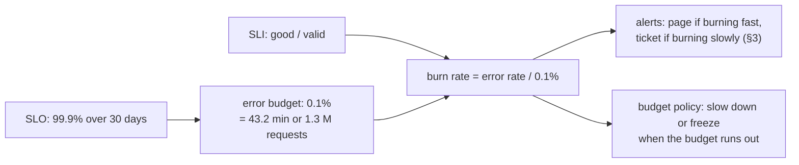
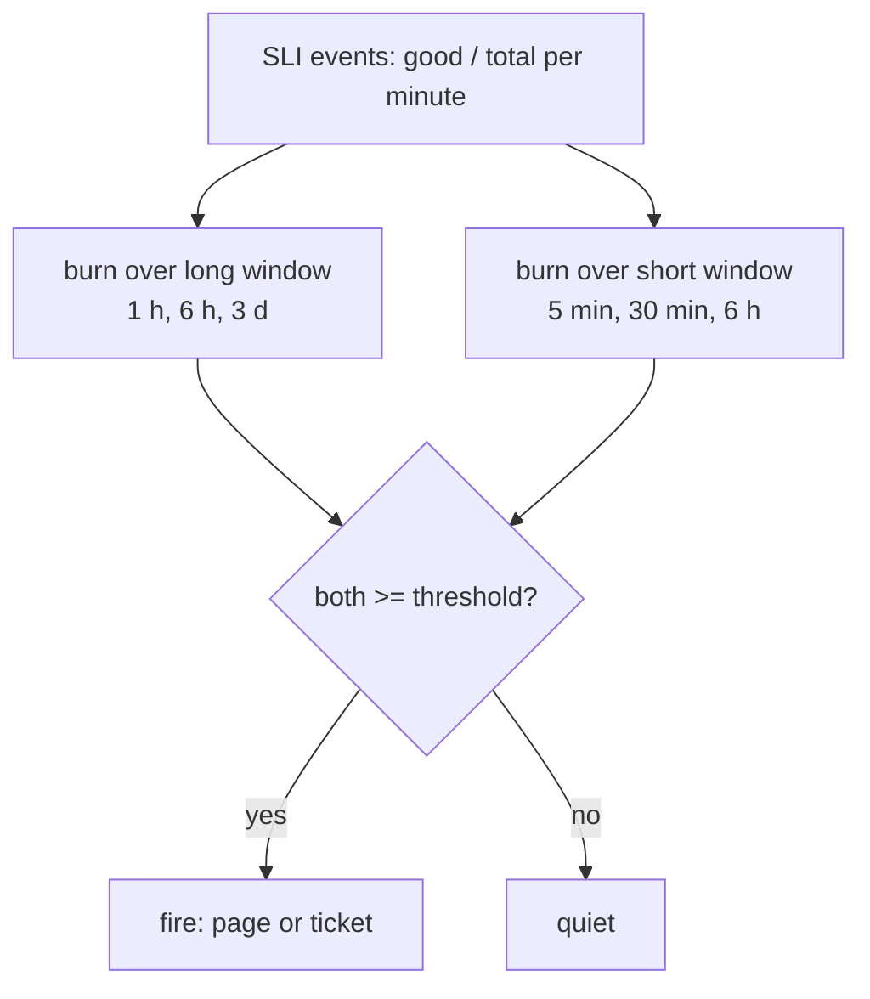
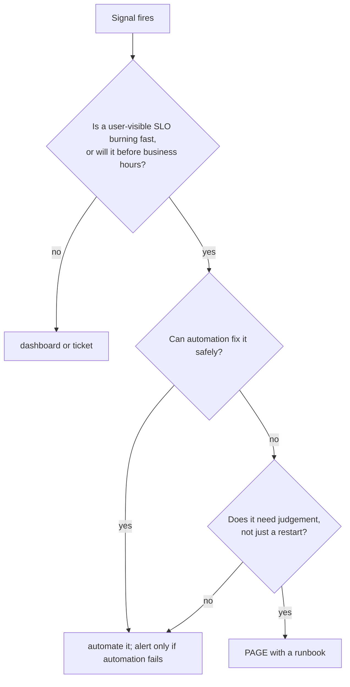
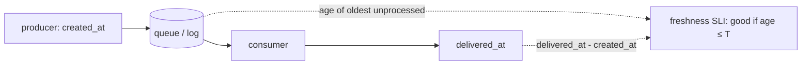

# A8 Unit 2 — Promising and planning

> Time: ~6 h · CORE: §1–§5 · STRETCH (≈ 1 h): §6 · Lab: `labs/a8/burnrate`

Unit 1 gave you instruments. This unit turns them into **promises** (SLIs and SLOs), a **spending model** for
those promises (the error budget), **alerts that follow the spending** (multi-window burn rates), and **plans for
load** (capacity and load testing). It ends with the question every system-design interview eventually asks in some
form: "how will you know it is working, what will you promise, and what happens at 10× traffic?"

## Before you start

You should have finished Unit 1: especially §3–§4 (never average percentiles; keep counts; an SLI is a ratio of
counts) and §5 (measure from arrival, at the edge). You also need Little's law (A0) and load shedding (A7).
Warm-up, answers written down first:

1. A 99.9% availability SLO over 30 days allows how many minutes of total outage? And 99.99%?
2. Why is "p99 under 300 ms" better expressed as "99% of requests under 300 ms" when you want to alert on it?
3. Your service sheds load with `429` when its concurrency limit is hit (A7). Should those responses count as bad
   events in the availability SLI? Who decides, and what do you lose either way?

<details data-kind="answer">
<summary>Warm-up answers</summary>

1. 0.1% × 30 d × 24 h × 60 min = **43.2 min**. For 99.99%: **4.32 min** (about 4.3).
2. The ratio good ÷ total is additive across instances and time (sum the counts, then divide), whereas percentiles
   can't be combined (Unit 1 §3). It is also exactly what an error budget consumes.
3. A policy choice that must be written down. From the member's side a shed request is a failed request, so
   shedding caused by *our* capacity should count as bad (otherwise you can "improve" the SLI by refusing more
   traffic). A per-client rate limit hitting a misbehaving partner is the client's problem and is usually excluded.
   Either way, track sheds as their own outcome class (U1 §2) so the decision is visible and reversible.

</details>

---

## §1 SLIs, SLOs and SLAs: choosing what to promise

### The failure story

The platform sells a contract to its 40 credit unions: **99.99% availability**, measured by a monitor that calls
`/healthz` every minute. In the second quarter the core-banking vendor's monthly maintenance window makes every
money-movement call fail for **4 hours**, one night. The servers are healthy and `/healthz` answers 200 throughout, so
the platform's own report says **100% uptime**. The credit unions' records show 214 failed member transfers and
they claim an SLA breach. By the time of the dispute, finance has asked what the 99.99% actually meant:
99.99% of 30 days is **4.3 minutes**. By *time*, four hours of failures is 1 − 4/720 ≈ **99.44%**.

Internally the number does damage in both directions. Engineers who know a single bad deploy would blow a 4.3-minute
allowance quietly stop deploying on Fridays, then on Thursdays. Others notice the allowance is meaningless and ignore
it. Nobody can say what "available" means for a transfer.

### Predict

<!-- predict id="A8-U2-P01" -->
**Predict.** Write your answers down before opening the reveal.

1. Write SLIs for a money-movement API with three parts: create a transfer, read its status, and webhook
   notifications of state changes. For each: what is a *valid* event, what is a *good* one, and where do you measure?
2. The core banking system has ≈ 4 hours of scheduled maintenance a month and 99.9% availability otherwise. What
   availability can you honestly promise for *synchronous* transfers? How could you design around it, and what do
   you then promise instead?
3. How should SLI, SLO, SLA and the team's alerting target relate? Which should be strictest, and why?
<!-- /predict -->

### Reveal

<details data-kind="reveal" data-for="A8-U2-P01">
<summary>Reveal</summary>

1. SLIs have the shape **good events ÷ valid events**.
   - *Create transfer, availability*: valid = requests to `POST /v1/transfers` that are well-formed and
     authorised (exclude 4xx caused by the client, health checks, known-abusive callers); good = answered with an
     accepted/success status (2xx) and not shed or timed out. Measured at the load balancer or gateway, so it sees
     queueing and rejections.
   - *Create transfer, latency*: fraction of valid requests answered within 1 s (an *acceptance* time; settlement is
     a different journey), as a histogram count at a bucket edge on 1 s.
   - *Read status*: availability and latency, with a looser latency target (it is a cheap read).
   - *Settlement freshness (asynchronous)*: fraction of accepted transfers that reach a terminal state within 30 s.
   - *Webhooks*: fraction of state changes delivered (2xx from the partner) within 60 s, measured from the event
     stream or outbox.
   - *Correctness* is not a ratio SLO: "duplicate postings", "ledger vs core mismatches" are **invariants** with
     target zero and an immediate alert on any occurrence; budgeting them would be like budgeting double-charging.
2. Serial dependencies multiply: even if your own code never failed, a synchronous path through a 99.9% core is at
   best 99.9% and, with 4 h of maintenance (99.44%), no better than ≈ 99.4% *during that month*. Design around it:
   accept the transfer (`202`), durably queue it, execute when the core is up. Then promise two things you can keep:
   **acceptance availability** (≈ 99.95%, you own it) and **settlement freshness** with an explicit exclusion
   for announced maintenance (or a long enough threshold). Be honest in the contract about which one a number is.
3. **SLI** = the measurement. **SLO** = the internal target for the SLI over a window. **SLA** = the contract, with
   consequences (usually service credits) if missed. The SLA must be *looser* than the SLO (for example SLA 99.5%,
   SLO 99.9%) so that you notice, and fix, a problem long before the contract is breached; your alerting is
   driven by the SLO's error budget (§2–§3), not by the SLA. If SLO = SLA you learn about the problem when you are
   already in breach.

</details>

### How it actually works

**Vocabulary** (from Google's SRE book and workbook, now industry standard):

| Term | Meaning | Example |
|---|---|---|
| **SLI** (indicator) | a quantitative measure of one aspect of service level, usually `good events ÷ valid events` | share of `POST /v1/transfers` that return 2xx within 1 s |
| **SLO** (objective) | target for the SLI over a window | 99.9% over a rolling 30 days |
| **SLA** (agreement) | contract with consequences for missing a target | 99.5% monthly or service credits |
| **Error budget** | `1 − SLO`: how much badness the SLO allows | 0.1% of requests, or 43.2 min per 30 days |

**SLI specification vs implementation.** Write both. *Specification*: "the proportion of valid transfer requests
that are served successfully in under 1 s". *Implementation*: "from gateway access logs / the LB's request metrics:
good = status in {200, 201, 202} and `request_time < 1 s`; valid = all requests on that route except 4xx other than
429, health checks and requests carrying the synthetic-traffic header". Disagreements about an SLO are almost always
disagreements about the implementation.

**Pick SLIs by system type** (the workbook's menu):

| System | Useful SLIs |
|---|---|
| Request/response (APIs) | availability, latency, quality (served degraded results?) |
| Data processing / pipelines | **freshness** (age of the newest data), coverage (share processed), correctness, throughput |
| Storage | durability, availability, latency |
| Batch jobs | on-time completion, success rate |

**Measure user journeys, not components.** A member "sending money to a saved payee" touches login, balance,
the payee list, transfer creation and a confirmation. A journey SLI is the one your customers recognise; component
SLOs support it. Keep the number small: 1–3 SLIs per journey, a handful of journeys per service.

**Choose the targets from user needs and from what the dependencies can support.** Nines are exponentially
expensive:

| SLO | Budget per 30 days (time) | Roughly means |
|---|---|---|
| 99% | ≈ 7.2 h | batch / internal tools |
| 99.9% | 43.2 min | typical user-facing API |
| 99.95% | 21.6 min | money-movement front door |
| 99.99% | 4.32 min | needs multi-AZ/region, automated failover, no manual steps |
| 99.999% | ≈ 26 s | rarely sensible; slower than human reaction |

Start from what you currently achieve and what users complain about, set the SLO a little tighter than "never
noticed", and revisit quarterly.

**Request-based vs time-based (window-based) SLIs.** A *request-based* SLI counts events: good requests ÷ valid
requests. A *time-based* SLI classifies each time slice (say a minute) as good or bad (for example, "error rate < 1%
in that minute") and reports the share of good slices. They answer different questions:

| Outage of 30 min, total, at… | Requests/day | Request-based SLI (day) | Time-based SLI (day) |
|---|---|---|---|
| 03:00 (≈ 100 req/min at night) | 3.33 M | **99.71%** | **97.92%** (30 bad minutes of 1,440) |
| 12:00 (≈ 6,000 req/min peak) | 3.33 M | **94.66%** | **97.92%** |

(Reference simulation in this section's Break-it.) The request-based number is weighted by how many members were
hurt: a night outage barely moves it, a peak outage devastates it. The time-based number is the contract
language ("uptime") and is insensitive to when it happened. Neither is wrong; know which you are promising. For
internal engineering use request-based (it matches pain and has a natural error budget); for contracts, the
customer may demand time-based and you must make the budget match.

**Fairness across tenants.** A global SLI is dominated by the biggest credit unions. A tiny credit union with
80 requests a day can be *completely down* for three hours and move the fleet-wide SLI by nothing. If different
tenants have contractual expectations, add per-tenant SLIs (or a floor such as "no tenant below 99% on its own
traffic") and track the worst tenants, not only the sum.

**Async journeys need their own SLIs.** For "accepted → settled" or "event → webhook delivered", availability is
the wrong measure: use **freshness** ("95% of transfers settle within 5 s, 99.9% within 60 s") measured from
timestamps on the record, not from request logs. Also count **unknown outcomes** (a timeout where the transfer may
or may not have posted) as bad events even if the transfer eventually posts: the member did not know.

### Build it

No lab for this section; the SLI becomes a stream of `(good, total)` counts that you feed to the tracker in §2.
Here is the SLI implementation from the reveal, as code, so there is exactly one place that decides what counts:

```go
package main

import (
	"fmt"
	"net/http"
	"time"
)

// Sample is what the edge knows about one finished request.
type Sample struct {
	Route     string
	Status    int
	Duration  time.Duration
	Synthetic bool
}

const latencyTarget = time.Second

// Classify returns whether the request is part of the SLI population (valid)
// and whether it met the objective (good). One function, used by the
// availability SLI and the latency SLI alike.
func Classify(s Sample) (valid, good bool) {
	switch {
	case s.Route != "POST /v1/transfers", s.Synthetic:
		return false, false
	case s.Status >= 400 && s.Status < 500 && s.Status != http.StatusTooManyRequests:
		return false, false // the client's mistake: not our availability
	}
	// 5xx, shed (429 from overload) and anything slower than the target are bad.
	return true, s.Status < 400 && s.Duration <= latencyTarget
}

func main() {
	samples := []Sample{
		{"POST /v1/transfers", 201, 180 * time.Millisecond, false},
		{"POST /v1/transfers", 201, 1400 * time.Millisecond, false}, // slow: valid, bad
		{"POST /v1/transfers", 422, 20 * time.Millisecond, false},   // declined: not valid
		{"POST /v1/transfers", 502, 8000 * time.Millisecond, false}, // core down: valid, bad
		{"POST /v1/transfers", 429, 2 * time.Millisecond, false},    // shed: valid, bad
		{"POST /v1/transfers", 201, 90 * time.Millisecond, true},    // synthetic canary: excluded
	}
	var good, valid int
	for _, s := range samples {
		v, g := Classify(s)
		if v {
			valid++
		}
		if g {
			good++
		}
	}
	fmt.Printf("valid=%d good=%d SLI=%.1f%%\n", valid, good, 100*float64(good)/float64(valid))
}
```

### Break it

Reproduce the time-based vs request-based table. This program simulates one day of per-minute traffic with a daily
curve (night ≈ 100 req/min, peak ≈ 6,000 req/min), 0.05% baseline errors and a 30-minute total outage:

```go
package main

import (
	"fmt"
	"math"
	"math/rand/v2"
)

func main() {
	traffic := func(minute int) float64 { // requests per minute: 100 at night, ~6,000 at noon
		h := float64(minute) / 60
		return 100 + 5900*math.Pow(math.Sin(math.Pi*h/24), 4)
	}
	for _, outageStart := range []int{3 * 60, 12 * 60} {
		r := rand.New(rand.NewPCG(1, 2))
		var good, total float64
		goodMinutes := 0
		for m := 0; m < 24*60; m++ {
			n := traffic(m)
			errRate := 0.0005
			if m >= outageStart && m < outageStart+30 {
				errRate = 1
			}
			bad := math.Min(n, n*errRate*(0.9+0.2*r.Float64()))
			good += n - bad
			total += n
			if bad/n < 0.01 {
				goodMinutes++
			}
		}
		fmt.Printf("outage at %02d:00: request-based SLI %.2f%%   time-based SLI %.2f%% (%d/1440 good minutes)\n",
			outageStart/60, 100*good/total, 100*float64(goodMinutes)/1440, goodMinutes)
	}
}
```

1. Predict which SLI makes the 03:00 outage look small and which is indifferent to the time of day.
2. Run it, then change the outage length to 5 minutes and the "good minute" rule to "error rate < 10%". How
   does the time-based number react?
3. You promised credit unions "99.9% monthly uptime". Which SLI definition must the SLA use, and what would you put
   in the SLO so that the engineering target is still request-weighted?

<details data-kind="answer">
<summary>What you should see, and why</summary>

1. `outage at 03:00: request-based SLI 99.71% time-based SLI 97.92% (1410/1440 good minutes)` and
   `outage at 12:00: request-based SLI 94.66% time-based SLI 97.92% (1410/1440 good minutes)`. The request-based
   SLI is sensitive to *when* (members hurt), the time-based one is not.
2. Time-based changes only by the number of bad minutes (5 of 1,440 → 99.65%), and a looser "bad minute" rule
   (< 10% errors) also stops a 5% brownout from counting at all: time-based SLIs hide partial degradation unless the
   per-minute threshold is chosen carefully. Request-based SLIs count every failed request regardless.
3. The SLA must use whatever the contract defines (here time-based "uptime", which should be defined precisely:
   what is a minute of downtime, who measures). Keep an internal request-based SLO that is stricter, so you are
   alerted by what hurts members long before the contractual measure moves.

</details>

### In the wild

- **Google SRE book** (chapter "Service Level Objectives") and **SRE workbook** (chapters "Implementing SLOs" and
  "Alerting on SLOs") are the origin of this vocabulary and of the SLI menu above.
- **Google Cloud Monitoring** lets you define SLOs on *request-based* and *windows-based* SLIs, which is exactly
  the split in this section; **OpenSLO** is an open YAML specification for describing SLOs; **Sloth** and **Pyrra**
  generate Prometheus recording and alerting rules from an SLO definition (§3).
- **Cloud SLAs** (AWS, GCP, Azure) are stated as a monthly uptime percentage with tiered service credits when missed,
  with exclusions (customer-caused failures, scheduled maintenance, force majeure). `TODO-VERIFY` current
  percentages and credit tiers for any service you quote.
- **Real-user and synthetic measurement**: HTTP-level LB metrics (AWS ALB, Google Cloud HTTP(S) LB, Envoy) for the request-based SLI; probes
  (Prometheus blackbox exporter, cloud canaries) for outside-in.

### Trade-offs

| Option | Wins when | Loses when | When the answer flips |
|---|---|---|---|
| Request-based SLI | Internal engineering; weights by member impact; natural budget | Low-traffic periods and small tenants are under-weighted | Add time-based or per-tenant SLIs where contracts or small tenants need them |
| Time-based SLI | Contract language ("uptime"); simple to explain | Blind to traffic weighting; hides partial degradation; threshold choice matters | Use as the SLA definition; keep request-based internally |
| One SLO per service | Few numbers, easy to run | Hides which journey or tenant suffers | One per critical journey once a service has distinct journeys |
| SLO = SLA | Fewer numbers | You find out when you're already in breach | Never for external SLAs: keep internal headroom |
| Tight SLO (99.99%) | Truly critical journeys with automation | Cost, deploy freezes, dependency-bound | Loosen until it matches what users notice and dependencies can deliver |
| Count shed requests as bad | Honest about member experience | Load shedding looks "expensive" in the SLO | Exclude only per-client rate limits that protect other tenants |

### Senior bar

- **Failure modes**: SLIs that cannot see failure (`/healthz`); SLOs on components rather than journeys; too many
  SLOs (more than a handful per service is noise); SLOs nobody acts on (no budget policy, §2); promises that exceed
  the serial product of dependencies; global SLIs hiding a down tenant; "valid events" defined so loosely that the
  SLI is always 99.99%.
- **Capacity / numbers (≈)**: 99.9% = 43.2 min / 30 d; each additional nine divides the allowance by 10. Serial
  availability multiplies: three 99.9% dependencies in series ≈ 99.7% (`docs/NUMBERS.md`).
- **Ops**: SLO documents are living: owner, SLI specification and implementation, window, target, exclusions,
  review date. Review quarterly against incidents and customer feedback.
- **Cost**: each extra nine multiplies engineering cost (redundancy, automation, on-call); an SLO tighter than
  users notice is waste, and a budget you never spend is a sign you could ship faster.

Interviewer follow-up probes:

1. "Define SLIs for a payments API."

<details data-kind="answer">
<summary>Model answer</summary>

Availability and latency of create-transfer measured at the gateway (good = accepted within 1 s, valid excludes the
client's 4xx), a freshness SLI for settlement and for webhook delivery measured from timestamps, and invariants
(duplicate postings, ledger mismatches) with a target of zero that alert on any occurrence rather than burn a budget.
I'd start with one SLO per journey and per-tenant visibility for the largest and the smallest credit unions.

</details>

2. "Your SLA is 99.9% but the core banking vendor only promises 99.5%. What do you do?"

<details data-kind="answer">
<summary>Model answer</summary>

Don't promise what the serial path can't deliver. Decouple: accept and queue transfers durably so *acceptance* does
not depend on the core, and promise settlement freshness with explicit maintenance exclusions. Negotiate the
vendor's windows and notice periods, add a degraded mode (read-only balances from cache), and report the two
numbers separately. If the contract must say 99.9% for synchronous settlement, price the risk or change the
architecture; an SLA you expect to miss is a liability.

</details>

3. "A tiny credit union has been down for three hours and the global SLO is fine. Is that acceptable?"

<details data-kind="answer">
<summary>Model answer</summary>

Not if it has contractual expectations. Aggregates are weighted by traffic, so small tenants vanish. I'd add
per-tenant SLIs (cheap with recording rules for 40 tenants), alert on a floor per tenant, and use synthetic probes
per tenant so a tenant with almost no traffic is still observed. The global SLO stays for engineering trade-offs.

</details>

### Check yourself

1. Write the generic SLI formula and name the two things you must define precisely.
2. Why should an SLA be looser than the SLO?
3. When is time-based better than request-based?

<details data-kind="answer">
<summary>Answers</summary>

1. `good events ÷ valid events`; define which events are valid (the population) and which are good.
2. To leave headroom: the SLO and its budget alert you to problems well before the contractual line is crossed.
3. When the contract is stated in uptime terms or when you need to guarantee coverage in low-traffic periods;
   it counts each interval equally rather than weighting by traffic.

</details>

---

## §2 Error budgets and burn rate

### The failure story

Two teams run services with the same 99.9% objective.

**Team A** has no concept of a budget. On day 12 a bad deploy returns 100% errors for 31 minutes (72% of the
monthly time budget). On day 19 a dependency outage takes another 20 minutes (46%). By day 19 the budget is overspent
by 18% and nobody knows until the month-end report. They have been shipping all along.

**Team B** has had no incident in nine months, 99.99% actual against 99.9% promised. Product keeps asking for faster
experiments and gets "reliability first". Nine months of frozen launches is also a cost; they are *over*-investing
in a promise nobody asked them to keep.

The same missing thing hurts both: a **shared currency** that tells product and engineering how much unreliability
is affordable *right now*.

### Predict

<!-- predict id="A8-U2-P02" -->
**Predict.** Write your answers down before opening the reveal.

1. How many minutes of full outage per 30 days do 99.9%, 99.95% and 99.99% allow?
2. The API averages 500 req/s ≈ 1.3 billion requests per 30 days, SLO 99.9%. (a) How many failed requests does the
   month allow? (b) An incident returns 5% errors for one hour while traffic is 800 req/s. What fraction of the
   month's budget is that, and what was the burn rate during the hour? (c) The same 5% for one hour at 03:00 at
   100 req/s?
3. At constant burn rates of 14.4, 6 and 1, how long until a fresh 30-day budget is gone? What would you put in
   a written policy for "budget exhausted"?
<!-- /predict -->

### Reveal

<details data-kind="reveal" data-for="A8-U2-P02">
<summary>Reveal</summary>

1. 0.1% × 43,200 min = **43.2 min**; 0.05% → **21.6 min**; 0.01% → **4.32 min**.
2. (a) 0.001 × 1.296 B ≈ **1.3 million** bad requests. (b) Bad requests = 800 × 3,600 × 0.05 = 144,000 → **11.1%** of
   the budget. Burn rate = observed error rate ÷ allowed error rate = 0.05 ÷ 0.001 = **50**. (c) 100 × 3,600 × 0.05
   = 18,000 → **1.4%**. The same error rate for the same hour costs 8× less at night because fewer members
   were affected. That is a feature of request-based budgets (they track pain), and a reason to keep a synthetic
   probe or per-minute SLI so night-time failures are still seen.
3. Time to exhaustion = period ÷ burn rate: 720 h / 14.4 = **50 h**; 720 / 6 = 120 h = **5 days**; 720 / 1 =
   **30 days**. Policy for exhausted budget (typical): freeze feature releases for the service, spend the
   engineering time on reliability work until the rolling budget recovers, with explicit exceptions (security
   fixes, fixes for the outage itself) and an escalation path for disagreements.

</details>

### How it actually works

**The budget.** If the SLO is 99.9%, the error budget is 0.1%: of every 1,000 valid events, 1 may be bad. Over a
period (say a rolling 30 days) the budget is `(1 − SLO) × valid events`, or `(1 − SLO) × period` in time terms.
Budget *remaining* is `1 − bad ÷ budget`: 100% untouched, 0% spent, negative means the SLO is violated for the window.

**Burn rate** compares the speed you are spending to the speed that would exactly use the budget over the period:

```
burn rate = (observed error rate) ÷ (1 − SLO)

burn 1    → on course to spend exactly 100% of the budget by the end of the period
burn 14.4 → would spend 100% in 1/14.4 of the period (= 50 h of a 30 d period)
```

Two identities carry the whole unit:

```
budget consumed in a window W at constant burn b over period P  =  b × W / P
time to exhaust a full budget at burn b                          =  P / b
```

| Burn rate | Error rate at 99.9% | Full 30-day budget gone in | Budget used per hour |
|---|---|---|---|
| 1 | 0.1% | 30 days | 0.14% |
| 2 | 0.2% | 15 days | 0.28% |
| 6 | 0.6% | 5 days | 0.83% |
| 14.4 | 1.44% | 50 h | 2% |
| 36 | 3.6% | 20 h | 5% |
| 100 | 10% | 7.2 h | 13.9% |
| 1000 | 100% (total outage) | 43.2 min | 138.9% |

The last row ties it back to Unit 1: a total outage burns at `1 / (1 − SLO)`, which for 99.9% is 1000, the largest
burn rate that exists. A burn threshold above that can never fire.



**Rolling vs calendar window.** A rolling window (last 28 or 30 days) ages old errors out smoothly and always
reflects the recent past; it fits burn-rate alerting. A calendar window (this month) resets on the 1st: right after the
reset the budget is full, which invites risky changes, and just before it ends a spent budget has nothing left to
lose. Contracts are usually calendar; engineering is better rolling.

**An error budget policy** is a short written agreement between product, development and SRE about what the budget
*means* in practice. Typical clauses: while the budget is healthy, ship normally and spend it on launches,
migrations, chaos experiments; below a threshold (say 25% remaining) slow down rollouts and add review; when
exhausted, freeze non-reliability work for that service until it recovers; a single incident that consumes more than
a set share of the budget triggers a postmortem with action items that must be completed (the SRE workbook's
example policy uses this style of clause; `TODO-VERIFY` its exact thresholds before quoting them); and exceptions for
security fixes. The policy is what stops the number being decoration.

**Spend it.** A budget that is never used is waste: 99.99% achieved against a 99.9% promise means ten times the
allowed risk was left on the table. Planned risk (a database migration, a new vendor, a canary of a risky change)
should be *budgeted*, not avoided.

**Which errors count?** Everything the SLI classifies as bad, including errors caused by a dependency: the member
doesn't care whose fault it was. The contract may exclude some (announced maintenance) but your engineering
budget shouldn't, or you'll never feel the pressure to build resilience around that dependency.

**Banking link.** Money movement tolerates less risk than a balance read. Give `POST /v1/transfers` its own,
tighter budget and its own policy, so a flaky account-summary widget cannot freeze payment releases (or, worse,
hide inside a shared 99.9%). Planned vendor maintenance windows are budget events you can forecast: schedule risky
releases away from them.

### Build it

Lab `labs/a8/burnrate`, file `burnrate.go`, first half: the **`Tracker`**. It stores `(good, total)` per time bucket
and answers questions about any trailing window. Time is always a parameter (the equivalent of an injected clock,
so tests never sleep). The package comment pins the exact window semantics (bucket width = `Resolution`, a window of
`w` covers `ceil(w / Resolution)` buckets ending with the bucket that contains `now`). Implement:

- `NewTracker(Config{Objective, Period, Resolution})`: validate (objective in (0,1), positive period, resolution ≤ period;
  default resolution 1 minute).
- `RecordAt(at, good, total)`: add counts to the bucket containing `at`; reject `good > total`; accept events out
  of order; forget buckets older than `Period` (amortised O(1) per new bucket: don't rescan the whole map per
  event) and drop events older than the retention.
- `SLI(now, window)` returns `(good/total, total, ok)`: with no events `ok` is false ("0/0" is *unknown*, not 100%).
- `BurnRate(now, window)` = error rate ÷ `(1 − Objective)`.
- `BudgetRemaining(now)` = `1 − bad ÷ ((1 − Objective) × total)` over the whole `Period` (1 with no traffic).
- `TimeToExhaustion(now, window)` = `remaining × Period ÷ burn`; `(0, true)` if already spent; `(0, false)` if the
  window shows no errors or no traffic.

Acceptance tests: `TestNewTracker_ValidatesConfig`, `TestRecordAt_RejectsGoodAboveTotal`,
`TestSLI_ExactFractionsOverTrailingWindows`, `TestSLI_WindowIncludesCurrentBucketAndExcludesOlderOnes`,
`TestSLI_NoTrafficIsUnknownNotPerfect`, `TestSLI_FutureEventsAreNotCountedEvenWithManyBuckets`,
`TestRecordAt_OutOfOrderMatchesInOrder`, `TestTracker_MemoryIsBoundedByPeriodAndOldDataIsForgotten`,
`TestBurnRate_IsErrorRateOverAllowedErrorRate`, `TestBudgetRemaining_*`, `TestTimeToExhaustion_*`. Run
`go test -race -run 'Tracker|SLI|Record|Burn|Budget|Time' ./labs/a8/burnrate/`.

### Break it

1. **0/0 is not 100%.** In your `SLI`/`BurnRate`, return `(1, 0, true)` / `(0, true)` when there is no traffic and
   run `TestSLI_NoTrafficIsUnknownNotPerfect`. Then answer: a misconfigured load balancer sends nothing to your
   service for 20 minutes. What does the burn-rate dashboard show with and without the "unknown" state, and what do
   you add so this failure still pages?
2. **Off by one bucket.** Make a window cover `ceil(w / Resolution) + 1` buckets and run `TestSLI_ExactFractions…`.
   Compute by hand how wrong a 5-minute window becomes if the extra bucket is a clean minute versus a bad one.
3. **Retention off by one.** Let the tracker keep `Period/Resolution + 1` buckets and watch
   `TestTracker_MemoryIsBoundedByPeriodAndOldDataIsForgotten`. Why does an off-by-one in retention matter for a
   30-day budget?

<details data-kind="answer">
<summary>What you should see, and why</summary>

1. The test fails: with no data the SLI must be "unknown". If "no traffic" becomes a perfect SLI, a total outage
   that *removes* the traffic (dead LB, DNS, expired certificate) reads as a burn rate of 0 and the dashboard stays
   green while every member is locked out. You need a signal that does not depend on traffic existing: a synthetic
   probe through the real front door, and an alert on **absent traffic** (`request rate == 0` or `absent(...)`
   for a service that always has traffic). The unit's rule: burn-rate alerts can only see failures that produce
   events.
2. A 5-minute window that becomes 6 buckets dilutes the error rate by 5/6 if the extra minute is clean (a 20% error
   rate reads 16.7%) and inflates it if the extra minute is bad. A ≈ 17% error in the measured burn rate is
   the difference between paging and not paging for an incident burning near the threshold.
3. Memory is bounded either way, but the extra bucket silently includes a minute from outside the SLO period: a
   spent budget "recovers" one bucket late and a window's total is wrong. The lab's test catches it by asserting the
   exact retained total; in production this is the kind of bug that surfaces as an auditor asking why the monthly
   number does not match the logs.

</details>

### In the wild

- **Google SRE book/workbook**: error budgets, the concept of a budget policy, and the example *Error Budget
  Policy* appendix in the workbook are the standard reference.
- **Google Cloud Monitoring** displays "error budget remaining" and supports rolling and calendar compliance
  periods on SLOs; **Grafana SLO**, **Datadog SLOs**, **Nobl9** and **Sloth/Pyrra** do the same on top of your metrics
  (`TODO-VERIFY` feature names per product).
- **Error budgets as a release gate** appear in progressive-delivery tooling (canary analysis compares the canary's
  error rate to the baseline; automated rollback when it burns budget too fast).
- **Cloud provider SLAs** are the external, credit-based cousin: a missed monthly uptime tier earns the customer a
  credit.

### Trade-offs

| Option | Wins when | Loses when | When the answer flips |
|---|---|---|---|
| Rolling 30-day window | Engineering: smooth, always current, fits burn-rate alerts | Doesn't match calendar-month contracts | Report calendar-month compliance separately for the SLA |
| Calendar window | Contracts and finance reports | Reset cliff: full budget on the 1st | Use only for reporting; don't drive deploy policy from it |
| Request-based budget | Matches member pain | Quiet-hour failures are cheap | Add a time-based or synthetic SLI where quiet-hour correctness matters |
| Time-based budget | Easy to explain ("43 minutes") | Ignores traffic weighting | Use for coverage guarantees |
| Strict freeze when budget is exhausted | Creates real pressure for reliability work | Blocks urgent fixes | Define exceptions (security, the fix for the outage itself) in the policy |
| Per-route budgets | Money movement isolated from low-value routes | More alerts and dashboards | Merge routes that share a failure domain and a user journey |

### Senior bar

- **Failure modes**: a budget with no policy; a budget no one is allowed to spend; one global budget masking a
  critical route; counting only server-caused errors so dependency failures are free; calendar resets driving
  risky behaviour; "no data" treated as healthy.
- **Capacity / numbers (≈)**: burn rate for a total outage = `1 / (1 − SLO)` (1000 for 99.9%, 10,000 for 99.99%);
  consumed fraction = `b × W / P`; one hour of 14.4× burn = 2% of a 30-day budget. A request-based budget for
  1.3 B requests at 99.9% is 1.3 M bad requests.
- **Ops**: the tracker must survive restarts (store counts in a durable metrics system, not in process memory) and
  tolerate late and out-of-order data; budget dashboards show remaining budget, burn over 1 h / 6 h / 3 d, and the
  top error causes.
- **Cost**: the budget makes the cost of reliability visible: moving from 99.9% to 99.99% divides the allowed
  downtime by 10 and typically multiplies infrastructure and on-call effort far more than 10×.

Interviewer follow-up probes:

1. "You've been at 99.99% for a year against a 99.9% SLO. Is that good?"

<details data-kind="answer">
<summary>Model answer</summary>

It's a signal to look at velocity, not a trophy. Either the SLO is too loose for what users now rely on (then raise
it deliberately), or the team is over-invested in reliability and could ship faster, run riskier experiments or
retire expensive redundancy. I'd check complaints and incidents first, then agree with product how to spend the unused
budget: more frequent releases, bolder migrations, or lower infrastructure cost.

</details>

2. "A single incident consumed 70% of the month's budget on day 3. Now what?"

<details data-kind="answer">
<summary>Model answer</summary>

The policy decides, not mood. Run the postmortem and fix the cause; with 30% left and 27 days to go, tighten
rollouts (smaller canaries, off-peak deploys), pause risky planned work such as migrations, and watch the burn rate.
If another incident would exhaust the budget, the freeze clause applies. Afterwards, ask whether the SLO,
the deploy safety nets or a dependency is the real problem.

</details>

3. "A dependency eats your budget but is outside your control. Do those errors count?"

<details data-kind="answer">
<summary>Model answer</summary>

For engineering, yes: the member doesn't care whose fault it is, and excluding them removes the incentive to build
resilience (retries with budgets, caches, async decoupling, a degraded mode). For the external SLA, the contract may
exclude documented vendor maintenance. Track dependency-caused burn as its own category to show the business what
the vendor costs.

</details>

### Check yourself

1. What is the burn rate of a total outage under a 99.99% SLO?
2. At a steady burn rate of 3, how long until a fresh 30-day budget is exhausted?
3. Why should "no traffic" not be reported as 100% good?

<details data-kind="answer">
<summary>Answers</summary>

1. 1 / 0.0001 = 10,000.
2. 30 days / 3 = 10 days.
3. A failure that removes all traffic would look perfect. Report unknown, and detect it with absent-data alerts and
   synthetic probes.

</details>

---
## §3 Multi-window, multi-burn-rate alerts

### The failure story

The transfers API has a 99.9% SLO and ≈ 10,000 requests/minute. The team writes alerts in the order most teams do,
and each fix breaks something else. Over three days of replayed traffic (the lab's break-it harness) they see:

1. **"Error ratio over 5 minutes above 1.44%" → page.** Every time a harmless two-minute blip at 5% errors passes
   (a deploy rolling, a pod restarting), it pages: **11 false pages in three days.** Those blips consumed ≈ 2.5% of
   the monthly budget in total. The on-call stops reacting. (The same rule *does* catch the real outage in the first
   minute.)
2. **"Switch to a 1-hour window."** The noise stops. But the alert keeps firing for **59 minutes after the outage is
   over**, because the 1-hour window still contains the bad minutes. A 2% error rate, which burns the budget 20× too fast,
   takes **44 minutes** to page.
3. **"Lower the threshold ten-fold (1.44× burn)"** to catch slow problems: the 11 false pages come back, and a
   gentle 0.5% error rate that would take six days to exhaust the budget now pages a human at 3 a.m.
4. **"Raise it ten-fold (144×)"** to stop the noise: the outage is detected after **8 minutes** instead of 1, and a
   six-hour 10% brownout (burn 100, ≈ 83% of the whole month's budget) is **never** detected.

No single (window, threshold) pair is good at everything. There are four things to get right at once, and the
fix is not a better number, it is a better *structure*.

### Predict

<!-- predict id="A8-U2-P03" -->
**Predict.** Write your answers down before opening the reveal.

1. For a 99.9% SLO over 30 days, what burn-rate threshold means "2% of the budget gone in 1 hour"? "5% in 6 hours"?
   "10% in 3 days"? What error rate does each correspond to?
2. You pair a 1-hour window with a 5-minute window and require *both* to exceed the threshold. What does the
   5-minute window change for (a) alerts that keep firing after an outage ends, (b) detection time of a total
   outage, (c) a short blip that is over?
3. A steady 0.5% error rate (burn 5) starts and never stops. Which of the three standard rules (14.4× on 1 h/5 min,
   6× on 6 h/30 min, 1× on 3 d/6 h) fires, when, and as what severity?
<!-- /predict -->

### Reveal

<details data-kind="reveal" data-for="A8-U2-P03">
<summary>Reveal</summary>

1. From `consumed = b × W / P`, so `b = consumed × P / W`: 0.02 × 720 h / 1 h = **14.4** (error rate 14.4 × 0.1% =
   **1.44%**); 0.05 × 720 / 6 = **6** (0.6%); 0.10 × 720 / 72 = **1** (0.1%).
2. (a) **Reset**: the alert stops within about 5 minutes of the problem ending instead of up to an hour, because
   the short window no longer holds bad minutes; the long window is still above the threshold at that moment,
   which is exactly why it alone cannot reset the alert. (b) **Detection** is unchanged: for a severe outage the
   short window is hot immediately and the long window crosses within a minute or two (one bad minute is 1.67% of
   the hour: burn 16.7). (c) A blip that is over leaves the short window cool and the long window barely warm:
   **no page**.
3. Burn 5 is below 6, so neither page rule fires; the **3-day, 1×** rule fires as a **ticket** once the 3-day
   window averages above the threshold: about 8 hours in with a typical background error rate (14.4 h from a clean
   history). Right answer: the budget lasts six days at this rate, which is a "fix it this week" situation,
   not a "wake someone up" one.

</details>

### How it actually works

**Four properties of an alert** (the SRE workbook's framing):

| Property | Question | Bad when |
|---|---|---|
| **Precision** | of the alerts fired, what share were about real, significant problems? | false pages train people to ignore the pager |
| **Recall** | of the significant events, what share raised an alert? | customers find your outages before you do |
| **Detection time** | how long from the start of the problem to the alert? | a burning budget isn't noticed for hours |
| **Reset time** | how long from the end of the problem to the alert clearing? | stale pages; people stop trusting "resolved" |

The workbook walks through six designs: a target error rate on a short window (good recall and detection, poor
precision); a longer window (better precision, worse detection and reset); an extra duration clause (better precision,
and it hides bursty failures from recall); alerting on a *burn rate*; several burn rates at once; and finally
**multiple burn rates, each with a long and a short window**. The last one is the answer used in practice.

**The structure.**

```
rule fires  =  burn(long window) ≥ T   AND   burn(short window) ≥ T
```

- The **long window** gives *significance*: enough of the budget really was consumed to justify waking someone.
- The **short window** (a rule of thumb: about 1/12 of the long one) gives *recency*: the problem is still
  happening now. It is what makes the alert reset quickly, and it also suppresses alerts for incidents that have
  already ended.
- **Several (window, threshold) pairs** cover different speeds: fast burns must page quickly; slow burns don't
  need a human immediately but must not be missed.

The thresholds are not magic numbers; they are `T = budgetFraction × period ÷ longWindow`:

| Severity | Long window | Short window | Burn threshold | Budget consumed to trigger | Error rate at 99.9% | Time to exhaust the whole budget at this burn |
|---|---|---|---|---|---|---|
| page | 1 h | 5 min | **14.4** | 2% | 1.44% | 50 h |
| page | 6 h | 30 min | **6** | 5% | 0.6% | 5 days |
| ticket | 3 d | 6 h | **1** | 10% | 0.1% | 30 days |

(These are the example values in the SRE workbook's chapter "Alerting on SLOs" for a 30-day SLO; the formula
reproduces them, and `DefaultRules(period)` in the lab computes them for any period. For a 7-day SLO the same
fractions give 3.36, 1.4 and 0.23.)



What a timeline looks like. A 60-minute total outage (burn 1,000), then recovery, on the 14.4× / 1 h + 5 min rule:

| Time | 1 h burn | 5 min burn | Single 1 h window | 1 h **and** 5 min |
|---|---|---|---|---|
| end of outage | 1,000 | 1,000 | firing | firing |
| +4 min | 933 | 200 | firing | firing (one bad minute still in the 5 min window) |
| +5 min | 917 | 0 | firing | **resolved** |
| +30 min | 500 | 0 | firing | resolved |
| +59 min | 17 | 0 | firing | resolved |
| +60 min | 0 | 0 | resolved | resolved |

(The lab's `TestEvaluate_ShortWindowResetsAnAlert…` pins this down.)

**In Prometheus** the pairs become recording rules for the error ratio at each window plus alert rules that `and`
them (shown for the first pair; the others differ only in windows and threshold):

```yaml
groups:
- name: transfers-slo
  rules:
  - record: job:transfers_error_ratio:rate5m
    expr: |
      sum(rate(http_requests_total{route="/v1/transfers", code=~"5.."}[5m]))
      /
      sum(rate(http_requests_total{route="/v1/transfers"}[5m]))
  - record: job:transfers_error_ratio:rate1h
    expr: |
      sum(rate(http_requests_total{route="/v1/transfers", code=~"5.."}[1h]))
      /
      sum(rate(http_requests_total{route="/v1/transfers"}[1h]))
  - alert: TransfersErrorBudgetFastBurn
    expr: |
      job:transfers_error_ratio:rate1h > (14.4 * 0.001)
      and
      job:transfers_error_ratio:rate5m > (14.4 * 0.001)
    labels:
      severity: page
    annotations:
      summary: "Transfers burning the 30d error budget at >14.4x (2% of budget per hour)"
      runbook: "https://runbooks.example.internal/transfers-slo"
```

Latency SLOs use the same shape with the bad ratio taken from the histogram: bad = `1 −
rate(…_bucket{le="1"}[w]) / rate(…_count[w])`, which is exact only because Unit 1 §4 put a bucket edge at 1 s.

**Practical traps.**

- **Low traffic.** At 2 req/s, one failure in 50 requests is a 2% error ratio (burn 20) and pages. Require a minimum
  request count in the window (`and total > N`), use longer windows, drive traffic with synthetic requests, or alert on
  *bad event counts* instead of ratios for tiny services.
- **Thresholds above the maximum burn.** The most a service can burn is `1 / (1 − SLO)`; with a 99.99% SLO
  that's 10,000, but with a 99% SLO a "burn 144" rule can never fire at all. Check each threshold against
  that ceiling.
- **No data.** If the metric vanishes (scrape failure, dead LB), nothing "exceeds" a threshold. Add an alert on
  absent data and a synthetic canary (Unit 1 §2), plus a watchdog alert that always fires so you know the alert path itself
  is alive.
- **Staleness of the long window.** A 3-day window computed at query time is expensive; precompute it with
  recording rules at multiple resolutions.
- **Many dimensions.** One rule per (tenant × route) multiplies alerts: keep the page rules at the service/journey
  level; use per-tenant dashboards and a separate ticket-level rule per tenant if contracts need it.

**Banking link.** Put the money-movement route on its own, tighter pair of rules (for example a 99.95% target with
the same structure) and send its pages to a different rotation from account-summary widgets. A *duplicate-callback*
spike (U1 §2) is not a budget event, so it doesn't belong in these rules; give it a ticket-level threshold of
its own.

### Build it

Lab `labs/a8/burnrate`, second half of `burnrate.go`:

- `DefaultRules(period)`: the three pairs above, with `Threshold = fraction × period / long`. Rule names must be
  non-empty and distinct; severities are `"page"` and `"ticket"`.
- `NewEvaluator(tracker, rules)`: validate (`Long > 0`, `0 ≤ Short ≤ Long`, `Threshold` positive and finite, non-nil
  tracker); copy the rules.
- `Evaluate(now)`: for each rule in order, compute the burn over the long window and, unless `Short == 0`, over the
  short window; the rule fires only if both exist (a window with no traffic cannot exceed a threshold) and are
  `≥ Threshold`. Return `Alert{Rule, LongBurn, ShortBurn}` in rule order. The evaluator is stateless.

Acceptance tests: `TestDefaultRules_ThresholdsFollowTheBudgetFormula` (30-day and 7-day periods),
`TestNewEvaluator_ValidatesRules`, `TestEvaluate_FiresOnlyWhenBothWindowsExceedTheThreshold` (four sub-scenarios:
fires and reports burns; short blip; outage over; several rules in order),
`TestEvaluate_ShortWindowResetsAnAlertWhileTheLongWindowIsStillHot`,
`TestEvaluate_SingleWindowRuleKeepsFiringLongAfterTheIncident`, `TestEvaluate_NoTrafficNeverFires`,
`TestEvaluate_DetectionTimeScalesWithSeverity` (total outage: 1 minute; 2% errors: exactly 44 minutes = ⌈60 × 14.4 / 20⌉;
1% errors: never pages), `TestEvaluate_SlowBurnIsInvisibleToPagesButCaughtByTheTicketRule`,
`TestTracker_ConcurrentRecordAndQueryIsExact`. Run `go test -race ./labs/a8/burnrate/` for everything.

### Break it

Run the harness. It replays ten simulated days (10,000 requests per minute) through six alerting strategies:
harmless two-minute 5% blips every six hours for three days, then a real 20-minute total outage, then two days of
0.5% errors (a slow burn), then a six-hour 10% brownout.

```
go test -tags breakit -run BreakIt -v ./labs/a8/burnrate/
```

1. Predict the table first: which strategies page on the blips, which keep paging after the outage, and which never
   notice the brownout?
2. Set `Short: 0` in a rule (remove the short window) and rerun. What happens to reset time?
3. Divide every threshold by ten, then multiply by ten. Name the failure each causes.
4. In a scratch copy of the harness change the baseline error rate to 0.3% (burn 3). Which strategies now page all
   the time, and what does that tell you about alert design versus SLO choice?

<details data-kind="answer">
<summary>What you should see, and why</summary>

Reference run (the harness prints two tables; minutes are after the incident started or ended):

| Strategy | outage detect | outage reset | slow-burn page | slow-burn ticket | brownout detect |
|---|---|---|---|---|---|
| single window 5 min @ 14.4× | 0 min | 4 min | never | never | 0 min |
| single window 1 h @ 14.4× | 0 min | **59 min** | never | never | 8 min |
| 1 h + 5 min @ 14.4× | 0 min | 4 min | never | never | 8 min |
| 1 h + 5 min @ 1.44× (÷10) | 0 min | 4 min | **0 h** | never | 0 min |
| 1 h + 5 min @ 144× (×10) | **8 min** | 4 min | never | never | **never** |
| DefaultRules (3 pairs) | 0 min | 29 min | never | **8 h** | 8 min |

| Strategy | noise pages (3 d) | episodes | precision | recall (of 3 incidents) |
|---|---|---|---|---|
| single window 5 min @ 14.4× | **11** | 13 | 15% | 2/3 |
| single window 1 h @ 14.4× | 0 | 2 | 100% | 2/3 |
| 1 h + 5 min @ 14.4× | 0 | 2 | 100% | 2/3 |
| 1 h + 5 min @ 1.44× | **11** | 14 | 21% | 3/3 |
| 1 h + 5 min @ 144× | 0 | 1 | 100% | 1/3 |
| DefaultRules (3 pairs) | 0 | 3 | 100% | **3/3** |

1. The 5-minute single window and the ÷10 threshold page on every blip (11); the 1-hour single window is the
   only single-window rule with good precision but resets 59 minutes late; the ×10 rule never sees the brownout
   (burn 100 < 144). Only the full rule set gets precision 100% and recall 3/3, with the slow burn caught as a
   *ticket* after 8 hours rather than a page.
2. `Short: 0` returns the reset time to ≈ the long window (59 min here): the alert is "true" the whole time the long window
   holds the bad minutes, which is not the same as "true now". Nobody knows whether the incident is over.
3. ÷10: every small blip pages (precision 21%) and the slow burn pages immediately even though it has days to
   spare. ×10: detection of the real outage is eight times slower and a brownout that burns 83% of the month goes
   unseen. Thresholds come from budget arithmetic, not taste.
4. With a 0.3% baseline (burn 3) the ÷10 rule (1.44) pages continuously, and even the ticket rule (1×) is always on:
   a *permanently* burning budget cannot be fixed by alert tuning. The SLO is unrealistic for the system as built,
   or there is a real, chronic problem to fix; alerts correctly say so.

</details>

### In the wild

- **SRE workbook, chapter 5, "Alerting on SLOs"**: the derivation above, with the table of 14.4 / 6 / 1 and the
  long/short window pairs.
- **Sloth** and **Pyrra** generate Prometheus recording and alerting rules for these multi-window multi-burn-rate
  pairs from a short SLO specification; **Google Cloud Monitoring** offers SLO burn-rate alerting policies with a
  lookback window; **Grafana SLO** and **Datadog** ship burn-rate alerts too (`TODO-VERIFY` exact features per
  product and version).
- **Prometheus tooling**: `promtool test rules` unit-tests alert rules against synthetic series; Alertmanager groups,
  deduplicates and inhibits.
- The lab's `Tracker` + `Evaluator` is the same logic, small enough to simulate a month of traffic in a unit test.

### Trade-offs

| Option | Wins when | Loses when | When the answer flips |
|---|---|---|---|
| Multi-window multi-burn-rate | Any SLO-driven service with steady traffic | Complexity: ≥ 6 queries per SLO; needs recording rules | Use a simpler single-window rule for non-critical internal tools |
| Single long window | Simplicity, high precision | 1 h reset time; slow detection of moderate burns | Never for pages; acceptable as a ticket rule |
| Single short window | Fast detection of total outages | Noisy; no sense of significance | Only as a component of a pair |
| Fixed error-ratio threshold (no burn rate) | A hard absolute limit (error ratio > 50% = page) | Ignores budget; wrong at different SLO targets | Keep one as a "this is obviously broken" backstop |
| Page for slow burns | The budget is nearly exhausted already | Wakes people for week-scale problems | Ticket by default; page only when time-to-exhaustion < working-hours latency |
| Per-tenant burn alerts | Contractual per-tenant SLOs | N × rules, noisy tenants with little traffic | Aggregate pages; per-tenant tickets with min-traffic guards |

### Senior bar

- **Failure modes**: low-traffic noise; thresholds above the achievable maximum; missing-data blindness; alert on a
  recorded series that stopped updating; mismatched numerator/denominator label sets; a burn-rate rule on a metric
  with a different resolution than the SLI; paging for slow burns; rule duplication across services.
- **Capacity / numbers (≈)**: 14.4× over 1 h = 2% of the budget; detection of a total outage ≈ 1–2 minutes; of a
  2% error rate ≈ 44 minutes; reset ≈ the short window (5 min), or 30 min for the 6 h pair. A 3-day-window query over
  raw per-second series is heavy; recording rules at 5 m / 30 m / 1 h / 6 h / 3 d keep each query cheap.
- **Ops**: store the SLO definition as code and generate rules from it (Sloth/Pyrra/OpenSLO) so thresholds are
  derived, reviewed and versioned. Every page links the dashboard (burn rates, remaining budget, top error causes)
  and the runbook. Test rules with synthetic series and replayed incidents.
- **Cost**: ≈ 10 recording rules and 3 alerts per SLO; cheap compared with the engineer-hours of a noisy pager.

Interviewer follow-up probes:

1. "Why 14.4?"

<details data-kind="answer">
<summary>Model answer</summary>

It's the burn rate at which 2% of a 30-day budget disappears in one hour: 0.02 × 720 h ÷ 1 h = 14.4. The 2% is a
product decision (how much budget is worth a page); 14.4 is just arithmetic from it. Pick the fraction and the
window, derive the threshold, and the same method gives 6 (5% in 6 h) and 1 (10% in 3 days).

</details>

2. "Why two windows instead of one?"

<details data-kind="answer">
<summary>Model answer</summary>

One window cannot have both significance and fast reset. The long window ensures enough budget was truly spent
(precision); the short one ensures it's still being spent (the alert resets about when the problem does, and it
doesn't page for incidents that already ended). Both must exceed the threshold.

</details>

3. "Traffic is 2 requests a second at night and the burn alerts are noisy. What do you do?"

<details data-kind="answer">
<summary>Model answer</summary>

Small denominators make ratios jumpy: one failure in 50 requests is a 2% error ratio. Add a minimum event count
to the rule, lengthen the windows for that service, generate synthetic traffic so the denominator is never tiny,
and keep a separate rule on bad-event *counts* for very low-volume services. Don't loosen the threshold: that
destroys the budget arithmetic.

</details>

4. "How do you know your alerts work?"

<details data-kind="answer">
<summary>Model answer</summary>

Unit-test the rules with synthetic series (`promtool test rules`), replay past incidents and near-misses through
the same rules (as the break-it harness does) and read precision, recall, detection and reset times off the
result, run game days that inject failure end to end, and keep a watchdog alert plus a monthly test of the paging
path itself.

</details>

### Check yourself

1. State the firing condition of a multi-window rule in one sentence.
2. Which window gives fast reset, and roughly how long should it be relative to the long window?
3. What is the burn threshold for "5% of a 7-day budget in 6 hours"?

<details data-kind="answer">
<summary>Answers</summary>

1. It fires when the burn rate over the long window and over the short window are both at or above the threshold.
2. The short window, about 1/12 of the long window.
3. consumed × period ÷ window = 0.05 × 168 h ÷ 6 h = 1.4.

</details>

---

## §4 Alert quality and the on-call loop

### The failure story

One week on the rotation of a platform team, from the pager export: **63 pages**. Of those, 41 resolved themselves
before anyone acted, 12 were the same incident announced five times by five dependent services, and 10 were real
pages for 7 distinct incidents. During the same week two customer-impacting incidents produced **no page at all**:
the credit unions' support desk reported them. The on-call's phone was on silent for the quiet hours of two nights
because "it's always noise".

Counting what matters: precision is 10/63 ≈ 16%; recall is 7/9 ≈ 78%. The worst number is the one no dashboard shows:
**2 of 9 incidents were detected by customers.**

### Predict

<!-- predict id="A8-U2-P04" -->
**Predict.** Write your answers down before opening the reveal.

1. In one week there were 12 pages. 9 led to real action. 3 real incidents produced no page. Compute precision and
   recall. Which would you improve first and why?
2. For each knob, say which of precision / recall / detection time / reset time it improves and which it hurts:
   (a) raise the threshold, (b) lengthen the long window, (c) shorten the short window, (d) add `for: 10m`,
   (e) group and inhibit dependent alerts.
3. What must a page contain for the engineer to act within five minutes at 3 a.m.?
<!-- /predict -->

### Reveal

<details data-kind="reveal" data-for="A8-U2-P04">
<summary>Reveal</summary>

1. Precision = 9 / 12 = **75%**. Recall = 9 / (9 + 3) = **75%**. Improve **recall** first when missed incidents are
   costly (customers see outages before you do: trust and money), **precision** first when the pager is so noisy
   that real pages are ignored. In practice noisy pagers cause the missed incidents too; fix precision until people
   trust the pager, then work on recall.
2. (a) Threshold up: precision ↑, recall ↓, detection ↓ (slower), reset unchanged. (b) Longer long window:
   precision ↑, detection slower, reset slower on its own (the short window fixes reset). (c) Shorter short window:
   reset ↑ (faster), but too short makes the rule flap on noisy data. (d) `for: 10m`: precision ↑, recall ↓ for
   short incidents, detection ↓ by 10 min; a failure that comes and goes never holds for the duration. (e) Grouping and
   inhibition: fewer pages per incident (precision ↑ in the sense of fewer duplicates) with no loss of recall if done
   right.
3. What is wrong (SLO, burn rate, remaining budget, time to exhaustion), how widely (routes, tenants, regions), since
   when, a link to the pre-built dashboard drill-down, the **runbook** with the first three checks and the safe
   mitigations (roll back the last deploy, fail over, flip a flag, drain a vendor), the owner and escalation path,
   and recent changes (deploys, config changes) which explain most incidents.

</details>

### How it actually works

**Measure the alerting system.** Precision, recall, detection time and reset time (§3) are properties of each alert
*and* of the pager as a whole. Add the operational counters: pages per shift, percentage actionable, time to
acknowledge, time to mitigate, and the number that matters most: **the share of incidents first detected by a
customer or support rather than by an alert.** Review them monthly like any other SLO; the on-call experience *is* a
reliability metric. The SRE book's guidance is on the order of at most two incidents per 12-hour on-call shift
(`TODO-VERIFY`), because investigating well takes time.

| Knob | Precision | Recall | Detection time | Reset time |
|---|---|---|---|---|
| Higher threshold | better | worse | slower | – |
| Longer long window | better | – | slower | slower (alone) |
| Shorter short window | – | – | – | faster (too short: flaps) |
| `for:` duration | better | worse for bursty failures | slower by the duration | – |
| Group by incident / inhibit dependents | fewer duplicate pages | – | – | – |
| More alerts (more symptom coverage) | – | better | faster for the new cases | – |

**Is it a page?** A page requires a human *now* and a human *to think*. A decision rule:



**Grouping, deduplication and inhibition** keep one incident from becoming forty pages. Alertmanager groups alerts
by labels (service, cluster) into one notification, deduplicates identical alerts from replicated Prometheus
servers, and uses inhibition rules (do not page for "transfers errors" while "database primary down" is already
firing). Dependency maps (what depends on what) are what let you write inhibition correctly.

**From page to diagnosis.** The drill-down order from U1 §2 is the on-call's workflow: SLO burn → which route and
tenant → which dependency (RED per vendor) → which resource (USE) → example traces and logs. Pre-build the dashboard
the page links to, with the same four panels for every service, and a panel showing **where the budget went** this
month (top error causes). That list is also the agenda for the next reliability sprint.

**Runbooks and ownership.** Every alert has an owner and a runbook: what it means, how to confirm, the three
safest mitigations, who to escalate to. An alert without a runbook is a question, not an alert. Treat alerts as code:
in version control, reviewed, with unit tests, deleted when they stop leading to action.

**Postmortems close the loop.** After each incident write down: how it was detected (alert or customer?), detection
and mitigation time, budget consumed, and which alert or runbook would have shortened it. If a customer detected
it, the action item is an alert or a probe, not "be more careful".

### Build it

No new lab; the harness from §3 already measures these properties. Here is the scoring in a few lines of standard
library Go, so you can feed it any list of alert episodes and incident intervals (for instance a month of pager
exports). It also models Prometheus's `for:` clause so you can see its cost.

```go
package main

import (
	"fmt"
	"sort"
)

// Interval is a half-open [Start, End) span in minutes.
type Interval struct{ Start, End int }

func (a Interval) overlaps(b Interval) bool { return a.Start < b.End && b.Start < a.End }

// Quality scores alert episodes against the real incidents.
type Quality struct {
	Precision    float64 // alerts overlapping a real incident / all alerts
	Recall       float64 // real incidents overlapping an alert / all incidents
	DetectDelays []int   // per detected incident: minutes from incident start to its first alert
	ResetDelays  []int   // per detected incident: minutes its last alert outlives the incident
}

func Score(alerts, incidents []Interval) Quality {
	var q Quality
	trueAlerts := 0
	for _, a := range alerts {
		for _, in := range incidents {
			if a.overlaps(in) {
				trueAlerts++
				break
			}
		}
	}
	if len(alerts) > 0 {
		q.Precision = float64(trueAlerts) / float64(len(alerts))
	}
	detected := 0
	for _, in := range incidents {
		first, last, hit := -1, -1, false
		for _, a := range alerts {
			if a.overlaps(in) {
				if !hit || a.Start < first {
					first = a.Start
				}
				if !hit || a.End > last {
					last = a.End
				}
				hit = true
			}
		}
		if hit {
			detected++
			q.DetectDelays = append(q.DetectDelays, max(0, first-in.Start))
			q.ResetDelays = append(q.ResetDelays, max(0, last-in.End))
		}
	}
	if len(incidents) > 0 {
		q.Recall = float64(detected) / float64(len(incidents))
	}
	sort.Ints(q.DetectDelays)
	return q
}

// WithFor models a `for: d` clause: an alert fires only after its condition has
// held for d minutes, and never if it ends first.
func WithFor(alerts []Interval, d int) []Interval {
	var out []Interval
	for _, a := range alerts {
		if a.End-a.Start >= d {
			out = append(out, Interval{a.Start + d, a.End})
		}
	}
	return out
}

func main() {
	incidents := []Interval{{100, 130}, {400, 415}, {900, 960}, {1500, 1510}, {2000, 2100}}
	alerts := []Interval{{102, 150}, {405, 420}, {700, 705}, {905, 1020}, {1800, 1802}, {2040, 2105}}
	for _, c := range []struct {
		name string
		a    []Interval
	}{{"as measured", alerts}, {"with for: 10m", WithFor(alerts, 10)}} {
		q := Score(c.a, incidents)
		fmt.Printf("%-14s alerts=%d precision=%.0f%% recall=%.0f%% detect delays=%v reset delays=%v\n",
			c.name, len(c.a), 100*q.Precision, 100*q.Recall, q.DetectDelays, q.ResetDelays)
	}
}
```

### Break it

1. Predict the two output lines before running. In particular: what does `for: 10m` do to the 2-minute and the
   5-minute false alerts, and what does it do to the 15-minute incident that the alert caught?
2. Run it. Then add the five-services-one-incident duplicate problem: add four more alerts that overlap the first
   incident. What happens to precision, and what does a human experience that the metric does not capture?
3. Add an alert that overlaps an incident only *after* it ended (an alert delayed by `for:`). Is it a true
   positive? What should the scoring say?

<details data-kind="answer">
<summary>What you should see, and why</summary>

1. `as measured    alerts=6 precision=67% recall=80% detect delays=[2 5 5 40] reset delays=[20 5 60 5]` and
   `with for: 10m  alerts=4 precision=75% recall=60% detect delays=[12 15 50] reset delays=[20 60 5]`. The `for`
   clause removed both false alerts (the 5- and 2-minute ones), so precision rose; but the 15-minute incident's alert
   (`[405, 420)` for the incident `[400, 415)`) became `[415, 420)`: it now fires only *after* the incident ended, so
   that incident is missed and the alert counts as a false positive. Recall fell from 80% to 60% and detection
   delays grew by 10 minutes. `for:` trades recall and speed for precision, and bursty or short failures lose.
2. Duplicates all overlap a real incident, so per-alert precision stays high while the human experiences five
   pages for one incident. The metric needs a notion of *incident-level* grouping (count pages per incident);
   grouping and inhibition are the fix.
3. Under this scoring it's a false positive (and the incident is a miss): the alert did not help anyone while it
   mattered. That is the right verdict: an alert that fires after the problem is over is noise with a delay.

</details>

### In the wild

- **Prometheus + Alertmanager**: `for:`, grouping (`group_by`, `group_wait`, `group_interval`), inhibition rules,
  silences, routing trees to PagerDuty/Opsgenie/Slack; `promtool test rules` for alert unit tests.
- **PagerDuty / Opsgenie** provide acknowledgement, escalation and on-call analytics (pages per shift, time to
  acknowledge); many teams report "percent of pages actionable" from them.
- **Google SRE book** chapters on being on-call and on postmortems (blameless reviews with action items) are the
  common reference for the on-call load guideline and for the habit of recording how each incident was detected.
- **Kubernetes** gives you the dependency labels (namespace, service, node) that inhibition rules key on.
- **Incident tooling** (Rootly, incident.io, FireHydrant, status pages) tie declared incidents to the SLO data.
  `TODO-VERIFY` before naming specific products in an interview unless you have used them.

### Trade-offs

| Option | Wins when | Loses when | When the answer flips |
|---|---|---|---|
| Few symptom pages + many dashboards | Small team, one rotation | Slower diagnosis if dashboards are poor | Add targeted cause pages after repeated incidents |
| Many cause-level pages | Mature system with known failure modes and runbooks | Noise; missed novel failures | Prune to symptoms plus the causes with guaranteed near-term impact |
| `for:` duration on alerts | Flapping signals with no budget awareness | Misses short incidents; later detection | Replace with burn-rate windows (the window *is* the duration) |
| Aggressive inhibition | Large dependency trees (a DB outage floods) | A wrongly inhibited alert hides a second failure | Keep the dependency map in code and test it |
| Page on any customer-visible error | Tiny critical services | Unsustainable at scale | Move to SLO burn alerts as traffic grows |
| Follow-the-sun rotation | Teams in several time zones | Handover cost, knowledge spread | Single-site rotation with strict load limits when the team is co-located |

### Senior bar

- **Failure modes**: alert fatigue; duplicate pages for one incident; alerts without runbooks or owners; inhibition
  that hides a real second incident; alert rules that nobody tests (and silently stopped matching after a metric
  rename); detection by customers; the paging path itself failing (expired credentials, a muted integration).
- **Capacity / numbers (≈)**: target ≤ 2 incidents per 12-hour shift (SRE book guideline; `TODO-VERIFY`); 41 false
  pages a month ≈ 14 hours of wasted attention at 20 min each; the recall figure to drive to zero is "incidents first
  reported by customers".
- **Ops**: monthly alert review (every alert: fired how often, actionable how often, delete or fix); blameless
  postmortems with detection-method fields; game days; rotate the on-call fairly and compensate it; maintain the
  runbooks as part of the definition of done for a new service.
- **Cost**: engineer attention is the dominant cost of a bad alerting setup, then attrition from the rotation.

Interviewer follow-up probes:

1. "How do you reduce a noisy pager without missing real incidents?"

<details data-kind="answer">
<summary>Model answer</summary>

First measure: export a month of pages and classify each (actionable, duplicate, self-resolved, no-action). Delete or
demote alerts that were never actionable; collapse duplicates with grouping and inhibition; move cause alerts to
tickets; replace threshold alerts with SLO burn-rate pairs. Track recall at the same time, the share of incidents
reported by customers, so noise reduction isn't paid for with blind spots.

</details>

2. "What goes in a runbook for the fast-burn page?"

<details data-kind="answer">
<summary>Model answer</summary>

Confirm scope (which routes, tenants, regions) from the dashboard; check the most recent changes (deploys, flags,
vendor status); the safe mitigations in order of speed and reversibility (roll back, fail over, shed or disable a
feature, drain a vendor, scale out); who to escalate to and when; how to declare an incident and notify partners;
and what *not* to do (don't restart the database during a failover). Each step links to the command or dashboard.

</details>

3. "Alertmanager is down. How would you know?"

<details data-kind="answer">
<summary>Model answer</summary>

A watchdog (dead man's switch): an alert that always fires, routed to an external service which pages if the
heartbeat stops. Test the whole path monthly. The monitoring system must be monitored by something that does not
depend on it.

</details>

### Check yourself

1. Define precision and recall for an alert.
2. What does `for: 10m` cost you?
3. What metric tells you most directly that your alerting has a recall problem?

<details data-kind="answer">
<summary>Answers</summary>

1. Precision: alerts that were about a real, significant problem ÷ alerts fired. Recall: real problems that raised
   an alert ÷ real problems.
2. Detection is later by at least 10 minutes, and incidents shorter than that never fire (or fire after they end).
3. The share of incidents first detected by customers or support.

</details>

---
## §5 Capacity planning and load testing

### The failure story

On the 1st of the month, members check balances and pay bills: traffic runs at **6× the baseline** (≈ 400 req/s to
≈ 2,400 req/s) for ninety minutes. Last quarter the team "passed" a load test: 2,000 virtual users, p99 = 220 ms,
green. On payday:

- The stateless tier runs 4 pods, each good for ≈ 250 req/s before latency climbs: ≈ 1,000 req/s. The autoscaler
  (CPU target 60%) notices after a minute of metrics, schedules pods, pulls images and waits for readiness: **three to
  five minutes** before new capacity serves traffic. For those minutes the offered load is 2.4× capacity.
- The core adapter's connection pool (50 connections) saturates; callers queue; latency climbs from 300 ms to 8 s;
  clients time out and retry; the retries make the arrival rate higher still.
- For forty minutes ≈ 9% of requests fail. Scaling the pods to 16 in the end does not help the pool; the core vendor's
  contractual limit of 300 req/s per credit union is the real ceiling.

The load test passed because it asked the wrong question (§5 of Unit 1): a closed-loop test with 2,000 users can
never offer more load than the system completes, so it never saw the cliff.

### Predict

<!-- predict id="A8-U2-P05" -->
**Predict.** Write your answers down before opening the reveal.

1. A service has an average service time of 20 ms. Using the M/M/1 model, what is the average response time at 50%,
   80%, 90% and 95% utilisation? What is the rough p99 (hint: the response-time distribution is exponential)? What
   utilisation can you run at if the p99 SLO is 300 ms?
2. Three availability zones each run 6 pods at 60% CPU. One zone fails. What is the survivors' utilisation? What
   steady-state utilisation lets the survivors stay at or below 70%?
3. A closed-loop test with 100 virtual users and no think time reports p99 = 220 ms at 4,500 req/s. Production
   peak is expected at 6,000 req/s. What's wrong with concluding "we have headroom", and how do you test properly?
<!-- /predict -->

### Reveal

<details data-kind="reveal" data-for="A8-U2-P05">
<summary>Reveal</summary>

1. M/M/1 response time is `S / (1 − ρ)`: **40 ms** (50%), **100 ms** (80%), **200 ms** (90%), **400 ms** (95%). Because
   the response time is exponentially distributed, p99 ≈ mean × ln(100) ≈ **4.6 × mean**: 184, 460, 921 and 1,842 ms.
   For a p99 of 300 ms you need a mean of ≈ 65 ms, so `1 / (1 − ρ) ≤ 3.3` and ρ ≤ **≈ 70%**. (A multi-server pool
   has a later but sharper knee; same idea.) Latency is not linear in load: from 50% to 90% it grows 5×, and from
   90% to 95% it doubles again.
2. 18 pods at 60% do 10.8 pods' worth of work. Twelve survive: 10.8 / 12 = **90%**, past the knee, with failover
   traffic and cold caches arriving at once. To keep survivors ≤ 70% the steady state must be ≤ 0.7 × 12/18 ≈
   **47%**. In general, with `k` equal zones, steady utilisation ≤ target × (k − 1)/k; and a rolling deploy that
   takes 25% of pods out at a time cuts that again.
3. A closed loop with N users has throughput ≈ N / response time; it self-limits. It tells you the latency *at that
   concurrency*, not at an arrival rate of 6,000 req/s. If the system saturates at, say, 5,000 req/s, an open-loop 6,000
   req/s test shows latency growing without bound (the queue never drains), while the closed-loop test still looks
   "green" because users simply wait. Test with an **open-loop** generator at the target arrival rate, ramp in
   steps to find the knee (latency vs offered load), hold for a long time (soak), inject failures under load, and
   include the dependency limits.

</details>

### How it actually works

**The queueing view.** Work arrives at rate λ and each server completes work at rate μ; utilisation is ρ = λ/μ.
For a single server with random arrivals and exponential service (M/M/1), the mean response time is `R = S / (1 − ρ)`:
the service time `S` inflated by a waiting factor that explodes as ρ → 1. Almost all of the growth is *queueing*,
which is why latency is a hockey stick, and why "CPU 70%" is not a safe place for every service (§2's saturation).
Simulated here with service time 10 ms (the program in "Build it" regenerates the table):

| Utilisation | M/M/1 mean | M/M/1 p99 | 8 servers: mean | 8 servers: p99 | Formula `S/(1−ρ)` |
|---|---|---|---|---|---|
| 0.30 | 14.3 ms | 66 ms | 10.0 ms | 46 ms | 14.3 ms |
| 0.50 | 20.1 ms | 92 ms | 10.2 ms | 46 ms | 20.0 ms |
| 0.70 | 33.5 ms | 157 ms | 11.1 ms | 48 ms | 33.3 ms |
| 0.80 | 50.5 ms | 240 ms | 12.9 ms | 52 ms | 50.0 ms |
| 0.90 | 101 ms | 483 ms | 18.7 ms | 69 ms | 100 ms |
| 0.95 | 204 ms | 966 ms | 30.6 ms | 113 ms | 200 ms |
| 0.98 | 491 ms | 2,252 ms | 63.7 ms | 219 ms | 500 ms |

A pool of 8 servers sharing one queue tolerates much higher utilisation before the knee (statistical multiplexing),
but it still has one. That's the reason big pools can be run hotter than small ones, and why a single-threaded
component (a lock, one DB primary, a per-tenant connection to a vendor) hits the knee first.

**Little's law sizes the pools.** In-flight requests = arrival rate × time in system. At 2,400 req/s with a 300 ms
core call you need 2,400 × 0.3 = 720 in-flight vendor calls; with a 50-connection pool the ceiling is
50 / 0.3 ≈ 167 req/s, *whatever the pod count*. Every pool, queue and thread limit is a capacity ceiling to compute,
not to discover.

**A capacity model, step by step.**

1. **Demand**: peak request rate at the forecast horizon (average × peak factor, plus known events). `sd estimate`
   drills this.
2. **Per-instance capacity at the knee**: run an open-loop step test on one instance (or a small slice of the
   fleet): raise the offered rate until p99 reaches the SLO threshold or errors appear. *That* rate (not 100% CPU)
   is the instance's capacity. Example: 250 req/s.
3. **Target utilisation**: apply 50–70% of that capacity for headroom against variance and for the knee shape
   (`docs/NUMBERS.md`): 250 × 0.6 = 150 req/s usable per pod.
4. **Failure domains**: size so the loss of the largest domain (an AZ, a node group) still leaves the target
   utilisation: with 3 zones the survivors carry 100% of the load on 2/3 of the pods. Add rolling-deploy surge.
5. **Dependencies**: min over every shared limit: DB connections, vendor rate limits, per-tenant quotas, Kafka
   partitions, cloud quotas. The smallest wins.
6. **Lead times**: autoscalers take minutes; quota increases and vendor contract changes take days or weeks.

Worked example: peak 2,400 req/s ÷ 150 usable = **16 pods** to serve it at 60%. For the AZ-loss case, the survivors
must carry 16 pods' worth with 2 of 3 zones: total = 16 × 3/2 = **24 pods (8 per zone)**, 50% more than the naive
answer. Check the dependency: 2,400 req/s × 0.3 s = 720 pooled connections to the core, split across pods, within the
vendor's connection limit.

**Autoscaling** is feedback with delay. Kubernetes' Horizontal Pod Autoscaler computes
`desired = ceil(current × currentMetric / targetMetric)` on a periodic loop; the metric windows, scheduling, image pull
and readiness probes add up to minutes before new pods take traffic (`TODO-VERIFY` defaults for your version). So:

- scale on a **leading** signal (request rate per pod, in-flight, queue depth), not only CPU, which lags;
- scale **up fast, down slowly**;
- **pre-scale** (scheduled scaling) for known events: payday, month-end, ACH cut-offs, batch files, marketing;
- keep **static headroom** for the delay window; autoscaling handles growth, not cliffs;
- remember the bottleneck moves downstream: scaling stateless pods into a database that is already at its
  connection limit makes it worse;
- when demand still exceeds capacity, **shed load** (A7) to protect admitted traffic: serve 90% well, not 100% badly.

**Kinds of load test.**

| Test | Question | Shape |
|---|---|---|
| Smoke | does it run at all? | tiny load |
| Load | does it meet the SLO at expected peak? | open-loop at forecast peak |
| Step / capacity | where is the knee? | ramp in steps, hold each, record latency vs rate |
| Stress | how does it fail beyond capacity? | go to 150–200% of capacity |
| Spike | does it survive a sudden 5× jump? | instant ramp (payday) |
| Soak | any leak or slow degradation over hours? | peak for 4–24 h |
| Failure under load | does AZ loss at peak hold? | kill a zone mid-test |

**Open vs closed loop, with numbers.** One server, 10 ms deterministic service, capacity 100 req/s:

| Generator | Result |
|---|---|
| closed loop, 1 / 5 / 10 / 50 clients | throughput 100 req/s every time; p99 10 / 50 / 100 / 500 ms (= N × S) |
| open loop 50 req/s (Poisson) | p99 38 ms |
| open loop 90 req/s | p99 222 ms |
| open loop 100 req/s | p99 688 ms and growing |
| open loop 110 req/s | p50 2.2 s, p99 5.2 s, ≥ 5 s in the last second: **the queue never drains** |
| open loop 150 req/s | p50 14 s, p99 29 s |

The closed loop reports a number that grows politely with N and a throughput that never exceeds capacity, so it can
never show overload. The open loop shows the cliff: beyond 100 req/s the queue (hence latency) grows linearly with
time. Real members behave like the open loop.

**Forecasting** is demand = trend × seasonality + events. Trend: fit growth (for example 6% a month) over a year of
history. Seasonality: daily curve, weekly pattern, and for banking the monthly shape (1st and 15th paydays, month
end, tax season, holiday weeks). Events: a new credit union migrating onto the platform adds its members' traffic
at a known date; marketing campaigns; a partner's batch file. Plan for the forecast *peak* with margin, review
quarterly, and watch the leading indicators (new tenants, signups). Track *forecast error* like any other SLI.

**Not everything scales linearly.** Gunther's Universal Scalability Law models throughput that flattens and then
*falls* as contention (serialised sections, locks) and coherency costs (cross-node chatter) grow: doubling
the fleet can lower throughput. The practical rule: measure capacity at two or three fleet sizes before extrapolating.

**Banking link.** Your peaks are calendar-driven and predictable: payday, month-end, interest posting, statement
generation, ACH windows, and the vendor-imposed ceilings of the core. Capacity planning here is mostly (1) knowing the
calendar, (2) pre-scaling for it, and (3) respecting the vendor's per-credit-union limits and batch windows by
queueing and shedding, rather than by hoping autoscaling reacts in time.

### Build it

No lab for this section; the simulations below regenerate the tables above, with virtual time (no sleeping).
Program 1, the queueing knee (M/M/1 and M/M/c):

```go
package main

import (
	"fmt"
	"math"
	"math/rand/v2"
	"sort"
)

// simulate returns mean and p99 response time (ms) of an M/M/c queue with
// mean service time S ms and per-server utilisation rho.
func simulate(c int, rho, S float64, n int, seed uint64) (mean, p99 float64) {
	r := rand.New(rand.NewPCG(seed, 99))
	lambda := rho * float64(c) / S // arrivals per ms
	free := make([]float64, c)     // when each server becomes free
	t := 0.0
	resp := make([]float64, 0, n)
	for i := 0; i < n; i++ {
		t += r.ExpFloat64() / lambda
		best := 0
		for j := 1; j < c; j++ {
			if free[j] < free[best] {
				best = j
			}
		}
		start := math.Max(t, free[best])
		free[best] = start + r.ExpFloat64()*S
		resp = append(resp, free[best]-t)
	}
	resp = resp[n/10:] // drop the warm-up
	var sum float64
	for _, v := range resp {
		sum += v
	}
	sort.Float64s(resp)
	return sum / float64(len(resp)), resp[int(0.99*float64(len(resp)-1))]
}

func main() {
	fmt.Printf("%-5s | %-24s | %-24s | %s\n", "util", "1 server mean / p99", "8 servers mean / p99", "S/(1-rho)")
	for _, rho := range []float64{0.3, 0.5, 0.7, 0.8, 0.9, 0.95, 0.98} {
		m1, p1 := simulate(1, rho, 10, 1_000_000, 1)
		m8, p8 := simulate(8, rho, 10, 1_000_000, 2)
		fmt.Printf("%-5.2f | %8.1f / %8.1f ms  | %8.1f / %8.1f ms  | %.1f ms\n", rho, m1, p1, m8, p8, 10/(1-rho))
	}
}
```

Program 2, open vs closed loop against one 10 ms server:

```go
package main

import (
	"fmt"
	"math"
	"math/rand/v2"
	"sort"
)

const S = 0.010 // seconds; one server, capacity 100 req/s

func pct(vs []float64, p float64) float64 {
	sort.Float64s(vs)
	return vs[int(p*float64(len(vs)-1))]
}

func closedLoop(n int) (throughput, p50, p99 float64) {
	free := 0.0
	ready := make([]float64, n) // when each client is ready to send
	var lat []float64
	for {
		i := 0
		for j := range ready {
			if ready[j] < ready[i] {
				i = j
			}
		}
		done := math.Max(ready[i], free) + S
		if done > 60 {
			break
		}
		lat = append(lat, done-ready[i])
		free, ready[i] = done, done
	}
	return float64(len(lat)) / 60, pct(lat, .5), pct(lat, .99)
}

func openLoop(lambda float64) (p50, p99 float64) {
	r := rand.New(rand.NewPCG(7, 7))
	free, t := 0.0, 0.0
	var lat []float64
	for {
		t += r.ExpFloat64() / lambda
		if t > 60 {
			break
		}
		free = math.Max(t, free) + S
		lat = append(lat, free-t)
	}
	return pct(lat, .5), pct(lat, .99)
}

func main() {
	for _, n := range []int{1, 5, 10, 50} {
		tp, p50, p99 := closedLoop(n)
		fmt.Printf("closed loop %2d clients: %6.1f req/s  p50 %6.0f ms  p99 %6.0f ms\n", n, tp, 1000*p50, 1000*p99)
	}
	for _, l := range []float64{50, 90, 100, 110, 150} {
		p50, p99 := openLoop(l)
		fmt.Printf("open loop %4.0f req/s:           p50 %7.0f ms  p99 %7.0f ms\n", l, 1000*p50, 1000*p99)
	}
}
```

### Break it

1. Predict the response time at 80% and at 95% utilisation for one server and for eight, then run program 1. By
   what factor does the single server's p99 grow between 80% and 95%? Between 95% and 98%?
2. Change `c` from 8 to 2 and re-run. What does that tell you about service tiers with few replicas?
3. Run program 2. At which arrival rate does the open-loop p50 stop settling and start growing with the length of
   the test? Why does the closed loop never show it?
4. In program 2, set the closed-loop client count to 200. What happens to throughput and latency, and what does that
   say about concluding "it scales to 200 users"?

<details data-kind="answer">
<summary>What you should see, and why</summary>

1. One server: p99 ≈ 240 ms at 80%, ≈ 966 ms at 95% (×4.0), ≈ 2,252 ms at 98% (×2.3 more); eight servers:
   ≈ 52 ms, ≈ 113 ms, ≈ 219 ms. Running a single-server component at 95% utilisation costs 4× the p99 of
   running it at 80%. Your own numbers will differ by a percent or two (random seeds, sample counts); the shape is
   the point.
2. With c = 2 the knee moves back towards the single-server curve: the benefit of pooling grows with the number of
   servers. Small replica counts (2–3 pods, a primary with one replica) need *more* headroom than big pools.
3. At λ = 100 the system is exactly at capacity and the p99 is already 688 ms and drifting; at 110 the queue grows
   without bound (p50 2.2 s after a minute, and growing). The closed loop is limited to N in-flight requests, so its
   latency saturates at N × S and its throughput at capacity: it hides the unbounded queue.
4. Throughput stays at 100 req/s, latency rises to 2,000 ms (200 × 10 ms): the "scales to 200 users" conclusion is
   false; it just waits. Little's law again: users = throughput × response time.

</details>

### In the wild

- **Little's law and queueing** underpin autoscaling and connection-pool sizing everywhere; Google's SRE book chapters
  on handling overload and cascading failures describe load shedding and why a system at its knee collapses.
- **AWS Builders' Library** articles describe *static stability*: pre-provisioning for the failure of a zone so that
  recovery does not depend on scaling during the event; and using timeouts, retries and backoff with jitter.
  `TODO-VERIFY` article titles before citing them verbatim.
- **Kubernetes HPA** (`desired = ceil(current × currentMetric / targetMetric)`), scale-down stabilisation windows, and
  KEDA for event-driven scaling on queue depth (`TODO-VERIFY` current defaults).
- **Netflix's concurrency-limits** library adapts concurrency limits from observed latency (TCP-Vegas-style) so the
  service sheds before the knee.
- **Open-loop load tools**: wrk2, Vegeta, k6's arrival-rate executors, Gatling's open injection (see U1 §5).
- **Neil Gunther's Universal Scalability Law** for modelling retrograde scaling.

### Trade-offs

| Option | Wins when | Loses when | When the answer flips |
|---|---|---|---|
| Static over-provisioning (50–60% target) | Spiky or calendar-driven load; slow scale-up; money movement | Idle cost (≈ 2× the instances of a 100% design) | Flip to autoscaling for slowly varying load with fast, cheap instances |
| Reactive autoscaling | Gradual growth, large daily swings | Lag of minutes; fails on cliffs and on shared-dependency limits | Combine with scheduled pre-scaling and headroom for known peaks |
| Scheduled scaling | Predictable calendar peaks (payday) | Misses unplanned surges | Keep reactive scaling as the backstop |
| Load shedding at the edge | Demand may exceed any feasible capacity | Rejects some members | Fix capacity first when shedding is frequent; shedding is a safety net |
| Open-loop load test | Public traffic; capacity and overload behaviour | Needs generator capacity; can melt shared test infra | Closed-loop with think time for a fixed population (call-centre tool) |
| Single large instances | Fewer coordination costs, simpler | Bigger blast radius, AZ-loss headroom is chunky | More, smaller instances across zones for resilience |
| Reserved / committed capacity | Steady base load | Wasted if demand falls | On-demand/spot for the variable top slice |

### Senior bar

- **Failure modes**: closed-loop tests; sizing on average instead of peak; forgetting AZ-loss and deploy-surge
  headroom; scaling on CPU only; autoscaling stateless tiers into a saturated database or vendor limit; retries
  amplifying overload (A7); cold caches and connection storms after failover; calendar peaks missed in the forecast;
  quotas and limits discovered in production.
- **Capacity / numbers (≈)**: a 1-in-3 zone loss means survivors run at 1.5× their steady load; p99 ≈ 4.6 × mean for
  exponential service; M/M/1 response grows 5× from 50% to 90% utilisation; target 50–70% of the knee capacity;
  Little's law for every pool; typical autoscale lag 3–5 minutes (`TODO-VERIFY` per platform).
- **Ops**: capacity review each quarter with the forecast, a game-day that kills a zone at peak, per-dependency
  headroom dashboards (pool utilisation, vendor rate-limit consumption), load-test results stored with the code
  version, alerts on *saturation* (Unit 1 §2) not just CPU.
- **Cost**: headroom costs money: 60% target utilisation means ≈ 1.7× the capacity of a 100% design. Quantify the
  trade: cost of idle capacity vs cost of an outage minute at peak.

Interviewer follow-up probes:

1. "How many servers do you need for 50,000 requests per second?"

<details data-kind="answer">
<summary>Model answer</summary>

State assumptions: peak (average × peak factor), per-server capacity *at the SLO knee* from an open-loop step
test (say 2,500 req/s for a stateless service with a downstream call), target utilisation 60% → 1,500 usable.
50,000 / 1,500 ≈ 34. Add failure-domain headroom: with 3 zones, total = 34 × 3/2 = 51 so survivors carry the load.
Add deploy surge (rolling 20% at a time → ≈ 62 or a slower rollout). Then check dependency limits (DB connections,
vendor rate limits) and say what I'd measure to replace the assumed numbers.

</details>

2. "The load test passed but production melted at half the tested load. Why?"

<details data-kind="answer">
<summary>Model answer</summary>

Likely a closed-loop test (self-limiting, hides the knee and the queue), a missing shared limit in the test
(a DB pool, a vendor quota, a rate limiter, cold caches) or unrealistic data/request mix (hot keys,
large accounts), a test environment smaller than prod without scaling dependencies, or no failure injection
(AZ loss at peak). I'd rerun open-loop at the target arrival rate with production-shaped traffic, include the
dependencies, hold it long enough to see stalls, and kill a zone during the run.

</details>

3. "Payday traffic is 6× in 10 minutes and the autoscaler takes 4 minutes. What do you do?"

<details data-kind="answer">
<summary>Model answer</summary>

Don't depend on reactive scaling for a predictable cliff: scheduled pre-scale before the 1st with static headroom,
keep the reactive autoscaler as a backstop, check the downstream pools and vendor limits that won't scale, queue or
smooth the work that can wait (statement jobs, notifications), and add load shedding with priorities so
balance reads and money movement are protected from low-value traffic. Rehearse with a spike test.

</details>

### Check yourself

1. In M/M/1, what is the mean response time at ρ = 0.9 if the service time is 10 ms?
2. Why do three zones need steady utilisation of at most about two thirds of the target?
3. What does a closed-loop load test with N users measure?

<details data-kind="answer">
<summary>Answers</summary>

1. S / (1 − ρ) = 10 / 0.1 = 100 ms.
2. If one zone fails, the other two carry 3/2 of their previous load: steady ≤ target × 2/3.
3. Latency at concurrency N (and capacity at that concurrency). It cannot reveal what happens when the arrival rate
   exceeds capacity.

</details>

---

## §6 Composing SLOs and SLOs for asynchronous pipelines (STRETCH)

### The failure story

Product wants **99.95%** for "transfer accepted". The request path is gateway (99.99%) → auth (99.95%) →
transfers service (99.95%) → core adapter (99.9%) → core banking (99.5%, with maintenance windows). Multiply them:
without the core, 0.9999 × 0.9995 × 0.9995 × 0.999 ≈ **99.79%** (≈ 91 minutes a month); with the core in the
synchronous path, ≈ **99.29%** (≈ 5 hours a month). The promise was arithmetically impossible, and no amount of
alerting fixes arithmetic.

A different team runs a webhook delivery pipeline. Its dashboard shows a 100% delivery success rate and healthy
consumers. A partner complains that status updates are three hours late. The queue is working: every event is
delivered, eventually; the backlog is 3 h × 200 events/s ≈ 2.2 million events. A success-rate SLI cannot see
lateness.

### Predict

<!-- predict id="A8-U2-P06" -->
**Predict.** Write your answers down before opening the reveal.

1. Two replicas, each 99% available and failing independently, behind a load balancer: availability? If a shared
   deployment process causes simultaneous failures 0.05% of the time, what is it now?
2. For the webhook pipeline, write a freshness SLI. What do you measure, and what do you do about events that are
   *still stuck* in the queue and so have not yet been recorded as late?
3. How could you split a 99.9% error budget between your service and its three hard dependencies?
<!-- /predict -->

### Reveal

<details data-kind="reveal" data-for="A8-U2-P06">
<summary>Reveal</summary>

1. Independent: 1 − 0.01² = **99.99%**. With a 0.05% shared-cause outage: both-down probability = 0.0005 + 0.9995 ×
   0.0001 ≈ 0.0006, so ≈ **99.94%**: shared fate dominates, and the second replica bought almost nothing beyond the
   first nine. Redundancy only helps against *independent* failures; deploys, config, certificates and regions are
   common causes.
2. **SLI**: fraction of events delivered (or made visible) within T of being created, e.g. 99% within 60 s, 99.9%
   within 10 min, computed from `delivered_at − created_at` timestamps. Stuck events have no `delivered_at`, so
   compute lateness for *unfinished* work too: the **age of the oldest undelivered event**
   (`now − created_at`), or count each event as bad the moment its age exceeds T, not when it eventually completes.
   Otherwise a total stall looks like "no data" or "100% of the delivered ones were fast". Typical metrics:
   SQS `ApproximateAgeOfOldestMessage`, Pub/Sub `oldest_unacked_message_age`, consumer lag expressed in time.
3. For example, spend at most half the 0.1% on your own code and deploys and allow the dependencies the other half
   (0.05%, so ≈ 0.017% each for three). Equivalently, a hard dependency should be about an order of magnitude more
   reliable than the SLO you want to build on it, or it should be made a *soft* dependency (cache, fallback,
   queue) so its failures don't multiply into yours.

</details>

### How it actually works

**Serial dependencies multiply**: if a request needs A, B and C, all must succeed:
`availability ≈ A × B × C` (assuming independent failures). Each extra hard dependency at 99.9% subtracts about
0.1% from your ceiling. **Parallel redundancy** helps only against independent failures: `1 − (1−A)(1−B)`.

Ways to beat the product:

- **Remove hard dependencies from the critical path**: accept and queue (async), cache with stale-ok reads, fall back
  to a degraded answer (A7's graceful degradation).
- **Shrink the blast radius** of common causes: staggered deploys, per-zone config, cell-based architecture.
- **Hedge or retry** idempotent calls (with budgets) so transient failures don't surface.
- **Make the contract match**: promise acceptance availability separately from settlement freshness (§1).

**Error-budget allocation** across a chain: decide the budget each component may consume, measure each component's
own SLI, and reconcile at the journey level. A component that spends more than its share triggers the policy for
*that* component.

**SLOs for asynchronous pipelines** use different indicators (§1's menu):

| SLI | Question | Measure |
|---|---|---|
| **Freshness** | how old is the data users see? | `now − event_time` of the newest processed item, or % of items processed within T |
| **Coverage / completeness** | what share of expected items were processed? | processed ÷ expected (count-based) |
| **Correctness** | are results right? | reconciliation mismatches, DLQ rate, duplicate rate |
| **Throughput** | can we keep up? | processing rate ≥ arrival rate (backlog not growing) |
| **On-time completion** (batch) | did the job finish before its deadline? | finish time vs deadline |

Freshness fits the same burn-rate machinery: each item is good (processed within T) or bad (later than T, or still
unfinished after T). The `Tracker` from the lab accepts exactly that stream of `(good, total)` counts. The one subtlety is
that **late work is recorded late**, so also emit "this item has now exceeded T" when it crosses the line, not when
it finishes.



**Banking link.** The transfer pipeline is a chain of asynchronous hops (accept → ledger → core → status update →
webhook). Give each externally visible boundary a freshness SLO ("95% of transfers reach a terminal state within
5 s, 99.9% within 60 s"; "99% of webhooks delivered within 60 s of the state change"), count *unknown outcomes* as
bad, and treat the vendor's batch/maintenance windows as explicit exclusions in the contract but not in the
internal budget.

### Build it

No lab for this section. Compute composed availability and the effect of shared failures with a few lines of Go:

```go
package main

import "fmt"

func serial(as ...float64) float64 {
	p := 1.0
	for _, a := range as {
		p *= a
	}
	return p
}

// parallel is the availability of redundant replicas that fail independently.
func parallel(as ...float64) float64 {
	q := 1.0
	for _, a := range as {
		q *= 1 - a
	}
	return 1 - q
}

func main() {
	const monthMin = 43200.0
	chain := []float64{0.9999, 0.9995, 0.9995, 0.999} // gateway, auth, transfers, adapter
	for _, core := range []float64{0, 0.999, 0.995} {
		a := serial(chain...)
		label := "without core"
		if core > 0 {
			a, label = serial(append([]float64{core}, chain...)...), fmt.Sprintf("with core %.1f%%", 100*core)
		}
		fmt.Printf("%-20s %.4f%%  (%.0f min/month down)\n", label, 100*a, (1-a)*monthMin)
	}

	indep := parallel(0.99, 0.99)
	common := 0.0005 // shared deploy/config failures take both replicas down together
	withCommon := 1 - (common + (1-common)*(1-indep))
	fmt.Printf("two 99%% replicas: independent %.4f%%, with 0.05%% shared-cause %.4f%%\n", 100*indep, 100*withCommon)
}
```

### Break it

1. Predict the four lines, then run the program.
2. Add a sixth hard dependency (a fraud-scoring service at 99.9%) and see what happens to the ceiling. Then turn
   the fraud check into a *soft* dependency (if it times out, allow low-value transfers and flag them for review):
   how does the arithmetic change?
3. Change `common` to 0.0001 and to 0.005. At what level of shared-cause failure is a third replica pointless?

<details data-kind="answer">
<summary>What you should see, and why</summary>

1. The four lines of output are:

   ```
   without core         99.7901%  (91 min/month down)
   with core 99.9%      99.6904%  (134 min/month down)
   with core 99.5%      99.2912%  (306 min/month down)
   two 99% replicas: independent 99.9900%, with 0.05% shared-cause 99.9400%
   ```

   Even a 99.9% core in the synchronous path costs ≈ 43 minutes a month of ceiling; the 99.5% core with its
   maintenance windows costs ≈ 3.5 hours.
2. A sixth hard dependency at 99.9% multiplies the ceiling by 0.999 (≈ 43 more minutes a month down). As a soft
   dependency it contributes only in the cases where you *choose* to fail closed (for instance high-value
   transfers); the rest of the time the failure is absorbed by the fallback, so it's not part of the product for
   the covered traffic. Soft dependencies convert multiplication into a bounded business risk you can state.
3. At `common = 0.0001` the pair is ≈ 99.98%: the shared cause already doubles the both-down probability of the
   independent case (0.01%). At 0.005 it is ≈ 99.49%: the shared cause alone caps availability at 99.5%, however
   many replicas you add. Once the shared-cause failure probability exceeds the independent both-down probability
   (here 0.01%), more replicas cannot help; fix the common cause (staggered deploys, cells, separate config).

</details>

### In the wild

- **Google SRE workbook** discusses SLOs for data-processing pipelines (freshness, coverage, correctness,
  throughput) and the role of dependencies in setting targets.
- **Queue age metrics**: Amazon SQS `ApproximateAgeOfOldestMessage`, Google Pub/Sub `oldest_unacked_message_age`,
  Kafka consumer lag (offset lag exported by `kafka-lag-exporter` or Burrow, ideally converted to time).
- **Batch schedulers** such as Airflow have offered SLA-miss mechanisms for on-time completion (`TODO-VERIFY` what your
  version provides).
- **Cell-based architectures** (AWS Builders' Library, Slack, others) shrink the blast radius of common-cause failures
  (`TODO-VERIFY` which cell-based writeups you quote).
- **Stream processors** (Flink, Beam) expose watermark metrics, a freshness measure in event-time terms.

### Trade-offs

| Option | Wins when | Loses when | When the answer flips |
|---|---|---|---|
| Hard synchronous dependency | The result must be exact and immediate | Multiplies availability; couples latency | Flip to async/queue when the dependency is less reliable than your SLO |
| Soft dependency with fallback | The fallback is acceptable (stale cache, degraded answer) | Fallback logic is code that must be tested; correctness risk | Flip to hard + fail closed for money movement where degraded answers are unsafe |
| More replicas | Failures are independent (hardware, instance) | Shared-cause failures dominate | Invest in cells, staggered deploys, per-zone config instead |
| Freshness SLI by item | Per-item lateness matters (webhooks, transfers) | Needs per-item timestamps and a stuck-work sweeper | Use queue-age (oldest message) for simple pipelines |
| Throughput/backlog SLI only | Cheap, easy | Doesn't say how late items are | Add freshness once users notice lateness |
| Budget allocation per component | Many teams share a journey | Overhead of coordination | Use only the journey SLO for small systems |

### Senior bar

- **Failure modes**: promising the product of dependencies you can't meet; independence assumed where deploys,
  config, certs or regions are shared; freshness measured on completed work only (stalls invisible); freshness
  computed from processing time rather than event time; unknown outcomes counted as success; backlog growth not
  alerted (throughput below arrival rate).
- **Capacity / numbers (≈)**: three 99.9% serial dependencies ≈ 99.7%; the lab's pipeline example: 3 h × 200 events/s
  ≈ 2.2 M events backlog; two independent 99% replicas ≈ 99.99%, but a 0.05% common cause caps it near 99.94%.
- **Ops**: dependency SLOs documented and visible per journey; contract renegotiation (vendor maintenance windows,
  notice periods) as part of reliability work; backlog-age alert as the page for pipelines.
- **Cost**: removing a hard dependency from the critical path (queue, cache, fallback) costs engineering and
  adds states to test, but is usually cheaper than adding a nine to the dependency.

Interviewer follow-up probes:

1. "Product wants 99.99% for a flow through five 99.9% services. Thoughts?"

<details data-kind="answer">
<summary>Model answer</summary>

In series they give ≈ 99.5%, so the target needs structural change, not alerting. Take hard dependencies off the
critical path (async, caching, fallbacks), make sure the failures are independent, set per-component budgets that
sum to the journey budget, and be explicit about which part is promised (acceptance) and which isn't (completion).
If none of that is possible, push back with the arithmetic.

</details>

2. "How do you monitor a Kafka-based pipeline's health from the user's point of view?"

<details data-kind="answer">
<summary>Model answer</summary>

Freshness: end-to-end delay from event time to visible/delivered time, as an SLI with a threshold; consumer lag
converted to seconds and the age of the oldest unprocessed message as the saturation signal; backlog growth versus
arrival rate; DLQ rate and reconciliation mismatches for correctness. Alert on burn of the freshness SLO and on lag
age exceeding the threshold, so a stalled consumer is caught even when nothing is "failing".

</details>

### Check yourself

1. Three serial services at 99.9%, 99.95% and 99.95%: ceiling?
2. Why does a success-rate SLI miss a stalled pipeline?
3. When does adding a second replica stop improving availability?

<details data-kind="answer">
<summary>Answers</summary>

1. ≈ 0.999 × 0.9995 × 0.9995 ≈ 99.8%.
2. Stuck work is neither a success nor a failure yet; only lateness (age) shows it.
3. When common-cause failures (deploys, config, region) dominate the independent both-down probability.

</details>

---

## Unit wrap-up

| Decision | Default | Flip when… |
|---|---|---|
| SLI form | `good ÷ valid`, request-based, measured at the LB/edge | Contract says uptime → time-based for the SLA; small tenants → per-tenant SLIs |
| SLO vs SLA | SLA looser than SLO; SLO drives alerts | Never the other way round |
| Async journeys | Freshness SLIs from timestamps (+ stuck-work sweeper); unknown outcomes are bad | Sync-only flows → availability + latency |
| Error budget | `1 − SLO` over a rolling 30 days with a written policy | Calendar-month reporting for contracts only |
| Burn-rate alerts | Pairs: 14.4× (1 h/5 min), 6× (6 h/30 min) page; 1× (3 d/6 h) ticket | Very low traffic → minimum event counts, longer windows or synthetic traffic |
| Thresholds | Derived: `fraction × period ÷ window` | Never hand-tuned by factors of 10 |
| Alert quality | Track precision, recall, detection and reset time; share of incidents found by customers | A `for:` clause only for flapping signals; prefer burn-rate windows |
| Capacity | Peak ÷ (capacity at the SLO knee × 50–70%), × failure-domain factor, min over dependency limits | Slowly varying load with fast scale-up → more autoscaling, less static headroom |
| Load tests | Open-loop at forecast peak, step tests for the knee, failure injection | Fixed user population → closed-loop with think time |
| Dependencies | Hard dependencies multiply; make them soft or async when they cannot meet the SLO | Money movement → fail closed rather than degrade |

Next: make `go test -race ./labs/a8/burnrate/` pass, run `sd lab A8` (both packages), then the design exercise
([`design-exercise.md`](design-exercise.md)) and the teach-back ([`teachback.md`](teachback.md)). The quiz is
`sd quiz A8`: two passing attempts on different days.
