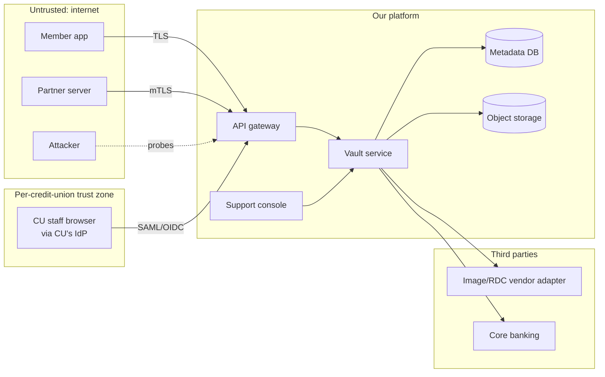
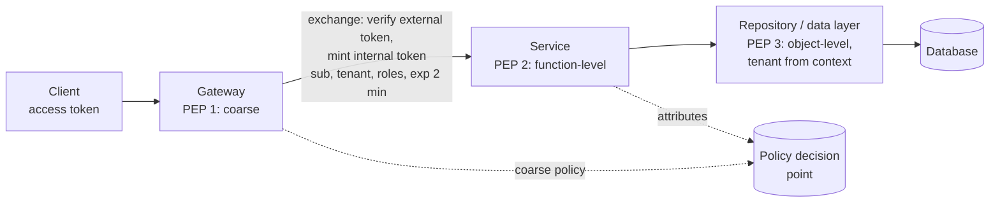
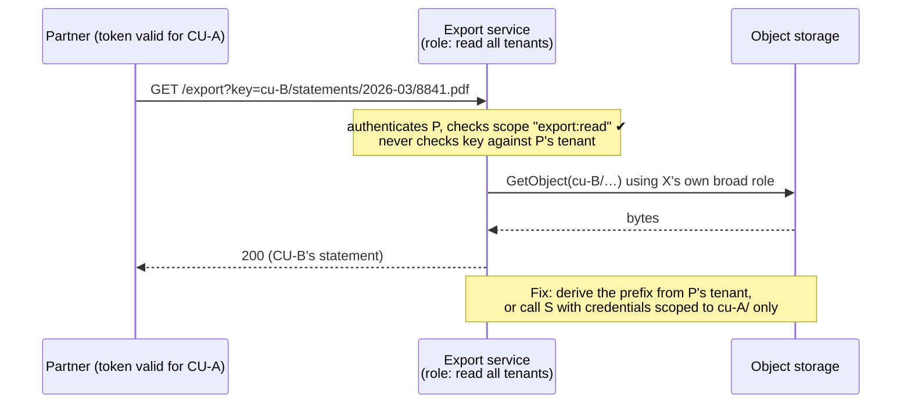
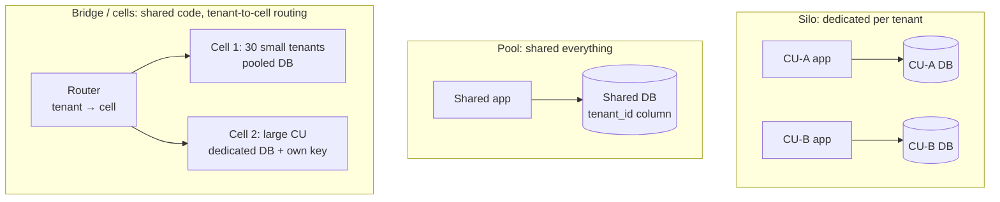
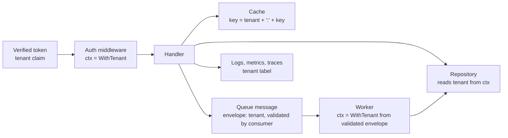
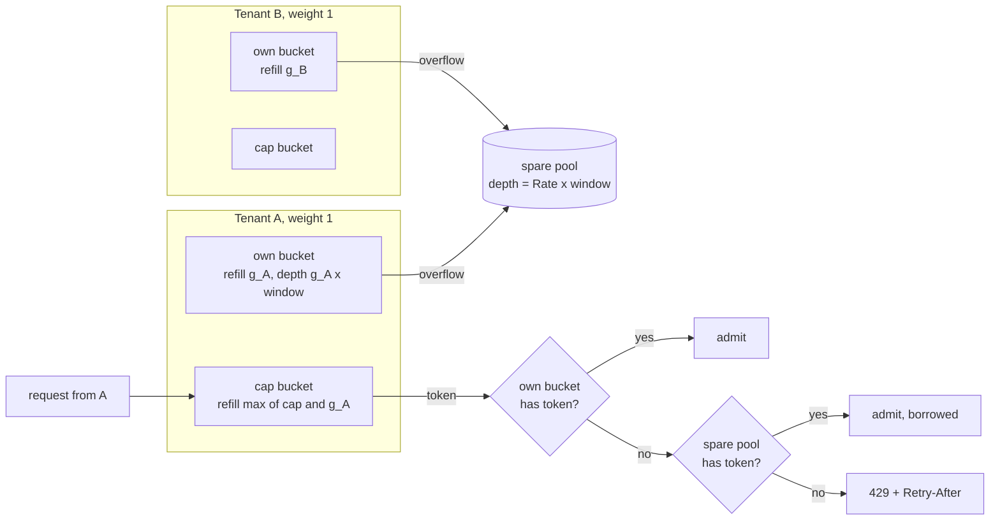
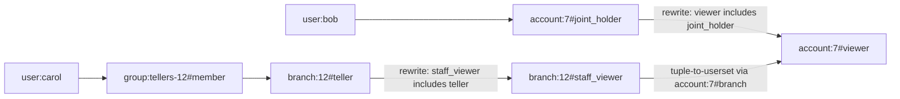

# A9 Unit 1 — Who can do what, to whose data

> Time: ~6 h · CORE: §1–§5 · STRETCH (≈ 1 h): §6 · Lab: `labs/a9/tenancy` (core)

Your platform is one codebase serving about 40 credit unions. Every request arrives with two questions attached:
*who is this?* and *whose data is this about?* A1 Unit 3 taught you to answer the first one (tokens, OAuth, SSO). This
unit is about the second, and about the uncomfortable fact that most real security failures in multi-tenant systems are
not broken cryptography. They are a correct, authenticated user reaching an object that was never theirs, or one
tenant's busy day quietly becoming another tenant's outage. It is also where your credit-union background is a direct
interview advantage: you have already lived "tenant A must never see tenant B" and "the audit trail must say who did
it on whose behalf".

## Before you start

You should have finished A1 (Unit 3 §3–§4 especially: tokens, OAuth/OIDC, SAML, mTLS, and the gateway-versus-service
split of checks). Warm-up from that material; write the answers down first.

1. What does a valid JWT signature prove, and what does it *not* prove?
2. Your transfers API receives a perfectly valid OIDC **ID token** from the mobile app. Why must it be rejected?
3. A partner's token is bound to credit union A. It requests `GET /v1/transfers/tr_8841`, and `tr_8841` belongs to
   credit union B. What should the response be, and which layer must make that decision?

<details data-kind="answer">
<summary>Warm-up answers</summary>

1. It proves the header and payload were produced by someone holding the signing key and were not modified. It does
   not prove the token is unexpired, was meant for *this* audience, came from the issuer you expect, has not been
   revoked, or that the bearer is its legitimate owner. Payloads are readable by anyone.
2. An ID token is addressed to the client application (`aud` = the app's client ID), not to your API. Accepting it
   lets any application that can obtain an ID token for a user call your API as that user. APIs require access tokens
   whose audience is the API.
3. Not found (404): do not confirm that the object exists. The decision cannot be made at the gateway (it has no
   domain data); the service, at the data-access layer, must scope the lookup by the principal's tenant. That is this
   unit's §3.

</details>

---

## §1 Threat modelling in a design interview

### The failure story

A platform team ships a "member document vault" in one sprint: members upload ID scans and signed loan documents;
credit-union staff can look documents up from an internal support console. The design review draws six boxes and four
arrows and takes 40 minutes. Nobody asks what could go wrong. Over the next year:

- The support console's search is "convenient": it searches all credit unions at once. A staff user at credit union A
  exports 1,900 documents belonging to credit union B's members before an alert fires nine days later. Nothing was
  "hacked"; every call was authenticated and permitted.
- Upload and download use pre-signed object-storage URLs valid for 7 days. One lands in a support ticket and is copied
  into a vendor's tracker.
- A federated SSO setup lets each credit union's IdP assert a `groups` claim. One credit union's IT admin, testing,
  asserts `platform-admin`. The adapter maps it faithfully.
- Uploads accept 2 GB files and 40 concurrent uploads from one tenant saturate the shared upload workers for an hour.

A late security review finds 14 issues. Three need re-architecture (tenant-scoped storage prefixes, a scoped support
tool, per-tenant claim mapping): about six weeks of work that the original design could have absorbed in a few days.
Everyone agrees "we should have thought about security earlier", which is not an action item.

### Predict

<!-- predict id="A9-U1-P01" -->
**Predict.** Write your answers down before opening the reveal.

1. It is minute 22 of a 45-minute interview. The interviewer says "talk about security for the document vault". You
   have five minutes. What is the *first* thing you do, and what do you produce on the board?
2. Classify each incident above with one or more STRIDE letters (Spoofing, Tampering, Repudiation, Information
   disclosure, Denial of service, Elevation of privilege): the cross-tenant export, the leaked pre-signed URL, the
   `platform-admin` claim, the 2 GB uploads.
3. Which one of those four would you fix first, and what single argument ranks it above the others?
<!-- /predict -->

### Reveal

<details data-kind="reveal" data-for="A9-U1-P01">
<summary>Reveal</summary>

1. Start from the *assets and actors*, not from a list of mitigations. In ≈ 30 seconds: "The crown jewels are member
   documents and the ability to move money; the actors are members, credit-union staff, partners, our own engineers and
   anonymous internet users; the trust boundaries are the internet edge, the tenant boundary, and the line between
   application and storage." Then walk the boundary crossings with STRIDE-lite, name the top three threats by blast
   radius, and attach one mitigation each to a box on your diagram. Ask one clarifying question that changes the design,
   for example "are tenants allowed to see each other's aggregate data in any form?"
2. Cross-tenant export: **I**nformation disclosure (and **E**levation of privilege: staff acting beyond their tenant).
   Leaked pre-signed URL: **I** (a bearer capability that escaped). `platform-admin` claim: **S**poofing (the IdP
   asserts something it has no right to) and **E**. 2 GB uploads: **D**enial of service.
3. The cross-tenant export, because its blast radius is *every* tenant's members and it is a regulatory event
   (reportable, contractual, trust-destroying), while the leaked URL exposes one object for a bounded time and the
   upload problem degrades availability without disclosing anything. Rank threats by blast radius and by whether
   existing controls would notice; say that out loud.

Tempting wrong answers: starting with "we use TLS and encrypt at rest" (that addresses the attacker who is not in
this story), or listing every control you know without tying any of them to a boundary.

</details>

### How it actually works

Threat modelling is four questions (Adam Shostack's formulation): *What are we working on? What can go wrong? What are
we going to do about it? Did we do a good job?* In an interview you compress the first three into five minutes and
touch the fourth with a sentence about tests and monitoring.



Every arrow that crosses a subgraph boundary is a place to ask the six STRIDE questions. The tenant boundary is the one
that does not appear as a box: it cuts *through* the platform and the database. That is why multi-tenant threat models
need it drawn explicitly.

**The five-minute procedure** (say each step aloud and write one line per step):

1. **Assets**: what would hurt if it leaked, changed or vanished? (Member PII, balances, the ability to move money,
   credentials and keys, audit trails, availability itself.)
2. **Actors**: who touches the system and with what legitimate power? Include the non-obvious ones: your own
   engineers, support staff, a credit union's IT admin, a partner with a valid token, a compromised vendor.
3. **Trust boundaries**: where does the level of trust change? Internet to edge, tenant to tenant, application to
   data store, our network to vendors, production to everything else.
4. **STRIDE-lite on each crossing**: one line per letter that applies, not a matrix of 36 cells.
5. **Abuse cases and ranking**: write two or three as "As X, I want to Y, using Z" and rank by blast radius.

| STRIDE | Property violated | Banking-platform example | Typical mitigation |
|---|---|---|---|
| **S**poofing | Authentication | Forged `X-Tenant-ID` header; IdP asserting an arbitrary group | Verify identity cryptographically; per-tenant claim mapping; mTLS between services |
| **T**ampering | Integrity | Editing an audit row; modifying a transfer amount in a queue message | Signed/validated messages; hash-chained audit trail (Unit 2 §4); DB constraints |
| **R**epudiation | Non-repudiation | "I never approved that wire" | Audit trail with actor, on-behalf-of and request id; step-up authentication for approvals |
| **I**nformation disclosure | Confidentiality | Cross-tenant read; PII in logs; leaked pre-signed URL | Object-level authorisation at the data layer (§3); encryption and key scoping (Unit 2); short-lived URLs |
| **D**enial of service | Availability | One tenant's batch saturating shared workers | Per-tenant quotas and fair sharing (§5); size limits |
| **E**levation of privilege | Authorisation | Member calls an admin endpoint; staff acts beyond their tenant | Function- and object-level checks; least privilege; separation of duties |

**Abuse cases** are use cases written by the adversary. "As a support-console user at credit union A, I want to read
credit union B's documents, by changing the `cu` query parameter or by using the global search." Writing it as a
sentence forces you to name the capability the attacker already has (a valid login) and the path they will take. That
is what makes the mitigation concrete: *the search endpoint derives the tenant from the principal, never from a
parameter*.

**Assume breach.** A good model includes "what if this service is compromised?" and "what if this tenant's admin is
malicious?". The answer is blast radius: per-tenant keys, per-tenant storage prefixes, scoped credentials, an audit
trail the compromised service cannot rewrite. Defence in depth is not repetition of the same check; it is making each
layer assume the one above it failed.

**Security requirements are NFRs with numbers.** In the requirements phase of the 45-minute framework (A0 Unit 1) add
lines such as: *zero cross-tenant reads, verified by automated tests on every endpoint; 100% of money-moving actions
and privileged reads audited with actor and tenant; a compromised service credential can reach at most one tenant's
data; session revocation takes effect within 15 minutes.* A requirement you can test is a design driver; "secure" is
not.

### Build it

No lab for this section. §3 and §4 turn the first abuse case into code (`labs/a9/tenancy`), and the design exercise
asks you to run this procedure end to end on a new feature.

### Break it

Threat-model this description in five minutes, writing at least **six** distinct threats, each tagged with STRIDE
letters and a one-line mitigation. Then compare with the answer.

> *Partner reporting API.* Fintech partners authenticate with a long-lived API key sent in the `X-Api-Key` header.
> `GET /v1/reports?tenant=cu-17&from=...&to=...` returns transaction CSVs for any credit union the partner is
> contracted with; the contract list is checked in the gateway. The CSV is generated by a worker that reads the
> read-replica with a database user that can read every tenant. Download links are signed URLs valid for 24 hours and
> are emailed to the partner's contact. Report generation is unlimited and runs on the shared worker pool. Request
> bodies, including the API key header, are logged at debug level.

<details data-kind="answer">
<summary>Threats you should have found</summary>

1. **Confused deputy / E, I**: the worker's database user can read every tenant, and the tenant comes from a query
   parameter. A bug or a forged job message turns a partner's request into a cross-tenant read. Mitigation: derive the
   tenant from the authenticated principal; give the worker per-tenant credentials or row-level security keyed by a
   session variable (§4).
2. **Authorisation only at the gateway / E**: the contract list lives in one place that the worker does not recheck.
   Mitigation: the worker re-verifies the (partner, tenant) grant from the job message plus the store, not from the
   parameter.
3. **S**: long-lived API keys are bearer secrets with no rotation story and no sender constraint. Mitigation: OAuth
   client credentials with short-lived tokens, mTLS for sensitive scopes, two keys for rotation (A1 Unit 3 §4).
4. **I**: the API key header appears in debug logs; request bodies may contain account numbers. Mitigation: redact
   headers and sensitive fields at the logging layer; never log credentials (Unit 2 §1).
5. **I**: 24-hour signed URLs sent by email are bearer capabilities that end up in forwards and tickets. Mitigation:
   short expiry (minutes), single use or bound to the requester, deliver through the authenticated API.
6. **D**: unlimited report generation on a shared pool lets one partner (or a loop in its code) starve everyone.
   Mitigation: per-tenant and per-partner quotas, a bounded queue, a separate worker lane for exports (§5).
7. **R**: no record of which partner downloaded which tenant's report. Mitigation: audit event per generation and per
   download with partner, tenant, row count and request id (Unit 2 §4).
8. **T/I**: CSV injection (a member's memo field starting with `=` executes in the partner's spreadsheet). Mitigation:
   neutralise leading `=`, `+`, `-`, `@` in exported cells.

A senior answer ranks them: 1 and 2 first (blast radius is every tenant), 4 and 5 next (credential exposure), 6 as the
availability item.

</details>

### In the wild

- **STRIDE** was devised at Microsoft in the late 1990s (Kohnfelder and Garg) and spread through its Security
  Development Lifecycle (`TODO-VERIFY`: exact year); Adam Shostack's *Threat Modeling: Designing for Security* (2014)
  is the standard practitioner's book, and the four-question formulation above is his.
- **OWASP API Security Top 10** lists broken object-level authorisation (BOLA) as the first risk in both its 2019 and
  2023 editions. It is the abuse case that matters most for your platform, and the next sections are about it.
- **Capital One (2019)**: public reporting and the US Department of Justice complaint describe a server-side request
  forgery against a misconfigured web application firewall that reached the cloud instance metadata service, returned
  credentials for an over-privileged role, and exposed data on the order of 100 million people (≈ 106 million in the
  company's own disclosure; TODO-VERIFY exact count). It is a case study in trust boundaries (the metadata endpoint)
  and blast radius (what the role could read). AWS introduced IMDSv2, a session-oriented metadata service, later that
  year.
- **Threat-modelling tools and checklists**: OWASP Threat Dragon, Microsoft's Threat Modeling Tool, and OWASP's ASVS
  (Application Security Verification Standard) as a checklist for the "did we do a good job?" question.

### Trade-offs

| Option | Wins when | Loses when | When the answer flips |
|---|---|---|---|
| STRIDE per element (data-flow diagram) | A new feature or service with clear boxes and arrows; you want coverage | Slow on large systems; produces long lists | Flip to abuse cases + ranking when time is short (an interview) or the diagram is already stable |
| Abuse-case list ("as X I want Y") | Short sessions; it makes attacker capability and path explicit | Easy to miss whole classes of threats | Add STRIDE per boundary when the feature touches money or tenant data |
| Attack trees | One high-value goal (e.g. "move money without approval") with many paths | Costly to build for the whole system | Use for the two or three crown-jewel goals only |
| Checklist (OWASP ASVS, API Top 10) | Reviewing an existing implementation; consistency across teams | Misses threats specific to your architecture | Pair with a short model whenever the design has a new trust boundary |

### Senior bar

- **Failure modes**: a threat model done once and never updated; only external attackers considered (insiders,
  support tooling and partners are where the cross-tenant reads actually happen); mitigations listed with no owner or
  test; "security" reduced to "TLS and encryption at rest".
- **Capacity / effort**: ≈ 30–60 minutes per feature for a team, ≈ 5 minutes in an interview. Late fixes cost roughly
  an order of magnitude more than design-time ones (the story above: days versus weeks).
- **Ops**: re-run the model when a trust boundary changes (new partner type, new data store, new cloud account); keep
  the model in the repo next to the design doc; turn each top threat into an automated test or an alert.
- **Cost**: the cheap controls (derive the tenant from the principal, short-lived URLs, redacted logs) cost nearly
  nothing at design time; retrofitting scoped storage and per-tenant credentials is the expensive part.

Interviewer follow-up probes:

1. "You have two minutes left. What are the three threats you would stake the design on?"

<details data-kind="answer">
<summary>Model answer</summary>

Cross-tenant data access through any path that takes a tenant or object id from the caller (blast radius: every
tenant; mitigation: tenant from the principal, enforced in the data layer, tested per endpoint). Credential and
capability leakage: long-lived keys, pre-signed URLs, secrets in logs (mitigation: short-lived scoped credentials,
redaction, rotation). Privileged internal access: support and operations tooling with broad reach (mitigation: scoped
tools, just-in-time access, audit that the operator cannot edit). I rank the first highest because it fails silently,
at scale, with every call looking legitimate.

</details>

2. "Why isn't encrypting the database at rest the answer to the cross-tenant export?"

<details data-kind="answer">
<summary>Model answer</summary>

Because at-rest encryption protects against theft of the storage medium, not against a legitimate session reading
decrypted data. The staff user's queries go through the application, which decrypts as designed. The control that
matters is authorisation scoped to the tenant at the data layer; encryption with per-tenant keys (Unit 2 §3) adds a
second barrier and enables per-tenant deletion, but does not replace it.

</details>

3. "How do you know your threat model is any good?"

<details data-kind="answer">
<summary>Model answer</summary>

I don't know from the document alone. I check it three ways: every high-ranked threat has an automated test or alert
that would fail if the mitigation regressed (for example a cross-tenant probe on every endpoint in CI); the model is
revisited when a trust boundary changes; and someone outside the team attacks it (a design review by a security
engineer, then a penetration test), whose findings I feed back as new abuse cases.

</details>

### Check yourself

1. Name the three things you write down before applying STRIDE.
2. Why is "As a malicious staff user at tenant A…" a better starting point than "an attacker steals a password"?
3. Which STRIDE letters apply to a forged `X-Tenant-ID` header that the service believes?

<details data-kind="answer">
<summary>Answers</summary>

1. Assets, actors, trust boundaries.
2. It starts from capabilities the attacker *already has* (a valid login), which is where multi-tenant breaches occur,
   and it forces you to name the path; password theft is one path among many and says nothing about the tenant
   boundary.
3. Spoofing (the caller pretends to be another tenant) and Elevation of privilege (it gains access beyond its own),
   with Information disclosure as the consequence.

</details>

---

## §2 Authentication, authorisation and where decisions are made

### The failure story

The platform has an API gateway and six services. The gateway validates the access token and forwards `X-User-ID`
and `X-Tenant-ID` headers; each service then does its own role checks. After a year:

- A new `/export` endpoint ships with an "admin only" check in the web UI but not in the service. Any member can call
  it directly and export every transaction in their credit union.
- The IdP mapping renames the role `CU_ADMIN` to `cu-admin`. Four services check the old string; two check the new
  one. Credit-union admins are locked out of half their screens for three hours on a Monday.
- A credit-union employee is terminated at 09:00. Their 60-minute access token stays valid until 09:41; in that
  window they perform 112 actions, including a bulk member-data export.
- Security asks "who can read account 7?" Nobody can answer without reading six codebases. The auditor's sample of 25
  access decisions takes a team two weeks to reconstruct.
- A well-meaning refactor moves authorisation into a central policy service. Each request now makes ≈ 12 policy
  calls at p99 ≈ 40 ms each, serialised: ≈ 480 ms added latency, and the policy service becomes a dependency of
  everything.

### Predict

<!-- predict id="A9-U1-P02" -->
**Predict.** Write your answers down before opening the reveal.

1. Which checks belong at the gateway, which in each service, and which at the data layer? Give one example of each
   for the transfers API.
2. Model these three rules and say which of RBAC, ABAC or relationship-based access control (ReBAC) fits each best:
   (a) "a teller can view accounts at their own branch"; (b) "a staff member may approve a wire only if it is under
   their limit and they did not initiate it"; (c) "a joint-account holder, and anyone they have delegated to, may view
   the account".
3. The terminated employee in the story: with 15-minute access tokens, what is the worst-case exposure after
   revocation, and what would you add for high-risk actions?
<!-- /predict -->

### Reveal

<details data-kind="reveal" data-for="A9-U1-P02">
<summary>Reveal</summary>

1. **Gateway** (coarse, uniform, no domain data): token validity, issuer, audience, scope for the route, per-client
   rate limits, request size. **Service** (function-level, needs domain context): "may this role call `approveWire` at
   all?", amount limits, four-eyes rules. **Data layer** (object-level): "does this account belong to the principal's
   tenant and to a member this principal may act for?" enforced in the query itself. Putting only the first group in
   place is how the `/export` story happens.
2. (a) **RBAC with a scope**: role `teller` assigned *at* branch 12 in tenant A; the check is "has `teller` on the
   branch that holds the account". (b) **ABAC**: it depends on attributes of the subject (limit), the resource (amount,
   initiator) and the relationship between them; a role cannot express "not the initiator". (c) **ReBAC**: access
   follows relationships and delegation chains (holder, delegate-of-holder); expressing that as roles explodes, and as
   ABAC becomes a recursive join. See the stretch §6.
3. Worst case ≈ the token lifetime plus any cache TTLs in front of the check: 15 min + 1 min policy cache ≈ 16 min. To
   close that window for risky actions: step-up (require a recent authentication, `auth_time`/`acr` claims) and an
   *online* check against the session/revocation state for money movement and bulk exports, accepting one extra lookup
   there while keeping the cheap local check everywhere else. A pushed denylist of revoked sessions (small, expiring
   with the tokens) closes the rest for everything else.

Tempting wrong answers: "validate the token at the gateway and trust the headers after that" (any process that reaches
a service can forge them), and "one central policy service called for everything" (a latency and availability
multiplier, as the last bullet showed).

</details>

### How it actually works

**Two jobs, kept apart.** Authentication produces a *principal*: subject, tenant(s), roles or scopes, authentication
strength and time. Authorisation decides whether *this principal* may perform *this action* on *this resource* in
*this context*. A1 Unit 3 §3–§4 covered how principals are authenticated; the question here is where the decisions are
made and how identity travels between components.

**Where to validate the token.** There are three common arrangements:

| Arrangement | How it works | Wins | Loses |
|---|---|---|---|
| Edge only | Gateway validates; services trust forwarded headers | Simple services | Any process on the network can forge headers; one gateway bug is a total bypass |
| Edge + internal signed identity | Gateway validates the external token, then forwards (or mints, via token exchange) a short-lived *internal* token signed by the platform (≈ 1–5 min, audience = the service). Services verify the signature locally | Cheap local verification; services need no external IdP knowledge; identity can't be forged from the network; the external token never travels inward | Key distribution for the internal issuer; one more token type |
| Opaque token + introspection | Gateway (or each service) calls the issuer to introspect | Instant revocation | A network call per request, or a cache that reintroduces staleness |

The middle row is often called the *phantom token* or token-exchange pattern (RFC 8693 defines OAuth token exchange).
It combines with mTLS between gateway and services so that a service also knows *which component* is calling.



**Policy decision and enforcement points.** The vocabulary comes from XACML, but the idea is general. A **PEP**
(policy enforcement point) sits in the request path and enforces: it asks "may this happen?" and obeys. A **PDP**
(policy decision point) evaluates policy and returns allow or deny. **PIPs** supply attributes (the account's branch,
the user's limit). A **PAP** is where policy is authored. You want *several* PEPs (gateway, service, data layer) and
*one* policy language and store, so rules are written once, reviewed in pull requests and testable.

The PDP can be a library compiled into each service (decisions in microseconds, policy bundles pushed to services),
a sidecar (≈ 100 µs–1 ms over loopback, language-independent), or a remote service (≈ network RTT per decision and an
availability dependency). The story's 12 × 40 ms is the cost of the last option used serially. Embedded or sidecar PDPs
with periodically pushed policy and data are the usual compromise; keep remote calls for decisions that need fresh
global state.

**Fail closed.** If the PDP, the policy bundle or the attribute source is unavailable, deny. A deliberate exception
(public read-only content) is a documented, per-route choice, never a default.

**RBAC, ABAC, ReBAC.**

| Model | A decision is… | Strong at | Weak at |
|---|---|---|---|
| **RBAC** (NIST RBAC model) | principal → roles → permissions, optionally scoped (role at tenant/branch) | Simple, auditable ("who has the teller role?"), fast | Role explosion (`teller-branch-12-readonly`…); no context ("under their limit", "not the initiator") |
| **ABAC** (NIST SP 800-162) | a predicate over subject, resource, action and environment attributes | Expressive, contextual, policy-as-code (OPA/Rego, Cedar) | Hard to answer "who can access X?"; attribute quality is the real problem; slow if attributes need joins |
| **ReBAC** (Zanzibar-style) | reachability in a graph of relationships (`owner`, `member`, `parent`) | Sharing, delegation, hierarchies, joint ownership | Needs a tuple store and consistency design (§6); overkill for flat role models |

In a multi-tenant platform the tenant is part of every one of these: roles are assigned *per tenant* (a person can be a
teller at credit union A and nothing at B), and tenant membership is checked before anything else. Real systems mix
models: RBAC for coarse function access, ABAC rules for limits and four-eyes, ReBAC where ownership and delegation
genuinely form a graph.

**Federated claims are input, not truth.** In the SSO story, the IdP is controlled by the *tenant*. Treat its
assertions as "this credit union says this person is in group X", then map them through a per-tenant table you control
to roles *inside that tenant only*. A tenant's IdP must be unable to mint `platform-admin`, or a role in another tenant,
by construction.

**Decision caching.** Caching `(principal, action, resource) → decision` for seconds saves calls but adds staleness
equal to the TTL. The cache key must include everything the decision depends on, above all the tenant (user ids are
unique per IdP, not globally). Revocation-sensitive actions bypass the cache.

A minimal Go shape for the pieces that cross every service boundary (compile-able, stdlib only):

```go
package authz

import "context"

// Principal is established once, from a verified token, and then only read.
type Principal struct {
	Subject  string
	Tenant   string   // from the verified token, never from a request parameter
	Roles    []string // roles within Tenant
	AuthTime int64    // when the user last authenticated (unix seconds)
}

type ctxKey struct{}

func WithPrincipal(ctx context.Context, p Principal) context.Context {
	return context.WithValue(ctx, ctxKey{}, p)
}

func FromContext(ctx context.Context) (Principal, bool) {
	p, ok := ctx.Value(ctxKey{}).(Principal)
	return p, ok
}

// Resource is what the decision is about; Attrs carries what the policy needs.
type Resource struct {
	Type, ID, Tenant string
	Attrs            map[string]string
}

// Decider is the PDP interface a PEP calls. Implementations fail closed.
type Decider interface {
	Allow(ctx context.Context, p Principal, action string, r Resource) (bool, error)
}

// Require is a PEP helper: any error or missing principal is a denial.
func Require(ctx context.Context, d Decider, action string, r Resource) bool {
	p, ok := FromContext(ctx)
	if !ok || r.Tenant != p.Tenant { // tenant check first, cheap, and not delegated to policy authors
		return false
	}
	allowed, err := d.Allow(ctx, p, action, r)
	return err == nil && allowed
}
```

### Build it

No lab package for this section. The `tenancy` lab (§3–§4) uses exactly this shape for the tenant: a value placed in
the context once, by trusted code, and read by everything below. In your design exercise, mark the three PEPs on your
diagram and say what each checks.

### Break it

Find the flaw in each configuration (write your answer before opening):

1. A role check is `if slices.Contains(claims.Groups, "admin")`, where `Groups` comes from the SAML assertion of the
   credit union's own IdP.
2. The decision cache key is `userID + ":" + action + ":" + resourceID`.
3. The authorisation middleware calls the policy service; on timeout it logs a warning and lets the request through
   "to avoid an outage".
4. The gateway authorises `/v1/accounts/{id}/**` with a regex on the URL path. Services route using a different
   framework's path normalisation.

<details data-kind="answer">
<summary>Flaws</summary>

1. The tenant controls its own IdP, so a tenant IT admin can assert `admin`: privilege escalation, and if "admin"
   means platform admin, a cross-tenant one. Map IdP groups through a per-tenant table to roles scoped *to that
   tenant*; there is no group string that grants anything outside it.
2. The key omits the tenant. User ids are unique per IdP, so the same `userID` in two tenants shares a cached
   decision, and a "no" or "yes" computed for one is served to the other. Include the tenant (and the policy version)
   in the key.
3. Fail-open converts a PDP outage into an authorisation bypass, and an attacker can cause the outage (DoS the policy
   path) to get through. Fail closed; protect availability with local evaluation and cached bundles instead.
4. A parsing differential: `/v1/accounts/../admin/x`, `%2e%2e`, double slashes or case differences make the gateway and
   the service disagree about what the path *is*. Authorise by the resolved route and resource in the service, not
   by pattern-matching raw URLs at an outer layer; normalise once, and have the data layer enforce object access
   regardless.

</details>

### In the wild

- **Envoy**: the `jwt_authn` filter validates tokens at the edge and the `ext_authz` filter delegates decisions to an
  external service over gRPC or HTTP. **Istio**'s `AuthorizationPolicy` expresses allow/deny rules on mTLS identities
  and JWT claims.
- **Open Policy Agent** (CNCF graduated project) with the Rego language, usually run as a library or sidecar with
  policy bundles pushed by a control plane. **Cedar**, the policy language behind Amazon Verified Permissions, was
  open-sourced by AWS in 2023 and is designed to be analysable (you can ask "can anyone ever do X?"). Others: Casbin,
  Cerbos, Oso.
- **AWS IAM policy evaluation**: default deny, explicit deny beats any allow, permissions boundaries and
  organisation-level policies narrow what identity policies can grant. A good mental model for layered, deny-wins
  policy.
- **Kubernetes** combines RBAC (who may call which API verbs on which resources) with admission control (policy checks
  on the object being written), the same coarse-then-fine split.
- **Token exchange and phantom tokens**: RFC 8693 (OAuth 2.0 Token Exchange); the "phantom token" pattern from Curity
  is an opaque token at the edge exchanged for a JWT at the gateway.
- **Continuous access evaluation**: Microsoft Entra's CAE and the OpenID Shared Signals work (CAEP) push session
  revocation events to relying parties so that long-lived tokens do not mean long-lived access (`TODO-VERIFY: current
  status of the Shared Signals specifications`).

### Trade-offs

| Option | Wins when | Loses when | When the answer flips |
|---|---|---|---|
| Gateway-only authorisation | A small system with one service | Any internal caller bypasses it; no object-level view | Always add service- and data-layer checks once there is more than one service |
| Internal signed token (exchange) | Several services; you want local, cheap verification and no header trust | Another issuer and key set to operate | Opaque + introspection when instant revocation matters more than latency |
| Embedded PDP (library/bundles) | Hot paths; many checks per request | Policy and data distribution; stale bundles | Remote PDP for rare, high-value decisions needing fresh global state |
| Remote PDP per check | Strong central control; one place to audit | Latency × checks and a new hard dependency | Embedded/sidecar the moment checks per request exceed ≈ 3 |
| RBAC | Stable job functions; auditors want role lists | Context-dependent rules; many scopes | ABAC conditions on top of roles when rules need limits or relationships |
| ABAC | Limits, time, location, four-eyes rules | "Who can access X?" questions; attribute sprawl | ReBAC when the rules are really about ownership/delegation graphs |
| Cached decisions | High check volume with stable policy | Revocation latency; cross-tenant key bugs | No caching (or online check) for money movement and bulk export |

### Senior bar

- **Failure modes**: header trust inside the network; authorisation only in the UI; tenant omitted from cache keys;
  federated claims trusted raw; fail-open on policy errors; role names as magic strings duplicated across services;
  no step-up for high-risk actions; policy changes deployed without a shadow period.
- **Capacity**: check volume = requests × checks per request. 5,000 req/s × 3 checks = 15,000 decisions/s: trivial
  embedded (tens of µs each ≈ 0.5 core), but 15,000 remote calls/s at ≈ 1 ms each needs a PDP fleet and adds its
  latency to every request. Internal tokens at 2-minute TTL and 40 services: re-minting is cheap (≈ tens of µs to
  sign); JWKS/key rotation for the internal issuer is the real operational item.
- **Ops**: ship policy changes in *shadow mode* first (log "would deny") and compare decisions before enforcing;
  version policies and record the policy version in the audit event; alert on denial-rate spikes by route; keep an
  explainable answer to "who can access this resource?" for auditors (list-objects/who-can queries are why some teams
  adopt ReBAC or analysable languages).
- **Cost**: a policy platform is real engineering; but one inconsistent rule set is more expensive. Remote decision
  services cost latency budget rather than money.

Interviewer follow-up probes:

1. "Where do you validate tokens: gateway, services or both?"

<details data-kind="answer">
<summary>Model answer</summary>

Both, doing different jobs. The gateway terminates the external credential, does the coarse checks (signature,
issuer, audience, scope, rate limit) and exchanges it for a short-lived internal token. Services verify that internal
token locally with a public key, so no one can forge identity from inside the network, and then make function-level
decisions. The data layer makes object-level decisions using the tenant from the verified principal. mTLS between
components adds service identity. I would not forward bare identity headers.

</details>

2. "A user is fired at 09:00. How fast does their access end, and what does it cost to make it faster?"

<details data-kind="answer">
<summary>Model answer</summary>

With 15-minute access tokens and revocation of the refresh token/session at the auth server, the exposure is
≈ 15 minutes plus cache TTLs. Faster options each cost something: a pushed denylist of session ids to verifiers
(small, immediate, but a distribution mechanism to run), online checks for sensitive actions (one extra lookup on the
risky paths only), or opaque tokens with introspection everywhere (a network call per request unless cached, which
brings the staleness back). I would do short tokens plus step-up and an online check for money movement and exports,
and a pushed denylist for emergencies.

</details>

3. "RBAC or ABAC for a credit-union platform?"

<details data-kind="answer">
<summary>Model answer</summary>

RBAC for the coarse structure (roles assigned per tenant, easy for credit-union admins and auditors to reason about),
plus ABAC conditions where roles can't say it (amount limits, "approver is not the initiator", branch or time
constraints). I'd keep the tenant check outside policy authors' reach, as a structural property of the data layer. If
joint ownership and delegation become central, I'd model those as relationships (ReBAC) rather than inventing roles
per case.

</details>

4. "Why not make every service call a central authorisation service?"

<details data-kind="answer">
<summary>Model answer</summary>

It puts a network round trip and an availability dependency on every decision. With 12 serial checks at 40 ms p99 the
story added ≈ 480 ms, and the policy service becomes a single point of failure for every flow. I'd centralise policy
*authoring and distribution* (one language, one repository, tested) and evaluate it locally in each service or a
sidecar, keeping remote calls for rare decisions that need fresh global state.

</details>

### Check yourself

1. Why must the tenant be part of an authorisation cache key?
2. Which check can only be made correctly at the data layer?
3. What does "fail closed" mean for a PDP outage, and what do you do to keep availability anyway?

<details data-kind="answer">
<summary>Answers</summary>

1. User ids are unique per identity provider, not globally, and the same action on the same resource id may be allowed
   in one tenant and denied in another; without the tenant in the key one tenant's cached decision is served to the
   other.
2. Object-level authorisation ("does *this row* belong to the principal's tenant and the accounts they may act for?"),
   because only the query layer sees the actual object being touched.
3. Deny when the decision can't be made. Preserve availability with locally evaluated policy and cached bundles, not
   with an allow-on-error path.

</details>

---

## §3 Object-level authorisation and the confused deputy

### The failure story

The statements service exposes `GET /v1/statements/{id}` and the mobile app calls it with the member's own statement
ids. The handler checks "is the caller authenticated?" and "does the caller have the `statements:read` scope?", then
loads the statement by id and returns the PDF. Ids are sequential integers.

On a Friday a member notices the URL contains `8841` and tries `8842`. It works. Over three days someone runs a loop:
38,000 statements across six credit unions, ≈ 50 KB each, ≈ 1.9 GB of egress. It is found because the bandwidth graph
bumps, not because anything in security noticed: every request was authenticated, scoped and rate-limited under the
per-user limit. The fix looks trivial (add an ownership check), and a week later a second endpoint
(`/v1/statements/{id}/pdf`) is found with the same bug, because the check lived in the handler of the first one.

Meanwhile an *export service* runs with a broad storage role so it can read any tenant's files. Its API takes a
`storage_key` and returns the object. A partner whose token is valid for credit union A passes a key under
credit union B's prefix. The service obligingly fetches it with its own, much broader, authority.

### Predict

<!-- predict id="A9-U1-P03" -->
**Predict.** Write your answers down before opening the reveal.

1. The ownership check was "forgotten" on a second endpoint. Describe a design where forgetting it is *impossible*
   (not just unlikely). What would a developer have to do deliberately to bypass it?
2. For a request on another tenant's statement id: 403 or 404? What about a statement in the *same* tenant but another
   member's? Why does it matter which?
3. The export service holds broad authority and takes a caller-supplied key. Name the vulnerability class, and give
   two different fixes.
<!-- /predict -->

### Reveal

<details data-kind="reveal" data-for="A9-U1-P03">
<summary>Reveal</summary>

1. Make the *only* way to reach rows go through an API that takes its scope from the verified principal. A repository
   whose methods are `Get(ctx, id)` with the tenant (and, where relevant, the member) read from `ctx`, whose queries
   always include the predicate, and which has no `GetByID(id)` that skips it. A developer would have to build a second
   data-access path or use a privileged connection deliberately, which is visible in review and can be blocked by lint
   rules, database roles and row-level security. The structure turns an omission (easy) into a violation (loud).
2. Other tenant's id: **404**, identical to a missing id (including message and timing as far as practical), so ids
   can't be probed for existence. Same tenant, another member's statement: also hide it (404) when the id space is
   enumerable and the existence itself is sensitive; return 403 only when the caller legitimately knows the resource
   exists and *why* it is denied helps them (for example a staff user who lacks the scope). The point is not the number;
   it is that denial must not become an oracle.
3. A **confused deputy**: a component with more authority than its caller is tricked into using that authority on the
   caller's behalf for something the caller could not do. Fixes: (a) *use the caller's authority*, not the deputy's:
   authorise the key against the caller's principal, or perform the fetch with a credential derived from the caller's
   (token exchange / on-behalf-of) so the storage layer enforces tenant prefixes; (b) *shrink the deputy's authority*:
   per-tenant roles or credentials (an export worker for credit union A can only reach A's prefix), and accept an
   opaque handle the platform minted for that caller rather than a name the caller can forge.

</details>

### How it actually works

**BOLA** (broken object-level authorisation, also called IDOR, insecure direct object reference) is the bug class in
which the server authenticates the caller but doesn't verify that *this caller* may act on *this object*. The object id
is attacker-controlled input like any other. Three adjacent classes appear in the OWASP API Security Top 10: **BFLA**
(function-level: a member calls an admin endpoint), **BOPLA** (property-level: a `PATCH` that can set `role` or
`tenant_id`, also called mass assignment) and unrestricted resource consumption (§5).

**Unguessable ids are not authorisation.** UUIDs make enumeration expensive, not forbidden: ids leak through logs,
emails, referrer headers, support tickets and shared links, and the day one leaks, authorisation is the only control
left. Use random ids to reduce probing noise; enforce access anyway.

**Authorise at the data layer.** Handlers are many, the repository is one. The pattern:

```text
// Handler-level check: forgettable. Don't build on this.
st, _ := repo.GetStatementByID(ctx, id)   // reads ANY tenant's row
if st.AccountID != principalAccount { return errForbidden }

// Data-layer scoping: the query cannot return what the caller may not see.
st, err := repo.GetStatement(ctx, id)      // tenant (and member) come from ctx
// SELECT ... FROM statements s
//   JOIN accounts a ON a.id = s.account_id AND a.tenant_id = s.tenant_id
//  WHERE s.id = $1 AND s.tenant_id = $2 AND a.member_id = $3
```

Rules that keep it honest:

1. **One door.** All reads go through scoped repository methods. Raw `GetByID` is unexported, or lives in a
   clearly-named admin package that cannot be imported by request handlers (enforced by a lint rule or package
   visibility).
2. **Scope comes from context**, set once by trusted middleware from the verified principal, never from a parameter,
   path segment or header the client controls (§4 shows the propagation).
3. **Not found, not forbidden**, for resources outside the caller's scope (see Reveal 2).
4. **Strict decoding** so that `PATCH` bodies can't smuggle `tenant_id` or `role` (A1 Unit 2 §3: reject unknown
   fields; use explicit input DTOs, never bind request JSON straight onto a domain struct).
5. **Test the matrix**: for every endpoint × every role × {own object, other tenant's object, other member's object}
   assert the outcome. Generate the cases from the route table so a new endpoint without a case fails the build.

**The confused deputy** was named by Norm Hardy (1988): a compiler service that could write to a billing file, invoked
by a user who passed that filename as its output path. The deputy had authority from two sources (its own, and the
caller's request) and used the wrong one. In a platform it appears as: export and reporting jobs, webhook dispatchers
that call tenant-supplied URLs with internal credentials (also SSRF), pre-signed URL generators, batch jobs reading a
"tenant" column from a queue message, and any service that takes a name and resolves it with ambient authority.



The robust fixes share a principle: **don't let a name carry authority**. Prefer **capabilities** (an unforgeable,
platform-minted handle that already encodes what it permits, such as a signed, short-lived, tenant-bound download token)
over **ambient authority plus caller-supplied names**. Cloud IAM offers the second mitigation directly: tag the
workload's session with the tenant and write storage policies that only allow access to the prefix matching the tag
(attribute-based access control with session tags in AWS IAM), and for cross-account roles use conditions such as
`ExternalId`, `aws:SourceArn` and `aws:SourceAccount` so a third party's confusion can't be used against you.

**Property-level checks** matter for the tenant itself: the tenant is not a field the client may write. Insert stamps it
from the context (the lab refuses a row whose `Tenant` disagrees with the caller's, rather than quietly overwriting it,
because silent correction hides both attacks and bugs).

### Build it

Lab `labs/a9/tenancy`, file `tenancy.go`, **Store part 1**. Provided: `TenantID` (with `Valid`), `WithTenant`,
`FromContext`, `Row`, error values. Implement `NewStore`, then `Insert`, `Get`, `Update`, `Delete` and `Count`, all of
which obtain the tenant from the context and fail closed (`ErrNoTenant`, `ErrInvalidTenant`). The package documentation
lists the exact behaviour. The points the tests check:

- no method takes a tenant parameter, and row ids are unique *per tenant*;
- another tenant's id behaves like a missing id: `ErrNotFound` with a message identical to the genuinely missing case
  (`TestStore_AnotherTenantsRowIsIndistinguishableFromMissing`), and `Update`'s mutate callback is never handed
  another tenant's row;
- `Insert` stamps the tenant and rejects a row stamped for someone else (`ErrTenantMismatch`);
- everything returned or stored is a deep copy, including the `Labels` map, even the pointer given to `mutate`;
- `Update` is an atomic read-modify-write and restores `ID`/`Tenant` after `mutate` (`Version` is old + 1).

Acceptance tests: `TestStore_InsertGetStampsTenantAndVersion`, `TestStore_NoTenantOrInvalidTenantFailsClosed`,
`TestStore_SameIDInTwoTenantsAreDifferentRows`, `TestStore_InsertRejectsEmptyIDAndForeignTenantField`,
`TestStore_GetUpdateDeleteOfAnotherTenantsRowIsNotFound`, `TestStore_AnotherTenantsRowIsIndistinguishableFromMissing`,
`TestStore_UpdateIgnoresAttemptsToChangeIdentity`, `TestStore_RowsAreDeepCopies`,
`TestStore_ConcurrentUpdatesAreNotLost`. Run `go test -race -run Store ./labs/a9/tenancy/` (the list/pagination tests
come in §4).

### Break it

1. Finish §4's `List`, then wire `breakNoTenantPredicate` into it as `breakit_on.go` describes (with `-tags breakit`,
   scan every tenant's rows). Predict the percentage of rows tenant `cu-alpha` can enumerate that belong to others in
   the experiment (three tenants, 40 rows each), then run
   `go test -tags breakit -run BreakIt_CrossTenantLeak -v ./labs/a9/tenancy/` and
   `go test -tags breakit -run Store ./labs/a9/tenancy/`. Which tests notice?
2. In your own `Get`, return `fmt.Errorf("statement %q not found for tenant %s", id, tenant)` for the missing case and
   run `-run Indistinguishable`. Describe the attack that message makes possible.
3. Let `Update` store the pointer it passed to `mutate` instead of a clone, and run
   `go test -race -run DeepCopies ./labs/a9/tenancy/`. What fails, and why is this an isolation bug and not just a
   style issue?

<details data-kind="answer">
<summary>What you should see, and why</summary>

1. 80 of the 120 rows `cu-alpha` can list are other tenants' (≈ 67%), and no authorisation check was ever consulted:
   the leak is *structural*. The failing normal tests are `ListIsTenantScopedAndFilterOnlySeesOwnRows`,
   `ListPaginatesByKeysetExactlyOnce` and `ConcurrentMixedTenantsNeverLeakOrLose`, none of which you wrote for this
   particular mistake. They fail because they check the property (nothing foreign is ever visible), not the
   implementation. Notice also that the *good* implementation made this bug something you had to add on purpose, in a
   separate branch of the code.
2. The message contains the id and the tenant, and differs from the "other tenant's row" path's message, so a client
   can distinguish "exists elsewhere" from "doesn't exist" and enumerate ids across the platform: the existence oracle
   from Reveal 2. Error text, status codes, response sizes and (as far as practical) latency must not differ.
3. `TestStore_RowsAreDeepCopies` fails: a retained pointer lets a caller mutate stored state outside the lock. In a
   real server that is also a data race (the race detector flags it as soon as two requests touch the row), and
   without the detector one request silently corrupts another's view. Tenant isolation is also a memory-safety
   property.

</details>

### In the wild

- **OWASP API Security Top 10**: API1 (BOLA) in 2019 and 2023; API3 (BOPLA, 2023) covers mass assignment and excessive
  data exposure; API5 (BFLA). Penetration-test reports for multi-tenant SaaS are dominated by variants of API1.
- **Rails and Django idiom**: `current_tenant.accounts.find(params[:id])` (scoped finders) and gems such as
  `acts_as_tenant`; Hibernate 6's `@TenantId`; Django's `django-tenants`. They all push the predicate into a layer
  most code can't skip.
- **AWS IAM and the confused deputy**: AWS documents the confused-deputy problem for cross-account access and
  recommends `ExternalId` and the `aws:SourceArn`/`aws:SourceAccount` condition keys; ABAC with session/principal tags
  lets one role definition serve many tenants safely.
- **Norm Hardy, "The Confused Deputy (or why capabilities might have been invented)"**, 1988: the origin of the term
  and the capability argument.
- **Capability-style handles in practice**: pre-signed object-storage URLs (an unforgeable capability, which is also
  why they must be short-lived and tenant-bound), Macaroons (a delegable, attenuable bearer token; `TODO-VERIFY` for
  production adoption specifics), and signed cursors/tokens like the one in the A1 pagination lab.

### Trade-offs

| Option | Wins when | Loses when | When the answer flips |
|---|---|---|---|
| Check in each handler | Prototype; few endpoints | Forgettable; every new endpoint is a chance to omit it | Almost never; move to the data layer |
| Scoped repository (tenant from `ctx`; the lab) | You control the access layer; polyglot callers are few | Raw SQL or another service can bypass it | Add database-enforced row-level security as a second barrier (§4) |
| Database row-level security | Many writers/languages; defence in depth | Operational complexity (session variables, pooling); perf | Pair with scoped repository; don't rely on one alone |
| Policy engine call per object | Rich rules (delegation, limits) | Latency; availability | Embed it and batch decisions (list endpoints) |
| 404 for out-of-scope | Enumerable ids; existence is sensitive | Harder debugging for legitimate callers (mitigate with request ids and audit) | 403 for same-tenant callers who legitimately know the object exists and why |
| Capability handle (signed, scoped) | Cross-service delegation; downloads | Revocation is expiry; leakage means access | Server-side lookup per request when instant revocation is required |

### Senior bar

- **Failure modes**: handler-level checks; list endpoints that filter *after* loading everything; joins that pull in
  another tenant's rows via a foreign key; batch/async jobs that read a tenant column from a message; caches keyed
  without the tenant; error messages and timing as existence oracles; admin endpoints reachable with member tokens;
  mass assignment of `tenant_id`.
- **Capacity**: scoped queries must be indexed with the tenant as the *leading* column (`(tenant_id, id)`); a
  forgotten leading column turns each object lookup into a scan. At 5,000 lookups/s a ≈ 1 ms indexed query is ≈ 5 busy
  cores of database time; a 50 ms scan is not survivable.
- **Ops**: continuous cross-tenant probing in production with synthetic "tenant zero" accounts (an automated prober
  that asks for another tenant's known ids on every endpoint and pages when it succeeds); the route-table-driven
  authorisation matrix in CI; alert on 404 bursts per principal (enumeration); log tenant and object ids on denials.
- **Cost**: the scoped-repository pattern is nearly free to build early; retrofitting it across hundreds of queries is
  the expensive path, which is why it is the first thing to decide in a multi-tenant design.

Interviewer follow-up probes:

1. "How would you prove there is no BOLA across 300 endpoints?"

<details data-kind="answer">
<summary>Model answer</summary>

I wouldn't try to prove it per endpoint; I would make it structural and then test the structure. One data-access path
that takes the tenant from the context (so there is no way to express an unscoped read in handler code), lint or
package-visibility rules that forbid raw queries outside it, and database row-level security as a second barrier.
Then verification: an authorisation matrix test generated from the route table (every endpoint × role × own,
other-tenant and other-member objects), a fuzzer that replays captured ids across tenants, a production prober using
synthetic tenants, and periodic penetration tests as an independent check.

</details>

2. "A reporting job runs nightly for all tenants with one service account. Is that a problem?"

<details data-kind="answer">
<summary>Model answer</summary>

It's a confused deputy waiting to happen: one bug in the loop and tenant A's report contains B's data, with no layer to
stop it. I'd run it per tenant: the scheduler enqueues one job per tenant carrying the tenant id, the worker sets the
tenant in the context and obtains a credential scoped to that tenant (or sets the row-level-security session variable),
and the output goes to a tenant-prefixed location the credential can reach. The job message is validated against the
scheduler's record, not trusted blindly.

</details>

3. "403 or 404 for an object in another tenant?"

<details data-kind="answer">
<summary>Model answer</summary>

404, indistinguishable from a nonexistent object, so ids can't be probed. For same-tenant objects the caller is
allowed to know exist, 403 with a generic message can be fine, and it helps legitimate users. I'd log the denial with
principal, tenant and object id server-side so support can debug, and return a request id to the caller.

</details>

### Check yourself

1. Why is a UUID id not authorisation?
2. In the `tenancy` lab, why is there no `Get(tenant, id)` method?
3. What is the difference between BOLA and BFLA?

<details data-kind="answer">
<summary>Answers</summary>

1. UUIDs only make guessing hard; they leak through logs, emails and links, and once an id is known only authorisation
   stops access.
2. A method that accepts a tenant can be called with the wrong one (or one taken from a request parameter). Taking it
   from the context set by trusted middleware removes that mistake from handler code entirely.
3. BOLA is about *which object* (a valid member reads another member's statement); BFLA is about *which function* (a
   member calls an admin-only endpoint). Both need checks, at the data layer and the service layer respectively.

</details>

---

## §4 Tenant isolation models

### The failure story

The platform started as one Postgres cluster with a `tenant_id` column on every table: a pooled model, cheap and fast
to build. At 40 credit unions it hurts in four different ways in the same quarter:

1. A migration adds a column with a default to `transactions` (≈ 900 M rows across all tenants). The table is rewritten
   under an exclusive lock for 11 minutes during one credit union's end-of-day posting. All 40 tenants see errors; the
   incident review is about a schema change that was safe for 39 of them.
2. The largest credit union (≈ 12% of members) says its examiner requires "logically separate data" and asks for
   dedicated infrastructure by the next audit, in five months. Another asks to hold its own encryption key.
3. A new analytics query written for the data team has no tenant predicate. It is *correct SQL* and returns the sum
   across tenants into a dashboard that a credit union's staff can open.
4. A credit union asks to restore its data to the state of three days ago after a bad import. With one shared database
   the only restore is everyone's.

Someone proposes the opposite extreme: a dedicated stack per credit union. Quick arithmetic: a small highly-available
database + services footprint of ≈ $1,200/month (illustrative) × 40 tenants ≈ $48,000/month, versus ≈ $9,000/month
for the pooled cluster, plus 40 stacks to patch, migrate and monitor. Neither extreme is right.

### Predict

<!-- predict id="A9-U1-P04" -->
**Predict.** Write your answers down before opening the reveal.

1. Your tenants: 36 small credit unions (< 20k members), 3 medium, 1 large with a dedicated-infrastructure
   requirement and a bring-your-own-key request. Pick an isolation model for each group and say what the blast radius
   of a bad migration, a compromised credential and a noisy query is in each.
2. Rank these ways of enforcing "only my tenant's rows", from weakest to strongest, by *who has to remember what*:
   (a) every query has `WHERE tenant_id = ?`; (b) an ORM default scope; (c) a separate schema per tenant;
   (d) row-level security policies in the database; (e) a separate database with separate credentials per tenant.
3. You enable row-level security keyed on `current_setting('app.tenant_id')`, set per connection with
   `SET app.tenant_id = 'cu-17'`, behind a transaction-pooling connection pooler. What can go wrong?
<!-- /predict -->

### Reveal

<details data-kind="reveal" data-for="A9-U1-P04">
<summary>Reveal</summary>

1. A **bridge** (hybrid): small tenants stay in the shared pool (cheap, fast onboarding); the medium three can stay
   pooled or move to a separate database/schema if their migrations or load warrant it; the large tenant gets a
   **silo** (its own database and, if required, its own compute "cell") and a customer-managed key. Blast radius:
   pooled tenants share everything (a bad migration or runaway query hits all of them); a silo contains a bad
   migration or credential to one tenant but costs more and must be migrated separately; the cell boundary is what you
   can promise an examiner. The code must be identical across all three: tenant → placement is routing data, not an
   `if` in the codebase.
2. Weakest to strongest: (a) discipline on every query; (b) default scope, which any raw query bypasses; (c) schema per
   tenant, enforced only by `search_path`, which is also a convention; (d) row-level security, enforced by the database
   even when the application forgets, bypassed only by privileged roles; (e) separate database and credentials, where
   the *credential* is the boundary. Stronger isn't automatically better: (e) is the most expensive to operate.
3. A session-level `SET` survives on the pooled connection. The next transaction, from a different tenant's request,
   inherits `cu-17` (or, if it forgot to set it, runs as `cu-17`): a cross-tenant read that is invisible in the
   application code. Set the variable **per transaction** (`set_config('app.tenant_id', $1, true)` or `SET LOCAL`) so
   it is cleared at commit/rollback, and make the policy fail closed when the setting is absent.

</details>

### How it actually works

**Three models** (the terms *silo*, *pool* and *bridge* are used in AWS's SaaS architecture guidance):



| Dimension | Silo | Pool | Bridge / cells |
|---|---|---|---|
| Isolation strength | Strongest (credentials and infrastructure) | Weakest (logical only) | Per cell |
| Blast radius of a bad deploy/migration/query | One tenant | All tenants | One cell |
| Noisy neighbours | None between silos | Real (§5) | Within a cell only |
| Cost per tenant | Highest (fixed footprint × N) | Lowest | Middle |
| Per-tenant restore, region, retention, key | Easy | Hard | Easy for siloed tenants |
| Ops burden | N stacks to patch, migrate, observe | One | A handful of cells |
| Onboarding time | Minutes to hours (provision) | Seconds (a row) | Seconds (pooled) or hours (silo) |
| Compliance / customer asks | Easiest to attest | Needs strong logical controls | Offer both |

**Design so tenants can move.** Whatever you start with, put `tenant_id` in every table and every message, key
caches and queues by it, and keep a **placement table** (`tenant → cell/database`). Then promoting a tenant from the
pool to a silo is a data migration plus a routing change, not a rewrite. This is the cell-based architecture: the same
code deployed as several complete, independent copies, each hosting a subset of tenants.

**Enforcing the boundary in the data layer**, strongest guarantee first:

1. **Separate database (or account) and credentials per tenant.** A bug cannot cross the boundary because the
   connection can't reach the other data.
2. **Row-level security** (Postgres, SQL Server, Oracle's VPD): the database applies the predicate for you.
3. **Scoped repository / ORM scope** in the application (what the lab builds): the boundary is the API shape.
4. **Convention** (`WHERE tenant_id = ?` written by hand): the weakest, and the one most incidents come from.

Use more than one. A concrete Postgres design:

```sql
CREATE TABLE transfers (
  tenant_id  text   NOT NULL CHECK (tenant_id <> ''),
  id         bigint NOT NULL,
  account_id bigint NOT NULL,
  amount     bigint NOT NULL,
  PRIMARY KEY (tenant_id, id),
  FOREIGN KEY (tenant_id, account_id) REFERENCES accounts (tenant_id, id)  -- composite: a transfer cannot point at another tenant's account
);
ALTER TABLE transfers ENABLE ROW LEVEL SECURITY;
ALTER TABLE transfers FORCE ROW LEVEL SECURITY;               -- the table owner is subject to the policy too
CREATE POLICY tenant_isolation ON transfers
  USING      (tenant_id = current_setting('app.tenant_id', true))  -- unset gives NULL (or '' after an earlier
  WITH CHECK (tenant_id = current_setting('app.tenant_id', true)); -- SET LOCAL): matches no row, so it fails closed
-- The application connects as a role WITHOUT the BYPASSRLS attribute and without superuser.
```

The Go side sets the variable per transaction, from the context, and nowhere else:

```go
package repo

import (
	"context"
	"database/sql"
	"errors"
)

type tenantKey struct{}

func tenantFrom(ctx context.Context) (string, bool) {
	t, ok := ctx.Value(tenantKey{}).(string)
	return t, ok && t != ""
}

// InTenantTx runs fn in a transaction whose row-level-security variable is the
// context's tenant. is_local = true clears it at COMMIT/ROLLBACK, so a pooled
// connection never carries one tenant's identity into the next request.
func InTenantTx(ctx context.Context, db *sql.DB, fn func(*sql.Tx) error) error {
	t, ok := tenantFrom(ctx)
	if !ok {
		return errors.New("repo: no tenant in context") // fail closed
	}
	tx, err := db.BeginTx(ctx, nil)
	if err != nil {
		return err
	}
	defer tx.Rollback()
	if _, err := tx.ExecContext(ctx, `SELECT set_config('app.tenant_id', $1, true)`, t); err != nil {
		return err
	}
	if err := fn(tx); err != nil {
		return err
	}
	return tx.Commit()
}
```

The pitfalls to know by heart: superusers and roles with `BYPASSRLS` ignore policies; table owners ignore them unless
`FORCE ROW LEVEL SECURITY`; the policy expression is evaluated in every query, so index with `tenant_id` first and
check plans; session-level `SET` through a transaction-mode pooler leaks identity; views run with the view owner's
rights unless created appropriately (check `security_invoker` in your Postgres version); and a missing setting must
error or return no rows, never "all rows".

**Composite keys do real work.** With `PRIMARY KEY (tenant_id, id)` and composite foreign keys, the database itself
refuses a child row that references another tenant's parent. Uniqueness constraints become per tenant
(`UNIQUE (tenant_id, email)`), which also stops one tenant from learning that an email exists in another.

**Tenant context propagation.** The tenant is established exactly once and carried everywhere:



Rules: derive the tenant from the verified principal, never from a path, query or header the client sets (the one
exception is a *platform operator* acting for a tenant: an explicit, separately authorised, audited "act as" flow);
include it in cache keys (the A1 CDN cache leak was this bug at the edge); put it in every queue message and have the
consumer *validate* it against the job record rather than trust it; in background jobs, loop over tenants explicitly
and create a context per tenant; make "system" operations a visibly different context type, rarely used and always
audited.

**Tenant lifecycle** is part of the model: provisioning (create placement, keys, quotas, audit chain), migrations
(fan out across cells with a canary tenant first), tenant moves between cells, export, offboarding and deletion
(Unit 2 §3 shows crypto-shredding).

### Build it

Lab `labs/a9/tenancy`, **Store part 2**. Implement `List` and finish the Store:

- `List` returns the caller's tenant's rows ordered by id; `Filter` runs *before* the limit and is only ever called
  with the caller's rows; `Limit <= 0` means 50, capped at 200; `After` is an exclusive keyset cursor; `Next` is set
  only when at least one more matching row exists (fetch `Limit+1`: with exactly 50 rows and a limit of 10, page 5 must
  not point at an empty page 6).
- The data structure is a design decision: if rows live in one partition per tenant and `List` can only reach the
  caller's partition, there is no "all rows" loop to forget a predicate in. That is the in-process analogue of a
  database per tenant.

Acceptance tests: `TestStore_ListIsTenantScopedAndFilterOnlySeesOwnRows`, `TestStore_ListPaginatesByKeysetExactlyOnce`,
`TestStore_ListFilterAppliesBeforeLimit`, `TestStore_ListDefaultAndMaximumPageSize`, `TestStore_CountIsPerTenant`,
`TestStore_DeleteThenReinsertStartsAtVersionOne`, `TestStore_ConcurrentMixedTenantsNeverLeakOrLose` (32 goroutines over
8 tenants under `-race`, including probes of neighbours' id namespaces). Run `go test -race -run Store ./labs/a9/tenancy/`.

### Break it

1. Using the SQL above, a developer adds a nightly report job that calls `SET app.tenant_id = 'cu-17'` (session level)
   on a pooled connection and forgets to reset it. List three distinct things that can go wrong, and the one-line fix.
2. A reviewer proposes dropping the composite foreign key "because we already check the tenant in code". Construct the
   concrete bug that composite key would have caught.
3. Run the concurrent store test with the mutex removed from your `Insert`, under `-race`.

<details data-kind="answer">
<summary>What you should see, and why</summary>

1. (a) The next request on that pooled connection runs as `cu-17`; if it is from another tenant it silently reads and
   *writes* cu-17's rows (the `WITH CHECK` policy passes because the setting says cu-17). (b) A request that forgot to
   set the variable doesn't fail closed any more; it inherits whatever the last user left. (c) Audit and metrics
   attribute the activity to the wrong tenant, so the incident looks like a different tenant's problem. Fix:
   `set_config('app.tenant_id', $1, true)` inside the transaction (or `SET LOCAL`), so the value dies with the
   transaction.
2. A code path that builds an `INSERT INTO transfers (tenant_id, account_id…)` from two ids the client supplied: tenant
   `cu-A`, account id belonging to `cu-B`. The application "checked the tenant" of the row being created, not of the
   account it points to; the composite FK makes the insert fail in the database no matter which code path wrote it.
   Later joins would otherwise leak cu-B's account details into cu-A's transfer listing.
3. `-race` reports concurrent map writes (and, without it, you may see `fatal error: concurrent map writes`): the
   isolation property includes "one tenant's write cannot corrupt the map another tenant is reading".

</details>

### In the wild

- **AWS SaaS architecture guidance** (SaaS Lens, "SaaS Storage Strategies" and tenant-isolation whitepapers) uses
  silo, pool and bridge; they also describe tenant-scoped credentials issued per request.
- **PostgreSQL row-level security** (since 9.5), **SQL Server** security policies with filter and block predicates
  (since 2016), **Oracle Virtual Private Database**. Citus's multi-tenant model distributes tables by `tenant_id` so a
  tenant's rows are co-located on one node.
- **Cells and pods**: Salesforce hosts each org on an *instance* (a cell); Shopify runs shops in *pods*
  (`TODO-VERIFY`: current pod terminology and sizes); Slack described a migration to a cell-based architecture
  (`TODO-VERIFY`: article and dates); AWS publishes a cell-based architecture whitepaper. Notion's account of sharding
  Postgres by workspace id (a pool partitioned on the tenant key; `TODO-VERIFY`: ≈ 480 logical shards over 32 physical
  databases) is a good "pool, but sharded by tenant" reference.
- **django-tenants** (schema per tenant), **Hibernate** `@TenantId` and multi-tenancy modes (database, schema,
  discriminator column), Rails `acts_as_tenant`: the same menu in application frameworks.

### Trade-offs

| Option | Wins when | Loses when | When the answer flips |
|---|---|---|---|
| Pool (shared tables, `tenant_id`) | Many small tenants; cost and onboarding speed matter | Noisy neighbours; one bad migration hits all; restore/delete per tenant is hard | Move big or regulated tenants to a silo/cell; keep small ones pooled |
| Schema per tenant | Moderate tenant count (hundreds); per-tenant restore and migrations | Thousands of schemas strain catalogs/migrations; `search_path` mistakes | Pool + RLS when tenants number in the thousands |
| Database per tenant (silo) | Contractual isolation, per-tenant keys/regions, big tenants | N migrations, N connection pools, cost floor | Pool when tenants are tiny and numerous |
| Row-level security | Many code paths/writers; defence in depth | Session-variable discipline, perf, privileged-role bypass | Skip only if a single, well-tested data-access layer is the sole door *and* you accept that risk |
| Cell-based (bridge) | Growing platform with mixed tenant sizes | Router and placement tooling to build | Single pool until the first tenant needs something different |

### Senior bar

- **Failure modes**: session-level tenant variables on pooled connections; roles with `BYPASSRLS` used by the app
  "temporarily"; background jobs and queue consumers that take the tenant from the message; cache keys without the
  tenant; analytics and BI tools with unscoped read access; cross-tenant foreign keys; global unique constraints that
  double as existence oracles; migrations that can't be applied tenant by tenant.
- **Capacity**: connection budget matters. Silo with one pool of 10 connections per service per tenant: 40 tenants × 6
  services × 10 ≈ 2,400 connections (databases handle only low hundreds of active connections efficiently, order of
  magnitude; `TODO-VERIFY` for your engine and pooler), versus ≈ 6 × 50 = 300 pooled. Migrations: 40 silos × ≈ 3 min
  sequential ≈ 2 hours; with a canary tenant first and 5-way parallelism ≈ 30 minutes. Pool storage: indexes must lead
  with `tenant_id`, which can add ≈ 8–32 bytes per index entry.
- **Ops**: per-tenant dashboards and quotas; a placement table and tooling to move tenants; a canary tenant for every
  migration and deploy; per-tenant backup/restore drills; test the RLS role in CI (connect as the application role and
  attempt cross-tenant reads and writes, expecting zero rows or errors).
- **Cost**: the silo cost floor (≈ $1,200/month in the example) is why you offer it as a tier priced into the contract,
  not as the default.

Interviewer follow-up probes:

1. "A credit union demands dedicated infrastructure. How do you do it without forking the product?"

<details data-kind="answer">
<summary>Model answer</summary>

Same code, different placement. Tenant-to-cell routing is data in a placement table; the router sends that tenant to a
dedicated cell (its own database, compute pool and key), and everything else is unchanged. I'd migrate their data with
the same export tooling used for any tenant move, switch routing at a quiet time, and keep versions in lock-step by
deploying cells with a canary-first pipeline. The contract prices the cell; the architecture treats it as one more
cell.

</details>

2. "How do you know row-level security is actually applied?"

<details data-kind="answer">
<summary>Model answer</summary>

Test it as the application sees it: CI connects as the real application role and runs cross-tenant reads and writes,
expecting no rows or errors; a startup check asserts the role has neither superuser nor `BYPASSRLS` and that every
tenant table has RLS enabled and forced (`pg_policies`/catalog checks); production prober tenants confirm isolation
continuously; and the app fails closed when the tenant variable is missing.

</details>

3. "Walk me through the blast radius of a bad migration in each model."

<details data-kind="answer">
<summary>Model answer</summary>

Pool: all tenants, because they share the table and its locks; mitigate with online schema-change techniques, canary on
a small cell first, and time-boxed lock timeouts. Schema/database per tenant: one tenant at a time, but the rollout
is N operations, so you do a canary tenant, then batches with automatic halt on error. Cells: the migration is staged
cell by cell, so the blast radius is the cell, and rollback is per cell.

</details>

### Check yourself

1. Why must the row-level-security variable be set per transaction rather than per session when using a pooler?
2. What does a composite foreign key `(tenant_id, account_id)` buy you?
3. What is a "cell" in a cell-based architecture?

<details data-kind="answer">
<summary>Answers</summary>

1. Pooled connections are reused by different requests; a session-level value outlives the request that set it and is
   inherited by the next one, possibly from another tenant.
2. The database rejects a row that references another tenant's parent, regardless of which code path wrote it, and
   joins can't accidentally cross the tenant boundary.
3. A complete, independent copy of the service stack (code, data, queues) hosting a subset of tenants, with a router
   that maps each tenant to its cell; the cell is the blast-radius boundary.

</details>

---

## §5 Noisy neighbours and fair sharing

### The failure story

Month-end. Credit union 17's marketing partner starts polling `GET /v1/transactions?from=2024-01-01` for every
member, at ≈ 400 requests/second, each query touching a wide date range and taking ≈ 120 ms under load. The platform's
global rate limit is 2,000 req/s and never trips: 400 is well under it. But the transactions service shares a database
connection pool of 60. Little's law: 400 req/s × 0.12 s ≈ 48 connections busy, 80% of the pool, held by one tenant.
Everyone else queues for what is left. Other tenants' p99 goes from ≈ 180 ms to ≈ 6.4 s. Three credit unions open
incidents; none of them did anything unusual, and CU 17 did nothing "wrong" under the contract.

A week later a different shape of the same problem: one tenant floods at 1,700 req/s. The global limit does trip, and
admits requests first-come-first-served, so the flooder, who sends the most, gets ≈ 85% of the capacity. The 39 polite
tenants share what is left and most of their requests fail. The limiter did exactly what it was designed to do, and
the outcome is still an outage for 39 customers.

### Predict

<!-- predict id="A9-U1-P05" -->
**Predict.** Write your answers down before opening the reveal.

1. In the first incident the global rate limit never tripped. What resource actually ran out, and what kind of limit
   would have protected the other tenants? Pick a number for it.
2. Platform capacity is 100 req/s shared by two equal tenants. Tenant `big` sends 500 req/s and goes first in every
   scheduling round; `small` sends 40 req/s. Under one global token bucket (100 req/s), roughly what fraction of
   `small`'s requests succeed? Under a design that gives each tenant a guaranteed 50 req/s, lends idle capacity and
   caps any tenant at 80 req/s?
3. In that second design, `small` goes idle. What should happen to its unused 50 req/s, and what stops `big` from taking
   all 100?
<!-- /predict -->

### Reveal

<details data-kind="reveal" data-for="A9-U1-P05">
<summary>Reveal</summary>

1. The **database connection pool** (concurrency), not request rate. A limit on *arrival rate* doesn't bound
   *occupancy*: with slow requests, a modest rate holds many connections (L = λ × W). Protect it with a **per-tenant
   concurrency limit** (a bulkhead): e.g. cap any tenant at ≈ 25% of the pool = 15 connections, which at 120 ms per
   query is ≈ 125 req/s for CU 17; the excess is queued briefly or rejected with 429. Keep a per-tenant rate limit
   too, for the CPU and downstream costs that concurrency doesn't capture.
2. Global bucket: `small` succeeds on the order of 2% of its requests (it only gets the scraps after `big` takes the
   bucket each round; the lab's break-it measures 8 of 400). Guaranteed share with cap: 100% of `small`'s 40 req/s (it
   is below its 50 req/s guarantee), while `big` gets its own 50 plus whatever `small` leaves unused, up to the 80 cap.
3. Idle guaranteed capacity should be **lent** (work conservation) so the platform isn't left half-empty while a
   customer is throttled. The **cap** stops `big` from taking everything (80 < 100), so when `small` wakes up its
   guarantee is still there instantly. The guarantee is what `small` can count on; the cap is how much of the spare
   `big` may use; the sum of guarantees never exceeds capacity.

</details>

### How it actually works

**Which resource?** Noisy neighbours show up on whatever is shared and finite: request rate, **concurrency** (threads,
goroutines, connections), CPU, memory, disk and network bandwidth, queue slots, storage. Decide per resource whether you
limit *rate* (arrivals per second), *concurrency* (in flight), or *usage* (CPU-seconds, bytes). Rate limits alone fail
against slow requests; concurrency limits alone fail against cheap floods; production systems use both.

**The toolbox** (cross-link: A7 covers rate-limit algorithms, bulkheads and load shedding in depth; this section is
about making them tenant-aware):

| Mechanism | What it bounds | How tenants are treated |
|---|---|---|
| Per-tenant token bucket | Arrival rate + burst | Independent; sum of limits may exceed capacity (statistical oversubscription) |
| Per-tenant concurrency limit (semaphore/bulkhead) | In-flight work | Independent; protects pools and downstreams |
| Weighted fair queueing, deficit round robin (DRR) | Service order in a shared queue | Each tenant has its own queue; workers serve queues in proportion to weights; idle queues cost nothing |
| Hierarchical token bucket (guarantee + ceiling + borrowing) | Rate, work-conserving | Guaranteed rate per tenant, spare capacity lent up to a cap (this lab) |
| Quotas (daily/monthly) | Total usage | Billing, abuse; not a protection against bursts |
| Priority classes | Which work is shed first | Interactive over batch, paying tiers over free |
| Shuffle sharding / cells | Blast radius of a bad actor | Each tenant is mapped to a small random subset of workers/cells |

**Max-min fairness and weights.** Fair doesn't mean equal: give each tenant a *weight* (contractual tier, expected
volume) and share capacity in proportion, with unused share redistributed. *Max-min fairness*: no tenant can get more
without taking from one that has less. A hierarchical token bucket implements it with three ideas:



- Each tenant's **guaranteed rate** is `g = Rate × weight / Σweights`; its own bucket is filled at `g` and holds a
  second's worth. Guarantees sum to the platform rate, so they are never oversubscribed.
- When a tenant's own bucket is full, its further refill **overflows** into a shared spare pool: capacity nobody is
  using. A tenant with an empty own bucket may **borrow** from the pool.
- A **cap** bucket (refilled at `max(cap, g)`) must also have a token for any admission, so no tenant can exceed its
  ceiling no matter how much spare exists.

Linux's `tc` HTB queueing discipline has the same shape (per-class `rate` and `ceil`, with borrowing from the parent).
The lab's `Limiter` is a small, clock-injected, lazy-refill version: no background goroutines, all state advanced from
timestamps, so tests need no sleeps.

**What to do with the excess.** Return **429** with `Retry-After` (the lab computes the exact wait from the binding
bucket), put well-behaved bounded bursts in a short queue, or shed the lowest-priority work first. Excess must be
cheap to reject: decide *before* doing the work, after authentication (so the tenant is known) and keyed by tenant,
with a coarser per-IP limit in front of authentication. Clients that retry blindly turn rejection into amplification:
see A1 Unit 3 §1 (jitter, budgets).

**Shuffle sharding.** Instead of every tenant hitting every worker, assign each tenant a small random subset (say 2 of 8
workers). A poisonous tenant can take down only its own two; the chance another tenant shares *both* of them is
1 / C(8,2) = 1/28 ≈ 3.6%. With 100 workers and 5 per tenant there are C(100,5) = 75,287,520 combinations, so
overlap is vanishingly rare. It is the same blast-radius idea as cells, applied to routing.

**Quotas and observability.** Quotas (requests/day, export size) express contracts; per-tenant dashboards ("top 5 tenants
by connection-seconds and by throttle rate") turn a mystery into a name in thirty seconds, and feed capacity planning
and pricing tiers. At 40 tenants per-tenant metrics are cheap; at 100,000 you aggregate (A8 covers cardinality).

**Using the lab limiter in HTTP middleware** (the tenant comes from the context set by auth middleware, §4):

```go
package api

import (
	"fmt"
	"net/http"
	"strconv"
	"time"

	"example.com/platform/tenancy" // your labs/a9/tenancy package
)

func RateLimit(l *tenancy.Limiter, next http.Handler) http.Handler {
	return http.HandlerFunc(func(w http.ResponseWriter, r *http.Request) {
		d := l.Allow(r.Context())
		if !d.Allowed {
			secs := int(d.RetryAfter/time.Second) + 1 // Retry-After is whole seconds; round up
			w.Header().Set("Retry-After", strconv.Itoa(secs))
			http.Error(w, fmt.Sprintf(`{"error":{"code":"rate_limited","reason":%q}}`, d.Reason), http.StatusTooManyRequests)
			return
		}
		next.ServeHTTP(w, r)
	})
}
```

### Build it

Lab `labs/a9/tenancy`, **Limiter**. Provided: `LimiterConfig`, `Decision`, the `Limiter` type shell. Implement
`NewLimiter` (defaults), `SetWeight`, `Allow` and `Stats` using float64 tokens and the injected clock. Work in this
order: a single tenant (burst, steady rate, idle cap); then guarantees under saturation; then borrowing and the spare
pool; then the cap; then `RetryAfter` and the reshaping rules (the package documentation specifies each).

What the tests prove (read them before you code; they are the specification):

- `TestLimiter_NoisyNeighbourCannotTakeAnotherTenantsGuarantee`: `small` at 40 req/s is *never* refused while `big`
  floods at 500 req/s and goes first every tick; `big` still ends up with `small`'s unused share (it borrowed).
- `TestLimiter_CapBoundsAGreedyTenantAndLeavesRoomForOthers`: with half the platform idle, `big` stays at about 80 req/s,
  and when `small` wakes, its first 50 requests are all admitted.
- `TestLimiter_UncappedTenantUsesAllIdleCapacity` and `TestLimiter_WeightedSharesUnderContention` (3 : 1 weights give
  ≈ 3 : 1 admissions).
- `TestLimiter_RetryAfterIsExactAndReasonsSeparateShareFromCap`, `TestLimiter_TimeNeverRunsBackwards`,
  `TestLimiter_NewTenantReshapesGuarantees`.
- `TestLimiter_FrozenClockConcurrentAdmissionIsExact` (8 tenants × 8 goroutines under `-race`: exactly 100 admissions
  each) and `TestLimiter_ConcurrentUseWithAdvancingClockRespectsTotalBudget` (no tokens created from nothing).

Run `go test -race -run Limiter ./labs/a9/tenancy/`.

### Break it

1. `go test -tags breakit -run BreakIt_NoisyNeighbour -v ./labs/a9/tenancy/` compares one global bucket with your limiter
   (`big` floods at 500 req/s, `small` sends 40 req/s, 10 simulated seconds). Predict `small`'s success rate under each
   before running.
2. In a scratch copy of the break-it test, set `TenantCap` to 0 (no cap) and send nothing from `small` for the whole run.
   How many requests does `big` get? Then set `TenantCap` to 30 (below the 50 req/s guarantee) and explain the result.
3. Remove the mutex from `Limiter.Allow` and run `go test -race -run Concurrent ./labs/a9/tenancy/`.

<details data-kind="answer">
<summary>What you should see, and why</summary>

1. One global bucket: `big` ≈ 1,082 admitted, `small` ≈ 8 of 400 (≈ **2%**): the bucket is empty before `small`'s
   requests are looked at. Fair limiter: `small` **100%** (400 of 400), `big` ≈ 644, i.e. its own 50 req/s plus the
   ≈ 10 req/s `small` leaves unused, plus its first burst. Same total capacity; very different outcomes.
2. With no cap and `small` idle, `big` reaches ≈ 1,050 in 10 s: all 100 req/s of platform capacity (its 50 req/s
   guarantee plus the 50 req/s that overflows from `small`). That is what work conservation means, and also why you
   want a cap if your *downstream* can't take 100. A cap below the guarantee is raised to the guarantee
   (`max(cap, g)`): a ceiling must never undercut a promise, or the guarantee becomes a lie.
3. Concurrent access to the bucket maps and the spare pool is a data race (`-race` reports it), and even without the
   detector the exact-admission test fails: tokens are double-spent. Limiter state is shared by every request.

</details>

### In the wild

- **Stripe** ("Scaling your API with rate limiters", Paul Tarjan, 2017) describes four layers: a request-rate limiter, a
  concurrent-requests limiter, a fleet-usage load shedder reserving capacity for critical traffic, and a worker-
  utilisation shedder. The concurrency limiter is the one the first incident above needed.
- **Linux `tc` HTB**: per-class guaranteed `rate`, `ceil`, and borrowing from the parent. **Kubernetes** applies the same
  ideas with namespace `ResourceQuota` / `LimitRange`, cgroup CPU shares, and API Priority and Fairness in the API
  server (flows queued per priority level with fair queuing and shuffle sharding).
- **AWS Builders' Library**, "Workload isolation using shuffle-sharding" (Colm MacCárthaigh): the combinatorics above
  applied to routing; Route 53 uses it to bound the blast radius of bad actors.
- **Kafka quotas** per client id/user (producer and consumer byte rates, request-time percentage) throttle noisy
  clients by delaying responses rather than rejecting them. **NGINX** `limit_req` (leaky bucket) and `limit_conn`
  (concurrency); Envoy's local and global rate-limit filters, with Lyft's `ratelimit` service as the shared-state
  backend.
- **Database governors**: SQL Server Resource Governor, Oracle Resource Manager and MySQL resource groups give per-
  workload CPU/IO shares; PostgreSQL has no built-in tenant governor, so teams use per-role connection limits
  (`ALTER ROLE … CONNECTION LIMIT`), statement timeouts and per-tenant pools.

### Trade-offs

| Option | Wins when | Loses when | When the answer flips |
|---|---|---|---|
| One global limit | Protecting the platform from total overload; simplest | A single tenant can take everything; says nothing about fairness | Add per-tenant limits as soon as one tenant's traffic can hurt others |
| Static per-tenant limit (limit = capacity / N) | Predictable, simple | Wastes idle capacity; a tenant at the limit is throttled while the platform is idle | Hierarchical/borrowing limits when utilisation matters |
| Weighted fair + borrowing + cap (the lab) | Mixed tenant sizes; high utilisation; guarantees by contract | More state and tuning; weights need a source of truth | Per-tenant queues (DRR) when work should wait rather than be rejected |
| Per-tenant queues with DRR | Asynchronous or batch work; smoothing bursts | Latency from queueing; unbounded queues hide overload | Bounded queues plus 429 for interactive requests |
| Concurrency (bulkhead) limit | Protecting pools and downstreams from slow requests | Wrong size starves legitimate bursts | Pair with rate limits; size from Little's law |
| Silo (dedicated pool/stack) | A tenant that must have zero interference or has huge, spiky load | Cost, ops | Shared pool with limits when the tenant's needs fit a guarantee |

### Senior bar

- **Failure modes**: rate limit without a concurrency limit (slow requests hold the pool); limits keyed by IP (a
  credit union's users share a NAT) or by something the client controls; per-instance limiter state (20 instances ×
  100 req/s = 2,000 req/s unless coordinated or divided by instance count); limiter store outage (fail open or closed? decide
  per route: closed for expensive endpoints, open for cheap ones); synchronized retries after a 429; weights that
  never get updated when a tenant grows; a "cap" that undercuts a guarantee.
- **Capacity**: limiter memory ≈ 100–200 bytes per tenant per limiter: 100,000 tenants ≈ 10–20 MB, trivial. A shared
  Redis-backed limiter costs one round trip per check (≈ 0.2–0.5 ms in-region; `TODO-VERIFY`) at 5,000 req/s ≈ 5,000
  Redis ops/s, comfortable for one primary; local limiters with periodic syncing avoid the hop at the price of
  approximate global limits. Connection-pool sizing by Little's law: 60 connections ÷ 0.12 s ≈ 500 req/s total
  capacity, so a 25% per-tenant concurrency cap is ≈ 125 req/s for that query shape.
- **Ops**: per-tenant overrides with an expiry (a one-off raise for payroll day, logged); throttle-rate alerts per tenant;
  limits and burst allowances written into the API documentation and contracts; load tests that include a flooding
  tenant ("noisy-neighbour game day").
- **Cost**: capacity headroom to honour guarantees is the real cost (Σ guarantees = capacity), recovered by borrowing and
  by selling higher weights. Rejecting early is nearly free; admitting and then timing out is expensive.

Interviewer follow-up probes:

1. "A tenant needs ten times its limit for a payroll run on the 1st and 15th. What do you do?"

<details data-kind="answer">
<summary>Model answer</summary>

Treat it as a known, scheduled workload rather than an anomaly. Options: a time-boxed higher weight or cap (an
override with an expiry, set by operations or self-service within contract); better, route the batch to a separate
lane (its own queue and worker pool with its own quotas) so it can't compete with interactive traffic, and offer
bulk endpoints or file-based submission that smooth the load. If the work can wait, per-tenant queues with fair
dequeuing absorb the burst. If it's regular and large enough, price it into a tier (a dedicated cell).

</details>

2. "Your limiter runs on 20 instances. How do you enforce a per-tenant limit?"

<details data-kind="answer">
<summary>Model answer</summary>

Options: shard by tenant so one instance owns each tenant's bucket (consistent hashing at the load balancer, but
failures reset state); divide the limit by instance count and accept inaccuracy under uneven load balancing;
a shared store (Redis with atomic scripts) with one round trip per check; or local buckets that lease tokens from a
central allocator in batches. I'd choose by how precise the limit must be: a contractual hard cap uses the shared
store, a protective soft limit uses local buckets with periodic reconciliation, and the failure mode (open or
closed) is chosen per endpoint.

</details>

3. "How do you choose the weights?"

<details data-kind="answer">
<summary>Model answer</summary>

From the contract tier first (what we promised), then validate against observed demand: percentile usage per tenant over
a few weeks and growth. Weights should reflect entitlement, not just current load, otherwise a growing tenant is
punished for being a good customer. I'd start with tiered weights, review monthly from the per-tenant usage
dashboards, and keep the sum of guaranteed rates within measured capacity with headroom for losing a node.

</details>

### Check yourself

1. Why can't a per-tenant *rate* limit alone protect a connection pool?
2. What does it mean for a limiter to be work-conserving, and which setting prevents it from harming a tenant?
3. With 8 workers and 2 per tenant, what is the probability that two given tenants share both workers?

<details data-kind="answer">
<summary>Answers</summary>

1. Occupancy is arrival rate × time in system (Little's law); slow requests hold connections at a modest rate. You need
   a concurrency limit as well.
2. It lends capacity that is idle instead of throttling a tenant while the platform has room. The per-tenant guarantee
   (own bucket) and the cap are what keep lending from harming anyone: the borrower can't touch another tenant's
   guarantee and can't exceed its ceiling.
3. 1 / C(8,2) = 1/28 ≈ 3.6%.

</details>

---

## §6 STRETCH: Relationship-based access control (Zanzibar-style)

> STRETCH (≈ 1 h). Skip on a first pass; return to it before an interview that might ask "how would you design Google
> Drive sharing?" or "how do you model joint accounts and delegation?".

### The failure story

Joint accounts, powers of attorney, business accounts with delegated users, a credit-union supervisor who can see
everything their branch managers can see: access in a bank follows *relationships*. The RBAC implementation has
900 roles by the second year (`teller-branch-12-readonly`, `joint-holder-acct-7`…). The ABAC rewrite expresses the same
rules as SQL joins in policy conditions; a single "can this user see account 7?" check now joins five tables and takes
≈ 40 ms; "which accounts can this user see?" (needed for a list screen) runs the same logic for every account and
takes seconds. Auditors ask "who can see account 7, and *why*?" and get a different answer from each team.

### Predict

<!-- predict id="A9-U1-P06" -->
**Predict.** Write your answers down before opening the reveal.

1. Represent as data (not code): "a member can view an account if they own it or are a joint holder, or if they are a
   teller in the branch that holds the account". What are the facts you store, and what is the rule?
2. How does the system answer "can bob view account 7?" And what makes the reverse question, "which accounts can bob
   view?", harder?
3. An access change ("bob removed from the account") and a document update ("statement added") happen in that order, but
   a stale replica of the permission data serves the next check. What bad outcome results, and what does the system
   need to prevent it?
<!-- /predict -->

### Reveal

<details data-kind="reveal" data-for="A9-U1-P06">
<summary>Reveal</summary>

1. Facts are **relation tuples** `object#relation@subject`: `account:7#owner@user:alice`, `account:7#joint_holder@user:bob`,
   `account:7#branch@branch:12`, `branch:12#teller@group:tellers-12#member`, `group:tellers-12#member@user:carol`. The rule
   is a **rewrite**: `account#viewer` = `owner` ∪ `joint_holder` ∪ (`staff_viewer` of the branch that holds the account).
   Access is *reachability* in the graph of tuples.
2. `Check(account:7, viewer, user:bob)` walks tuples and rewrites from the object towards the user, with cycle and
   depth limits. The reverse (**ListObjects**) must start from the user and walk *backwards* through groups and
   parents, or precompute an index; it's more expensive and is what systems like Zanzibar use dedicated indexes for.
3. The **new enemy problem**: the stale check still says bob may view, so bob sees the new statement he was just
   removed from. The system needs **consistency tokens**: a check can be evaluated "at least as fresh as" the moment the
   content was written (Zanzibar's *zookies*), so an ACL change is always visible to checks on content written after it.

</details>

### How it actually works

Google's **Zanzibar** (USENIX ATC 2019, "Zanzibar: Google's Consistent, Global Authorization System") is the reference:
one system answering authorisation questions for Drive, Photos, YouTube, Cloud and others, with a small, uniform data
model.

- **Relation tuples**: `object#relation@subject`, where the subject is a user or a **userset** (`group:eng#member`,
  "everyone with `member` on `group:eng`"). Nesting groups is nesting usersets.
- **Namespace configuration** defines relations and **rewrite rules**: *computed userset* ("viewer includes owner") and
  *tuple-to-userset* ("viewer of a document includes viewer of its parent folder": follow the `parent` tuple, then
  evaluate the relation on that object).
- **APIs**: `Check`, `Read`, `Write`, `Watch`, `Expand` (the set of subjects with a relation: the auditor's "who can
  access this and why?"), and later `ListObjects`/`LookupResources` in open-source implementations.
- **Consistency**: a `Write` returns a token (*zookie*); content-writing systems store it with the content, and
  subsequent checks pass it to demand a snapshot at least that fresh, avoiding the new enemy problem without making
  every check strongly consistent.
- **Scale tricks** (paper-level detail, `TODO-VERIFY` exact figures): a very large tuple store (trillions of tuples
  reported), millions of checks per second, request hedging and caching for tail latency, and a dedicated index
  (Leopard) for deeply nested group membership.



A complete toy `Check` (tuples, usersets, computed-userset and tuple-to-userset rewrites, cycle and depth guards) fits in
under 70 lines of Go and is worth reading once to demystify the model:

```go
package main

import (
	"fmt"
	"strings"
)

// Tuple is "object#relation@subject". A subject is a user ("user:alice") or a
// userset ("group:tellers-12#member": everyone with relation member on that
// group).
type Tuple struct{ Object, Relation, Subject string }

// Rewrite says a relation is implied by other relations on the same object
// (viewer includes owner) or by a relation on a related object (viewer of an
// account includes staff_viewer of the branch that holds it).
type Rewrite struct {
	Computed []string          // other relations on the same object
	Parent   map[string]string // tupleset relation -> relation to check on that parent
}

type Engine struct {
	tuples   []Tuple
	rewrites map[string]Rewrite // "account#viewer" -> rewrite
	maxDepth int
}

// Check answers: does user have relation on object?
func (e *Engine) Check(object, relation, user string) bool {
	return e.check(object, relation, user, 0, map[string]bool{})
}

func (e *Engine) check(object, relation, user string, depth int, seen map[string]bool) bool {
	key := object + "#" + relation
	if depth > e.maxDepth || seen[key] { // cycles and runaway nesting fail closed
		return false
	}
	seen[key] = true
	defer delete(seen, key)      // seen tracks the current path only
	for _, t := range e.tuples { // 1. direct tuples and usersets
		if t.Object != object || t.Relation != relation {
			continue
		}
		if t.Subject == user {
			return true
		}
		if obj, rel, ok := strings.Cut(t.Subject, "#"); ok && e.check(obj, rel, user, depth+1, seen) {
			return true
		}
	}
	typ, _, _ := strings.Cut(object, ":")
	rw := e.rewrites[typ+"#"+relation] // 2. rewrites
	for _, r := range rw.Computed {
		if e.check(object, r, user, depth+1, seen) {
			return true
		}
	}
	for tupleset, parentRel := range rw.Parent {
		for _, t := range e.tuples {
			if t.Object == object && t.Relation == tupleset && e.check(t.Subject, parentRel, user, depth+1, seen) {
				return true
			}
		}
	}
	return false
}

func main() {
	e := &Engine{maxDepth: 8, rewrites: map[string]Rewrite{
		"account#viewer":      {Computed: []string{"owner", "joint_holder"}, Parent: map[string]string{"branch": "staff_viewer"}},
		"branch#staff_viewer": {Computed: []string{"teller"}},
	}}
	e.tuples = []Tuple{
		{"account:7", "owner", "user:alice"},
		{"account:7", "joint_holder", "user:bob"},
		{"account:7", "branch", "branch:12"},
		{"branch:12", "teller", "group:tellers-12#member"},
		{"group:tellers-12", "member", "user:carol"},
		{"group:a", "member", "group:b#member"}, // a cycle, on purpose
		{"group:b", "member", "group:a#member"},
	}
	for _, u := range []string{"user:alice", "user:bob", "user:carol", "user:mallory"} {
		fmt.Printf("%-13s can view account:7: %v\n", u, e.Check("account:7", "viewer", u))
	}
	fmt.Println("cycle terminates, mallory in group:a:", e.Check("group:a", "member", "user:mallory"))
}
```

### Build it

No lab package; this is an optional reading-and-experiment exercise. Copy the program above into a scratch directory,
run it, then: add a `group:supervisors#member` userset on `branch:12#manager` and make `staff_viewer` include `manager`
(one new rewrite entry, no code change); and write `ListObjects(user, relation)` by brute force (call `Check` for each
object of a type). That brute force is exactly what real systems must avoid.

### Break it

Take the program and (a) raise `maxDepth` to 1,000,000 and delete the `seen` check, then call
`Check("group:a", "member", "user:mallory")`; (b) add 10,000 members to `group:tellers-12` and time `Check` for the last
member; (c) remove the tuple `account:7#joint_holder@user:bob` and think about when a cache of `Check` results learns
about it.

<details data-kind="answer">
<summary>What you should see, and why</summary>

(a) The cycle `group:a ↔ group:b` recurses until the stack or depth limit is exhausted: the program crashes with a stack
overflow (a Go stack overflow is a fatal error, not a recoverable panic). Real systems bound depth and track visited
nodes, and treat "gave up" as deny. (b) Each `Check` scans every tuple (linear), so the cost grows with the whole
store: real systems index tuples by `(object, relation)` and by subject, shard the store, and cache; deeply nested sets
get dedicated indexes. (c) A cache learns only at TTL expiry or on an invalidation event (`Watch` in Zanzibar's API),
which is the same revocation-latency trade-off as in §2, now at the permission-data layer.

</details>

### In the wild

- **Zanzibar paper** (Pang et al., USENIX ATC 2019). Open-source implementations inspired by it: **SpiceDB** (AuthZed),
  **OpenFGA** (originally from Auth0/Okta; a CNCF project, `TODO-VERIFY` current maturity level), **Ory Keto**.
- **Google Drive-style sharing** (viewer/editor/owner on documents and folders, groups, link sharing) is the canonical
  ReBAC example; GitHub's organisation/team/repository permissions and cloud IAM resource hierarchies are close cousins.
- **Cedar** and OPA can express relationship-style checks but expect you to supply the relationship data; ReBAC
  engines own the graph and the consistency story.

### Trade-offs

| Option | Wins when | Loses when | When the answer flips |
|---|---|---|---|
| RBAC with scopes | Flat job functions; auditors want role lists | Sharing and delegation explode the number of roles | ReBAC when ownership/delegation graphs drive access |
| ABAC rules over SQL | Few relationship hops; rich conditions | Slow joins; opaque "who can access X" | Dedicated relationship store when checks or list queries get slow |
| ReBAC engine | Sharing, groups, nested hierarchies, "who can access this?" | New datastore, consistency tokens, operational weight | Keep RBAC if your model is flat and stable |
| Local check from your own tables | Small graph; one service owns it | Not reusable across services | Shared engine when several services need the same answers |

### Senior bar

- **Failure modes**: the new enemy problem (stale ACLs); unbounded group nesting and cycles; `ListObjects` scans;
  permission data and content out of sync (deleted object, orphan tuples); tuple store becoming a hard dependency of
  every request; leaking the tenant boundary through shared groups (tenant must be part of every object/subject id).
- **Capacity**: 5,000 req/s × 3 checks = 15,000 checks/s; with a ≈ 90% hit cache, ≈ 1,500/s reach the store. A tuple per
  (account, relationship) at ≈ 100 bytes: 3 M accounts × 4 relationships ≈ 1.2 GB; trivially in memory for one tenant
  group, a real sharding question at Google scale.
- **Ops**: tuple writes follow content lifecycle (delete tuples when an object is deleted); `Expand` for audits; a way
  to test model changes against recorded check traffic before deploying.
- **Cost**: another stateful service to run and secure; justified only when the relationship model is genuinely the
  business logic.

Interviewer follow-up probes:

1. "Design sharing for a document service."

<details data-kind="answer">
<summary>Model answer</summary>

Objects with parents (folders), relations owner/editor/viewer, groups as usersets, and rewrites so viewer ⊇ editor ⊇ owner and
folder viewers are document viewers. Store tuples in a replicated, indexed store; Check walks rewrites with depth and
cycle guards; content writes carry a consistency token so checks after a permission change see it. For listing
documents a user can see, maintain a reverse index (or use an engine with ListObjects) rather than checking every
document. Tenant (or org) is part of every id so no tuple crosses the tenant boundary.

</details>

2. "Why not just put the permissions in the database next to the data?"

<details data-kind="answer">
<summary>Model answer</summary>

For a single service with shallow rules, I would. A shared engine earns its keep when many services need the same
answers, relationships nest (groups of groups, folders of folders), you need "who can access this?" for audits, and you need
consistent semantics across them. The costs are another critical dependency and a consistency design, so I'd start
with tables behind a clean interface and extract only when that interface is needed by several teams.

</details>

### Check yourself

1. What is a userset?
2. What problem do consistency tokens (zookies) solve?
3. Why must `Check` bound recursion depth?

<details data-kind="answer">
<summary>Answers</summary>

1. A subject defined by a relation on another object (`group:eng#member`): "everyone who has `member` on `group:eng`".
2. The new enemy problem: ordering an access-control change before later content so a stale permission view can't
   expose content written after the change.
3. Groups can nest and even form cycles; unbounded recursion exhausts the stack or never terminates, and "give up" must
   mean deny.

</details>

---

## Unit wrap-up

| Decision | Default | Flip when… |
|---|---|---|
| Threat modelling | Assets → actors → trust boundaries → STRIDE-lite → ranked abuse cases, in five minutes | Add attack trees for crown-jewel goals; full STRIDE per element for new services |
| Token validation | Gateway terminates the external token; services verify a short-lived internal signed identity; mTLS between them | Opaque + introspection when instant revocation outweighs latency |
| Where to authorise | Gateway coarse; service function-level; data layer object-level with tenant from context | Never drop the data-layer check |
| Policy model | RBAC per tenant for structure, ABAC conditions for limits and four-eyes | ReBAC when joint ownership and delegation graphs are the business |
| Policy engine placement | Embedded or sidecar PDP, bundles pushed, fail closed | Remote PDP for rare decisions needing fresh global state |
| Out-of-scope object | 404 indistinguishable from missing | 403 for same-tenant callers who legitimately know it exists |
| Deputies | Act with the caller's authority or with per-tenant scoped credentials; capabilities over names | Broad service credentials only for operations with no caller-influenced input |
| Isolation model | Bridge: pool for small tenants, silo/cell for big or regulated ones; same code, routing data | Pure pool while all tenants are small and unregulated; pure silo only for a handful of huge tenants |
| Data-layer enforcement | Scoped repository + database row-level security (per-transaction variable) + composite keys | Separate database/credentials where the credential must be the boundary |
| Noisy neighbours | Weighted fair rate limit with borrowing and a cap, plus per-tenant concurrency limits | Per-tenant queues with fair dequeue for batch work; silo for tenants that need zero interference |

Next: make `go test -race ./labs/a9/tenancy/` pass (Store in §3–§4, Limiter in §5), then Unit 2
([`unit-2-data-protection-audit.md`](unit-2-data-protection-audit.md)). Run `sd quiz A9` once you have both units;
the quiz questions tagged `multitenancy`, `auth` and `security` come from this unit.
