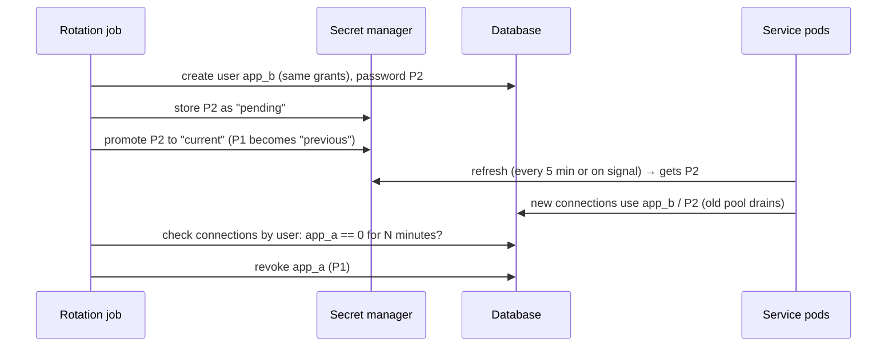
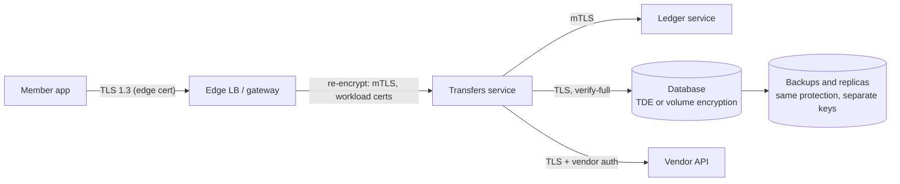
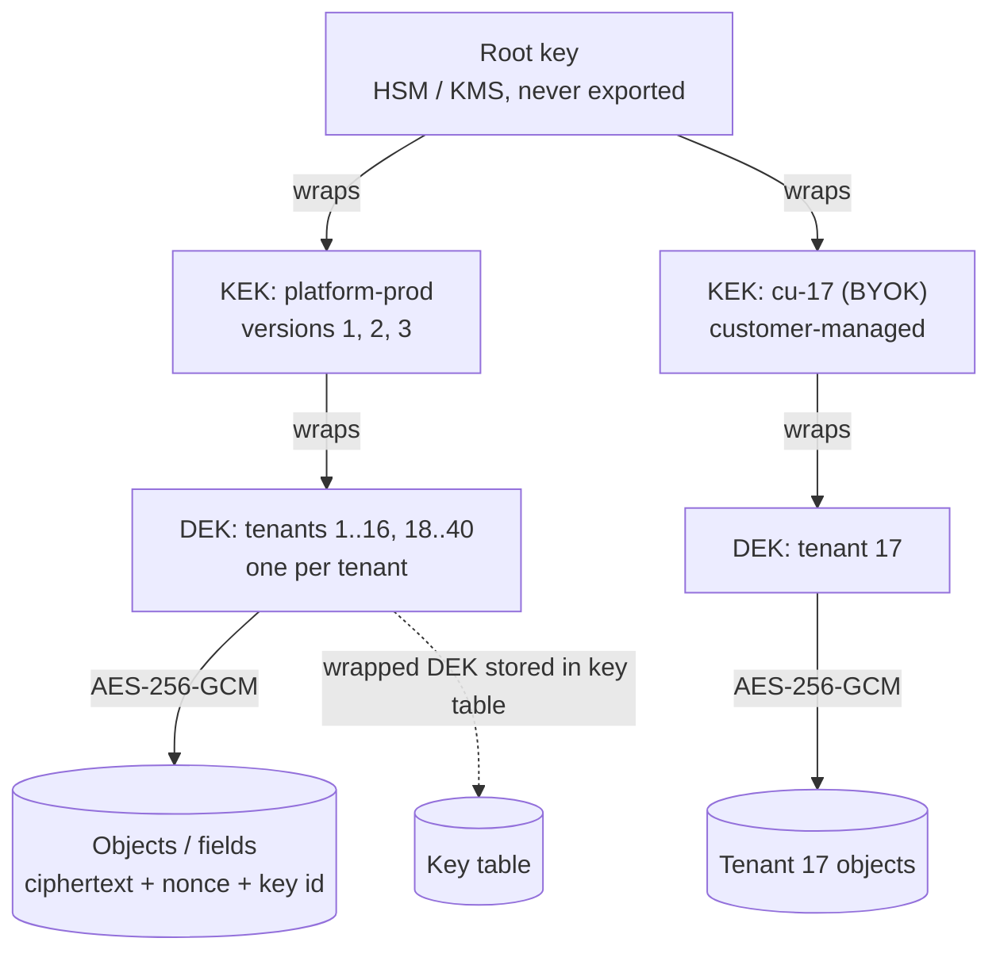
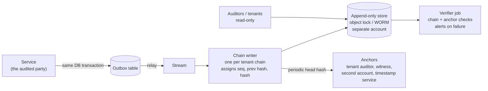
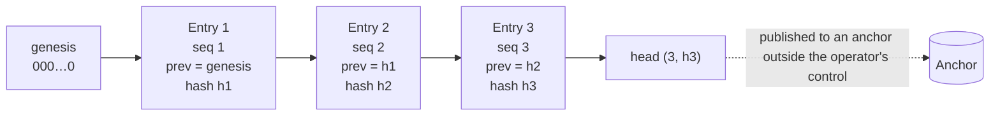
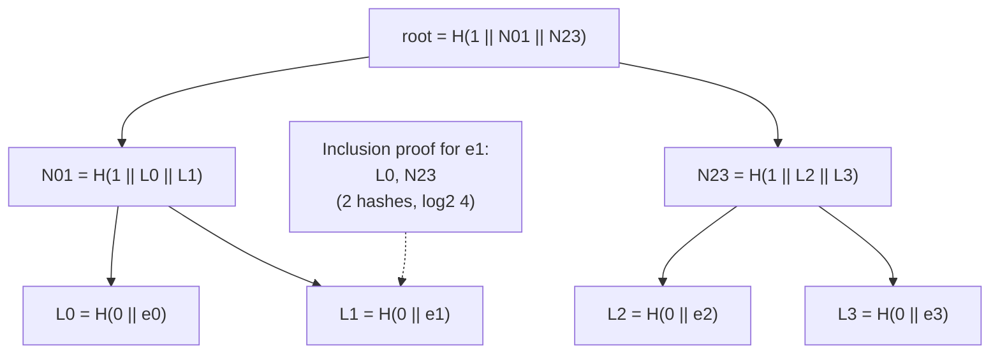

# A9 Unit 2 — Protecting data and proving what happened

> Time: ~6 h · CORE: §1–§5 · STRETCH (≈ 1 h): §6, and the `envelope` lab (the concept in §3 is CORE; building it is STRETCH) · Labs: `labs/a9/auditlog` (core), `labs/a9/envelope` (stretch)

Unit 1 decided *who may touch which tenant's data*. This unit assumes that decision will sometimes fail and asks two
different questions. First: if someone gets past it (a stolen disk, a leaked credential, an over-curious administrator, a
compromised service), how much can they read, and can you take that data away from them later? Second: after the fact,
can you prove who did what, and prove that the record you are showing an examiner is the record that was written? Both
questions come up whenever a credit union asks about your platform in vendor due diligence, which makes them as much
a business topic as a technical one.

## Before you start

You should have finished Unit 1 and A1 (Unit 3: tokens, mTLS; Unit 3 §2: idempotency keys; Unit 1: the TLS handshake and
its round-trip cost). Warm-up; write the answers down first.

1. A JWT access token lasts 15 minutes. A staff member is fired right now. In the worst case, how long can they keep
   acting, and name two ways to shorten it for risky operations.
2. Why is a pooled database connection with a session-level `SET app.tenant_id` dangerous?
3. Roughly how many round trips does a brand-new HTTPS connection cost with TLS 1.3, and why does that make
   connection pooling matter for mutual TLS between services?

<details data-kind="answer">
<summary>Warm-up answers</summary>

1. Up to ≈ 15 minutes plus any cache TTLs. Shorten with step-up authentication plus an online session check for money
   movement and exports, a pushed denylist of revoked sessions, or opaque tokens with introspection (Unit 1 §2).
2. The value outlives the request that set it, so the next request on that connection, possibly from another tenant,
   inherits it. Use a transaction-local setting (`set_config(..., true)`) so it dies at commit or rollback (Unit 1 §4).
3. TCP (1 RTT) + TLS 1.3 (1 RTT) = 2 RTT before the first request byte (`docs/NUMBERS.md`); mutual TLS adds certificate
   verification and, with short-lived certificates, issuance load. Pool and reuse connections so handshakes are rare.

</details>

---

## §1 Secrets management

### The failure story

The image-deposit vendor adapter needs four secrets: the vendor API key, the database password, the signing key for
outbound webhooks and the HMAC secret for inbound ones. They live in environment variables set from a Helm values file
(committed to the repository) and a Kubernetes Secret (base64-encoded, which is encoding, not encryption). Over two
and a half years:

- An engineer turns on debug logging while chasing a timeout. The startup log prints the effective configuration,
  including the API key. The log platform retains 90 days and ≈ 40 people can query it.
- The Docker image is built with `ARG VENDOR_KEY=...` for a test. The key now lives in an image layer in the registry,
  and so does every earlier tag.
- A contractor leaves. Rotating the database password means redeploying six services in a coordinated window: ≈ 3
  minutes per rolling restart × 6 ≈ 18 minutes plus approvals. Nobody does it. The password is unchanged 31 months later.
- The vendor key appears in a public repository (as in A1 Unit 3 §4). A scanner finds it three days later. The vendor
  account can submit deposits.

Nothing here is exotic. Every one of these is "secrets are just configuration" meeting a long-lived, widely readable
copy.

### Predict

<!-- predict id="A9-U2-P01" -->
**Predict.** Write your answers down before opening the reveal.

1. Design secret delivery for six services and 40 tenants, each tenant having its own SSO certificate, vendor
   credentials and webhook secret. Where do secrets live, how does a pod prove who it is to get them, and what is the
   unit of access control?
2. Rotate the database password with zero downtime. List the steps in order. What must be true of the database and the
   application for this to work?
3. What is the difference in risk between a secret that is rotated every 90 days and one that lives for an hour and is
   never written down?
<!-- /predict -->

### Reveal

<details data-kind="reveal" data-for="A9-U2-P01">
<summary>Reveal</summary>

1. A **secret manager** (Vault, AWS Secrets Manager, GCP Secret Manager, Azure Key Vault) holds them, with a path per
   tenant and per secret (`tenants/cu-17/sso-cert`). A pod authenticates with a **workload identity** the platform
   already gave it (a Kubernetes service-account token, a cloud IAM role, a SPIFFE identity), which avoids the "secret
   zero" problem of needing a secret to fetch secrets. Access control is by *workload × path*: the adapter can read
   `vendor/*` and its own tenants' entries; the web tier cannot.
2. Use **two valid credentials** during an overlap: (1) create the new credential (a second database user, or a new
   password on an alternating pair); (2) store it in the secret manager as the pending/current version; (3) roll the
   application, which re-reads secrets (or reloads on a signal) and starts using the new one while the old one still
   works; (4) verify nothing uses the old one (connection counts per user); (5) revoke the old credential. It requires
   a database that allows two principals with equal rights (or per-session credentials), and an application that
   reloads credentials without a full restart and reconnects its pool.
3. A 90-day secret has a 90-day (or longer, if rotation slips) window in which any leak is usable, and it exists in many
   copies (config, backups, laptops). A dynamic, short-lived credential is generated per workload and expires on its own;
   a leak is a leak of something already dead, and there is nothing to find in old configs or images. The cost shifts
   to needing a reliable issuer.

</details>

### How it actually works

**Classify secrets.** (a) Credentials your code presents to others: database passwords, vendor API keys. (b) Keys your
code signs or verifies with: JWT signing keys, HMAC webhook secrets. (c) Certificates and private keys: TLS/mTLS, SAML
service-provider keys. (d) *Tenant-owned* secrets: each credit union's SSO metadata, vendor credentials, BYOK key
references. Tenant secrets need per-tenant paths and policies, an audit trail of every read, and an offboarding path
that deletes them.

**Never in these places:** source control, container images and build arguments (layers persist; use build-time secret
mounts such as BuildKit's `RUN --mount=type=secret`), command lines (visible to every process on the host), logs and
traces, error messages, crash dumps, and environment variables as the long-term store. Environment variables are
inherited by every child process, appear in `/proc/<pid>/environ` and container inspection output, and are routinely
dumped by diagnostics and CI tooling. The 2021 compromise of Codecov's Bash uploader, which exfiltrated environment
variables from its users' CI jobs, is the standard illustration.

**Delivery.** Fetch from the secret manager at start-up and refresh periodically using workload identity, or mount as
files on an in-memory volume (the Kubernetes Secrets Store CSI driver, External Secrets Operator, Vault Agent). Hold
secrets in memory only, wrapped so they can't be printed. Cache the last good value so a secret-manager blip doesn't take the
service down (fail static), and alert on staleness.

**Rotation patterns:**

| Pattern | How | Downtime risk | Used for |
|---|---|---|---|
| Replace in place | Change the secret, restart consumers | Window of failures between change and propagation | Almost nothing you want to keep |
| Alternating pair | Two database users A/B; rotate the idle one, flip the pointer, rotate the other later | None, if consumers re-read | Database logins (AWS Secrets Manager's "alternating users" strategy) |
| Dual-key verification | Sign with the new key; verify with old **and** new for a window ≥ max token lifetime + skew; then retire old | None | JWT/HMAC keys (`kid`, A1 Unit 3 §3), webhook secrets |
| Dynamic secrets | Issuer creates a unique credential per workload/lease and revokes it at expiry | None; rotation is the default | Databases and cloud credentials via Vault or cloud IAM |
| Overlapping certificates | Issue the new cert before the old one expires; reload without restart | None, if automated | TLS/mTLS (ACME, cert-manager, SPIRE) |



**Detection and containment.** Secret scanning on commits and pushes (pre-commit hooks, CI, your Git host's push
protection); recognisable prefixes on issued keys so scanners can find leaks (A1 Unit 3 §4); *canary secrets*
(honeytokens that look real and alert on use); least-privilege read policies (the adapter reads its own secrets, not
all of them); rotation on staff departure and on any suspected exposure, rehearsed so it is a runbook, not an
excavation.

**Redaction in code** is the last line of defence. A typed secret that refuses to print itself costs five lines:

```go
package main

import (
	"encoding/json"
	"fmt"
	"log/slog"
	"os"
)

// Secret is a string that refuses to print itself.
type Secret string

func (Secret) String() string               { return "[REDACTED]" }
func (Secret) GoString() string             { return "[REDACTED]" }
func (Secret) LogValue() slog.Value         { return slog.StringValue("[REDACTED]") }
func (Secret) MarshalJSON() ([]byte, error) { return []byte(`"[REDACTED]"`), nil }

// Reveal is the only way out, and it is greppable.
func (s Secret) Reveal() string { return string(s) }

type VendorConfig struct {
	BaseURL string
	APIKey  string // plain string: the mistake
	Signing Secret // typed: the fix
	hmacKey Secret // unexported: fmt cannot call methods on it
	rawKey  string
}

func main() {
	c := VendorConfig{"https://vendor.example", "sk_live_abc123", "whsec_def456", "hmac_789", "raw_000"}
	fmt.Printf("%%v : %v\n", c)
	fmt.Printf("%%+v: %+v\n", c)
	b, _ := json.Marshal(c)
	fmt.Printf("json: %s\n", b)
	log := slog.New(slog.NewTextHandler(os.Stdout, nil))
	log.Info("vendor call", "cfg", c, "api_key", c.APIKey, "signing", c.Signing)
	fmt.Println("reveal:", c.Signing.Reveal())
}
```

### Build it

No lab for this section; the program above is complete and runnable (`go run secret.go` in a scratch directory). The
`envelope` lab (§3) shows what a secret manager does one level down: wrapping keys with other keys.

### Break it

Predict, field by field, which of `APIKey`, `Signing`, `hmacKey` and `rawKey` appear in cleartext in each of the four
outputs (`%v`, `%+v`, JSON, `slog`) before you run the program. Then add one line that makes `hmacKey` safe too.

<details data-kind="answer">
<summary>What you should see, and why</summary>

`%v` and `%+v` print `APIKey`, `hmacKey` and `rawKey` in cleartext and `Signing` as `[REDACTED]`; JSON includes `APIKey`
and `Signing` (redacted) but omits unexported fields entirely; `slog` logs `api_key=sk_live_abc123` and, because
`cfg` is a struct, prints it with the `%+v` rules (so `hmacKey` leaks there as well). The surprise is **`hmacKey`**:
`fmt` can only call `String()` on values it can obtain through an *exported* path; an unexported field of type `Secret` is
printed from its underlying string. A type alone isn't enough: make config structs unprintable as a whole by giving
the struct a `String()`/`LogValue()` method that lists only safe fields, or hold secrets in a type with no printable
fields (a struct wrapping a `[]byte`), and add a test that logs your configuration and fails if any known secret value
appears in the output. The plain-string `APIKey` shows the baseline failure: if the type doesn't say "secret", nothing
will treat it as one.

</details>

### In the wild

- **HashiCorp Vault**: dynamic secrets (the database secrets engine creates a user per lease with a TTL and revokes it
  on expiry), leases and renewals, the Transit engine (encryption as a service, with `rewrap`), and Kubernetes /
  cloud-IAM authentication methods that solve secret zero.
- **AWS Secrets Manager** rotation uses staging labels (`AWSPENDING`, `AWSCURRENT`, `AWSPREVIOUS`) and offers
  single-user and alternating-user strategies. Pricing is per secret per month plus per-call
  (`TODO-VERIFY`: roughly $0.40 per secret-month and $0.05 per 10,000 calls).
- **Kubernetes Secrets** are base64-encoded and stored in etcd; encryption at rest and an external KMS provider are
  opt-in configuration. External Secrets Operator and the Secrets Store CSI Driver sync from external managers.
- **SPIFFE/SPIRE** issue short-lived workload identities (X.509 or JWT SVIDs); cloud workload identity (IAM roles for
  service accounts, GCP Workload Identity) removes stored cloud keys.
- **Secret scanning**: GitHub secret scanning and push protection, gitleaks, truffleHog. **Codecov (2021)** and the
  **CircleCI (2023)** incident, after which customers were told to rotate every secret stored in the platform, are
  reminders that CI is a high-value secret surface.
- **The Twelve-Factor App** recommends configuration in environment variables; for *secrets* the practical consensus
  moved to files or fetched-at-runtime values for the reasons above.

### Trade-offs

| Option | Wins when | Loses when | When the answer flips |
|---|---|---|---|
| Environment variables | Non-secret config; local development | Leaks via diagnostics, children, `/proc`, CI | Never for production secrets; use for pointers (a path or ARN), not values |
| Mounted files from a secret manager | Simple apps; sidecar/CSI available; file reload | Needs reload logic; file permissions | SDK fetch when you need rotation without file-watching |
| Runtime fetch via workload identity | Fine-grained, audited access; rotation | Start-up dependency on the manager; code changes | Cache last-good and fail static to tolerate outages |
| Static long-lived secrets | Third parties that offer nothing better | Leaks live forever; rotation is painful | Dynamic secrets wherever the target supports them |
| Dynamic per-lease credentials | Databases, cloud APIs | Issuer is critical infrastructure; connection churn | Alternating pair when the target can't create users on demand |
| One secret manager for everything | Uniform audit and policy | Blast radius of the manager | Separate instances/accounts for platform vs tenant secrets, or per-tenant key encryption (§3) |

### Senior bar

- **Failure modes**: secret zero (bootstrapping with a stored credential); the secret manager down at deploy or restart
  (no cached value); a consumer that caches a secret forever and breaks at rotation; one broad read policy ("all
  services read all secrets"); tenant secrets readable across tenants; secrets in crash dumps, heap profiles and
  traces; rotation that works in staging and fails in production because one forgotten consumer still holds the old
  value; shared accounts.
- **Capacity**: 40 tenants × 5 secrets = 200 tenant secrets plus ≈ 30 platform secrets. If all 120 pods (6 services ×
  20) refreshed all ≈ 230 secrets every 5 minutes that would be ≈ 120 × 230 / 300 s ≈ 92 reads/s: small, but needless.
  Refresh only what a pod uses (a few dozen reads per pod), and add jitter so refreshes don't synchronise into a
  thundering herd against the manager.
- **Ops**: a rotation calendar with owners; a *tested* break-glass procedure; alerts on secret reads outside the normal
  pattern; secret inventory with last-rotated times; offboarding checklist that revokes the departing person's access
  and rotates what they could read.
- **Cost**: managed secret stores charge per secret and per call (small); the real cost is the engineering to make
  consumers reload credentials without restarting, which pays back every rotation.

Interviewer follow-up probes:

1. "Rotate the database password with zero downtime."

<details data-kind="answer">
<summary>Model answer</summary>

Two credentials that are valid at the same time. Create the new one (a second user with the same grants, or the idle half
of an alternating pair), publish it to the secret manager, have services pick it up and reconnect with it while the
old one still works, watch connection counts per user until the old one is idle, then revoke it. This requires the
service to reload credentials and recycle its pool without restarting. Better still, use dynamic credentials with a
TTL so rotation is continuous and nothing long-lived exists.

</details>

2. "How does a pod authenticate to Vault without a secret?"

<details data-kind="answer">
<summary>Model answer</summary>

It presents an identity the platform already attests: in Kubernetes, the pod's projected service-account token, which
Vault validates against the cluster's API (or via cloud IAM, a signed identity document). Vault maps that identity to a
policy that allows reading specific paths. The trust is rooted in the platform's attestation of the workload, not a
credential we had to distribute.

</details>

3. "The secret manager is down while you deploy. What happens?"

<details data-kind="answer">
<summary>Model answer</summary>

New pods can't start if they depend on a fetch at boot, so I'd avoid making the manager a hard dependency of rollouts:
cache the last good value (in memory for running pods; a sealed local copy or a replicated read path for new ones),
run the manager highly available across zones, and design deploys so existing pods keep running during the outage.
Alerts fire on fetch failures and staleness, not only on total failure.

</details>

### Check yourself

1. Why are environment variables a poor long-term home for secrets?
2. What is "secret zero" and one way to solve it?
3. How long must a verifier accept both the old and new HMAC key during rotation?

<details data-kind="answer">
<summary>Answers</summary>

1. They're inherited by child processes, visible in process and container metadata, and routinely dumped by
   diagnostics, crash reports and CI tooling.
2. The first secret needed to fetch all the others. Solve it with a platform-attested workload identity (Kubernetes
   service-account token, cloud IAM role, SPIFFE) instead of a distributed credential.
3. At least the maximum lifetime of anything signed with the old key plus clock skew (for example the longest token
   TTL, or the webhook retry window), then retire the old key.

</details>

---

## §2 Encryption in transit and at rest

### The failure story

"We encrypt everything." In practice: TLS terminates at the load balancer; inside the VPC services talk plain HTTP;
the database volumes are encrypted with the cloud provider's disk encryption. Then:

- A diagnostics team enables traffic mirroring to troubleshoot latency. The mirror target is a shared analysis host.
  Eleven service-to-service calls per request, including member tax ids and bearer tokens, are now readable by
  everyone with access to that host.
- A DBA runs an export of the `members` table (≈ 3.2 M rows) to a laptop for an analytics request. Disk encryption was on,
  and it didn't matter: the database decrypts for any authorised session, and the file left in plaintext.
- A backup is copied to another account for a vendor's test environment. The copy is encrypted under a key whose policy
  grants `kms:*` to the whole organisation.
- A staging database is restored from production "just this once", and now the staging team can read production data.

Every control exists; none of them addresses the attacker who is actually present.

### Predict

<!-- predict id="A9-U2-P02" -->
**Predict.** Write your answers down before opening the reveal.

1. For each attacker, say which of these protects the data: **TLS at the edge only**, **mTLS between services**,
   **volume/disk encryption**, **database TDE**, **application-level field encryption with per-tenant keys**.
   Attackers: (a) steals a decommissioned disk or a snapshot; (b) sniffs traffic inside the VPC; (c) a DBA with legitimate
   read access; (d) exploits SQL injection in the app; (e) compromises one service and its database credentials;
   (f) a staff member with permission to call KMS `Decrypt`.
2. mTLS authenticates both ends of every service-to-service call. Does it stop the confused-deputy export from Unit 1
   §3? Why or why not?
3. A service makes 2,000 new HTTPS connections per second to a downstream over a 0.5 ms RTT network. Is the TLS
   handshake a problem? What changes if it is a 100 ms RTT vendor?
<!-- /predict -->

### Reveal

<details data-kind="reveal" data-for="A9-U2-P02">
<summary>Reveal</summary>

1. (a) Volume encryption, TDE (and application-level, trivially). (b) mTLS (or any TLS inside the network); edge-only TLS
   does nothing. (c) Only application-level field encryption with keys the DBA can't use; disk encryption and TDE are
   transparent to any authorised session. (d) Application-level encryption helps only for fields the compromised
   code path can't decrypt; if the injected query runs inside the app's session with the app's keys, it can read what
   the app can read. Prevention (parameterised queries, least-privilege DB role, row-level security) matters most.
   (e) Per-tenant keys limit it to the tenants whose keys the service holds, and database row-level security limits
   which rows; nothing else does. (f) Key policy and separation of duties: encryption moves the trust question to "who
   may call Decrypt", so that list must be short, audited and not the same as the DBA list.
2. No. mTLS proves *which service* is calling; it doesn't say whether that service should act for *this* tenant on
   *this* object. The export service is authenticated and authorised as itself and still resolved the caller's key with
   its own authority. Transport security and object-level authorisation answer different questions.
3. At 0.5 ms RTT the handshake's latency is small (≈ 1 RTT for TLS 1.3 on top of TCP's 1), but CPU is not free: 2,000
   handshakes/s with ECDSA certificates is a few percent of a core to a core or two depending on key types
   (`TODO-VERIFY` on your hardware), and it is wasteful because pooled, keep-alive connections would make nearly all of
   them unnecessary. At 100 ms RTT each new connection costs ≈ 2 RTT ≈ 200 ms before the first request byte
   (`docs/NUMBERS.md`), which is the reason to pool and reuse connections to vendors.

</details>

### How it actually works

**In transit.** TLS gives confidentiality, integrity and server authentication. TLS 1.3 removed RSA key exchange and
static Diffie-Hellman, so every session has forward secrecy; it needs 1 RTT after TCP (2 RTT total from a cold start;
`docs/NUMBERS.md`), and resumption shortens repeat connections. Set a minimum of TLS 1.2 (1.3 where you control both
ends). **Mutual TLS (mTLS)** adds client certificates so the server learns *which workload* is calling. In a platform the
useful identity is a workload identity in the certificate's SAN (for example a SPIFFE URI
`spiffe://platform/ns/payments/sa/transfers`), and authorisation rules refer to that identity ("only `transfers` may
call `ledger.Post`"). Certificates should be short-lived (hours to days) and issued automatically (SPIRE, cert-manager,
a service mesh), which removes revocation lists from the picture: a stolen certificate expires.



Server side of workload authentication in Go (the interesting part is the last four lines: *authorise on the identity*):

```go
package mesh

import (
	"crypto/tls"
	"crypto/x509"
	"net/http"
)

func serverTLS(clientCAs *x509.CertPool, cert tls.Certificate) *tls.Config {
	return &tls.Config{
		MinVersion:   tls.VersionTLS12,
		Certificates: []tls.Certificate{cert},
		ClientAuth:   tls.RequireAndVerifyClientCert, // reject callers without a cert from our CA
		ClientCAs:    clientCAs,
	}
}

// allowOnly admits callers whose certificate carries one of the SPIFFE ids.
func allowOnly(ids map[string]bool, next http.Handler) http.Handler {
	return http.HandlerFunc(func(w http.ResponseWriter, r *http.Request) {
		if r.TLS == nil || len(r.TLS.PeerCertificates) == 0 {
			http.Error(w, "client certificate required", http.StatusUnauthorized)
			return
		}
		for _, u := range r.TLS.PeerCertificates[0].URIs {
			if u.Scheme == "spiffe" && ids[u.String()] {
				next.ServeHTTP(w, r)
				return
			}
		}
		http.Error(w, "forbidden", http.StatusForbidden)
	})
}
```

For databases, encrypting the connection isn't enough; **verify the server**. In libpq terms `sslmode=require` encrypts
but doesn't validate the certificate (a man in the middle can present any certificate); `verify-full` checks the chain
and the host name.

**At rest has four layers, protecting against different attackers:**

| Layer | What it is | Protects against | Does not protect against |
|---|---|---|---|
| Volume / disk encryption (LUKS, cloud block-store encryption) | Whole device encrypted; keys from KMS | Stolen media, decommissioned disks, snapshot theft | Anything running on the live system, DBAs, SQL injection |
| Database TDE | Data files and logs encrypted by the engine | Same as above, at file level | The same; the engine decrypts for any session |
| Application-level (field/column) encryption | App encrypts sensitive fields before they reach the database | DBAs, SQL injection of data you can't decrypt, leaked backups and replicas, analytics copies | A compromised app with the keys; also costs you search and sort on those fields |
| Tokenisation | Replace the value with a token; the real value lives in a hardened vault | Spread of sensitive data across systems; shrinks audit scope (PCI) | Compromise of the vault itself |

Application-level encryption has a price: you can't index, sort or range-query ciphertext. Two standard techniques:
a **blind index** (an HMAC of the normalised value, stored next to the ciphertext, for equality lookups: it leaks which
rows are equal, so use a keyed HMAC, not a plain hash) and **deterministic encryption** (same plaintext → same
ciphertext, enabling equality joins at the cost of leaking frequency). Never use a mode with no per-message randomness
for general data (ECB reveals repeated blocks). Choose which fields get this treatment by classification: public,
internal, confidential (member PII), restricted (tax ids, full account numbers, credentials). Mask in UIs and logs
(last four digits) regardless.

**Backups, replicas and copies** inherit exposure. Encrypt them under keys the production application can't delete and
the backup operators can't read; never restore production into environments with weaker access; analytics extracts get
the same classification as the source.

### Build it

No lab for this section. §3 builds the key hierarchy that makes application-level encryption practical
(`labs/a9/envelope`), and the mesh snippet above compiles as a package if you want to stand up an `httptest` server
with it.

### Break it

Find the flaw in each configuration (write your answer before opening):

1. A Go service connects to Postgres with `sslmode=require` and `InsecureSkipVerify: true` "because the internal CA
   isn't in the container image".
2. Service mesh mTLS is enabled everywhere; any service with a valid workload certificate can call any other service,
   and the `ledger.Post` endpoint trusts the `X-Caller` header the caller sets.
3. Member tax ids are encrypted with AES-256 in ECB mode "so we can still search for duplicates".
4. Disk and snapshot encryption are on. Snapshots are shared with the analytics account, and the KMS key policy grants
   `kms:Decrypt` to `*` principals within the organisation.
5. The platform's internal CA issues 5-year workload certificates; revocation is "we would update the CRL".

<details data-kind="answer">
<summary>Flaws</summary>

1. The channel is encrypted but unauthenticated: any host that can intercept the connection can impersonate the database
   and read credentials and data. Mount the CA bundle and use `verify-full`; skipping verification turns TLS into
   obfuscation.
2. mTLS authenticates *that* a caller is a platform workload, not *which one* may do what. Authorise on the certificate
   identity (SPIFFE id) with an allow-list per endpoint, and never trust a caller-supplied identity header when a
   verified one exists.
3. ECB encrypts identical 16-byte blocks identically, so patterns survive, and equal values are visible; it also has no
   integrity. Use an AEAD (AES-GCM, XChaCha20-Poly1305) with random nonces, and for the duplicate check store a keyed
   blind index (HMAC-SHA-256 under a separate key).
4. Snapshot encryption doesn't constrain anyone who can call `Decrypt`, and the policy lets the entire organisation do
   that. Key policy is the real access control: restrict `Decrypt` to the specific roles that need it, separate the
   key used for backups from production keys, and audit every use.
5. Five years is a standing credential; if a certificate leaks you wait for a CRL that clients may not even check.
   Use short-lived certificates (hours to days) with automated renewal so compromise self-heals.

</details>

### In the wild

- **Service meshes**: Istio and Linkerd provide automatic mTLS with workload certificates that rotate on the order of
  a day (`TODO-VERIFY` defaults); **SPIFFE/SPIRE** issue X.509 SVIDs with short TTLs (`TODO-VERIFY` defaults).
  **Google ALTS** is the application-layer transport security Google uses between its own services. **Let's Encrypt**
  popularised automated issuance (ACME) with 90-day certificates, and the CA/Browser Forum has approved shorter maximum
  lifetimes for public certificates (`TODO-VERIFY` the schedule).
- **Databases**: PostgreSQL `sslmode` values `disable`, `allow`, `prefer`, `require`, `verify-ca`, `verify-full`.
  SQL Server **Always Encrypted** (client-side column encryption, deterministic and randomised); MongoDB
  **client-side field-level encryption**; Oracle and SQL Server **TDE**. Community PostgreSQL does not ship built-in TDE
  (`TODO-VERIFY` current state; vendor distributions and extensions offer it).
- **Cloud**: block-store and database "encrypt at rest" options backed by KMS keys, usually chosen at creation time
  (`TODO-VERIFY` per service whether in-place enablement is possible).
- **Equifax (2017)**: public reports note that an expired certificate on a network inspection device left traffic
  monitoring blind for an extended period during the breach (`TODO-VERIFY` duration); a reminder that certificate
  lifecycle is an operational control, not a one-time setup.
- **Tokenisation and PCI scope**: hosted payment fields and token vaults keep card numbers out of your systems and
  shrink the audit scope (§5).

### Trade-offs

| Option | Wins when | Loses when | When the answer flips |
|---|---|---|---|
| TLS to the edge only | A single trusted network and no lateral-movement concern | Any internal compromise or mirror sees plaintext | mTLS (mesh or library) as soon as there are several services or regulated data |
| Mesh sidecar mTLS | Many services, polyglot, consistent policy | Extra hop and resource overhead; mesh operations | Library-level mTLS for a handful of services in one language |
| Volume encryption | Baseline for everything; zero app change | Protects only against media theft | Always on, but never the only layer for regulated fields |
| Application-level field encryption | DBAs/analytics/backups must not read the field | No search/sort; key management; performance | Tokenisation when many systems need to reference the value without reading it |
| Deterministic encryption / blind index | You need equality lookups on a sensitive field | Leaks equality and frequency | Randomised encryption plus a separate lookup token when frequency leakage is unacceptable |
| Short-lived certificates | Automation exists | Needs reliable issuance (an outage in the CA is an outage in the platform) | Longer-lived with revocation for devices that can't renew automatically |

### Senior bar

- **Failure modes**: some services plaintext "temporarily"; `InsecureSkipVerify`; expired certificates (the classic
  outage and the classic monitoring blind spot); CA key compromise; identity taken from headers rather than
  certificates; keys for backups the same as production; development and staging with production data; TLS
  terminated at a proxy that logs bodies.
- **Capacity**: TLS record encryption with AES-NI is a small fraction of CPU (low single-digit percent at typical API
  rates; `TODO-VERIFY` on your hardware). The handshake dominates on connection churn: fresh HTTPS ≈ 2 RTT, so
  pooling and keep-alive remain the first optimisation (A1 Unit 1 §3). 200 services with 24-hour certificates is ≈ 200
  issuances per day: trivial for a CA, but each renewal must succeed or a service falls over at expiry.
- **Ops**: certificate expiry dashboards and alerts at 30/14/7 days (or at 2/3 of lifetime for automated renewal);
  rotate the CA with an overlap period; scan for plaintext listeners; a regular check that `Decrypt` permissions on
  key policies match the intended list.
- **Cost**: mesh CPU/memory per pod; HSM-backed keys; engineering time for field-level encryption (every query and
  report touching those fields changes).

Interviewer follow-up probes:

1. "You have TLS at the load balancer and encrypted disks. Is that enough for a banking platform?"

<details data-kind="answer">
<summary>Model answer</summary>

It covers two attackers, the one on the internet and the one holding a stolen disk. It does nothing for the attacker
inside the network (so mTLS between services, ideally with identity-based authorisation), nor for anyone with a
legitimate session such as a DBA, a compromised service or a SQL injection (so least-privilege database roles,
row-level security, and application-level encryption for the most sensitive fields with keys that only the services
that need them can use). And the keys' own access policy has to be tight and audited, otherwise "encrypted" just
means "decryptable by everyone in the organisation".

</details>

2. "Why not put the tenant id into the certificate and skip tokens between services?"

<details data-kind="answer">
<summary>Model answer</summary>

A service certificate identifies a *workload* (transfers, ledger), not the member or tenant on whose behalf a request is
being served; one transfers pod serves all tenants. The tenant and end user must travel as signed request context (the
internal token from Unit 1 §2), and be enforced at the data layer. Per-tenant certificates only make sense for
per-tenant deployments (a silo/cell), where the workload really is single-tenant.

</details>

3. "How do you roll out mTLS to 80 services without an outage?"

<details data-kind="answer">
<summary>Model answer</summary>

Start in permissive mode (accept both plaintext and mTLS) with the mesh or library injected everywhere, watch metrics
for which edges still use plaintext, fix them service by service, then switch each namespace or edge to strict. Keep
certificate lifetimes short from the start so renewal is exercised daily, alert on renewal failures, and have a
rollback switch per namespace. Authorisation rules come after encryption: first "every call is mTLS", then "this
identity may call that endpoint".

</details>

### Check yourself

1. Which attacker does volume encryption defeat, and which does it not?
2. `sslmode=require` versus `verify-full`: what does the second add?
3. Why can't you index ciphertext, and what is a blind index?

<details data-kind="answer">
<summary>Answers</summary>

1. It defeats theft of disks and snapshots; it doesn't help against any live authorised session (DBA, app, SQL
   injection), because the system decrypts for them.
2. Verification of the server's certificate chain and host name, which prevents a man-in-the-middle from impersonating
   the database; `require` only encrypts.
3. Properly randomised ciphertext differs for equal plaintexts and has no order, so an index can't help. A blind index
   stores a keyed HMAC of the normalised value to allow equality lookups, at the price of revealing which rows are
   equal.

</details>

---

## §3 Envelope encryption and key management

> The *concept* (key hierarchy, rotation by re-wrapping, crypto-shredding, KMS cost) is CORE. Building it in
> `labs/a9/envelope` is STRETCH.

### The failure story

A team encrypts `members.tax_id` with AES-256 under one key held in the cloud KMS, and calls KMS `Decrypt` for every
value read. It works in testing. In production:

- A statements screen lists 50 accounts: 50 KMS calls × ≈ 8 ms. The page takes 400 ms longer.
- A nightly export reads 2 M members: 2 M KMS calls in an hour ≈ 550 calls/s. KMS request quotas are shared per account
  and region (`TODO-VERIFY` the numbers), so the export throttles *other* services that use the same account's KMS:
  TLS certificate issuance, object-storage encryption, the secrets manager. Pricing is per request (≈ $0.03 per 10,000
  requests; `TODO-VERIFY`): 2 M calls ≈ $6 per export, 100 exports a day ≈ $600/day for a design mistake.
- Compliance asks for annual key rotation. With one key, "rotate" means decrypting and re-encrypting every ciphertext:
  3.2 B field values.
- Credit union 17 offboards and contractually requires deletion of all its data, including backups, within 30 days.
  With one key shared by 40 tenants there is nothing to delete that affects only them.
- Another credit union asks to hold its own key and be able to revoke the platform's access.

### Predict

<!-- predict id="A9-U2-P03" -->
**Predict.** Write your answers down before opening the reveal.

1. Design a key hierarchy that fixes all five problems. How many levels? What does each level protect, where is each
   stored, and what is cached in memory?
2. Two designs: (A) one data key per *object* (100 M objects), (B) one data key per *tenant* (40 tenants). The master
   key is rotated. How many KMS re-wrap calls does each need, and how long at 1,000 calls/s?
3. How do you "delete tenant 17's data from the backups" without touching the backups?
<!-- /predict -->

### Reveal

<details data-kind="reveal" data-for="A9-U2-P03">
<summary>Reveal</summary>

1. **Envelope encryption** with a hierarchy: a **root key** in an HSM/KMS (never leaves it) protects **key-encryption
   keys** (KEKs, per environment and optionally per tenant), which wrap **data-encryption keys** (DEKs, per tenant and
   possibly per object class). DEKs encrypt the data locally. Only *wrapped* DEKs are stored (beside the data or in a
   key table); plaintext DEKs live in service memory with a TTL. KMS is called to wrap/unwrap DEKs rarely, not once per
   value. Per-tenant keys give per-tenant rotation, deletion and customer-held keys.
2. (A) 100 M re-wraps ÷ 1,000/s = 100,000 s ≈ **28 hours** (and 100 M × $0.03/10,000 ≈ $300). (B) **40** calls: seconds.
   The data is untouched in both: rotating a KEK re-wraps DEKs, it doesn't re-encrypt data. The per-object design buys
   a tiny blast radius and no nonce concerns per key, and pays in key-table size and rewrap volume; per-tenant is the
   usual sweet spot, with a limit on how many messages one DEK may encrypt (see below).
3. **Crypto-shredding**: destroy the tenant's DEKs (and its KEK, if it has one). The backups still contain the
   ciphertext, but nothing can ever decrypt it. The wrapped DEKs must not survive in backups of the key table beyond the
   deletion deadline, so key-table backups have a *shorter* retention than data backups, or live in a separate system.

</details>

### How it actually works



**The operations:**

- **Encrypt**: get the tenant's current DEK (from the cache, or unwrap it through the KMS once); generate a random
  96-bit nonce; AES-256-GCM encrypt with **associated data (AAD)** that names the context (tenant, object id, field);
  store `{key id, nonce, ciphertext}`.
- **Decrypt**: look up the key id, get the DEK, decrypt with the same AAD. The GCM tag fails if the ciphertext, nonce
  or AAD differ in any bit.
- **Rotate a KEK**: create a new version; **re-wrap** each stored DEK under it (the KMS does this without exposing the
  DEK; Vault's `transit/rewrap` and similar calls exist for it). Data is not touched. Then destroy the old version once
  every wrapped DEK has moved (the lab's `DestroyingAnOldKEKWithoutRewrappingLosesData` shows the failure when you
  don't). Rewrap lazily on read if you can't do it all at once.
- **Rotate a DEK**: needed on suspected compromise or when it reaches its usage limit; generate a new DEK, encrypt new
  data with it, and re-encrypt old data in the background (expensive: this is the operation that touches data).
- **Crypto-shred**: delete the DEK/KEK (with the KMS's own waiting period, typically 7–30 days for managed keys), plus
  the wrapped copies.

**AAD is what binds a ciphertext to its place.** Without it, anyone who can write to storage can copy tenant A's blob
into tenant B's row, or swap one account's encrypted limit into another's, and decryption succeeds because the key is the
same. With AAD = `enc(tenant) ‖ enc(object)` (length-prefixed fields, as in the audit encoding in §4), the tag check
fails. Per-tenant DEKs give the same protection across tenants; AAD gives it across *objects* in one tenant and as
defence in depth everywhere. The lab lets you misconfigure a single shared DEK on purpose, to see that AAD alone still
stops the swap, and then turn AAD off to see it succeed.

**Nonces.** GCM is catastrophically sensitive to **nonce reuse** under the same key: two messages with the same key and
nonce reveal the XOR of the plaintexts and let an attacker forge valid tags. With random 96-bit nonces the collision
probability among *n* messages under one key is ≈ n² / 2⁹⁷. NIST SP 800-38D caps random-nonce use at 2³² messages per key
(probability ≈ 2⁻³³ ≈ 10⁻¹⁰ there). Practical rules: bound the messages per DEK (the lab retires a DEK after
`MaxSealsPerKey`), prefer a nonce-misuse-resistant or extended-nonce construction when you cannot (AES-GCM-SIV,
XChaCha20-Poly1305), never derive nonces from the clock, and check that your randomness source isn't stuck (the lab
refuses to encrypt when two consecutive nonces are equal, like the continuous RNG self-tests in FIPS 140; `TODO-VERIFY`
the exact name of that requirement).

**Caching DEKs.** The KMS call is on the wrong path for per-field encryption, so unwrapped DEKs are cached in memory:
bound by TTL, number of uses and bytes (the AWS Encryption SDK's caching layer offers exactly those limits), zeroed on
eviction, never persisted. Trade-off: a long cache means fewer KMS calls and tolerance of KMS outages; it also means
revoking the service's KMS permission doesn't take effect until the cache expires. For a tenant with a revocable
customer-held key, a 5–15 minute TTL is a common compromise.

**Customer-held keys (BYOK / HYOK).** The credit union holds its KEK in its own KMS or HSM and grants your platform a
role that may use it. They can revoke access (a kill switch) or rotate on their policy. The costs: your availability
now depends on *their* key service for that tenant (put it behind a per-tenant bulkhead and cache DEKs so a brief
outage doesn't stop reads); latency across accounts or providers; and the support story when they revoke by mistake.
Typically offered as a premium tier for the siloed tenants from Unit 1 §4.

**Deletion versus retention.** Crypto-shredding is the technically clean answer to "delete this tenant everywhere", but
a bank's records often have *minimum* retention periods (and legal holds). Shred at the end of the retention period, not at
the offboarding date, and let legal and compliance own those dates (`TODO-VERIFY` retention rules with counsel).

A minimal AES-GCM encrypt/decrypt with AAD, to see the shape (the lab wraps this in a vault; in production, use a vetted
library such as Tink or the AWS Encryption SDK rather than this):

```go
package seal

import (
	"crypto/aes"
	"crypto/cipher"
	"crypto/rand"
	"encoding/binary"
	"io"
)

func aad(tenant, object string) []byte {
	b := binary.BigEndian.AppendUint32(nil, uint32(len(tenant)))
	b = append(b, tenant...)
	b = binary.BigEndian.AppendUint32(b, uint32(len(object)))
	return append(b, object...)
}

// Seal returns nonce || ciphertext||tag for plaintext under dek (32 bytes).
func Seal(dek []byte, tenant, object string, plaintext []byte) ([]byte, error) {
	block, err := aes.NewCipher(dek)
	if err != nil {
		return nil, err
	}
	gcm, err := cipher.NewGCM(block)
	if err != nil {
		return nil, err
	}
	nonce := make([]byte, gcm.NonceSize())
	if _, err := io.ReadFull(rand.Reader, nonce); err != nil {
		return nil, err
	}
	return gcm.Seal(nonce, nonce, plaintext, aad(tenant, object)), nil
}

func Open(dek []byte, tenant, object string, sealed []byte) ([]byte, error) {
	block, err := aes.NewCipher(dek)
	if err != nil {
		return nil, err
	}
	gcm, err := cipher.NewGCM(block)
	if err != nil {
		return nil, err
	}
	if len(sealed) < gcm.NonceSize() {
		return nil, io.ErrUnexpectedEOF
	}
	nonce, ct := sealed[:gcm.NonceSize()], sealed[gcm.NonceSize():]
	return gcm.Open(nil, nonce, ct, aad(tenant, object))
}
```

### Build it

**STRETCH**: lab `labs/a9/envelope`, file `envelope.go` (not required for the gate). The file's header is a loud
reminder: *teaching sketch, never roll your own crypto in production.* Implement the in-process `KMS` first (named keys with
versions; `Wrap`/`Unwrap` with an encryption context; `Rewrap`; `DestroyVersion`; call counters), then the `Vault`
(`Seal`, `Open`, DEK cache, usage limit, `RewrapKeys`, `ShredTenant`), using only `crypto/aes`, `cipher.NewGCM` and
`crypto/rand`.

Acceptance tests: `TestKMS_WrapUnwrapBindsToContext`, `TestKMS_RotateRewrapAndDestroy`,
`TestVault_RoundTripsAndNeverRepeatsACiphertext`, `TestVault_NoncesAreUniqueAcrossManySeals`,
`TestVault_TamperingAndWrongObjectFailAuthentication`, `TestVault_OneDEKPerTenantAndCrossTenantOpenFails`,
`TestVault_SharedKeyStillBindsCiphertextToTenantAndObject`, `TestVault_CachesDEKsSoKMSCallsDoNotScaleWithObjects`,
`TestVault_RotatingTheKEKReWrapsKeysNotData`, `TestVault_DestroyingAnOldKEKWithoutRewrappingLosesData`,
`TestVault_ShredTenantMakesItsDataUnreadableAndLeavesOthersAlone`,
`TestVault_RetiresADEKAfterMaxSealsAndKeepsOldOnesReadable`, `TestVault_DetectsAStuckRandomSource`,
`TestVault_RandomSourceErrorsSurfaceAsErrors`, `TestVault_ValidatesArguments`,
`TestVault_ConcurrentSealOpenAndRewrapUnderRace`. Run `go test -race ./labs/a9/envelope/`.

### Break it

1. Wire `breakNoAAD` into your `Seal` and `Open` so that `-tags breakit` passes nil as the associated data. Run
   `go test -tags breakit -run BreakIt_SwapWithoutAAD -v ./labs/a9/envelope/` (shared-key vault, tenant alpha's blob
   copied into beta's row) and then the whole suite. Predict what the experiment prints and which tests fail.
2. `go test -tags breakit -run BreakIt_KMSCalls -v ./labs/a9/envelope/`: 10,000 reads of one tenant's object, with the
   DEK cache and with the cache dropped before each read. Predict the `Unwrap` counts.
3. Destroy KEK version 1 after rotating, *without* calling `RewrapKeys`. Open an object with a warm cache, then call
   `DropCache` and open it again.
4. Replace the random source with one that always returns the same bytes and seal twice.

<details data-kind="answer">
<summary>What you should see, and why</summary>

1. With AAD off, the experiment prints that the cross-tenant swap **succeeded** (tenant `cu-beta` read
   `"alpha wire limit: $250,000"`), and the same-tenant swap succeeded too (the `wire-limit` row now reads the daily
   limit). The tests that fail are `TamperingAndWrongObjectFailAuthentication` (object substitution) and
   `SharedKeyStillBindsCiphertextToTenantAndObject` (cross-tenant swap). `OneDEKPerTenantAndCrossTenantOpenFails`
   keeps passing because per-tenant DEKs still separate tenants: the layers are redundant on purpose, and AAD is what
   remains when a layer is misconfigured.
2. `{Wrap:1 Unwrap:0}` with the cache; `{Wrap:1 Unwrap:10000}` without. A cache turns "one KMS call per read" into
   "one per DEK per process lifetime": the difference between the 2 M-call export in the failure story and a handful.
3. The warm-cache read succeeds, which is why this bug ships: nothing fails until the next restart or cache expiry,
   when `Open` returns `ErrKeyDestroyed` for every object. Destroy an old KEK version only after re-wrapping *and*
   verifying that no wrapped DEK still refers to it (the vault's key table and any backups of it).
4. The second `Seal` returns `ErrNonceRepeat`. A stuck or low-entropy random source (a fork bug, a broken VM image, a
   test double left in production) would otherwise reuse the nonce silently; refusing to encrypt is the only safe
   answer.

</details>

### In the wild

- **AWS KMS**: `GenerateDataKey` returns a plaintext data key and a copy wrapped under your KMS key; direct
  `Encrypt`/`Decrypt` are limited to small payloads (4 KB), which is why envelope encryption is the documented pattern.
  Request quotas are per account and region (`TODO-VERIFY` current values); keys can be scheduled for deletion with a
  waiting period of 7–30 days. S3 server-side encryption with KMS offers *bucket keys* to cut KMS request volume
  (`TODO-VERIFY` the reduction claimed).
- **AWS Encryption SDK**, **Google Tink**: vetted libraries for envelope encryption, key rotation through keysets
  and data-key caching with age/message/byte limits.
- **Vault Transit**: encryption as a service with versioned keys, `rewrap`, and a minimum decryption version to retire
  old key versions. **GCP Cloud KMS** documents the same envelope pattern with key versions and rotation periods.
- **LUKS**: the disk's master key is itself stored encrypted in key slots under passphrase-derived keys: envelope
  encryption on your laptop.
- **Customer-managed keys in SaaS**: Slack's Enterprise Key Management and Salesforce's Shield Platform Encryption
  with bring-your-own-key are products built around the BYOK idea above.
- **AES-GCM limits**: NIST SP 800-38D (the 2³² random-nonce bound); nonce-misuse-resistant AES-GCM-SIV (RFC 8452) and
  XChaCha20-Poly1305's 192-bit nonce as practical alternatives.

### Trade-offs

| Option | Wins when | Loses when | When the answer flips |
|---|---|---|---|
| DEK per object | Large blobs; smallest blast radius; no nonce-limit worry | Key table size; rewrap = one call per object; one KMS call per object unless you generate DEKs locally | Per-tenant DEK for small, numerous records |
| DEK per tenant (with usage cap) | Per-tenant rotation, shred and customer keys; few KMS calls | One DEK's compromise exposes a tenant; must cap messages per key | Per-tenant-per-day or per-object keys for the most sensitive data |
| One platform-wide DEK | Never (or prototypes) | No per-tenant deletion or isolation; huge rotation cost | — |
| Cache DEKs for minutes | Throughput; KMS outage tolerance | Revocation delay | Short or no cache for tenants that need a prompt kill switch |
| KMS-managed KEK per tenant (BYOK) | Contractual key control; shredding by key deletion | Availability coupling, latency, cost per key | Platform-managed per-tenant DEKs under one KEK when no one asks for control |
| Roll your own crypto | Teaching | Everything | Use Tink / the AWS Encryption SDK / a managed service |

### Senior bar

- **Failure modes**: KMS call per object (cost, quota, latency); old KEK destroyed before re-wrapping; DEK cache that
  outlives a revocation; nonce reuse or a weak RNG; AAD omitted or built by naive concatenation; key policy that lets
  everyone `Decrypt`; plaintext DEKs in logs or crash dumps; the key table not backed up (all data lost) or backed up
  forever (shredding fails); one tenant's customer-held key outage affecting others.
- **Capacity**: reads/s × (1 − DEK cache hit rate) = KMS calls/s. At 5,000 reads/s with a 99.99% hit rate that's
  ≈ 0.5 calls/s; with no cache 5,000/s ≈ 430 M calls/day ≈ $1,300/day at $0.03 per 10,000 (`TODO-VERIFY` price). KEK
  rotation cost is *the number of wrapped DEKs*, not the data volume: 40 per-tenant DEKs, or 100 M per-object ones
  (≈ 28 h at 1,000 calls/s). Messages per DEK: at 2,000 writes/s for one tenant, 2³² messages takes ≈ 25 days, so
  rotate DEKs at least monthly or cap by count.
- **Ops**: scheduled KEK rotation with a re-wrap job and a *verification* step before old-version destruction; DEK
  rotation runbook; alert on KMS throttling and on `Decrypt` calls from unexpected principals; key-table backup
  retention shorter than data backup retention; quarterly review of who may use each key.
- **Cost**: KMS requests and per-key monthly fees; HSM/BYOK integration engineering; the real cost of getting it wrong is
  irrecoverable data loss or an unshreddable tenant.

Interviewer follow-up probes:

1. "Walk me through rotating the master key for 3 billion encrypted values."

<details data-kind="answer">
<summary>Model answer</summary>

I would never re-encrypt the values for a KEK rotation. With envelope encryption the values are encrypted under DEKs;
the KEK wraps the DEKs. Create a new KEK version, re-wrap the DEKs (tens or thousands of calls, not billions), verify
that no key record still references the old version, then disable and later destroy it. Only a DEK compromise or usage-
limit forces re-encryption of data, and then it's a background job per DEK, prioritised by sensitivity.

</details>

2. "How do you delete a tenant's data from every backup?"

<details data-kind="answer">
<summary>Model answer</summary>

Crypto-shredding: the tenant's data is encrypted under tenant-specific DEKs (and optionally a tenant KEK). Delete those keys
and every copy, including backups, replicas and analytics extracts, becomes unreadable. The subtlety is the keys' own
backups: the key table must be backed up on a shorter schedule than the data (or somewhere with explicit purge), or the
deletion deadline isn't met. Retention law may require keeping the data; shredding happens at the end of that period.

</details>

3. "What stops one tenant's ciphertext from being served to another?"

<details data-kind="answer">
<summary>Model answer</summary>

Two layers. Per-tenant DEKs mean tenant B's key can't decrypt tenant A's blob. And the associated data binds each
ciphertext to its tenant and object id, so even a mistake like a shared key, or a swap between two objects of one tenant, fails
the authentication tag. I would test both: a cross-tenant swap test with a deliberately shared key to prove the AAD
alone holds.

</details>

### Check yourself

1. What is the difference between rotating a KEK and rotating a DEK in cost?
2. Why is the nonce reuse under AES-GCM so dangerous?
3. What does AAD add beyond using a different key per tenant?

<details data-kind="answer">
<summary>Answers</summary>

1. KEK rotation re-wraps the DEKs (cost ∝ number of DEKs, data untouched); DEK rotation re-encrypts data (cost ∝ data
   volume).
2. Two messages under the same key and nonce reveal the XOR of the plaintexts and allow forging authentication tags, so
   both confidentiality and integrity are lost.
3. It binds each ciphertext to its tenant *and object*, so swaps within a tenant, or across tenants if keys are ever shared
   by mistake, fail authentication.

</details>

---

## §4 Audit trails and tamper-evidence

### The failure story

A credit union's examiner asks two questions on a Thursday: *Who changed member 8812's mailing address on March 3rd?* and
*Who approved the $48,000 wire on March 9th, and was it the same person who created it?* The platform's "audit log" turns out
to be:

- application logs in the central log platform: 30 days hot, 12 months in cold storage, unindexed, written by the same
  services the audit is about;
- an `audit_events` table in the application database, which the application's own database role can `UPDATE` and
  `DELETE`;
- missing events for anything done through the support console, which logs to a different system;
- no record of who *read* member records, only who changed them.

Investigation shows the wire's `approved_by` column was edited after the fact (the approver was the creator). Nothing in
the system can prove what the row said before. The four-week scramble costs a deal; the findings go into the next
audit report. Volume, for sizing: ≈ 5 M audit events/day (≈ 58/s average, ≈ 175/s at a 3× peak), ≈ 500 bytes each:
≈ 2.5 GB/day, ≈ 0.9 TB/year, ≈ 6.4 TB for seven years before replication or compression.

### Predict

<!-- predict id="A9-U2-P04" -->
**Predict.** Write your answers down before opening the reveal.

1. List the fields of one audit event, and five categories of action that must produce one.
2. Which properties must an audit trail have? For each, name a way the story's log violated it.
3. An attacker (or a careless admin) with full write access to the audit store deletes last Tuesday's 5,000 events.
   Design the cheapest mechanism that lets you *detect* it. What can it not detect, and what do you add?
<!-- /predict -->

### Reveal

<details data-kind="reveal" data-for="A9-U2-P04">
<summary>Reveal</summary>

1. **Who** (actor, on-behalf-of, tenant, session, client/IP), **what** (action, resource type and id, a reference to
   before/after rather than the values), **when** (server UTC time and a sequence number), **where** (service,
   region, request and trace id), **outcome** (success, denied, error, reason), and **why** for privileged actions (ticket,
   approval id). Categories: authentication (logins, MFA, failures, lockouts); authorisation denials; money movement
   (create, approve, cancel, with idempotency key); privileged and administrative actions (role grants, config, key
   use, support-console access); reads of sensitive records (staff viewing a member's PII); tenant lifecycle events.
2. **Complete** (the support console wasn't logged), **append-only** (the role could `UPDATE`/`DELETE`),
   **tamper-evident** (a changed row looked normal), **attributable** (actor and on-behalf-of recorded),
   **ordered and timestamped** (no sequence; times from many clocks), **retained and available** for the required period,
   **protected from its subjects** (written by the services being audited, editable by them).
3. A **hash chain**: each entry's hash covers the previous entry's hash, so deleting, editing or reordering any entry
   breaks verification from that point on. It can *not* detect truncation of the tail or a rewrite of the whole chain by someone who
   can rewrite everything. For that you **anchor** the head hash outside the attacker's reach (a WORM bucket in another
   account, a witness, an email or report to each tenant's auditor, a timestamping service). Verification then checks
   the chain *and* the anchor.

</details>

### How it actually works

**What to log and what not to.** Log decisions and effects, not secrets. Never log passwords, tokens, full account or card
numbers or raw request bodies; log identifiers (member id, account id) and, where a change matters, a hash or version
reference of the before/after state. PII in logs is a liability: it multiplies the places a deletion request must reach
(§5). Pick a schema once (JSON with fixed fields), and keep the canonical form stable, because the hash depends on it.

**An architecture that doesn't let the audited party hold the pen:**



- **Written in the same transaction as the effect** (the outbox pattern; A6 covers it): for a money movement, the audit
  event and the transfer commit together or not at all, so there is no transfer without a record. For high-risk actions, if
  the audit write is unavailable the action **fails closed**; low-risk reads can be best-effort with a loud alarm.
- **Write-only for services, read-only for auditors, delete for nobody.** The services' credential can append to the
  stream; the chain writer is a separate component with its own identity; the store enforces immutability (object-lock
  retention, append-only tables with no `UPDATE`/`DELETE` grants and triggers that refuse them) in an account the
  application operators don't control.
- **Audit the auditors**: reads and exports of the audit log are themselves audit events.

**Hash chain and its limits.** The lab's design: every entry stores `PrevHash`, and `Hash = SHA-256(canonical(entry))`
including `PrevHash`. Changing any byte of an entry changes its hash, which no longer matches the next entry's `PrevHash`;
deleting or reordering entries breaks the links.



| Attack | Chain alone | Chain + anchor |
|---|---|---|
| Edit an entry (hash left stale) | Detected: stored hash ≠ recomputed (`ErrModified`) | Detected |
| Edit an entry and recompute its hash | Detected at the *next* entry (`ErrBrokenLink`) | Detected |
| Delete or reorder a middle entry | Detected by the broken link | Detected |
| Delete and recompute every later link (keeping `Seq`) | Detected by the sequence gap (`ErrSeqGap`) | Detected |
| Truncate the tail | **Not detected** | Detected (`ErrTruncated`: the anchor is ahead of the log) |
| Rewrite the last entry and rehash it | **Not detected** | Detected (`ErrAnchorMismatch`) |
| Delete, recompute links *and* renumber everything | **Not detected** | Detected if an anchor lies beyond or inside the changed range |

An anchor is any commitment to the head that the log operator cannot later alter: a signed head published in a bucket
with object lock in another account, a daily email to each credit union's auditor (each tenant then holds proof of
*its own* chain), a third-party timestamp (RFC 3161), or a public transparency log. **Per-tenant chains** (the lab's
`TenantLogs`) mean one credit union can verify its entire history without seeing anyone else's, and `CombineHeads`
reduces all tenants' heads to a single digest you can publish. The more independent the anchor, the harder the lie;
the more often you anchor, the shorter the window an attacker can rewrite undetected (anchor every few minutes if the
threat model needs it).

**Unambiguous encoding matters.** The lab asks for length-prefixed fields. Naive concatenation of `actor` and `action`
lets an attacker move bytes between adjacent fields (`"ab","c"` and `"a","bc"`) while keeping the hash; and the encoding
is a persistent format, because verifiers written later must agree with it forever. Domain-separation strings
(`"auditlog/v1"`) keep a hash for one purpose from being replayed as another.

**Concurrency and throughput.** A chain needs a **total order**, which means one writer (or a lock) per chain. The
lab's `Append` serialises under a mutex; measured on a commodity core it appends in ≈ 3 µs per entry (hashing is
a small part; the rest is encoding and allocation), i.e. ≈ 300,000 entries/s per chain in memory, far above the
platform's ≈ 175/s peak. In a distributed system shard chains by tenant (or by tenant and partition), assign sequence
numbers in the chain writer, and batch (group commit) so you pay one durable write per batch. If a single global order
is ever needed, build a Merkle tree over a batch and chain the batch roots (§6).

**Verification cost.** O(n): ≈ 1.9 µs per entry in the lab (single core, `TestBreakIt_VerifyCost`) ⇒ 5 M entries (one day)
in ≈ 10 s; a year (≈ 1.8 B entries) in ≈ 1 hour on one core; seven years in ≈ 7 hours, and it parallelises across tenants and
across segments (each segment starts from a stored checkpoint, as `Verify(entries, start, anchor)` allows). Run it on a
schedule and alert on failure. An unverified hash chain is theatre.

**Retention and the right to be forgotten.** Retention is set by regulation and contract (PCI DSS wants at least a year of
audit-log history with the most recent three months immediately available; banking records often 5–7 years;
`TODO-VERIFY` each with your compliance team) and enforced technically with object-lock retention. Immutability conflicts
with deletion requests, so don't put erasable personal data in the log: log pseudonymous ids, keep PII in a separate
store referenced by id, or encrypt sensitive detail fields under a *per-subject* key and shred the key (§3).

**Time.** Use server time in UTC (clients lie), run NTP/chrony everywhere and monitor drift, and treat the sequence number as
the order of record. Never use `time.Now()` for anything the verifier must reproduce; the lab injects a clock.

**Log injection.** A member name containing a newline and a forged "ACTION=APPROVED" line can fabricate entries in a
line-oriented log. Structured encoding (JSON with escaping, or the length-prefixed canonical form) removes the class.

### Build it

Lab `labs/a9/auditlog`, file `auditlog.go`. Provided: `Entry`, `Input`, `Checkpoint` (+ `String`), error values.
Implement, in this order:

1. `Canonical` and `ComputeHash` exactly as the package documentation specifies. The tests contain an independent
   encoder and a pinned golden hash, so a "close enough" encoding fails.
2. `New`, `Append` (validation first, then sequence, UTC time from the clock, `PrevHash`, `Hash`, all under a lock),
   `Len`, `Head`, `Entries`, `Since` (deep copies).
3. `Verify(entries, start, anchor)` with checks in the documented order (hash, then link, then sequence, then anchor)
   and `*VerifyError` carrying kind, index and sequence number. `ParseCheckpoint`.
4. `TenantLogs` (`Append`, `Entries`, `Head`, `Heads`) and `CombineHeads`.

Acceptance tests: `TestCanonical_MatchesTheDocumentedFormatByteForByte`, `TestCanonical_IgnoresTheHashFieldAndDetailsOrder`,
`TestCanonical_FieldBoundariesAreUnambiguous`, `TestHash_CoversEveryField`,
`TestAppend_AssignsSequenceTimeAndChainsEntries`, `TestAppend_RejectsIncompleteEntriesWithoutBurningASequenceNumber`,
`TestLog_CopiesInAndCopiesOut`, `TestLog_HeadAndSince`, `TestVerify_AcceptsIntactLogsAndSegments`,
`TestVerify_DetectsTamperingAndNamesTheCheckThatCaughtIt` (17 sub-cases, including the ones that *must go undetected*
without an anchor), `TestVerify_AnchorBeforeTheVerifiedSegmentCannotBeChecked`, `TestAnchoredHeadSurvivesRoundTripAndCatchesRewrite`,
`TestCheckpoint_StringAndParse`, `TestVerify_SurvivesJSONRoundTrip`, `TestAppend_ConcurrentAppendsFormOneTotalOrder`
(16 writers and 2 verifying readers under `-race`), `TestTenantLogs_*`, `TestCombineHeads_CommitsToEveryTenantSeqAndHash`.
Run `go test -race ./labs/a9/auditlog/`.

### Break it

1. `go test -tags breakit -run BreakIt_TamperMatrix -v ./labs/a9/auditlog/` prints nine attacks on a ten-entry log with the
   verdict *without* an anchor and *with* the head at seq 10. Before running, fill in both columns yourself.
2. In your `putString`, drop the length prefix and run the suite. Which test names the problem, and what attack does it
   correspond to?
3. Skip the `PrevHash` comparison in `Verify`. Which attacks stop being detected, and which still are (and by which
   check)?
4. `go test -tags breakit -run BreakIt_VerifyCost -v ./labs/a9/auditlog/`: use the output to estimate the cost of verifying
   your seven-year retention.

<details data-kind="answer">
<summary>What you should see, and why</summary>

1. On the reference run:

| Attack | No anchor | Anchored at seq 10 |
|---|---|---|
| edit entry 5, keep its hash | modified @ 4 | modified @ 4 |
| edit entry 5, recompute its hash | broken-link @ 5 | broken-link @ 5 |
| delete entry 5 | broken-link @ 4 | broken-link @ 4 |
| swap entries 4 and 5 | broken-link @ 3 | broken-link @ 3 |
| truncate to 7 entries | **not detected** | truncated |
| edit the last entry, recompute | **not detected** | anchor-mismatch |
| delete entry 5, rechain, keep Seq | seq-gap @ 4 | seq-gap @ 4 |
| delete entry 5, rechain, renumber | **not detected** | truncated |
| rewrite entry 3, rechain everything | **not detected** | anchor-mismatch |

   (Indexes are 0-based positions in the slice.) The "not detected" rows are the attacks available to someone who can
   write the entire log; the anchor is the only thing that catches them.
2. `TestCanonical_FieldBoundariesAreUnambiguous` fails (and the golden-hash test too). The attack: shift bytes between
   adjacent fields (`actor="ab", action="c"` vs `"a","bc"`) so a modified entry keeps the same hash.
3. Edits that left the stored hash stale are still caught (by the hash check). **Edit-and-rehash becomes invisible**:
   the link to the successor was the only thing that noticed the entry's hash had changed. Deletion, swap and
   duplication are still caught, but only by the weaker sequence check, which an attacker defeats by renumbering while
   rechaining. The link check is what ties each entry to *its predecessor's content*; sequence numbers only say how many.
4. Roughly 1.9 µs per entry on one core: 7 years × 1.8 B ≈ 12.6 B entries ≈ 24,000 s ≈ 6.7 hours single-threaded; at 16
   parallel segments, under 30 minutes. Your hardware will vary; the order of magnitude, not the digits, is the point.

</details>

### In the wild

- **AWS CloudTrail log file integrity validation**: hourly digest files containing the hashes of the log files delivered
  in that hour, signed, and each digest references the previous one: a signed hash chain you can verify with the CLI.
- **Certificate Transparency** (RFC 6962; v2 in RFC 9162) and the logs behind it are Merkle-tree-based, append-only, with
  signed tree heads and independent monitors/auditors: the strongest public example of "anchor and witness" (§6).
  **Sigstore's Rekor** and the **Go checksum database** (`sum.golang.org`) are transparency logs in the same family.
- **Ledger databases**: Amazon QLDB kept a hash-chained journal (AWS has announced its end of support;
  `TODO-VERIFY` dates and the suggested migration path); **immudb** is an open-source tamper-evident database based on
  a Merkle tree. **Git** is itself a Merkle DAG: commit ids chain parents, and a signed tag is an anchor.
- **Immutable storage**: S3 Object Lock (governance and compliance modes), Azure immutable blob storage, GCS bucket
  retention policies and locks: the "WORM" layer under an audit sink.
- **Kubernetes audit logging** with policy levels (`None`, `Metadata`, `Request`, `RequestResponse`): the standard
  example of choosing *how much* to record. **Linux `auditd`** with remote forwarding; **SIEM** products as the
  query layer.
- **Standards**: NIST SP 800-92 (log management guide); PCI DSS requirement 10 (log and monitor all access to system
  components and cardholder data); `TODO-VERIFY` exact current clause numbers.

### Trade-offs

| Option | Wins when | Loses when | When the answer flips |
|---|---|---|---|
| App logs as the audit trail | Prototypes | Mutable, incomplete, short retention | Never for regulated actions |
| Audit table in the app DB with triggers | Simple; transactional with the effect | Same operators/credentials can edit it; DB admin can rewrite | Ship rows to an append-only store; keep the table as an outbox |
| Append-only stream + WORM store | Strong immutability against the application | Doesn't show *tampering by the store's operator*, only prevents it | Add hash chain and anchors for tamper *evidence* |
| Hash chain + external anchor | Cheap, simple tamper evidence; per-tenant verification | O(n) verification; one writer per chain; no inclusion proofs | Merkle batches when you need per-entry proofs or parallel writers |
| Merkle tree / transparency log | Public or third-party verifiability; O(log n) proofs | More machinery (witnesses, STH handling) | Chain is enough when the auditor can download the log |
| Blockchain / ledger service | A real multi-party trust problem | Cost, complexity, throughput, solves a trust problem you may not have | Anchor to a signed, locked bucket and a tenant-held digest |
| Fail closed on audit write failure | Money movement, privileged actions | Audit store outage becomes a business outage | Buffer with a durable local outbox and alarm (for low-risk events) |

### Senior bar

- **Failure modes**: the audit write failing silently; auditing the UI instead of the API; missing the support console and
  batch jobs; PII or secrets in details; clock skew; the chain writer as a single point of failure or bottleneck; a
  chain never verified; the anchor stored where the same people can edit it; one tenant's volume starving the
  shared writer; retention shorter than the contractual period; the audit pipeline's own credentials too powerful.
- **Capacity**: ≈ 5 M events/day × ≈ 500 B ≈ 2.5 GB/day ≈ 6.4 TB over seven years (JSON compresses ≈ 5–10×, so
  ≈ 1 TB; ×3 for replication). Peak ≈ 175 events/s: one writer per tenant chain is more than enough; the
  bottleneck is the durable append, not the hash. Verification ≈ 1.9 µs/entry (lab, one core).
- **Ops**: scheduled chain verification with paging on failure; anchor publication monitored (a *missing* anchor is an
  alert); quarterly restore-and-verify drills; access reviews for who can read the log; retention locks that match
  policy; a runbook for "verification failed" that preserves evidence before anyone touches anything.
- **Cost**: storage is cheap compared to the cost of being unable to answer an examiner; the engineering cost is in
  completeness (every path emits events) and in keeping the writer and anchors independent of the audited services.

Interviewer follow-up probes:

1. "How would you prove to an examiner that no audit entry was deleted?"

<details data-kind="answer">
<summary>Model answer</summary>

Entries are hash-chained with contiguous sequence numbers per tenant, and the head hash is published on a schedule to
places the platform's operators can't edit: a locked bucket in a separate account, a digest sent to each credit
union's auditor, optionally a timestamping service. I run the verifier over the log and the anchors and show the result:
the chain is intact, the sequence has no gaps, and every anchored head matches. The anchors are what prove nothing
was removed *after* they were published; for the window since the last anchor the guarantee is weaker, so I anchor often
enough to make that window acceptable.

</details>

2. "The audit store is down. Do you fail the transfer?"

<details data-kind="answer">
<summary>Model answer</summary>

For money movement, privileged actions and anything the regulator will ask about: yes, fail closed, because an unaudited
transfer is a compliance violation and a fraud blind spot. The practical design avoids making the audit *store* a
synchronous dependency: write the event to an outbox in the same transaction as the transfer, and ship it
asynchronously to the sink; the transfer fails only if the local database fails, which it would anyway. For low-risk
read events I'd buffer locally with an alarm rather than block users.

</details>

3. "Why not put the audit log on a blockchain?"

<details data-kind="answer">
<summary>Model answer</summary>

Because the trust problem is narrower than the one blockchains solve. I need to show that one operator didn't rewrite
history; a hash chain with anchors held by independent parties (the tenants' auditors, a locked bucket in another
account) gives that at far lower cost and latency, with erasure and retention control that a public ledger lacks. If
multiple mutually distrusting organisations had to write to a shared record, I'd revisit it.

</details>

4. "How do you keep PII out of an immutable log?"

<details data-kind="answer">
<summary>Model answer</summary>

Log identifiers, not values; keep the personal data in a mutable store referenced by id, so erasure deletes the store
entry and leaves a non-identifying id behind. Where the detail itself must be recorded and might be personal, encrypt
that field under a per-subject (or per-tenant) key and shred the key to "delete" it, while the hash chain still
verifies because it covers the ciphertext.

</details>

### Check yourself

1. What does the `PrevHash` field give you that a per-entry hash alone does not?
2. Why does a hash chain by itself not detect truncation of the tail?
3. Why per-tenant chains?

<details data-kind="answer">
<summary>Answers</summary>

1. It binds each entry to its predecessor's content, so deleting, inserting or reordering entries breaks the chain; a
   per-entry hash only shows that an entry wasn't edited without its hash being recomputed.
2. A shorter chain is still a valid chain: every remaining link is consistent. Only an externally held record of the
   head (an anchor) says how long it should have been.
3. Each credit union can verify and anchor its own history independently, a tenant's data can be shredded or exported
   without touching others, and chains scale out by tenant.

</details>

---

## §5 Compliance, data lifecycle and separation of duties

> This section is design framing, not legal advice. Anything marked `TODO-VERIFY` is something to confirm with your
> compliance or legal team before you quote it.

### The failure story

A mid-sized credit union is evaluating your platform. Its vendor-due-diligence questionnaire has 380 questions: Do you
hold a SOC 2 Type II report? Is cardholder data in scope? What is your log retention? Who can access production data?
How do you offboard staff? Where are backups stored and for how long? What is your incident-notification timeline?
Three answers are optimistic. The examiner's follow-up finds:

- engineers have standing, unreviewed read access to the production database;
- a former engineer's account stayed active for 41 days (access reviews are quarterly);
- audit logs *can* be deleted by the platform team;
- developers regularly restore production snapshots into staging.

The deal slips five months. Three findings land in the next audit report. Remediation consumes two quarters of platform
work that had nothing to do with features. None of this was a missing algorithm; it was missing controls that were
cheap to build in early and expensive to retrofit under scrutiny.

### Predict

<!-- predict id="A9-U2-P05" -->
**Predict.** Write your answers down before opening the reveal.

1. What is the difference between a SOC 2 Type I and Type II report, and what kind of *evidence* will an auditor sample
   for the access-control criterion?
2. Cardholder data (PANs) are stored in 14 of your services. Name three design moves that shrink the scope of PCI DSS.
3. A member requests deletion of their data; separately, banking regulations require you to retain transaction records for
   years. What do you do, architecturally?
4. How do you let a support engineer help a member without giving them standing access to member data?
<!-- /predict -->

### Reveal

<details data-kind="reveal" data-for="A9-U2-P05">
<summary>Reveal</summary>

1. **Type I** reports on the *design* of controls at a point in time; **Type II** reports on whether they *operated
   effectively over a period* (typically 3–12 months). For access control the auditor samples populations and asks for
   evidence: a list of joiners/movers/leavers and the tickets showing access was granted, reviewed and removed on time;
   a sample of privileged accesses with approvals and logs; the quarterly access-review records; MFA enforcement
   settings. "We do this" without records doesn't count.
2. **Don't store the PAN**: use a tokenisation provider or hosted fields so card numbers never touch your systems;
   **centralise** what you must handle in one small, segmented service (one cardholder-data environment instead of 14);
   **network-segment and restrict** what can reach it; encrypt with managed keys and mask everywhere else. Scope is
   everything that stores, processes or transmits card data *or can affect its security*, so shrinking the footprint
   is the cheapest control.
3. Separate **retention-required records** (the ledger, with legal minimums and holds) from **erasable personal data**
   (profile details, marketing consent) by data class, with a retention schedule per class, owned by compliance. Delete or
   anonymise what may be deleted; retain what must be retained, with limited access; crypto-shred a tenant's or a
   subject's keys at the end of the applicable period (§3). Keep a deletion record (what, when, under which policy) as
   evidence.
4. **Just-in-time access**: a request tied to a ticket and a member's consent or a stated reason, approved by a second
   person, time-boxed (e.g. 60 minutes), recorded, with a masked view by default and field-level reveal logged. A support
   console that shows only the data needed for the case, scoped to the member's tenant (Unit 1 §1), with every view in
   the audit chain (§4).

</details>

### How it actually works

**Frameworks are lenses on the same engineering.** You are not choosing between them in an interview; you map each to
design decisions.

| Framework | What it is (short) | What it asks of the design |
|---|---|---|
| **SOC 2** (AICPA Trust Services Criteria) | An attestation by a CPA firm against criteria: Security (always), plus optionally Availability, Confidentiality, Processing Integrity, Privacy. Type I = design at a date; Type II = operating effectiveness over a period | Access control, change management, monitoring and logging, incident response, vendor management, risk assessment, with *evidence* |
| **PCI DSS** | A contractual standard for entities that store, process or transmit cardholder data (twelve requirements) | Scope reduction (tokenisation), segmentation, strong cryptography, access control, logging (requirement 10), vulnerability management |
| **GLBA safeguards (via NCUA Part 748, Appendix A for credit unions)** | A regulatory duty to protect member information, including oversight of service providers | Written security programme, risk assessment, access controls, encryption, monitoring, **vendor due diligence**, incident response |
| **FFIEC IT Examination Handbook** | Examiner guidance used for financial institutions, including vendor/technology service provider oversight | Evidence for management, audit, development, operations, information security, business continuity |
| **ISO 27001 / NIST CSF / SP 800-53** | Management-system or control catalogues often used as the baseline behind the above | A control framework and risk process to organise the work |
| **Privacy laws** (CCPA/CPRA, state laws; GDPR if EU residents) | Rights over personal data (access, deletion, portability) and duties (minimisation, breach notification) | Data inventory, retention schedules, deletion paths, subject-level keys |

`TODO-VERIFY`: which of these applies to your platform depends on what you handle and whom you serve: a credit-union
service provider is typically assessed through its customers' regulators; the NCUA's cyber-incident notification rule
for credit unions (72 hours; effective 2023) places tight timelines on *them*, which flow down contractually to you.

**Controls map to code and process.**

| Control family | What you build | Evidence you can show |
|---|---|---|
| Access control | SSO + MFA for staff, role-per-tenant, JIT elevation, no shared accounts, service accounts with owners | Access-review records, JIT approvals, MFA enforcement config |
| Change management | Pull-request review, protected branches, CI gates, signed artifacts, deployment audit trail | PR history, pipeline logs, deploy records linked to tickets |
| Logging and monitoring | The audit chain (§4), security alerts, retention | Verifier results, anchor logs, alert runbooks |
| Encryption | In transit (§2), at rest and per-tenant keys (§3), key policies | Key inventory, policies, rotation records |
| Vulnerability management | Dependency scanning, patch SLAs, container scanning, annual penetration test | Scan reports, remediation tickets, test summary |
| Incident response | Runbooks, on-call, notification timelines, post-incident reviews | Drill records, past incident reports |
| Vendor management | Sub-processor inventory, due diligence, contract terms | Vendor register |
| Availability | Backups, restore drills, multi-AZ, RPO/RTO (A7 covers this) | Restore-test results, DR exercise reports |
| Data lifecycle | Classification, retention schedules, deletion with evidence | Retention policy, deletion certificates |
| Environment separation | No production data in non-production; separate accounts | Network and IAM boundaries, data-masking pipeline |

**Data lifecycle.** Classify (public / internal / confidential / restricted) → minimise collection → protect by class →
retain per schedule (per class, and per tenant when the contract says so) → delete with evidence (including backups
via key destruction) → legal hold overrides. A record of *what you hold, where, why and for how long* (a data
inventory) is the prerequisite for every privacy and deletion obligation.

**Separation of duties and privileged access.**

- No single person can both change and approve (four-eyes on production changes, on audit configuration and on wires).
- Engineers who deploy cannot alter or delete audit data; audit administrators cannot deploy code.
- Production access is **just-in-time**, approved, time-boxed and session-recorded (tools in this category: Teleport,
  Boundary, cloud session managers), with **break-glass** accounts that exist for emergencies, trigger alerts when used and
  are reviewed afterwards.
- Support sees masked data by default and unmasks per case with a reason code, in the tenant's scope, logged.
- Platform admins and tenant admins are different principals with different powers; neither can mint the other.

**Continuous compliance.** Express controls as code (policy-as-code on infrastructure, CI checks that tenant tables have
RLS, IAM drift detection) and collect evidence automatically; compliance-automation products exist for evidence
collection. The aim is that an audit sample is a query, not an investigation.

**Shared responsibility.** The credit union is responsible for its members, its staff's use of the platform and its own
examiners; you are responsible for the platform's controls and for giving them the evidence (per-tenant audit export,
reports, sub-processor list). Make that boundary explicit in the product and contracts.

### Build it

No lab for this section. Evidence is the deliverable: the design exercise asks for a short control-to-evidence table for
the feature you design, using the audit chain from the `auditlog` lab as the monitoring control.

### Break it

For each statement, say whether it would produce a SOC 2 exception, a PCI scope expansion, both, or neither, and why.

1. "Developers can SSH to production hosts using their own accounts at any time; we review the list every quarter."
2. "Card numbers are masked in logs, but the transfers service stores full PANs encrypted in its database."
3. "The audit table is append-only for the application role; the DBA role can `DELETE`."
4. "Staging is refreshed weekly from a production snapshot with names and account numbers replaced by random values."
5. "We rotate the database password annually; the runbook is tested yearly."
6. "A departed engineer's account is disabled on the next quarterly access review."

<details data-kind="answer">
<summary>What you should see, and why</summary>

1. **SOC 2 exception** (standing privileged access without approval; quarterly review is too slow to compensate).
   Also a PCI concern if the hosts are in scope. Fix: JIT access with approval and session recording.
2. **PCI scope expansion** (the transfers service and everything connected to it is in the cardholder-data
   environment), plus SOC 2 relevance for confidentiality. Fix: tokenise at the edge, store only the token and last four.
3. **SOC 2 exception** for log integrity (a privileged role can delete evidence), and a PCI requirement 10 finding.
   Fix: separation of duties: no role can delete; ship to an immutable store with anchors (§4).
4. **Neither**, provided the replacement is irreversible and the staging environment is treated as non-production; the
   anti-pattern is *partial* masking that leaves enough to re-identify. Verify with a re-identification test.
5. **Possibly neither**: annual rotation is a policy choice that must match the stated policy; the finding appears if the policy
   says 90 days. Evidence matters more than the interval.
6. **SOC 2 exception**: offboarding access must be removed promptly (typically within a day or on termination); a
   quarterly review is a detective control, not the removal mechanism. Fix: automate deprovisioning from the HR system.

</details>

### In the wild

- **AICPA Trust Services Criteria** (SOC 2); **PCI Security Standards Council** documents (scope guidance, tokenisation
  guidelines); **NCUA Rules and Regulations Part 748** and its Appendix A (Guidelines for Safeguarding Member
  Information); **FFIEC IT Examination Handbook** (Information Security; Outsourcing Technology Services / third-party
  management booklets). `TODO-VERIFY` current titles and numbering.
- **Hosted payment fields and token vaults** (Stripe Elements and similar): card data goes from the member's browser to the
  provider, shrinking what the merchant must attest to (`TODO-VERIFY`: PCI self-assessment type applicable to each
  integration style).
- **JIT access tooling**: Teleport, HashiCorp Boundary, AWS Systems Manager Session Manager, cloud IAM
  "just-in-time"/PAM products; **break-glass** is standard guidance in cloud security baselines.
- **Cloud shared-responsibility model** and the compliance reports clouds publish (for AWS, "Artifact") that you
  inherit and reference in your own attestations.
- **Evidence automation**: SOC 2 programmes commonly use compliance-automation platforms that pull control evidence from
  cloud, identity and ticketing systems (named products omitted: pick one by your auditor's acceptance).

### Trade-offs

| Option | Wins when | Loses when | When the answer flips |
|---|---|---|---|
| Standing production access | Tiny team, early stage | Every audit; insider risk | JIT with approval as soon as customers ask about access control |
| JIT + session recording | Regulated customers; on-call needs | Friction during incidents | Break-glass with alerts for true emergencies |
| Store sensitive data (e.g. PAN) yourself | You *are* the payment processor | Large audit scope | Tokenise / hosted fields when you only need to reference the card |
| Process-heavy compliance | Early, small | Evidence gaps, human error | Policy-as-code and automated evidence as the team grows |
| One audit trail for all tenants | Simplicity | Tenants can't verify their own history; deletion/export hard | Per-tenant chains and per-tenant exports |
| Delete on request | Privacy-first products | Conflicts with retention law for financial records | Retain-and-restrict for regulated records; delete the rest |
| Per-tenant retention policy | Contracts differ by credit union | Policy engine and testing complexity | A single strict platform default if all tenants accept it |

### Senior bar

- **Failure modes**: controls that exist on paper and not in practice (the evidence is the control); standing privilege;
  shared accounts; staging with production data; deletion that skips backups and analytics copies; compliance owned by
  one person; scope creep from "just storing the PAN for convenience"; answering questionnaires optimistically.
- **Capacity / effort**: first SOC 2 Type II ≈ 6–12 months elapsed (readiness, then an observation period) and a
  meaningful fraction of a team's time (`TODO-VERIFY` typical effort); recurring annual cost is in evidence collection
  and the auditor. Access-review cadence: monthly for privileged, quarterly for the rest is common.
- **Ops**: automated joiner/mover/leaver; access reviews with records; DR and restore drills; tabletop incident
  exercises; vendor reassessment; control owners named; evidence calendar.
- **Cost**: audit fees, tooling, and engineering for JIT, logging and deletion; scope reduction (tokenisation) is
  usually the highest-return item because it removes systems from audit entirely.

Interviewer follow-up probes:

1. "How would you design the platform so a new credit union's security questionnaire is easy to answer?"

<details data-kind="answer">
<summary>Model answer</summary>

Make each answer a link to something the platform does automatically: per-tenant isolation tested continuously, a
per-tenant hash-chained audit export they can verify themselves, encryption with per-tenant keys (with a BYOK option),
JIT-only production access with recorded sessions, documented retention and deletion with crypto-shredding evidence,
and an up-to-date SOC 2 report with a published sub-processor list. Where we're weak I'd say so and show the remediation
plan; optimistic answers are the expensive ones later.

</details>

2. "Where do you draw the line between what the platform guarantees and what the credit union is responsible for?"

<details data-kind="answer">
<summary>Model answer</summary>

The platform owns infrastructure, tenant isolation, platform staff access, encryption, logging and availability, and
provides the evidence. The credit union owns who its own staff are and what roles they have (via its IdP and our
admin UI), its members' consent and its regulatory relationships. I'd document it in a shared-responsibility matrix and
build the product so tenant admins can see and export their own access reviews and audit trail.

</details>

3. "A tenant wants all its data deleted at contract end, including backups. What do you do?"

<details data-kind="answer">
<summary>Model answer</summary>

Export on request, honour the contractual and regulatory retention period for records that must be kept, then
crypto-shred: destroy the tenant's keys so every copy including backups becomes unreadable, purge the tenant's key
material from key-table backups within the agreed window, delete operational copies and analytics extracts, and
issue a deletion record with dates and the keys destroyed.

</details>

### Check yourself

1. What is the difference between a preventive and a detective control? Give an example of each for offboarding.
2. Why is tokenisation the highest-return PCI move?
3. What does "just-in-time access" mean?

<details data-kind="answer">
<summary>Answers</summary>

1. Preventive stops a bad outcome before it happens (automatic deprovisioning from the HR system); detective finds it
   after (the quarterly access review).
2. It keeps card numbers out of most of your systems, so those systems leave the audit scope entirely.
3. Access is granted on request for a specific purpose and time (approved, time-boxed, recorded) and expires
   automatically; there is no standing privilege.

</details>

---

## §6 STRETCH: Merkle trees, transparency logs and external witnesses

> STRETCH (≈ 1 h). Skip on a first pass. Worth reading before an interview that might ask "how would you let a third
> party verify your log without downloading all of it?".

### The failure story

The hash chain from §4 has a cost profile that was fine for an internal verifier and is awkward for an outside one. A credit
union's auditor wants to check *one* thing: "was the $48,000 wire approval on March 9th really in the log you showed
us last quarter?" With a chain, they must download and hash every entry from the start (or from a checkpoint) to be sure: for
a year of one tenant's log that is ≈ 1.8 B entries ≈ an hour of hashing and ≈ 0.9 TB of transfer. Two further asks make it
worse. The platform wants **several writers** (one chain forces a single sequencer), and a third-party witness wants to
confirm that the log published today is an **extension** of the one published last month, not a rewrite, without
re-reading either.

### Predict

<!-- predict id="A9-U2-P06" -->
**Predict.** Write your answers down before opening the reveal.

1. A binary hash tree (a Merkle tree) is built over 2³⁰ ≈ 1.07 billion log entries. How large is the proof that entry
   #123,456,789 is in the log with a given root hash? What does the verifier need to hold?
2. A published root covers the first *m* entries; today's covers *n* > *m*. What does a verifier need to be convinced
   today's log extends yesterday's?
3. Why do real Merkle logs hash leaves and interior nodes with *different* prefixes?
<!-- /predict -->

### Reveal

<details data-kind="reveal" data-for="A9-U2-P06">
<summary>Reveal</summary>

1. An **inclusion proof** is the sibling hash at each level from the leaf up: log₂(2³⁰) = **30 hashes** × 32 bytes
   = **960 bytes**, plus the leaf. The verifier holds only the signed/anchored root, recomputes upward and compares:
   30 hashes of work rather than 1.07 billion.
2. A **consistency proof**: a short list (O(log n) hashes) from which the verifier recomputes *both* the old root over
   the first *m* leaves and the new root over *n* leaves, proving the old tree is a prefix of the new one. No entries need to be
   downloaded.
3. **Domain separation** (RFC 6962 uses `0x00` for leaves, `0x01` for interior nodes) prevents a *second-preimage*
   confusion: without it, an interior node's input (two child hashes concatenated) is indistinguishable from a leaf
   whose content is those 64 bytes, so an attacker can present a subtree as a "leaf" and get a different tree with the same
   root.

</details>

### How it actually works

**Merkle tree.** Leaves are hashes of entries; each interior node hashes its two children; the **root** commits to
everything below. Changing any leaf changes the root. For a non-power-of-two *n*, RFC 6962 splits at the largest power of
two smaller than *n* so the tree shape is canonical.



**What you get over a chain:**

| | Hash chain | Merkle tree (RFC 6962 style) |
|---|---|---|
| Append | O(1), one writer | O(log n) tree update (a few hashes), batchable |
| Prove entry *i* is in the log | Reveal everything from a checkpoint: O(n) | **O(log n)** hashes |
| Prove log *B* extends log *A* | Reveal the entries between: O(n) | **O(log n)** consistency proof |
| Parallel writers | No (single order) | Yes, per batch/subtree, merged into a root |
| Complexity to run | Low | Moderate (signed tree heads, proof code, witnesses) |

**Signed tree heads and witnesses.** The log publishes a **signed tree head**: `(size, root, timestamp, signature)`.
Independent **monitors** fetch heads, verify consistency between successive heads, and **gossip** or **cosign** them, so
that a log cannot show different histories to different parties ("split-view" attacks). That is how Certificate
Transparency works, and the Go checksum database uses the same idea for module hashes. For a private platform, the
witnesses are your tenants' auditors, a second cloud account and optionally a public timestamping service.

**A practical hybrid for your platform**: collect a second's worth of audit entries (or *N* entries) per tenant into a
Merkle tree, and put the **batch root** into the §4 hash chain as one entry. Per-entry proofs cost O(log batch); the chain
across batch roots is short and cheap to verify (≈ 31.5 M batches per year at one per second, versus billions of
entries); and several writers can build batches in parallel while one sequencer orders batch roots.

A complete, runnable Merkle tree with RFC 6962 hashing and inclusion proofs is short:

```go
package main

import (
	"crypto/sha256"
	"fmt"
	"math/bits"
)

// RFC 6962 hashing: leaves and interior nodes are domain-separated so a node
// can never be passed off as a leaf.
func leafHash(data []byte, sep bool) [32]byte {
	if !sep {
		return sha256.Sum256(data)
	}
	return sha256.Sum256(append([]byte{0x00}, data...))
}

func nodeHash(l, r [32]byte, sep bool) [32]byte {
	b := make([]byte, 0, 65)
	if sep {
		b = append(b, 0x01)
	}
	b = append(b, l[:]...)
	b = append(b, r[:]...)
	return sha256.Sum256(b)
}

// root computes the Merkle tree hash of leaves (len >= 1) with the RFC 6962
// split rule: the left subtree takes the largest power of two < n.
func root(leaves [][]byte, sep bool) [32]byte {
	if len(leaves) == 1 {
		return leafHash(leaves[0], sep)
	}
	k := 1 << (bits.Len(uint(len(leaves)-1)) - 1) // largest power of two < n
	return nodeHash(root(leaves[:k], sep), root(leaves[k:], sep), sep)
}

// inclusionProof returns the sibling hashes from leaf m up to the root.
func inclusionProof(leaves [][]byte, m int, sep bool) [][32]byte {
	if len(leaves) == 1 {
		return nil
	}
	k := 1 << (bits.Len(uint(len(leaves)-1)) - 1)
	if m < k {
		return append(inclusionProof(leaves[:k], m, sep), root(leaves[k:], sep))
	}
	return append(inclusionProof(leaves[k:], m-k, sep), root(leaves[:k], sep))
}

// verifyInclusion recomputes the root from one leaf and its proof.
func verifyInclusion(leaf []byte, m, n int, proof [][32]byte, want [32]byte, sep bool) bool {
	h := leafHash(leaf, sep)
	var walk func(m, n int, proof [][32]byte) [32]byte
	walk = func(m, n int, proof [][32]byte) [32]byte {
		if n == 1 {
			return h
		}
		k := 1 << (bits.Len(uint(n-1)) - 1)
		last := proof[len(proof)-1]
		if m < k {
			return nodeHash(walk(m, k, proof[:len(proof)-1]), last, sep)
		}
		return nodeHash(last, walk(m-k, n-k, proof[:len(proof)-1]), sep)
	}
	return walk(m, n, proof) == want
}

func main() {
	var leaves [][]byte
	for i := 0; i < 11; i++ {
		leaves = append(leaves, []byte(fmt.Sprintf("entry-%d", i)))
	}
	r := root(leaves, true)
	p := inclusionProof(leaves, 6, true)
	fmt.Println("proof length for 11 leaves:", len(p), "ok:", verifyInclusion(leaves[6], 6, 11, p, r, true))
	fmt.Println("tampered:", verifyInclusion([]byte("entry-X"), 6, 11, p, r, true))

	// Why the 0x00 / 0x01 prefixes exist.
	a, b := []byte("a"), []byte("b")
	two := root([][]byte{a, b}, false)
	ha, hb := leafHash(a, false), leafHash(b, false)
	fake := append(append([]byte{}, ha[:]...), hb[:]...)
	one := root([][]byte{fake}, false)
	fmt.Println("without prefixes, 2-leaf tree == 1-leaf tree over H(a)||H(b):", two == one)
	two = root([][]byte{a, b}, true)
	ha, hb = leafHash(a, true), leafHash(b, true)
	fake = append(append([]byte{}, ha[:]...), hb[:]...)
	one = root([][]byte{fake}, true)
	fmt.Println("with prefixes:", two == one)
}
```

### Build it

No lab package: this stretch topic is an exercise, not a gate item. Copy the program into a scratch directory, run it,
then extend the `auditlog` lab *in a scratch copy*: add `MerkleRoot(entries []Entry) [32]byte` over the entries'
`Hash` fields and a function that builds a "batch entry" whose `Details` carry the batch's root and size, then verify
a chain made of such batch entries. (Keep the shared lab files unchanged: the tests must stay identical to the
solution's.)

### Break it

1. Run the program and read the last two lines. Explain, in terms of what the verifier is shown, how an attacker uses the
   failing case (`sep == false`) to present a different "log" with the same root.
2. Change `k` in `root` to `len(leaves)/2` and compare roots for 5 and 6 leaves with an independent implementation or a
   second run on the same data split differently. What goes wrong for interoperability?
3. Build a tree over 8 entries, produce the inclusion proof for entry 5, flip one bit in one proof hash and verify.

<details data-kind="answer">
<summary>What you should see, and why</summary>

1. Without prefixes, the 2-leaf tree over `a` and `b` and the 1-leaf tree whose single "entry" is `H(a) ‖ H(b)` have the
   **same root**. The attacker presents the second log (a 64-byte "entry" that is really two hashes) as the committed
   history, or proves "membership" of an interior node as if it were an entry. With the `0x00`/`0x01` prefixes the roots
   differ, so a node can't impersonate a leaf.
2. The tree shape (which leaves pair with which) is part of the commitment. Two implementations splitting 5 or 6 leaves
   differently compute different roots for identical data, so proofs from one fail in the other. The canonical
   "largest power of two smaller than n" rule exists so independent verifiers agree.
3. Verification returns `false`: any change to any hash on the path changes the recomputed root. That is the
   tamper-evidence property, and the 3-hash proof for 8 leaves is what makes verification O(log n).

</details>

### In the wild

- **Certificate Transparency** (RFC 6962; RFC 9162 for v2): public append-only Merkle logs of TLS certificates with
  signed tree heads, inclusion and consistency proofs, and independent monitors; browsers require certificates to carry
  proofs of logging (SCTs). Google's **Trillian** is the general-purpose log server behind several of these.
- **Go's checksum database** (`sum.golang.org`) is a transparency log (see Russ Cox, "Transparent Logs for Skeptical
  Clients") that lets `go` clients detect a registry serving different content to different users. **Sigstore Rekor**
  logs software-signing events the same way. The `C2SP` "tlog" specifications describe witness cosigning
  (`TODO-VERIFY` current names and status).
- **Dynamo-style anti-entropy** (A4/A5) uses Merkle trees for a different purpose: two replicas compare roots and
  descend only into subtrees that differ, to find divergent keys cheaply.
- **Git** objects form a Merkle DAG; Bitcoin and Ethereum commit transactions via Merkle roots in block headers.
- **Timestamping**: RFC 3161 time-stamp authorities sign (hash, time) pairs; cheap, third-party anchors for tree heads.

### Trade-offs

| Option | Wins when | Loses when | When the answer flips |
|---|---|---|---|
| Hash chain | Internal verifiers; single writer; simple code | Per-entry proofs and third-party checks cost O(n) | Merkle batches when outsiders must verify single entries |
| Merkle tree per batch, chained roots | Parallel writers; proofs per entry; cheap long-term verification | Batch latency; proof code | Plain chain at low volume or with trusting verifiers |
| Full transparency log with witnesses | Public or multi-party verifiability | Real operational burden (witness network, STH distribution) | Anchors to a few independent parties when only tenants' auditors need assurance |
| Signature on each entry | Non-repudiation by a specific key | Key management; no ordering/deletion evidence by itself | Combine with chain or tree for completeness |

### Senior bar

- **Failure modes**: missing domain separation; non-canonical tree shapes between implementations; a log that signs different
  heads for different parties (split view) with no gossip; losing the signing key (or not protecting it) which breaks
  the trust root; verifying proofs without ever checking the root against an independent anchor; batching so coarse
  that the "undetectable window" is hours.
- **Capacity**: proofs are ⌈log₂ n⌉ × 32 B (30 hashes ≈ 1 KB at a billion entries); tree head state is O(log n) hashes to
  append; hashing 2 × n nodes per full rebuild, so incremental append structures are standard. At one batch root per
  second you add ≈ 31.5 M chain entries per year (≈ 60 s to verify at ≈ 1.9 µs each).
- **Ops**: protect and rotate the tree-head signing key (HSM); monitor the monitors (an unverified witness is no
  witness); publish heads on a fixed cadence and alert on a missed one; keep old proofs verifiable across key rotation.
- **Cost**: modest compute and storage; most of the cost is engineering and the operational discipline around heads and
  witnesses.

Interviewer follow-up probes:

1. "Why use a Merkle tree rather than a hash chain for an audit log?"

<details data-kind="answer">
<summary>Model answer</summary>

For O(log n) inclusion and consistency proofs and parallel writers. With a chain, proving one entry exists means
sending everything after a checkpoint; with a tree, a billion-entry log proves membership with about thirty hashes and
proves that today's log extends last month's with a similar number. If my only verifier is an internal job that can read the whole log
anyway, a chain is simpler and enough.

</details>

2. "What stops a log operator from showing one history to the regulator and another to a customer?"

<details data-kind="answer">
<summary>Model answer</summary>

Witnessing and gossip: signed tree heads are published to independent parties (each tenant's auditor, a second account,
a timestamping service) who check consistency between successive heads. A split view would produce two heads for the same
size that can't both extend a common earlier head, which any two parties comparing notes will see. The operator can
still refuse to publish, which is itself detectable as a missed anchor.

</details>

### Check yourself

1. How many hashes are in an inclusion proof for a tree of 1,024 leaves?
2. What problem does the `0x00`/`0x01` prefix solve?
3. What does a consistency proof show?

<details data-kind="answer">
<summary>Answers</summary>

1. 10 (log₂ 1024), 320 bytes with SHA-256.
2. It stops an interior node (two concatenated child hashes) from being passed off as a leaf, so two different trees
   cannot share a root through that confusion.
3. That a newer tree head extends an older one, i.e. the older log is a prefix of the newer: nothing was rewritten or
   removed.

</details>

---

## Unit wrap-up

| Decision | Default | Flip when… |
|---|---|---|
| Secret storage | Secret manager + workload identity; secrets in memory only, typed to resist printing | Mounted files from a CSI driver when apps can't call the manager; never env vars for the value |
| Credential lifetime | Dynamic, per-workload, short TTL | Alternating pair when the target can't create credentials on demand |
| Rotation | Two valid credentials/keys during an overlap ≥ longest dependent lifetime + skew | Dual-key with `kid` for HMAC/JWT; overlapping certificates for TLS |
| In transit | TLS 1.2+ at the edge, mTLS with workload identity between services, `verify-full` to databases | Plain internal HTTP only inside a single-host trust boundary you fully control |
| At rest | Volume encryption everywhere + application-level encryption for restricted fields | Tokenisation when many systems only need to reference a value |
| Key hierarchy | Root/KEK in KMS or HSM, per-tenant DEKs, AAD = tenant + object, cached DEKs with limits | Per-object DEKs for the most sensitive blobs; customer-held KEKs (BYOK) for tenants that require it |
| Rotation of keys | Rotate KEKs by re-wrapping DEKs; rotate DEKs on compromise or usage limit | Re-encrypt data only when a DEK is compromised or reaches its limit |
| Deletion | Crypto-shred the tenant's keys after the retention period, with key-table backups on a shorter schedule | Plain deletion for non-sensitive, unencrypted data |
| Audit trail | Outbox → append-only store; per-tenant hash chains; anchors outside operator control; scheduled verification | Merkle batches and a transparency log when outsiders must verify single entries |
| Audit write failure | Fail closed for money movement and privileged actions | Buffer and alarm for low-risk reads |
| Compliance | Build controls with evidence (JIT access, immutable logs, retention schedules); shrink scope (tokenisation) | Heavier process only where the framework demands it; automate evidence as you grow |

Next: make `go test -race ./labs/a9/auditlog/` pass (and `./labs/a9/envelope/` if you are doing the stretch), run
`sd lab A9`, then do the design exercise ([`design-exercise.md`](design-exercise.md)) and the teach-back
([`teachback.md`](teachback.md)). `sd quiz A9` draws from both units; tags `encryption`, `audit`, `secrets` and
`compliance` come from this one.
