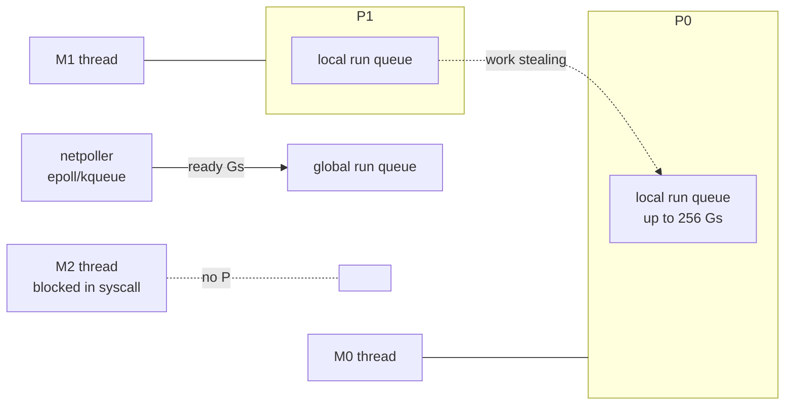
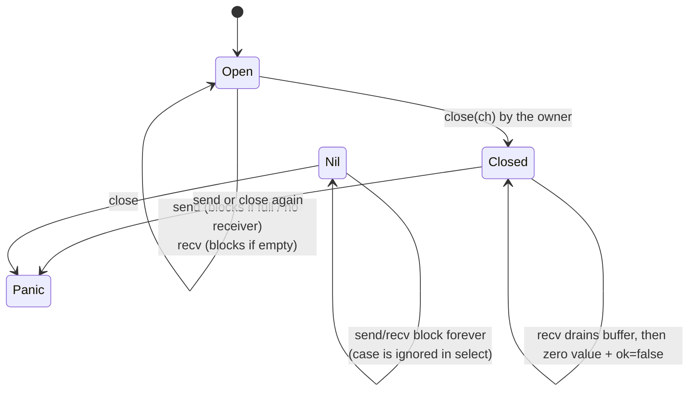
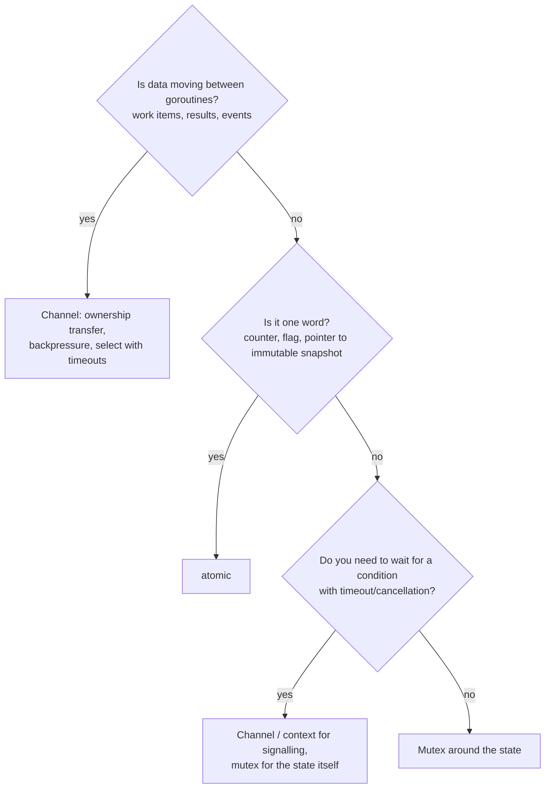

# B0 Unit 1 — Primitives and the memory model

> Time: ~6 h · CORE: §1–§5 · STRETCH: §6 · Labs: `labs/b0/batcher`, `labs/b0/safemap`, `labs/b0/breakit`

## Before you start

You need working Go (1.22+; the course pins `go 1.22` in `go.mod` and is tested with toolchain 1.24) and the
race detector, which needs cgo and a C compiler on Linux (`go env CGO_ENABLED` should print `1`). No earlier
module is required. This unit assumes you can write Go comfortably; it does not assume you have reasoned
carefully about what two goroutines can see of each other's writes.

Warm-up, from what you already know as a backend engineer (write the answers down first):

1. Your adapter service calls a vendor whose p50 is 80 ms and p99 is 800 ms. At 200 req/s, roughly how many
   vendor calls are in flight at once, at p50 and in a p99-ish bad minute?
2. A Java/Kotlin colleague says "a thread costs ≈ 1 MB of stack, so we cap the pool at 200". What changes about
   that reasoning in Go, and what does *not* change?
3. Name one bug you have seen in production that only happened under load.

<details data-kind="answer"><summary>Warm-up answers</summary>

1. Little's law (L = λ × W, see `docs/NUMBERS.md`): 200 × 0.08 ≈ 16 in flight at p50; if a bad minute pushes most
   calls towards 0.8 s, 200 × 0.8 ≈ 160. Concurrency is a *consequence* of latency. When the vendor slows down, your
   in-flight count rises 10× without a single extra request arriving. Unit 2 builds on this.
2. A goroutine starts with a small stack (≈ 2 KB in current Go, §1) that grows on demand, so 100k goroutines are
   affordable where 100k OS threads are not. What does not change: each in-flight call still holds a socket, a
   buffer, a DB connection, and a slot in the vendor's rate limit. The goroutine is cheap. What it holds is not.
3. Typical answers: a map shared between requests, a counter that was "close enough" until an audit, a
   connection pool that ran dry, a retry storm. All of these are concurrency bugs; most of them are this unit.

</details>

---

## §1 Goroutines and the scheduler

### The failure story

The audit service of a digital-banking platform writes one row per member action. Someone "optimises" the request
path by making the audit write asynchronous: `go audit.Write(ctx, event)`. At 2,000 req/s with a 5 ms insert this is
fine: Little's law says ≈ 10 goroutines alive at any moment. Then the audit database has a bad afternoon: inserts
take 3 s because of lock contention on an index. Now 2,000 × 3 ≈ 6,000 goroutines are alive, each holding a
connection attempt, an event struct and a request-scoped logger. The connection pool caps at 50, so 5,950 of them
queue inside `database/sql`. The service's RSS climbs from 300 MB to 4 GB in twenty minutes, the pod is OOM-killed,
and the restart loses every queued event. No goroutine "leaked" in the textbook sense. They were all going to
finish eventually. Cheap goroutines made unbounded concurrency *easy to write*. They did not make it free.

### Predict

<!-- predict id="B0-U1-P01" -->
**Predict.** Write down what this program prints, and why.

```go
package main

import "fmt"

func main() {
	go fmt.Println("hello")
}
```
<!-- /predict -->

<!-- predict id="B0-U1-P02" -->
**Predict.** With `GOMAXPROCS(1)`, does this program print `done`, hang forever, or crash? Does the Go version
matter?

```go
package main

import (
	"fmt"
	"runtime"
	"time"
)

func main() {
	runtime.GOMAXPROCS(1)
	go func() {
		for {
		}
	}()
	time.Sleep(10 * time.Millisecond)
	fmt.Println("done")
}
```
<!-- /predict -->

<!-- predict id="B0-U1-P03" -->
**Predict.** You start 100,000 goroutines that each block forever on a channel receive. Estimate the extra memory,
in MB, before reading on.
<!-- /predict -->

### Reveal

<details data-kind="reveal" data-for="B0-U1-P01">
<summary>Reveal</summary>

It almost always prints **nothing**. A Go program exits when `main` returns. It does not wait for other goroutines.
The `go` statement only schedules the call; `main` returns at once, and the process ends before the new goroutine
runs. "Sometimes prints hello" is possible in principle, which is worse: the result depends on scheduling. The
fix is to *wait for completion explicitly* (`sync.WaitGroup`, a channel, `errgroup`). Tempting wrong answer: "it
prints hello because goroutines start immediately". They don't. `go` makes the goroutine runnable. It does not run it.

</details>

<details data-kind="reveal" data-for="B0-U1-P02">
<summary>Reveal</summary>

On Go **1.14+** it prints `done`. On older Go it could hang forever. The spinning goroutine has no function calls,
so before 1.14 it had no *cooperative* preemption point. With one P (one thread running Go code), `main` never got
scheduled again after its sleep. Go 1.14 added **asynchronous preemption**: the runtime's monitor thread (`sysmon`)
notices a goroutine that has run for more than 10 ms (`forcePreemptNS` in `runtime/proc.go`) and interrupts it with
a signal. Tempting wrong answers: "crash" (nothing is wrong at the language level) and "hang" (true for old Go,
and still true in spirit if *every* P is busy spinning, because then nothing else gets CPU).

</details>

<details data-kind="reveal" data-for="B0-U1-P03">
<summary>Reveal</summary>

About **200–260 MB**. Measured on the course's reference box (Go 1.24, linux/amd64): 100k blocked goroutines added
≈ 205 MB of `StackInuse` (≈ 2 KB each) and ≈ 267 MB of total `Sys` (≈ 2.6 KB each, including the runtime's `g`
structs and bookkeeping). The minimum stack is 2,048 bytes (`stackMin` in `runtime/stack.go`). Since Go 1.19 the
*starting* size adapts to the average stack use the runtime has observed, so goroutines with deep call chains can
start bigger. Tempting wrong answers: "≈ 100 GB, like threads" (that is the 1 MB-per-thread intuition) and "a few
KB total" (goroutines are cheap, not free). In the failure story, 6,000 goroutines' *stacks* are only ≈ 15 MB. The
4 GB came from what they held.

</details>

### How it actually works

The runtime multiplexes many goroutines (**G**) onto a few OS threads (**M**) through **P**s (processors). A P is
the right to run Go code. There are `GOMAXPROCS` of them, which defaults to the number of CPUs. Since Go 1.25 the
default on Linux also respects the container's cgroup CPU limit. An M must hold a P to run Go code.



- **Run queues.** Each P has a local queue (a fixed array of 256 entries, `runq [256]guintptr` in
  `runtime/runtime2.go`) plus a `runnext` slot for the goroutine that was just woken, which helps ping-pong
  patterns. Overflow goes to a global queue. An idle P steals half of another P's queue.
- **Preemption.** Goroutines yield at blocking operations (channel ops, locks, I/O). Since 1.14 a goroutine that
  runs more than ≈ 10 ms without yielding is preempted asynchronously by a signal.
- **Network I/O does not block threads.** A goroutine reading from a socket that has no data is *parked*: its fd is
  registered with the netpoller (epoll on Linux) and the M picks up other work. This is why `net/http` can afford a
  goroutine per connection.
- **Blocking syscalls do block threads.** File I/O on Linux, cgo calls and some DNS lookups occupy the M. The
  runtime hands the M's P to another thread (spawning one if needed) so other goroutines keep running. This is why
  a Go process doing heavy disk I/O or cgo can have far more OS threads than `GOMAXPROCS` (the default thread cap
  is 10,000, `debug.SetMaxThreads`).
- **Stacks grow by copying.** A goroutine starts small (≈ 2 KB) and the runtime copies its stack to a block twice
  the size when it overflows, up to 1 GB on 64-bit (`fatal error: stack overflow`, "goroutine stack exceeds
  1000000000-byte limit"). Copying is why you cannot keep raw pointers into a goroutine's stack from C.

What a goroutine costs, then: ≈ 2–3 KB of memory and well under a microsecond to create and schedule (≈, measure
on your hardware), plus *everything it references*. Its biggest cost is the work it starts.

### Build it

No lab for this section; it is the mental model the labs rely on. Watch the scheduler on your own machine by
running any program that lives for a few seconds (for example the one in Break it below) with
`GODEBUG=schedtrace=1000`, which prints one line per second: `gomaxprocs`, `threads`, idle Ps, and run-queue
lengths.

### Break it

Save this as `main.go` in a scratch module and run it twice: `go run .` and `go run . syscall`. Predict the two
thread counts first.

```go
package main

import (
	"fmt"
	"os"
	"runtime/pprof"
	"sync"
	"syscall"
	"time"
)

func main() {
	blocking := len(os.Args) > 1 && os.Args[1] == "syscall"
	var wg sync.WaitGroup
	for i := 0; i < 200; i++ {
		wg.Add(1)
		go func() {
			defer wg.Done()
			if blocking {
				ts := syscall.Timespec{Sec: 1}
				_ = syscall.Nanosleep(&ts, nil) // a blocking syscall: pins an OS thread (Linux/macOS)
			} else {
				time.Sleep(time.Second) // parked by the runtime: no thread
			}
		}()
	}
	time.Sleep(500 * time.Millisecond)
	fmt.Println("threads created so far:", pprof.Lookup("threadcreate").Count())
	wg.Wait()
}
```

<details data-kind="answer"><summary>What you should see</summary>

On the reference box (4 vCPUs, Go 1.24): **6** threads for `time.Sleep`, **203** for `syscall.Nanosleep`.
Sleeping goroutines are parked by the runtime and use no thread. A goroutine in a blocking syscall takes its M into
the kernel with it, so the runtime creates more Ms to keep the Ps busy: one per blocked goroutine. Regular-file
reads, cgo calls and some DNS lookups behave like the syscall version. Network sockets behave like the sleep
version (netpoller). Lesson: "goroutines are cheap" holds for network-bound and timer-bound work. For blocking
syscalls and cgo, bound concurrency yourself (Unit 2 §2), or you hit `SetMaxThreads`' default of 10,000 and the
process dies.

</details>

### In the wild

- **`net/http` server.** `Server.Serve` accepts a connection and runs `go c.serve(connCtx)` (`net/http/server.go`):
  one goroutine per connection. That is only viable because idle keep-alive connections are parked in the
  netpoller and cost a small stack, not a thread.
- **Go runtime itself.** The GMP design (Dmitry Vyukov's scalable scheduler, Go 1.1) and async preemption (Go 1.14)
  are described in the runtime source comments at the top of `runtime/proc.go`. That is the authoritative
  reference, more than blog posts.
- **Containers.** Before Go 1.25, a Go process in a container limited to 2 CPUs on a 64-core node defaulted to
  `GOMAXPROCS=64`, which caused CFS throttling and latency spikes; `go.uber.org/automaxprocs` existed to fix that.
  Go 1.25 reads the cgroup CPU bandwidth limit itself (disabled if you set `GOMAXPROCS` explicitly).
  TODO-VERIFY: whether the 1.25 default is gated by the `go` line in `go.mod` (it has GODEBUG settings
  `containermaxprocs`/`updatemaxprocs`, and GODEBUG defaults usually follow the `go` line).

### Trade-offs

| Option | Wins when | Loses when | When the answer flips |
|---|---|---|---|
| Goroutine per task (unbounded) | Work is network-bound, arrival rate is bounded by something upstream (e.g. connections), and each task holds little | Tasks hold scarce resources (DB conns, vendor quota, file handles) or arrival can spike | As soon as a downstream slows down: in-flight = rate × latency, and latency is not yours to control |
| Fixed worker pool (N goroutines) | You need a hard cap on concurrency and a queue you can measure | Tasks are heterogeneous and a few slow ones starve the pool | When per-task latency varies 100×, a semaphore around goroutine-per-task (Unit 2 §2) is simpler and fairer |
| Raising `GOMAXPROCS` above CPUs | Almost never | Always adds contention and scheduling overhead | Heavy cgo or blocking-syscall workloads: fix with bounded concurrency, not GOMAXPROCS |

### Senior bar

- **Failure modes.** Unbounded goroutine creation under downstream slowness (memory, then OOM). Goroutines blocked
  forever (leaks, Unit 2 §3). CPU-bound goroutines starving latency-sensitive ones (GOMAXPROCS is shared by all of
  them). Thread explosion from blocking syscalls or cgo.
- **Numbers.** ≈ 2 KB minimum stack; ≈ 2.6 KB per idle goroutine measured all-in. 100k idle goroutines ≈ 250 MB.
  Preemption quantum ≈ 10 ms. Local run queue 256. Max stack 1 GB on 64-bit. Default max threads 10,000.
- **Ops.** `runtime.NumGoroutine()` as a gauge in every service (alert on slope, not level). `GODEBUG=schedtrace=1000`
  for scheduler state. `/debug/pprof/goroutine?debug=1` groups goroutines by identical stack with counts, which is
  how you find "48,213 goroutines in `audit.Write` waiting on `sql.(*DB).conn`".

**Interviewer probes**

<details data-kind="answer"><summary>"Goroutines are cheap, so why would you ever bound them?"</summary>

Because the goroutine is not the expensive part. Each one holds whatever its task holds: a DB connection, a socket,
request buffers, a slot in a vendor's rate limit. In-flight work equals arrival rate × latency, and I don't control
the latency of my dependencies. A cap turns "the vendor slowed down" into a queue or a fast rejection that I can
see and alert on, instead of memory growth that ends in an OOM kill.

</details>

<details data-kind="answer"><summary>"What happens when a goroutine makes a blocking syscall?"</summary>

The M (OS thread) blocks in the kernel with it. The runtime detaches the P from that M (sysmon retakes Ps from
threads that have been in a syscall for more than a short while) and gives it to another M, creating one if
needed, so other goroutines keep running. When the syscall returns, the goroutine needs a P again; if none is
free it goes on the run queue. Network I/O avoids all of this through the netpoller. Regular file I/O and cgo
don't, which is why they can inflate thread counts.

</details>

<details data-kind="answer"><summary>"Your service runs in a 2-CPU container on a 64-core node and p99 is spiky. Why might Go be involved?"</summary>

Before Go 1.25, `GOMAXPROCS` defaulted to the node's 64 CPUs, not the container's 2-CPU quota. The process runs up
to 64 threads of Go code, burns its CFS quota early in each period, and is throttled for the rest of it. That
shows up as periodic latency spikes. Fix: upgrade to a Go version that reads cgroup limits, or set `GOMAXPROCS`
(env var or automaxprocs). I would confirm with the container's throttling metrics (`nr_throttled` in cgroup
`cpu.stat`).

</details>

### Check yourself

1. Why can `net/http` use a goroutine per connection when a thread per connection is a classic scalability mistake?
2. Which part of the failure story's 4 GB was goroutine stacks, roughly?
3. What does `GOMAXPROCS` bound, and what does it not bound?

<details data-kind="answer"><summary>Answers</summary>

1. Idle connections are parked in the netpoller; a parked goroutine costs ≈ 2–3 KB and no thread. Threads cost ≈ MBs
   of reserved stack and kernel scheduling.
2. ≈ 6,000 × 2.6 KB ≈ 15 MB: under 1%. The rest was what the goroutines held and the queued requests.
3. It bounds how many threads execute Go code at the same moment. It does not bound goroutines, threads blocked in
   syscalls/cgo, or outstanding I/O.

</details>

---

## §2 Channels and `select`

### The failure story

The audit writer from §1 gets rewritten "properly": request handlers send events into
`events := make(chan Event, 10000)` and one background goroutine drains it into the database. Three things go wrong
over the next quarter:

1. During a DB failover (≈ 40 s), the buffer of 10,000 fills in ≈ 5 s at 2,000 events/s. Every handler's `events <-
   e` then blocks, and p99 latency of *member-facing* endpoints jumps from 120 ms to 35 s. Audit has taken the
   front door down.
2. Someone "fixes" that with `select { case events <- e: default: }`. Now during failover ≈ 70,000 audit events are
   silently dropped. In a regulated bank, that is an incident report.
3. On deploy, the process exits with up to 10,000 events still in the buffer.

The channel did not cause these bugs. Each one is a missing decision: what happens when the consumer is slower
than the producer (block, drop, or fail), and who drains on shutdown.

### Predict

<!-- predict id="B0-U1-P04" -->
**Predict.** What does this print?

```go
ch := make(chan int, 2)
ch <- 1
ch <- 2
close(ch)
for v := range ch {
	fmt.Print(v)
}
v, ok := <-ch
fmt.Println(v, ok)
```
<!-- /predict -->

<!-- predict id="B0-U1-P05" -->
**Predict.** What does each snippet do: print, block forever, or panic?

```go
// (a)
var ch chan int
select {
case v := <-ch:
	fmt.Println("got", v)
default:
	fmt.Println("default")
}

// (b)
var ch2 chan int
close(ch2)

// (c)
ch3 := make(chan int, 1)
close(ch3)
ch3 <- 1
```
<!-- /predict -->

<!-- predict id="B0-U1-P06" -->
**Predict.** A `select` has two ready cases: `case <-ctx.Done():` and `case job := <-jobs:`, and both are ready at
the same time on every iteration. Which one runs?
<!-- /predict -->

### Reveal

<details data-kind="reveal" data-for="B0-U1-P04">
<summary>Reveal</summary>

`120 false`. Closing a buffered channel does not discard its contents: receivers still get 1 and 2, then `range`
ends because the channel is closed *and empty*. A receive from a closed, empty channel returns the zero value
immediately with `ok == false`. Tempting wrong answers: "12 then panic" (receiving from a closed channel never
panics; *sending* does) and "nothing, close drops the buffer" (it doesn't).

</details>

<details data-kind="reveal" data-for="B0-U1-P05">
<summary>Reveal</summary>

(a) prints `default`. A nil channel is never ready, so its case is ignored, and `default` runs. Without `default`
the select would block forever. That "nil channel disables a case" behaviour is a feature: the batcher lab uses it
for "no timer running". (b) **panics**: `close of nil channel`. (c) **panics**: `send on closed channel`. Panic
rules to memorise: send on closed → panic; close of closed → panic; close of nil → panic; receive from closed →
zero value, ok=false; send or receive on nil → block forever.

</details>

<details data-kind="reveal" data-for="B0-U1-P06">
<summary>Reveal</summary>

Either: **select picks uniformly at random among ready cases**. It does not go in source order and has no priority.
So a worker that should stop on cancellation will, on average, process about one more job after `ctx` is done
(each iteration is a coin flip), and it may process several. If you need "stop promptly", check `ctx.Err()` at the
top of the loop or in a nested non-blocking select. The fanout lab has the same issue with a semaphore and a
deadline both ready. Tempting wrong answer: "the first case listed wins". That is true in some other languages'
`select`-like constructs, not in Go.

</details>

### How it actually works

A channel (`runtime/chan.go`, type `hchan`) is a mutex-protected struct holding a ring buffer of `cap` elements,
a queue of blocked senders (`sendq`), a queue of blocked receivers (`recvq`) and a `closed` flag.

- **Unbuffered (`cap == 0`)**: a send completes only when a receiver takes the value. The runtime copies the value
  directly from the sender's stack to the waiting receiver. It is a **synchronisation point**: after `ch <- v`
  returns, you know the receiver has the value.
- **Buffered**: a send completes when there is space in the buffer. It is a **queue with a capacity**: after `ch <- v`
  returns you know only that the value is buffered. The capacity is a decision about how much burst you absorb
  before backpressure.
- **Close** is a broadcast to receivers: every blocked and future receiver wakes. It is a signal from the *sender
  side* ("no more values"). Only the owner (the single sender, or whoever coordinates the senders) may close.
- **`select`** locks all involved channels, picks a random ready case, or (if none are ready and there is no
  `default`) enqueues the goroutine on every channel's wait queue and parks it.



Idioms you should be able to write from memory:

```go
// Timeout on one operation.
select {
case res := <-resultCh:
	use(res)
case <-ctx.Done():
	return ctx.Err()
}

// Non-blocking try (drop or fall back), make the drop VISIBLE.
select {
case events <- e:
default:
	droppedEvents.Add(1) // a metric, never a silent drop
}

// Disable a case dynamically with a nil channel (the batcher's run loop, simplified).
var timerC <-chan time.Time // nil: "no timer running", so this case can never fire
for {
	select {
	case it := <-in:
		batch = append(batch, it)
		if len(batch) == 1 {
			timerC = time.NewTimer(linger).C // the linger clock starts at the FIRST item
		}
	case <-timerC:
		flush(batch)
		batch, timerC = nil, nil // disabled until the next batch's first item
	}
}
```

The batcher you are about to build combines all three: an unbuffered hand-off for backpressure, a nil timer
channel, and a single owner goroutine.

### Build it

Lab: **`labs/b0/batcher`**. Implement `New`, `Add`, `Close` and the run loop in `batcher.go`.

- Flush when a batch reaches `MaxItems`, or `Linger` after the batch's **first** item, whichever comes first.
- `flush` is called from one goroutine only; the slice handed to it is never touched again.
- `Add(ctx, item)` blocks while the run loop is busy (backpressure) but gives up when `ctx` is done.
- `Close` flushes the remainder, waits for that flush, is idempotent and safe to call concurrently; `Add` after
  `Close` returns `ErrClosed`; every `Add` that returned `nil` is flushed exactly once.

Acceptance: `go test -race ./labs/b0/batcher/` (tests: ordering and slice ownership, linger measured from the first
item using an injectable fake clock, stale timer ignored, backpressure respects ctx, single flush goroutine, racing
`Add`/`Close` loses nothing, no goroutine leak).

### Break it

Once your batcher passes, change the hand-off channel from unbuffered to `make(chan T, 64)` and rerun the tests.
Predict which tests fail before you run them.

<details data-kind="answer"><summary>What fails and why</summary>

With the reference solution, four tests fail: "Add after Close returns ErrClosed" (a send into buffer space succeeds
even though the run loop is gone), "Add respects ctx under backpressure" (the buffer absorbs the send, so Add
returns nil instead of timing out), "racing Adds lose nothing" (items accepted into the buffer after the run loop's
last receive are never flushed: e.g. "616 Adds returned nil but 566 items were flushed"), and the linger test (Add
returns before the run loop has the item). With an unbuffered channel, "Add returned nil" **means** "the run loop
has the item", and closing `quit` wakes every parked `Add` before the run loop can observe it. That is why the
reference solution needs no drain loop. A buffered channel needs a drain-on-close *and* a guarantee that no send
lands after the drain, which is much harder to get right. That is the sense in which an unbuffered channel is a
synchronisation tool and not just a zero-size queue.

</details>

### In the wild

- **Kafka producer batching.** The Java producer accumulates records per partition and sends a batch when it
  reaches `batch.size` (default 16,384 bytes) or after `linger.ms`. That is exactly this lab's size-or-time rule.
  The `linger.ms` default changed from 0 to 5 ms in Apache Kafka 4.0 (per the `ProducerConfig` docs), because a few
  ms of latency buys much larger batches.
- **`time.Ticker` / `time.Timer`** deliver on channels. In this repo's `go 1.22` module the timer channels are still
  buffered (capacity 1, the pre-1.23 behaviour, see Unit 2 §6). That is one reason the batcher stops its timer and
  sets the channel to nil instead of trusting a late tick.
- **`net/http`**: `Request.Context().Done()` is a channel closed when the client goes away: close-as-broadcast.

### Trade-offs

| Option | Wins when | Loses when | When the answer flips |
|---|---|---|---|
| Unbuffered channel | You need hand-off semantics ("receiver has it") and natural backpressure | Producer and consumer are bursty and you want to smooth bursts | When a measured burst profile says a small buffer removes most blocking without hiding a slow consumer |
| Buffered channel, cap N | Absorbing known bursts (N ≈ burst size), decoupling a fast producer from a briefly slow consumer | N is chosen as "big, to be safe": it hides a slow consumer until it's full, then blocks anyway, and loses N items on crash | When the consumer is *persistently* slower: no buffer size helps; you need backpressure or shedding |
| Drop on full (`select default`) | Telemetry, best-effort metrics, where losing some data beats slowing requests | Anything audited, financial, or required for correctness | Never drop silently: count drops and alert |
| Mutex + slice | Batch state is touched by many goroutines in different ways (inspection, metrics) | You need blocking/timeout semantics, which channels give you for free | When you need `select` with timers and ctx, the channel/owner-goroutine design is simpler |

### Senior bar

- **Failure modes.** Buffer fills and blocks callers (latency coupling). Silent drops. Data loss on shutdown.
  Close by a non-owner causes `send on closed channel` panics. Range over a channel that is never closed blocks
  forever (a leak or deadlock). A stale timer tick flushes the wrong batch.
- **Numbers.** Batching 100 events per INSERT turns 2,000 inserts/s into ≈ 20. With Linger = 50 ms, the worst-case
  added latency for an event is ≈ 50 ms plus one flush. A channel op costs on the order of tens to a few hundred ns
  (≈, contention-dependent; benchmark it). That is irrelevant next to a 5 ms insert, but not next to a map lookup.
- **Ops.** Export buffer depth (`len(ch)` is a racy-but-useful gauge), drop counters and flush latency. On shutdown:
  stop intake, drain, flush, then exit. Budget that within the platform's termination grace period (Unit 2 §5).

**Interviewer probes**

<details data-kind="answer"><summary>"Why not just make the channel buffered with 100k capacity?"</summary>

A buffer only absorbs a *temporary* rate mismatch. If the consumer is persistently slower, a 100k buffer just
delays the moment producers block. Meanwhile it holds up to 100k events in memory that a crash or deploy loses,
and it hides the problem from monitoring. I size buffers from a burst estimate (burst rate × burst duration), keep
them small, and handle the full case explicitly: block with a deadline, shed with a metric, or spill to durable
storage.

</details>

<details data-kind="answer"><summary>"Who closes the channel when there are several senders?"</summary>

None of the senders. Closing is the "no more values" signal, and with multiple senders no single one knows that.
I add a coordinator: senders are tracked by a `WaitGroup`, and one goroutine does `wg.Wait(); close(ch)`. That is
the `Merge` pattern in the pipeline lab. For a "stop" signal going the other way (consumer to producers), I use a
separate `done` channel or a context, never close the data channel from the receiving side.

</details>

<details data-kind="answer"><summary>"How do you test the linger behaviour without sleeping in tests?"</summary>

Inject the clock. The batcher takes a `NewTimer func(d) (<-chan time.Time, stop func() bool)`. The test's fake
records each requested duration and hands back a channel the test fires by hand. Then "no flush before linger" is
deterministic (nothing can fire), and "flush after linger" is one send. I keep one test on the real clock with a
short linger and a generous upper bound, to prove the default wiring works.

</details>

### Check yourself

1. What two things does a *successful* unbuffered send tell you that a buffered send does not?
2. Why is `for v := range ch` a potential leak?
3. In the batcher, why is the timer channel variable set to `nil` after a flush?

<details data-kind="answer"><summary>Answers</summary>

1. That a receiver has the value now, and (therefore) that the receiver was alive and ready. Ordering/visibility
   follow from the memory model (§4): the send happens before the receive completes.
2. It ends only when the channel is closed. If the producer exits without closing (or blocks forever), the ranging
   goroutine blocks forever.
3. So the select stops listening to a timer from a batch that was already flushed by size: a nil channel disables
   that case until the next batch's first item starts a new timer.

</details>

---

## §3 Locks and the `sync` toolbox

### The failure story

The SSO adapter caches vendor access tokens in a `map[string]token` keyed by tenant (credit union). The cache was
written for a single-tenant pilot and has no lock. In production, 40 credit unions refresh tokens concurrently at
the top of each hour. One night at 03:00 the service dies with:

```
fatal error: concurrent map writes
```

It is a `fatal error`, not a panic: `recover` cannot catch it, and every in-flight request on the pod is lost. The
fix-in-a-hurry wraps the map in one `sync.Mutex`. That works, but at peak 6,000 req/s all reading tokens, the single
lock's cache line bounces between all cores, and a profile shows ≈ 15% of CPU in `sync.(*Mutex).Lock`. Someone
proposes `sync.Map`; someone else proposes sharding; someone proposes `RWMutex`. Which one, and how would you know?

### Predict

<!-- predict id="B0-U1-P07" -->
**Predict.** What does this print? What would `go vet` say?

```go
type Counter struct {
	mu sync.Mutex
	n  int
}

func (c Counter) Inc() { c.mu.Lock(); c.n++; c.mu.Unlock() }

func main() {
	var c Counter
	c.Inc()
	c.Inc()
	fmt.Println(c.n)
}
```
<!-- /predict -->

<!-- predict id="B0-U1-P08" -->
**Predict.** Does this program finish? (A goroutine re-acquires a read lock it already holds while a writer is
waiting.)

```go
var mu sync.RWMutex
mu.RLock()
go func() { mu.Lock(); fmt.Println("writer"); mu.Unlock() }()
time.Sleep(10 * time.Millisecond)
mu.RLock() // recursive read lock
fmt.Println("second read lock")
mu.RUnlock()
mu.RUnlock()
```
<!-- /predict -->

<!-- predict id="B0-U1-P09" -->
**Predict.** `once.Do(f)` is called three times in a loop; `f` prints `init attempt` and then panics; each call
is wrapped in a function that recovers. How many times is `init attempt` printed?
<!-- /predict -->

### Reveal

<details data-kind="reveal" data-for="B0-U1-P07">
<summary>Reveal</summary>

It prints `0`. `Inc` has a **value receiver**, so each call increments a copy, including a copy of the mutex.
`go vet` (the `copylocks` check) reports `Inc passes lock by value: <pkg>.Counter contains sync.Mutex`. Any type that
contains a `sync.Mutex`, `WaitGroup`, `Once`, `Cond`, `atomic.Int64` etc. must not be copied after first use; use
pointer receivers and pass pointers. Tempting wrong answer: "2". Correct only with `func (c *Counter) Inc()`.

</details>

<details data-kind="reveal" data-for="B0-U1-P08">
<summary>Reveal</summary>

It **deadlocks**: `fatal error: all goroutines are asleep - deadlock!` with main in `[sync.RWMutex.RLock]`.
`RWMutex` is writer-preferring. Once a writer is waiting in `Lock`, new `RLock` calls block until that writer has
acquired *and released* the lock (this is documented: recursive read locking is prohibited). The writer waits for
the first read lock to be released, which never happens. Tempting wrong answer: "read locks are shared, so the
second RLock succeeds". It does when no writer is waiting, which is why this bug passes tests and fails under load.

</details>

<details data-kind="reveal" data-for="B0-U1-P09">
<summary>Reveal</summary>

**Once.** If `f` panics, `Do` considers it to have returned. Later calls return without calling `f`, so the
"initialised" thing stays uninitialised forever. For a vendor client initialised lazily, that means one network
blip at startup leaves every later request with a nil client. If initialisation can fail, use `sync.OnceValues`
(Go 1.21+) to cache the error explicitly, or a mutex plus a "succeeded" flag if you want retries.

</details>

### How it actually works

- **`sync.Mutex`** is a word of state plus a semaphore. The fast path is one atomic compare-and-swap (≈ 15–25 ns
  uncontended lock+unlock, per `docs/NUMBERS.md`). Under contention a waiter spins briefly, then parks. If a waiter
  has waited more than 1 ms (`starvationThresholdNs` in `internal/sync/mutex.go`), the mutex switches to
  **starvation mode** and hands ownership directly to the oldest waiter. That favours fairness over throughput. Not
  re-entrant: locking twice in the same goroutine deadlocks. Unlocking an unlocked mutex is `fatal error: sync:
  unlock of unlocked mutex` (unrecoverable).
- **`sync.RWMutex`** lets many readers or one writer in. Every `RLock`/`RUnlock` still does an atomic add on a shared
  reader count, so it does **not** remove cache-line contention between readers. It only lets them run in parallel
  *while they hold the lock*. If the critical section is a 20 ns map lookup, `RWMutex` is often no faster than
  `Mutex`, and its writer-preference creates the recursive-RLock deadlock above.
- **`sync.WaitGroup`**: a counter. `Add` before starting the goroutine, `Done` in a `defer`, `Wait` blocks until
  zero. A negative counter panics (`sync: negative WaitGroup counter`). Go 1.25 adds `wg.Go(f)`, which does the
  Add/Done pairing for you (not available under this repo's go 1.22 line).
- **`sync.Once`**, **`sync.OnceFunc/OnceValue/OnceValues`** (Go 1.21): run initialisation exactly once, with a
  happens-before edge from the init to every `Do` return.
- **`sync/atomic`** typed values (`atomic.Int64`, `atomic.Bool`, `atomic.Pointer[T]`, Go 1.19): single-word
  read/write/add/CAS with sequentially consistent ordering in Go's memory model. Good for counters, flags, and
  swapping an immutable config snapshot (`atomic.Pointer[Config]`). Bad for multi-field invariants: two atomics are
  not one transaction.
- **`sync.Map`**: per its docs, optimised for two cases: (1) keys written once and read many times (caches that only
  grow), and (2) goroutines working on disjoint key sets. Otherwise a plain map with a lock is recommended, for
  type safety and for keeping other invariants. In Go 1.24 the implementation was replaced by a concurrent hash-trie
  (`internal/sync.HashTrieMap`, see `sync/hashtriemap.go`). Its reads don't write shared memory, which is why it
  scales on read-heavy loads (§6).
- **`sync.Cond`**: wait for a condition with `Wait` in a `for !cond {}` loop, `Signal`/`Broadcast` on change. Rarely
  the right tool in Go; a channel close (broadcast) or a channel per waiter is usually clearer. Its one real
  advantage is waking waiters repeatedly without allocating new channels.
- **Sharding** splits one hot lock into N locks by hashing the key. It reduces *waiting* for a held lock. It does
  not remove the per-op cost of hashing and of writing a lock word on every op; §6 measures what that means in
practice, with a surprising result.

### Build it

Lab: **`labs/b0/safemap`**: a generic `ShardedMap[K comparable, V any]`.

- `New(shards, hash)`: round shards up to a power of two so `shardFor` is `hash & mask`; seed with
  `maphash.MakeSeed()` (a random seed per map defeats hash-flooding inputs).
- `Get`, `Set`, `Delete`, `Len`, `ShardLens`, `Shards`.
- `Update(key, fn)`: atomic read-modify-write under **one** write lock. A Get-then-Set implementation passes every
  single-goroutine test and loses increments under concurrency, and `-race` will not flag it, because each call is
  individually locked. The test `TestUpdate_ConcurrentIncrementsAreNotLost` catches it.
- `Range(fn)`: copy a shard under its read lock, release, *then* call `fn`, so `fn` may call back into the map
  (`TestRange_CallbackMayMutateMapWithoutDeadlock`).

Acceptance: `go test -race ./labs/b0/safemap/`.

### Break it

1. In your `Update`, replace the single locked section with `old, ok := m.Get(k); v, keep := fn(old, ok); m.Set(k, v)`.
   Run the tests with and without `-race`. Predict whether `-race` complains.
2. Make `Range` call `fn` while holding the shard's read lock, and run the tests.
3. Run `go run -tags breakit ./labs/b0/breakit/mapwrites` (no `-race`) and read the crash.

<details data-kind="answer"><summary>What you should see</summary>

1. `TestUpdate_ConcurrentIncrementsAreNotLost` fails ("N increments were lost"), and **`-race` reports nothing**.
   Every memory access is protected by a lock, so there is no *data race*. There is a *race condition*: a logical
   check-then-act across two critical sections. The race detector finds the first kind only.
2. `TestRange_CallbackMayMutateMapWithoutDeadlock` fails with its "did not finish within 5s" message: `fn` calls
   `Set`, which needs the write lock on a shard whose read lock this goroutine already holds. RWMutex is not
   re-entrant, so it self-deadlocks. Rule: never call user code while holding your lock.
3. `fatal error: concurrent map writes` and a goroutine dump. The runtime has a cheap built-in check for map
   writes during writes (a flag in the map header). It is best-effort, so it does not catch every race, and it is
   fatal, so it kills the process. The race detector would report it as a DATA RACE first.

</details>

### In the wild

- **Go runtime maps** detect concurrent writes with a "writing" flag in the map header (`internal/runtime/maps` in
  Go 1.24; older versions called it `hashWriting`) and `fatal("concurrent map writes")`. That is the 03:00 crash.
- **`database/sql.DB`** guards its pool with one mutex and hands out connections. Contention there is rare because
  the critical section is tiny next to the query.
- **Prometheus `client_golang`** counters use atomics for the hot path. Caffeine (Java) and Ristretto (Go) caches
  use striping/sharding plus buffered, lossy access recording to avoid a global lock. TODO-VERIFY: Ristretto's
  current internal design details before quoting them.
- **`expvar` and `sync.Map`**: the standard library itself uses `sync.Map` for registries that are written rarely and
  read often, which is case (1) of its doc comment.

### Trade-offs

| Option | Wins when | Loses when | When the answer flips |
|---|---|---|---|
| `map` + `sync.Mutex` | Default. Mixed reads/writes, multi-field invariants, small critical sections | One lock becomes a measured hotspot under high parallelism | Profile shows lock contention (mutex profile, `sync.(*Mutex).Lock` in CPU profile) |
| `map` + `sync.RWMutex` | Read-mostly with *long* read critical sections (iteration, serialization) | Short critical sections (no gain, extra cost), any re-entrant read path (deadlock) | When readers hold the lock long enough that they would otherwise queue |
| `sync.Map` | Grow-only caches, disjoint key sets per goroutine, read-heavy loads (lock-free reads) | Heavy overwrite/delete churn, need for `Len` or consistent iteration, type safety | Measure. On the reference box it beat a single RWMutex 2× at 4 CPUs for 90% reads |
| Sharded map | Many writers on different keys, non-trivial critical sections (`Update` with work) | Tiny critical sections, where per-op overhead can outweigh the waiting saved (32 shards lost to one RWMutex in §6) | When `Update` holds the lock for work: sharding cut ns/op ≈ 2× at 4 CPUs in §6's benchmark |
| `atomic.Pointer[T]` copy-on-write | Config/routing tables: read on every request, replaced rarely | Frequent writes (each write copies the whole structure) | When the write rate × structure size becomes real allocation pressure |

### Senior bar

- **Failure modes.** Unlocked maps (fatal). Value receivers copying locks (silent). Recursive RLock with a pending
  writer (deadlock under load only). `Once` that swallows a failed init. Calling callbacks or doing I/O under a lock
  (one slow vendor call holds every caller hostage). Lock ordering inversions across two mutexes (A then B in one
  path, B then A in another).
- **Numbers.** Uncontended mutex ≈ 15–25 ns. Contended can be µs, plus parking. Starvation mode after 1 ms of
  waiting. On a 4-vCPU VM, a single RWMutex map under a 90%-read mix went from ≈ 16 ns/op on 1 CPU to ≈ 28 ns/op on 4
  (aggregate throughput *fell* as CPUs were added), while `sync.Map` went from ≈ 34 to ≈ 16 ns/op (§6).
- **Ops.** `runtime.SetMutexProfileFraction(n)` plus `/debug/pprof/mutex` shows where goroutines wait on locks;
  `/debug/pprof/block` shows channel and lock blocking. Both are off by default because they have overhead.

**Interviewer probes**

<details data-kind="answer"><summary>"Why not RWMutex everywhere reads dominate?"</summary>

Because `RLock` still does an atomic write on a shared counter. For a short critical section the cost is that
cache line bouncing between cores, which `RWMutex` doesn't fix, and it adds overhead plus writer-preference
semantics that make recursive read locking a deadlock. `RWMutex` wins when readers hold the lock long enough that
they would otherwise *queue*. I would benchmark with `-cpu 1,4,8` before choosing.

</details>

<details data-kind="answer"><summary>"Your Update calls a user callback under the lock. What are the risks?"</summary>

The callback could be slow, which holds every other caller of that shard. It could call back into the map, which
deadlocks because locks aren't re-entrant. It could panic, which is why I `defer Unlock()` in `Update` so a panic
doesn't leave the shard locked forever. I document that `fn` must be fast and must not touch the map. For `Range`
I avoid the problem by copying under the lock and calling `fn` outside it.

</details>

<details data-kind="answer"><summary>"Two atomics or one mutex for a balance and a version number?"</summary>

One mutex, or one atomic pointer to an immutable struct. Two atomics give no atomicity across both fields: a reader
can see the new balance with the old version. Atomics are for single-word facts. Multi-field invariants need a
lock or copy-on-write.

</details>

### Check yourself

1. Why does `-race` not catch a lost update in a Get-then-Set `Update`?
2. What does `go vet`'s copylocks check catch?
3. Name the two use cases `sync.Map`'s documentation says it is optimised for.

<details data-kind="answer"><summary>Answers</summary>

1. There is no unsynchronised memory access, only a logical race across two separately locked operations. The race
   detector finds data races, not atomicity violations.
2. Copying values that contain locks (or other `noCopy` types): value receivers, passing by value, range copies,
   assignments.
3. Keys written once and read many times (grow-only caches), and goroutines reading/writing disjoint key sets.

</details>

---

## §4 The memory model and the race detector

### The failure story

A rate-limit adapter keeps the current vendor limits in a package-level `var limits *Limits`. A background goroutine
refreshes it every minute from the vendor's API with `limits = fresh`; request handlers read `limits.PerSecond`.
"Pointer writes are atomic on amd64," says the reviewer, and the code ships. Months later, an ARM-based node pool is
introduced to save cost. A handler occasionally sees a `Limits` whose fields are still zero, because the struct
initialisation was not guaranteed visible before the pointer. The adapter allows unlimited calls, and a vendor
bills the platform for 2.3 M overage calls in a weekend. The code was racy on amd64 too; it just happened to work.

### Predict

<!-- predict id="B0-U1-P10" -->
**Predict.** What can this program do? List every outcome you think is allowed.

```go
var data int
var ready bool

func main() {
	go func() {
		data = 42
		ready = true
	}()
	for !ready {
	}
	fmt.Println(data)
}
```
<!-- /predict -->

<!-- predict id="B0-U1-P11" -->
**Predict.** A test suite runs green with `go test -race ./...` on every CI build for a year. Does that prove the
code has no data races?
<!-- /predict -->

### Reveal

<details data-kind="reveal" data-for="B0-U1-P10">
<summary>Reveal</summary>

It is a **data race**, so the Go memory model gives you only weak guarantees. Allowed outcomes include: printing
`42`; printing `0` (the write to `ready` may become visible before the write to `data`, through compiler or CPU
reordering); and **looping forever** (nothing obliges the compiler to re-read `ready` inside a loop with no
synchronisation, so it may hoist the load). When we ran it with Go 1.24 on amd64 it printed `42`, which proves
nothing. `go run -race` reports the race. Fix: `ready` as an `atomic.Bool`, or a channel/WaitGroup. Each creates a
happens-before edge from `data = 42` to the read. Tempting wrong answer: "always 42, because writes happen in
program order". They do *within* a goroutine. Other goroutines only see that order through synchronisation.

</details>

<details data-kind="reveal" data-for="B0-U1-P11">
<summary>Reveal</summary>

No. The race detector reports races that **actually happen during that run** (per its documentation: it "only
finds races that happen at runtime, so it can't find races in code paths that are not executed"). A race on a
path your tests never execute concurrently, such as an error path, a rare timer, or a config reload, is invisible.
The detector has no false positives in practice: if it reports a race, you have one. A clean run is evidence, not
proof. Improve the odds with tests that run real concurrent callers, `-count=N`, and running a `-race` build in a
staging or canary environment under realistic traffic.

</details>

### How it actually works

The Go memory model (`go.dev/ref/mem`; also shipped as `doc/go_mem.html` in your Go installation) defines a
**data race** as a write to a memory location happening concurrently with another read or write to that location,
unless all accesses are atomic. Its core promise is **DRF-SC**: if your program has no data races, it behaves as if
all goroutines' operations were interleaved in some sequential order. With a race, you lose that. Go does give
somewhat more than C/C++ (a racy word-sized read sees *some* value actually written, not "anything"). But multi-word
values like interfaces, slices and strings can be torn, and you should treat any race as a bug.

**Happens-before** edges you can rely on (simplified):

| Synchronisation | Edge |
|---|---|
| `go f()` | the `go` statement happens before `f` starts |
| channel send | a send happens before the corresponding receive completes |
| channel close | close happens before a receive that returns because the channel is closed |
| unbuffered channel | a receive happens before the corresponding send completes |
| buffered channel, cap C | the k-th receive happens before the (k+C)-th send completes (this is what makes a buffered channel a counting semaphore) |
| `sync.Mutex` | the n-th `Unlock` happens before the (n+1)-th `Lock` returns |
| `sync.Once` | the completion of `f` happens before any `Do(f)` returns |
| `sync/atomic` | atomic operations behave as sequentially consistent: an atomic write observed by an atomic read creates an edge |
| `WaitGroup` | `Done` happens before the `Wait` it unblocks returns |

So in the failure story, the fix is `var limits atomic.Pointer[Limits]` with `limits.Store(fresh)` and
`limits.Load()`. The store happens before the load that observes it, so every field written before `Store` is
visible.

**The race detector** (`-race`) is ThreadSanitizer compiled into your binary. It instruments every memory access
and tracks happens-before with vector clocks. Per the Go documentation, typical overhead is **5–10× memory and
2–20× execution time**. It needs cgo. Since Go 1.19 it uses TSan v3 on most platforms (≈ 1.5–2× faster than v2,
half the memory, and no limit on simultaneously alive goroutines). It also allocates an extra 8 bytes per `defer`
and `recover` that is not freed until the goroutine exits. What it **cannot** do: find races on paths not executed,
find logical races (check-then-act across two locked sections, §3), find deadlocks, or find leaks. Its report shows
both accesses (the current one and the "Previous write at"), with stacks and where each goroutine was created.

### Build it

Lab: **`labs/b0/breakit`** (build tag `breakit`). Run the race exercises one at a time:

```sh
go test -race -tags breakit -run '^TestRacyCounter$' ./labs/b0/breakit/
go test -race -tags breakit -run '^TestRacyLazyInit$' ./labs/b0/breakit/
go test -race -tags breakit -run '^TestWaitGroupAddInsideGoroutine$' ./labs/b0/breakit/
```

Read each report, then fix the code: `atomic.Int64` or a mutex for the counter, `sync.Once`/`sync.OnceValue` for
the lazy init, and `wg.Add(1)` before `go`. Done when all three pass under `-race`. Expected output is in
`labs/b0/README.md`.

### Break it

Run `TestRacyCounter` **without** `-race` (`go test -tags breakit -run '^TestRacyCounter$' ./labs/b0/breakit/`)
five times. Predict how many runs fail.

<details data-kind="answer"><summary>What you should see</summary>

On the reference box it **passed every time** without `-race`: each goroutine's 1,000 increments finish within its
first time slice, so they rarely interleave. Under `-race` (which slows everything and changes scheduling) the
same test lost ≈ 20% of the increments *and* printed `WARNING: DATA RACE`. Lesson: a racy test that passes is
normal. Never accept "it passed 1,000 times" as evidence of safety. Raise the iteration count to 1,000,000 and it
will fail without `-race` too.

</details>

### In the wild

- **Go's own CI** runs the standard library tests under `-race` on its builders. Many Go shops run `go test -race`
  in CI and some ship a `-race` canary binary; the 5–10× memory cost is why nobody runs it fleet-wide.
- **Kubernetes** runs its unit tests with `-race` in CI. TODO-VERIFY: current Kubernetes `make test` race defaults.
- **Interfaces and torn reads.** An interface value is two words (type, data). A racy write can let a reader see the
  new type word with the old data word, which crashes with confusing errors far from the race. This is the classic
  "races in Go are not benign" argument.

### Trade-offs

| Option | Wins when | Loses when | When the answer flips |
|---|---|---|---|
| Channels for handoff | Ownership transfer: after the send, the receiver owns the value | Shared state many goroutines read in place | When you find yourself sending pointers and still locking, use a mutex |
| Mutex | Protecting an invariant over several fields | Very hot single-word counters/flags | When profiling shows the lock hot and the state is one word: atomics |
| Atomics | Counters, flags, pointer-swap of immutable snapshots | Anything multi-field; code readers must reason about ordering | When a second field joins the invariant, go back to a mutex |
| `-race` everywhere in CI | Catching races before prod; cheap relative to an incident | Slower CI (2–20×), more memory | Run `-race` on the concurrency-heavy packages every build, full suite nightly, if CI time is the constraint |

### Senior bar

- **Failure modes.** Benign-looking races (flags, "it's just a pointer") that become real on another architecture or
  compiler version. Torn interface/slice/string reads. Tests that never exercise concurrency, so `-race` sees
  nothing.
- **Numbers.** `-race` ≈ 5–10× memory, ≈ 2–20× CPU (Go docs). Atomic load ≈ same cost as a plain load on x86; atomic
  add/CAS ≈ tens of ns under contention (≈, cache-line transfer).
- **Ops.** CI: `go test -race -count=1 ./...` for concurrency packages. A crash with a confusing nil dereference in
  code that "can't be nil" should make you suspect a race: reproduce under `-race`.

**Interviewer probes**

<details data-kind="answer"><summary>"Is a race on a bool flag really a problem?"</summary>

Yes. Formally, a racy program loses the sequential-consistency guarantee: the compiler may hoist the read out of a
loop (infinite loop), and other writes made before setting the flag may not be visible when the flag is seen. In
practice it might work on amd64 today and break on ARM or after a compiler change. `atomic.Bool` costs essentially
nothing on the read side and makes the intent explicit. I don't keep "benign" races in a banking codebase.

</details>

<details data-kind="answer"><summary>"What does the race detector not catch?"</summary>

Races on paths that didn't execute concurrently in that run. Logical races (check-then-act across two critical
sections). Deadlocks. Goroutine leaks. Races in code it doesn't instrument, such as memory written by C code via
cgo. It is sound for what it observes and blind to everything else. So I pair it with concurrency-focused tests,
leak checks and `-count`.

</details>

### Check yourself

1. Which happens-before edge makes a buffered channel of capacity N usable as a semaphore?
2. What's the difference between a data race and a race condition?
3. Fix the `limits` pointer from the failure story in one line of declarations.

<details data-kind="answer"><summary>Answers</summary>

1. The k-th receive happens before the (k+N)-th send completes: at most N sends can be "inside" without a matching
   receive.
2. A data race is unsynchronised concurrent access to the same memory with at least one write (the detector finds
   these). A race condition is a correctness bug that depends on timing, possibly with every access properly
   locked (lost updates across two critical sections).
3. `var limits atomic.Pointer[Limits]`, with `limits.Store(fresh)` in the refresher and `limits.Load()` in handlers;
   never mutate a `*Limits` after storing it.

</details>

---

## §5 Channels or mutexes? Choosing the tool

### The failure story

Two engineers build the same vendor-session registry. Engineer A follows the proverb "share memory by
communicating" and builds a goroutine that owns the map and serves requests over channels: `getCh`, `setCh`,
`deleteCh`, each carrying a reply channel. It works, but every lookup is two channel operations and a goroutine
switch (≈ several hundred ns, and it serialises all lookups on one goroutine). When that goroutine blocks on a
slow log write, *every* request in the service stalls behind it. Engineer B uses a mutex around a map, then adds
"refresh session if expiring" logic inside the lock, which includes an HTTP call to the vendor. Now one slow vendor
call holds the lock for 2 s, and every request stalls. Both designs fail the same way: a single serialisation
point doing slow work. The tool was not the problem.

### Predict

<!-- predict id="B0-U1-P12" -->
**Predict.** For each, pick channel/owner-goroutine or mutex, and say why in one line:
(a) a per-tenant request counter read by a metrics endpoint; (b) handing each incoming file to exactly one of 8
parsers; (c) a "first error wins, cancel everyone" signal; (d) an LRU cache with `Get` that moves an entry to the
front.
<!-- /predict -->

### Reveal

<details data-kind="reveal" data-for="B0-U1-P12">
<summary>Reveal</summary>

(a) **Atomics or a mutex**: state shared and read in place, nothing to transfer. (b) **Channel**: work
distribution and ownership transfer; the receiver owns the file after the receive. (c) **Channel close / context
cancel**: a one-to-many broadcast (`sync.Once` + `close(done)`, or `context.WithCancelCause`). (d) **Mutex**: `Get`
mutates shared structure (list + map) under one invariant, and the critical section is a few pointer swaps.
Tempting wrong answers: "channels for everything, it's idiomatic" (the proverb is about *design*, not a ban on
mutexes; the Go standard library is full of mutexes), and "mutex for (b)" (you would be rebuilding a queue badly).

</details>

### How it actually works

The Go proverb "Don't communicate by sharing memory; share memory by communicating" is about **ownership**. A
channel transfers ownership of data from one goroutine to another, so at any moment exactly one goroutine may touch
it, and you need no lock. A mutex protects data that stays where it is while many goroutines take turns.

A practical decision rule:



Signals belong to channels and contexts: done, cancel, "first result", shutdown. `select` composes them with
timeouts. A mutex cannot be part of a `select`. Invariants over state belong to mutexes. Rules that hold for both:
never do I/O or call unknown code while holding the serialisation point; keep the critical section (or the owner
goroutine's per-message work) to microseconds.

### Build it

No new lab. Revisit your two Unit 1 labs and write down, in two sentences each, why the batcher uses an
owner goroutine plus channels and the safemap uses mutexes. You will need this articulation in the machine-coding
round (Unit 2 §7) and in the design exercise.

### Break it

Re-implement `safemap.Get`/`Set` as requests to a single owner goroutine over channels (a 30-line throwaway in a
`_test.go` file is enough) and benchmark it against your sharded map with `-cpu 1,4`. Predict the ratio.

<details data-kind="answer"><summary>What you should see</summary>

The owner-goroutine version is typically several times slower per op (≈ hundreds of ns: two channel operations,
a reply channel allocation unless you pool it, and a goroutine hand-off) and does **not** scale with CPUs, because
one goroutine serialises everything. Exact numbers vary by machine. The point is the shape: an owner goroutine is
right for coordination (the batcher), wrong for a hot shared index.

</details>

### In the wild

- **`net/http`'s `Transport`** keeps its idle-connection pool under a mutex and hands connections out. Waiters for a
  connection get a channel-based "wantConn" mechanism. That is both tools, each where it fits. TODO-VERIFY: the
  exact internal names in your Go version (`net/http/transport.go`).
- **`database/sql`**: mutex-protected pool state, plus a channel per waiting request to hand over a freed connection
  (`connRequests` in `database/sql/sql.go`). Callers waiting for a connection honour their `ctx`.
- **`context`**: cancellation is a closed channel (`Done()`), state is mutex-protected internally.

### Trade-offs

| Option | Wins when | Loses when | When the answer flips |
|---|---|---|---|
| Owner goroutine + channels | Coordinating timers, cancellation and sequencing; state machine with one writer | Hot read paths; a slow message blocks everyone; more goroutines to shut down | When the owner's per-message work is not trivially fast, or reads dominate |
| Mutex-protected struct | Shared state with invariants, read/written in place, short critical sections | Waiting with timeouts (cannot `select` on a lock); long critical sections | When you need "wait until X or ctx done", add a channel for the signal |
| Atomic snapshot (`atomic.Pointer`) | Read-mostly config/tables | Frequent writes | When writes are frequent enough that copying hurts |

### Senior bar

- **Failure modes.** The single owner goroutine as a hidden global lock. I/O under a mutex. Mixing both on the same
  state (half the code locks, half sends messages), so neither protects it.
- **Numbers.** Uncontended mutex ≈ 20 ns vs channel round-trip with goroutine switch ≈ hundreds of ns (≈, measure).
  Neither matters next to a 5 ms DB call. Both matter in a hot index.
- **Ops.** Owner goroutines need explicit shutdown (a `quit` channel) and show up in goroutine dumps by name. Mutex
  waits show up in the mutex profile.

**Interviewer probes**

<details data-kind="answer"><summary>"Isn't using a mutex un-idiomatic Go?"</summary>

No. The proverb is about designing ownership. The standard library uses mutexes everywhere: `sync.Map` internals,
`database/sql`, `net/http`. I use channels to move work and signals between goroutines and mutexes to guard state
that stays put. The question I ask is "is data moving, or is it shared in place?"

</details>

<details data-kind="answer"><summary>"Your owner-goroutine design is a bottleneck. What do you do?"</summary>

First, confirm with a profile or a queue-depth metric. Then: shard the owner (N owners keyed by hash, like the
safemap), or move reads off the owner by publishing an immutable snapshot through an `atomic.Pointer` while keeping
writes on the owner. Or replace it with a mutex if the original reason for the owner (timers, cancellation)
doesn't apply to the hot path.

</details>

### Check yourself

1. What does "share memory by communicating" actually prescribe?
2. Why can't a mutex replace a channel in a `select` with a timeout?

<details data-kind="answer"><summary>Answers</summary>

1. Transfer ownership of data by sending it, so only one goroutine accesses it at a time, rather than letting many
   goroutines access it in place under locks. It's a design heuristic, not a prohibition.
2. `Lock` is not a channel operation and cannot be a `select` case; it blocks without a way to give up. (`TryLock`
   exists but polling is not waiting.) For "lock or time out", use a channel-based semaphore of capacity 1.

</details>

---

## §6 STRETCH — Measuring contention

### The failure story

After the 03:00 crash (§3), the team adds sharding to the token cache "because it's faster". Six months later a new
engineer benchmarks it and finds the sharded map is **slower** than the single-mutex version under the real 95%-read
workload. The extra hash and the cache misses across 32 shard maps cost more than the contention they avoided. Nobody
had measured. The lesson, in an interview and in production: "it depends" is only a senior answer if you can say
*on what*, and then show a number.

### Predict

<!-- predict id="B0-U1-P13" -->
**Predict.** The safemap test file has three benchmarks under a 90% read / 10% write mix over 10k keys: single
`RWMutex` map, `sync.Map`, and your 32-shard map. Rank them at `-cpu 1` and at `-cpu 4`. Then predict the ranking
for the `UpdateWithWork` pair (a ≈ 70 ns computation inside the critical section).
<!-- /predict -->

### Reveal

<details data-kind="reveal" data-for="B0-U1-P13">
<summary>Reveal</summary>

Measured with the reference solution on a 4-vCPU cloud VM (Go 1.24). Yours **will** differ, which is the point:

| Benchmark | -cpu 1 | -cpu 4 |
|---|---|---|
| 90% read, single RWMutex | ≈ 16 ns/op | ≈ 28 ns/op |
| 90% read, sync.Map | ≈ 34 ns/op | ≈ 16 ns/op |
| 90% read, sharded 32 | ≈ 37 ns/op | ≈ 70 ns/op |
| Update with work, single Mutex | ≈ 68 ns/op | ≈ 209 ns/op |
| Update with work, sharded 32 | ≈ 87 ns/op | ≈ 112 ns/op |

What is solid: `sync.Map` scaled on the read-heavy mix because its reads don't write shared memory, and when the
critical section did real work, callers of the single mutex *queued* and sharding nearly halved the cost at 4 CPUs.
What is surprising: 32 shards lost to one `RWMutex` on the read-heavy mix, yet 1,024 shards beat both (Break it
below). No one-line model explains all of that. Candidate explanations to test, not facts: every `RLock` is still
an atomic write to a lock word that every core eventually touches (cache-line transfers); the 10% writers make
readers that collide with them park, which costs µs, and collisions fall as shards rise; hashing and spread-out
memory add ns per op. Use the mutex/block profiles (§3 Senior bar) to see whether goroutines are parking. The
interview-grade conclusion is the method: measure under the real mix, with `-cpu 1,4,8`, before choosing.

</details>

### How it actually works

- **Cache coherence.** A lock word is a cache line. A write (lock, atomic add) on core A invalidates that line on
  every other core; the next core to touch it waits ≈ tens to 100+ ns for the transfer (≈, depends on topology).
  This cost exists *without any waiting for the lock*.
- **Contention (queueing).** If the lock is held for time S and requests arrive at rate λ, utilisation is λ·S. As
  it approaches 1, waiting explodes (queueing theory, same as Little's law in NUMBERS.md). Sharding divides λ per
  lock by N; it helps exactly when λ·S is high.
- **False sharing.** Two independent hot variables on the same 64-byte line still invalidate each other. The
  solution pads each shard to reduce that (`_ [40]byte`). In the reference run, padding vs none made no
  difference on the read mix and ≈ 10% on the Update benchmark (≈ 100 vs ≈ 113 ns/op at 4 CPUs). Measure before you
  keep such tricks.
- **`sync.Cond`** belongs here as the "rarely" tool: it's a wait queue tied to a lock. Classic use is a bounded
  queue where producers wait for "not full" and consumers for "not empty" without allocating channels. In Go you
  usually reach for a buffered channel instead, which gives you `select` and timeouts.

### Build it

STRETCH, about 1 h: run the benchmarks in `labs/b0/safemap/safemap_test.go`:

```sh
go test -run '^$' -bench . -cpu 1,4 ./labs/b0/safemap/
```

Then add one benchmark of your own that models the SSO token cache (≈ 99% `Get`, keys = 40 tenants) and decide,
with numbers, which implementation the token cache should use.

### Break it

Change `DefaultShards`/the benchmark to 1 shard and to 1,024 shards and rerun. Predict the curve.

<details data-kind="answer"><summary>What you should see</summary>

Measured on the reference box (ns/op, -cpu 1 → -cpu 4):

| Shards | 90% read | Update with work |
|---|---|---|
| 1 | ≈ 40 → 73 | ≈ 91 → 189 |
| 32 | ≈ 37 → 70 | ≈ 87 → 112 |
| 1,024 | ≈ 45 → 49 | ≈ 97 → 82 |

1 shard behaves like the single mutex plus hashing overhead. 1,024 shards cost a little more on one CPU (more
memory spread) but was the best sharded configuration at 4 CPUs in *both* benchmarks, which fits the "fewer
collisions, less parking" hypothesis better than the "cache-line traffic only" one. It still lost to `sync.Map`
(≈ 16 ns/op) on the read-heavy mix. If your machine disagrees, believe your machine, and find out why with a
profile.

</details>

### In the wild

- **Java's `LongAdder`/`ConcurrentHashMap`** and **Go's `sync.Pool`** (per-P caches) avoid shared cache lines by
  keeping per-core state and aggregating on read. Same principle as sharding, taken to one shard per core.
- **Linux kernel per-CPU counters** do the same for hot statistics.

### Trade-offs

| Option | Wins when | Loses when | When the answer flips |
|---|---|---|---|
| Fewer, bigger locks | Low arrival rate per lock or tiny critical sections | λ·S per lock approaches 1 | When the mutex profile shows queueing |
| More shards | High write rate with real work under the lock | Read-mostly tiny critical sections; iteration/`Len` gets costlier | When shard count ≫ cores, returns diminish and memory spreads |
| Per-core/striped counters | Very hot counters | Reads must aggregate all stripes (slower, not instantaneous) | When reads are as frequent as writes |

### Senior bar

- **Failure modes.** Optimising without a profile. Benchmarks whose goroutines walk keys in lockstep and collide
  artificially (the reference benchmark gives each goroutine a different start key for this reason). Benchmarking
  on a laptop and deploying on a 64-core box.
- **Numbers.** See the table above; quote them as "on a 4-vCPU VM, ≈". Cache-line transfer ≈ tens of ns or more.
- **Ops.** `go test -bench . -cpu 1,4,8 -count 10` and compare with `benchstat` (`golang.org/x/perf`), to avoid
  reading noise as signal.

**Interviewer probes**

<details data-kind="answer"><summary>"You sharded the map and it got slower. How is that possible?"</summary>

Sharding reduces *waiting* for a held lock. It doesn't remove the per-op costs: the hash, the lock word write on
every op (which bounces between cores), and memory spread over many small maps. With a 20 ns lookup those costs
can outweigh the waiting you saved, and the shard count matters non-linearly (on my test box 32 shards lost to
one RWMutex while 1,024 shards won). So I'd benchmark with the real read/write mix at several `-cpu` values and
shard counts, check the mutex and block profiles to see whether goroutines actually park, and consider
`sync.Map` or an atomic snapshot for read-heavy cases.

</details>

### Check yourself

1. Under what condition does sharding help?
2. Why can `sync.Map` reads scale when `RWMutex` reads don't?

<details data-kind="answer"><summary>Answers</summary>

1. When utilisation per lock (arrival rate × hold time) is high enough that callers wait: write-heavy or with
   non-trivial critical sections. And only as measured: shard count matters non-linearly.
2. `sync.Map` lookups don't write shared memory (no lock word, no reader count), so cache lines stay shared in
   every core's cache. `RLock` does an atomic add on a shared counter, which bounces the line.

</details>

---

## Unit wrap-up

| Decision | Use | Flip to | When |
|---|---|---|---|
| Run work concurrently | goroutine | bounded goroutines (Unit 2) | the work holds a scarce resource or arrival can spike |
| Move data between goroutines | channel (unbuffered for hand-off) | small buffered channel | a measured burst profile justifies it; never "big to be safe" |
| Full buffer | block with ctx deadline | drop + metric | only for best-effort data (never audit/financial) |
| Shared state | mutex | atomic / atomic.Pointer snapshot | single-word facts or read-mostly immutable snapshots |
| Read-mostly map | mutex map | sync.Map | grow-only/disjoint keys, measured win |
| Hot write map | mutex map | sharded map | mutex profile shows queueing |
| Lazy init | sync.Once | sync.OnceValues | init can fail and the error must be kept |
| Verify safety | `go test -race` with concurrent tests | + `-count`, staging race canary | code paths only hit under real traffic |

Next: `sd quiz B0` covers both units; the labs for this unit are `batcher`, `safemap` and the race exercises in
`breakit`. Run all labs with `sd lab B0`.
