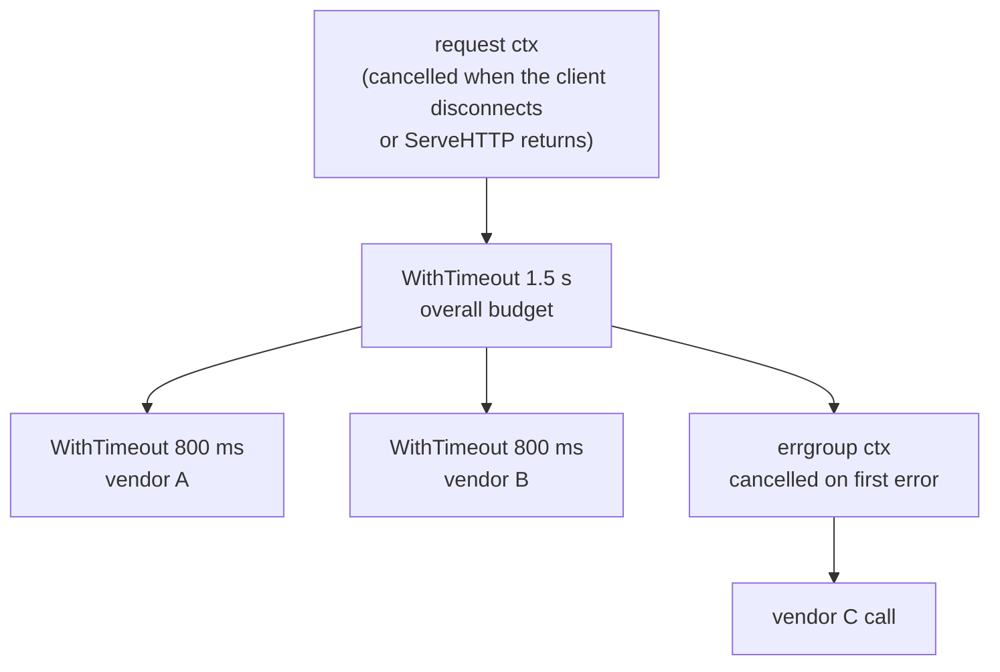
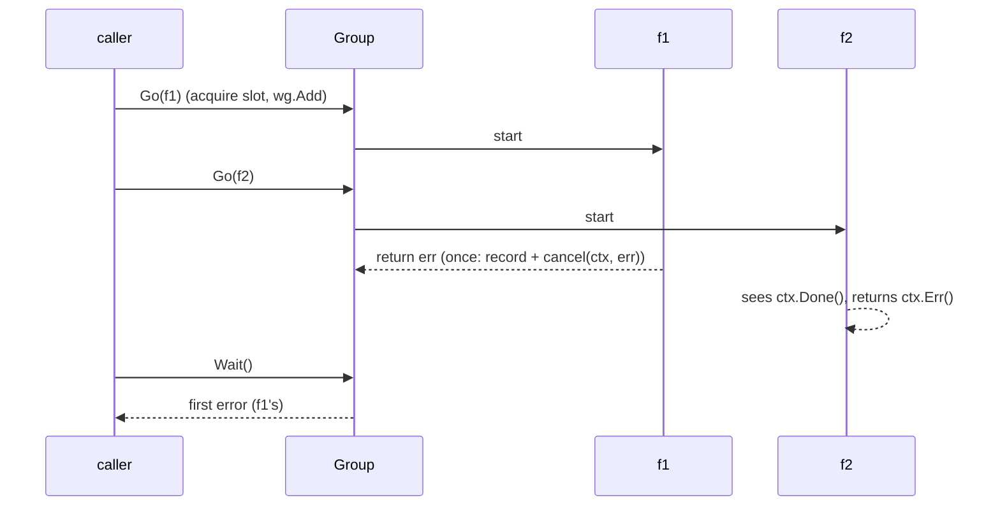
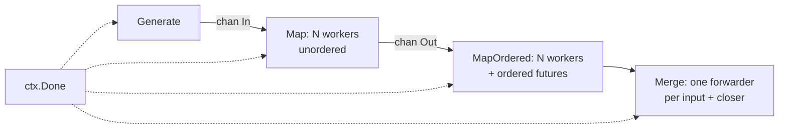
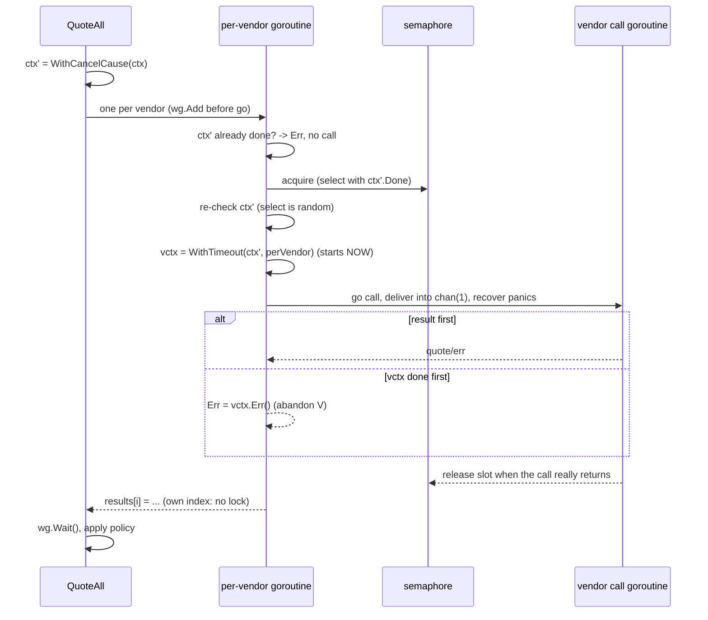
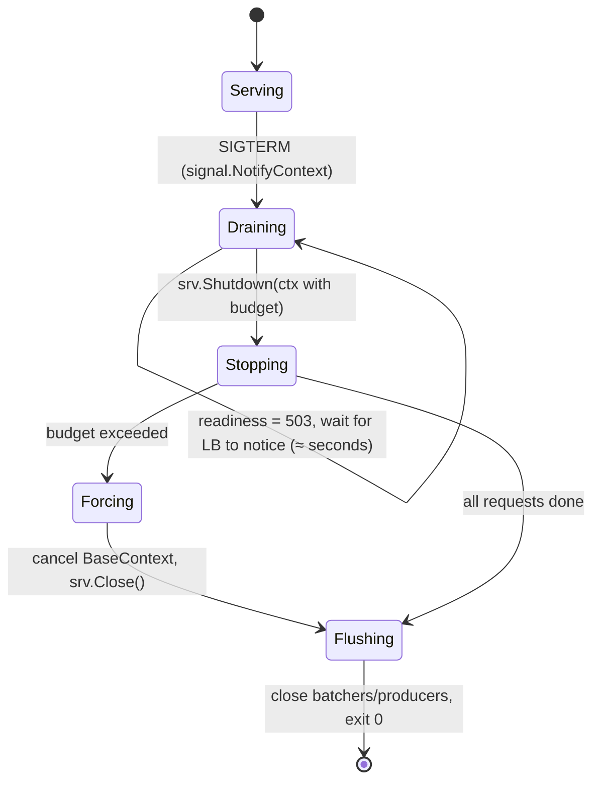

# B0 Unit 2 — Cancellation and structured concurrency

> Time: ~7.5 h (includes the 1 h design exercise and the teach-back) · CORE: §1–§7 · STRETCH: the "STRETCH" parts of §7
> (testing/synctest, production goroutine forensics) · Labs: `labs/b0/group`, `labs/b0/pipeline`,
> `labs/b0/fanout`, `labs/b0/breakit` (leak and panic exercises)

## Before you start

You should have finished Unit 1 (or be able to explain unbuffered vs buffered channels, `select` randomness,
mutex vs channel, and what `-race` does and doesn't catch). Warm-up, answers below; write yours down first:

1. What does `select` do when two cases are ready?
2. A `sync.RWMutex` has a waiting writer. A goroutine that already holds a read lock calls `RLock` again. What
   happens?
3. Why did the batcher lab not need a drain loop on `Close`?

<details data-kind="answer"><summary>Warm-up answers</summary>

1. Picks one uniformly at random; there is no priority by source order (Unit 1 §2).
2. It blocks behind the writer, and the writer waits for the first read lock: deadlock (Unit 1 §3).
3. The hand-off channel is unbuffered, so `Add` returning nil means the run loop already received the item; and
   closing `quit` wakes every parked `Add` before the run loop observes it. No item can sit "in between"
   (Unit 1 §2, Break it).

</details>

---

## §1 `context`: cancellation trees and deadlines

### The failure story

The member-facing "compare FX rates" endpoint calls three vendors. A member on a phone on a train taps the button,
loses signal, and taps again: four times in ten seconds. Each tap is a new HTTP request; each abandoned request
keeps running, because the vendor adapters use `http.Get(url)` with no context and a client with no timeout. One
vendor is degraded (≈ 25 s responses), so every abandoned request holds a goroutine, a TCP connection and a slot in
that vendor's 100-concurrent-connection limit for 25 s. At 150 req/s with ≈ 30% abandoned, that is
150 × 0.3 × 25 ≈ 1,100 useless in-flight calls (Little's law again). The vendor starts rejecting *all* traffic from
the platform with `429 Too Many Requests`, including the requests whose members are still waiting. The work nobody
wanted took the work they did want down with it.

### Predict

<!-- predict id="B0-U2-P01" -->
**Predict.** What does this print?

```go
parent, cancel := context.WithTimeout(context.Background(), 50*time.Millisecond)
defer cancel()
child, cancelChild := context.WithTimeout(parent, time.Hour)
defer cancelChild()

dl, _ := child.Deadline()
fmt.Println(time.Until(dl) < time.Second)

<-child.Done()
fmt.Println(child.Err())
```
<!-- /predict -->

<!-- predict id="B0-U2-P02" -->
**Predict.** What do these two lines print?

```go
ctx, cancel := context.WithCancelCause(context.Background())
cancel(errors.New("vendor down"))
fmt.Println(ctx.Err(), "|", context.Cause(ctx))

ctx2, cancel2 := context.WithTimeoutCause(context.Background(), time.Millisecond, errors.New("vendor budget spent"))
defer cancel2()
<-ctx2.Done()
fmt.Println(ctx2.Err(), "|", context.Cause(ctx2))
```
<!-- /predict -->

### Reveal

<details data-kind="reveal" data-for="B0-U2-P01">
<summary>Reveal</summary>

`true`, then `context deadline exceeded` after ≈ 50 ms. A child context can **shorten** its parent's deadline
but never extend it: `WithTimeout(parent, time.Hour)` takes the earlier of the two deadlines, so `Deadline()`
reports the parent's. When the parent expires, the child is done too, with the parent's error. Tempting wrong
answer: "false, then it waits an hour". That would make per-vendor timeouts able to escape the request deadline,
and the API is designed so they can't.

</details>

<details data-kind="reveal" data-for="B0-U2-P02">
<summary>Reveal</summary>

```
context canceled | vendor down
context deadline exceeded | vendor budget spent
```

`Err()` is still one of the two sentinel errors (`context.Canceled`, `context.DeadlineExceeded`), so existing
`errors.Is(err, context.Canceled)` checks keep working. `context.Cause` returns the *reason*.
`WithCancelCause`/`Cause` arrived in Go 1.20; `WithTimeoutCause`/`WithDeadlineCause` in Go 1.21. If no cause was
given, `Cause` returns the same as `Err()`. The errgroup clone you build in §2 passes the first error as the cause,
so callers can log *why* their context died.

</details>

### How it actually works

A `context.Context` is an immutable node in a tree. Each derived context (`WithCancel`, `WithTimeout`,
`WithDeadline`, `WithValue`, and the `...Cause` variants) points at its parent. Cancelling a node closes its
`Done()` channel and cancels every descendant. It never affects the parent or siblings.



Rules that make it work:

- **Pass `ctx` as the first parameter**, down every call that can block: `http.NewRequestWithContext(ctx, ...)`,
  `db.QueryContext(ctx, ...)`, `conn.SetDeadline` derived from `ctx.Deadline()` for raw sockets. Cancellation is
  *cooperative*: a callee that never looks at `ctx` is never cancelled.
- **Always call the `cancel` func** (`defer cancel()`). A derived context registers itself with its parent; until it
  is cancelled (or the parent is), it holds a reference and, for timeouts, a timer. `go vet`'s `lostcancel` check
  flags a discarded cancel func.
- **Deadline vs timeout.** `WithTimeout(ctx, d)` is `WithDeadline(ctx, now+d)`. Deadlines compose across hops: a
  server can read `ctx.Deadline()` and refuse work it cannot finish in time, and gRPC propagates the remaining
  deadline to the next service in a header.
- **Values sparingly.** `WithValue` is for request-scoped data that crosses API boundaries: trace IDs, the
  authenticated tenant. Never use it for optional parameters or dependencies. Keys are an unexported type so
  packages can't collide.
- **Go 1.21 extras.** `context.AfterFunc(ctx, f)` runs `f` when ctx is done (handy to close a raw connection on
  cancel), and `context.WithoutCancel(ctx)` keeps values but drops cancellation. Use it for work that must outlive
  the request, such as writing the audit record for a request the client abandoned.
- In `net/http`, an incoming request's context is cancelled when the client's connection closes, when the request
  is cancelled (HTTP/2), or when `ServeHTTP` returns.

### Build it

You will use contexts in every remaining lab; the first one is §2's `group.WithContext`, which must use
`context.WithCancelCause` so `context.Cause(ctx)` reports the first error
(`TestWithContext_CancelledOnFirstError_WithCause`).

### Break it

In the pipeline lab (§3), after your implementation passes, change one worker's
`fn(ctx, v)` call to `fn(context.Background(), v)` and rerun. Predict which test fails and how long it takes.

<details data-kind="answer"><summary>What you should see</summary>

`TestMap_PassesContextToFn_SoBlockedCallsUnwind` fails after its 5 s timeout, either because the output never
closes ("not closed within 5s") or with a goroutine-leak report whose stacks show your worker blocked inside
`fn`. The `fn` in that test only returns when its ctx is cancelled, like a well-behaved vendor call; given
`Background()` it never returns. One dropped `ctx` anywhere in a call chain is enough to make the whole chain
uncancellable.

</details>

### In the wild

- **`net/http` client.** `http.NewRequestWithContext` ties the whole exchange (dial, TLS, headers, body read) to
  ctx. `http.Client.Timeout` is a separate, coarser, per-request limit. Use ctx for the request budget, and keep a
  client `Timeout` as a backstop against code that forgets ctx.
- **`database/sql`.** `QueryContext`/`ExecContext` honour ctx both while waiting for a pool connection and (driver
  permitting) during the query. Waiting for a free connection is where cancellation often matters most.
- **gRPC** propagates deadlines across services (`grpc-timeout` header), so a downstream service sees the caller's
  remaining budget, not a fresh one.

### Trade-offs

| Option | Wins when | Loses when | When the answer flips |
|---|---|---|---|
| Per-call timeout only | Single dependency, simple latency budget | Several sequential/parallel calls: timeouts add up past the caller's SLO | As soon as there are ≥ 2 calls: derive per-call timeouts from one overall deadline |
| Overall deadline only | Fan-out where any partial answer is fine | One slow vendor eats the whole budget, so others' answers are wasted | When vendors have very different latency profiles: add per-vendor caps too |
| `context.WithoutCancel` for follow-up work | Audit/logging that must complete although the client left | Work that should stop when the client leaves | When the work is costly and not required: keep cancellation |
| `http.Client.Timeout` | Backstop for code that ignores ctx | It cannot be shortened per request, and it kills streaming bodies | Prefer ctx for budgets; keep `Timeout` as a generous safety net |

### Senior bar

- **Failure modes.** Dropped ctx in one layer (uncancellable chain). Forgotten `cancel()` (timer and tree-node
  leak, flagged by `go vet` lostcancel). Timeouts larger than the caller's deadline. Retries that ignore the
  remaining deadline (retrying with 50 ms left is pure load). Using the request ctx for work that must survive the
  request.
- **Numbers.** Budget example for a 2 s member-facing SLO: ≈ 100 ms own work, ≈ 1.5 s overall vendor deadline,
  per-vendor cap ≈ vendor p99 (≈ 800 ms) so one slow vendor cannot eat the whole budget. Abandoned work ≈ abandon
  rate × arrival rate × latency (≈ 1,100 in-flight in the story).
- **Ops.** Log `context.Cause` on failures. Separate "client went away" (`context.Canceled` with the request ctx's
  cause) from "we timed out" (`DeadlineExceeded`) in metrics; they need different fixes.

**Interviewer probes**

<details data-kind="answer"><summary>"The client disconnected. How does that stop your vendor call three layers down?"</summary>

`net/http` cancels the request's context when the connection closes. I pass that ctx (or something derived from
it) through every layer and build the outbound request with `http.NewRequestWithContext`. The transport watches
ctx and aborts the dial/read, so the vendor call returns `context.Canceled` and the goroutines unwind. If any
layer creates a fresh `context.Background()`, the chain breaks there. That is a review item, and a lint rule
(contextcheck-style linters) if the team uses them.

</details>

<details data-kind="answer"><summary>"Why not put the database handle or the tenant config in the context?"</summary>

Context values are untyped, invisible in function signatures and unchecked by the compiler. Dependencies belong
in struct fields or parameters, where the type system can see them. I keep context values for request-scoped
metadata that has to cross API boundaries untouched: trace IDs, the authenticated principal. Anything a function
needs in order to do its job should appear in its signature.

</details>

<details data-kind="answer"><summary>"Deadline or timeout across services?"</summary>

Deadlines. A timeout is relative and restarts at every hop, so three services each with a 2 s timeout can spend
6 s on a request whose caller gave up after 2. Propagating an absolute deadline (as gRPC does) means each hop
knows the remaining budget and can fail fast or skip optional work.

</details>

### Check yourself

1. Can a child context outlive its parent's deadline?
2. What does `go vet`'s `lostcancel` catch, and why does it matter?
3. When would you use `context.WithoutCancel`?

<details data-kind="answer"><summary>Answers</summary>

1. No. A derived deadline is the earlier of the parent's and the requested one, and the parent's cancellation
   always propagates.
2. A cancel func that is never called on some path. The derived context stays registered with its parent (and its
   timer stays live) until the parent ends, a slow leak in long-lived parents.
3. For work that must finish even though the request was cancelled, while keeping request-scoped values: writing
   the audit record, releasing a vendor reservation. Give it its own timeout.

</details>

---

## §2 Bounded concurrency: semaphores, worker pools and errgroup

### The failure story

Month-end statement generation fetches cheque images from an imaging vendor for 40,000 members. The first version
loops sequentially: ≈ 300 ms per image, ≈ 3.3 hours. The second version does `go fetch(member)` for every member:
40,000 goroutines start in ≈ 50 ms, and 40,000 requests hit a vendor whose contract allows 50 concurrent
connections and 200 req/s. The vendor's gateway returns `429`s to 99% of them, the retry logic retries all 39,600
with no backoff, and the vendor's on-call team rate-limits the bank's IP range for the rest of the day. The right
answer was between the two: about 50 at a time, ≈ 40,000 × 0.3 s ÷ 50 ≈ 4 minutes.

### Predict

<!-- predict id="B0-U2-P03" -->
**Predict.** With the errgroup API (`g, ctx := WithContext(parent)`), what is wrong with this function?

```go
func refresh(parent context.Context) error {
	g, ctx := group.WithContext(parent)
	var a, b Profile
	g.Go(func() (err error) { a, err = fetchA(ctx); return })
	g.Go(func() (err error) { b, err = fetchB(ctx); return })
	if err := g.Wait(); err != nil {
		return err
	}
	return save(ctx, merge(a, b))
}
```
<!-- /predict -->

<!-- predict id="B0-U2-P04" -->
**Predict.** You must call a vendor for 10,000 items with at most 50 in flight. Compare (a) 50 worker goroutines
reading from a jobs channel and (b) one goroutine per item that first acquires a buffered-channel semaphore of
capacity 50. How many goroutines exist at the peak for each? Which one would you write in a 60-minute machine-coding
round, and why?
<!-- /predict -->

### Reveal

<details data-kind="reveal" data-for="B0-U2-P03">
<summary>Reveal</summary>

`save(ctx, ...)` runs with a **cancelled context**. The group's context is cancelled the first time a function
fails *or when `Wait` returns*, so after a fully successful `Wait`, `ctx.Err()` is `context.Canceled` and `save`
fails every time (`TestWithContext_CancelledWhenWaitReturnsEvenWithoutError` pins this behaviour). Use `parent` for
work after `Wait`. The closures writing `a` and `b` are fine: each variable has one writer, and `Wait` provides the
happens-before edge to the reads. Tempting wrong answer: "data race on a and b". There isn't one.

</details>

<details data-kind="reveal" data-for="B0-U2-P04">
<summary>Reveal</summary>

(a) 50 workers + 1 feeder ≈ 51 goroutines at all times. (b) **Up to 10,000** goroutines exist, because each
acquires *inside* the goroutine, but only 50 make calls. The rest are parked on the semaphore (≈ 2.6 KB each, so
≈ 26 MB here: fine at 10k, not at 10M). errgroup's `SetLimit` (and your `group` lab) acquires *in `Go`, before
starting the goroutine*, so the caller's loop blocks and peak goroutines stay ≈ 51 with the same short code. In a
machine-coding round, `SetLimit` is fewer lines and has fewer shutdown bugs: no jobs channel to close, no separate
result channel, errors and cancellation come with the group. Choose (a) when the item count is unbounded (a stream,
a queue consumer), or when workers hold expensive per-worker state such as a connection or a buffer. Tempting wrong
answer: "(b) is wrong because it creates 10,000 goroutines". The bound that matters is on *calls in flight*, and
both bound that to 50. Where you acquire decides how many goroutines wait.

</details>

### How it actually works

A **counting semaphore** in Go is a buffered channel: `sem := make(chan struct{}, n)`; acquire with `sem <- struct{}{}`,
release with `<-sem`. Unit 1 §4's memory-model rule ("the k-th receive happens before the (k+n)-th send completes")
is exactly why at most n holders can exist. Add a `select` with `ctx.Done()` to make acquisition cancellable.

**errgroup** (`golang.org/x/sync/errgroup`; you are rebuilding it with the standard library only):

- `Go(f)` runs `f` in a goroutine tracked by a `WaitGroup`. With a limit, `Go` blocks until a slot is free.
- The first non-nil error is recorded once (`sync.Once`), and with `WithContext` it cancels the group's context,
  with the error as the cause.
- `Wait` waits for all, returns the first error, and cancels the context.
- `SetLimit(n)`: a semaphore. Per the x/sync docs, a negative value means no limit, zero prevents new goroutines,
  and the limit must not be modified while goroutines are active.
- `TryGo(f)`: non-blocking acquire. It returns false at the limit, which lets you shed load instead of queueing.



Two invariants to get right: **`wg.Add` before `go`**, never inside the goroutine (or `Wait` can return early);
and **release the slot when the function returns**, in a `defer`, so a panic or early return doesn't leak a slot.

### Build it

Lab: **`labs/b0/group`**: `WithContext`, `Go`, `TryGo`, `SetLimit`, `Wait` in `group.go`.

Acceptance: `go test -race ./labs/b0/group/`: zero value usable; `Wait` waits for all and returns the first error;
ctx cancelled on the first error with `context.Cause` = that error; ctx cancelled when `Wait` returns; parent
cancellation propagates; `SetLimit` bounds concurrency; `Go` blocks at the limit until a slot frees; `TryGo`
respects the limit; `SetLimit(0)` and `SetLimit(-1)` semantics; concurrent callers of `Go`; no goroutine leak.

### Break it

1. Move `wg.Add(1)` inside the goroutine and run the tests with `-race -count=3`.
2. Forget to release the semaphore slot in one path.

<details data-kind="answer"><summary>What you should see</summary>

1. With the reference solution mutated this way, five tests fail, including `TestSetLimit_BoundsConcurrency`,
   `TestTryGo_RespectsLimit` and the zero-limit test: `Wait` sees a zero counter and returns before some
   functions have started. The failure is intermittent in some tests. `breakit`'s
   `TestWaitGroupAddInsideGoroutine` shows the same bug with a race report. (Go 1.25's `go vet` adds a `waitgroup`
   analyzer that reports this misplaced `Add`.)
2. Tests that need a free slot fail after their 5 s guard ("Go is blocked on the limit (are slots released when a
   function returns?)"). In production this is a slow death: each leaked slot permanently reduces concurrency
   until the service processes nothing.

</details>

### In the wild

- **`golang.org/x/sync/errgroup`**: the real thing, with the same API you just built. `x/sync/semaphore` provides a
  *weighted* semaphore (acquire n units), useful when tasks have different costs, such as bytes of memory.
- **`database/sql`'s `SetMaxOpenConns`** is a semaphore on connections. The default is 0 (unlimited), and the
  default max idle is 2 (`defaultMaxIdleConns` in `database/sql/sql.go`). With a cap set, callers wait for a
  connection and the wait honours ctx. `db.Stats().WaitCount` and `WaitDuration` tell you if the cap is binding.
- **`net/http.Transport.MaxConnsPerHost`** caps connections per vendor host (0 = unlimited by default).
  `MaxIdleConnsPerHost` defaults to 2 (`DefaultMaxIdleConnsPerHost`), a classic cause of connection churn against a
  single busy vendor.

### Trade-offs

| Option | Wins when | Loses when | When the answer flips |
|---|---|---|---|
| errgroup + `SetLimit` | Finite batch of tasks, first-error-cancels-all semantics, short code | Unbounded streams (one goroutine per item forever) | When items arrive continuously: use a worker pool fed by a channel |
| Worker pool (N goroutines + jobs channel) | Streams, queue consumers, per-worker state (connection, buffer) | Result collection, error propagation and shutdown are on you (close jobs, wait, close results) | When tasks are a finite list: errgroup is simpler |
| Semaphore acquired inside goroutine-per-task | Heterogeneous task durations, simple code | Millions of tasks waiting = millions of parked goroutines | When the backlog is huge, acquire *before* `go` (as `SetLimit` does) so the producer blocks |
| Rate limiter (token bucket) | Vendor contract is req/s rather than concurrency | Doesn't bound in-flight count if latency rises | Usually you need both: concurrency cap and rate cap |
| `TryGo` / reject when full | Shedding load is better than queueing (latency-sensitive) | Batch work that must all complete | When callers can retry later (429 + Retry-After) |

### Senior bar

- **Failure modes.** Unbounded fan-out (the story). A bounded pool plus unbounded retries (retries amplify; retry
  only within the remaining deadline, with backoff and jitter). `wg.Add` in the goroutine. Leaked semaphore slots.
  Using the errgroup ctx after `Wait`. A panic inside `Go` crashes the process: errgroup does not recover panics
  (TODO-VERIFY: newer x/sync versions may propagate panics to `Wait`; check the version you depend on).
- **Numbers.** Concurrency needed = target throughput × latency: 200 req/s × 0.3 s ≈ 60, so a 50-connection
  contract caps you at ≈ 50 ÷ 0.3 ≈ 166 req/s. Peak goroutines: semaphore acquired inside the goroutine = number of tasks; acquired before `go` (SetLimit) or a pool = N + 1.
- **Ops.** Export the semaphore's in-use count and wait time. A pool that is always full means the bound (or the
  vendor) is the bottleneck. Pair every concurrency cap with a timeout, or a stuck dependency pins all slots.

**Interviewer probes**

<details data-kind="answer"><summary>"How do you pick the concurrency limit for a vendor?"</summary>

Start from the contract and Little's law: if the vendor allows 50 concurrent connections and ≈ 200 req/s, with
p50 ≈ 300 ms I need ≈ 60 in flight to reach 200 req/s, so the 50-connection cap binds first, at ≈ 166 req/s. I set
the cap at or slightly below the contract, add a token-bucket rate limiter if the contract is in req/s, and watch
429s and the semaphore's wait time. If several pods share the contract, the per-pod cap is the contract divided by
the replica count, or I coordinate through a shared limiter.

</details>

<details data-kind="answer"><summary>"What does errgroup do if one goroutine panics?"</summary>

In the version I built (and errgroup as I know it), nothing special: a panic in a goroutine is not recovered,
so it crashes the whole process, like any goroutine panic. If tasks run third-party adapter code, I recover inside
the function passed to `Go` and convert the panic to an error, as the fanout lab does. I'd check the x/sync
release notes for the exact version in use, since panic propagation has been discussed upstream.

</details>

<details data-kind="answer"><summary>"Why does Wait cancel the context even on success?"</summary>

The group's context is scoped to the group's work. Once `Wait` returns, that work is over, and cancelling releases
anything derived from it: timers, `AfterFunc` callbacks, goroutines still watching `Done()`. The consequence is
that code after `Wait` must use the parent context. I've seen that bug in review more than once.

</details>

### Check yourself

1. Why is a buffered channel of capacity n a correct semaphore (cite the memory-model rule)?
2. What does `TryGo` give you that `Go` doesn't?
3. Where must `wg.Add` go, and why?

<details data-kind="answer"><summary>Answers</summary>

1. The k-th receive happens before the (k+n)-th send completes, so at most n sends (acquires) can be outstanding
   without a matching receive (release).
2. A non-blocking acquire: you can reject or defer work at the limit (load shedding) instead of blocking the caller.
3. Before the `go` statement, in the goroutine that will later call `Wait`. Otherwise `Wait` can observe the
   counter before the new goroutine has incremented it and return early.

</details>

---

## §3 Pipelines, fan-out/fan-in, and goroutine leaks

### The failure story

The statement service has a "first vendor to answer wins" helper for cheque images (two imaging vendors, both
called, the faster result used). It returns as soon as one result arrives:

```go
ch := make(chan Image) // unbuffered
go func() { ch <- vendorA(id) }()
go func() { ch <- vendorB(id) }()
return <-ch
```

The losing goroutine blocks forever on `ch <-`, because nobody will ever receive. At ≈ 30 calls/s, that is ≈ 2.6 M
leaked goroutines per day, each pinning its stack plus a decoded image buffer of ≈ 200 KB. RSS grows ≈ 500 MB/h.
The pods were restarted by every deploy, so nobody noticed until a three-day holiday freeze: on day three the pods
were OOM-killed, all at about the same time. The goroutine profile, had anyone looked, would have shown
"2,612,004 @ … statement.firstImage.func2" blocked in `chan send`.

### Predict

<!-- predict id="B0-U2-P05" -->
**Predict.** What number does this print (roughly)?

```go
func fetch(timeout time.Duration) (string, error) {
	ch := make(chan string)
	go func() { time.Sleep(50 * time.Millisecond); ch <- "quote" }()
	select {
	case q := <-ch:
		return q, nil
	case <-time.After(timeout):
		return "", errors.New("timeout")
	}
}

func main() {
	for i := 0; i < 1000; i++ {
		fetch(time.Millisecond)
	}
	time.Sleep(200 * time.Millisecond)
	fmt.Println(runtime.NumGoroutine())
}
```
<!-- /predict -->

<!-- predict id="B0-U2-P06" -->
**Predict.** A consumer ranges over a 3-stage pipeline (generate → map → map), reads the first 10 results, and
`return`s without cancelling anything. Which goroutines are still alive a minute later, and in what state?
<!-- /predict -->

### Reveal

<details data-kind="reveal" data-for="B0-U2-P05">
<summary>Reveal</summary>

**1001**: main plus 1,000 leaked goroutines. Every `fetch` times out after 1 ms and returns; 49 ms later its
goroutine tries to send on an unbuffered channel that nobody will ever read, and blocks forever. A blocked
goroutine is never garbage-collected, even though the channel is unreachable from everywhere else. Fixes: make the
channel buffered with capacity 1 (the send always completes, and the goroutine exits), or have the sender `select`
on a ctx. Tempting wrong answer: "1, because the goroutines finish after 50 ms". They finish *sleeping*, then
block on the send.

</details>

<details data-kind="reveal" data-for="B0-U2-P06">
<summary>Reveal</summary>

All of them, blocked: the last stage on `out <- v` (nobody receives), the middle stage on its send to the last
stage, and the generator on its send. Workers in a parallel stage are each stuck on a send. Every goroutine of the
pipeline leaks, plus anything they hold. The fix is the stage contract: every send `select`s on `ctx.Done()`, and
a consumer that stops early **cancels**. Then every stage unwinds within one channel operation. Tempting wrong
answer: "only the generator, the others finished". They can't finish while their downstream is blocked.

</details>

### How it actually works

**Leak = a goroutine blocked forever.** The runtime does not detect it (the global "all goroutines are asleep"
check fires only when *every* goroutine is blocked, which never happens in a server), and the GC cannot reclaim
it. The common shapes:

| Shape | Blocked on | Fix |
|---|---|---|
| early return, unbuffered result channel | `ch <- v` | buffer = number of senders, or select on ctx |
| consumer stops reading a pipeline | stage `out <- v` | consumer cancels; every send selects on ctx |
| producer never closes | consumer `range ch` | the owner closes when done (defer) |
| waiting on a ctx that is never cancelled | `<-ctx.Done()` | always `defer cancel()`; tie the lifetime to a parent |
| `time.Ticker` never stopped | (timer, not a goroutine) | `defer t.Stop()` |

**The stage contract** (the pipeline lab enforces it):



1. Each stage **owns** its output channel: it is the only sender, and it closes the channel when it's done (`defer
   close(out)`). With N senders (workers), a separate closer goroutine does `wg.Wait(); close(out)`.
2. Every blocking operation is a `select` with `<-ctx.Done()`.
3. Consumers either drain to the end or cancel.

**Ordering** is a real design decision. Unordered `Map` emits in completion order and never waits for a slow item.
`MapOrdered` must buffer finished results until their predecessors are done. The lab's design bounds that buffer:
a dispatcher pushes a one-shot "future" channel per item onto a queue of capacity N, a worker fills it, and a
collector reads futures in order. A slow item stalls the line (head-of-line blocking), but memory stays bounded
by N.

**Detecting leaks in tests**: record `runtime.NumGoroutine()` before, run the code, then poll until the count drops
back to the baseline or a deadline passes. Use a settle loop, never a single check, because goroutines take a
moment to exit. On failure, dump `pprof.Lookup("goroutine").WriteTo(w, 1)`. Every lab test file in this module has
that helper (`waitForGoroutines`).

### Build it

Lab: **`labs/b0/pipeline`**: `Generate`, `Map` (unordered), `MapOrdered` (input order), `Merge`.

Acceptance: `go test -race ./labs/b0/pipeline/`: all items processed; workers really run in parallel (a barrier
`fn` that only proceeds when N calls are inside at once); `MapOrdered` preserves order even when early items are
slowest; `Merge` forwards everything and closes; **cancel mid-stream with an abandoned consumer leaks nothing**;
output closes after cancel; `fn` receives ctx so blocked calls unwind; a pre-cancelled context stops all stages
promptly.

### Break it

1. Run `go test -race -tags breakit -run '^TestLeakyFirstResponse$' ./labs/b0/breakit/` and read the goroutine
   profile it prints. Then fix `firstResponse`.
2. In your `Map`, replace the `select { case out <- r: case <-ctx.Done(): }` with a bare `out <- r`. Which tests
   fail?

<details data-kind="answer"><summary>What you should see</summary>

1. "leaked 200 goroutines after 100 calls" and a profile with a line like
   `200 @ 0x… # … breakit.firstResponse.func1+0x4c …/breakit_test.go:112`. The count is grouped by identical
   stack, which is what makes it useful in production: one line, a big number, the exact source line. Fix:
   `make(chan string, len(vendors))`.
2. The two cancel-mid-stream tests fail after 5 s with goroutine-leak reports showing workers blocked in
   `chan send` inside your `Map`. Everything else still passes, which is why leak tests have to be written on
   purpose: a leaking pipeline produces correct output.

</details>

### In the wild

- **"Go Concurrency Patterns: Pipelines and cancellation"** (Sameer Ajmani, the Go blog, 2014) introduced this
  stage contract with a `done` channel; `context` later generalised it.
- **`go.uber.org/goleak`** is a widely used test helper that fails a test if unexpected goroutines remain. It does
  the same job as our `waitForGoroutines`, but matches stacks instead of counts.
- **`net/http/pprof`**: `/debug/pprof/goroutine?debug=1` (grouped counts) and `?debug=2` (every goroutine with its
  state and, for long waits, how long it has been blocked, e.g. `[chan send, 4123 minutes]`). That wait duration is
  the leak smoking gun.

### Trade-offs

| Option | Wins when | Loses when | When the answer flips |
|---|---|---|---|
| Unordered `Map` | Results are independent (sum, upsert by key) | Consumer needs input order | When order matters, you pay head-of-line blocking or reorder memory |
| `MapOrdered` with bounded window | Order required and per-item latency is similar | One slow item stalls all output | When latency variance is high, emit unordered with sequence numbers and let the consumer reorder |
| Buffered stage channels | Smoothing bursts between stages of different speeds | More in-flight memory and more to lose on crash | Only after profiling shows stages blocking on each other |
| Single goroutine, no pipeline | Small inputs; CPU-bound work already parallelised elsewhere | I/O-bound per-item work | When per-item latency ≫ per-item CPU, parallel stages pay off |

### Senior bar

- **Failure modes.** Leaks from early return, abandoned consumers, never-closed channels, and never-cancelled
  contexts. Closing a channel from the receiver side. Stages that ignore ctx inside `fn`. An unbounded reorder
  buffer in ordered parallel maps.
- **Numbers.** Leak rate = call rate × leaked goroutines per call (2 vendors, 1 loser, 30 calls/s ≈ 2.6 M/day).
  Memory per leaked goroutine ≈ 2.6 KB + whatever it references (≈ 200 KB images in the story) ≈ 500 MB/h.
- **Ops.** A `runtime.NumGoroutine()` gauge with an alert on sustained slope is the cheapest leak detector there is. In
  an incident, `curl …/debug/pprof/goroutine?debug=1 | head -50` and look for the biggest count.

**Interviewer probes**

<details data-kind="answer"><summary>"How do you know your pipeline doesn't leak?"</summary>

By construction: every stage owns and closes its output, and every send and receive selects on ctx. By test: I
record `runtime.NumGoroutine()` before, run the pipeline, cancel mid-stream *without draining*, and poll until
the count returns to the baseline within a deadline, dumping the goroutine profile if it doesn't. By production
telemetry: a goroutine-count gauge and the pprof endpoint.

</details>

<details data-kind="answer"><summary>"Ordered or unordered output for the cheque-image pipeline?"</summary>

It depends on the consumer. If images are written to object storage by key, order doesn't matter: unordered,
maximum throughput. If they are appended to a PDF statement in transaction order, I need order, and I'd bound the
reorder window to N so memory stays at N images. If one image can take 30 s, I'd rather emit unordered with sequence
numbers and let the PDF assembler place them, so one slow image doesn't stall every page.

</details>

### Check yourself

1. Why can't the garbage collector free a goroutine blocked on a channel nobody else references?
2. In `Map` with N workers, who closes the output channel?
3. What two things must a consumer that stops early do?

<details data-kind="answer"><summary>Answers</summary>

1. Blocked goroutines are GC roots: the runtime keeps every goroutine until it exits, and a goroutine blocked on a
   channel can't exit. The runtime doesn't prove that no other goroutine could ever unblock it.
2. A separate closer goroutine, after a `WaitGroup` says every worker (every sender) has returned. A worker
   closing it would make the other workers panic on send.
3. Cancel the context (so stages stop), and not assume anything about values still in flight. Draining is optional
   once cancelled.

</details>

---

## §4 Capstone: fanning out to vendors under budgets

### The failure story

The FX-quote endpoint asks five vendors and shows the best rate. Version 1 calls them sequentially (p50 ≈ 5 ×
120 ms = 600 ms). Version 2 calls them in parallel and waits for all, so the endpoint is as slow as the slowest
vendor. With five independent vendors each at p99 = 800 ms, at least one exceeds its p99 on 1 − 0.99⁵ ≈ 4.9% of
requests (tail-at-scale arithmetic, `docs/NUMBERS.md`), so the endpoint's p95 is now ≈ the vendors' p99. Version 3
adds a 1 s timeout per vendor. Then one vendor's adapter turns out to use a raw TCP client that ignores context: its
calls never time out, and the endpoint hangs for 30 s whenever that vendor's link stalls. Version 4 must cope with
slow, failing and *uncooperative* vendors, respect the member's overall deadline, never exceed each vendor's
concurrency contract, and say clearly what happens on partial failure.

### Predict

<!-- predict id="B0-U2-P07" -->
**Predict.** Five vendors, a 1.5 s overall deadline, a 1 s per-vendor timeout, `MaxConcurrency: 2`. Each vendor
takes 600 ms. Which vendors succeed if (a) the per-vendor timeout starts when `QuoteAll` starts, (b) when each
vendor's call starts?
<!-- /predict -->

<!-- predict id="B0-U2-P08" -->
**Predict.** A vendor adapter ignores ctx and blocks for 30 s. Your wrapper runs the call in a goroutine and
`select`s on the result channel and `ctx.Done()`. The deadline fires at 1 s and `QuoteAll` returns. What happens to
the adapter's goroutine at 30 s if the result channel is (a) unbuffered, (b) buffered with capacity 1?
<!-- /predict -->

### Reveal

<details data-kind="reveal" data-for="B0-U2-P07">
<summary>Reveal</summary>

With 2 slots, vendors run in waves: wave 1 at 0–600 ms, wave 2 at 600–1200 ms, and vendor 5 at 1200–1800 ms.
(a) Every vendor's timeout expires at 1 s: wave 1 succeeds; wave 2 is cancelled at 1 s, 400 ms into a 600 ms
call; vendor 5 never really gets started. **2 succeed.** (b) Each call gets its own full second, so waves 1 and 2
succeed (4 vendors). Vendor 5 starts at 1.2 s and is cut off by the **overall** 1.5 s deadline. **4 succeed.**
The per-vendor timeout must start when the call starts (`TestQuoteAll_PerVendorTimeout_StartsWhenTheCallStarts`);
the overall deadline bounds everything. If 4 of 5 isn't good enough, raise `MaxConcurrency` (within the
contracts) or the budget; no timeout trick fixes the arithmetic.

</details>

<details data-kind="reveal" data-for="B0-U2-P08">
<summary>Reveal</summary>

(a) Unbuffered: at 30 s the adapter goroutine tries to send, nobody is receiving (`QuoteAll` returned long ago),
and it **blocks forever**: a leak per stuck call. (b) Buffered(1): the send completes into the buffer, the goroutine
exits, and the channel and value are garbage-collected. **No leak** (`TestQuoteAll_VendorIgnoringContext_IsAbandoned_NoLeakAfterItReturns`).
Either way the 30 s of socket time is spent, which is why the senior answer also fixes the adapter: pass ctx
through, or set `conn.SetDeadline` from `ctx.Deadline()`, or use `context.AfterFunc(ctx, func() { conn.Close() })`.

</details>

### How it actually works

The reference design for `QuoteAll(ctx, vendors, req, opts) ([]Result, error)`:



Key decisions, all stated in the API doc comment:

- **Results are index-aligned** (`results[i]` is `vendors[i]`), always, even on error. Each goroutine writes only
  its own element, so no lock is needed; `wg.Wait()` publishes the writes.
- **Two budgets**: per-vendor timeout (from call start) and overall deadline (the caller's ctx). `context` composes
  them: the per-vendor ctx is derived from the overall one.
- **Policy is explicit.** `BestEffort` waits for everyone (each bounded) and succeeds with ≥ `MinSuccesses` quotes;
  the error, when there is one, wraps `ErrInsufficientQuotes` *and* every vendor error (`errors.Join`, Go 1.20).
  `FailFast` cancels everyone on the first error, with that error as the context cause.
- **Uncooperative vendors are abandoned**, not waited for, and their goroutine can still exit (buffered result
  channel).
- **Panics are contained** (recover in the call goroutine → `ErrVendorPanic`). An adapter bug must not crash an
  API server that is serving every other credit union.
- **No calls after the deadline**: check ctx before acquiring, and re-check after acquiring, because `select` may
  pick the semaphore case even when `Done()` is also ready. The up-front check is tested deterministically with a
  pre-cancelled ctx. The post-acquire re-check covers a narrower window that no test can force reliably: defence in
  depth.
- **Semaphore accounting for abandoned calls** is a judgement call. The reference releases the slot only when the
  call really returns, because the abandoned call still holds a socket against the vendor's limit. The cost: a
  vendor that hangs forever pins a slot. The tests accept either choice; your design note must say which you chose
  and why.

### Build it

Lab: **`labs/b0/fanout`**: `QuoteAll` (and a `callOne` helper) in `fanout.go`.

Acceptance: `go test -race ./labs/b0/fanout/`: index-aligned results; vendors called concurrently; per-vendor
timeout gives partial results; a ctx-ignoring vendor is abandoned and its goroutine exits once it returns; the
overall deadline bounds everything; FailFast cancels siblings (`context.Canceled`) and returns the first error;
insufficient quotes wraps all vendor errors; `MaxConcurrency` bounds in-flight calls; per-vendor timeout starts at
call start; queued vendors are not called after the deadline; a pre-cancelled ctx calls nobody; vendor panics are
contained; concurrent callers sharing vendors are race-free.

### Break it

After your solution passes, apply each mutation alone and predict the failing tests first:
(1) result channel unbuffered; (2) create the per-vendor timeout once, before the loop; (3) remove the
`recover`; (4) call `v.Quote` directly instead of in a goroutine.

<details data-kind="answer"><summary>What you should see (reference solution)</summary>

1. Only the abandoned-vendor test fails, with a goroutine-leak report showing the call goroutine in `chan send`.
2. `PerVendorTimeout_StartsWhenTheCallStarts` fails: the log shows `results[6].Err = context deadline exceeded`,
   and the same for most later vendors. They spent their budget queued for the single slot and timed out without
   a fair try. Every other test passes, which is why this behaviour needs its own test.
3. The whole test binary crashes (`panic: assignment to entry in nil map`), and every test result after it is lost.
   That is what the API server would do too.
4. Five tests fail after their 5 s guards: overall deadline, FailFast, abandoned vendor, MaxConcurrency and
   per-vendor timeout. The first three because, without a separate goroutine, you cannot stop waiting for a call
   that won't stop. The last two because in the reference design the slot release lived in that goroutine, so the
   mutation also leaks every slot. Two bugs from one "simplification".

</details>

### In the wild

- **"The Tail at Scale"** (Dean and Barroso, CACM 2013) is the reference for fan-out tail amplification and for
  *hedged requests*: send a second request after the p95 latency and take whichever answers first. The
  `firstResponse` breakit exercise is a hedge without the leak fix.
- **Envoy/Istio** expose the same knobs at the proxy layer: per-try timeout vs overall route timeout, max
  concurrent requests per upstream cluster (circuit-breaker thresholds), and outlier ejection for failing vendors.
  TODO-VERIFY: exact Envoy field names (`per_try_timeout`, `max_requests`) for the version you cite.
- **Aggregator APIs in fintech** (rate shopping, credit-bureau pulls, KYC checks across providers) are this exact
  shape. KYC is usually `FailFast` (all checks must pass); rate shopping is `BestEffort`.

### Trade-offs

| Option | Wins when | Loses when | When the answer flips |
|---|---|---|---|
| BestEffort (partial results) | Any answer helps: best price, first available slot | Every answer is required (compliance, multi-party approval) | When a missing answer must block the action: FailFast |
| FailFast | All-or-nothing workflows; saves vendor calls on early failure | One flaky vendor fails every request | When a vendor is optional, wrap it so its failure is a result, not an error |
| Wait for all, no timeouts | Never in user-facing paths | Always: latency = slowest vendor | Offline batch with idempotent retries maybe |
| Hedged requests | Tail latency dominated by random slowness; idempotent reads | Writes; vendors that bill per call; correlated slowness | When the vendor charges per request or the slowness is systemic |
| Release slot on abandon | Liveness: a hung vendor can't pin slots | Real concurrency can exceed the contract | When the vendor enforces concurrency strictly (429s), release only on true return |

### Senior bar

- **Failure modes.** Tail amplification. Timeouts that don't compose (per-vendor > overall). Uncooperative adapters
  (leaks, hangs). Retries without a deadline check. Panics in third-party adapter code. Partial results that the UI
  shows as complete. Semaphore slots pinned by hung calls.
- **Numbers.** P(at least one of N exceeds its p99) = 1 − 0.99ᴺ: ≈ 4.9% for 5, ≈ 63% for 100. Budget: overall ≈ SLO
  minus own processing; per-vendor ≈ that vendor's p99 (or lower if the overall budget is tight); concurrency =
  min(contract, rate × latency).
- **Ops.** Per-vendor metrics: latency histogram, timeout count, error count by class, abandoned-call count, and
  slots in use. Alert on abandoned calls (an adapter ignoring ctx is a bug to fix, not just a timeout). Log
  `context.Cause` for FailFast cancellations.

**Interviewer probes**

<details data-kind="answer"><summary>"What if the consumer of QuoteAll's results is slow?"</summary>

`QuoteAll` returns a slice after `wg.Wait()`, so a slow consumer can't block vendor goroutines: they've all
finished or been abandoned. If I changed the API to stream results on a channel, I'd have to decide: buffer
len(vendors) so senders never block, and make the stream's lifetime explicit (ctx cancels it, and the channel is
closed when all vendors are done). Otherwise a consumer that stops reading leaks every vendor goroutine.

</details>

<details data-kind="answer"><summary>"What if a vendor ignores ctx?"</summary>

My wrapper runs the call in its own goroutine, delivering into a buffered channel, and selects on that versus the
per-vendor ctx. When the ctx fires, I stop waiting and record `DeadlineExceeded`; the call's goroutine exits
whenever the adapter returns, because its send can't block. That bounds *my* latency, not the vendor's resource
use, so I also count abandoned calls per vendor and fix the adapter: pass ctx through to the HTTP request, or set
socket deadlines from `ctx.Deadline()`.

</details>

<details data-kind="answer"><summary>"How do you test this without real vendors or long sleeps?"</summary>

Fake vendors with scripted behaviour: fast, failing, slow-but-ctx-respecting (a timer versus ctx), stubborn (blocks
on a channel the test controls, ignoring ctx) and panicking. Tests assert on *ordering of events*, not wall-clock
precision. "QuoteAll returned while the stubborn vendor was still blocked" is deterministic because the test only
releases the vendor afterwards. Every wait has a 5 s guard so a broken implementation fails instead of hanging.
Leaks are checked with a goroutine-count settle loop after releasing the stubborn vendor.

</details>

### Check yourself

1. Why must the per-vendor timeout be created inside `callOne`, after acquiring the slot?
2. Why does `results` need no mutex?
3. FailFast: what does a cancelled sibling's `Result.Err` satisfy, and what does `context.Cause` of the group ctx
   return?

<details data-kind="answer"><summary>Answers</summary>

1. So each call's budget starts when the call starts. Created earlier, time spent queued for a slot would eat into
   it, and queued vendors would time out without having been tried.
2. Each goroutine writes a distinct element (`results[i]`), and the caller reads only after `wg.Wait()`, which
   happens after every `Done`.
3. `errors.Is(err, context.Canceled)`. The cause is the first vendor's error (wrapped with the vendor name).

</details>

---

## §5 Graceful shutdown

### The failure story

Every deploy of the integration gateway (≈ 10 deploys a week, 6 pods, rolling) shows a blip of ≈ 0.3% 502s at the
load balancer, and the audit team finds gaps: a few hundred audit events per deploy that were accepted by the API
but never written. Investigation: the process exits as soon as it receives SIGTERM (the default Go behaviour with
no signal handling). In-flight requests are cut off mid-response. Kubernetes removes the pod from the Service
endpoints *concurrently* with sending SIGTERM, so for a second or two new requests still arrive at a process that
is already gone. And the audit batcher's in-memory batch (up to 100 events or 50 ms) dies with the process.

### Predict

<!-- predict id="B0-U2-P09" -->
**Predict.** A handler is 200 ms into 2 s of work. You call `srv.Shutdown(ctx)` with a 500 ms timeout. What does
`Shutdown` return, and when? Is the handler's `r.Context()` cancelled? What happens to the request if `main`
returns right after `Shutdown`?
<!-- /predict -->

### Reveal

<details data-kind="reveal" data-for="B0-U2-P09">
<summary>Reveal</summary>

`Shutdown` returns `context deadline exceeded` after ≈ 500 ms. **The handler's context is not cancelled**:
`Shutdown` closes listeners and idle connections, then waits for active ones; it does not interrupt them. We
verified this with Go 1.24: the handler finished its full 2 s after `Shutdown` had already returned. If `main`
returns, the process exits and the request is cut off with no response. If you want stragglers to stop, give the
server a `BaseContext` you control and cancel it when the shutdown deadline passes. Also: `ListenAndServe` returns
`http.ErrServerClosed` *immediately* when `Shutdown` starts, so `main` must wait for `Shutdown` itself, not for
`ListenAndServe`.

</details>

### How it actually works

The shutdown sequence, ordered so nothing is accepted that can't be finished:



A complete program (compiled and exercised with a real SIGTERM while writing this unit):

```go
package main

import (
	"context"
	"errors"
	"log"
	"net"
	"net/http"
	"os"
	"os/signal"
	"sync/atomic"
	"syscall"
	"time"
)

func main() {
	// 1. SIGTERM (Kubernetes) or Ctrl-C cancels ctx.
	ctx, stop := signal.NotifyContext(context.Background(), syscall.SIGTERM, os.Interrupt)
	defer stop()

	var ready atomic.Bool
	ready.Store(true)

	// Request contexts derive from baseCtx, so we can cancel stragglers ourselves:
	// Shutdown alone never cancels in-flight request contexts.
	baseCtx, cancelInFlight := context.WithCancel(context.Background())
	defer cancelInFlight()

	mux := http.NewServeMux()
	mux.HandleFunc("/readyz", func(w http.ResponseWriter, r *http.Request) {
		if !ready.Load() {
			http.Error(w, "draining", http.StatusServiceUnavailable)
			return
		}
		w.WriteHeader(http.StatusOK)
	})
	mux.HandleFunc("/quote", func(w http.ResponseWriter, r *http.Request) {
		select {
		case <-time.After(300 * time.Millisecond): // pretend vendor call
			w.Write([]byte("ok\n"))
		case <-r.Context().Done():
			return // client went away or we are force-cancelling
		}
	})
	srv := &http.Server{
		Addr:              "127.0.0.1:8080",
		Handler:           mux,
		ReadHeaderTimeout: 5 * time.Second,
		BaseContext:       func(net.Listener) context.Context { return baseCtx },
	}

	serveErr := make(chan error, 1)
	go func() { serveErr <- srv.ListenAndServe() }()

	select {
	case err := <-serveErr:
		log.Fatalf("server failed to start: %v", err)
	case <-ctx.Done():
	}
	stop() // a second SIGTERM/Ctrl-C now kills the process immediately (default behaviour)

	// 2. Fail readiness so the load balancer stops routing here, and give it
	//    time to notice (endpoint removal is asynchronous to SIGTERM).
	ready.Store(false)
	time.Sleep(2 * time.Second) // in Kubernetes: ≈ 5 s, or a preStop sleep

	// 3. Stop accepting, close idle conns, wait for in-flight requests.
	shutdownCtx, cancel := context.WithTimeout(context.Background(), 10*time.Second)
	defer cancel()
	if err := srv.Shutdown(shutdownCtx); err != nil {
		log.Printf("shutdown deadline hit (%v); cancelling in-flight requests", err)
		cancelInFlight()
		_ = srv.Close()
	}
	if err := <-serveErr; !errors.Is(err, http.ErrServerClosed) {
		log.Printf("serve: %v", err)
	}

	// 4. Flush and close background work (batchers, producers) LAST, after
	//    no handler can enqueue more: e.g. auditBatcher.Close().
	log.Println("clean exit")
}
```

Budget it against the platform. Kubernetes (per its pod-lifecycle docs) runs the `preStop` hook, sends SIGTERM to
PID 1 of each container, and after `terminationGracePeriodSeconds` (default **30 s**) sends SIGKILL. Endpoint
removal happens at about the same time as SIGTERM, not before it. So: readiness drain (≈ 5 s) + `Shutdown` budget
(≈ 20 s) + flush (≈ 3 s) must fit inside 30 s, or you raise the grace period.

### Build it

No new package. Your batcher's `Close` (Unit 1 §2) is the "flush" step, and its tests already prove Close flushes
and is idempotent. In the design exercise you will write the shutdown sequence for a service of your own and
explain each step's budget.

### Break it

Run the program above, start `curl localhost:8080/quote` in a loop in another terminal, and send SIGTERM
(`kill -TERM <pid>`). Then remove step 2 (the readiness drain) and repeat; then replace the whole sequence with
`os.Exit(0)` on SIGTERM. Compare the curl errors.

<details data-kind="answer"><summary>What you should see</summary>

With the full sequence, every request that was accepted completes, and `/readyz` returns 503 during the drain (on
the reference run: in-flight `/quote` returned `ok`, `readyz during drain: 503`, `clean exit`). Locally, without a
load balancer, removing the drain changes little, because curl talks to the process directly. In Kubernetes it is
what prevents connection-refused errors in the window before endpoints update. With `os.Exit(0)`, in-flight
requests die with `curl: (52) Empty reply from server` or connection resets, which is exactly the 0.3% of 502s in
the story.

</details>

### In the wild

- **Kubernetes**: preStop hook → SIGTERM → grace period (default 30 s) → SIGKILL; terminating endpoints are marked
  not-ready rather than removed instantly. Many teams use a `preStop` `sleep 5` for the LB-propagation window.
- **`net/http.Server.Shutdown`**: closes listeners, closes idle connections, waits for active ones. It does not
  close or wait for hijacked connections such as WebSockets (use `RegisterOnShutdown` to notify them).
- **Kafka producers** (`producer.close()` with a timeout) and **database pools** (`db.Close()`) are the "flush and
  close" step: close them after the HTTP server has drained, or the last requests' messages are lost.

### Trade-offs

| Option | Wins when | Loses when | When the answer flips |
|---|---|---|---|
| Long grace period (e.g. 120 s) | Long requests/uploads, big batches to flush | Slow rollouts, slow node drains, stuck pods hold capacity | When requests are long by nature: move them to async jobs instead |
| Short grace period (≈ 30 s default) | Fast deploys | Long-running requests get SIGKILLed | When p99 request time × safety > budget |
| Cancel stragglers at the deadline (BaseContext) | Clean, logged cancellation and partial cleanup | Work is cut off, so clients must retry | When requests are not idempotent, prefer waiting longer and fixing request length |
| Durable queue instead of in-memory batch | Zero audit loss even on SIGKILL/OOM | Latency and infrastructure | When loss is unacceptable (audit, payments), in-memory batching is only an optimisation in front of something durable |

### Senior bar

- **Failure modes.** Exiting on SIGTERM (default). Waiting on `ListenAndServe` instead of `Shutdown`. Closing the
  batcher before the server has drained, so late handlers get `ErrClosed`. No budget, so SIGKILL arrives mid-flush.
  WebSockets/hijacked connections ignored by `Shutdown`. PID 1 problems: a shell wrapper that doesn't forward
  SIGTERM to the Go binary (use `exec` in entrypoint scripts).
- **Numbers.** 30 s default grace. Drain ≈ 5 s. Audit batch at most 100 events or 50 ms, so the flush is ≈ one insert.
  10 deploys/week × 6 pods × (events in flight at SIGTERM) = your weekly loss if you get this wrong.
- **Ops.** Log each phase with timestamps ("drain start", "shutdown done in 1.8 s", "flushed 37 events"). Alert on
  shutdowns that hit the deadline. Track 5xx by pod age to see deploy blips.

**Interviewer probes**

<details data-kind="answer"><summary>"Walk me through what happens between SIGTERM and exit."</summary>

`signal.NotifyContext` cancels a root ctx. I flip readiness to failing and wait a few seconds so the load balancer
stops routing, because endpoint removal is concurrent with SIGTERM. Then `srv.Shutdown` with a budget: listeners
close, idle connections close, active requests finish. If the budget expires, I cancel the server's `BaseContext`
so handlers see ctx done, then `srv.Close()`. Last, I close background work in dependency order: batchers, then
producers, then DB pools. Everything fits in the grace period with margin.

</details>

<details data-kind="answer"><summary>"How do you guarantee audit events aren't lost on deploy?"</summary>

The in-memory batcher reduces loss on graceful shutdown: it is closed after the HTTP server drains, and `Close`
flushes. But SIGKILL, OOM or a node failure still lose the in-memory batch. If loss is unacceptable, the request
path must write the event durably before acknowledging, for example through a transactional outbox in the same DB
transaction as the business change, and the batcher becomes an optimisation on the *relay* from the outbox. That
is the honest answer for a regulated system.

</details>

### Check yourself

1. Why does a correct `main` wait on `Shutdown` rather than on `ListenAndServe`'s return?
2. Why fail readiness before calling `Shutdown`?
3. In which order do you close the HTTP server and the audit batcher, and why?

<details data-kind="answer"><summary>Answers</summary>

1. `ListenAndServe` returns `ErrServerClosed` as soon as `Shutdown` starts, before in-flight requests have finished.
   Returning from `main` then would cut them off.
2. Because the load balancer keeps sending new requests until it learns the pod is going away (endpoint updates are
   asynchronous). Once `Shutdown` closes the listener, those would be refused.
3. Server first, so no handler can `Add` after the batcher is closed; then the batcher, so its final flush includes
   everything the last requests enqueued.

</details>

---

## §6 The pitfall catalogue: deadlocks, panics and footguns

### The failure story

A post-incident review lists the concurrency bugs that reached production in one year on the platform team:
`close of closed channel` when the shutdown signal handler and the deploy hook both closed `done` (one crash per
≈ 50 deploys); a `WaitGroup` deadlock in the reconciliation job where results were collected only after
`wg.Wait()`; an `fatal error: all goroutines are asleep` in a CLI tool; memory growth from `time.After` in the
quote poller's hot loop (≈ 540 MB of pending timers after 2 M iterations, in a module still declaring `go 1.22`);
a counter that never moved because of a value receiver; and a loop-variable capture bug in a service still built
with a `go 1.21` go.mod. None of them was exotic. Each has a one-line fix, and each is easiest to spot as a pattern.

### Predict

<!-- predict id="B0-U2-P10" -->
**Predict.** Does this finish? If not, what is printed?

```go
results := make(chan int)
var wg sync.WaitGroup
for i := 0; i < 3; i++ {
	wg.Add(1)
	go func() { defer wg.Done(); results <- i }()
}
wg.Wait()
close(results)
for r := range results {
	fmt.Println(r)
}
```
<!-- /predict -->

<!-- predict id="B0-U2-P11" -->
**Predict.** In a module whose `go.mod` says `go 1.22`, this loop runs 2 M iterations. Roughly how much heap is in
use afterwards? What changes if `go.mod` says `go 1.23`?

```go
for i := 0; i < 2_000_000; i++ {
	select {
	case <-ch: // always ready
	case <-time.After(time.Minute):
	}
}
```
<!-- /predict -->

<!-- predict id="B0-U2-P12" -->
**Predict.** What does this print with `go 1.22` in `go.mod`? And in a file with `//go:build go1.21` at the top?

```go
var printers []func()
for i := 0; i < 3; i++ {
	printers = append(printers, func() { fmt.Print(i, " ") })
}
for _, p := range printers {
	p()
}
```
<!-- /predict -->

### Reveal

<details data-kind="reveal" data-for="B0-U2-P10">
<summary>Reveal</summary>

It deadlocks: `fatal error: all goroutines are asleep - deadlock!`, with `goroutine 1 [sync.WaitGroup.Wait]`. The
senders block on the unbuffered `results` because nobody receives yet, so they never call `Done`, so `Wait` never
returns, so nobody receives. Fix: run `wg.Wait(); close(results)` in its own goroutine and range in the caller
(the `Merge` closer pattern), or buffer `results` to the number of senders. Tempting wrong answer: "prints 0 1 2 in
some order", which is what it does once the wait is moved into a goroutine.

</details>

<details data-kind="reveal" data-for="B0-U2-P11">
<summary>Reveal</summary>

With `go 1.22`: ≈ **540 MB** (measured on the reference box: 538 MB). Every iteration creates a timer that lives
for a minute. Before Go 1.23, unexpired, unstopped timers could not be garbage-collected. With `go 1.23` (or
later) in `go.mod`: ≈ **0 MB**, because since 1.23 unreferenced timers are collectable even if they haven't fired.
The behaviour follows the **`go` line, not the toolchain**: a Go 1.24 toolchain building a `go 1.22` module defaults
to `asynctimerchan=1` (check with `go list -f '{{.DefaultGODEBUG}}' ./yourcmd`), which restores both pre-1.23
timer behaviours. This course's `go.mod` says `go 1.22`, so this applies to your labs. Robust fix regardless of
version: create one `time.NewTimer` outside the loop and `Reset` it, or use ctx deadlines.

</details>

<details data-kind="reveal" data-for="B0-U2-P12">
<summary>Reveal</summary>

With `go 1.22`: `0 1 2`, because each iteration has its own `i`. In a file whose build constraint is `go1.21`
(which sets that file's language version to 1.21): `3 3 3`, because there is one `i` shared by all iterations, and
the closures run after the loop ends. Run `go run -tags breakit ./labs/b0/breakit/loopvar` to see it, then delete
`&& go1.21` from the constraint. The semantics follow the module's (or file's) declared language version, so an
old `go.mod` keeps the old behaviour even on a new toolchain.

</details>

### How it actually works

The catalogue: symptom → cause → fix. Learn to recognise the symptom, because that's what you get at 3 a.m.

| Symptom (exact text) | Cause | Fix |
|---|---|---|
| `panic: close of closed channel` | two owners close the same channel | one owner closes; or `sync.Once` around close |
| `panic: send on closed channel` | a sender outlives the close (receiver closed it, or the closer didn't wait for senders) | only the sending side closes, after all senders finish (`wg.Wait(); close`) |
| `panic: close of nil channel` | closing an uninitialised channel field | initialise in the constructor |
| `fatal error: all goroutines are asleep - deadlock!` | *every* goroutine blocked: `Wait` before draining, forgotten `close` before `range`, lock taken twice | restructure ownership; in servers the same bug is a silent hang (some goroutine is always alive) |
| `panic: sync: negative WaitGroup counter` | more `Done` than `Add` | pair `Add` before `go` with `defer Done()` |
| `fatal error: sync: unlock of unlocked mutex` | double unlock, or unlock without lock | `defer mu.Unlock()` right after `Lock()` |
| `fatal error: concurrent map writes` | unsynchronised map | mutex / sharded map |
| counter never moves; `go vet`: `passes lock by value` | value receiver copies the mutex (copylocks) | pointer receivers |
| Wait returns early, sum short; race report on the result | `wg.Add` inside the goroutine | `Add` before `go` (Go 1.25 vet: `waitgroup` analyzer) |
| memory grows with timers | `time.After` in a hot loop with a pre-1.23 go line | reuse one timer; `Stop` timers; ctx deadlines |
| closures all see the last value | pre-1.22 loop variable semantics | go 1.22+ in go.mod, or `i := i` |
| RSS grows slowly over days | goroutine leak | §3 patterns; goroutine profile |
| deadlock under load only | recursive RLock with a waiting writer; lock-order inversion | no re-entrant locking; a global lock order |

Note which are **panics** (recoverable in principle, though you rarely should recover them) and which are
**fatal errors** (map races, unlock of unlocked mutex, global deadlock): no `recover`, the process dies.

### Build it

Lab: **`labs/b0/breakit`**. Run each and match the output to the table:

```sh
go test -race -tags breakit -run '^TestDoubleClose$' ./labs/b0/breakit/
go run -tags breakit ./labs/b0/breakit/deadlock
go run -tags breakit ./labs/b0/breakit/loopvar
```

Then fix each one in place and rerun until clean.

### Break it

Take your passing `group` lab and change `Wait` to close a `done` channel that `WithContext` also closes on first
error, without a `sync.Once`. Write the test that crashes it (hint: an error *and* a normal `Wait`).

<details data-kind="answer"><summary>What you should see</summary>

`panic: close of closed channel` when a function returns an error (first close) and then `Wait` returns (second
close). This is why the reference solution cancels a *context* in both places: cancel funcs are idempotent. Closing
a channel is not. If you must close a channel from several paths, wrap it in a `sync.Once`.

</details>

### In the wild

- **`go vet`** catches several rows of the table for free: `copylocks`, `lostcancel`, `loopclosure` (for pre-1.22
  files). Note that `go test` runs only a high-confidence subset of vet checks (`atomic`, `bool`, `buildtags`,
  `directive`, `errorsas`, `ifaceassert`, `nilfunc`, `printf`, `stringintconv`, `tests`, per `go help test`), so
  `copylocks` and `lostcancel` need an explicit `go vet ./...` in CI.
- **Go 1.22 loopvar change**: the Go team's write-up of the change ("Fixing For Loops in Go 1.22", the Go blog,
  2023) explains the per-module opt-in via the `go` line. TODO-VERIFY: exact blog title and date before citing.
- **Go 1.23 timer change**: documented in `time.NewTimer`'s doc comment, including that `GODEBUG=asynctimerchan=1`
  restores both old behaviours.

### Trade-offs

| Option | Wins when | Loses when | When the answer flips |
|---|---|---|---|
| Recover panics at goroutine boundaries (adapters, handlers) | Third-party/adapter code; one bad request must not kill the process | It hides bugs if you don't log and alert | Never recover in library code you own: fix the bug |
| Let it crash | Invariant violations; state may be corrupt | Multi-tenant servers where one bug kills everyone's requests | At process boundaries (HTTP handler, job runner), contain and report |
| Bump `go` line in go.mod | Get 1.22 loopvar, 1.23 timer semantics | Subtle behaviour changes in old code (tests usually reveal them) | Bump with a test run; it's almost always worth it |

### Senior bar

- **Failure modes.** The table above, plus: `defer` in a loop (resources released only when the function returns),
  `time.Tick` leaking a ticker (pre-1.23 semantics), `select {}` used as "wait forever" in code that should exit,
  and holding a lock across a channel send (a deadlock once the receiver needs the same lock).
- **Numbers.** `time.After` in a hot loop under pre-1.23 semantics: ≈ 270 bytes per pending timer (≈ 538 MB / 2 M,
  measured), held for the timer's duration.
- **Ops.** Treat `fatal error:` lines in logs as P1 regardless of frequency: each one killed every in-flight request
  on that pod.

**Interviewer probes**

<details data-kind="answer"><summary>"Why does the runtime detect the deadlock in a CLI but not in your server?"</summary>

The detector only fires when every goroutine is blocked and nothing (timer, network poller) can wake one. A server
always has something alive: the accept loop in the netpoller, tickers, signal handlers. So the same bug becomes a
silent hang of the affected requests. I find those with goroutine dumps (`debug=2` shows how long each goroutine
has been blocked) and with timeouts on every wait.

</details>

<details data-kind="answer"><summary>"Who should close a channel?"</summary>

The sender, and only when it knows no more sends will happen: a single producer closes when done; with several
producers, a coordinator closes after a `WaitGroup` says they're all finished. Receivers never close a data
channel. For "stop" signals to producers, use a separate channel or a context. Closing is idempotent only if you
make it so (`sync.Once`); a context's cancel is idempotent by design, which is one reason to prefer it.

</details>

### Check yourself

1. Which of these are fatal (unrecoverable): close of closed channel, concurrent map writes, negative WaitGroup
   counter, unlock of unlocked mutex?
2. Why does `results` collection after `wg.Wait()` deadlock with an unbuffered channel?
3. What decides loop-variable semantics: the toolchain or the `go` line?

<details data-kind="answer"><summary>Answers</summary>

1. Fatal: concurrent map writes and unlock of unlocked mutex. Panics (recoverable): close of closed channel,
   negative WaitGroup counter.
2. Senders block until someone receives; nobody receives until `Wait` returns; `Wait` returns only after the
   senders' `Done`. It is a circular wait.
3. The declared language version: the module's `go` line, or a file's `//go:build go1.N` constraint.

</details>

---

## §7 Testing concurrent code, and talking about it in a machine-coding round

### The failure story

A candidate in a machine-coding round builds a working rate-limited job runner in 50 minutes. The interviewer asks
"how do you know it's safe under concurrency?" The candidate says "I used a mutex", runs one test once without
`-race`, and the test sleeps 100 ms to "let the goroutines finish". The interviewer runs `go test -race -count=20`:
two races and one flaky failure. Feedback: "working code, but no evidence of safety; mid-level signal." The code
was 90% right. The missing 10% was the part that signals seniority: a stated concurrency contract and tests that
would catch it being broken.

### Predict

<!-- predict id="B0-U2-P13" -->
**Predict.** Rank these test techniques from most to least reliable for "the worker stops when ctx is cancelled":
(a) cancel, `time.Sleep(10*time.Millisecond)`, assert the worker's `stopped` flag; (b) cancel, then wait on a
`stopped` channel the worker closes on exit, with a 5 s timeout; (c) cancel, then poll `runtime.NumGoroutine()`
until it returns to the baseline, with a 5 s deadline. What does each one prove?
<!-- /predict -->

### Reveal

<details data-kind="reveal" data-for="B0-U2-P13">
<summary>Reveal</summary>

**(b) > (c) > (a).** (b) is deterministic: it waits for the *event*, not for time, and the timeout only matters
when the code is broken. It proves this worker exits. (c) proves *nothing leaked anywhere*, including goroutines you
didn't know about, but it's coarser: other tests' stragglers can disturb counts, which is why it uses a settle loop
and "≤ baseline". (a) is flaky in both directions: on a loaded CI box 10 ms may not be enough (false failure), and
it reads the flag without synchronisation unless the flag is atomic (a race). Use (b) for behaviour, (c) as a leak
backstop, and never (a).

</details>

### How it actually works

**The toolkit** (every lab test in this module uses these):

| Technique | What it buys | Example in this module |
|---|---|---|
| `go test -race` | catches data races on executed paths | every lab; `sd lab B0` runs it |
| `-count=N` | reruns to shake out schedule-dependent failures (and disables test caching) | `go test -race -count=5 ./solutions/b0/...` |
| timeouts on every wait | a broken implementation fails in seconds instead of hanging CI | `waitWithTimeout`, `collect`, `quoteAll` helpers |
| injectable clock | timing logic tested without sleeps | batcher `Config.NewTimer` + `fakeClock` |
| channels as hooks | wait for events (entered, started, released) instead of time | `barrierFn`, `stubborn` vendor's `release` |
| goroutine settle loop | leak detection | `waitForGoroutines` |
| real concurrent callers | gives `-race` something to observe | 16 adders in the batcher, 8 callers of `Go` |
| assert invariants, not schedules | robust under any interleaving | "max in flight ≤ 3", "accepted == flushed" |
| fail-fast preconditions | stubs fail in ms, not after timeouts | `requireBasics` in the group tests |

**STRETCH: `testing/synctest`.** Go 1.24 shipped an experimental `testing/synctest` (behind `GOEXPERIMENT=synctest`)
and Go 1.25 made it generally available. It runs a test in a "bubble" with a fake clock that advances only when
every goroutine in the bubble is blocked, so `time.Sleep(time.Hour)` in a test takes no real time and timing tests
become deterministic. TODO-VERIFY: exact API names in your Go version (1.25: `synctest.Test(t, f)` and
`synctest.Wait()`; the 1.24 experiment used `synctest.Run`). This repo's 1.22 language version and 1.24 toolchain
don't rely on it, which is why the labs inject clocks by hand. That is still the portable technique, and the one
interviewers expect you to know.

**STRETCH: production goroutine forensics.** Import `net/http/pprof` on an internal-only port. In an incident:
`/debug/pprof/goroutine?debug=1` for grouped counts, `?debug=2` for full dumps with wait durations,
`go tool pprof http://host:port/debug/pprof/goroutine` for interactive `top`/`traces`. Compare two dumps a few
minutes apart: groups whose counts only ever increase are your leak.

**Narrating concurrency safety in a machine-coding round.** Say these out loud, in this order, and write the first
three as doc comments:

1. **Contract.** "`Add` and `Close` are safe for concurrent use; `flush` is called from one goroutine; the slice is
   owned by `flush`."
2. **Ownership.** "The run loop owns the batch and the timer; nothing else touches them, so there's no lock. Callers
   hand items over an unbuffered channel."
3. **Bounds.** "At most N calls in flight (semaphore); each bounded by a timeout derived from the caller's
   deadline."
4. **Lifecycle.** "Close is idempotent (`sync.Once`), stops intake, flushes and waits. After `Close` returns, no
   goroutine started by this type is alive."
5. **Failure.** "If a vendor ignores ctx, we abandon it; its goroutine exits when it returns. Panics are recovered at
   the adapter boundary."
6. **Evidence.** "Tests run with `-race -count=20`, use concurrent callers, inject the clock, wait on events with
   timeouts, and check goroutine counts for leaks."

### Build it

Take the lab you found hardest and, without looking at its tests, write one new test for it from the toolkit
table. Use an event hook (a channel) rather than a sleep, add a 5 s guard, and run it with `-race -count=20`. Then
write the six-point narration for that lab in ≤ 120 words. You will reuse both in the design exercise.

### Break it

Replace one event-based wait in any lab test (in a scratch copy) with `time.Sleep(time.Millisecond)`, then run
`go test -race -count=50` while loading the machine (e.g. `go test -race -count=50 ./... &` twice in parallel).

<details data-kind="answer"><summary>What you should see</summary>

Intermittent failures that disappear when you rerun "just that test": the signature of a timing-dependent test.
The event-based original never fails, however loaded the machine is, because it waits for the thing it asserts.
Whenever you see a sleep in a concurrent test, ask "what event am I actually waiting for?" and wait for that.

</details>

### In the wild

- **Go's standard library tests** use injected time sources heavily (e.g. `net/http` internal test hooks) and run
  under `-race` on dedicated builders.
- **`go.uber.org/goleak`**: `goleak.VerifyNone(t)` or `VerifyTestMain`, the stack-matching version of our settle
  loop.
- **Machine-coding rounds** at large companies are graded on working code *and* on communication and testing. The
  six-point narration above is that rubric made explicit (see the design exercise rubric).

### Trade-offs

| Option | Wins when | Loses when | When the answer flips |
|---|---|---|---|
| Real clock + generous bounds | Proving default wiring works; few assertions | Asserting "not before X" (flaky) | For anything with a lower bound, inject the clock |
| Injected clock | Deterministic timing logic | More API surface | When the type has no timing logic, don't add the hook |
| Goroutine-count leak checks | Catch leaks anywhere, cheap | Noisy if tests run in parallel (`t.Parallel`) | With parallel tests, use stack matching (goleak) |
| `testing/synctest` (Go 1.25+) | Deterministic time for code you can't easily inject into | Needs a recent Go/language version; bubble rules to learn | When the codebase is on 1.25+, it replaces most hand-rolled fake clocks |

### Senior bar

- **Failure modes.** Sleep-based tests (flaky). Tests with no concurrency (`-race` sees nothing). Assertions on exact
  schedules ("worker 2 runs before worker 3"). Tests that hang CI on failure (no timeouts). Leak checks that compare
  with `==` instead of `≤ baseline`.
- **Numbers.** Rule of thumb for guards: 100× the expected time and ≥ 1 s; with `-race`, expect 2–20× slowdown.
  `-count=20` on a 1 s concurrent test suite costs 20 s and catches most schedule-dependent bugs that one run misses.
- **Ops.** Run `-race -count=N` on concurrency packages in CI. Quarantine and fix flaky tests within days; a flaky
  concurrent test is usually a real bug or a sleep.

**Interviewer probes**

<details data-kind="answer"><summary>"How would you test this deterministically?"</summary>

I separate "when" from "what". Time comes from an injected clock or timer factory, so the test fires timers by
hand. Ordering is observed through hooks: channels the code closes or sends on at interesting points (entered,
flushed, stopped). I assert invariants that hold under every interleaving (counts, max in flight, no loss) rather
than a particular schedule, and give every wait a timeout. Then `-race -count=20` with real concurrent callers to
shake out what the deterministic tests can't see.

</details>

<details data-kind="answer"><summary>"What's shared in your design, and who owns it?"</summary>

The model answer is specific: "The batch slice and the timer belong to the run-loop goroutine. The `in` and `quit`
channels are shared; `quit` is closed exactly once, under `sync.Once`. The flush function's argument belongs to
`flush` after the call. Nothing else is shared, so there are no locks; `-race` with 16 concurrent adders is clean."
A vague "it's thread-safe" is the answer that fails.

</details>

### Check yourself

1. Name three techniques that make concurrent tests deterministic.
2. Why compare goroutine counts with "≤ baseline" and a settle loop?
3. What are the six points of the narration?

<details data-kind="answer"><summary>Answers</summary>

1. Injected clocks; channels as event hooks; asserting invariants rather than schedules (plus timeouts so failures
   are fast).
2. Goroutines take a moment to exit after the code under test returns (settle loop), and goroutines from earlier
   tests may exit during this one (≤, not ==).
3. Contract, ownership, bounds, lifecycle, failure, evidence.

</details>

---

## Unit wrap-up

| Decision | Use | Flip to | When |
|---|---|---|---|
| Stop work nobody wants | pass ctx everywhere; `defer cancel()` | `context.WithoutCancel` + own timeout | the work must outlive the request (audit) |
| Several calls, one SLO | overall deadline + per-call caps from call start | — | always for user-facing fan-out |
| Bound concurrency, finite tasks | errgroup + `SetLimit` | worker pool | unbounded stream or per-worker state |
| First error | FailFast (cancel with cause) | BestEffort + MinSuccesses | partial answers are useful |
| Uncooperative dependency | goroutine + buffered(1) result + select on ctx | fix the adapter | always do both |
| Pipeline | stage contract: own+close output, select on ctx | single goroutine | small inputs / no I/O |
| Shutdown | NotifyContext → readiness drain → Shutdown(budget) → cancel stragglers → flush | durable outbox | loss is unacceptable |
| Testing | events + injected clock + timeouts + `-race -count` + leak checks | synctest | codebase on Go 1.25+ |

Next: finish the labs (`sd lab B0`), take `sd quiz B0`, then do the timed design exercise (`design-exercise.md`)
and the teach-back (`teachback.md`).
