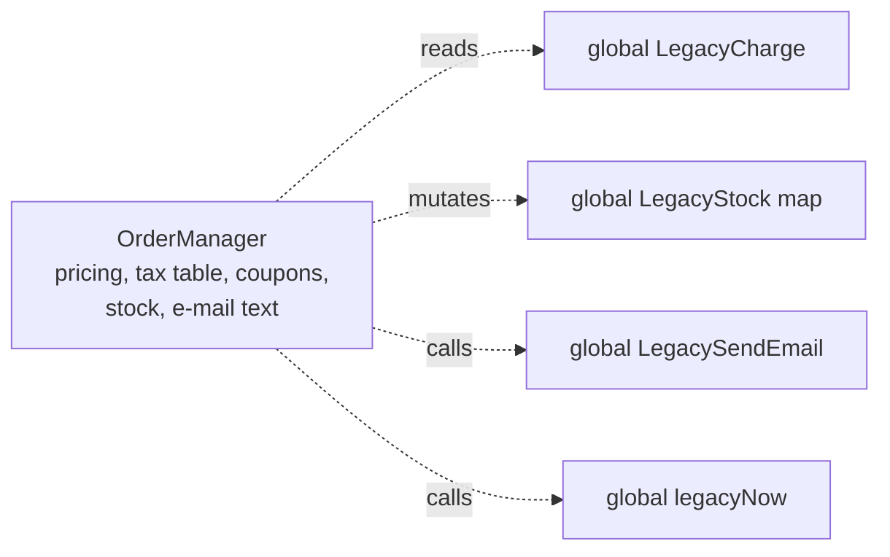
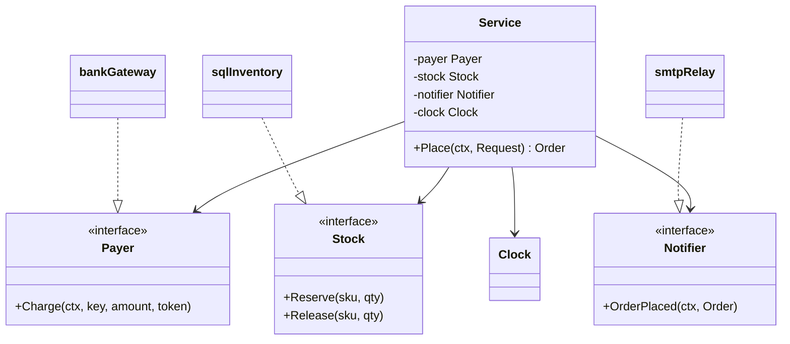
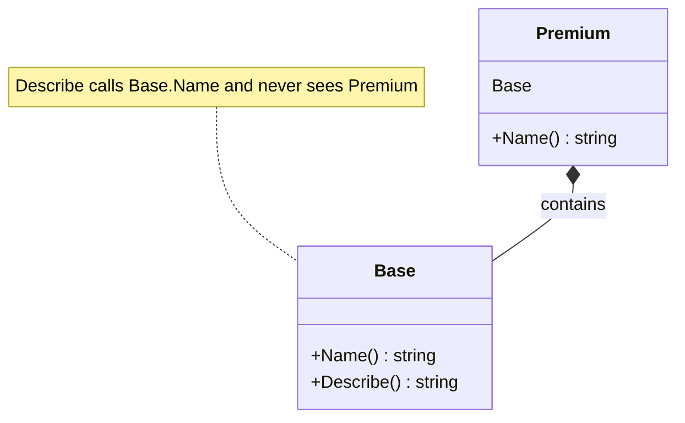
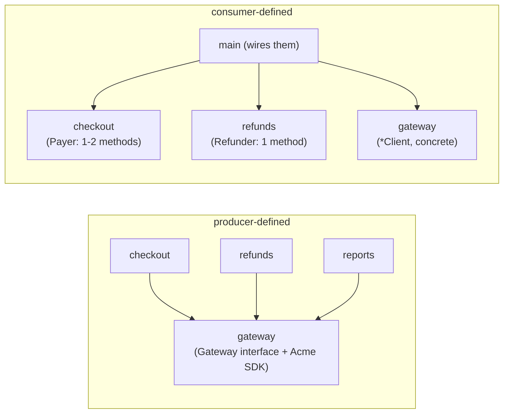
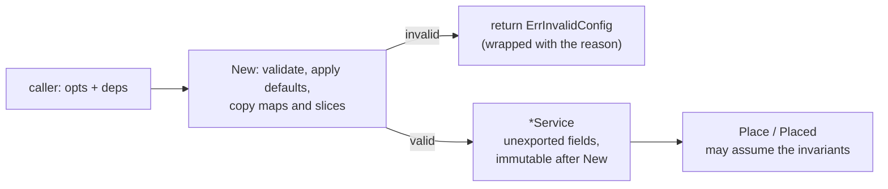
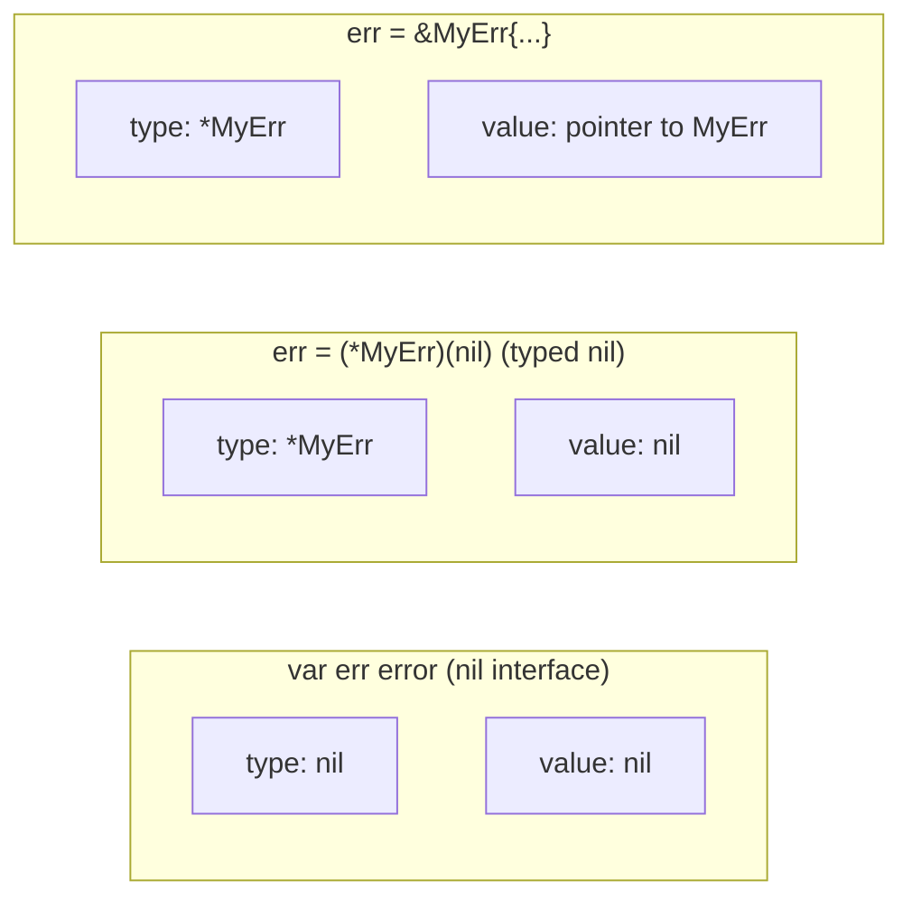

# B1 Unit 1 — Shaping types

> Time: ~6 h · CORE: §1–§5 · STRETCH: §6 · Lab: `labs/b1/checkout` (graded), `labs/b1/breakit` (Unit 1 exercises)

## Before you start

You should have finished B0 (or be able to explain who owns a goroutine's data, why `wg.Add` goes before `go`, and
what `go vet` says about a lock passed by value). This unit leans on three things from B0: shared state needs a
named owner, a type that contains a lock must not be copied, and tests of concurrent code need injected time and
hard deadlines. Warm-up; write your answers down before opening the box:

1. A type has `func (c Counter) Inc() { c.mu.Lock(); c.n++; c.mu.Unlock() }`. What does `go vet` report and what
   does the counter hold after 100 concurrent calls?
2. Who closes a channel, and what does `close` of an already-closed channel do?
3. Why did the B0 `fanout` lab take the vendors as a slice of small interface values instead of a slice of
   concrete adapter structs?

<details data-kind="answer"><summary>Warm-up answers</summary>

1. `copylocks`: "Inc passes lock by value". Each call locks and increments its own copy, so the original stays 0
   (you will reproduce this in `breakit`, §5). The lock protects nothing.
2. The sender/owner closes, never the receiver. Closing a closed channel panics.
3. So the tests could pass fakes (fast, failing, slow, stubborn, panicking) without any network. The interface
   was what made the capstone testable; this unit explains where such an interface should be declared and how big
   it should be.

</details>

---

## §1 The god object and why it hurts

### The failure story

*A design-pain story, composed from patterns typical of long-lived service code; the numbers are illustrative.*

The payments service of a credit-union platform has one type at its centre: `PaymentService`, ≈ 1,100 lines, 41
methods, imports from three vendor SDKs, a package-level `var db *sql.DB`, a package-level `var cfg Config` loaded
in `init()`, and calls to `time.Now()` in 17 places. It takes card payments through one provider, validates amounts,
applies fee rules, reserves a ledger hold, e-mails a receipt, and writes the audit row. Every feature of the last
two years went into it, because that is where the data already was.

Product asks for a fourth provider, an instant bank-transfer rail. The estimate is two days. It takes nine
working days. The new provider's code touches **six files**: the provider `switch` in `Charge`, the one in
`Refund`, the one in `Status`, the config struct, the audit mapper, and the receipt template (which prints the
provider name). It breaks **two tests** nobody wrote: both assert on log output. 70% of the 410 tests need a real
Postgres and the vendors' sandbox, so the suite takes ≈ 11 minutes and fails ≈ 3% of the time for reasons unrelated
to the change. The week after release, a nil-map panic at 02:10 takes the service down: the `providers` map was
filled in an `init()` in a file whose name changed in an unrelated tidy-up, and Go initialises a package's files in
the order they are presented to the compiler (normally sorted by name), so the map was now used before it was
filled. Four incidents in a quarter trace back to this one type; nobody on the team will touch it without a day of
fear.

None of this is exotic. The type is not *wrong*, it is *responsible for everything*: its reasons to change are
tax, fees, vendors, e-mail, auditing and time. Any change to any of them lands in the same file, and every test of
any of them needs everything else to exist.

### Predict

<!-- predict id="B1-U1-P01" -->
**Predict.** Here is the heart of that service, trimmed. **Before reading on, write down** (a) every distinct
*reason this function would have to change*, one line each, and (b) the single cut you would make first.

```go
var db *sql.DB // set in main()

func (s *PaymentService) Settle(ctx context.Context, id string) error {
	var amt int64
	var provider, email string
	err := db.QueryRowContext(ctx,
		`SELECT amount, provider, email FROM payments WHERE id=$1`, id).Scan(&amt, &provider, &email)
	if err != nil {
		return err
	}
	if amt > 500000 && time.Now().Hour() >= 22 { // after-hours limit
		return errors.New("limit exceeded")
	}
	switch provider {
	case "acme":
		resp, err := http.Post("https://api.acme.example/charge", "application/json", body(amt))
		if err != nil || resp.StatusCode != 200 {
			return fmt.Errorf("acme failed: %v", err)
		}
	case "zenpay":
		// ... a different request shape, a different failure mapping ...
	}
	smtp.SendMail("mail:25", nil, "billing@cu.example", []string{email}, receipt(id, amt))
	log.Printf("settled %s", id)
	return nil
}
```
<!-- /predict -->

<!-- predict id="B1-U1-P02" -->
**Predict.** You have two days, a 1,000-line type with 12 tests that mostly check log output, and a release due.
You may not rewrite it. What is the **first test** you write, before touching any production code, and what is it
for? Why is "add unit tests for each method" the wrong first move?
<!-- /predict -->

### Reveal

<details data-kind="reveal" data-for="B1-U1-P01">
<summary>Reveal</summary>

At least eight reasons to change: the SQL or the schema; the table's column set; the after-hours policy and its
threshold; the clock (hidden `time.Now`); each provider's request shape and failure mapping (one reason *per
provider*); the error vocabulary callers see (a string, `"limit exceeded"`); the receipt channel (SMTP
host and format); and the log format. Each is owned by a different person or team, which is the practical test of
"responsibility".

The first cut is the one with the biggest blast radius per line: **the providers**. The `switch` is the place where
new requirements arrive (a fourth provider) and where tests need the network. Extract "charge this amount" behind
one small interface *declared in the settlement code* (`Charge(ctx, key, amount) (receipt, error)`), pass it in,
and the `switch` becomes data: a map of name to implementation, built once in `main`. The second cut is the clock,
because it is the cheapest (one method) and the one that makes the after-hours rule testable. Tempting wrong
answer: "split it into `PaymentServiceA` and `PaymentServiceB` by method count". That moves lines but keeps every
dependency; you now have two god objects. Another tempting answer: "put an interface in front of `PaymentService`".
Callers then depend on 41 methods through an interface instead of through a struct, and nothing about the
internals improved.

</details>

<details data-kind="reveal" data-for="B1-U1-P02">
<summary>Reveal</summary>

A **characterisation test**: drive the *outside* of the code with realistic inputs, record what it does today
(prices, charges made, rows written, errors returned), and assert exactly that, bugs included. Its job is not to
prove the code is right; it is to detect *change*, so that every refactoring step can be checked in seconds. In
this unit's lab, `TestPlace_ParityWithLegacyOrderManager` is exactly this: it runs the legacy code and the new code
on 12 inputs and compares them.

Per-method unit tests are the wrong first move because the methods are not independently testable: each needs the
global DB, the clock and the network, so you would build the very fakes the refactoring is supposed to produce,
before the seams exist, and then throw the tests away when the seams move. Write the coarse test first, cut a seam,
keep the coarse test green, and let finer tests appear naturally on the new, small pieces.

</details>

### How it actually works

**What "god object" means mechanically.** A type is a god object when (1) it has many unrelated reasons to change,
(2) it reaches for ambient state (globals, `time.Now`, the environment, the network) instead of receiving what it
needs, and (3) its methods cannot be understood or tested without the rest. These three symptoms feed each other:
ambient state makes tests slow, slow tests are not written, untested code is scary, scary code grows by
accretion. The "single responsibility" principle is best read as *"one reason to change, one owner"*, not "does one
thing" (everything "does one thing" at some zoom level).

**The two pictures.** The first is what the legacy checkout in this unit's lab looks like; the second is the
target design you will build.





In the second picture the arrows between `Service` and the interfaces point *into* `checkout`: the adapters
(`bankGateway` and friends) depend on the core, not the other way round. That direction is the point (Unit 2 §2).

**The refactoring recipe** (it is the same one you will follow in the lab):

1. **Pin behaviour.** Characterisation tests around the outside (parity with the old code on realistic inputs).
2. **Find the seams.** A seam is a place where behaviour can be swapped without editing the code that uses it. The
   candidates are everything that does I/O or reads ambient state: the database, the network, the clock, random
   numbers, environment variables, the filesystem, global registries.
3. **Cut one seam at a time.** For each, declare the *smallest interface the user actually needs* in the user's
   package (§3), and pass the implementation in through the constructor (§4).
4. **Extract the pure core.** Pricing is arithmetic on integers: it needs no fakes at all. Move it into plain
   functions (`discountFor(subtotal, coupon)`) that tests call with a table. "Functional core, imperative shell"
   is the idea: keep decisions in pure functions and keep effects at the edge.
5. **Delete the globals** last, once nothing reads them. A global that nothing reads is a deleted line, not a risk.

```go
// The pure core: no interfaces, no fakes, no clock. 12 table rows test it completely.
func discountFor(subtotal Money, coupon string) Money {
	var bps int64
	if subtotal >= 50000 {
		bps = 500
	}
	switch strings.ToUpper(coupon) {
	case "SAVE10":
		bps = max(bps, 1000)
	case "SAVE20":
		if subtotal >= 20000 {
			bps = max(bps, 2000)
		}
	}
	return Money((int64(subtotal)*bps + 5000) / 10000) // half up, integer arithmetic
}
```

(`max` as a builtin is Go 1.21+.) Notice what is *not* an interface here: pricing has one implementation and no
side effects, so it is a function.

### Build it

Lab: **`labs/b1/checkout`**. This section is "part 0" of the lab:

1. Read `legacy.go` and write down (a) every package-level variable a test of `OrderManager` must swap and restore,
   (b) every place a caller must read an error *string*, (c) the three bugs the comments point at.
2. Read the exported API and comments in `checkout.go` (the target design) and run the stub:
   `go test -race ./labs/b1/checkout/ 2>&1 | head -40`. Everything fails; that is correct.
3. Start with the tests that need no side effects: `go test -race -run 'TestNew|TestPlace_PricingHardCoded' ./labs/b1/checkout/`.
   Implement `DefaultTaxRates`, the options, `New`, and the validate-and-price part of `Place`.

Acceptance for this part: `TestPlace_PricingHardCodedExample` and `TestPlace_ParityWithLegacyOrderManager`
(pricing assertions) pass. The rest of the lab continues in §3–§5.

### Break it

In your *passing* `discountFor`, replace the integer rounding with a float:
`return Money(float64(subtotal) * float64(bps) / 10000)`. Run
`go test -race -run Parity ./labs/b1/checkout/ -v`. Predict **which** parity cases fail and why before you run it.
Then ask: if you had written per-method unit tests with hand-computed expectations instead of a parity test,
would this have been caught?

<details data-kind="answer"><summary>What you should see</summary>

Exactly three of the 12 cases fail (measured on the reference solution): "coupon is case-insensitive" and "half-up
rounding of discount" (12,345 x 10% = 1,234.5) and "many lines" (35,859 x 20% = 7,171.8). A float-to-integer
conversion truncates toward zero (1,234 and 7,171) while the legacy code rounds half up (1,235 and 7,172). The other
nine pass because their discounts are exact multiples. The failure message prints `[subtotal discount tax total]` for both sides, so the one-cent drift is visible
immediately. Hand-computed expectations only catch it if the author chose inputs that exercise the rounding edge;
a parity test against the old behaviour catches every input you feed it, including the ones nobody thought were
interesting. One cent per order across ≈ 40,000 orders a month is the kind of discrepancy that reaches reconciliation
a quarter later.

</details>

### In the wild

- **`net/http`.** `http.Server` is a large *configuration* struct, but its behaviour is delegated through one-method
  interfaces (`Handler`, `ResponseWriter`) that you supply. The size lives in fields (data), not in an entangled
  set of behaviours. Compare to the legacy `OrderManager`: all behaviour and all collaborators in one place.
- **`database/sql`.** `*sql.DB` owns pooling, retries on bad connections and statement caching, and delegates
  everything vendor-specific to the small `database/sql/driver` interfaces (`Driver` has one method, `Conn` three).
  One concrete type for the generic mechanism, tiny interfaces at the seam to the outside world.
- **The vocabulary.** "Divergent Change" and "Large Class" are standard smells in Martin Fowler's *Refactoring*;
  seams and characterisation tests come from Michael Feathers' *Working Effectively with Legacy Code*. Both books
  are Java/C++-era but the moves transfer directly. The Go-specific part is *where the interface lives* (§3).

### Trade-offs

| Option | Wins when | Loses when | When the answer flips |
|---|---|---|---|
| Strangler refactor (parity test, cut one seam per PR) | Code is live and money moves through it; you cannot stop the world | The old code has no inputs you can replay, so parity cannot be established | When you cannot characterise behaviour at all, put a tracing/shadow-run layer in production first, then refactor |
| Rewrite | The model itself is wrong (not just the structure), or the old code is under 500 lines | Almost always for payment paths: you rediscover every edge case in production | If the domain is genuinely changing (new product line), a clean second system beside the first can be cheaper |
| Leave it, wrap it | It rarely changes and has no incidents | Each new feature has to be added inside it | The day a change needs more than one switch statement, start cutting seams |
| Split by file/package only | The type is large only because it is long, and the dependencies are already clean | The same globals and `time.Now` are still shared by everything | Splitting without cutting dependencies is cosmetic: check what each piece imports and reads |

### Senior bar

- **Failure modes.** Refactoring without a behaviour pin (silent price drift). Fixing bugs *during* the refactor so
  parity cannot be judged (separate commits: first parity, then deliberate behaviour changes with their own tests,
  as the lab does with the stock-leak fixes). Introducing an interface per struct "for testing" and freezing the
  bad boundary in place. Big-bang PRs of thousands of lines nobody can review.
- **Numbers.** Aim for seam-sized PRs (≈ 200–400 changed lines is a common review limit; a soft figure, not a
  rule). Suite time is a design metric: if 70% of tests need Postgres, the suite is ≈ 10 minutes, and developers
  stop running it. After extraction, the pure core and fake-driven service tests typically run in milliseconds.
- **Ops.** Keep the old path behind a flag and shadow-compare in production before switching money-moving code
  (run both, charge once, compare the would-be result). Track "files touched per feature" and "tests run in under 10 s"
  as the health numbers for a refactoring.

**Interviewer probes**

<details data-kind="answer"><summary>"You inherit a 1,000-line manager class with no tests. What do you do in the first week?"</summary>

Characterise before changing: capture real or recorded inputs, run them through the class with its collaborators
stubbed at the edges, and record outputs as a golden/parity suite. Then find the cheapest seam with the highest
blast radius (usually the vendor call and the clock), cut it with a consumer-side interface injected through the
constructor, keep the parity suite green, and ship that as a small PR. Repeat per seam. I would not rewrite, and I
would not start by splitting the file.

</details>

<details data-kind="answer"><summary>"How do you know when to stop splitting?"</summary>

When each piece has one owner and one reason to change, and a typical feature touches one file. Practical tests: can I
describe what the type does without "and"? Can I test its behaviour with fakes of five lines each? If two pieces are
always edited together, they are one thing and should be merged back. Splitting past that point is the
over-abstraction trap (§6 of Unit 2).

</details>

<details data-kind="answer"><summary>"Is a big struct always a god object?"</summary>

No. `http.Server` and `tls.Config` have many fields because they are configuration records. The smell is *behaviour*
and *collaborators* piling up, not field count. A struct with 20 plain data fields and no entangled logic is fine.

</details>

### Check yourself

1. Name the three symptoms that together define a god object, and which one makes tests slow.
2. Why do we write the parity test before extracting any interface?
3. In `discountFor`, why is there no interface and no fake?

<details data-kind="answer"><summary>Answers</summary>

1. Many unrelated reasons to change; reliance on ambient state (globals, clock, network); methods that cannot be
   understood or tested without the rest. Reliance on ambient state is what makes tests slow (real DB, real
   network).
2. Without it you cannot tell whether a step preserved behaviour. The test is the safety net that makes small,
   frequent, boring refactoring steps possible.
3. It is pure: integers in, integer out, no side effects, one implementation. A table test covers it. Interfaces
   are for seams to *effects*, not for arithmetic.

</details>

---

## §2 Go's object model: structs, methods and embedding

### The failure story

A team ports a Java-style provider hierarchy to Go. `BaseProvider` has `Process()` which calls `Validate()` then
`Send()`; `AcmeProvider` embeds `BaseProvider` and overrides `Validate()` to add an IBAN check. Production
accepts an invalid IBAN for six weeks: `Process` is a promoted method running with `BaseProvider` as its receiver,
so it calls `BaseProvider.Validate`, never the override. The fix is two lines; finding it cost ≈ 3 engineer-days
because the code "obviously" overrides the method.

The same team finds two more problems in the same quarter. An adapter embeds `*http.Client` "to save forwarding",
so every method of `http.Client` is now part of the adapter's public API and callers use `adapter.Get(url)`,
bypassing the circuit breaker that `adapter.Fetch` applies (≈ 20% of calls, found only in a latency review). And a
`Cache` struct embeds `sync.Mutex`, so `cache.Lock()` is callable from other packages, and one of them forgets the
matching `Unlock` on an error path: a ≈ 20-minute stall of the quote endpoint at the next peak. Three incidents,
≈ 40 engineer-hours, one root cause: embedding was treated as inheritance.

### Predict

<!-- predict id="B1-U1-P03" -->
**Predict.** This type and method come from the failure story. What does the program print? Then say, without
running anything, what you would change.

```go
type Base struct{}

func (Base) Name() string       { return "base" }
func (b Base) Describe() string { return "I am " + b.Name() }

type Premium struct{ Base }

func (Premium) Name() string { return "premium" }

func main() {
	fmt.Println(Premium{}.Describe())
	fmt.Println(Premium{}.Name())
}
```
<!-- /predict -->

<!-- predict id="B1-U1-P04" -->
**Predict.** Embedding an *interface* in a struct is a common way to override one method. Does this compile? What
does it print, and what happens on the last line?

```go
type Store interface {
	Get(string) (string, bool)
	Put(string, string)
}

type memStore struct{ m map[string]string }

func (s *memStore) Get(k string) (string, bool) { v, ok := s.m[k]; return v, ok }
func (s *memStore) Put(k, v string)             { s.m[k] = v }

type auditStore struct {
	Store
	puts []string
}

func (a *auditStore) Put(k, v string) { a.puts = append(a.puts, k); a.Store.Put(k, v) }

func main() {
	a := &auditStore{Store: &memStore{m: map[string]string{}}}
	a.Put("x", "1")
	_, ok := a.Get("x")
	fmt.Println(ok, a.puts)

	var b auditStore
	b.Put("y", "2")
}
```
<!-- /predict -->

### Reveal

<details data-kind="reveal" data-for="B1-U1-P03">
<summary>Reveal</summary>

```
I am base
premium
```

`Premium{}.Describe()` is shorthand for `Premium{}.Base.Describe()`. Inside `Describe`, the receiver `b` has type
`Base`, so `b.Name()` is `Base.Name`. Go has no virtual dispatch through embedding: the embedded value does not
know it is embedded. `Premium{}.Name()` is `premium` because `Premium` declares its own `Name`, which *shadows* the
promoted one at the shallower depth. The fix is to stop expecting an override: make `Describe` a function that
takes the thing whose name it needs (`func Describe(n Namer) string`, with `type Namer interface{ Name() string }`),
or give `Premium` its own `Describe`. Tempting wrong answer: "I am premium" (the Java/C++ expectation).

</details>

<details data-kind="reveal" data-for="B1-U1-P04">
<summary>Reveal</summary>

It compiles. The first two lines print `true [x]`: `auditStore` promotes `Get` from the embedded `Store` and
overrides `Put` to record the key before delegating. The last line **panics** with
`invalid memory address or nil pointer dereference`: `var b auditStore` has a nil `Store` field, the compiler cannot
know that, and `a.Store.Put` calls a method on a nil interface. Embedding an interface to override one method
(`sort.Reverse` does it with `sort.Interface`) is a legitimate technique, but the embedded field must be set, and
nothing in the type system enforces that. Make the zero value harmless, or hide the type behind a constructor that
takes the inner `Store` and is the only way to build one (§4). Tempting wrong answer: "compile error: `auditStore`
doesn't implement `Get`". It does, through promotion.

</details>

### How it actually works

**Go's object model in four sentences.** A *struct* is a record of fields. A *method* is a function with a receiver
parameter, declared next to the type. An *interface* is a set of method signatures, satisfied implicitly by any type
that has those methods. There is *no inheritance*: types do not have parents, and subtyping happens only between a
concrete type and an interface it satisfies.

**Method sets** decide interface satisfaction:

| Receiver of the method | In the method set of `T` | In the method set of `*T` |
|---|---|---|
| `func (t T) M()` | yes | yes |
| `func (t *T) M()` | **no** | yes |

So a `T` value does not satisfy an interface that needs a pointer-receiver method (the compile error from §5's
lab exercise: "method M has pointer receiver"). A variable of type `T` is *addressable*, so `v.M()` works with
automatic `&v`; a map element or a function return value is not addressable and `m[k].M()` does not compile for
pointer methods.

**Embedding** is a struct field declared without a name:

```go
type ReadWriter struct {
	*Reader // field named Reader
	*Writer // field named Writer
}
```

The compiler *promotes* the embedded type's fields and methods to the outer type, resolving selectors by depth:
a name declared on the outer type shadows the promoted one; two promoted names at the same depth are ambiguous
(a compile error when used, and the method silently drops out of the method set). Promotion is only syntax. The
promoted method still runs with the **embedded value as its receiver**.



**Rules of thumb for embedding:**

- Embed a type when you want its *entire* API on your type and you accept every future method it gains. This is
  rare outside the standard library (`bufio.ReadWriter` embeds `*Reader` and `*Writer`).
- Otherwise use a **named field** and write the few forwarding methods. A named field keeps the API surface
  deliberate. An adapter should expose `Fetch`, not all of `http.Client`.
- Never embed `sync.Mutex` (or any lock) in a type with exported API. `Lock` and `Unlock` become part of that API.
  Use `mu sync.Mutex`.
- Embed an **interface** to build decorators and partial test doubles that override one or two methods. Guard
  against the nil embedded value (constructor), and remember a wrapper hides *optional* interfaces of the wrapped
  value: wrapping an `http.ResponseWriter` loses `Flusher` and `Hijacker` unless you forward them or provide
  `Unwrap() http.ResponseWriter` for `http.ResponseController` (Go 1.20).
- Watch promotion of methods you did not intend: a struct embedding `time.Time` promotes `MarshalJSON`, so the
  whole struct marshals as a bare timestamp. Embedding is promotion *including* interfaces like `json.Marshaler`
  and `fmt.Stringer`.

**Composition is not delegation by default.** In Go you choose, per dependency, between a named field (explicit,
what you want 90% of the time), an embedded field (promotion), and an interface-typed field (swappable). Choose
on the question: "Is this part of *my* identity or something I *use*?" A `Service` uses a `Payer`; it is not a kind of
payer.

### Build it

Lab: **`labs/b1/checkout`**.

- `Service` holds `payer`, `stock` and `opts` as *named* fields; nothing is embedded, so the exported API is exactly
  `New`, `Place` and `Placed`. Check yours with `go doc ./labs/b1/checkout Service`.
- `ClockFunc` is the `http.HandlerFunc` trick: a function type with a method so a plain func satisfies `Clock`.
  `ClockFunc` is given; `TestPlace_UsesInjectedClockAndReturnsReceipt` uses it.
- In `labs/b1/breakit`, work the embedding exercise (below).

### Break it

1. Run `go test -tags breakit -run '^TestEmbeddingIsNotInheritance$' ./labs/b1/breakit/`, read the failure, and fix
   it with a `Namer` interface. Predict first: will the test file still compile when `Premium` also embeds a second
   type that has a `Name()` method?
2. In a scratch file, give `Registry` (from `nilmap_test.go`) an embedded `sync.Mutex` and call `r.Lock()` from the
   test. Does it compile? What does that tell you about the API you just published?

<details data-kind="answer"><summary>What you should see</summary>

1. The failure is `Describe() = "I am base", want "I am premium"`. After the fix the test passes. With two embedded
   types that both declare `Name()` at the same depth, the program **still compiles** as long as nothing calls
   `Premium{}.Name()` (or assigns it to an interface that needs `Name`): the ambiguity is reported at the use site
   ("ambiguous selector"). This is why embedding two types with overlapping method sets is a landmine that only
   explodes later.
2. It compiles: `Lock` and `Unlock` are now exported methods of `Registry`, in its godoc, callable and
   misusable from any package. Rename the field to `mu sync.Mutex` and the compiler stops other packages from
   touching it.

</details>

### In the wild

- **`sort.Reverse`** is `type reverse struct{ Interface }` with one overriding method
  (`Less(i, j int) bool { return r.Interface.Less(j, i) }`). The canonical use of interface embedding: the three-method
  `sort.Interface` is satisfied by promotion plus one override. (It also shows the zero-value hazard: a `reverse{}`
  with nil `Interface` would panic on use, so it is unexported and built only by `Reverse`.)
- **`bufio.ReadWriter`** embeds `*Reader` and `*Writer`: a case where wanting the whole API of both is exactly right.
- **`http.ResponseWriter` middleware.** Logging and metrics middleware commonly embed `http.ResponseWriter` in a
  struct to capture the status code. The standard library solved the "lost optional interfaces" problem in Go 1.20
  with `http.ResponseController` and the convention of an `Unwrap() http.ResponseWriter` method.
- **Embedding `time.Time`** and accidentally promoting `MarshalJSON` is a well-known gotcha in Go code
  review (documented widely in community write-ups; TODO-VERIFY: pin a specific reference before quoting it in an
  interview).

### Trade-offs

| Option | Wins when | Loses when | When the answer flips |
|---|---|---|---|
| Named field + explicit forwarding methods | You want a deliberate, minimal API (almost always) | You forward 15 methods unchanged | If you genuinely want the whole inner API (a thin typed alias), embed |
| Embed a struct | The outer type *is* the inner one plus extras (`bufio.ReadWriter`) | You expected overriding semantics; the inner type grows methods you do not want | If you only need part of the API, switch to a named field |
| Embed an interface | Decorator or test double that overrides 1–2 methods | Nil embedded value panics at call time; hides optional interfaces | If the interface is large and you override most methods, implement it fully instead |
| Compose interfaces (`io.ReadCloser`) | A consumer needs several capabilities of one value | You compose big interfaces "just in case" | If one consumer needs only `Read`, ask for `io.Reader` |

### Senior bar

- **Failure modes.** Expecting overrides (the story). Promoted methods widening an exported API (breaking changes
  when the inner type adds a method that collides). Ambiguous selectors surfacing months later. Nil embedded
  interface. Embedded lock in an exported type. Copying a struct that embeds a lock (§5).
- **Numbers.** `sort.Interface` has 3 methods, `io.Reader` 1, `database/sql/driver.Conn` 3, `http.Handler` 1:
  the standard library's interfaces are tiny by design. If your interface needs a table to describe its methods, it
  is a type, not a seam.
- **Ops/maintenance.** Embedding couples your type's API to someone else's release cadence. In code review treat
  any embedded field in an *exported* struct as an API decision requiring a sentence of justification. Wrapper types
  are where observability goes (metrics, tracing): check they forward optional interfaces.

**Interviewer probes**

<details data-kind="answer"><summary>"Go has no inheritance. How do you do polymorphism?"</summary>

Through interfaces: a function accepts an interface, any type with the right methods works, and the type does not
declare that it implements it. For shared implementation I use composition: a named field and a method that
delegates, or a small helper function that several types call. When I want to override one method of an existing
implementation I embed the interface and define the one method, as `sort.Reverse` does, being careful about a nil
embedded value.

</details>

<details data-kind="answer"><summary>"What is the difference between embedding and a named field?"</summary>

Embedding promotes the inner type's exported fields and methods to the outer type's method set, which makes the
outer type satisfy interfaces the inner one does. It does not change the receiver: promoted methods operate on the
inner value and cannot see the outer one. A named field promotes nothing; you forward explicitly. I default to a
named field because it keeps the API deliberate and the dependency visible.

</details>

<details data-kind="answer"><summary>"Why does `Premium{}` not satisfy my interface after I embedded a second type?"</summary>

If both embedded types supply a method with the same name at the same depth, the selector is ambiguous and the
method is excluded from the outer method set, so the interface is not satisfied. The compiler reports it where you
use the type as the interface. The fix is to define the method on the outer type and say which one wins.

</details>

### Check yourself

1. A promoted method calls another method that the outer type overrides. Which one runs?
2. Why is `struct{ sync.Mutex; ... }` usually wrong for an exported type?
3. What is the compile-time and run-time behaviour of a nil interface embedded in a struct?

<details data-kind="answer"><summary>Answers</summary>

1. The embedded type's own version: the promoted method's receiver is the embedded value, which does not know about
   the outer type.
2. It exports `Lock`/`Unlock` as part of the type's API, so any caller can take the lock and forget to release
   it. Use an unexported field.
3. It compiles (the promoted methods exist); calling one panics with a nil pointer dereference at run time. Build
   such wrappers only through a constructor, or make the zero value safe.

</details>

---
## §3 Interfaces defined by the consumer

### The failure story

The checkout package imports `gateway`, because that is where the `Gateway` interface lives: 14 methods (`Charge`,
`Refund`, `Void`, `Capture`, `Status`, `ListSettlements`, ...) defined next to the one implementation, `acme`, in the
same package as the vendor SDK wrapper. `gateway.New()` returns the interface. Checkout calls exactly **two** of the
14 methods.

To test checkout, the team writes a 14-method fake in `checkout_test.go`; the 12 methods checkout never calls are
`panic("unused")`. When the platform adds a `Dispute` method for chargebacks, seven fakes in five packages stop
compiling (all of them written by people who never call `Dispute`), and that fix is a separate 40-file PR. The
import graph is worse: *everything* that wants to charge a card imports `gateway` and therefore the vendor SDK, so
`go build ./...` for a package that only formats receipts drags in 61 transitive packages and adds ≈ 35 s to a
cold CI build (≈ figures from this story). Meanwhile somebody adds `UserServiceInterface` and `UserServiceImpl`
with `mockgen`, and the repository acquires 3,400 lines of generated mocks that assert call *order* and break on
every refactor.

### Predict

<!-- predict id="B1-U1-P05" -->
**Predict.** Which of these declarations is in the wrong package, and what would you move where? Write down the
new signature of the constructor too.

```
checkout/                 // package checkout: orders, pricing, the Service
    service.go            //   imports "acme/gateway"; calls g.Charge and g.Refund only
gateway/                  // package gateway: wraps the Acme SDK
    gateway.go            //   type Gateway interface { Charge; Refund; Void; Capture; Status; ... 14 methods }
    acme.go               //   type acme struct{...};  func New(cfg Config) Gateway { return &acme{...} }
```
<!-- /predict -->

<!-- predict id="B1-U1-P06" -->
**Predict.** Which of the labelled lines compile? For each that doesn't, say what the compiler reports.

```go
type Counter struct{ n int }

func (c *Counter) Inc() { c.n++ }

type Incer interface{ Inc() }

func main() {
	var a Incer = Counter{}          // A
	c := Counter{}
	c.Inc()                          // B
	var b Incer = &c                 // C
	m := map[string]Counter{"x": {}}
	m["x"].Inc()                     // D
	_, _ = a, b
}
```
<!-- /predict -->

### Reveal

<details data-kind="reveal" data-for="B1-U1-P05">
<summary>Reveal</summary>

The `Gateway` interface is in the wrong package, and `New` returns the wrong thing. An interface belongs in the
package that *uses* the values, and it should list only the methods that package calls. Checkout should declare:

```go
// in package checkout
type Payer interface {
	Charge(ctx context.Context, key string, amount Money, token string) (receipt string, err error)
	Refund(ctx context.Context, receipt string, amount Money) error
}
func New(p Payer, ...) (*Service, error)
```

and `gateway.New` should return the concrete `*gateway.Client` ("accept interfaces, return structs"). Nothing needs
to change in the vendor package for this to work: `*gateway.Client` satisfies `checkout.Payer` implicitly, because
Go interfaces are satisfied structurally. Checkout no longer imports `gateway` at all (the wiring happens in `main`),
the test fake has two methods, and adding `Dispute` to the client touches nobody who does not dispute. Tempting wrong
answers: "keep the interface in `gateway` but split it into smaller ones" (better, but the importer still depends on
the producer); "create a third package `interfaces`" (a dumping ground that every package imports: Unit 2 §2).

</details>

<details data-kind="reveal" data-for="B1-U1-P06">
<summary>Reveal</summary>

A does **not** compile: `cannot use Counter{} (value of struct type Counter) as Incer value in variable declaration:
Counter does not implement Incer (method Inc has pointer receiver)`. The method set of `Counter` does not include
pointer-receiver methods; the method set of `*Counter` does. B compiles: `c` is an addressable variable, so `c.Inc()`
is shorthand for `(&c).Inc()`. C compiles: `&c` is a `*Counter`. D does **not** compile: `cannot call pointer method
Inc on Counter`, because map elements are not addressable (the map may move them when it grows). This is why a type
that is meant to be used through interfaces and has any mutating method is passed around as a pointer. Tempting
wrong answer: "A is fine because the compiler takes the address automatically": that rule applies only to
addressable *variables* in a method call expression, never to interface assignment.

</details>

### How it actually works

**Structural typing and the consequence.** A type satisfies an interface if it has the methods; it never says so. A
producer cannot know every consumer, but a consumer knows exactly what it needs. So the **consumer** is the right
place to write the interface down, and an interface that lists only what the consumer calls is the *smallest*
dependency possible. This is also what the Go Code Review Comments say: interfaces generally belong in the package
that uses values of the interface type, and you should not define interfaces on the implementer side "for mocking".



In the "after" picture `checkout` and `refunds` do not import `gateway`. `main` is the only place that knows both
sides. Nothing the compiler needs from `gateway` is visible to checkout except a type that happens to fit.

**Guidelines that follow:**

1. **Accept interfaces, return structs.** A function parameter should be the narrowest interface that works
   (`io.Reader`, not `*os.File`); a constructor should return the concrete type so callers can use all of it and
   consumers can wrap it in their own interfaces. Exceptions are real: `errors` are returned as the `error`
   interface; some constructors return an interface because the concrete type is deliberately hidden and varies
   (for example `crypto/cipher.NewGCM` returns `cipher.AEAD`).
2. **Make interfaces small.** One to three methods is typical in the standard library. Method count is a coupling
   metric: every method is a promise every implementer and fake must keep. "The bigger the interface, the weaker the
   abstraction" is a Go proverb for a reason.
3. **Name by behaviour.** One-method interfaces are named with an `-er` suffix (`Reader`, `Payer`, `Notifier`). A
   consumer-side interface can also be named for its *role* in that package (`Stock`, `Clock`).
4. **Compose, don't enlarge.** If one consumer needs two capabilities, embed two small interfaces
   (`io.ReadCloser`), rather than inventing a new big one.
5. **Optional capabilities by interface upgrade.** The caller checks `if f, ok := w.(http.Flusher); ok`. The standard
   library uses this heavily (`io.WriterTo`, `io.ReaderFrom`, `database/sql/driver`'s `Pinger`,
   `QueryerContext`, `ExecerContext`): the base interface stays tiny and fast paths are opt-in.
6. **Adapters are function types.** `http.HandlerFunc` and the lab's `ClockFunc` and `dispatch.SinkFunc` let a plain
   function satisfy a one-method interface, which makes tests and glue code a one-liner.

**When not to define an interface.**

- There is one implementation, it is deterministic and fast (a pure function, a value type, `Money`). Use the
  concrete type.
- The seam you want is already provided by the standard library at a lower level: don't mock `*http.Client`, use
  `httptest.NewServer` or a fake `http.RoundTripper`; don't mock the filesystem, use `fstest.MapFS` with `fs.FS`.
- You are defining it "in case we need another implementation later". Add it when the second one (or the first
  test that needs one) arrives; Go makes that edit local and cheap.
- It would be exported only so a test in another package can fake it. Keep it unexported in the consumer.

**Sentinel errors and dependency direction.** The consumer interface says "`Reserve` fails with out-of-stock". How
does an adapter signal that without importing the consumer? Two honest options: the adapter imports the consumer's
package for the sentinel (`checkout.ErrOutOfStock`), which is fine because the dependency then points inward, or
the adapter returns its own error and `main` wraps it in a small adapter shim that maps it. The lab picks the first:
`ErrOutOfStock` and `ErrPaymentDeclined` are declared in `checkout`, the fakes return them, and `Place` wraps them
with `%w`.

### Build it

Lab: **`labs/b1/checkout`**. In `checkout.go` the interfaces `Payer`, `Stock`, `Notifier` and `Clock` are given.
Your task is the code that *uses* them:

- `Place` reserves each line in order, releases everything it reserved on any failure (in reverse order), charges
  with `req.ID` as the idempotency key, and wraps adapter errors with `%w` and context so `errors.Is`/`errors.As`
  reach the adapter's own error.
- Read the fakes at the top of `checkout_test.go`: `fakePayer`, `fakeStock`, `fakeNotifier`, `fixedClock`. They are
  5–20 lines each, in-memory, and need no mocking library. That is the evidence that the interfaces are the right
  size.
- Acceptance: `TestPlace_OutOfStockRollsBackEarlierReservations`,
  `TestPlace_PaymentDeclinedReleasesAllStockAndKeepsTheCause`, `TestPlace_ChargeUsesOrderIDAsIdempotencyKey`,
  `TestPlace_NotifierFailureDoesNotFailAPaidOrder`, `TestPlace_NotifierIsOptional`,
  `TestExtension_PayerDecoratorPlugsInWithoutChangingService`, and the parity test for the full flow.

### Break it

The fat-interface exercise in `labs/b1/breakit`. In `fat.go`, add `Watch(key string) <-chan string` to the `Store`
interface and run `go test -tags breakit -run '^$' ./labs/b1/breakit/`. **Count the compile errors before you
look.** Then change `Greeting` to take a one-method `Getter` declared next to it and run the command again.

<details data-kind="answer"><summary>What you should see</summary>

Four errors: `*MemStore does not implement Store (missing method Watch)` in `fat.go`, and one each for
`staticStore`, `emptyStore` and `*spyStore` in `fat_test.go`. Three of the four implementers never needed `Watch`.
After you narrow `Greeting` to `Getter`, the three fakes are no longer passed as a `Store`, so they stop mattering:
they already have a `Get` method and satisfy `Getter`, and you can delete their `panic("unused")` methods. Only
`MemStore`, the one real implementation behind the `var _ Store` assertion, still has to grow `Watch`. The change request that cost four edits now costs one: that is "interface segregation" without
any ceremony, and it is the whole argument for consumer-side interfaces.

</details>

### In the wild

- **`io.Reader` / `io.Writer`.** One method each. `io.Copy(dst Writer, src Reader)` works with files, sockets, HTTP
  bodies, gzip streams and `strings.NewReader` because it asks for almost nothing. The optional-upgrade pattern
  lives alongside: `io.Copy` checks for `WriterTo`/`ReaderFrom` for a fast path. The read contract (such as
  returning `io.EOF` itself, unwrapped, so callers may compare with `==`) is documented in prose, since the type
  system can't express it.
- **`net/http.RoundTripper`.** One method, `RoundTrip(*Request) (*Response, error)`. Retry, tracing, auth and fake
  backends are all `RoundTripper` wrappers; `http.Client{Transport: myWrapper}` plugs them in. That is the right
  "mock" for HTTP: a few lines of code, no generated mock.
- **`io/fs.FS` and `testing/fstest`.** `fs.FS` is a single `Open(name string) (File, error)`;
  `fstest.MapFS` is an in-memory implementation, and `fstest.TestFS` checks that an `fs.FS` obeys the full contract
  (an example of a *contract test*, Unit 2 §3).
- **`database/sql/driver`.** `Conn` has three methods (`Prepare`, `Close`, `Begin`); extra abilities such as
  `Pinger`, `ExecerContext` and `QueryerContext` are optional interfaces checked at run time.
- **`sort.Interface`** has three methods (`Len`, `Less`, `Swap`): the upper end of "small".
- **Kubernetes client-go** offers a very large `kubernetes.Interface` and ships a fake clientset for tests, a
  pragmatic response to a fat interface you don't control (TODO-VERIFY: exact constructor names of the fake
  clientset differ across client-go versions). In your own code, prefer to depend on a two-method interface of your
  own over faking a 100-method one.

### Trade-offs

| Option | Wins when | Loses when | When the answer flips |
|---|---|---|---|
| Consumer-defined small interface | A package uses an external capability (payment, stock, mail, clock) | The same 1-method interface gets copied into 8 packages and drifts | Duplicating one method signature is cheaper than a shared package; consolidate only when the semantics (not just the signature) are shared, as with `io.Reader` |
| Producer-defined interface | A *plugin contract* many third parties implement (`database/sql/driver`, `http.Handler`), versioned and documented | It is defined only to allow mocking one implementation | When the interface is a public protocol, own it in the producer and keep it tiny |
| Concrete type + fake at a lower level (`httptest`, `fstest`, `RoundTripper`) | The stdlib already offers the seam | You need to inject failures the lower-level fake cannot produce | If the failure you need is business-level ("declined", "out of stock"), a consumer interface reads better |
| Generated mocks of a big interface | Large legacy interface you cannot change, call-order assertions are truly the requirement | Refactors break tests that asserted implementation details | Prefer fakes with state; use generated mocks only at hard boundaries |

### Senior bar

- **Failure modes.** Interface per struct (`FooInterface` + `FooImpl`) multiplying files without a second
  implementation. Fat interfaces whose fakes have 12 `panic("unused")` stubs. Returning interfaces from
  constructors so callers cannot reach the concrete API. Interface values compared with `==` or stored as map keys
  when the dynamic type is uncomparable (a runtime panic). Typed-nil in the interface (§5).
- **Numbers.** Standard-library interfaces: `io.Reader` 1 method, `http.Handler` 1, `driver.Conn` 3, `sort.Interface` 3.
  A consumer that calls 2 of 14 methods should depend on an interface of 2. A fake you cannot write in under ≈ 20
  lines is a hint that the interface is too big.
- **Ops/maintenance.** Smaller interfaces make additive changes (new vendor feature) local. Review rule of thumb:
  *new interface in a PR → ask "who is the consumer, and what is the second implementation or the test that needs
  it?"*. For banking adapters, keep the interface in the service package and the vendor-specific types in the
  adapter, so a vendor SDK upgrade never forces a change in domain code.

**Interviewer probes**

<details data-kind="answer"><summary>"Why do you define interfaces where they're used rather than next to the implementation?"</summary>

Because Go interfaces are implicit, the implementation never needs to know about the interface, and only the
consumer knows which subset of behaviour it depends on. Defining it at the consumer keeps it minimal, removes the
import of the producer (so the vendor SDK doesn't leak into domain code), and makes testing trivial because the
fake satisfies a two-method interface. Defining it at the producer couples every consumer to the full method set
and invites a growing fat interface.

</details>

<details data-kind="answer"><summary>"'Accept interfaces, return structs': when do you return an interface?"</summary>

When the concrete type is deliberately hidden or varies: `error` itself, `cipher.NewGCM` returning `cipher.AEAD`,
a factory choosing among implementations at run time. Otherwise a concrete return lets callers use the whole API
and lets *them* define the interface they need. Returning an interface from a constructor with one implementation
usually just hides methods and forces a type assertion later.

</details>

<details data-kind="answer"><summary>"Your teammate wants an interface for every service so we can mock it. Response?"</summary>

I'd ask what the test needs to control. If the service is called by one or two consumers, each of those consumers can
declare the 1–3 methods it uses, defined where it is used, only when a test or second implementation requires it.
Fakes with state beat generated mocks for most cases, since they survive refactors. An interface per struct,
mirrored by a mock file, is cost with no design benefit.

</details>

### Check yourself

1. Why does `checkout` not import the package that implements `Payer`?
2. Which of `Counter{}` and `&Counter{}` satisfies `interface{ Inc() }` if `Inc` has a pointer receiver?
3. Give two situations where you would not introduce an interface.

<details data-kind="answer"><summary>Answers</summary>

1. The interface is declared in `checkout`, and Go's structural typing means the adapter satisfies it without either
   package knowing about the other; `main` wires them. The domain package therefore has no dependency on the vendor
   SDK.
2. Only `&Counter{}` (a `*Counter`): pointer-receiver methods are in the method set of `*T`, not `T`.
3. A pure value-computing function with one implementation; a case where the standard library already offers the seam
   (`httptest`, `fstest.MapFS`, a fake `RoundTripper`); an "in case we need it later" abstraction with no second
   implementation or test that needs it.

</details>

---

## §4 Constructors, invariants and zero values

### The failure story

The platform's tenant configuration is a struct with 11 fields, built with struct literals at 14 call sites.
Three of them forget `Timeout`. `http.Client{Timeout: 0}` means *no timeout*, so when a vendor hangs, those three
code paths hold goroutines and connections open until the OS gives up (minutes), and a latency incident that should
have been a 2-second blip becomes a 40-minute brownout. A second incident: `NewClient(url, user, pass, 5, 30, true)`
has six positional arguments; two callers swap `retries` (5) and `timeoutSeconds` (30), which compiles because both
are `int`: 30 retries with a 5-second timeout hammer a flaky vendor. A third: one tenant's config lacks `Region`,
silently falls through to a default tax table, and mis-taxes fees for three days before reconciliation notices
(illustrative numbers). Nothing in the type system or the constructor says "a Config without a Timeout is not a
Config".

### Predict

<!-- predict id="B1-U1-P07" -->
**Predict.** Which of these zero values are safe to use immediately, and which panic (or silently misbehave)?
Write down a verdict for each before you run anything.

```go
var b bytes.Buffer;  b.WriteString("hi")                  // 1
var m map[string]int; m["a"]++                            // 2
var s []int;          s = append(s, 1)                    // 3
var t time.Timer;     t.Reset(time.Second)                // 4
var c http.Client;    c.Get("https://vendor.example/")    // 5 (assume the network works)
var mu sync.Mutex;    mu.Lock(); mu.Unlock()              // 6
```
<!-- /predict -->

<!-- predict id="B1-U1-P08" -->
**Predict.** A vendor client has two required inputs (base URL, API key) and six optional ones (timeout, retries,
transport, logger, metrics, tenant header). Compare (a) a `Config` struct passed to `New`, and (b)
`New(url, key string, opts ...Option)` with functional options. For each of these, say which design is better and why:
adding a seventh option without touching callers; making the API key impossible to forget; showing all options and
defaults in one place; `New(url, key, WithRetries(3), WithRetries(5))`; and loading the settings from a YAML file.
<!-- /predict -->

### Reveal

<details data-kind="reveal" data-for="B1-U1-P07">
<summary>Reveal</summary>

1 works (`bytes.Buffer`'s zero value is an empty buffer ready to use). 2 **panics**: `assignment to entry in nil map`
(reading a nil map is fine, writing is not). 3 works (`append` on a nil slice allocates). 4 **panics**:
`time: Reset called on uninitialized Timer` (timers must come from `NewTimer`/`AfterFunc`). 5 works, but silently:
the zero `http.Client` uses `http.DefaultTransport` and has `Timeout == 0`, which means **no timeout**, a zero
value that is useful *and* dangerous. 6 works (`sync.Mutex` zero value is unlocked). I ran 2, 4 and 5 to check; run
them yourself.

The lesson is not "zero values are bad" but "decide, per type, what the zero value means and make that decision
visible". Where a safe default exists, honour it (the Go proverb is *make the zero value useful*). Where it cannot
exist (a client needs a URL), make the invalid state hard to construct. Tempting wrong answer: "Go zero-initialises
everything, so everything is initialised". It is *zeroed*, not *valid*.

</details>

<details data-kind="reveal" data-for="B1-U1-P08">
<summary>Reveal</summary>

- **Adding a seventh option.** Options win: a new `WithX` function breaks no caller. A config struct also survives
  (new field, zero value = default) as long as every field's zero value means "use the default"; if some fields have
  non-zero defaults (retries = 3), callers must distinguish "unset" from "0", which is awkward with plain values.
- **Making the API key impossible to forget.** Positional required parameters (`New(url, key, opts...)`) win: the
  compiler enforces them. A struct can't, except via `Validate()` at run time.
- **All options and defaults in one place.** The struct wins: `go doc` shows every field, and `Config{}` can be
  printed and logged. With options, defaults hide in `New`'s body and docs are scattered over N functions.
- **`WithRetries(3), WithRetries(5)`.** Last one wins unless you detect and reject duplicates; an option pattern
  forces you to define ordering semantics. A struct has one value per field.
- **YAML.** The struct wins: it deserialises directly. Options are code, not data; you would write a
  `FromConfig(cfg) []Option` bridge.

Verdict: neither dominates. A good hybrid is the one the lab uses: required dependencies positional, optional
behaviour as options, and a plain exported config struct for anything that comes from files. Tempting wrong answer:
"functional options are always more idiomatic". They are *popular* (grpc-go, zap), not mandatory.

</details>

### How it actually works

**Invariants.** An invariant is a fact about a value that every method may assume ("`maxLines >= 1`", "the tax table
is not nil and every rate is in [0, 10000]", "the balance is never negative"). If a method has to re-check it, the
type isn't enforcing anything. Enforcing an invariant needs three things: (1) a **single door** where values are
created and validated, (2) **no side doors**: unexported fields so other packages can't write an invalid state,
and (3) **no aliasing** of mutable inputs: copy maps and slices on the way in (and out), or the caller can break
your invariant later.



**Constructor rules.**

- Name it `New` (one main type per package) or `NewX`. Return the concrete type and an `error`: `func New(...) (*Service, error)`.
  Use `Must...` variants that panic only for compile-time-constant inputs at program start (`regexp.MustCompile`,
  `template.Must`), never for runtime input.
- Required dependencies as positional parameters, ideally ≤ 3; a nil check is cheap and turns a future nil-pointer
  panic into an immediate, specific error: `New(nil, stock)` returns `ErrInvalidConfig` ("payer is required").
- Optional behaviour as options or a config struct with usable zero values.
- Validate *relations* between fields as well as each field (`MinRetries <= MaxRetries`).
- Wrap constructor failures with a sentinel (`ErrInvalidConfig`) plus the reason, so a caller can both branch on the
  class and print the cause.

**The options patterns, concretely.**

```go
// Config struct: explicit, serialisable. Zero value must mean "default".
type Config struct {
	Timeout time.Duration // 0 = 10s (NOT "no timeout")
	Retries int           // 0 = 3; use -1 for "none" (document the oddity!)
}

func (c Config) withDefaults() Config {
	if c.Timeout == 0 {
		c.Timeout = 10 * time.Second
	}
	if c.Retries == 0 {
		c.Retries = 3
	}
	return c
}

// Functional options: extensible, validated where applied.
type Option func(*options) error

func WithTimeout(d time.Duration) Option {
	return func(o *options) error {
		if d <= 0 {
			return fmt.Errorf("WithTimeout(%v): must be positive", d)
		}
		o.timeout = d
		return nil
	}
}

func New(url, apiKey string, opts ...Option) (*Client, error) {
	if url == "" || apiKey == "" {
		return nil, fmt.Errorf("%w: url and api key are required", ErrInvalidConfig)
	}
	o := options{timeout: 10 * time.Second, retries: 3}
	for _, opt := range opts {
		if err := opt(&o); err != nil {
			return nil, fmt.Errorf("%w: %v", ErrInvalidConfig, err)
		}
	}
	return &Client{url: url, key: apiKey, o: o}, nil
}
```

Note the `0 = default` trap in the struct version: you can't express "no retries" without a sentinel like `-1`.
Options with explicit values (`WithRetries(0)`) don't have this problem, which is a real advantage.

**Zero-value design.** Decide per type:

- *Useful by default* (`bytes.Buffer`, `sync.Mutex`, `sync.WaitGroup`, `strings.Builder`, `http.Client`): allocate lazily
  inside methods (`if m.items == nil { m.items = map[...] }`, under the lock if concurrent) and avoid fields that need
  initialisation. `dispatch.Dispatcher` in Unit 2's lab works as `var d Dispatcher`.
- *Must be constructed* (a client with a URL and key): export only the constructor path. Keep fields unexported so a
  `Client{}` literal in another package gets a value with all fields at zero; then make methods fail clearly
  (`ErrNotInitialised`) instead of nil-dereferencing.
- *Never mix*: a type whose zero value half-works is the worst of both.

**Immutability.** After `New`, a `Service` never changes: no setters, no exported fields, copies on the way in. An
immutable value can be shared across goroutines with no lock (the B0 ownership question answered by construction;
this is why `Place` is safe for concurrent use in the lab with only an atomic counter). Types that are values
(`Money`, `time.Time`) get value receivers and "with" methods returning a modified copy.

### Build it

Lab: **`labs/b1/checkout`**.

- Implement `DefaultTaxRates` (return a fresh copy every time), the four options, `Option`, and `New`.
- `WithTaxRates` must copy the map. `New` must reject a nil `Payer`/`Stock`, a nil option, and every invalid option
  value with an error wrapping `ErrInvalidConfig`.
- Acceptance: `go test -race -run 'TestNew|TestDefaultTaxRates' ./labs/b1/checkout/` passes. Then
  `TestPlace_ValidationFailuresTouchNoDependency`: ten kinds of bad request, each must produce an error wrapping
  `ErrInvalidOrder` before the first call to a collaborator.

### Break it

1. In your passing solution, change `WithTaxRates` to keep the caller's map (`o.taxRates = rates`) and run the tests.
   Which test fails, and what production bug does it represent?
2. In `labs/b1/breakit`, run `go test -tags breakit -run '^TestZeroValueRegistry$' ./labs/b1/breakit/` and fix it
   twice: once by making the zero value work, once by forcing construction. Which fix is better for a type with an
   exported method set used by other packages, and why?

<details data-kind="answer"><summary>What you should see</summary>

1. `TestNew_CopiesTaxRatesFromCaller` fails (the test edits and deletes from the caller's map after `New`, then
   places an order for region "XX" and expects the original 10% rate). It is the "config map shared with a
   reloader" bug: a hot-reload goroutine rewrites a map the service is reading, which is at best wrong prices and at
   worst `fatal error: concurrent map read and map write` (unrecoverable, B0 Unit 1). Copy on the way in.
2. The panic is `assignment to entry in nil map`. Lazy allocation in `Register` (`if r.handlers == nil { r.handlers
   = map[string]func(){} }`, under a lock if concurrent) makes `var r Registry` work like `bytes.Buffer`. Forcing
   `NewRegistry()` is simpler when the type has other required state, but nothing stops a caller from writing
   `Registry{}`, so you still need the methods to fail clearly. For a small type with no required dependencies,
   prefer the useful zero value: it removes a whole class of "forgot to call New" bugs.

</details>

### In the wild

- **`http.Client`.** Zero value is usable (uses `DefaultTransport`, no timeout). Useful, and a documented foot-gun for
  outbound calls to vendors: always set `Timeout` or use a context per request.
- **`grpc.NewServer(opts ...ServerOption)`, `grpc.Dial(target, opts ...DialOption)`, `zap.New(core, opts ...Option)`**:
  functional options in widely used libraries, for extensibility without breaking callers. The pattern was
  popularised by Rob Pike's "Self-referential functions and the design of options" (2014) and Dave Cheney's
  "Functional options for friendly APIs" (2014).
- **`regexp.MustCompile`, `template.Must`**: the `Must` convention for constants known at startup.
- **`tls.Config`, `http.Server`**: exported config structs with sensible zero values, `Clone()` where copying is
  needed. A configuration *record* rather than an object with invariants.
- **`sql.Open`** returns a `*sql.DB` without connecting (it validates arguments and defers connecting): constructors
  that don't do I/O are cheap to call and easy to test; use `PingContext` to check reachability explicitly.
- **`time.Timer`** shows a type whose zero value is *not* usable and says so in the documentation.

### Trade-offs

| Option | Wins when | Loses when | When the answer flips |
|---|---|---|---|
| Positional parameters | ≤ 3 required inputs of distinct types | Several `int`/`string` params that can be swapped | When two parameters share a type, wrap them in a named type (`Money`, `TenantID`) or use a struct |
| Config struct (+ `Validate`) | Many optional fields, loaded from YAML/env/flags, must be logged | Defaults whose zero value is meaningful (retries = 0) | Switch to pointer fields or options when "unset" must differ from "zero" |
| Functional options | Library API that must grow without breaking callers; validation per option | Config comes from files; many options make the doc scattered | For application-internal types with 3 knobs, a struct is less code |
| Builder (method chaining) | Rare in Go; sometimes for query/request building | Almost always more code than options | If the object is assembled step by step with ordering rules (SQL builders), keep it |
| Useful zero value | The type has no required inputs | There are required inputs (URL, key) | Then constructor + clear errors, never "half-works" |

### Senior bar

- **Failure modes.** Missing timeout (the story). Swappable positional ints. A constructor that panics on bad
  *runtime* input. Config alias bugs (shared map or slice). A constructor that does I/O (network call, file read),
  so it fails in tests and in `init()`. Option ordering surprises. Defaults scattered over call sites.
- **Numbers.** Rule of thumb: > 3 parameters of similar types is where a named type or config struct starts paying
  off. Time budget: a constructor should run in microseconds; anything slower (DNS, TLS) belongs in a `Start`/`Ping`
  method with a context.
- **Ops.** Log the *effective* configuration (after defaults) once at startup, with secrets redacted, so on-call can
  see that tenant X is running with `Timeout=0`. Reject unknown YAML keys when loading config
  (`yaml.Decoder.KnownFields` in yaml.v3; TODO-VERIFY the exact API in your pinned version).
  For multi-tenant platforms, validate each tenant's config at load time and refuse to start that tenant, not the whole
  process.

**Interviewer probes**

<details data-kind="answer"><summary>"Config struct or functional options?"</summary>

Required dependencies positional so the compiler enforces them; optional behaviour either way. I use a plain config
struct when settings come from a file or must be logged, and functional options for a library surface that has to
grow without breaking callers or when each option needs validation. The deciding questions: does "unset" differ from
"zero", and does the API need to evolve under external users?

</details>

<details data-kind="answer"><summary>"Should a constructor return an error or panic?"</summary>

Return an error for anything derived from runtime input (config, flags, requests) so the caller decides. Panic only in
`Must`-style helpers for values fixed at compile time (regex literals), where failure is a programmer bug that should
crash at startup. Panicking in a constructor called per request is an outage waiting for one bad input.

</details>

<details data-kind="answer"><summary>"How do you make a struct immutable in Go?"</summary>

There is no `const` struct, so I use convention enforced by the compiler's visibility: unexported fields, no setters,
a constructor that copies mutable inputs, and value receivers (or pointer receivers that never write) on the methods.
For derived variants I return a modified copy. That makes the value safe to share between goroutines without a lock.

</details>

### Check yourself

1. Why must `WithTaxRates` copy its map argument?
2. What does `http.Client{}` do when the vendor never answers, and how do you fix it?
3. When is a "useful zero value" the wrong goal?

<details data-kind="answer"><summary>Answers</summary>

1. Otherwise the caller (or a config reloader) can mutate the map after construction, breaking the invariant that
   the table is valid and risking a concurrent map read/write crash.
2. It waits indefinitely (zero `Timeout` means none; with only a default transport, the call blocks until the OS or
   server gives up). Set `Timeout`, or better, pass a context with a deadline to each request.
3. When the type has required inputs (a URL, credentials, a database handle): there is no sensible default, so
   force construction and fail clearly if it is skipped.

</details>

---
## §5 Pointer or value, and the typed-nil trap

### The failure story

Two incidents from one release. First: a validation helper returns `error`, built like this.

```go
func validate(req Request) error {
	var verr *ValidationError // concrete pointer type
	if req.Amount <= 0 {
		verr = &ValidationError{Field: "amount"}
	}
	return verr
}
```

After the deploy, **every** payment request fails with `invalid : <nil>`. `err != nil` is true for *all* requests, valid
or not. The error rate is 100% for 22 minutes until the rollback finishes; the canary didn't catch it because the
canary's synthetic payment went through a different, older code path. (The numbers are illustrative; the bug is
real and common: it has a Go FAQ entry.)

Second: a `Counter` with a mutex and a value-receiver `Inc` is shared by 100 goroutines. It reports 0. Nothing
crashes, `go test` is green, and the dashboard that depends on the counter is flat for a week until someone
compares it with the load balancer's count. In both cases the type system accepted an operation that did not mean
what it looked like: an interface that holds a nil pointer, and a copy of a lock.

### Predict

<!-- predict id="B1-U1-P09" -->
**Predict.** What does this print? Then explain *why* in terms of what an interface value contains.

```go
type MyErr struct{ Msg string }

func (e *MyErr) Error() string { return "myerr" }

func find(fail bool) error {
	var p *MyErr
	if fail {
		p = &MyErr{Msg: "boom"}
	}
	return p
}

func main() {
	err := find(false)
	fmt.Println(err == nil)
	fmt.Printf("%v %T\n", err, err)
}
```
<!-- /predict -->

<!-- predict id="B1-U1-P10" -->
**Predict.** What do the three `Println` lines print? Where is the aliasing, and which line does a Go 1.22 loop-variable
change *not* fix?

```go
type Counter struct{ n int }

func (c Counter) IncValue()    { c.n++ }
func (c *Counter) IncPointer() { c.n++ }

func main() {
	cs := []Counter{{}, {}}
	for _, c := range cs {
		c.IncPointer()
	}
	fmt.Println(cs)

	for i := range cs {
		cs[i].IncPointer()
		cs[i].IncValue()
	}
	fmt.Println(cs)

	ps := []*Counter{{}, {}}
	for _, p := range ps {
		p.IncPointer()
	}
	fmt.Println(*ps[0], *ps[1])
}
```
<!-- /predict -->

### Reveal

<details data-kind="reveal" data-for="B1-U1-P09">
<summary>Reveal</summary>

```
false
<nil> *main.MyErr
```

An interface value is a pair: **(dynamic type, dynamic value)**. It is `nil` only when *both* are nil. `find(false)`
returns `(*MyErr, nil)`: the type word is set, the pointer is nil. The comparison with `nil` (a nil interface) is
false. `%v` prints `<nil>` because `fmt` handles a nil pointer receiver gracefully, which makes the bug look even
stranger in a log. `%T` reveals the truth: `*main.MyErr`. Note `Error()` was *not* called with a bad receiver by `==`;
the trap springs when someone calls it on the nil pointer with a method that dereferences it, or, as here, when the
branch `if err != nil` fires.

Fix: return the literal `nil` on the success path (`if !fail { return nil }`) or declare `var err error`, not a
concrete pointer, and assign a pointer only when there is an error. Tempting wrong answer: "true, because p is nil".
It is nil, but the interface around it is not.

</details>

<details data-kind="reveal" data-for="B1-U1-P10">
<summary>Reveal</summary>

```
[{0} {0}]
[{1} {1}]
{1} {1}
```

First loop: `c` is a **copy** of each element, so `IncPointer` increments the copy. Slices of structs hold values.
Go 1.22's per-iteration loop variable makes closures capture different variables, but it does not stop `range`
from copying; the fix for this line is indexing (`cs[i].IncPointer()`) or iterating a slice of pointers. Second
loop: `cs[i]` is an addressable slice element, so `IncPointer` works and increments the real element, while
`IncValue` increments a copy and has no effect, so each counter ends at 1, not 2. Third: a slice of pointers shares the
underlying structs, so mutation through the copy of the pointer is visible. Tempting wrong answer: "[{1} {1}]" on the
first line because "range gives me the element". It gives you a copy of the element.

</details>

### How it actually works

**What an interface value holds.**



`err == nil` compares *both* words with nil. The middle case is not nil. Calling a method through it is legal: the
runtime dispatches on the type word and passes a nil `*MyErr` receiver. If the method doesn't dereference it, it
works (some types rely on this deliberately: a nil `*T` `String()` can print `"<nil>"`); if it does, you get a nil
pointer panic *inside the method*, far from the cause. Calling a method on a truly nil interface panics at the call
site.

**Rules that keep typed nils out of your code:**

1. A function that returns `error` returns the literal `nil` for success. Never `return p` where `p` is a concrete
   pointer that might be nil.
2. Don't declare error variables with a concrete pointer type unless the function itself returns that type.
3. If a function returns a concrete pointer (`*ValidationError`), do the nil check before converting to `error`:
   `if e := f(); e != nil { return e }; return nil`.
4. `reflect.ValueOf(x).IsNil()` can detect it, but needing it is a smell; fix the producer.
5. For *dependencies* (not errors) the stdlib doesn't guard against a typed nil `Payer` passed to a constructor.
   Decide whether your constructor checks `p == nil` only (cheap, catches the common bug) or uses reflection (catches
   more, costs clarity). The lab checks `== nil` only, and says so.

**Pointer or value receiver.** Pick per type, and make every method on the type use the same kind.

| Use a pointer receiver when | Use a value receiver when |
|---|---|
| a method mutates the receiver | the type is a small, immutable value (`Money`, `time.Time`, a 2-field coordinate) |
| the type contains a `sync.Mutex`, `sync.WaitGroup`, `atomic.*`, or anything with `noCopy` | the type is a map, func or chan header you won't reassign (copying the header is cheap and shares the data) |
| the struct is large (copying costs) or has identity (a connection, a service) | you want values usable as map elements and call results without taking addresses |
| any other method already needs a pointer receiver (consistency, and method sets) | you want the type itself (not only `*T`) to satisfy an interface |

**Copying is shallow.** `b := a` for a struct copies its fields; slices, maps and pointers inside still refer to the
same data. That is what makes defensive copies (§4) necessary, and why `Order.Lines` in the lab is a fresh slice.

**Copying a lock.** A `sync.Mutex` is a small struct of state; copying it copies the *current* state and creates a
second, independent lock. Everything that contains one (`sync.WaitGroup`, `sync.Once`, `atomic.Int64`, your own
struct) must not be copied after first use. `go vet`'s **copylocks** check catches value receivers, by-value
parameters, range copies and struct assignments of such types. The standard library's `strings.Builder` goes further
and panics at run time if you use a copied builder.

### Build it

Lab: **`labs/b1/checkout`** and **`labs/b1/breakit`**.

- `Service` contains an `atomic.Int64` (the `Placed` counter), so all its methods have pointer receivers and `New`
  returns `*Service`. Acceptance: `TestPlace_ConcurrentOrdersAreIndependent` (64 concurrent orders; the counter must
  be exact under `-race`) and `TestPlace_OnlyOneBuyerGetsTheLastUnit` (20 buyers, one unit: one winner, nineteen
  `ErrOutOfStock`, one charge).
- Finish the rest of `Place`: context handling (`TestPlace_CancelledContextDoesNothing`,
  `TestPlace_CancelledBetweenReserveAndChargeReleasesAndSkipsCharge`, `TestPlace_CancelDuringChargeStillReturnsThePaidOrder`),
  the defensive copies (`TestPlace_DoesNotAliasCallersLines`) and the optional notifier.
- Run the whole lab: `go test -race -count=5 ./labs/b1/checkout/`.

### Break it

1. `go test -tags breakit -run '^TestTypedNilError$' ./labs/b1/breakit/`: read the message, then fix it two ways
   (explicit `return nil`, and changing the helper to build and return an `error` only when needed).
2. `go vet -tags 'breakit copylocks' ./labs/b1/breakit/` then
   `go test -race -tags 'breakit copylocks' -run '^TestValueReceiverCounter$' ./labs/b1/breakit/`. Predict vet's
   message and the counter's final value. Fix with pointer receivers.
3. In your `checkout.go`, change `func (s *Service) Placed() int` to a value receiver `func (s Service) Placed() int`
   and run `go vet ./labs/b1/checkout/`. What does vet say, and does `go test` still pass?

<details data-kind="answer"><summary>What you should see</summary>

1. `validate("alice") = <nil> (dynamic type *breakit.ValidationError); want a nil error. An interface holding a nil
   pointer is not nil.` Either fix passes; `go vet` does not detect this bug.
2. vet: `Inc passes lock by value: ...Counter contains sync.Mutex`. The test then reports
   `Value() = 0, want 100: each Inc incremented its own copy`; `-race` is silent because there is no shared memory
   access left to race on, only a counter that never moves.
3. vet reports `Placed passes lock by value: ...Service contains sync/atomic.Int64 contains sync/atomic.noCopy`. The tests may still pass, because the copy of an atomic counter reads the right number at the
   instant of copying; the bug would only show as a data race on the copy under concurrent `Place` calls. That
   is exactly why you run `go vet` in CI and treat copylocks as an error rather than a warning.

</details>

### In the wild

- **Go FAQ**, "Why is my nil error value not equal to nil?": the canonical explanation of the typed-nil trap, with
  the same shape of code as the story.
- **`os.PathError` / `fs.PathError`** is always returned through the `error` interface (`return &PathError{...}`), only
  on failure paths, never as a possibly-nil concrete pointer.
- **`time.Time`** is a value type with value receivers (≈ 24 bytes on 64-bit: seconds, nanoseconds, location pointer),
  designed to be copied and compared; **`big.Int`**, **`bytes.Buffer`** and **`sync.WaitGroup`** use pointer
  receivers because they have mutable state or must not be copied.
- **`strings.Builder`** panics when a non-zero builder is copied by value
  (`strings: illegal use of non-zero Builder copied by value`) as a run-time backstop for what vet checks statically.
- **`atomic.Int64` and friends** (Go 1.19) carry a no-copy marker so vet flags copies; this is how the lab's
  `Service` is protected.

### Trade-offs

| Option | Wins when | Loses when | When the answer flips |
|---|---|---|---|
| Pointer receivers throughout | The type has state, a lock, identity or is large | Small value types: forces `&T{}` and heap pressure for trivial values | Money, IDs, timestamps: use values |
| Value receivers | Small immutable values; usable as map values and keys | Mutation attempts silently act on copies | If you add a mutating method, convert *all* methods to pointer receivers |
| Return concrete pointer from constructors | You want the full API; callers define their own interfaces | Callers expect to swap implementations | When the concrete type must stay hidden (`cipher.AEAD`), return the interface |
| Return `error` interface from helpers | Always for errors | Never returns typed nil as long as you return literal `nil` | Concrete-error-typed returns are fine inside a package if you check nil before converting |
| Defensive copy on input/output | The caller keeps using the slice or map | Large slices on hot paths | If you document ownership transfer ("the Service takes ownership of Lines"), skip the copy and say so |

### Senior bar

- **Failure modes.** Typed nil returned as `error` (100% failure after deploy, the story). Value receiver on a type with a
  lock (counter stuck at 0, no race report). Mixed receivers on one type (some methods in the method set of `T`, some
  only `*T`, causing "does not implement" errors in odd places). Aliased slices (a caller mutating `Request.Lines`
  after `Place` changes an `Order`). Storing the address of a loop variable (fixed by Go 1.22's per-iteration
  semantics when the module's `go` line is 1.22 or later; it is a language-version feature, so check `go.mod`).
- **Numbers.** Copying a 24-byte `time.Time` is trivially cheap; copying a 1 MB array in a value receiver on every
  call is not. Choose by semantics first, size second; measure before optimising.
- **Ops/maintenance.** Run the full `go vet ./...` in CI: `go test` runs only a small subset of vet checks and copylocks is not among them (the lab shows this: the value-receiver `Placed` passes `go test` and fails `go vet`). Add a lint for returning concrete
  error pointers. In reviews, ask "who owns this slice or map after the call?".

**Interviewer probes**

<details data-kind="answer"><summary>"Why is `err != nil` true when the function returned a nil pointer?"</summary>

An interface value holds a type and a value; it is nil only if both are. Returning a nil `*MyErr` as `error` yields
`(*MyErr, nil)`, a non-nil interface. The fix is to return the literal `nil` on success and only build the concrete
error on the failure path. I'd also add a test that calls the function on the success path and asserts
`err == nil`, since the compiler and `go vet` won't flag it.

</details>

<details data-kind="answer"><summary>"Pointer or value receiver for this type?"</summary>

Pointer if it mutates, holds a lock or atomic, or is large, and then *all* its methods use pointers. Value if it's a
small immutable value like `Money` or a timestamp. I check `go vet` for copylocks, and I remember the method-set
rule: a `T` does not satisfy an interface that needs a pointer-receiver method, which is the usual reason a value
won't assign to an interface.

</details>

<details data-kind="answer"><summary>"What can go wrong when you range over a slice of structs and call a method?"</summary>

The loop variable is a copy. Pointer-receiver methods act on the copy and the slice element doesn't change; vet doesn't
flag it. Index into the slice (`s[i].M()`), or store pointers. In older Go versions (before 1.22 semantics), taking
`&v` of the loop variable also aliased all iterations to one variable.

</details>

### Check yourself

1. When is an interface value `nil`?
2. Why does `go vet` complain about a value-receiver method on a struct containing `sync.Mutex`?
3. Which receiver kind should `Money` use, and why?

<details data-kind="answer"><summary>Answers</summary>

1. Only when both its dynamic type and dynamic value are nil. A nil pointer stored in an interface has a non-nil type.
2. The call copies the struct, including the mutex; the method locks its own copy, so nothing is protected
   (copylocks).
3. A value receiver: it is a small immutable value, should be freely copied and comparable, and then both `Money`
   and `*Money` carry the methods.

</details>

---

## §6 Generics or interfaces? (STRETCH)

### The failure story

Two opposite mistakes, from one team. A `Cache` written in 2019 stores `interface{}` keys and values:
`v, _ := c.Get(k); n := v.(int)`. A refactor makes one writer store `int64`; the assertion panics in production at
the first read of that key: ≈ 3 hours to find because the type of the value was a code convention. Two years later the
same team, enthusiastic about type parameters, writes `Pipeline[In, Mid, Out, Err any, K comparable]` with five
type parameters and a `Map` method that its authors discover cannot be generic: compile errors run to 30 lines
and new joiners avoid the package.

### Predict

<!-- predict id="B1-U1-P11" -->
**Predict.** Does this compile? If not, what would you do instead to get "map a set to a set of another type"?

```go
type Set[T comparable] struct{ m map[T]struct{} }

func (s *Set[T]) Map[U comparable](f func(T) U) *Set[U] { /* ... */ return nil }
```
<!-- /predict -->

<!-- predict id="B1-U1-P12" -->
**Predict.** You need to sort a slice of `Order` by total, a slice of `string` by length, and a slice of `Account`
by balance. Sketch the three solutions using (a) `sort.Interface` and (b) `slices.SortFunc`. Which has less code,
and in which of the following situations does an *interface* remain the better tool: a plug-in `Payer`; a
`Stack` of any element type; "anything that can be written to an audit log"?
<!-- /predict -->

### Reveal

<details data-kind="reveal" data-for="B1-U1-P11">
<summary>Reveal</summary>

It does not compile: `syntax error: method must have no type parameters` (checked with Go 1.24). Methods can use the
receiver's type parameters (`T`) but cannot declare their own. Use a package-level function instead:
`func MapSet[T, U comparable](s *Set[T], f func(T) U) *Set[U]`. This is a deliberate language restriction, not a
missing feature you can work around with a trick. Tempting wrong answer: "yes, it compiles; the `U` is just another
parameter". The consequence for design: fluent, chainable generic APIs (`s.Map(...).Filter(...)`) are not idiomatic
Go; generic *functions* over small generic types are.

</details>

<details data-kind="reveal" data-for="B1-U1-P12">
<summary>Reveal</summary>

(a) With `sort.Interface` each of the three needs a named slice type plus `Len`, `Less`, `Swap` (≈ 6 lines each) or a
use of `sort.Slice` with a closure and reflection-based swapping. (b) With generics, `slices.SortFunc(orders,
func(a, b Order) int { return cmp.Compare(a.Total, b.Total) })` is one line per case, type-checked at compile time.
Generics win for **algorithms and containers over element types where behaviour does not vary by type**: sort,
search, `Set[T]`, `Stack[T]`, a sharded map (the B0 `safemap` lab).

Interfaces remain the right tool when **behaviour varies by type**: a plug-in `Payer`, where each implementation does
something different, and "anything auditable", where you call a method on the value. The `Stack` of any element
type is the generic case: the stack never calls a method on its elements. Rule of thumb: if your generic function
needs a method on `T`, ask whether an interface parameter says it more plainly; if you only ever store, move and
compare `T`, use a type parameter.

</details>

### How it actually works

**Type parameters and constraints.** `func Max[T cmp.Ordered](a, b T) T` takes any type in the set described by the
constraint. A constraint is itself an interface: it may list methods, and it may list a *type set*
(`~int | ~int64`, where `~` means "any type whose underlying type is"). `comparable` allows `==`; `any` allows
nothing but storing and passing. The compiler checks the body against the constraint, so errors appear where the
generic code is written, not at each instantiation.

**What generics cost.** The Go implementation compiles generic functions per "GC shape" with dictionaries for the
type-specific operations, so generic code can be slightly slower than a hand-specialised version, or equal, depending
on the operation (details vary by Go version; measure, don't assume). The real cost for most teams is *readability*
and *API rigidity*, not CPU.

**Decision rule (the one to say in an interview):**

| If the code... | use |
|---|---|
| stores, moves or compares values of a type it never inspects (collections, caches, pools, sorting) | type parameters |
| calls different behaviour depending on the concrete type (strategies, adapters, plug-ins) | an interface |
| needs both | type parameter constrained by a (small) interface |
| has one concrete use today | neither: write it concrete and generalise on the second use |

### Build it

No graded lab for this section; it is the STRETCH hour. Exercise, in a scratch directory outside the graded
packages (for example `labs/b1/_scratch/`, which `./...` ignores):

1. Write `Set[T comparable]` with `Add`, `Has`, `Len`, a generic function `Union[T comparable](a, b *Set[T]) *Set[T]`,
   and test it with `int` and with `string`.
2. Write the same thing with `interface{}` and type assertions, and write a test that makes it panic.
3. Write `SortedKeys[K cmp.Ordered, V any](m map[K]V) []K` and use it in the `dispatch` lab's `Stats` printing.

### Break it

Add a method `func (s *Set[T]) Map[U comparable](...)` to your `Set` and read the compiler's message. Then change
the constraint of `SortedKeys` to `K comparable` and observe the error at the comparison inside the body.

<details data-kind="answer"><summary>What you should see</summary>

The first: `method must have no type parameters` (a syntax error). The second: `cannot compare` / `operator <
not defined on K` style errors (the exact message depends on the Go version): `comparable` permits `==`, not `<`;
the constraint must be `cmp.Ordered` for ordering. Both errors point at the generic definition, which is the benefit of
checking against the constraint rather than at each instantiation.

</details>

### In the wild

- **`slices` and `maps`** (Go 1.21): generic `slices.Sort`, `slices.SortFunc`, `slices.Contains`, `maps.Keys` (the
  last returns an iterator in recent versions; TODO-VERIFY exact signature in your Go version) replaced much of
  `sort.Interface` and hand-written loops.
- **`sync/atomic`'s `atomic.Pointer[T]`** (Go 1.19): a generic type replacing `atomic.Value` plus assertions.
- **`sort.Interface`** is still in the standard library and still the right shape when sorting a custom collection
  that is not a slice.
- **`cmp.Ordered`** (Go 1.21) is the constraint for "has `<`".
- B0's `safemap.ShardedMap[K, V]` uses a type parameter pair plus an injected `Hasher[K]` function: generics for the
  shape, a function value for the one behaviour that varies.

### Trade-offs

| Option | Wins when | Loses when | When the answer flips |
|---|---|---|---|
| Type parameters | Containers and algorithms over element types | You add them speculatively; compile errors and API rigidity | If every use passes the same concrete type, drop the parameter |
| Interface parameter | Behaviour varies per implementation | You only store values (forces boxing, assertions) | If you need `T` in return types, use a type parameter |
| `any` + assertions | Truly heterogeneous data (JSON-like) | Anything where types are known; runtime panics | Almost always convert to generics or a sum-type-like interface |
| Code generation / copy-paste | Hot path where benchmarks show generics cost | Everything else | Only after a benchmark says so |

### Senior bar

- **Failure modes.** Generic code that needs a method on `T` and ends up with five constraints. `any` leaking out of an
  API. Over-parameterised types (more than two type parameters is a smell). Hiding a design problem (a missing
  interface) behind a type parameter.
- **Numbers.** Prefer ≤ 2 type parameters on a type. The `slices` package gives you sort and search; don't reimplement.
- **Ops/maintenance.** Generics lock your public API's shape: adding a type parameter later is a breaking change.
  Don't export a generic type until it has two real users.

**Interviewer probes**

<details data-kind="answer"><summary>"When would you use generics versus interfaces in Go?"</summary>

Generics for containers and algorithms where the code never needs behaviour from the element (stack, set, sort, a
concurrent map). Interfaces where behaviour differs by implementation (payment providers, sinks, clocks). If a
generic function needs a method on `T`, I constrain `T` with a small interface or ask whether a plain interface
parameter is clearer.

</details>

<details data-kind="answer"><summary>"Why can't a method have its own type parameters?"</summary>

It's a deliberate language limitation in current Go: methods may use the receiver's type parameters but cannot
introduce new ones (the reasons given in the design discussions involve interface method sets and implementation
complexity; TODO-VERIFY the exact rationale before quoting it). The idiom is a generic package-level function.

</details>

### Check yourself

1. What does `~int` mean in a constraint?
2. Why is `interface{}` plus assertions worse than a type parameter for a cache?
3. Name one case where an interface beats a type parameter.

<details data-kind="answer"><summary>Answers</summary>

1. Any type whose underlying type is `int` (including named types such as `type Cents int`).
2. Type errors move from compile time to runtime panics; call sites need assertions; values are boxed.
3. A plug-in point where each implementation behaves differently, such as `Payer`; the type parameter can't express
   varying behaviour without a constraint that is an interface anyway.

</details>

---

## Unit wrap-up

What you should be able to do now: look at a type and list its reasons to change; cut a seam with a small interface
*declared by the consumer*; build a type whose invariants cannot be broken after `New`; and explain, with code, why
`err != nil` can be true for a nil pointer.

| Decision | Use X when… | Flip to Y when… |
|---|---|---|
| Refactor strategy | Behaviour can be pinned: parity test, then one seam per PR (strangler) | Behaviour can't be characterised: add tracing/shadow-run first; rewrite only when the *model* is wrong |
| Reuse | Named field and explicit forwarding | You want the inner type's whole API: embed. Overrides needed: embed an interface and beware nil |
| Interface placement | In the consumer package, 1–3 methods | A public plug-in protocol with many third-party implementers: define it at the producer, versioned |
| Return type of constructors | Concrete type | The concrete type is intentionally hidden (`cipher.AEAD`) |
| Options | Positional required deps + functional options for optional behaviour | Settings come from files or must be logged: config struct with `Validate()` |
| Zero value | Make it useful when there are no required inputs | There are required inputs: force `New` and fail clearly |
| Receivers | Pointer for state, locks, identity; value for small immutable values (never mix) | A type gains a mutating method or a lock: convert every method to pointer receivers |
| Errors from helpers | Return literal `nil` and build concrete errors only on failure | You really return a concrete type: check for nil before converting to `error` |
| Containers | Type parameters when behaviour doesn't vary by type | Behaviour varies: an interface |

**Next:** run `sd quiz B1` (the pool covers both units; take it after Unit 2 for the gate), make sure
`go test -race ./labs/b1/checkout/` is green (and re-run with `-count=20`), and redo the `breakit` exercises 1–5
without looking at the answers. Then continue with Unit 2, which uses the same lab style on errors and boundaries.
