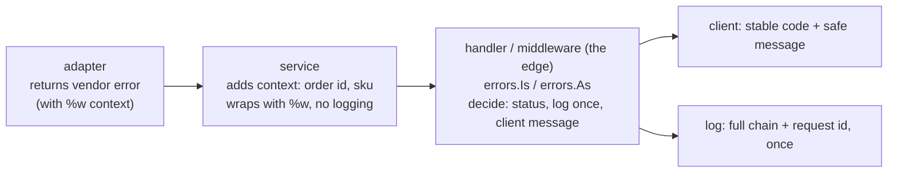
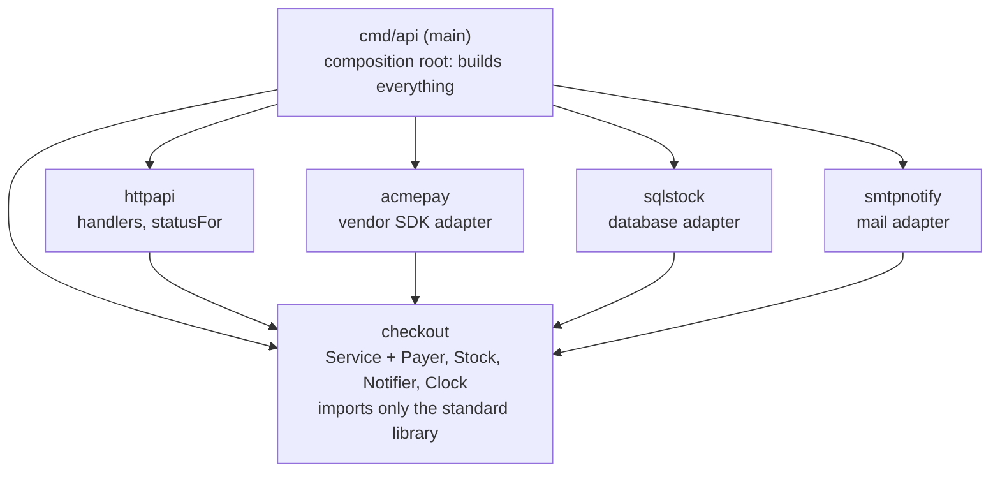
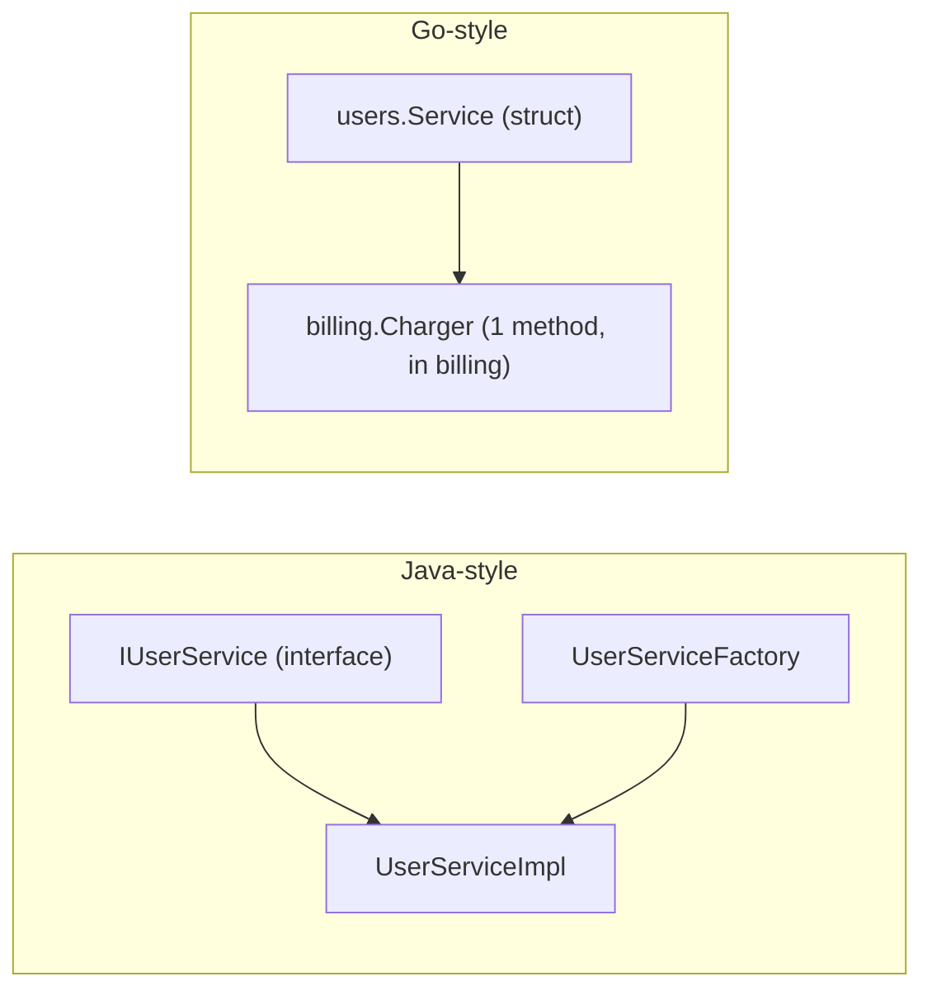
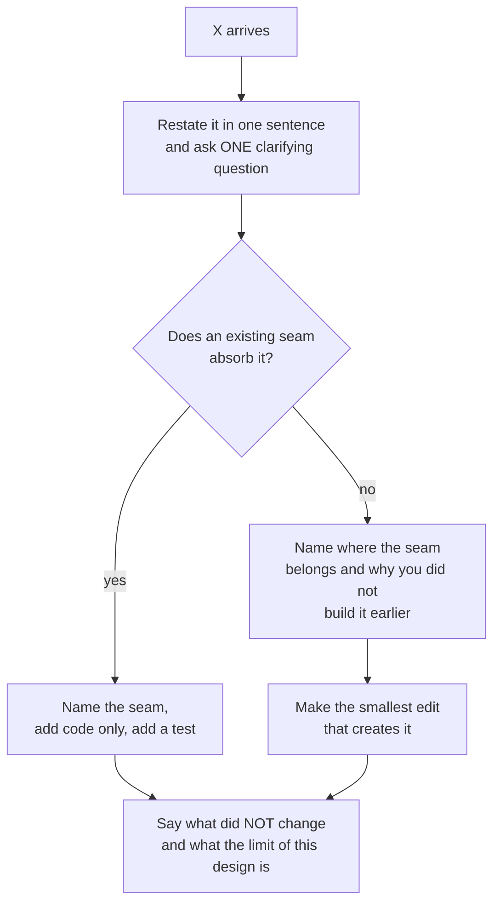

# B1 Unit 2 — Boundaries and errors

> Time: ~6 h (includes the 45-minute design exercise and the teach-back draft) · CORE: §1–§5 · STRETCH: §6 · Lab:
> `labs/b1/dispatch` (graded), `labs/b1/breakit` (error-wrapping exercises)

## Before you start

You should have finished Unit 1 (or be able to explain where an interface should be declared, what a typed nil is,
and why `New` returns an error). This unit turns those pieces into the rest of a design: how errors travel, where
package boundaries go, what SOLID means once you remove inheritance, and how to design so the tests stay small.
Warm-up; write your answers down first:

1. `checkout` needs to charge cards and the vendor adapter lives in another package. Which package declares the
   `Payer` interface, and which one imports which?
2. A helper returns `error` and its body is `var e *ValidationError; if bad { e = &ValidationError{}}; return e`.
   What is wrong?
3. Why does `Service.Place` return an error wrapping the adapter's error with `%w` instead of formatting it with `%v`?
   (You wrote that in the lab; say it in a sentence.)

<details data-kind="answer"><summary>Warm-up answers</summary>

1. `checkout` declares `Payer` (the consumer defines the interface). The adapter package does not need to import
   `checkout` for that; `main` imports both and wires them. If the adapter wants to return `checkout.ErrPaymentDeclined`
   it imports `checkout`, and the dependency points inward, never from `checkout` to the adapter.
2. It returns a typed nil: the `error` interface holds `(*ValidationError, nil)`, which is not equal to `nil`, so
   `err != nil` is true even on success. Return the literal `nil` instead.
3. So `errors.Is` and `errors.As` can still reach the adapter's error through the chain; `%v` would flatten it to
   text and the caller could no longer tell a decline from a timeout.

</details>

---

## §1 Errors as values

### The failure story

*A design-pain story composed from typical patterns; numbers are illustrative.*

A payments service wraps a vendor SDK. When the vendor times out, the adapter logs the error and returns it. The
service logs it and returns it. The handler logs it, and a middleware logs it again: **one failure produces 7 log
lines** at 4 layers. At 30 failures a minute during an incident that is ≈ 210 lines a minute of the same event with
four different prefixes, and on-call cannot tell how many distinct failures there were, or which line has the
useful context (none of them has the account ID).

The second problem is how callers decide. Idempotent retries are detected with
`strings.Contains(err.Error(), "duplicate key")`. A database host is rebuilt with a different server locale,
Postgres messages come back translated, the match fails, and for ≈ 3 hours duplicate requests (which should have
returned the stored result) return `500`. Clients retry; ≈ 1,900 retries pile up on a service that was healthy.
The vendor and the database were both fine. The team's own error handling was the outage.

Third: the repository layer returns `sql.ErrNoRows`, and the HTTP handler maps *any* error from the repository to
`404`. A connection-pool exhaustion returns `404` to members for ten minutes: "your account doesn't exist".

### Predict

<!-- predict id="B1-U2-P01" -->
**Predict.** What does each line print? Write all five down first.

```go
var ErrNotFound = errors.New("not found")

type QueryError struct {
	Query string
	Err   error
}

func (e *QueryError) Error() string { return "query " + e.Query + ": " + e.Err.Error() }
func (e *QueryError) Unwrap() error { return e.Err }

func repo() error { return &QueryError{"SELECT 1", ErrNotFound} }
func svc() error  { return fmt.Errorf("load account: %w", repo()) }
func api() error  { return fmt.Errorf("handle request: %v", svc()) }

func main() {
	fmt.Println(api())                                          // 1
	fmt.Println(errors.Is(svc(), ErrNotFound), errors.Is(api(), ErrNotFound)) // 2
	var qe *QueryError
	ok := errors.As(svc(), &qe)
	fmt.Println(ok, qe.Query)                                   // 3
	qe = nil
	fmt.Println(errors.As(api(), &qe))                          // 4
	w := fmt.Errorf("ctx: %w and %w", errors.New("a"), errors.New("b"))
	fmt.Println(w, errors.Join(nil, nil) == nil)                // 5
}
```
<!-- /predict -->

<!-- predict id="B1-U2-P02" -->
**Predict.** Your handler receives an error from `service.Place`. It might be: invalid input, an out-of-stock
condition, a payment decline, a cancelled context, a vendor timeout, or a bug (nil pointer recovered into an error).
For each, write down (a) the HTTP status you'd return, (b) whether you'd log it and at what level, and (c) *which
layer* should make those decisions. Which of the three answers is the most commonly wrong in review?
<!-- /predict -->

### Reveal

<details data-kind="reveal" data-for="B1-U2-P01">
<summary>Reveal</summary>

```
handle request: load account: query SELECT 1: not found
true false
true SELECT 1
false
ctx: a and b true
```

Line 1 shows the message accumulating context outward-in: `operation: operation: ... : cause`. Line 2: `svc()`
wrapped with `%w`, so `errors.Is` walks `*fmt.wrapError` to `*QueryError` (via its `Unwrap`) to `ErrNotFound`;
`api()` used `%v`, which formats the text and **drops the chain**, so `Is` is false. Line 3: `errors.As` finds the
`*QueryError` in the chain and assigns it. Line 4: after `%v`, there is no `*QueryError` to find. Line 5: since Go 1.20
`fmt.Errorf` accepts several `%w` verbs and the result unwraps to all of them; `errors.Join(nil, nil)` is `nil`
(it discards nil errors, and returns nil if none are left). Tempting wrong answer for line 2: "true, true because the
text still says 'not found'". `errors.Is` compares *values* in the chain, never text.

</details>

<details data-kind="reveal" data-for="B1-U2-P02">
<summary>Reveal</summary>

| Error | Status | Log | Notes |
|---|---|---|---|
| invalid input | 400 (or 422) | none or `debug`; it's the client's problem | message may be shown to the client |
| out of stock | 409 | `info` at most (business event) | safe, specific message |
| payment declined | 402 or 422 | `info` | do not echo the processor's internal detail |
| context cancelled (client left) | 499-style / no response | none (or `debug`) | nobody is listening |
| vendor timeout | 504 (or 503 with `Retry-After`) | `warn` once, with vendor name and attempt count | maybe retried upstream |
| bug / panic | 500 | `error` with stack, alert | generic message to the client; details stay in the log |

All three decisions (status, log level, whether to expose the message) belong to **one place: the edge**, the handler
or middleware that talks to the outside world. Inner layers add context and return. The most commonly wrong answer is
(c): logging in every layer ("log and return"), and its sibling, mapping every repository error to `404` in the
repository itself. Tempting wrong answer for payment declined: `500`. A decline is a normal business outcome, not a
server fault; paging on it trains on-call to ignore pages.

</details>

### How it actually works

**An error is a value.** The `error` interface is one method, `Error() string`. Everything else is convention built
on three functions in the `errors` package and the `%w` verb. Because errors are ordinary values you can compare
them, put fields in them, wrap them, and branch on them. There are no checked exceptions and no stack unwinding.

**Three shapes of error, and when to use each.**

| Shape | Example | Callers check with | Use when |
|---|---|---|---|
| **Sentinel** | `io.EOF`, `sql.ErrNoRows`, `fs.ErrNotExist`, `checkout.ErrOutOfStock` | `errors.Is(err, ErrX)` | The condition has no payload and callers branch on *which* condition it is |
| **Typed** | `*fs.PathError`, `*net.OpError`, `*dispatch.DeliveryError` | `errors.As(err, &target)` | Callers need fields (which sink, which attempt, which path) |
| **Opaque + behaviour** | any `error` with `Temporary() bool` or `Timeout() bool` | `errors.As` with an *interface* target | Callers care about *what to do* (retry?), not *what happened*; keeps your package's types private |

Every sentinel and typed error you export is part of your API: you cannot rename or remove it without breaking
callers, so export only what callers genuinely need to branch on. Prefer asking for behaviour (`IsTemporary(err)`)
over exporting a taxonomy.



**Wrapping with `%w`.** `fmt.Errorf("charge order %q: %w", id, err)` returns an error whose `Unwrap` returns `err`.
`errors.Is(err, target)` walks the chain comparing with `==` (or calling a custom `Is(target) bool` method);
`errors.As(err, &target)` walks until a value is assignable to the target type; `errors.Unwrap` peels one layer;
`errors.Join(errs...)` combines several errors into one whose `Unwrap() []error` exposes all of them. A custom wrapper
type must implement `Unwrap() error` (or `Unwrap() []error`); without it the chain stops there (the `breakit`
exercise). Wrap when the caller can act on the cause or when the added context is useful; use `%v` deliberately when
you want to *hide* an implementation detail from your API (the detail then can't become a compatibility promise).

**Messages.** Lowercase, no trailing punctuation, no leading "failed to" (it is repeated at every layer), and each
layer adds *what it was doing and to what*: `checkout: charge order "ord-1": payments: card declined: insufficient
funds`. Put identifiers in the message (order, sink, event), not in a log line that may be elsewhere. The Go Code
Review Comments are explicit that error strings should not be capitalised or end with punctuation, since they
usually appear inside other messages.

**Handle an error once.** Either handle it (decide, retry, degrade, translate) *or* return it with context. Never
both. "Log and return" produces the duplicate lines in the story. Log at the edge, where the final decision is made,
with the full chain; below the edge, return.

**Domain errors to transport codes: at the edge only.** The domain package knows `ErrOutOfStock`; it must not know
HTTP 409. One function in the transport layer maps:

```go
func statusFor(err error) (int, string) {
	var de *dispatch.DeliveryError
	switch {
	case err == nil:
		return http.StatusOK, ""
	case errors.Is(err, checkout.ErrInvalidOrder):
		return http.StatusBadRequest, "invalid order"
	case errors.Is(err, checkout.ErrOutOfStock):
		return http.StatusConflict, "out of stock"
	case errors.Is(err, checkout.ErrPaymentDeclined):
		return http.StatusPaymentRequired, "payment declined"
	case errors.Is(err, context.Canceled):
		return 499, "client closed request" // nginx convention, not in net/http
	case errors.As(err, &de) && dispatch.IsTemporary(de):
		return http.StatusServiceUnavailable, "try again later"
	case errors.Is(err, context.DeadlineExceeded):
		return http.StatusGatewayTimeout, "upstream timed out"
	default:
		return http.StatusInternalServerError, "internal error" // the detail goes to the log, not the client
	}
}
```

(This is also a table you can unit-test in 20 lines.) Order matters: put specific cases before general ones, and
put the default last.

**Programmer errors versus operational errors.** Use `panic` for broken invariants ("impossible" states, misuse of
an API that cannot be reported any other way), recover at goroutine boundaries you own (the `Dispatcher` recovers
sink panics into `ErrSinkPanic`), and use errors for everything that can happen in a correct program with a
bad world.

### Build it

Lab: **`labs/b1/dispatch`**, part 1: the error vocabulary. `DeliveryError`, the sentinels and `SinkFunc` are given;
you implement:

- `Temporary(err)` and `IsTemporary(err)`: a small unexported wrapper type with `Unwrap` and `Temporary() bool`;
  `IsTemporary` uses `errors.As` with an **interface target**. It must recognise types it didn't create (the test
  has one with a `Temporary() bool` method).
- `Match(pattern, eventType)` (pure function; table test).
- The error shape of `Dispatch`: `ErrNoRoute` and `ErrInvalidEvent` wrapped with the event ID and type; a
  `*DeliveryError` per failed sink; `errors.Join` across sinks, ordered by sink name.
- Acceptance: `go test -race -run 'TestMatch|TestIsTemporary|TestDispatch_NoRoute|TestDispatch_ReportsEvery|TestDispatch_BackoffAndMaxAttempts' ./labs/b1/dispatch/`.

Read `legacy.go` first. List what a caller of `LegacyDispatch` can do with the result `"error: 400 bad request"`.

### Break it

1. `go test -tags breakit -run '^TestErrorsIs_' ./labs/b1/breakit/`: two failures. Fix both (`%w`, and an `Unwrap`
   method). Predict which stdlib behaviour each one violates.
2. In your passing `dispatch.go`, make `deliver` build its error with
   `Err: errors.New(lastErr.Error())` (a "flattening" bug, the same as using `%v`). Run the package tests. How many
   fail, and which one tells an on-call engineer something real?

<details data-kind="answer"><summary>What you should see</summary>

1. `errors.Is("lookup acct-9: not found", ErrNotFound) = false` because `%v` stringified the cause, and
   `errors.Is("load acct-9: lookup acct-9: not found", ErrNotFound) = false` because `*opError` lacks `Unwrap`.
   Both are silent in code review: the message looks identical before and after.
2. Six tests fail (measured on the reference solution): the backoff/max-attempts test (`errors.Is(err, errVendor503)`
   false), the cancellation test (neither `context.Canceled` nor the sink's error is reachable), the parent-deadline
   test, the panic test (`ErrSinkPanic` unreachable), the joined-error test, and the extension test. The failing
   messages say "the sink's own error must stay reachable". Without that, a caller can't tell a decline from an outage
   and every caller falls back to string matching, which is exactly the failure story.

</details>

### In the wild

- **`os.PathError`** (`fs.PathError` since Go 1.16) is the standard typed error: `Op`, `Path`, `Err` plus `Unwrap`. You
  check `errors.Is(err, fs.ErrNotExist)` rather than comparing messages; `*os.PathError` and `*net.OpError` both
  expose their cause by `Unwrap`, and `net.OpError` implements `Timeout()`/`Temporary()`.
- **`io.EOF`** is a sentinel that the `io.Reader` contract says must be returned *unwrapped*, because callers
  compare it with `==`. A documented exception to "always wrap": when the sentinel is part of a protocol,
  wrapping breaks it.
- **`database/sql`**: `sql.ErrNoRows` is a sentinel, and drivers expose SQLSTATE codes in their own typed errors
  (for example `pgconn.PgError.Code` in the pgx driver; TODO-VERIFY the type and field names in the version you use).
  Branching on SQLSTATE `23505` (unique violation) is robust against message wording and server locale; matching
  message text is not.
- **`context`**: `context.Canceled` and `context.DeadlineExceeded` are sentinels, and `context.Cause` (Go 1.20) can
  carry a richer reason. `context.DeadlineExceeded` also implements `Timeout()` and `Temporary()` (both true), which
  is why the lab's `IsTemporary(context.DeadlineExceeded)` is true while `Dispatch` still refuses to retry once the
  caller's own context is done.
- **`net/http`**: `http.ErrServerClosed` is the sentinel `Serve` returns after `Shutdown`, and a mapping of it to
  "not an error" is a standard line in every `main`.
- **gRPC** carries codes in `status` errors and expects handlers to translate domain errors at the boundary;
  `status.FromError` / `status.Code` read them back (TODO-VERIFY helper names against your grpc-go version).

### Trade-offs

| Option | Wins when | Loses when | When the answer flips |
|---|---|---|---|
| Sentinel errors | A small, stable set of conditions with no payload | Callers need data, or the set grows to dozens | Switch to a typed error when you add the second field a caller needs |
| Typed errors | Callers need fields (`Sink`, `Attempts`, `Code`) | You export a type per failure and freeze your API | Keep the type unexported and expose a behaviour method (`Temporary()`) if callers only need a decision |
| Behaviour interfaces (`Temporary()`, `Timeout()`) | Retry/degrade decisions must work across packages you don't control | You need to know *what* happened for an audit trail | Pair with a typed error for the record; the interface for the decision |
| Wrap with `%w` | The cause is part of your contract (adapter errors callers branch on) | Wrapping leaks an internal dependency's error type into your public API | `%v` or a translated error at a stability boundary (public SDKs) |
| Error codes in strings | Never, in Go (only for logs and clients) | Always: locale, rewording | Never flips; use `errors.Is/As` and typed fields |

### Senior bar

- **Failure modes.** Log-and-return (duplicate lines, no single source of truth). String matching. `%v` dropping the
  chain. Wrapping so deep that the message is a paragraph. Exporting every internal error type. Mapping unknown errors
  to client-visible detail (leaking SQL, hostnames or card data into responses). `err == ErrX` instead of `errors.Is`
  (breaks once something wraps). Returning typed nil (Unit 1 §5). Swallowing errors from `Close()` on writers.
- **Numbers.** One failure should produce ≈ 1 error-level log line, not 7. A mapping function with 6–8 branches is
  normal; if it needs 40, you have a taxonomy problem (collapse to categories: invalid, not-found, conflict,
  unavailable, internal).
- **Ops.** Alert on categories and rates, not message text. Include a stable machine code and a request ID in client
  errors so support can find the log line. Keep a test that every sentinel the edge maps is still reachable
  (`TestStatusFor_Table`). In multi-tenant systems, add the tenant to the *log*, never to the client message.

**Interviewer probes**

<details data-kind="answer"><summary>"When do you wrap an error and when do you not?"</summary>

I wrap with `%w` when the underlying error is part of what callers may legitimately branch on, for example an
adapter's decline, timeout or not-found, and I always add what the layer was doing. I convert with `%v`, or map to my
own error, at a stability boundary where I don't want a dependency's type to become part of my API. Sentinel errors that
are part of a protocol, like `io.EOF` from a `Reader`, are returned unwrapped.

</details>

<details data-kind="answer"><summary>"Where should logging happen?"</summary>

At the edge, once, with the full chain and request context. Inner layers return errors with added context and don't
log them, because the same failure logged four times costs money and hides the signal. The exception is logging events that are
not errors (state changes, audit records) where the log is the product.

</details>

<details data-kind="answer"><summary>"How do you decide the HTTP status for an error from deep in the stack?"</summary>

One mapping function at the transport edge using `errors.Is` and `errors.As`: invalid input to 400, conflicts like out of
stock to 409, declines to a 4xx business status, cancellations to no response, timeouts and temporary failures to 503/504,
everything unknown to 500 with a generic message. Domain packages never import `net/http`. The mapping is table-tested.

</details>

<details data-kind="answer"><summary>"Sentinel or typed error?"</summary>

A sentinel if callers only need to know which condition occurred; a typed error when they need fields. If the only
decision is "retry or not", neither: expose a behaviour check, such as `IsTemporary(err)`, and keep the types private so
they can change.

</details>

### Check yourself

1. What is the difference between `errors.Is` and `errors.As`?
2. Why is `err == ErrNotFound` fragile?
3. Why does the lab's `Dispatch` return `errors.Join` rather than the first error?
4. Which layer decides the HTTP status?

<details data-kind="answer"><summary>Answers</summary>

1. `Is` asks "is this specific error (value) anywhere in the chain?"; `As` asks "is there an error of this type in the
   chain, and give it to me?".
2. As soon as any layer wraps the error with `%w`, equality fails; `errors.Is` walks the chain.
3. Several sinks can fail in the same dispatch; a joined error lets callers inspect all of them and `errors.Is/As`
   reach every cause, while the "first error" hides failures and makes outcomes depend on goroutine timing.
4. The edge (handler or middleware), via one mapping function. Inner layers must not know HTTP.

</details>

---

## §2 Package boundaries and dependency direction

### The failure story

The service has a package named `common`: 3,100 lines, 41 importers, containing string helpers, a date parser, the
`Money` type, a retry loop, three structs shared by billing and customers, and a global `*sql.DB`. Changing the date
parser rebuilds and re-tests all 41 importers: CI goes from ≈ 9 to ≈ 38 minutes for what is a four-line fix. A new
feature needs `billing` to call `customers` and `customers` to call `billing` (to look up a plan, and to look up
an invoice). The compiler refuses: **import cycle not allowed**. The team's first "fix" moves 1,200 lines of both
packages into `common`, which now has 55 importers and 4,300 lines. The feature slips two days, and the
layering diagram on the wiki (`controllers → services → models → common`) no longer describes the code.

### Predict

<!-- predict id="B1-U2-P03" -->
**Predict.** `billing` imports `customers` (to read a customer's plan) and `customers` imports `billing` (to list a
customer's invoices). The compiler rejects the build. List *three different* ways to break the cycle, and for each
say what moves where and what it costs. Which one would you use if `customers` only needs invoice *totals*?
<!-- /predict -->

<!-- predict id="B1-U2-P04" -->
**Predict.** The module is `github.com/acme/app`. It contains `internal/ledger`, `cmd/api` and `pkg/sdk`. Which of
`cmd/api`, `pkg/sdk` and a different module `github.com/acme/other` can import `github.com/acme/app/internal/ledger`?
What if the directory were `pkg/sdk/internal/auth`?
<!-- /predict -->

### Reveal

<details data-kind="reveal" data-for="B1-U2-P03">
<summary>Reveal</summary>

1. **Define an interface at the consumer** (the Unit 1 §3 move). `customers` declares
   `type InvoiceTotaler interface{ TotalFor(ctx, customerID string) (Money, error) }`; `billing` satisfies it
   implicitly; `main` passes one into the other. `customers` no longer imports `billing`. Cost: a small interface and
   a constructor parameter. This is the answer when `customers` only needs invoice totals, since one method is all
   it asks for.
2. **Move the shared concept down.** If both need the same type (`CustomerID`, `Money`, `Plan`), move just that type
   into a small third package both import (`money`, `plan`), named for what it is. Cost: a new package, and the risk of
   it growing into `common` if you let it. Keep it to value types.
3. **Merge the packages.** If they always change together and one cannot be used without the other, they are one
   package. Cost: a bigger package; benefit: no artificial boundary and no cycle.
4. (Bonus) **Pass a function** (`func(ctx, id) (Money, error)`) when the dependency is a single call.
   Tempting wrong answer: "move everything both need into `common`". That fixes the compiler error by making every
   package depend on a junk drawer, and the cycle reappears one level up.

</details>

<details data-kind="reveal" data-for="B1-U2-P04">
<summary>Reveal</summary>

`cmd/api` and `pkg/sdk` can import `internal/ledger`: the rule is that code may import a path containing `internal`
only if it lives in the tree rooted at the *parent* of that `internal` directory, here the module root. The other module
`github.com/acme/other` cannot (compile error: "use of internal package ... not allowed"). For
`pkg/sdk/internal/auth` the root of the permitted tree is `pkg/sdk`, so `pkg/sdk` and its sub-packages can import it,
but `cmd/api` cannot. The rule is enforced by the `go` tool, not by convention: it is the only visibility mechanism
between "exported" and "published module". Tempting wrong answer: "`pkg/sdk` can't import it because it's `pkg`".

</details>

### How it actually works

**A package is the unit of compilation, visibility and dependency.** Exported names (capitalised) are visible to every
importer; unexported names are visible within the package. There is nothing between those two except `internal/`.
So the boundary you draw with a package is a real encapsulation boundary, which is why putting everything in one
package (no boundaries) and splitting by technical layer (`controllers`, `services`, `models`) are both costly.

**Organise by what the code is about, not what kind of thing it is.** `checkout` (orders, pricing, the `Service`),
`dispatch` (events and sinks), `ledger`. A package named `models` or `types` forces every feature to depend on
everything, and *layered* trees (`handlers → services → repositories → models`) produce cycles the moment a
repository needs a service. Names: short, lowercase, no underscores, no stutter (`checkout.Service`, not
`checkout.CheckoutService`), and never `util`, `common`, `base`, `helpers`: the name should say what the package
*provides* (`clock`, `money`, `retry`).

**Dependency direction ("ports and adapters" without the ceremony).** Draw the core of your system (the business
rules and the interfaces it needs) in the middle. Everything technology-specific (HTTP handlers, SQL, vendor SDKs,
SMTP) lives outside and depends *on the core*, never the reverse. In Go the "ports" are the consumer-side interfaces
you already write; the "adapters" are packages that satisfy them; `main` is the composition root that builds adapters and
passes them into the core.



Read the arrows as "imports". Everything points at `checkout`; `checkout` points at nothing but the standard library.
You can *check* that rule mechanically:

```sh
go list -f '{{join .Imports "\n"}}' ./solutions/b1/checkout
```

lists only standard-library packages. Putting that command (or a test that parses `go list -json`) in CI turns an
architecture diagram into an enforced property. The only things the core imports from outside itself are the
standard library and, perhaps, small pure value packages.

**Breaking cycles.** The four moves from the Predict reveal: consumer-side interface, move the shared type down into a
small named package, merge, pass a function. A cycle is the compiler telling you two packages are
actually one concept or that one of them is reaching for something concrete it should have been handed.

**`internal/`.** Anything under `internal/` can only be imported from the tree rooted at its parent. Use it for
implementation packages you don't want other modules to depend on; it lets you refactor them freely. In a service
repository, `internal/` is the default home for everything except a deliberately published API.

**Test packages.** `package checkout` tests (same package) can see unexported names; `package checkout_test`
(external) tests only the public API and can import packages that import `checkout` without causing a cycle. Prefer
external tests for behaviour; use `export_test.go` (an in-package `_test.go` file that re-exports internals under test)
only when you must reach internals. The lab test files are in-package so the fakes can sit next to the code
and stay tiny; the price is that they *could* reach internals, so they stick to the exported API.

**Where do errors and shared types live?** Sentinel errors the core returns (`ErrOutOfStock`) live in the core, because
adapters depend on the core. Types that cross many packages and carry no behaviour (`Money`) either live in the core or
in a tiny package named for the concept. Avoid a `types` or `errors` package that every other package imports.

### Build it

Lab: **`labs/b1/dispatch`** (structure) and a repository exercise (no new code to write for the grade).

- In `dispatch`, notice what the package does **not** import: no HTTP, no SQL, no logging framework. Sinks arrive as
  values of the interface declared in the package. Adapters (a webhook sink, an audit sink) would be separate packages
  that import `dispatch` to implement `Sink`; the test file plays that role.
- Run `go list -f '{{join .Imports "\n"}}' ./labs/b1/dispatch ./labs/b1/checkout` and confirm both list only standard
  library packages. Then answer: which package would you create for the real e-mail sink, and which direction does its
  import go?
- Acceptance for this section is the same package-level tests (`go test -race ./labs/b1/dispatch/`), which compile and
  run with no adapter present at all.

### Break it

Create the import cycle yourself, in a scratch tree that `./...` ignores (directories starting with `_`):

```sh
mkdir -p labs/b1/_scratch/cyca labs/b1/_scratch/cycb
# cyca/a.go: package cyca; imports ".../labs/b1/_scratch/cycb" and calls cycb.B()
# cycb/b.go: package cycb; imports ".../labs/b1/_scratch/cyca" and calls cyca.A()
go build ./labs/b1/_scratch/cyca
```

Predict the message. Then break the cycle with an interface declared in `cyca` that `cycb` satisfies (and a small
`main` that wires them), and rebuild.

<details data-kind="answer"><summary>What you should see</summary>

```
package .../labs/b1/_scratch/cyca
	imports .../labs/b1/_scratch/cycb from a.go
	imports .../labs/b1/_scratch/cyca from b.go: import cycle not allowed
```

The compiler lists the cycle path. After you declare `type Ber interface{ B() int }` in `cyca`, have `cyca` use a
`Ber` field, and move the `cycb` import to the wiring code (`main`), `cycb` may import `cyca` (inward) while `cyca`
imports nothing from `cycb`. The build passes. Delete the scratch directories afterwards; they are not part of the lab.

</details>

### In the wild

- **The standard library's own layering.** `io` imports almost nothing; `os` imports `io/fs`, `syscall`; `net/http`
  imports `net`, `io`, `crypto/tls`. There are no cycles, and the small interface packages (`io`, `io/fs`, `context`) sit
  at the bottom. `testing/fstest` imports `io/fs` to test `fs.FS` implementations, not the other way round.
- **`internal/` in the Go tree itself.** The standard library keeps implementation packages under
  `internal/...` (for example `internal/poll`), importable only inside the repository; this is how the Go team changes
  them without a compatibility promise.
- **Kubernetes.** Large Go projects use `staging/` and `internal/` conventions and have tooling to enforce import
  restrictions (TODO-VERIFY: the exact mechanism in the Kubernetes repository is `import-restrictions` configuration
  consumed by a verification script; check before quoting).
- **`cmd/` and `internal/` layout.** The widely copied layout (`cmd/<binary>/main.go`, `internal/<domain>/...`) is a
  convention from the Go community, not a language rule; the `golang-standards/project-layout` repository is *not* an
  official standard, a point the Go team has made publicly (TODO-VERIFY wording before quoting).
- **Package names.** The Go blog's "Package names" article recommends names that describe what the package provides and
  warns against `util`/`common`-style names.

### Trade-offs

| Option | Wins when | Loses when | When the answer flips |
|---|---|---|---|
| Package per domain concept (`checkout`, `dispatch`) | Features change together and have a small public surface | Concepts are so entangled that every change crosses packages | Merge packages that always change together |
| Package per technical layer (`handlers`, `services`, `models`) | Tiny CRUD service where layers *are* the structure | Anything with cross-feature calls: cycles, fat `models` | Reorganise by domain when the second cross-layer cycle appears |
| One big package | Prototypes and small tools (the standard library has plenty of large packages, `net/http`) | The package grows past what one person can hold in their head; test compile times | Split along an interface you already have |
| Shared `common`/`util` package | Never as a dumping ground | Always: every package depends on it, it never shrinks | A small, named, behaviour-focused package (`clock`, `money`) is fine |
| `internal/` everywhere | Services and applications: nobody else should import it | Libraries meant to be imported | Publish a small public package deliberately for the contract |

### Senior bar

- **Failure modes.** `common`/`util`/`base` packages. Import cycles "fixed" by moving code into a junk package.
  Adapters imported by the core (vendor types leak into domain signatures). `init()` that registers things in global
  maps, which depends on file names and import order (the nil-map story in Unit 1 §1). Exporting everything "in case".
  Tests that reach into internals through `export_test.go` until the package is unchangeable.
- **Numbers.** The core's imports should be ≈ standard library only (count with `go list`). A package with > ≈ 30
  exported identifiers or > ≈ 5,000 lines deserves a look at whether it is two concepts (soft guides, not rules).
  Incremental build/test time is a design metric: a change in a leaf package should rebuild few importers.
- **Ops/maintenance.** Keep vendor SDKs behind adapters so upgrading an SDK touches one package and its tests, not
  the domain. For banking adapters, one package per vendor (`acmepay`, `zenpay`) with a test that the adapter
  satisfies the consumer's interface at compile time (`var _ checkout.Payer = (*Client)(nil)`), so a vendor upgrade
  breaks the build in the adapter, not in production.

**Interviewer probes**

<details data-kind="answer"><summary>"How do you structure a Go service?"</summary>

By domain: `internal/checkout`, `internal/dispatch` and so on, each with its own types and the interfaces it needs.
Adapters for HTTP, SQL, vendors and mail in separate packages that import the domain. `cmd/<service>/main.go` is
the only place that builds concrete adapters and wires them into the domain. I check the dependency direction with
`go list`: the domain imports the standard library only.

</details>

<details data-kind="answer"><summary>"You have an import cycle. What do you do?"</summary>

First ask what it means: either two packages are one concept (merge), or one reaches for something concrete it
should be handed. Usually the fix is an interface declared in the consumer and satisfied by the other package,
with `main` wiring them; if they share a value type, move that type into a small package named for it. I don't
move things into `common`.

</details>

<details data-kind="answer"><summary>"What's wrong with a package called `utils`?"</summary>

The name tells the reader nothing about what the package provides, so everything ends up there, everything imports it,
and a change anywhere rebuilds everything. Name packages for their contribution (`retry`, `clock`, `money`), and keep
helpers next to their only user until a second user appears.

</details>

### Check yourself

1. What does the `internal` directory rule restrict?
2. Which package in the checkout design imports the vendor SDK, and who imports that package?
3. Name two ways to break an import cycle that don't involve a shared dumping-ground package.

<details data-kind="answer"><summary>Answers</summary>

1. Importing a package whose path contains an `internal` element is allowed only from code in the tree rooted at
   the parent of that `internal` directory; the go tool enforces it.
2. The vendor adapter package (for example `acmepay`) imports the SDK; only `main` (the composition root) imports the
   adapter. The domain imports neither.
3. Declare an interface in the consumer package (the other package satisfies it implicitly); pass a function; or merge
   the two packages if they always change together.

</details>

---
## §3 SOLID translated to Go

### The failure story

*Composed from typical patterns; numbers are illustrative.*

A team lead pastes a "SOLID checklist" into the pull-request template. Within a quarter a CRUD endpoint that used to
be one handler and one SQL statement is **17 files**: `IAccountService`, `AccountServiceImpl`, `IAccountRepository`,
`AccountRepositoryImpl`, `AccountFactory`, `AccountValidatorStrategy`, an `interfaces` package imported by everything,
and ≈ 3,400 lines of generated mocks that assert call order. Every interface has exactly one implementation. A new
engineer takes ≈ 3 weeks to ship a first change (the old baseline was ≈ 4 days), and a refactor that renames one
method fails ≈ 190 mock-based tests that have nothing to do with the behaviour.

A year earlier, the same company had the opposite problem: the 1,100-line `PaymentService` of Unit 1. The lesson is
not that SOLID is wrong. It is that the principles were written for languages with inheritance and class hierarchies;
each letter survives in Go in a different, smaller form, and mechanically porting the Java *ceremony* reproduces
the cost without the benefit.

### Predict

<!-- predict id="B1-U2-P05" -->
**Predict.** For each principle, classify it for Go as **survives as is**, **survives in a different form**, or
**mostly a Java-ism**, and write one sentence on what it looks like in Go: S (single responsibility), O
(open/closed), L (Liskov substitution), I (interface segregation), D (dependency inversion).
<!-- /predict -->

<!-- predict id="B1-U2-P06" -->
**Predict.** The `Sink` contract says "`Deliver` returns nil only if the event was delivered". A teammate adds this
decorator to hide noisy errors from a flaky chat integration:

```go
type quietSink struct{ inner Sink }

func (q quietSink) Deliver(ctx context.Context, e Event) error {
	_ = q.inner.Deliver(ctx, e)
	return nil
}
```

Does `quietSink` satisfy `Sink`? Does it violate the Liskov substitution principle? What breaks in the dispatcher's
behaviour, and would any of the lab's current tests notice? How would you make the compiler or the test suite notice
next time?
<!-- /predict -->

### Reveal

<details data-kind="reveal" data-for="B1-U2-P05">
<summary>Reveal</summary>

| Principle | Go verdict | In Go it looks like |
|---|---|---|
| **S** single responsibility | Survives, as "one reason to change, one owner" | Small packages and types you can describe without "and"; the Unit 1 refactoring. Read it as a *cohesion* test, not a class-size rule |
| **O** open/closed | Survives in a different form | Extend by **adding code, not editing**: a new type satisfying a consumer interface (a new `Sink`), a decorator, a middleware (`func(Handler) Handler`), a function value. Not via inheritance or abstract base classes |
| **L** Liskov substitution | Survives, but the compiler only checks half of it | The type checker verifies signatures; *behaviour* contracts (ordering, errors, nil handling, blocking, concurrency) live in documentation and **contract tests**, e.g. the `io.Reader` rules |
| **I** interface segregation | Survives strongly, almost for free | Consumer-defined 1–3 method interfaces (Unit 1 §3); implicit satisfaction means no ceremony |
| **D** dependency inversion | Survives as "depend on a small interface you own", mostly via constructor injection | The consumer declares the interface; `main` is the composition root; no DI container needed for most services. The Java-ism is the container, the `I`-prefix and the `Impl` suffix |

The most commonly misjudged letter is **L**: people think the compiler guarantees substitutability because "it
type-checks". It checks method names and types only.

</details>

<details data-kind="reveal" data-for="B1-U2-P06">
<summary>Reveal</summary>

It satisfies `Sink` (the signature matches) but it **violates the contract**, which is Liskov in its original sense: a
subtype must honour the behavioural promises of its supertype. The dispatcher trusts "nil means delivered": stats
count a delivery, no retry is attempted, no `DeliveryError` reaches the caller, and the audit trail says the chat
message was sent when it was not. No lab test notices, because the lab's tests exercise the Dispatcher's behaviour
against sinks the test itself writes; nothing tests *sinks* against the contract. The compiler can't help (types are the
same), so the protection is a **contract test**: a function that takes a factory for any implementation and checks
the behavioural rules (see How it actually works). Run it against every real sink, and against decorators.
Tempting wrong answer: "it's fine, it still implements the interface". Equally tempting: "ban decorators". The
fix is to make the contract executable and to turn "hide noisy errors" into an explicit, visible feature (e.g. a sink
that *records* the failure and counts it, or a dispatcher option for best-effort sinks), not a silent lie.

</details>

### How it actually works

**S: one reason to change.** Treat "responsibility" as "a reason to change owned by one person or team". It scales
down to functions and up to packages. In Go the cheap tools are: a type per concept, a package per bounded domain,
pure functions for rules (Unit 1 §1). A useful self-test: *list the nouns that would make this file change*; more than
two or three unrelated nouns means more than one responsibility.

**O: extend by adding.** You close a design to modification by putting a seam where requirements vary:

```go
// A new requirement, as new code, plugged in from outside the package:
type tenantOnly struct {
	tenant string
	next   dispatch.Sink
}

func (f tenantOnly) Deliver(ctx context.Context, e dispatch.Event) error {
	if e.Tenant != f.tenant {
		return nil // filtered: not an error, not a delivery
	}
	return f.next.Deliver(ctx, e)
}
```

That decorator is in the `dispatch` lab's test file: the dispatcher is *closed for modification* with respect to
new sinks and filters, because the variation point is the interface. The Go idioms for this: decorators and
middleware (`http.Handler` wrappers, `RoundTripper` wrappers, the lab's `SinkFunc`), function-valued fields, and
plug-in registration. Be honest about which axes are open: the lab opens "what a sink does" but not "how
retries work" (that's options); trying to open every axis is how the abstract-factory layer cake appears (§6).

**L: contracts, not just types.** In Go the substitutability story is in the documentation of the interface and in
a shared test. `io.Reader` says: `Read` may return `n > 0` and an error together; it must not retain `p`;
returning `0, nil` is discouraged; `io.EOF` is returned unwrapped at the end. None of that is in the type.
The standard library ships contract testers for exactly this reason: `testing/iotest` for readers and writers,
`testing/fstest.TestFS` for `fs.FS`, `golang.org/x/net/nettest.TestConn` for `net.Conn` (a pattern worth copying
for your own plug-in points):

```go
// RunSinkContract is exported from a testing helper package so every sink
// implementation (real or decorator) can run the same behavioural checks.
func RunSinkContract(t *testing.T, newSink func(t *testing.T) dispatch.Sink) {
	t.Helper()
	t.Run("honours a cancelled context", func(t *testing.T) {
		s := newSink(t)
		ctx, cancel := context.WithCancel(context.Background())
		cancel()
		done := make(chan struct{})
		go func() { defer close(done); _ = s.Deliver(ctx, dispatch.Event{ID: "e", Type: "t.x"}) }()
		select {
		case <-done:
		case <-time.After(time.Second):
			t.Fatal("Deliver ignored a cancelled context")
		}
	})
	t.Run("does not modify the payload", func(t *testing.T) {
		s := newSink(t)
		p := []byte("abc")
		_ = s.Deliver(context.Background(), dispatch.Event{ID: "e", Type: "t.x", Payload: p})
		if string(p) != "abc" {
			t.Fatalf("payload modified: %q", p)
		}
	})
	t.Run("is safe for concurrent use", func(t *testing.T) { // meaningful under -race
		s := newSink(t)
		var wg sync.WaitGroup
		for i := 0; i < 16; i++ {
			wg.Add(1)
			go func() {
				defer wg.Done()
				_ = s.Deliver(context.Background(), dispatch.Event{ID: "e", Type: "t.x"})
			}()
		}
		wg.Wait()
	})
	// ...and: a sink whose backend fails must return a non-nil error.
}
```

**I: small interfaces.** Already Unit 1 §3. In Go it is not a separate discipline, it is a consequence of defining the
interface where it is used.

**D: depend on abstractions you own.** High-level policy (`checkout`) should not depend on low-level detail (an SDK).
In Go: the policy package declares the interface; the detail package satisfies it; `main` connects them. Prefer plain
constructor injection and a `main` that reads like a wiring diagram. DI frameworks exist (`google/wire` generates the
wiring at build time, `uber-go/fx` resolves it at run time) and can pay off in very large binaries, but a 60-line
`main` that builds 10 objects in order is clearer than either until it genuinely isn't.



### Build it

Lab: **`labs/b1/dispatch`**, part 2: the open/closed property and the contract.

- Read `TestExtension_NewSinkAndDecoratorsNeedNoDispatcherChanges` in `dispatch_test.go`: a new sink type and two
  decorators, written entirely in the test. That test passing without any change to your `Dispatcher` is the O of SOLID
  for this package.
- Write, in a scratch directory (for example `labs/b1/_scratch/contract/`), a `RunSinkContract` like the one above
  (add the rule "a sink whose backend fails returns a non-nil error": have `newSink` take a flag for a failing
  backend) and run it against: the test's `chatSink` (passes), a sink that wraps a failing backend and returns its error
  (passes), and `quietSink` from the Predict (must fail that one rule).
- Acceptance: `go test -race ./labs/b1/dispatch/` green; your contract test fails for `quietSink` and passes for
  `chatSink`.

### Break it

Make the dispatcher's behaviour depend on the concrete type instead of the contract: in your `Dispatch`, add
`if _, ok := r.sink.(*chatSink); ok { ... }`-style logic (use `fmt.Sprintf("%T", r.sink)` if you can't import the
test type). Which of the five principles does this break, and which existing tests notice? Then register `quietSink`
and observe stats.

<details data-kind="answer"><summary>What you should see</summary>

Special-casing a concrete type breaks O (every new sink now needs an edit here), L (sinks are no longer
interchangeable) and D (the high-level policy depends on a detail). The lab's tests don't notice: they test the
behaviour of the dispatcher with the sinks they define, and a type-switch only matters for types the tests don't
use. This is the point: **types and example-based tests don't enforce design rules**; reviews, contract tests and
sometimes `go list` import checks do. With `quietSink` registered, `Stats()["x"].Delivered` increments for events that
never reached the chat service, and no error ever reaches the caller.

</details>

### In the wild

- **`io.Reader` and `testing/iotest`.** The `io.Reader` documentation spells out the behavioural contract; `iotest`
  provides readers that misbehave on purpose (`OneByteReader`, `DataErrReader`, `TimeoutReader`, `ErrReader`) and
  `iotest.TestReader` checks an implementation against the contract.
- **`fstest.TestFS`** takes an `fs.FS` and verifies it against the rules in the `io/fs` documentation (listing
  consistency, `Open` and `ReadDir` agreement and so on): a ready-made contract test for a one-method interface family.
- **`http.Handler` middleware chains** are open/closed in practice: logging, auth, metrics and recovery are added by
  wrapping; the server never changes.
- **`net/http` and `database/sql/driver`** keep their plug-in interfaces tiny and stable for a decade, and add
  capabilities through optional interfaces instead of changing existing ones. That is OCP with the compatibility
  promise attached.
- **`slog.Handler`** (Go 1.21) is a small interface (`Enabled`, `Handle`, `WithAttrs`, `WithGroup`) that lets
  third parties write backends and wrappers (level filters, fan-out) without changes to the `slog` package.

### Trade-offs

| Option | Wins when | Loses when | When the answer flips |
|---|---|---|---|
| Apply SOLID as a review checklist | You want a shared vocabulary for design reviews | It becomes a rule to *add* interfaces and layers | Use it as questions ("who is the consumer? what varies?"), not mandates |
| Open the design with an interface at a real variation point | Requirements demonstrably vary there (providers, sinks, pricing) | You open axes that never vary | Remove the abstraction when the second implementation never came (§6) |
| Contract tests for plug-in interfaces | Several implementations, third-party or decorator authors | One implementation, one author | A single implementation's own tests are its contract |
| Constructor injection by hand | Most services (≈ 5–20 collaborators) | Hundreds of providers and lifecycles | Consider `wire` or `fx` when wiring itself becomes the maintenance burden |
| Type switches on concrete types in policy code | A closed set, internal to a package (a parser's tokens) | Anything extensible | Promote the behaviour into the interface (a method) or a function field |

### Senior bar

- **Failure modes.** Ceremony: `I`-prefixed interfaces, `Impl` suffixes, one interface per struct, mock files. The
  opposite: god objects with no seams. Decorators that quietly change the contract (swallowing errors, retrying
  non-idempotent calls, mutating inputs). Behaviour that depends on the dynamic type. Interfaces that grow by one method
  per feature.
- **Numbers.** Count: implementations per interface (1 is a smell unless a test needs the seam), methods per interface
  (1–3), files per feature (a CRUD endpoint should not need 17). The standard library's workhorse interfaces have
  1–3 methods.
- **Ops/maintenance.** Contract tests are the cheapest regression guard when someone writes the next sink at 2 a.m.
  Document behavioural contracts in the interface comment (concurrency, ownership of arguments, error meaning,
  blocking). In banking adapters, a decorator that adds **audit** (log every attempt with correlation ID) or
  **idempotency** (key the call) is a classic O-compliant extension: write it once as a wrapper over `Payer` or `Sink`.

**Interviewer probes**

<details data-kind="answer"><summary>"Do you apply SOLID in Go?"</summary>

The intent, yes; the Java form, no. Single responsibility as one reason to change per type or package. Open/closed by
putting an interface or function value at the real variation point and adding implementations or decorators. Liskov as
documented behavioural contracts plus a contract test, because the compiler only checks signatures. Interface
segregation comes free from consumer-defined small interfaces. Dependency inversion by having the policy package
declare the interface and `main` wire the adapters. What I skip is the ceremony: `IFoo`/`FooImpl` pairs, factories,
containers.

</details>

<details data-kind="answer"><summary>"How do you make sure a new implementation of an interface is correct?"</summary>

Signatures only prove it compiles. I write the behavioural contract into the interface docs and into a reusable
contract test that takes a factory: cancelled context, argument ownership, error semantics, concurrency. Every
implementation and every decorator runs it. The standard library does the same with `iotest` and `fstest.TestFS`.

</details>

<details data-kind="answer"><summary>"Show me open/closed in Go without inheritance."</summary>

An `http.Handler` middleware: `func WithAudit(next http.Handler) http.Handler`. The server code doesn't change when you
add auth or metrics; each is a new wrapper. In our dispatcher, a new sink or a `tenantOnly` filter is a new type
satisfying `Sink`, added in `main`, with the dispatcher untouched.

</details>

### Check yourself

1. Which SOLID principle can the Go compiler *not* check, and what do you use instead?
2. What does "depend on abstractions" look like in Go package terms?
3. Name two Java-isms to avoid when porting SOLID to Go.

<details data-kind="answer"><summary>Answers</summary>

1. Liskov (behavioural substitutability): the compiler checks signatures only. Use documented contracts and contract
   tests.
2. The policy package declares the small interface it needs; the detail package implements it without importing the
   policy package for that purpose; `main` wires them.
3. Interface-per-struct (`IFoo`/`FooImpl`), factories and DI containers where a constructor and a `main` suffice;
   abstract base types via embedding.

</details>

---

## §4 Designing for tests

### The failure story

*Composed from typical patterns; numbers are illustrative.*

The settlements service has 1,400 tests. 62% need a Postgres container and the vendors' sandbox, so the suite takes
≈ 14 minutes and flakes ≈ 3% of runs; developers push without running it locally and let CI discover problems. 140 tests
use `time.Sleep(2 * time.Second)` to wait for background work, adding ≈ 280 s on their own. Another 190 tests use
generated mocks that assert the *order* of calls, so a harmless refactor (batching two repository calls into one)
fails all 190. Line coverage is 78%, and the production bug of the quarter, a retry loop that never stopped on a
cancelled context, was in covered lines: the tests executed the code but never cancelled a context.

### Predict

<!-- predict id="B1-U2-P07" -->
**Predict.** Classify each of these test doubles as **dummy**, **stub**, **spy**, **mock** or **fake**, and say which
kind breaks first when the production code is refactored without changing behaviour:
(a) `type nopNotifier struct{}` whose method returns nil; (b) a `payer` that returns `ErrDeclined` for every call;
(c) a `fakeStock` backed by a map that decrements on `Reserve`; (d) a payer that records every `Charge` call's
arguments for later assertions; (e) a generated object that fails the test unless `Charge` is called exactly once
*before* `Reserve`.
<!-- /predict -->

<!-- predict id="B1-U2-P08" -->
**Predict.** This table test runs with `go 1.22` in `go.mod`. What does each subtest see? What would happen if the
module said `go 1.21`?

```go
func TestDouble(t *testing.T) {
	cases := []struct {
		name     string
		in, want int
	}{{"a", 1, 2}, {"b", 2, 4}, {"c", 3, 6}}
	for _, tc := range cases {
		t.Run(tc.name, func(t *testing.T) {
			t.Parallel()
			if got := double(tc.in); got != tc.want {
				t.Errorf("%s: double(%d) = %d, want %d", tc.name, tc.in, got, tc.want)
			}
		})
	}
}
```
<!-- /predict -->

### Reveal

<details data-kind="reveal" data-for="B1-U2-P07">
<summary>Reveal</summary>

(a) **dummy**: passed to satisfy a parameter, never meaningfully used. (b) **stub**: canned answers. (c) **fake**: a
working lightweight implementation with real behaviour (state), here an in-memory stock. (d) **spy**: a stub or fake
that also records calls. (e) **mock**: pre-programmed with expectations about *how* it is called, and failing if
they aren't met (the terminology follows Meszaros' *xUnit Test Patterns* and Martin Fowler's "Mocks Aren't Stubs").

(e) breaks first and most often: it encodes the implementation (order and count of calls), so any refactoring that
preserves behaviour but changes interaction fails. (c) survives such refactorings because it exercises the
*outcomes* (stock levels, charges made), which is what the business cares about. This is why the lab's tests use fakes
and assert on state: after `Place` fails, `stock.level("A") == 5`. Tempting wrong answer: "mocks are more precise".
They are more *coupled*.

</details>

<details data-kind="reveal" data-for="B1-U2-P08">
<summary>Reveal</summary>

With `go 1.22` (or later) in `go.mod`, each iteration has its own `tc`, so each subtest checks its own case and all
three pass, even though `t.Parallel()` makes the subtests run after the loop has finished. With `go 1.21` semantics
the loop variable `tc` is shared; parallel subtests pause until the parent function has finished the loop, so all
three run with `tc` set to the last case (`c`), and two of them fail with wrong values (`double(3) = 6` compared with
`want 2` or `4`, and each message says `c`). The failure is confusing: the test names `a` and `b` report data for `c`.
The fix on old Go versions was `tc := tc` before `t.Run`. Check the `go` line in `go.mod`: it selects the language
version, per module, so this course's `go 1.22` line gives you per-iteration variables. Tempting wrong answer: "they run
in order, so it passes". Parallel subtests are deferred.

</details>

### How it actually works

**Design for tests means design for seams.** A seam is a place where behaviour can be swapped without changing the
code under test. The ones that matter in service code:

| Seam | How to provide it | Test tool |
|---|---|---|
| Time | `Clock` interface or `func() time.Time` option; sleeper function | fixed or manual clock; `testing/synctest` (experimental in Go 1.24, stable from 1.25; see B0, where version details are marked TODO-VERIFY) |
| IDs and randomness | inject a generator (`func() string`, `io.Reader` for entropy, `*rand.Rand` with a seed) | deterministic generator |
| Network (HTTP) | take an `*http.Client` or `http.RoundTripper`; keep base URL configurable | `httptest.NewServer`, a fake `RoundTripper` |
| Filesystem | take an `fs.FS` | `fstest.MapFS` |
| Database | consumer-side repository interface for domain tests; a real DB (container) for adapter tests | fake for domain, real for the adapter's SQL |
| Concurrency | event channels, barriers, hooks, never `Sleep` (B0 Unit 2 §7) | `-race`, deadlines, goroutine-count checks |
| Process-wide state | don't: replace globals with injected values | none needed once removed |

**Prefer fakes and state verification.** A fake with a few lines of real behaviour (the lab's `fakeStock`) plus assertions
on resulting state tests *what happened*, and survives refactors. Use spies when you must assert an interaction that
is the requirement (the idempotency key sent to a payment provider); use mocks that assert order and counts only at
hard boundaries where order is the requirement.

**Table-driven tests and subtests.**

```go
func TestPlace_ValidationFailuresTouchNoDependency(t *testing.T) {
	mut := func(f func(*Request)) Request { r := validRequest(); f(&r); return r }
	cases := map[string]Request{
		"empty id":       mut(func(r *Request) { r.ID = "" }),
		"unknown region": mut(func(r *Request) { r.Region = "MARS" }),
		"zero qty":       mut(func(r *Request) { r.Lines[0].Qty = 0 }),
	}
	for name, req := range cases {
		t.Run(name, func(t *testing.T) {
			payer, stock := &fakePayer{}, newStock(nil)
			svc := newService(t, payer, stock)
			if _, err := svc.Place(context.Background(), req); !errors.Is(err, ErrInvalidOrder) {
				t.Fatalf("error = %v; want ErrInvalidOrder", err)
			}
			if len(payer.charges()) != 0 || stock.touched != 0 {
				t.Fatalf("a rejected order touched a dependency")
			}
		})
	}
}
```

Practices: name cases (the subtest name is the diagnosis); put the *why* in the failure message ("charged 2 times; a
retried payment would be charged twice"); `t.Helper()` in assertion helpers so the failure line is the caller's;
`t.Cleanup` rather than `defer` in helpers; `t.TempDir()` for files; one assertion per behaviour, not per line.

**Handlers with `httptest`.**

```go
func TestStatusFor_Handler(t *testing.T) {
	h := http.HandlerFunc(func(w http.ResponseWriter, r *http.Request) {
		code, msg := statusFor(errors.New("boom"))
		http.Error(w, msg, code)
	})
	rec := httptest.NewRecorder()
	h.ServeHTTP(rec, httptest.NewRequest(http.MethodPost, "/orders", nil))
	if rec.Code != http.StatusInternalServerError || strings.Contains(rec.Body.String(), "boom") {
		t.Fatalf("code=%d body=%q; internal detail must not reach the client", rec.Code, rec.Body)
	}
}
```

**Golden files** for large or structured outputs (statements, e-mail bodies, JSON documents):

```go
var update = flag.Bool("update", false, "rewrite golden files")

func golden(t *testing.T, name string, got []byte) {
	t.Helper()
	path := filepath.Join("testdata", name+".golden") // `go` tooling ignores testdata/
	if *update {
		if err := os.WriteFile(path, got, 0o644); err != nil {
			t.Fatal(err)
		}
	}
	want, err := os.ReadFile(path)
	if err != nil {
		t.Fatal(err)
	}
	if !bytes.Equal(got, want) {
		t.Errorf("%s differs from golden file; run `go test -update` and review the diff", name)
	}
}
```

Review golden diffs as carefully as code: `-update` makes every change pass, including wrong ones.

**Test at the right level.** The pure core (`discountFor`) gets a table; the service gets fakes (fast, deterministic,
`-race`); each adapter gets *its own* tests against the real thing (a container database, the vendor sandbox,
recorded fixtures), including the contract test that it satisfies the consumer's expectations. The expensive
tests then test only the thin layer that touches the world, and a vendor outage doesn't fail the domain suite.

**Concurrency in tests.** From B0: no sleeps, inject time, use barriers and event channels, set a deadline on every
wait, run with `-race -count=N`. The lab's `TestDispatch_DeliversToMatchingSinksConcurrently` proves concurrency
with a barrier that only opens when all sinks are inside `Deliver` at the same time: a sequential implementation can't
pass it, and it takes no time.

### Build it

Lab: **`labs/b1/dispatch`** and **`labs/b1/checkout`**: study the test files as examples first.

- Find, in the two test files: a fake with state (`fakeStock`), a spy (`sleeper`, `fakePayer.calls`), a stub (`SinkFunc`
  returning a fixed error), a barrier (`DeliversToMatchingSinksConcurrently`), a hook that cancels a context at a chosen
  moment (`fakeStock.reserveOK` in the cancel-before-charge test), and a goroutine-leak check.
- Implement the injected seams in `dispatch`: `WithSleep`, `WithBackoff`, `WithClock`, `WithAttemptTimeout`. No test
  waits for a real backoff; one test uses a real 20 ms timeout against a hung sink.
- Add one test of your own in a *scratch copy* of the file (the lab file must stay byte-identical to the solution's):
  an attempt-timeout that exceeds the parent's remaining deadline, and say what you expect first.
- Acceptance: `go test -race -count=20 ./labs/b1/dispatch/` is green and finishes in a couple of seconds.

### Break it

Make the backoff real: in your `deliver`, call `sleepCtx(ctx, set.backoff(attempt))` instead of the injected
`set.sleep`. Run `go test -race ./labs/b1/dispatch/`. Predict how many tests fail, how long the run takes, and what
one test failure message says. Then restore.

<details data-kind="answer"><summary>What you should see</summary>

Four tests fail in the reference solution (measured): the two that assert the recorded delays
(`RetriesTemporaryFailuresWithDefaultBackoff` and the extension test, which expects exactly one sleep), the
configurable-backoff test (its 1 s + 2 s + 3 s backoff doesn't fit in the test's 5 s context, so it burns the whole 5 s),
and the cancellation-during-backoff test (the injected sleeper that cancels is never called). The concurrent-load test
still passes but now takes ≈ 4 s, and the whole package goes from ≈ 0.1 s (≈ 1.5 s with `-race`) to ≈ 10 s. Beyond the failures: one
hard-coded `time.Sleep` turned a milliseconds-fast suite into a slow, timing-sensitive one, and the *behaviour* it
protects (what delays are requested) became untestable. This is the legacy `LegacyDispatch` story: its
`time.Sleep(100<<attempt * ms)` is why it has no retry test in the lab.

</details>

### In the wild

- **`net/http/httptest`** (`NewServer`, `NewRecorder`, `NewRequest`) is the standard way to test handlers and clients
  without sockets you manage by hand. The standard library's own HTTP tests use it extensively.
- **`testing/fstest.MapFS`** is an in-memory `fs.FS`; **`testing/iotest`** supplies misbehaving readers.
- **`golang.org/x/time/rate`**'s limiter methods take an explicit `time.Time` (`AllowN(t, n)`, `ReserveN(t, n)`), a
  clean way to make time injectable without a clock interface.
- **Fake clocks**: Kubernetes has a fake clock in `k8s.io/utils/clock/testing`, and `benbjohnson/clock` is a widely
  used third-party one (TODO-VERIFY current import paths before quoting). Go 1.24's `testing/synctest` is an
  experimental alternative that runs a test in a "bubble" with virtual time (see B0 Unit 2 §7).
- **Golden files** are used by the Go toolchain's own tests (`testdata/` directories with expected output) and by
  libraries such as `go/printer`, `gofmt`, and many generators.
- **Table-driven tests** are the house style of the standard library (`strconv`, `strings`, `net/url`).

### Trade-offs

| Option | Wins when | Loses when | When the answer flips |
|---|---|---|---|
| Fakes + state assertions | Domain logic with a few collaborators | The fake grows into a second implementation | Keep fakes under ≈ 30 lines; otherwise test against the real thing in an adapter test |
| Spies | The interaction *is* the requirement (idempotency key, audit call) | You spy on everything | Assert the outcome unless the call itself is the contract |
| Mocks (call-order and count) | Hard boundary, strict protocol, no cheap fake | Every refactor | Generated mocks only where order is genuinely part of the contract |
| Real dependencies in containers | SQL and migrations; adapter correctness | Domain logic tests (slow, flaky) | Real for adapters, fake for the core |
| Golden files | Large structured output | Small outputs (inline expected value is clearer) | Move to inline when the diff is shorter than a screen |
| Real time and sleeps | Almost never | Always (slow, flaky) | A single smoke test that uses real timers is fine |

### Senior bar

- **Failure modes.** Sleep-based tests. Mocks asserting order. Tests sharing global state (parallel runs interfere).
  Assertions that only check "no error". `-update` blindly accepting wrong golden output. Coverage as a goal: lines executed
  is not behaviour verified (the cancelled-context bug in the story was in covered lines). Tests that pass because the
  fake is more forgiving than the real service.
- **Numbers.** A domain suite should run in seconds (the lab's two packages: ≈ 1–2 s each with `-race`). Flake budget:
  ≈ 0 for unit tests; any flaky test is a bug in the test or in the code's concurrency. Always run
  `-race -count=N` on concurrent code, as in B0.
- **Ops/maintenance.** Run the unit suite on every push (< ≈ 1 min), adapter and integration suites on merge or
  nightly, with the vendor sandbox's rate limits in mind. Keep recorded fixtures for vendor responses with a refresh
  procedure and an owner. In banking adapters, keep a test for each documented vendor error code and each timeout class:
  they are what you debug at 2 a.m.

**Interviewer probes**

<details data-kind="answer"><summary>"How do you test code that calls a third-party HTTP API?"</summary>

Two layers. The domain depends on a small interface of mine, tested with a fake. The adapter takes an `*http.Client`
(or `RoundTripper`) and a base URL, and I test it against `httptest.NewServer` returning recorded or hand-written
responses for success, each documented error code, malformed bodies, slow responses (with a context deadline), and
connection resets. If the vendor offers a sandbox I add a small, separate, rate-limit-aware integration suite.

</details>

<details data-kind="answer"><summary>"Mock or fake?"</summary>

Fake by default: it has behaviour, so I assert outcomes (stock levels, charges made) and the test survives
refactoring. I use a spy when the call itself is the requirement. I use strict mocks only at a hard protocol boundary,
because they pin implementation details.

</details>

<details data-kind="answer"><summary>"How do you test retry logic without waiting?"</summary>

Inject the sleeper and the backoff function (or a clock). The test supplies a sleeper that records requested delays and
returns immediately, then asserts the delays (100 ms, 200 ms, ...), the number of attempts, and the final error. A second
test cancels the context from inside the sleeper to check that retries stop. No real time passes.

</details>

<details data-kind="answer"><summary>"You have 80% coverage and still shipped a bug. Why?"</summary>

Coverage measures which lines ran, not which behaviours were checked. The bug was in code the tests executed but never
asserted on (a context that is never cancelled in any test, an error path with no assertion). I'd add tests for the
behaviours: cancellation, each error class, concurrency under `-race`, and use mutation-style checks (the lab's "Break it"
exercises) to see whether tests notice changes.

</details>

### Check yourself

1. Why do the lab's tests prefer a fake stock over a mock?
2. What does `t.Helper()` do?
3. How does the lab test that sinks run concurrently without using timing?
4. When is a golden file the wrong tool?

<details data-kind="answer"><summary>Answers</summary>

1. A fake has state and behaviour, so tests assert outcomes (levels, releases) and survive refactors; a mock pins
   call order and count.
2. It marks the function as a test helper so failures are reported at the caller's line, not inside the helper.
3. With a barrier: each sink signals arrival and waits for all arrivals; a sequential dispatcher would hang until the
   guard times out, a concurrent one passes immediately.
4. When the expected output is small (inline it), or when reviewers won't actually read the golden diffs.

</details>

---
## §5 The LLD interview: extension without a rewrite

### The failure story

*Composed from typical mock-interview patterns; numbers are illustrative.*

The prompt is "design a parking lot", 45 minutes. Candidate A spends the first 12 minutes on a class diagram: a
`Vehicle` hierarchy (`Car`, `Bike`, `Truck`), a `ParkingSpotFactory`, an `AbstractParkingStrategy`, a
`ParkingLotManager` singleton, 14 types in all, with interfaces for most of them. At minute 30 the interviewer adds:
"EV charging spots, monthly pass holders park free, and two entrances can race for the last spot." Nine of the 14
types change; there is a single `Lot` shared by everyone with no ownership story; at minute 45 nothing runs and there
are no tests. Candidate B has four types (`Lot`, `Spot`, `Ticket`, one `Pricer` interface), 90 lines that compile at
minute 22, and two tests. At minute 30 the EV requirement is a new `Kind` value, passes are a 10-line `Pricer`
decorator, and the race is answered by pointing at the one mutex that guards the lot. Same knowledge of Go, ≈ 25 minutes
of difference in what could be demonstrated. On the TUTOR rubric that is the gap between "approaching" and "meets"
on interfaces and extensibility, correctness and tests, and time management at once.

### Predict

<!-- predict id="B1-U2-P09" -->
**Predict.** For "design a parking lot", write down in two minutes: the entities (nouns), the operations (verbs), the
business rules, and which of those vary. Then decide for each noun whether it is (a) a struct with identity and
state, (b) a value type, (c) an enum/kind, (d) an interface, or (e) not a type at all. How many interfaces did you
declare? What justifies each one?
<!-- /predict -->

<!-- predict id="B1-U2-P10" -->
**Predict.** At minute 30 the interviewer says: "Pricing now depends on the vehicle type and the time of day, and
monthly pass holders park free." Without writing code, say: which single seam absorbs this, which types must *not* be
touched, what the diff looks like in lines, and what you would say if asked "isn't that just luck?"
<!-- /predict -->

### Reveal

<details data-kind="reveal" data-for="B1-U2-P09">
<summary>Reveal</summary>

A typical good answer: nouns `Lot`, `Spot`, `Ticket`, `Vehicle`/`Plate`, `Gate`, `Payment`; verbs `Enter`, `Exit`,
`Price`, `FindSpot`; rules: allocation (which free spot?), pricing, capacity; what varies (told by the prompt or
likely): pricing and spot kinds.

- `Lot` (a): identity and state; owns the free and occupied sets and the lock.
- `Spot` (b/c): a value `{ID, Kind}`; `Kind` is an **enum** (Compact, Large, EV). Variation by *data*, not by subclass.
- `Ticket` (b): a value record `{ID, Plate, Spot, Entered}`.
- `Vehicle`/`Plate` (e): in the first 45 minutes it is a string or a `Kind` the caller supplies. A `Vehicle` hierarchy buys
  nothing.
- `Pricer` (d): **one** interface, because pricing is the stated axis of variation and a test wants a fixed price.
- `Gate`, `Payment`: out of scope until the interviewer asks; say so.
- Allocation: a function or a method on `Lot` (e); promote it to an interface only if the interviewer asks for pluggable
  strategies.

One interface, justified by "the requirement varies here" and "tests need a fixed value". Tempting wrong answers: an
`interface` per noun; subclasses by vehicle type; a `Singleton` manager.

</details>

<details data-kind="reveal" data-for="B1-U2-P10">
<summary>Reveal</summary>

The seam is `Pricer`: pricing is already behind an interface the `Lot` consumes. The change is **new code only**: an
implementation that looks at `t.Spot.Kind` (or a vehicle `Kind`) and `t.Entered`, plus a pass-holder decorator that
returns 0 for known plates and delegates otherwise. Untouched: `Lot`, `Spot`, `Ticket`, `Enter`, `Exit`, the locking.
About 15–25 new lines, one test per rule. If asked "isn't that luck?", the honest answer is "no, it is the
decision I made at minute 10 to put the one variable I was told about behind an interface, and to leave everything
that doesn't vary concrete". If the new requirement had arrived on an axis I *hadn't* abstracted (say, allocation
strategy), the response is just as important: say where the seam would go, make the smallest edit, and explain what the
design now guards. A design that survives every change is a sign of over-abstraction; one that survives the *likely*
changes and degrades gracefully on the unlikely ones is the goal.

</details>

### How it actually works

**The 45-minute shape** (mapped onto the TUTOR rubric for LLD and machine-coding rounds):

| Clock | Phase | You produce | Rubric dimension |
|---|---|---|---|
| 0:00–0:05 | Clarify and scope | 3–5 requirements, explicit out-of-scope, the axes you expect to vary | Requirements and modelling |
| 0:05–0:10 | Model | Entities, responsibilities, and the **API as Go signatures** (no bodies) | Requirements and modelling; interfaces |
| 0:10–0:30 | Core | Working code for the happy path plus the main error paths; tests as you go | Correctness; tests; code quality |
| 0:30–0:35 | **Requirement change** | The interviewer adds X; you absorb it | Interfaces and extensibility |
| 0:35–0:45 | Concurrency, edge cases, what's next | Ownership story; `-race`; what you'd do with another hour | Correctness and concurrency; time management |

**From the prompt to types, mechanically.**

- *Nouns with identity and changing state* become structs owned by something (`Lot`). *Nouns that are just data* are
  value types (`Ticket`, `Money`). *Nouns that differ only by label* are enums or fields, never subclasses
  (`Kind`).
- *Verbs* become methods on the owner (`Lot.Enter`, `Lot.Exit`).
- *Rules* become pure functions or small types you can table-test (`Pricer`, `discountFor`).
- *Variation* becomes an interface **only** where the prompt (or likely follow-up) says requirements will vary, and the
  interface is declared by the consumer with one or two methods.
- *Shared mutable state* gets one owner and one lock, stated out loud. If you can't say who owns it, you don't have a
  design yet.

**A worked core** (method bodies elided here; filled in it is about 90 lines, and the elided version below is the
shape to put on the board by minute 10):

```go
package parking

type Kind int

const (
	Compact Kind = iota
	Large
	EV
)

type Spot struct {
	ID   string
	Kind Kind
}

type Ticket struct {
	ID      string
	Plate   string
	Spot    Spot
	Entered time.Time
}

var (
	ErrFull          = errors.New("parking: no free spot of that kind")
	ErrUnknownTicket = errors.New("parking: unknown ticket")
)

// Pricer is declared by its consumer, Lot: the one place pricing varies.
type Pricer interface {
	Price(t Ticket, exit time.Time) Money
}

type Lot struct {
	pricer Pricer
	now    func() time.Time // injected: tests control time

	mu   sync.Mutex // guards everything below; the single owner of lot state
	free map[Kind][]Spot
	open map[string]Ticket
	seq  int
}

func New(spots []Spot, p Pricer, now func() time.Time) (*Lot, error) { /* validate, index by Kind */ }

func (l *Lot) Enter(plate string, need Kind) (Ticket, error) { /* lock, pop a free spot or ErrFull, record ticket */ }

func (l *Lot) Exit(ticketID string) (Money, error) { /* lock, find ticket or ErrUnknownTicket, free the spot, price */ }
```

and the requirement change as new code only:

```go
type withPasses struct {
	passes map[string]bool // plates with a monthly pass
	next   Pricer
}

func (w withPasses) Price(t Ticket, exit time.Time) Money {
	if w.passes[t.Plate] {
		return 0
	}
	return w.next.Price(t, exit)
}
```

**Responding to "now add X"** (the protocol worth rehearsing):



Saying what did not change is the evidence. Saying where the design breaks (a second axis of variation, a
distributed lot, pricing that needs I/O) is the senior signal: it shows you know the limits.

**What not to abstract.** Variation by data is a field or a table, not a type hierarchy. A single implementation
with no test seam stays concrete. Allocation strategy, payments, gates, vehicle taxonomies stay out until the
interviewer asks for them or the prompt says they vary; naming them as "extension points I'd add if asked" earns
more than building them.

**Concurrency in an LLD round.** Pick the ownership model and say it: one `sync.Mutex` guarding the lot's maps
(simple, correct, enough for the stated scale) or a channel-owned goroutine for event-driven designs. Two entrances
racing for the last spot is a check-then-act bug unless `Enter` does both under the lock. Run your tests with
`-race` and include one concurrent test (N goroutines, one spot, exactly one winner), like the lab's
`TestPlace_OnlyOneBuyerGetsTheLastUnit`.

### Build it

Lab: **`labs/b1/dispatch`** (the extension test) and the **design exercise**.

- Re-read `TestExtension_NewSinkAndDecoratorsNeedNoDispatcherChanges`: a requirement change expressed as new code
  (a chat sink, a tenant filter and an exhausted-budget decorator) with zero edits to `Dispatcher`. Your implementation
  passing it *is* the property interviewers probe for.
- Do the timed design exercise in [`design-exercise.md`](design-exercise.md) now (45 minutes, solo, plus a mid-way
  requirement change). It is the main Build it for this section.
- Rehearse the "now add X" protocol on the lab itself: product wants a *second* notification channel (SMS) on
  `checkout.Service`. Do it without editing `Service` (see Break it).

### Break it

Add a second notifier to `checkout.Service` **without editing `checkout.go`**. Predict which existing type you'll
write, where it lives, and what happens to `Order.Notified` if the SMS gateway is down and the e-mail works. Write it in
a scratch package (for example `labs/b1/_scratch/multi/`) importing `labs/b1/checkout`.

<details data-kind="answer"><summary>What you should see</summary>

```go
// multi fans one notification out to several notifiers. It is new code in the
// caller's package; checkout.Service is not edited.
type multi []checkout.Notifier

func (m multi) OrderPlaced(ctx context.Context, o checkout.Order) error {
	var errs []error
	for _, n := range m {
		cp := o // each notifier gets its own copy of Lines: they may not trust each other
		cp.Lines = append([]checkout.Line(nil), o.Lines...)
		if err := n.OrderPlaced(ctx, cp); err != nil {
			errs = append(errs, err)
		}
	}
	return errors.Join(errs...)
}
```

Pass it with `checkout.WithNotifier(multi{email, sms, push})`. The `Service` is untouched because `Notifier` is a
one-method consumer-side interface: this is the same move as `io.MultiWriter`. With the SMS gateway down, `multi`
returns a non-nil joined error, so `Order.Notified == false` even though the e-mail went out and the order succeeded.
That is a real design question the extension exposes: is "Notified" all-or-nothing? If product wants "at least one
channel", the change belongs in `multi` (return nil if any succeeded), still not in `Service`. Naming that decision out
loud is what "meets" sounds like.

</details>

### In the wild

- **`io.MultiWriter`, `io.TeeReader`, `io.MultiReader`** compose small interfaces into bigger behaviour with no
  framework: the shape of the `multi` notifier above.
- **`http.Handler` middleware** (`func(http.Handler) http.Handler`) is the Go idiom for the "add auth, logging,
  metrics" follow-up in LLD rounds.
- **`log/slog`** separates the front end (`Logger`) from the back end (`Handler`, four methods), so JSON/text output,
  level filters and fan-out are independent additions.
- **`database/sql/driver`** and **`net/http.RoundTripper`** are plug-in points with a decade of third-party
  implementations behind two or three methods.
- **LLD rounds in practice.** Interview write-ups commonly list parking lot, elevator, LRU cache, rate limiter, library
  management and ticket booking as stock problems; the Track B machine-coding module (B3) drills them. TODO-VERIFY: this
  is anecdotal across many sources, not a measured statistic; do not quote frequencies.

### Trade-offs

| Option | Wins when | Loses when | When the answer flips |
|---|---|---|---|
| Few concrete types + 1–2 interfaces at the stated axes | Time-boxed rounds, clear stated variation | The interviewer's follow-up is on an axis you did not open | Open the next axis only when asked, with the smallest edit |
| Rich type hierarchy up front | Never in Go | Always: inheritance doesn't exist, ceremony does | Never flips; use enums and interfaces |
| Enum / table for variation by data | Spot kinds, price bands, coupon rules | Variation needs different *algorithms* | Promote a row of the table to an implementation of an interface |
| One mutex around the aggregate | Moderate scale, simple invariants | Hot paths where a lock is the bottleneck | Shard the lock or move to an owner goroutine when profiling says so |
| Decorators for cross-cutting additions | Passes, audit, rate limit, retries | Order of decorators changes meaning | Document and test the order; if rules interact, make a real strategy |

### Senior bar

- **Failure modes.** Designing the whole class diagram before any code. Singleton managers and global state. An interface
  for every noun. No concurrency story. Tests missing or written last. Running out of time with nothing compiling.
  Absorbing the new requirement by editing six types (the interviewer's signal that the model was wrong).
- **Numbers.** Working compiling core by ≈ 0:22–0:25 (the TUTOR "working core by the halfway point"); first test
  by ≈ 0:25; the requirement change absorbed in ≲ 5 minutes, ≲ 30 changed lines; at most 1–3 interfaces in a 45-minute
  design.
- **Ops/maintenance.** In real work the same shape holds: a requirement that needs a rewrite of the core means the
  model is wrong; one that needs a new type behind an existing seam means it is right. Track how many files a feature
  touches (Unit 1 §1) as the health metric.

**Scoring signals (what the interviewer writes down).** Clarifying questions that change the design. Entities and
responsibilities that can be said in one sentence each. Interfaces that are small, consumer-side and justified by the
stated variation. Compiling code and a passing test early. An explicit answer to "who owns this state?". A calm,
protocol-driven response to the requirement change. A closing list of what you'd do next and what the design does *not*
cover.

**Interviewer probes**

<details data-kind="answer"><summary>"Why did you make Pricer an interface but not Vehicle?"</summary>

Because pricing is the thing the requirements say will vary, and a test wants a fixed price, so there are at least two
implementations. A vehicle is data: all I need from it is its kind or plate, which is a field. I'll add behaviour to
`Vehicle` the day two vehicles need to *act* differently.

</details>

<details data-kind="answer"><summary>"Two cars arrive at the same instant for the last spot. What happens?"</summary>

`Enter` takes the lot's mutex for the whole check-and-take, so exactly one gets the spot and the other gets `ErrFull`. If
I had checked availability and then allocated in two steps there would be a race even with a mutex on each. I'd show a test
with N goroutines and one spot under `-race`.

</details>

<details data-kind="answer"><summary>"Now add a second lot with shared passes. What changes?"</summary>

The pass list becomes a shared dependency of the pricer, not of `Lot`, so `withPasses` takes it by interface
(`HasPass(plate) bool`); both lots share one implementation. `Lot` itself still doesn't change. If lots must agree on
capacity across a region, that is a different problem (distributed state) and I'd say so rather than stretch this design.

</details>

<details data-kind="answer"><summary>"What would you test first?"</summary>

The pricer in a table (pure), then `Enter` and `Exit` happy path with a fixed clock, `ErrFull`, `ErrUnknownTicket`,
then the concurrent last-spot test with `-race`.

</details>

### Check yourself

1. What is the first thing you do when an interviewer adds a requirement?
2. When is variation modelled as an enum rather than an interface?
3. What is the evidence that a design absorbed a change well?

<details data-kind="answer"><summary>Answers</summary>

1. Restate it in a sentence and ask one clarifying question, then identify which existing seam absorbs it (or where
   the seam belongs).
2. When the variants differ by data (labels, rates, capacities) rather than by algorithm.
3. The diff is small, in new code behind an existing seam; the core types did not change; you can say what did not
   change, and where the design would stop absorbing changes.

</details>

---

## §6 The cost of premature abstraction (STRETCH)

### The failure story

A notification feature starts with one channel (e-mail). The author, planning ahead, adds `NotificationChannel` (an
interface), `EmailChannel`, `ChannelFactory`, `ChannelRegistry`, `NotificationStrategyProvider`, and a config key
`notify.channel_mode` that nobody ever sets. Seven files, ≈ 420 lines, to send one e-mail. Debugging "why wasn't the
receipt sent?" means opening five of them. Six months later product asks for SMS; the real difference turns out to be
*delivery guarantees* (e-mail is fire-and-forget; SMS needs a retry budget and a cost cap per tenant), which the
abstraction does not model. The team spends ≈ 5 days bending the pre-built hierarchy, then deletes it and writes a
60-line version around the actual difference. The abstraction wasn't just unused; it was in the wrong place and cost
twice: once to write, again to remove.

### Predict

<!-- predict id="B1-U2-P11" -->
**Predict.** A PR to `checkout` adds `type SystemClock struct{}`, `type ClockFactory interface{ New() Clock }`,
`type DefaultClockFactory struct{}` and a `Config.ClockMode string`, used in exactly one place:
`s.cfg.Clocks.New().Now()`. Which of these would you keep, and what would you replace the rest with? What would make you
keep more?
<!-- /predict -->

<!-- predict id="B1-U2-P12" -->
**Predict.** Two vendor adapters share about 80% of their request-building code; a third vendor is on the roadmap
and "might be different". Do you extract a shared base now, copy-paste, or something else? Write down the signal you
would wait for.
<!-- /predict -->

### Reveal

<details data-kind="reveal" data-for="B1-U2-P11">
<summary>Reveal</summary>

Keep `Clock` (or even replace it with `func() time.Time`): there is a real reason, tests need a fixed time. Delete
`ClockFactory`, `DefaultClockFactory` and `Config.ClockMode`: a factory that returns one thing is a function call
that costs two types; a mode string nobody sets is dead configuration. `checkout.New` already takes an option
(`WithClock`) and defaults to the system clock, which is everything the PR was trying to do in 4 lines instead of 40.
You would keep more if there were a second clock implementation in production (a clock that adds an offset for
simulation) or if the construction had real logic (reading a time zone from tenant config).
Tempting wrong answer: "it's more extensible". Extensible toward what? Each extra type is a place to read, a place to
keep in sync, and a promise to future maintainers that the variation exists.

</details>

<details data-kind="reveal" data-for="B1-U2-P12">
<summary>Reveal</summary>

Copy first, then extract when the third arrives *and you can see which parts are truly common*. Duplication is cheap to
read and cheap to delete; the wrong abstraction (a base type with flags for each vendor's differences) is expensive to
change because every caller depends on its shape. Sandi Metz put it as "duplication is far cheaper than the wrong
abstraction". Go adds a mechanical reason: because interfaces are satisfied implicitly, introducing the shared
interface *later* costs almost nothing (no `implements` edits in existing types), so waiting is nearly free. The
signal to wait for: a third implementation, or a bug fixed twice in the copies. Then extract the genuinely shared
parts as small functions (request signing, error mapping) rather than a base type. The Go proverb is "a little copying
is better than a little dependency".

</details>

### How it actually works

**An abstraction is a cost you pay now for flexibility you may never use.** The costs are concrete: more names to
learn, more files to open, a layer of indirection between a call and what it does (debuggers, stack traces, `grep`),
a contract to keep stable, and tests of the contract. The benefit appears only when something actually varies.

**A checklist before you add one** (any "no" means wait):

1. Is there a second implementation now, or in the stated requirements (not "someday")?
2. Or does a test genuinely need the seam, and is it impossible to get it more cheaply (a function value, `httptest`,
   `fstest.MapFS`)?
3. Does the thing vary by *behaviour*? (If it varies by data, use a field, table or enum.)
4. Can a plain function value do it? (`func() time.Time`, `func(attempt int) time.Duration`: the lab's `WithBackoff`.)
5. Will the consumer be the one declaring it (Unit 1 §3)?

**Smells of premature abstraction:** an interface with one implementation and one fake; an `Impl` suffix; a factory
that returns one type; configuration flags with one value in production; a generic with three type parameters used
with one type; "manager", "provider", "handler", "service" nested four deep; a diff that adds files faster than behaviour.

**The Go-specific safety net.** Structural typing makes the late move cheap: when the second implementation arrives,
write the interface at the consumer and nothing else changes. Compare Java, where retrofitting an interface edits every
implementer. So in Go the cost of *waiting* is lower than in the languages the SOLID lore comes from, and the cost of
*guessing wrong* is the same.

**Undoing it.** Deleting an abstraction is the same refactor in reverse (Unit 1 §1): pin behaviour, inline the
interface at its single use, delete the factory, run the tests. If you cannot delete an abstraction without touching 30
files, it had become a dependency, which is the cost the checklist is meant to prevent.

### Build it

No new lab. Exercise on the lab code you wrote:

1. Make a table of every interface and function-typed seam in `checkout.go` and `dispatch.go`: name, consumer, number
   of implementations (production plus test), the specific test or requirement that justifies it.
2. For each row decide: keep as interface / replace with a function / delete. Write your reasoning in one line each.
3. Pick the weakest row and sketch the change (do not necessarily make it).

### Break it

In a scratch copy of `checkout`, replace the `Clock` interface (and `ClockFunc`) with a `func() time.Time` option field.
Count the lines changed in the production code and in the tests. Then add a requirement: the service must also be able
to *wait* until a time (for scheduled settlement). Which version copes better?

<details data-kind="answer"><summary>What you should see</summary>

The function version removes the interface, `ClockFunc` and `systemClock` (≈ 12 lines) and changes each test's `fixedClock{t0}`
into `func() time.Time { return t0 }` (a handful of lines). Behaviour is unchanged, which a parity test confirms. For
the "wait until" requirement, a bare `func() time.Time` can't express `Sleep(ctx, d)`/`After`, so you would add a
second function option, and at two or three related functions the interface (`Now`, `Sleep`) reads better again. The
lesson is that *neither is universally right*: start with the function, and promote to an interface when a second
related behaviour joins it. That promotion is cheap because of structural typing.

</details>

### In the wild

- **Go Proverbs** include "A little copying is better than a little dependency" (Rob Pike). The standard library
  repeats small helper code rather than creating shared internal packages when the shared surface would be tiny.
- **The standard library avoids premature interfaces.** `os.File`, `bufio.Scanner`, `strings.Builder` and `time.Time` are
  concrete types. `io.Reader` and `http.Handler` are interfaces because many implementations existed in practice. Where
  `slog` needed a back end plug-in, it added `Handler`.
- **Sandi Metz**, "All the Little Things" (RailsConf 2014): "duplication is far cheaper than the wrong abstraction".
  The talk is about Ruby, the lesson isn't.
- **"Don't design with interfaces, discover them"** is a saying often attributed to the Go community's early designers
  (TODO-VERIFY the attribution before quoting it in an interview).

### Trade-offs

| Option | Wins when | Loses when | When the answer flips |
|---|---|---|---|
| Concrete first, abstract on the second use | Requirements uncertain; Go's cheap late interfaces | You know a third-party plug-in point is coming | Define the interface up front for a public plug-in contract |
| Duplicate small code | Two copies, differences unclear | Bug fixed in one copy, forgotten in the other | Extract as soon as you fix the same bug twice |
| Interface for testing only | A real I/O boundary with no cheaper seam | The thing is pure, or `httptest`/`fstest` suffice | Introduce when a test would otherwise need the network or a database |
| Function value instead of interface | One behaviour, no state | Several related behaviours that belong together | Promote to an interface when a second method appears |
| Shared base + flags | Almost never | Always: flag creep | Use small shared functions instead |

### Senior bar

- **Failure modes.** The wrong abstraction (cost twice). Dead configuration. Layers that pass data along without adding
  meaning. Generics for one type. Reviewers rewarding "extensibility" instead of asking "what varies?".
- **Numbers.** Files per feature; interfaces with one implementation (each needs a reason, usually "test seam");
  lines of glue per line of behaviour.
- **Ops/maintenance.** Review rule: a new interface or type parameter in a PR needs a one-line answer to "what is the
  second implementation or the test that needs it?" Quarterly, delete abstractions nobody used.

**Interviewer probes**

<details data-kind="answer"><summary>"How do you decide whether to introduce an interface?"</summary>

I ask who the consumer is and what varies. If there are two implementations, or a test that cannot otherwise run
without a network or a database, I declare a small interface at the consumer. If it's one pure implementation, or a
function value will do, I don't. In Go the late move is cheap, so I let the second use tell me.

</details>

<details data-kind="answer"><summary>"You're asked for 'extensibility'. How do you avoid over-engineering?"</summary>

By asking what specifically will vary and how likely it is, then putting one seam there and leaving the rest concrete.
I list other axes as 'extension points I would add on request'. A design that is extensible in every direction is
usually extensible in none, because each axis costs complexity.

</details>

### Check yourself

1. Why is waiting to introduce an interface cheaper in Go than in Java?
2. Name two smells of premature abstraction.
3. When does a function value beat an interface?

<details data-kind="answer"><summary>Answers</summary>

1. Interfaces are satisfied implicitly, so adding one later requires no edits to existing implementations.
2. An interface with one implementation and one fake; a factory returning one type; dead configuration flags; `Impl`
   suffixes.
3. When there is exactly one behaviour and no state (a clock, a backoff function); promote to an interface when related
   behaviours join.

</details>

---

## Unit wrap-up

What you should be able to do now: choose sentinel, typed or behaviour errors and wrap them so `errors.Is/As` work;
keep the domain independent of vendors with consumer-declared interfaces and a `main` that wires adapters; say what each
SOLID letter means in Go; design a test seam and choose fakes over mocks; and absorb a mid-interview requirement by adding
code behind an existing seam.

| Decision | Use X when… | Flip to Y when… |
|---|---|---|
| Error shape | Sentinel for payload-free conditions; typed errors when callers need fields | Callers only decide "retry or not": behaviour interface (`IsTemporary`), keep types private |
| Wrapping | `%w` when the cause is part of your contract | `%v` or a translated error at a stability boundary (public API, hiding an SDK) |
| Where errors are handled | Log and map once at the edge; inner layers wrap and return | Never both handle and return |
| Package layout | By domain; adapters import the core; `main` wires | Merge packages that always change together; move shared value types into a small named package |
| Cycles | Consumer-side interface or function parameter | Same concept: merge |
| SOLID | Questions in review: who is the consumer, what varies, is the contract tested? | Never as a checklist that adds layers |
| Test doubles | Fakes and state assertions by default | Spies when the call is the requirement; strict mocks only at a protocol boundary |
| Time and concurrency in tests | Injected clock/sleeper, barriers, deadlines, `-race -count=N` | `testing/synctest` where the toolchain allows |
| LLD round | 1–3 interfaces at the stated axes, enum for data variation, one owner per piece of state | The follow-up hits an unopened axis: smallest edit, say why |
| Abstraction | Concrete first; interface on the second implementation or a test that needs it | A public plug-in contract: define it up front |

**Next:** run `sd quiz B1`, finish `go test -race -count=20 ./labs/b1/...` (both labs), re-do the `breakit`
exercises 1–6 without peeking, then do the timed design exercise ([`design-exercise.md`](design-exercise.md)) and write
the teach-back ([`teachback.md`](teachback.md)). When everything on the README checklist is ticked, B2 (patterns that
matter) builds directly on this vocabulary: its patterns are the idiomatic Go forms of the seams you just used.
