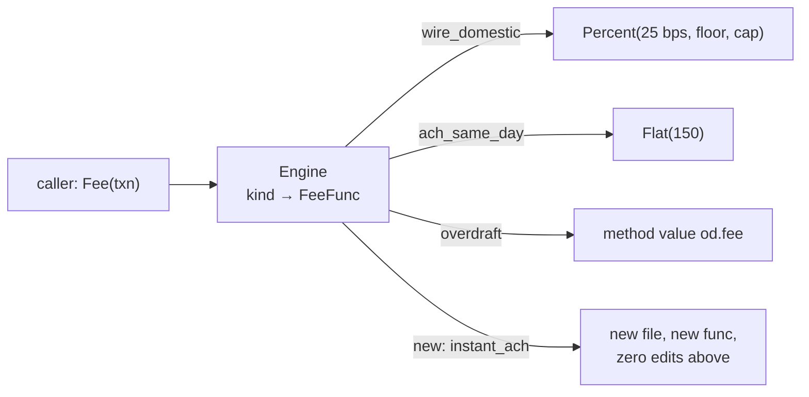
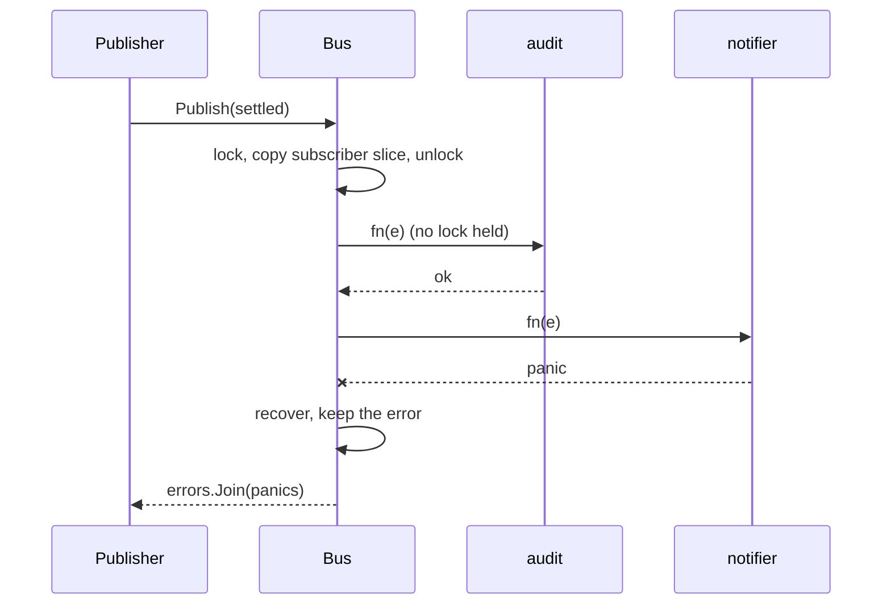
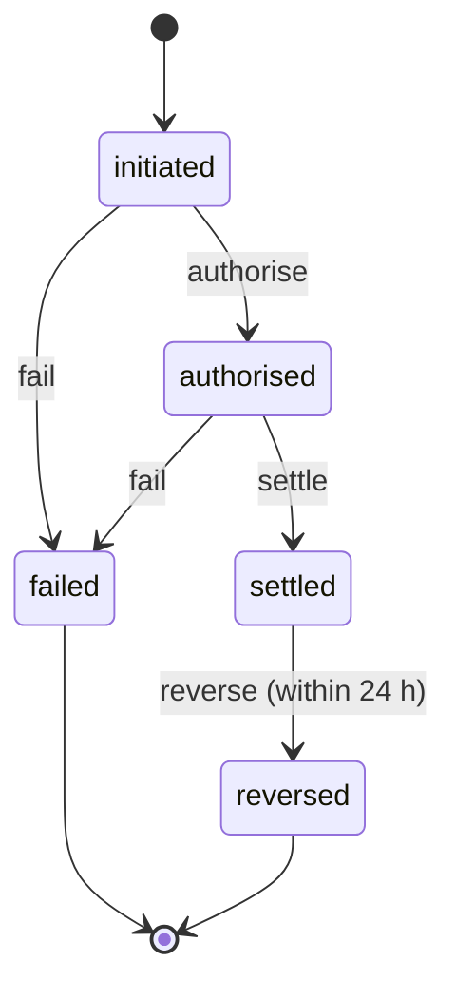
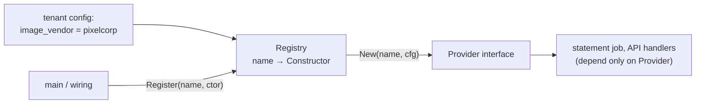
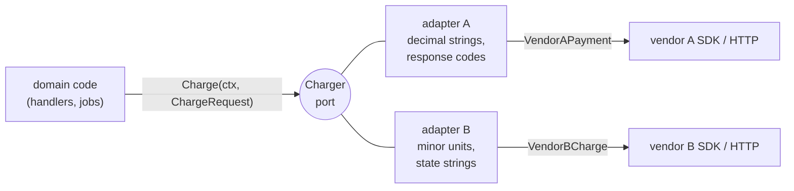
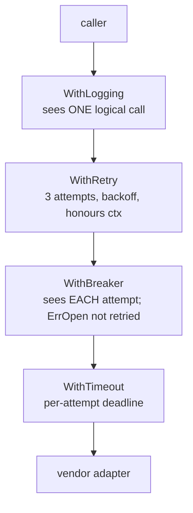
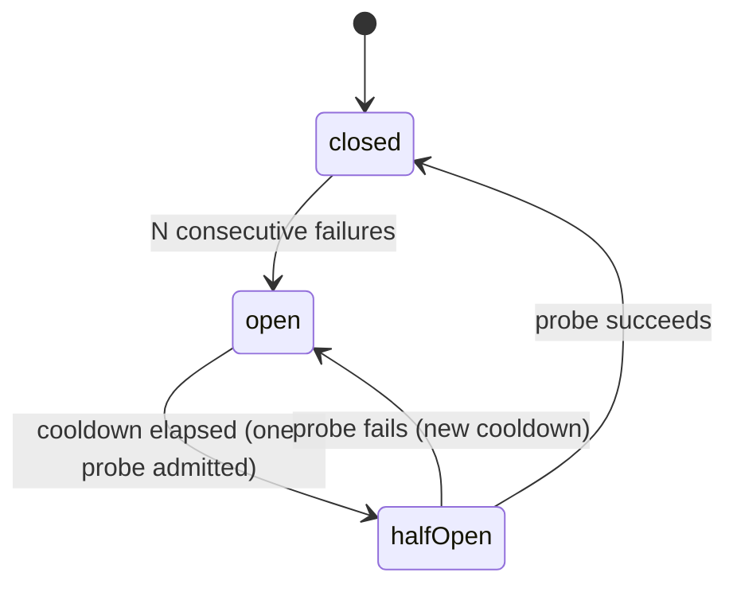
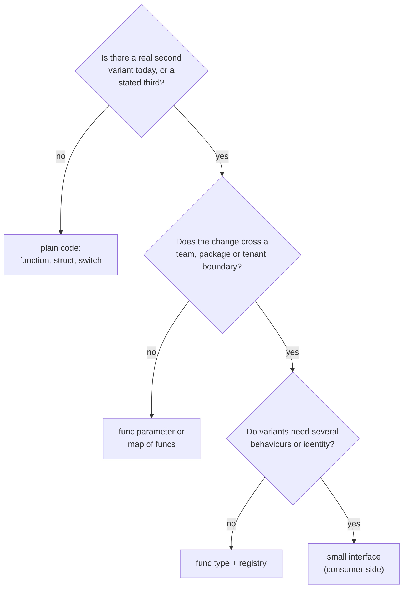

# B2 Unit 1 — Patterns that matter

> Time: ~6 h · CORE: §1–§7 · STRETCH: the blocks marked STRETCH in §4 (generic registry) and §6 (middleware chains
> for `net/http` and gRPC) · Labs: `labs/b2/strategy`, `labs/b2/observer`, `labs/b2/state`, `labs/b2/factory`,
> `labs/b2/adapter`, `labs/b2/decorator`, `labs/b2/breakit` (break-it exercises)

## Before you start

B1 gave you the vocabulary this unit leans on: small interfaces defined by the **consumer**, composition instead of
inheritance, constructors that enforce invariants, functional options, errors as values (`errors.Is`/`errors.As`,
`%w`), package boundaries, and designing for tests (fakes, an injected clock). Patterns are not new machinery on top
of that. They are *names for shapes you will keep re-inventing*: a rule you can swap, a list of listeners, a
lifecycle with legal moves, a map from name to constructor, a translator for a foreign API, a wrapper that adds
behaviour. Six shapes, each with a Go form that is usually smaller than the textbook one.

Two warnings before we start. First, in Go many patterns collapse into a **function value** or a **one-method
interface**, so if your solution has a `FooFactoryProvider` you have probably left the language. Second, in an LLD
interview the failure mode is *reciting* pattern names. The scoring signal is whether your design absorbs a
requirement change at minute 30 without a rewrite (Unit §7 and `design-exercise.md`). This unit teaches the problem
each pattern solves first, then the form, then when to leave it out.

| Pain you can feel | Shape | Go form | Kata |
|---|---|---|---|
| A `switch` on a type that every new product edits | Strategy | func value or one-method interface | `strategy` |
| Callers that must know everyone who cares about an event | Observer | callbacks or channels | `observer` |
| A `status` string compared in a dozen files | State | table of legal moves | `state` |
| `switch cfg.Vendor` at every call site | Factory / registry | map of constructors | `factory` |
| Vendor types leaking through the codebase | Adapter | small port + one translating struct | `adapter` |
| Retry/log/metrics copied into every client | Decorator | `func(Client) Client` | `decorator` |

Warm-up, from B1 and B0 (write your answers down first):

1. Where should an interface be declared, in the package that implements it or the one that uses it? What does that
   buy you when you write a fake in a test?
2. `err := fmt.Errorf("charge: %w", ErrRateLimited)`. Does `err == ErrRateLimited` hold? What do you call instead?
3. Why does a struct that needs "now" take a `func() time.Time` instead of calling `time.Now()` inside?

<details data-kind="answer">
<summary>Warm-up answers</summary>

1. In the package that **uses** it, sized to what the consumer needs (B1: "accept interfaces, return structs"). The
   consumer owns the contract, so it stays small, and a test can fake it with a ten-line struct without importing the
   real implementation.
2. No: `%w` wraps, so `==` is false. Use `errors.Is(err, ErrRateLimited)`, which walks the wrap chain (and
   `errors.As` for typed errors). §5 depends on this.
3. So tests control time: a fake clock makes "reversal window closes after exactly 24 h" a deterministic assertion
   rather than a sleep. Every kata in this unit that has a time rule takes a clock.

</details>

---

## §1 Strategy: a rule is a value

### The failure story

The fee engine of a credit-union platform started as one function:

```go
func calculateFee(t Txn) int64 {
	switch t.Kind {
	case "wire_domestic":
		// 25 bps, floor 15.00, cap 45.00, waived for "premier" members
	case "wire_intl":
		// domestic wire + 25.00 flat, unless USD->USD
	case "ach_same_day":
		// ...
	// ... eleven cases, 140 lines
	default:
		return 0
	}
}
```

Each new product edited it, plus four other places that mirror the same `switch`: the disclosure text, the
reversal calculation, the statement line description and the nightly revenue report. Adding "instant ACH" touched
five files. Over six months three releases forgot one of the five; the reversal path fell through to `default: return 0`,
so reversed instant-ACH transfers refunded the fee as `0` instead of the charged amount. At ≈ 2,000 such reversals a
month and a ≈ $1.50 fee, that is ≈ $3,000 a month of silent leakage that nobody saw, because nothing crashed.

Nothing here is a performance problem. The cost is **how many places must change when the business adds one more
variant**, and how silently the wrong place fails.

### Predict

<!-- predict id="B2-U1-P01" -->
**Predict.** What does this print? Write your answer down before opening the reveal.

```go
type schedule struct{ bps int64 }

func (s schedule) fee(amount int64) int64 { return amount * s.bps / 10000 }

func main() {
	s := schedule{bps: 100}
	f := s.fee // a method value, used as a strategy
	s.bps = 200
	fmt.Println(f(10000), s.fee(10000))

	price := 19.99
	fmt.Println(int64(price * 100))
}
```
<!-- /predict -->

<!-- predict id="B2-U1-P02" -->
**Predict.** The fee engine needs exactly one operation per fee type: `Fee(txn) (cents, error)`. Product asks next
quarter for a human-readable `Describe()` per fee type for the disclosure page, and a `Validate()` that runs when a
credit union configures the fee. Would you model the strategy as a func type or as an interface, and does your
answer change after those two requests? Give one sentence of reasoning each time.
<!-- /predict -->

### Reveal

<details data-kind="reveal" data-for="B2-U1-P01">
<summary>Reveal</summary>

```
100 200
1998
```

`s.fee` with a **value receiver** evaluates the receiver when the method value is created, so `f` holds a *copy* of
`schedule{bps: 100}`. Changing `s` afterwards does not affect `f`. If you want a strategy that follows later
configuration changes, bind a pointer (`(&s).fee`) or, better, re-register a new strategy when the schedule changes
(§1 Break it and the `Engine.Register` replace semantics). Tempting wrong answer: "200 200". And `19.99` is not
representable in binary floating point (it is ≈ 19.989999999999998), so `price*100` is ≈ 1998.9999999999998 and the
`int64` conversion truncates to **1998**. That is why every kata in this unit uses integer minor units. Never float
for money.

</details>

<details data-kind="reveal" data-for="B2-U1-P02">
<summary>Reveal</summary>

Start with a **func type**: one operation, no state beyond a closure, and any function or method value qualifies, so
tests pass a literal. After the two requests, flip to an **interface** (`Fee`, `Describe`, `Validate`) because a
strategy now has several behaviours that belong together and you want a single value to carry all of them. The flip
rule: one behaviour means a func; several related behaviours, or a need for identity (`Stringer`, comparison), mean an
interface. The standard library shows both: `sort.Interface` has three methods, while `slices.SortFunc` takes one
comparison func. And you can have the convenience of both with the `http.HandlerFunc` trick: a func type that
implements the interface by calling itself. Tempting wrong answer: "always an interface, it's more extensible". An
interface with one method and one implementation per file is the Java shape. In Go it adds a declaration and a name for
nothing a func type does not already give you.

</details>

### How it actually works

The pattern is three parts: a **family of interchangeable rules** that all have the same signature, a **context**
that picks one, and callers that depend only on the signature. Whether you pick by `kind`, by tenant or by member tier
is a separate decision (a lookup, which is the registry of §4).



The idiomatic Go form is a **function type**, with constructors that return closures:

```go
type Money int64 // minor units

type FeeFunc func(t Txn) (Money, error)

func Flat(fee Money) FeeFunc {
	return func(Txn) (Money, error) { return fee, nil }
}

// Percent: bps basis points, rounded half up, clamped to [min, max].
func Percent(bps int64, min, max Money) FeeFunc {
	return func(t Txn) (Money, error) {
		fee := Money((int64(t.Amount)*bps + 5000) / 10000)
		if fee < min {
			fee = min
		}
		if max > 0 && fee > max {
			fee = max
		}
		return fee, nil
	}
}
```

The strategies are *configuration-as-code*: `Percent(25, 1500, 4500)` is the wire fee schedule. The engine is a lookup
plus two rules that matter more than they look:

```go
func (e *Engine) Fee(t Txn) (Money, error) {
	e.mu.RLock()
	f, ok := e.fees[t.Kind]
	e.mu.RUnlock() // release BEFORE calling the strategy
	if !ok {
		return 0, fmt.Errorf("%w %q", ErrUnknownKind, t.Kind)
	}
	fee, err := f(t)
	if err != nil {
		return 0, fmt.Errorf("fee %q: %w", t.Kind, err)
	}
	if fee < 0 {
		return 0, fmt.Errorf("fee %q: %w (%d)", t.Kind, ErrInvalidFee, fee)
	}
	return fee, nil
}
```

1. **Copy the function out under the lock and call it outside.** A strategy may call back into the engine
   ("international wire = domestic wire + surcharge"). If `Fee` held the read lock across the call, a writer arriving
   between the outer and inner `RLock` would block the inner one (Go's `RWMutex` stops admitting new readers once a
   writer waits), and you get the deadlock from B0 Unit 1 §3.
2. **Validate the strategy's output.** A bug in one rule must not credit the customer, so the engine rejects negative
   fees instead of trusting every plug-in.

Four ways to get "a different rule per case", in the order you should consider them:

| Form | Looks like | Use when |
|---|---|---|
| Plain `switch` | `switch kind {…}` | 2–3 cases that will not grow and live in one function |
| Func parameter | `Charge(t, feeFn)` | the caller chooses, no lookup needed (`sort.Slice(x, less)`) |
| Map of funcs / engine | `fees[kind](t)` | variants are data-driven, grow over time, or are swapped at runtime |
| Interface | `type Fee interface{…}` | each variant has several behaviours or carries identity |

Tiered pricing shows why the *tests* matter more than the pattern. "Marginal" tiers (like income-tax brackets) charge
each slice of the amount at its own rate; the tempting "the whole amount at the rate of the tier it lands in" creates a
cliff where charging $1,000.01 costs *less* than $1,000.00. The kata's monotonicity test catches exactly that.

### Build it

Lab: **`labs/b2/strategy`** (`go test -race ./labs/b2/strategy/`). Implement `Flat`, `Percent`, `Tiered`, `Sum` and the
`Engine` (`Register`, `Fee`, `Kinds`) in `strategy.go`. Acceptance (read the test names; they are the spec):

- `Percent` rounds half up in integer arithmetic, applies floor and cap, and returns `ErrOverflow` instead of wrapping
  around for amounts near `MaxInt64`.
- `Tiered` is marginal, rounds **once** at the end, rejects malformed tier tables with `ErrInvalidStrategy`, copies the
  table, and its fee never decreases as the amount grows.
- `TestEngine_NewFeeTypeNeedsOnlyNewCode` registers an `overdraft` type that exists only in the test file. If your engine
  needs a change to serve it, you built a `switch`.
- Errors carry the kind and keep their cause (`errors.Is` works through the engine's wrapping).
- `TestEngine_StrategyRunsWithoutTheEngineLock` and the concurrent swap test pass under `-race`.

### Break it

1. In your engine, move `e.mu.RUnlock()` to a `defer` at the top of `Fee` so the lock is held while the strategy runs.
   Run `go test -race ./labs/b2/strategy/`. Predict which test fails and what it says.
2. Change `Tiered` to charge the whole amount at the rate of the tier it lands in. Which tests fail, and which one explains the
   problem in business terms?

<details data-kind="answer">
<summary>What you should see</summary>

1. `TestEngine_StrategyRunsWithoutTheEngineLock` fails after its 5 s guard with "Register blocked while a strategy was
   running": a writer cannot take the lock while an in-flight `Fee` call holds a read lock, and the re-entrant call
   would deadlock the same way. In production the symptom is a slow, intermittent hang the first time someone hot-swaps
   a fee schedule under load.
2. `TestTiered_IsMarginalNotWholeAmount` fails on every row above the first band, and
   `TestTiered_FeeNeverDecreasesAsAmountGrows` fails with "fee fell from X to Y when the amount rose". The second is the
   one that states the business problem (a member pays less for sending more) and it would have found the bug without
   anyone choosing the right example amounts, because the cliff exists only at the boundaries. A property ("fee is
   non-decreasing in the amount") finds what hand-picked examples can miss; that is the testing habit this unit wants
   from you.

</details>

### In the wild

- **`sort.Interface` and `slices.SortFunc`** are the same strategy in two Go forms: three methods before generics, one
  `cmp func(a, b E) int` since Go 1.21. `sort.Slice(x, less)` is the func-parameter form.
- **`http.HandlerFunc`** is the idiom "a func type that implements the interface" that lets you pass either.
- **`http.Client.CheckRedirect`**, **`tls.Config.GetCertificate`** and **`strings.Map`** take behaviour as a func
  parameter rather than defining an interface.
- **Interest and fee calculation in banking** is strategy territory: day-count conventions (for example actual/365
  versus 30/360) and compounding rules are exactly "same signature, different rule", and they change by product and
  by regulator, not by release.
- **Your own platform:** fee schedules per credit union are strategies chosen by tenant config (§4 gives you the
  lookup); the audit question "which schedule produced this fee on this date?" means strategies need **versions**.

### Trade-offs

| Option | Wins when | Loses when | When the answer flips |
|---|---|---|---|
| `switch` on kind | ≤ 3 stable variants in one function; trivially readable | Every new variant edits shared code in several places; silent `default` | When variants keep arriving, or a second `switch` over the same kind appears elsewhere |
| Func parameter | The caller knows which rule; tests pass literals | Callers need a lookup by name or tenant | When "which rule" is configuration, not code: add the engine |
| Map of funcs + engine | Data-driven, runtime-swappable, new variant = new file | Rules need several behaviours or identity | When `Describe`/`Validate` join the signature: interface |
| Interface per rule | Several related behaviours; can carry config and version | Boilerplate for one-method rules; mock-generation reflex | When every impl is a one-liner and the interface has one method: func type |

### Senior bar

- **Failure modes.** Silent `default` arm. Float arithmetic on money. A strategy with hidden mutable state shared across
  goroutines (a data race the engine cannot see). A hot-swap *between* quoting a fee and charging it, so the customer is
  charged a different amount than disclosed. A nil `FeeFunc` stored in the map (panic at the worst moment), which is why
  `Register` rejects it.
- **Numbers.** The story: one 140-line function with eleven arms versus eleven strategies of ≈ 5–15 lines each in
  separate files; adding a type is ≈ 1 new file and 0 edits, versus 5 edits. The maintenance metric to quote is
  *edits per new variant*.
- **Ops.** Version the schedule (`kind@v7`) and stamp it onto every fee you compute, so audit can reproduce any charge.
  Log "unknown kind" with the kind; alert on a non-zero count. Change fee schedules through review like code, because
  they are code.
- **Cost.** One extra indirection per call (negligible next to a DB call); the real cost is *readers* having to find
  which closure ran, so name strategy constructors after the business term (`WireFee`, not `Strategy3`).

**Interviewer probes**

<details data-kind="answer">
<summary>"How do you test that adding a fee type doesn't change existing ones?"</summary>

Two layers. Per-strategy table tests pin each rule's outputs including rounding and boundaries. Then an engine-level
test registers a brand-new type defined *in the test file* and asserts the old kinds still return their golden values;
if adding a type required engine changes, that test would not compile. I add a monotonicity or "never negative"
property for tiered rules, because boundaries are where example tests are thinnest.

</details>

<details data-kind="answer">
<summary>"Fees depend on member tier and balance too. Where does that data go?"</summary>

Into the strategy's input, not into global state: widen `Txn` (or pass a small `Context` struct) with the facts a rule
may need, and keep strategies pure functions of it. If a rule needs to *fetch* something (a balance), I give it an
explicit dependency through its constructor (a small interface, faked in tests) rather than letting it reach for a
global. Pure rules are trivially concurrent-safe and cacheable.

</details>

<details data-kind="answer">
<summary>"Strategy versus template method?"</summary>

Template method fixes the algorithm skeleton in a base class and lets subclasses override steps; Go has no inheritance,
so the equivalent is a function that takes the *varying steps* as parameters or as a small interface (the skeleton is
a normal function, the strategies are its arguments). I prefer that: the skeleton is testable alone, and steps are
independently swappable, with no override-the-wrong-hook bugs.

</details>

### Check yourself

1. Why does `Engine.Fee` release its lock before calling the strategy?
2. When is a func type the wrong shape for a strategy?
3. What does the engine do with a strategy that returns a negative fee, and why?

<details data-kind="answer">
<summary>Answers</summary>

1. A strategy may re-enter the engine; holding even a read lock across it can deadlock against a waiting writer, and it
   serialises hot-swaps behind slow strategies.
2. When a variant has several behaviours that must travel together (`Fee`, `Describe`, `Validate`) or needs identity;
   then an interface is the honest shape.
3. It returns `ErrInvalidFee`. One buggy rule must not be able to credit customers; the engine validates plug-in
   output at the boundary.

</details>

---

## §2 Observer: telling others without knowing them

### The failure story

When a transfer settles, the audit log, the member notifier and the fraud scorer all need to know. The first version of
`Settle` called all three inline. Then someone replaced that with a list of callbacks behind a mutex so other teams
could subscribe without editing `Settle`. Three bugs followed, in this order:

1. A subscriber unsubscribed itself from inside its own callback. `Publish` held the bus mutex while calling
   subscribers, so `Unsubscribe` blocked on the same mutex: the settling goroutine hung forever. Go's deadlock detector
   never fired, because the process had other live goroutines.
2. At month-end the batch settled ≈ 50,000 transfers. The notifier callback sent an email synchronously, ≈ 200 ms each,
   so the batch took ≈ 50,000 × 0.2 s ≈ 10,000 s ≈ 2.8 hours instead of ≈ 5 minutes.
3. A nil-pointer panic in the fraud scorer's callback unwound through `Publish` and killed the batch worker with ≈
   31,000 transfers settled but not audited.

The pattern is simple. The three bugs are all about **what runs while a callback runs**.

### Predict

<!-- predict id="B2-U1-P03" -->
**Predict.** What happens when this program runs? (No `-race`. Assume the program has other goroutines alive, as a
server does.)

```go
type Bus struct {
	mu   sync.Mutex
	subs []func(string)
}

func (b *Bus) Subscribe(fn func(string)) {
	b.mu.Lock()
	defer b.mu.Unlock()
	b.subs = append(b.subs, fn)
}

func (b *Bus) Publish(e string) {
	b.mu.Lock()
	defer b.mu.Unlock()
	for _, fn := range b.subs {
		fn(e)
	}
}

func main() {
	b := &Bus{}
	b.Subscribe(func(e string) { b.Subscribe(func(string) {}) })
	b.Publish("settled")
	fmt.Println("done")
}
```
<!-- /predict -->

<!-- predict id="B2-U1-P04" -->
**Predict.** A different bus delivers by channel: `Publish` does `for _, ch := range subs { ch <- e }`, each `ch` is
unbuffered, and each subscriber runs a `for e := range ch` loop in its own goroutine. One subscriber (the email sender)
stalls for 30 seconds. What happens to publishers, to the other subscribers, and to events published meanwhile? Name
three policies a bus could apply instead, and say what each one loses.
<!-- /predict -->

### Reveal

<details data-kind="reveal" data-for="B2-U1-P03">
<summary>Reveal</summary>

It never prints `done`. `Publish` holds `b.mu` and calls the subscriber, which calls `Subscribe`, which tries to take the
same `sync.Mutex`. Go mutexes are **not re-entrant**, so the goroutine blocks on itself. In `main` with no other
goroutines the runtime reports `fatal error: all goroutines are asleep - deadlock!`; in a real server, other goroutines
keep the detector quiet and you get a silent hang. Fix: snapshot the subscriber slice under the lock, release the lock,
then call the subscribers (what the kata requires). Tempting wrong answer: "it appends and carries on". The lock is
the problem, not the append.

</details>

<details data-kind="reveal" data-for="B2-U1-P04">
<summary>Reveal</summary>

The first `ch <- e` to the stalled subscriber blocks `Publish`, so **every publisher stalls** behind the slowest
subscriber, and subscribers later in the loop receive nothing until it recovers (event delivery is now coupled to the
slowest consumer's speed). Policies: (1) **block** (backpressure): safe for data you cannot lose, but one slow consumer
stalls the producer; (2) **buffer then drop** (newest or oldest): the publisher never stalls, but you lose events and must
count them; (3) **unbounded queue per subscriber**: nothing lost until memory is, which is a slow OOM; (4) a
**durable log/outbox** the subscriber reads at its own pace: the only one that tolerates a 30-second (or 30-hour) stall
without loss, at the price of a storage layer. Audit needs (4); a UI "transfer settled" toast is fine with (2).
Tempting wrong answer: "just make the channels bigger". A bigger buffer delays the stall; it does not remove it.

</details>

### How it actually works

An observer is a **registration list plus a notification loop**. The publisher knows only "there may be zero or more
listeners"; listeners know the event type. The decisions that make or break an implementation are about the loop:



The contract the `observer` kata enforces, and why each clause exists:

| Clause | Why |
|---|---|
| Subscribers run **in subscription order**, synchronously, on the publisher's goroutine | Predictable; the caller knows all effects finished when `Publish` returns |
| **No bus lock is held** while a callback runs | A callback may `Subscribe`, unsubscribe or `Publish`; holding the lock deadlocks (P03) |
| Delivery uses a **snapshot** taken at `Publish` start | A subscriber added by a callback sees the *next* event, not this one; nobody iterates a slice that is being mutated |
| **Copy-on-write** on unsubscribe | An in-flight `Publish` may still hold the old slice |
| **Unsubscribe by id**, idempotent | Removing "index 1" twice removes someone else's subscription the second time |
| A panicking subscriber is **recovered**; the rest still run; `Publish` returns the joined error | One bad observer must not kill the publisher or starve its neighbours |

```go
func (b *Bus) Publish(e Event) error {
	b.mu.Lock()
	snapshot := b.subs[e.Topic] // never mutated in place, so reading it unlocked is safe
	b.mu.Unlock()

	var errs []error
	for _, s := range snapshot {
		if err := call(s.fn, e); err != nil {
			errs = append(errs, err)
		}
	}
	return errors.Join(errs...)
}

func call(fn func(Event), e Event) (err error) {
	defer func() {
		if r := recover(); r != nil {
			err = fmt.Errorf("observer: subscriber for %q panicked: %v", e.Topic, r)
		}
	}()
	fn(e)
	return nil
}
```

**Callbacks versus channels.** The callback form (above) is synchronous: simple, ordered, and the publisher pays for slow
subscribers. The **channel form** decouples them: each subscriber gets a buffered channel and consumes at its own pace.
The price is that you now own a *delivery policy* for a full buffer. The kata's `SubscribeChan` drops the newest event and
counts it (`Dropped()`), so `Publish` never blocks. The subtle part is closing: a publisher goroutine sending on a channel
while another goroutine closes it panics with `send on closed channel`, so delivery and close are serialised by the
subscription's own mutex (the "sender owns the close" rule from B0, with several senders). Rule of thumb: **run
callbacks only for fast, non-blocking work; hand slow work to a channel and a worker.**

In-process observer gives you *at-most-once* delivery with no memory across restarts. If the audit trail must not lose
events, observer is only the *trigger*; the record goes through a durable outbox (a table written in the same transaction
as the state change). Once events cross a process boundary you are in messaging territory (at-least-once, ordering,
replay), which A6 and A7 cover.

### Build it

Lab: **`labs/b2/observer`** (`go test -race ./labs/b2/observer/`). Implement `Bus` (`Subscribe`, `Publish`) and the
channel form (`SubscribeChan`, `Subscription.Cancel`, `Dropped`). The tests that carry the lesson:

- `TestCallbacks_MayReenterTheBus`: a callback subscribes, unsubscribes itself and publishes to another topic.
- `TestSlowSubscriber_DoesNotBlockOtherTopicsOrSubscriptions`: while one callback is parked, another goroutine
  publishes and subscribes on a different topic.
- `TestUnsubscribe_StopsDeliveryAndIsIdempotent`: unsubscribing three times removes only one subscriber.
- `TestPublish_ContainsSubscriberPanics`: neighbours still run, and `Publish` reports the panic.
- `TestSubscribeChan_SlowConsumerNeverBlocksPublish` and `..._CancelRacingPublishNeverPanics` (200 rounds under `-race`).

### Break it

1. Run the deliberately broken bus: `go test -tags breakit -run '^TestNaiveBus' ./labs/b2/breakit/`. Predict the
   failure, then read the goroutine profile it prints.
2. In your own `Subscription`, deliver and close **without** the mutex and the `closed` flag (send straight onto `s.ch`; `close(s.ch)` in `Cancel`).
   Run `go test -race -count=5 -run CancelRacing ./labs/b2/observer/`.

<details data-kind="answer">
<summary>What you should see</summary>

1. After 2 s: "Publish did not return within 2s: a subscriber called Subscribe while Publish held the lock", followed by a
   profile with one goroutine parked in `sync.(*Mutex).Lock` called from `(*naiveBus).Subscribe`, called from the test
   callback, called from `(*naiveBus).Publish`: the stack reads like the diagnosis. `go vet` cannot find this; the race
   detector cannot either (there is no data race, just a lock-order bug on one goroutine).
2. `WARNING: DATA RACE` and then a panic, almost at once: `close of closed channel` (the test calls `Cancel` from three
   goroutines, and without the `closed` flag the second one closes again) or `send on closed channel` (a publisher whose
   snapshot predates the unsubscribe delivers after the close). The window for the second is tiny, which is why the test
   runs 200 rounds with 4 publishers: rare in review, certain in production at scale.

</details>

### In the wild

- **`os/signal.Notify(c, sig...)`** is the channel observer: the package relays signals to your channel and, per its
  docs, "will not block sending to c: the caller must ensure that c has sufficient buffer space", so it is the
  *drop-when-full* policy, and the reason you always pass a buffered channel.
- **`context.AfterFunc(ctx, f)`** (Go 1.21) registers a callback to run when a context is done. **`http.Server.RegisterOnShutdown`**
  and **`testing.T.Cleanup`** (callbacks in last-added-first-called order) are callback registries with specified ordering.
- **`net/http` exposes hook-style observers** such as `http.Server.ConnState` (called on every connection
  state change) and `httptrace.ClientTrace` (callbacks at dial, TLS, first byte). Hooks are observers with a fixed event
  set; their documentation tells you not to block in them.
- **Kubernetes client-go informers** let you register event handlers (`OnAdd`, `OnUpdate`, `OnDelete`) on a shared
  informer. TODO-VERIFY: details of how handlers are invoked (per-listener buffering) before quoting them.
- **Banking:** a settle event fanning out to audit, notification and fraud scoring; platform-level audit hooks in
  SSO adapters ("login succeeded/failed") are observers over your auth flow, and the durable audit record is the outbox.

### Trade-offs

| Option | Wins when | Loses when | When the answer flips |
|---|---|---|---|
| Direct calls in `Settle` | 1–2 collaborators that will not change | Every new interested party edits `Settle`; failures couple | When a third consumer appears or teams own the consumers |
| Sync callbacks | Fast, ordered, in-process; easy to reason about | A slow or panicking subscriber hurts the publisher | When a subscriber does I/O: give it a channel and a worker |
| Channel per subscriber (drop on full) | Decoupled speed; publisher never blocks | Events can be lost; you must count and expose drops | When loss is unacceptable: durable outbox/log |
| Durable outbox / event log | Survives crashes and slow consumers; replayable | Storage, a relay process, at-least-once duplicates | When the consumer is in-process and loss is fine: callbacks are enough |

### Senior bar

- **Failure modes.** Callback under lock (deadlock). Slow subscriber blocking the producer. Panic escaping the bus.
  **Lapsed listener**: subscribers never unsubscribed keep objects alive and keep receiving events (a leak; always
  return and *use* the unsubscribe func). Re-entrancy loops (handler of `A` publishes `A`). Unbounded
  goroutine-per-event fan-out. Assuming ordering across publishers (there is none).
- **Numbers.** The month-end story: 50,000 × 200 ms ≈ 2.8 h serial versus ≈ 5 min with the email on a worker. Buffer sizing
  for a channel subscriber: ≈ burst rate × worst consumer pause (200 events/s × 2 s ≈ 400).
- **Ops.** Export per-subscriber `dropped` counters, queue depth and handler latency histograms; a growing subscriber
  count with flat traffic means a leak. Log recovered panics with the event key.
- **Cost.** Indirection hides control flow: "who reacts to `settled`?" can no longer be answered by grep on the caller.
  Keep topics few and named after business events.

**Interviewer probes**

<details data-kind="answer">
<summary>"Sync or async delivery, and who decides?"</summary>

Sync when handlers are fast and the publisher needs to know they finished (updating an in-memory index); async when a
handler does I/O or can be slow. The subscriber, not the publisher, knows its own cost, so the safest default API is
sync callbacks that are *documented as must-not-block*, plus a channel subscription for anything slower. The publisher
must never be forced to pick a speed for subscribers it doesn't know about.

</details>

<details data-kind="answer">
<summary>"How do you guarantee the audit sink gets every event?"</summary>

An in-process observer can't guarantee it: the process can crash between state change and notification. I write the
audit record in the **same database transaction** as the state change (outbox), and a relay publishes it afterwards,
at-least-once, with a stable event id so consumers dedupe. The in-process bus is then just a low-latency nudge to
wake the relay.

</details>

<details data-kind="answer">
<summary>"What ordering do subscribers see?"</summary>

For one publisher goroutine and one topic: subscription order for the callbacks and publish order per subscriber. Across
concurrent publishers there is no global order unless the bus serialises (one goroutine draining a queue), which costs
throughput. If consumers need per-entity order (all events of transfer 17 in order), partition by key so one worker owns
each key.

</details>

### Check yourself

1. Why does `Publish` copy the subscriber slice under the lock instead of iterating under it?
2. What exactly makes `Cancel` racing `Publish` panic, and how does the kata prevent it?
3. When is an in-process observer the wrong tool for audit?

<details data-kind="answer">
<summary>Answers</summary>

1. So callbacks can re-enter the bus (subscribe, unsubscribe, publish) without deadlock and so a slow callback does not
   block other topics' publishers; copy-on-write on unsubscribe keeps the snapshot valid.
2. A `Publish` goroutine sending on `s.ch` while `Cancel` closes it gives `send on closed channel`. The subscription's
   mutex serialises `deliver` (which checks `closed` before sending) with the close.
3. Whenever the audit record must survive crashes or slow consumers: use an outbox written in the same transaction and a
   relay; the bus is only a trigger.

</details>

---


## §3 State: legal moves as data

### The failure story

A transfer's `status` is a string column. It is compared in 11 files, with three spellings in the wild (`"SETTLED"`,
`"settled"`, `"Settled "` with a trailing space from a CSV import). Every file has its own idea of which moves are legal:
the vendor-callback handler lets `settled` go back to `authorised` (a late duplicate callback), the reversal endpoint
reverses anything that is not `failed`, and the nightly job "fixes" stuck rows by writing `settled` directly. Two workers
handle the same duplicated settle callback: both read `authorised`, both decide "settle is fine", both post to the ledger.
At ≈ 40,000 transfers a month, a ≈ 0.3% anomaly rate is ≈ 120 bad rows; at ≈ 25 minutes of operations time per row that is
≈ 50 hours a month of cleanup, plus the money that moved twice before anyone noticed.

The bug is not in any one `if`. It is that **the lifecycle exists nowhere as a single artefact**, so nothing can check
a move against it, test it exhaustively, or draw it for the auditor.

### Predict

<!-- predict id="B2-U1-P05" -->
**Predict.** Using this lifecycle table, what is the final state after each sequence, and which events return an error?
Write down the state and the errors for each step.

```go
// initiated  --authorise--> authorised --settle--> settled --reverse--> reversed
//     |                         |
//     +-------- fail -----------+--> failed        (failed and reversed are terminal)

t := New("tr-1", 12500, clock)
t.Apply(Authorise) // step 1
t.Apply(Settle)    // step 2
t.Apply(Settle)    // step 3: a vendor re-delivers its callback
t.Apply(Fail)      // step 4
t.Apply(Reverse)   // step 5
t.Apply(Reverse)   // step 6, 2 hours after step 5
```
<!-- /predict -->

<!-- predict id="B2-U1-P06" -->
**Predict.** Two pods receive the same vendor "settled" callback at the same instant. Each does
`if t.Status == "authorised" { t.Status = "settled"; ledger.Post(t) }` against the same database row. Describe exactly
how the ledger gets two postings, name the class of bug, and give the one-statement database fix.
<!-- /predict -->

### Reveal

<details data-kind="reveal" data-for="B2-U1-P05">
<summary>Reveal</summary>

Steps 1 and 2 succeed (`authorised`, then `settled`). Step 3 is `Settle` in state `settled`: not an edge of the table, but
it equals the event that produced the current state, so it is a **duplicate**: `ErrDuplicate`, state unchanged (a caller
acknowledges and moves on; it must not alert). Step 4 is `Fail` in `settled`: no such edge, and it is not the last event,
so `ErrIllegalTransition` (money has moved; failing it would lose the ledger entry; the correct move is a reversal).
Step 5 succeeds (`reversed`, assuming the reversal window is open). Step 6 is a duplicate of step 5: `ErrDuplicate`.
The distinction matters: duplicates are *expected* in any system with at-least-once callbacks and need no alarm; an
illegal transition means a bug or an attack and should page someone. Tempting wrong answer: "both step 3 and step 6 are
illegal transitions". Treating retries as errors floods on-call and teaches people to ignore the alert.

</details>

<details data-kind="reveal" data-for="B2-U1-P06">
<summary>Reveal</summary>

A **check-then-act race** (TOCTOU). Both pods read `authorised` before either writes, both pass the `if`, both set the
status and both post to the ledger. A mutex inside one process does not help because the race is between processes. The
fix is to make the check and the write one atomic statement and to act only if you won:
`UPDATE transfers SET status='settled' WHERE id=$1 AND status='authorised'`, then check `RowsAffected() == 1` before posting
to the ledger. The loser sees 0 rows, treats it as a duplicate and does nothing. The in-memory kata does the same with one
mutex around "look up the rule, apply, record history". Tempting wrong answer: "read the row `FOR UPDATE`" is valid but
holds a lock across the vendor call and the ledger post; the conditional update is lighter and survives a crash between
steps.

</details>

### How it actually works

A state machine is a set of **states**, a set of **events**, and a **transition function** `(state, event) → state`,
usually with **guards** (extra conditions) and **actions** (side effects). Make the transition function *data*:



```go
type rule struct {
	to    State
	guard func(*Transfer) error // nil = always allowed
}

var table = map[State]map[Event]rule{
	Initiated:  {Authorise: {to: Authorised}, Fail: {to: Failed}},
	Authorised: {Settle: {to: Settled}, Fail: {to: Failed}},
	Settled:    {Reverse: {to: Reversed, guard: reversalWindowOpen}},
	// Failed and Reversed: no entries = terminal
}

func (t *Transfer) Apply(ev Event) error {
	t.mu.Lock()
	defer t.mu.Unlock()
	r, ok := table[t.state][ev]
	if !ok {
		if n := len(t.history); n > 0 && t.history[n-1].Event == ev {
			return fmt.Errorf("%w: %q already applied", ErrDuplicate, ev)
		}
		return fmt.Errorf("%w: %q in state %q", ErrIllegalTransition, ev, t.state)
	}
	if r.guard != nil {
		if err := r.guard(t); err != nil {
			return err
		}
	}
	t.history = append(t.history, Transition{From: t.state, To: r.to, Event: ev, At: t.now()})
	t.state = r.to
	return nil
}
```

Why a table beats `if`/`switch` chains:

- **One artefact to review.** Product, ops and the auditor can read it, and you can generate the diagram above from it.
- **Exhaustive tests are cheap.** The kata tests every `(state × event)` cell (5 × 4 = 20) against an independently written
  expected matrix, so a missing or extra edge is a failing cell, not a production incident.
- **Illegal moves are rejected in one place**, with a typed error. Duplicates are separated from illegal moves so retries
  do not look like attacks.
- **Atomicity is local.** Because `Apply` evaluates against the state the previous event left, two concurrent events cannot
  both pass; the same shape works against a database with the conditional `UPDATE` above.

**Three Go forms.** (1) *Enum + table* (above): best when behaviour on entering a state is small. (2) *State as types*:
each state is a type with only the methods legal in it, so illegal moves don't compile.

```go
type Authorised struct{ id string }
type Settled struct{ id string; ledgerRef string }

func (a Authorised) Settle(ref string) Settled { return Settled{id: a.id, ledgerRef: ref} }
func (s Settled) Reverse() Reversed             { return Reversed{id: s.id} }
// (Authorised).Reverse does not exist: "reverse before settle" cannot be written.
```

That is the strongest guarantee, but it needs a way to persist and reload a typed state (a switch at the storage boundary),
and it fits poorly when events arrive from outside in any order, as vendor callbacks do. (3) *Interface per state* (the
GoF form, `state.Handle(ctx, event)`): worth it when each state carries a lot of behaviour. For a payment lifecycle driven
by external events, form (1) is the default.

Time-dependent rules (the 24 h reversal window) are **guards** with an injected clock, and they are *not* illegal
transitions: the edge exists, the guard refused it. Keep the two error classes separate (`ErrReversalWindow` versus
`ErrIllegalTransition`), because the right reaction differs (tell the member "too late" versus page someone).

### Build it

Lab: **`labs/b2/state`** (`go test -race ./labs/b2/state/`). Implement `New`, `Apply`, `State`, `Allowed`, `History` and
`IsTerminal` in `state.go`; the table is yours to design, the tests pin the lifecycle.

- `TestApply_EveryStateEventPairMatchesTheLifecycle` walks all 20 cells; rejected moves must leave state and history
  untouched.
- `TestApply_DuplicateIsNotIllegal` and `TestReverse_RespectsTheReversalWindow` (inclusive boundary at exactly 24 h,
  rejection at +1 ns, state unchanged on refusal).
- `TestApply_ConcurrentDuplicateSettleSucceedsExactlyOnce` (50 goroutines) and the settle-versus-fail race (200 rounds).
- `IsTerminal` must be derived from the table, not hard-coded.

### Break it

1. Run `go test -tags breakit -run '^TestBrokenTable' ./labs/b2/breakit/`. The hand-typed table has two bugs. Predict which
   edges the diff reports and which state the reachability test blames, fix the table, and then say which of the two
   tests would have caught each bug on its own.
2. In your `Apply`, remove the mutex and run `go test -race -count=3 -run Concurrent ./labs/b2/state/`.

<details data-kind="answer">
<summary>What you should see</summary>

1. The matrix test reports `missing edge: authorised --fail-->`, `missing edge: settled --reverse-->` and `unexpected edge:
   settled --reverce-->` (a typo). The reachability test reports `state "settled" is a dead end but is not terminal` and
   `state "reversed" is unreachable from initiated`. The missing `authorised --fail-->` edge is only visible to the matrix
   test (the machine still reaches a terminal state some other way); the typo is visible to both, but the reachability
   test explains the *consequence* (transfers pile up in `settled`). Mechanical checks over the table (reachability,
   no dead ends, terminals have no exits) are a cheap second net beyond examples.
2. `WARNING: DATA RACE` reports on `state` and `history`, and the "exactly once" test fails with several `nil` results
   (two goroutines both settled). Without `-race` it often passes, which is why the test is concurrent *and* the gate runs
   under `-race`.

</details>

### In the wild

- **TCP** is the textbook table-driven machine: RFC 793 defines 11 states (`LISTEN`, `SYN-SENT`, `SYN-RECEIVED`,
  `ESTABLISHED`, `FIN-WAIT-1`, `FIN-WAIT-2`, `CLOSE-WAIT`, `CLOSING`, `LAST-ACK`, `TIME-WAIT`, `CLOSED`), and `ss -tan`
  shows them on a live box. `TIME-WAIT` lasts 2×MSL; on Linux it is a fixed ≈ 60 s (TODO-VERIFY: constant in current
  kernels).
- **`net/http.ConnState`** exposes a server connection's state (`StateNew`, `StateActive`, `StateIdle`, `StateHijacked`,
  `StateClosed`) through the `Server.ConnState` hook.
- **Kubernetes** drives objects through phases (a Pod is `Pending`, `Running`, `Succeeded`, `Failed` or `Unknown`), but
  controllers are *level-triggered reconcilers*: they compare observed to desired state repeatedly instead of trusting every
  event, which is how they survive lost and duplicated events. TODO-VERIFY: Pod phase list against the current API docs.
- **Payment APIs** model charges and intents as explicit statuses with documented legal moves (for example Stripe's
  PaymentIntent statuses such as `requires_action`, `processing`, `succeeded`, `canceled`). TODO-VERIFY: exact status set
  before quoting it. Your vendor adapters (§5) map these foreign states onto your own table.
- **HTTP/2** streams have `idle`, `open`, `half-closed` and `closed` states (RFC 7540, since superseded by RFC 9113); illegal frames in a state are
  protocol errors, exactly the "reject in one place" rule.
- **Your platform:** transfer lifecycle (`initiated → authorised → settled → reversed`), card-dispute and loan-application
  workflows, and KYC case states.

### Trade-offs

| Option | Wins when | Loses when | When the answer flips |
|---|---|---|---|
| `bool`/enum + scattered `if` | 2 states, no rules (active/inactive) | Any rule about *moves*; the lifecycle isn't written down | The moment a second file checks the status: table |
| Enum + transition table | Externally-driven events, 3–10 states, auditability | Rich per-state behaviour; compile-time guarantees | When illegal moves must be unrepresentable: state types |
| State as types | One process owns the flow and illegal calls should not compile | Persistence round-trips, out-of-order external events | When state is stored and events arrive from outside: table |
| Interface per state (GoF) | Each state has substantial behaviour (a parser, a protocol) | Boilerplate for plain lifecycles | When behaviour per state is a line or two: table |
| Workflow engine / saga | Days-long, human steps, retries, timers across services | Overhead, another system to run | When it is one entity in one DB with seconds-long steps: a table |

### Senior bar

- **Failure modes.** Missing or extra edges; no terminal states (rows live forever); **stuck states** (authorised for 3
  days because the settle callback never came); duplicate and out-of-order callbacks (settle before authorise from an
  async vendor); concurrent transitions (check-then-act); adding a state without migrating old rows; guards that read the
  wall clock (untestable); transitions with side effects (ledger post) that are not idempotent.
- **Numbers.** 5 states × 4 events = 20 cells to test exhaustively: trivial, which is the argument. The story's anomaly
  cost: ≈ 120 rows × 25 min ≈ 50 h/month.
- **Ops.** Gauge of transfers per state; **age of the oldest transfer in each non-terminal state** with an alert threshold
  (the stuck-state detector); a sweeper that expires `authorised` after N hours. Persist history with the actor and the
  vendor event id, because auditors ask "who moved this and why".
- **Cost.** Almost nothing at runtime; the cost is discipline: every status change must go through `Apply`.

**Interviewer probes**

<details data-kind="answer">
<summary>"The vendor's settle callback arrives before your authorise is recorded. What do you do?"</summary>

First decide whether out-of-order events are *possible by contract*; with async vendors they are. Options: buffer or
re-queue the early event with a bounded delay and retry; or make the table accept it by modelling the earlier state as
implied (`initiated --settle--> settled`, recording the skipped step); or fetch the authoritative status from the vendor
(a reconciliation call). I would not drop it silently and I would not apply it blindly. The decision depends on whether
skipped states carry obligations (an authorise that must be recorded for audit).

</details>

<details data-kind="answer">
<summary>"How do you enforce this across 3 pods and a database?"</summary>

The database is the source of truth, so the transition is a conditional write: `UPDATE … SET status=$new WHERE id=$id AND
status=$expected`, with the table checked in code *before* the write and `RowsAffected` checked *after*. Side effects
(ledger post) happen only for the winner, ideally in the same transaction or driven from an outbox so a crash between
steps is recoverable, and keyed by an idempotency key so replays are no-ops.

</details>

<details data-kind="answer">
<summary>"Why distinguish duplicate from illegal?"</summary>

Because at-least-once delivery makes duplicates normal and illegal moves abnormal. Duplicates are acknowledged and
counted; illegal transitions raise an alert and are investigated. Merging them either floods on-call or hides real bugs.

</details>

### Check yourself

1. How does a table make "illegal states" checkable, and by what kind of test?
2. Why is the reversal window a guard rather than a missing edge?
3. What is the database equivalent of the kata's mutex?

<details data-kind="answer">
<summary>Answers</summary>

1. The full lifecycle is data, so a test can enumerate every `(state, event)` cell against an independent expected matrix,
   and mechanical checks (reachability, dead ends, terminals) run over the table itself.
2. The edge `settled → reversed` is legal; whether it is allowed *now* depends on time. Modelling it as a guard keeps the
   table stable and yields a distinct error (`ErrReversalWindow`) with a different remedy.
3. A conditional update (`WHERE status = expected`) plus a `RowsAffected` check: check and write in one atomic statement.

</details>

---

## §4 Factory and registry: choosing a provider by name

### The failure story

The platform integrates three cheque-image vendors, and each credit union picks one in its configuration. The first
version of vendor #3 was added by copying vendor #2's adapter (≈ 300 lines), editing it, and then fixing nine places that
looked like this:

```go
switch cfg.ImageVendor {
case "acme":
	p = acme.New(cfg.Acme)
case "pixelcorp":
	p = pixelcorp.New(cfg.Pixel)
default:
	p = acme.New(cfg.Acme) // "safe default"
}
```

Eight of the nine got the new case; the statement job did not. The month-end run for two credit unions fell through to the
default and called the wrong vendor with the wrong credentials: ≈ 6,000 statements were delayed a day. Worse, a typo in a
tenant's config (`"pixelcrop"`) silently used the default vendor for weeks, and the bank paid for images from a vendor it
had no contract with for that tenant.

Two separate problems: *adding a vendor edits many places*, and *a misspelt name fails open*.

### Predict

<!-- predict id="B2-U1-P07" -->
**Predict.** What happens when this program runs, and on which line? What would change if you moved the
`register` call out of `init()` and into `main()`?

```go
var registry = map[string]func() string{}

func register(name string, f func() string) { registry[name] = f }

func mustGet(name string) func() string {
	f, ok := registry[name]
	if !ok {
		panic(fmt.Sprintf("unknown provider %q", name))
	}
	return f
}

var defaultProvider = mustGet("acme")

func init() { register("acme", func() string { return "acme" }) }

func main() { fmt.Println(defaultProvider()) }
```
<!-- /predict -->

<!-- predict id="B2-U1-P08" -->
**Predict.** Your registry is filled by `init()` functions in three vendor packages (`vendors/acme`, `vendors/pixelcorp`,
`vendors/lumen`). `main` imports only `vendors/acme`. A tenant's config says `pixelcorp`. What does the program do, when
is the problem discovered, and what are two different fixes? Which would you choose and why?
<!-- /predict -->

### Reveal

<details data-kind="reveal" data-for="B2-U1-P07">
<summary>Reveal</summary>

It panics before `main` runs: `panic: unknown provider "acme"`, in the package's variable initialisation (the trace shows
`main.init()` at the `var defaultProvider` line). Go initialises **all package-level variables first** (in dependency
order), and only then runs the package's `init()` functions, so `mustGet` sees an empty registry. Moving registration into
`main()` fixes this one (nothing runs before `main`) but changes the contract: now someone must remember to call it.
Cross-package, an imported package is fully initialised before its importer, but unrelated packages initialise in the
order the Go spec defines (sorted by import path, Go 1.21+), so no code should depend on "A registered before B". Tempting
wrong answer: "`init()` runs first, so it works". `init()` runs *after* variable initialisation.

</details>

<details data-kind="reveal" data-for="B2-U1-P08">
<summary>Reveal</summary>

`vendors/pixelcorp` is never linked in, so its `init()` never runs and the registry has no `pixelcorp`: the lookup fails at
**runtime**, when that tenant's provider is first built (on the first request, or at startup if you build providers
eagerly). The compiler cannot see it. This is `sql.Open("postgres", …)` without the driver import:
`sql: unknown driver "postgres" (forgotten import?)`. Fixes: (1) a **blank import** (`import _ "…/vendors/pixelcorp"`),
usually in one `vendors/all` package; implicit, but short. (2) **Explicit registration** in `main` or a wiring function:
`reg.Register("pixelcorp", pixelcorp.New)`; more lines, but the compiler checks that the package is imported and a reader
can see the full set. I would choose explicit registration for an application (we control `main`, and tests can build their
own registry), and `init()` registration only for plug-in style libraries like `database/sql` drivers. In both cases,
**validate every tenant's config at startup** so a missing or misspelt provider fails the deploy, not a month-end job.

</details>

### How it actually works

A *factory* hides **which concrete type gets constructed** behind a function. In Go the simplest factory is a constructor
that returns an interface (`func NewProvider(cfg Config) (Provider, error)`). A *registry* adds a lookup so configuration
can name the thing:



```go
type Provider interface {
	Name() string
	Fetch(ctx context.Context, id string) ([]byte, error)
}

type Constructor func(cfg Config) (Provider, error)

func (r *Registry) New(name string, cfg Config) (p Provider, err error) {
	r.mu.RLock()
	c, ok := r.ctors[name]
	r.mu.RUnlock() // do NOT hold the lock while constructing
	if !ok {
		return nil, fmt.Errorf("%w %q (known: %s)", ErrUnknown, name, strings.Join(r.Names(), ", "))
	}
	defer func() { // a vendor SDK's constructor may panic on bad input
		if rec := recover(); rec != nil {
			p, err = nil, fmt.Errorf("factory: constructor %q panicked: %v", name, rec)
		}
	}()
	p, err = c(clone(cfg)) // constructors get a copy; they may scrub secrets from it
	if err != nil {
		return nil, fmt.Errorf("factory: build %q: %w", name, err)
	}
	if p == nil {
		return nil, fmt.Errorf("%w: %q", ErrNilProvider, name)
	}
	return p, nil
}
```

The decisions, each learned from an incident:

- **Unknown name fails closed, loudly, with the list of known names.** Never a `default:` arm. The error message turns
  the `"pixelcrop"` typo into a ten-second fix.
- **`Register` of a duplicate name is an error** (it is an identity, unlike a fee schedule that you *want* to replace).
  `database/sql.Register` panics on a duplicate or nil driver; returning an error is friendlier for an application registry.
- **Run constructors outside the lock.** A composing provider (a *failover* built from two others) calls `New` from inside
  its constructor; holding the lock would deadlock behind any writer.
- **Build everything at startup and report every failure at once** (`Build(specs)` joins the errors, one per misconfigured
  tenant) so one deploy fixes all of them.
- **Constructors get a copy of the config**, and a constructor that panics or returns `(nil, nil)` becomes an error at
  the boundary instead of a nil dereference at month-end.
- **Instances are long-lived.** A provider holds connection pools and credentials; build one per tenant and reuse it,
  not one per request.

Registration style is a real design choice (see P08). **Global registry + `init()`** is convenient and is how
`database/sql` works, but it brings init-order and "forgotten import" bugs, and global state makes tests share data. **A
registry value passed into the code that needs it** is explicit and testable: each test builds its own. Prefer the second
in applications.

**STRETCH — a generic registry.** Once two kinds of thing need registries (providers, parsers), generics remove the
copy-paste:

```go
type Registry[T any] struct {
	mu    sync.RWMutex
	ctors map[string]func(Config) (T, error)
}

func (r *Registry[T]) Register(name string, c func(Config) (T, error)) error {
	r.mu.Lock()
	defer r.mu.Unlock()
	if r.ctors == nil {
		r.ctors = map[string]func(Config) (T, error){}
	}
	if _, dup := r.ctors[name]; dup {
		return fmt.Errorf("duplicate provider %q", name)
	}
	r.ctors[name] = c
	return nil
}
```

Generics buy one implementation for many `T`; they cost readability when the type parameter leaks into every signature.
Do it when you have a *second* registry, not before (§7). You can port the `factory` kata to `Registry[Provider]` as an
exercise; the tests need only a small adapter around the type.

### Build it

Lab: **`labs/b2/factory`** (`go test -race ./labs/b2/factory/`). Implement `Register`, `Names`, `New` and `Build`.

- `TestRegistry_NewVendorNeedsOnlyNewCode`: three vendor types exist only in the test file.
- `TestNew_UnknownProviderNamesItAndListsTheKnownOnes` (the `acem` typo), `TestRegister_RejectsBadAndDuplicateRegistrations`
  (the first registration stays in effect), `TestNew_ContainsConstructorPanicsAndNilProviders`.
- `TestNew_ConstructorGetsACopyOfTheConfig`, `TestBuild_ReportsEveryMisconfiguredTenant` (only the broken tenants are blamed,
  and `errors.Is` still sees `ErrUnknown` through the join).
- `TestNew_ConstructorRunsWithoutTheRegistryLockAndMayReenter` (a failover constructor is parked mid-construction while a
  writer registers; then it builds its two children through the same registry) and the concurrent registration tests under
  `-race`.

### Break it

1. Run the init-order program: `go run -tags breakit ./labs/b2/breakit/initorder`. Predict the panic and the line, then fix
   it two ways (lazy lookup; explicit registration) and say which you would ship.
2. In your `New`, hold `r.mu.RLock()` for the whole function (`defer RUnlock`) and run the factory tests.

<details data-kind="answer">
<summary>What you should see</summary>

1. `panic: unknown provider "acme" (registered: 0)` with a trace through `main.mustGet` to `main.init()` at the `var
   defaultProvider` line. It happens before `main` starts, so no log line or health check runs first. Lazy lookup (call
   `mustGet` inside `main`) works but leaves the ordering rule in your head; explicit registration from `main` (or a
   `Register` call in a constructor function) removes the rule entirely, which is why I'd ship that.
2. `TestNew_ConstructorRunsWithoutTheRegistryLockAndMayReenter` fails after 5 s with "Register blocked while a constructor
   was running": the writer cannot get the lock while `New` still holds the read lock across the constructor. Release the
   writer's wait and the failover constructor's own inner `New` would queue behind that writer too, so the whole thing
   deadlocks. The same shape as §1's engine.

</details>

### In the wild

- **`database/sql`**: `sql.Register(name, driver)` panics on a duplicate name or a nil driver; `sql.Open` returns `sql: unknown
  driver %q (forgotten import?)` for an unknown name. Drivers register in `init()`, which is why you write `import _
  "github.com/lib/pq"` (or another driver). This is the canonical factory registry in the standard ecosystem.
- **`image.RegisterFormat`** (and the `import _ "image/png"` idiom) and **`crypto.RegisterHash`** are the same shape, and
  the docs say the latter is meant to be called from `init`.
- **`net/http/pprof`** registers handlers on `DefaultServeMux` in `init()`, the famous side-effect import that exposes
  profiling endpoints if you serve the default mux.
- **Prometheus client libraries** panic on duplicate collector registration via `MustRegister` (TODO-VERIFY against the
  client_golang version you use).
- **Your platform:** the image/vendor provider adapters and SSO connectors are the textbook use: tenant config names a
  provider; a startup `Build` validates all tenants.

### Trade-offs

| Option | Wins when | Loses when | When the answer flips |
|---|---|---|---|
| `switch` at the call site | One or two call sites, fixed set | Each new variant touches every site; `default` fails open | When a second call site needs the same `switch` |
| Constructor returning an interface | One construction site; variants chosen in code | Names come from config | When config (or a plug-in) must pick by string: registry |
| Registry value + explicit registration | Applications; testable; whole set visible in `main` | A line per provider | When third parties must add providers without editing `main`: `init()` |
| Global registry + `init()` | Plug-in libraries (`database/sql`) | Init order, forgotten imports, shared test state | When you control `main`: pass a registry value |
| DI container / codegen (e.g. wire-style) | Large graphs with many dependencies | Learning cost, indirection | When the graph is a handful of providers: plain wiring |

### Senior bar

- **Failure modes.** Fail-open default; typo in config; init-order panics; forgotten blank import; duplicate registration
  across packages; constructors that do I/O (slow or failing startup) or hold secrets in logs; constructing a provider per
  request (connection churn); config drift between tenants.
- **Numbers.** ≈ 40 tenants × 3 vendors: construction cost is irrelevant, *validation at boot* is not. The story: 9 call
  sites to edit versus 1 registration line.
- **Ops.** Log the chosen provider per tenant at startup (never the credentials); fail the deploy on any `Build` error;
  export a `provider_info{tenant, provider}` gauge (low cardinality: tens of tenants); canary a new vendor on one tenant.
- **Cost.** One map lookup; the real cost is the second place you must look to find which type runs (`grep Register`).

**Interviewer probes**

<details data-kind="answer">
<summary>"How do you add a new vendor without touching existing code?"</summary>

A new package with a constructor and one registration line in the wiring. Existing providers, the registry and call sites are
unchanged; the acceptance test is a vendor defined in a *test file* that the registry serves without modification. If I need
a `switch` elsewhere on the vendor name, that is a design smell: the behaviour difference belongs inside the provider.

</details>

<details data-kind="answer">
<summary>"A vendor supports a feature the others don't (partial refunds). Where does it go?"</summary>

Not into the shared interface, or every provider must implement it badly. I use an optional interface and a type assertion at
the call site (`if r, ok := p.(PartialRefunder); ok`), the same way `io.WriterTo` or `http.Flusher` work, and I make the
absence an explicit business decision (fall back to full refund, or reject).

</details>

<details data-kind="answer">
<summary>"How do you test code that picks a provider?"</summary>

Give the code a registry or a `Provider` value rather than a global; the test registers a fake. A global registry forces
tests to share state and to clean up; if I'm stuck with one I add a test-only reset and avoid parallel tests on it.

</details>

### Check yourself

1. Why does `Register` return an error on a duplicate name while `Engine.Register` (§1) replaces?
2. What are the two ways to find out a provider is missing, and which one do you want?
3. Why must a constructor run outside the registry lock?

<details data-kind="answer">
<summary>Answers</summary>

1. A provider name is an identity that selects a vendor and a contract; silently replacing it would reroute a tenant. A fee
   schedule is a value you update by design.
2. At startup (`Build` over all tenants, fail the deploy) or at first use (a month-end job fails). You want startup.
3. Because a constructor can re-enter the registry (composite providers); holding the lock deadlocks behind a waiting writer
   and also serialises slow constructors.

</details>

---


## §5 Adapter: keeping vendor shapes out of your domain

### The failure story

The card-payment integration imports the vendor's SDK directly. After two years, 37 files import the vendor package: handlers,
jobs, tests, a reconciliation tool. The vendor ships v2 of its API with a different amount format and renamed error types.
Migrating means touching all 37 files and every test that builds a vendor struct, estimated at three weeks; behind a port it
would have been one file.

Meanwhile the existing translation code has its own bug. Vendor responses carry a code, and the mapping ends with
`default: return Approved`. When the vendor adds code `09` ("in progress"), 143 payments are shown to members as approved
while still pending; ≈ 11 of them are later declined, and the bank has already released goods against them. Nothing
crashed, so no alert fired. A third bug hides in the amount: the code builds `"%.2f"` from a `float64`, which is exactly
the §1 trap, at the largest scale.

An adapter has one job: **be the only place that knows the vendor's shape**, and translate in both directions without
letting vendor types, vendor error values or vendor *assumptions* cross into the domain.

### Predict

<!-- predict id="B2-U1-P09" -->
**Predict.** A vendor adapter wraps *every* error from the vendor client as `ErrUnavailable` and a circuit breaker
(§6) counts `ErrUnavailable` as a failure. Members on poor connections abandon a checkout at the 4 s mark, which cancels
the request's context. During a busy hour ≈ 8% of requests are abandoned this way and the vendor itself is perfectly
healthy. What does the breaker do, and what is the error in the adapter? Write down the fix in one sentence.
<!-- /predict -->

<!-- predict id="B2-U1-P10" -->
**Predict.** Vendor A sends `"09"` for "in progress", `"91"` for "issuer unavailable", and tomorrow will add a code your code
has never seen. Vendor B has a state string instead. List what your *port* should expose for the outcome of a charge (the
type of the result and the error classes), and say what the adapter must do with a code it does not recognise, and why.
<!-- /predict -->

### Reveal

<details data-kind="reveal" data-for="B2-U1-P09">
<summary>Reveal</summary>

The breaker opens although the vendor is healthy: ≈ 8% of calls "fail" with `ErrUnavailable`, and a few consecutive abandons
cross the threshold, so *all* members are rejected with "circuit open" until the cooldown passes. The adapter lost
information: a `context.Canceled` / `context.DeadlineExceeded` caused by the **caller** is not the vendor's fault. Fix:
return context errors as context errors (so `errors.Is(err, context.Canceled)` holds and no vendor-failure sentinel is
attached), and let the breaker ignore calls whose own context ended (the kata does both; the decorator kata's
`TestBreaker_CallerCancellationIsNotAVendorFailure` is the other half). Tempting wrong answer: "retry them". Retrying work
the caller abandoned is pure load.

</details>

<details data-kind="reveal" data-for="B2-U1-P10">
<summary>Reveal</summary>

The port exposes **domain outcomes**: a result with an id and a small `Status` (`Approved`, `Declined`, `Pending`) because a
decline is a normal business outcome, not an error; and a few **error classes callers can branch on** (`ErrRateLimited`
retry later; `ErrUnavailable` retryable; `ErrRejected` do not retry; `ErrInvalidRequest` never reached the vendor;
`ErrUnknownResponse` we don't understand the answer). An unrecognised code must map to `ErrUnknownResponse` (**fail
closed**): treating it as approval is how money leaves, and treating it as a decline is how members get charged twice on
retry. An unknown answer is "I don't know", and the system must stay honest about that: alert, hold the transaction for
reconciliation and use the idempotency key to ask again. Tempting wrong answer: "default to `Declined`, it's the safe
side". It is safe for the bank's risk but unsafe for the member and the books if the vendor in fact captured the funds.

</details>

### How it actually works



Rules that keep the boundary honest:

1. **The port lives with the consumer** (B1) and is shaped by *your domain's needs*, not by the union of vendor features. Money is
   `int64` minor units plus an ISO currency, ids are strings, outcomes are your enum.
2. **Translate both ways, at the edge, with integer math.** Vendor A wants `"12.50"` and a lower-case currency; the adapter
   renders `1250 USD` with a per-currency exponent table (JPY and KRW have 0 minor digits, KWD and BHD have 3, most have 2).
   Never `float64`.
3. **Classify errors into your taxonomy but keep the cause.** Since Go 1.20, `fmt.Errorf` accepts two `%w` verbs:

```go
func translate(ctx context.Context, vendor string, err error, classify func(error) error) error {
	if ctx.Err() != nil || errors.Is(err, context.Canceled) || errors.Is(err, context.DeadlineExceeded) {
		return fmt.Errorf("%s: %w", vendor, err) // the caller's problem, not the vendor's
	}
	return fmt.Errorf("%s: %w: %w", vendor, classify(err), err) // sentinel to branch on + cause to log
}

func classifyA(err error) error {
	var ae *VendorAError
	if !errors.As(err, &ae) { // errors.As, not a type assertion: the SDK may wrap
		return ErrUnavailable
	}
	switch {
	case ae.HTTPStatus == 429:
		return ErrRateLimited
	case ae.HTTPStatus >= 400 && ae.HTTPStatus < 500:
		return ErrRejected
	default:
		return ErrUnavailable
	}
}
```

   Callers branch on `errors.Is(err, ErrRateLimited)`; logs show the vendor's own message through `errors.As`. Do not
   export the vendor's error type in your port's API; it is just reachable for diagnostics.
4. **Fail closed on the unknown.** Unknown code, unknown state, an "approved" with no transaction id: `ErrUnknownResponse`.
5. **Validate before spending a vendor call** (`ErrInvalidRequest`), honour `ctx` (a done context returns its error without
   calling out), and forward your **idempotency key** as the vendor's reference so a retry cannot double-charge (A1 Unit 3).
6. **Hold every adapter to one contract.** The kata runs *the same table of scenarios against both adapters*: approved,
   declined, pending, rate-limited, 5xx, 4xx, transport failure, wrapped SDK error, unknown code, approval without id,
   cancelled and expired contexts. A contract suite turns "vendor C" from a guess into a checklist; running vendor sandboxes
   in CI is nice-to-have, but the fakes are what keep the suite fast and deterministic.

*Adapter, facade and decorator are different.* An **adapter** changes shape (A's API → your port). A **facade** simplifies
a complex subsystem behind one simpler API. A **decorator** keeps the *same* interface and adds behaviour (§6). If the
interface in and the interface out are identical, you wrote a decorator.

Vendors differ in capabilities, so the port is the *intersection* you can honour, with optional interfaces for extras
(`PartialRefunder`, §4 probes) and an explicit decision when a vendor lacks one. This is domain-driven design's
"anti-corruption layer" under another name; the mechanics are just a struct, an interface and a translation table.

### Build it

Lab: **`labs/b2/adapter`** (`go test -race ./labs/b2/adapter/`). The port, both vendor wire formats and both client
interfaces are given. Implement `NewVendorA` and `NewVendorB`'s `Charge` methods (and whatever helpers you want):

- `TestContract_*` runs one scenario table against both adapters: outcomes map to the taxonomy, the vendor error stays
  reachable by `errors.As`, invalid requests never reach the vendor, a dead context never reaches the vendor, a deadline
  reaches the vendor call and is *not* reported as `ErrUnavailable`, the idempotency key is forwarded, and both adapters are
  interchangeable behind `Charger`.
- `TestVendorA_FormatsMinorUnitsAsDecimalStringsWithoutFloats`: including 2^53 + 1 cents, which a `float64` cannot hold, and the
  JPY/KWD exponents.
- `TestVendorA_ResponseCodeTable` and `TestVendorA_HTTPStatusTable`, `TestVendorB_*`.

### Break it

1. In your vendor A mapping, change the unknown-code branch to return `Approved`. Which tests fail? Then rewrite the amount
   with `fmt.Sprintf("%.2f", float64(minor)/100)` and run again.
2. Replace the second `%w` in `translate` with `%v`. What stops working, and who notices in production?

<details data-kind="answer">
<summary>What you should see</summary>

1. `TestContract_VendorOutcomesMapToTheDomainTaxonomy/…/unknown_code_or_state` and `TestVendorA_ResponseCodeTable` fail
   (`err = nil, want ErrUnknownResponse`); the production symptom is silence. With the float formatting, the JPY (`"5.00"`
   instead of `"500"`), KWD (`"12.34"` instead of `"1.234"`) and 2^53 + 1 (`".92"` instead of `".93"`) cases fail, while all
   the friendly USD examples (`12.50`, `0.05`) still pass, which is why the awkward cases are in the table.
2. `TestContract_VendorErrorStaysReachableForLogging` fails: `errors.As(err, *VendorAError)` is false. Branching still works
   (the sentinel is wrapped), so nothing breaks until on-call needs the HTTP status and body from the logs and finds only
   "vendor unavailable".

</details>

### In the wild

- **`database/sql/driver`** is a port: `database/sql` defines `driver.Driver`, `Conn`, `Stmt`, and each database package is an
  adapter from its wire protocol to that interface. The registry of §4 selects the adapter.
- **Small standard-library adapters:** `io.NopCloser` (a `Reader` becomes a `ReadCloser`), `bytes.NewReader` and
  `strings.NewReader` (data becomes an `io.Reader`), `os.DirFS` (a directory becomes an `fs.FS`), and `http.HandlerFunc`
  (a func becomes a `Handler`).
- **Optional interfaces** are the standard-library answer to capability differences: `http.Flusher`, `io.WriterTo`,
  `driver.QueryerContext`. Callers type-assert for the extra ability and fall back.
- **Your platform:** SAML and OIDC identity-provider adapters that map different claim formats into one internal principal;
  image-vendor adapters; core-banking integrations. These are the strongest adapter use case in the course: *several foreign
  APIs, one domain port, one contract suite*.

### Trade-offs

| Option | Wins when | Loses when | When the answer flips |
|---|---|---|---|
| Use the vendor SDK types directly | One vendor, thin integration, prototypes | The vendor changes or a second one appears: shotgun surgery | When a second vendor, a test-fake need or a migration appears: add the port |
| Port + one adapter per vendor | Two or more vendors, regulated flows, a stable domain | Mapping code to write and test | When there will only ever be one and it is tiny: a thin interface at the boundary is enough |
| Generic mapping config (JSON/YAML rules) | Many near-identical vendors differing in field names | Logic (codes, units, error classes) doesn't fit in config; debugging is harder | When behaviour differs, not just names: code adapters |
| Canonical model + adapters (anti-corruption layer) | Several upstreams, long-lived domain | Over-design for one integration | When the model only mirrors the one vendor's: skip the canonical layer |

### Senior bar

- **Failure modes.** `default: approved`; floats for money; the caller's cancellation counted as vendor failure (P09); lost
  causes (`%v` instead of `%w`); vendor idempotency semantics that differ (does *their* key dedupe for 24 h or 24 days?);
  unit/timezone mismatches; leaking vendor types into the domain; capability gaps hidden behind a fat interface; adapters
  tested only against a live sandbox (flaky, slow).
- **Numbers.** A vendor adapter is ≈ 100–300 lines; a port should have 1–5 methods. The story: 37 files importing the SDK
  versus 1; a code mapping missing one value affected 143 payments in a day.
- **Ops.** Count `ErrUnknownResponse` per vendor and alert on any non-zero rate (the vendor changed something); histogram
  vendor latency separately from your own; record the vendor's request id on every call for support tickets; version-pin
  and contract-test on SDK upgrades.
- **Cost.** One more layer to read and one translation per call; the payoff arrives on the second vendor or the first
  migration.

**Interviewer probes**

<details data-kind="answer">
<summary>"The vendor doesn't support idempotency keys. How does your port's guarantee survive?"</summary>

I can't pass what they can't use, so the guarantee has to be built around the adapter: record the attempt (key, amount,
status) in my own store *before* calling, make the call, and on timeout reconcile by asking the vendor for the transaction by
my own reference (if they support lookup) before ever re-sending. If they support neither, the adapter must refuse to retry
and the port must say so (`Pending`/unknown-outcome), because an automatic retry could charge twice.

</details>

<details data-kind="answer">
<summary>"How do you test an adapter against a flaky vendor sandbox?"</summary>

Fakes at the client interface for the whole contract suite (fast, deterministic, covering errors the sandbox can't
produce on demand), plus a small number of recorded-response or sandbox tests run separately and non-gating, to catch
drift in the vendor's real behaviour. When a production incident shows a response the fakes never produced, the first step
is adding it to the scenario table.

</details>

<details data-kind="answer">
<summary>"Where does the port live, and who defines its error types?"</summary>

In the consumer's package (the domain), defined by what the consumer must decide: retry, wait, give up, ask a human. The
adapter package imports the port to implement it; the domain never imports an adapter. Wiring happens in `main`.

</details>

### Check yourself

1. What are the two `%w` verbs in `translate` for?
2. Why is a decline a `Status` and not an error?
3. What does "fail closed" mean for an unrecognised vendor code?

<details data-kind="answer">
<summary>Answers</summary>

1. One wraps a domain sentinel callers branch on (`errors.Is`), the other keeps the vendor's own error for logs
   (`errors.As`).
2. It is a normal outcome of a successful call: the vendor answered. Errors are for "we could not get an answer"; mixing them
   makes retry logic treat declines as outages.
3. Return `ErrUnknownResponse` (do not guess approve or decline), alert, and let reconciliation resolve the transaction using
   the idempotency key.

</details>

---

## §6 Decorator: stacking behaviour around a call

### The failure story

Six vendor adapters each carry their own retry loop, copy-pasted and edited: ≈ 50 lines of retry, timing and logging per
adapter, ≈ 300 lines in total, no two alike. One retries `4xx` responses. One sleeps with `time.Sleep` and ignores the
request's context. One retries 12 times with no backoff. During a 40-minute incident at the image vendor, baseline traffic
of ≈ 150 req/s turns into ≈ 150 × (1 + 3 retries) ≈ 600 req/s from the 3-retry adapters and more from the 12-retry one,
which is the rate-limit trigger: the vendor answers `429` to *everything*, including the requests whose members were still
waiting, and recovery takes longer than the vendor's own fix.

Retry, timeouts, circuit breaking, logging and metrics are **cross-cutting**: the same for every client, and unrelated to
what any one vendor does. They belong in one tested place, composed around the client, not inside each.

### Predict

<!-- predict id="B2-U1-P11" -->
**Predict.** A vendor is down: every call fails. You wrap one client with a retry (3 attempts) and a circuit breaker (opens
after 3 consecutive failures). In order A, `retry(breaker(vendor))`, and in order B, `breaker(retry(vendor))`, how many times
is the *vendor* called before the first `ErrOpen` comes back to the caller? What does the breaker count in each order?
<!-- /predict -->

<!-- predict id="B2-U1-P12" -->
**Predict.** A retry decorator waits between attempts with
`select { case <-ctx.Done(): return ctx.Err(); case <-time.After(backoff): }`. The module's `go.mod` says `go 1.22`.
Callers cancel quickly; the backoff is 30 minutes. What is wrong at a few hundred calls per second, and what do you use
instead? (This is the `time.After` lesson from B0.)
<!-- /predict -->

### Reveal

<details data-kind="reveal" data-for="B2-U1-P11">
<summary>Reveal</summary>

**A: 3 calls.** The retry is outside, so each attempt passes through the breaker: failures 1, 2, 3 reach the vendor and the
third opens the circuit; the retry loop's next attempt gets `ErrOpen`, which retries never retry, so the caller sees
`ErrOpen` after exactly 3 vendor calls. The breaker counts **attempts**. **B: 9 calls.** The breaker is outside, so it sees one
*logical* call per `Do`, each of which hides 3 vendor attempts: three logical failures are needed, 3 × 3 = 9 vendor calls
before it opens. The breaker counts **logical failures** (what the user experienced). Neither is universally right: A protects
the vendor faster; B ignores noise that retries absorb (one flaky attempt in three doesn't open the circuit). The senior move
is to know the numbers and pick on purpose, and to retry at one layer only. Tempting wrong answer: "order doesn't matter,
they're independent". Composition order *is* the semantics.

</details>

<details data-kind="reveal" data-for="B2-U1-P12">
<summary>Reveal</summary>

With a `go 1.22` line, the pre-Go-1.23 timer semantics apply: a timer created by `time.After` is **not garbage collected until it
fires**, even if nothing ever reads its channel. Every cancelled wait leaves a 30-minute timer behind; at a few hundred such
calls a second that is hundreds of thousands of live timers (and their channels) accumulating for half an hour. Use
`t := time.NewTimer(d); defer t.Stop()` and select on `t.C`, which is what the lab's default sleep does. (Go 1.23 changed
this for modules whose `go` line is 1.23 or newer; the course pins 1.22, so the older behaviour is the one to design for.
CLAUDE.md records why the line stays.) Tempting wrong answer: "the garbage collector handles it". It does in newer
semantics, not here.

</details>

### How it actually works

A **decorator** wraps a value of an interface and returns another value of the *same* interface, adding behaviour before and/or
after delegating. In Go the natural form is a function from client to client, so a stack is just composition:

```go
type Client interface {
	Do(ctx context.Context, req Request) (Response, error)
}

type ClientFunc func(ctx context.Context, req Request) (Response, error)

func (f ClientFunc) Do(ctx context.Context, req Request) (Response, error) { return f(ctx, req) }

type Decorator func(Client) Client

// Chain applies decorators so the FIRST is the OUTERMOST.
func Chain(c Client, ds ...Decorator) Client {
	for i := len(ds) - 1; i >= 0; i-- {
		c = ds[i](c)
	}
	return c
}
```



**Order is behaviour.** A sensible default stack, outermost first, and why:

| Layer | Sits… | Reason |
|---|---|---|
| Logging / metrics / tracing | outermost | records the *logical* call the caller experienced (inner placement logs every attempt) |
| Overall deadline | outside retry | one budget for the whole operation, from the caller's context (B0 Unit 2) |
| Retry | outside breaker | gives a failing vendor a few quick chances, then stops hammering once the breaker opens |
| Circuit breaker | outside the per-attempt timeout | counts timeouts as failures and sheds load when the vendor is sick |
| Per-attempt timeout | innermost around the vendor | a hung attempt frees itself so retry can try again |
| Auth, idempotency headers | innermost | applied to every attempt, including retries |

The kata's decorators, and the rules that make each one correct rather than merely plausible:

- **Retry.** Wait *between* attempts only; never after the last. The wait selects on `ctx.Done()`. Stop immediately for
  non-retryable errors, once the caller's context is done, and on `ErrOpen`. A `DeadlineExceeded` from a *per-attempt* timeout
  is retryable while the caller's own context is alive. Retries are only safe with an idempotency key (A1 Unit 3).
- **Breaker.** `closed → open → half-open → closed`. Consecutive failures reach the threshold, the circuit opens for a cooldown,
  then lets **exactly one probe** through; success closes it, failure reopens it for a full new cooldown. Subtleties the tests
  pin: a caller-cancelled call counts as neither failure nor success, a cancelled probe must release the probe slot, and a late
  success from a call admitted *before* the trip must not close an open circuit.



- **Timeout.** `context.WithTimeout` plus `defer cancel()`; a child deadline can only shorten the caller's.
- **Logging.** Injected clock, one entry per call that reaches this layer.

**The standard-library form.** `net/http` uses the same pattern twice. For servers, middleware is
`func(http.Handler) http.Handler`. For clients, `http.RoundTripper` is a one-method interface, so you decorate the transport:

```go
type RoundTripperFunc func(*http.Request) (*http.Response, error)

func (f RoundTripperFunc) RoundTrip(r *http.Request) (*http.Response, error) { return f(r) }

// WithHeader adds a header on every outbound request.
func WithHeader(key, val string) func(http.RoundTripper) http.RoundTripper {
	return func(next http.RoundTripper) http.RoundTripper {
		return RoundTripperFunc(func(r *http.Request) (*http.Response, error) {
			r = r.Clone(r.Context()) // RoundTrip must not modify the caller's request
			r.Header.Set(key, val)
			return next.RoundTrip(r)
		})
	}
}
```

   `RoundTripper`'s documentation is explicit that a round-tripper "should not modify the request" and must be safe for
   concurrent use, which is exactly the bug a mutating decorator introduces under retries and fan-out.

**STRETCH — middleware chains, options and interceptors.** The same function-composition idea scales: a decorator can take
functional options (B1) for its configuration (`WithRetry(MaxAttempts(3), Backoff(expo))`); one generic type
`Decorator[Req, Resp any] func(Handler[Req, Resp]) Handler[Req, Resp]` can serve several clients; gRPC calls this an
*interceptor* (a unary interceptor receives the context, request, call info and the next handler, and the library offers a way
to chain several). TODO-VERIFY: the current `grpc-go` helper names (`grpc.ChainUnaryInterceptor`) before quoting them in an
interview. The design questions are the same as above: order, who retries, who owns the budget.

### Build it

Lab: **`labs/b2/decorator`** (`go test -race ./labs/b2/decorator/`). Implement `Chain`, `WithRetry`, `WithBreaker`,
`WithTimeout` and `WithLogging` in `decorator.go`. Types, `ClientFunc` and `ErrOpen` are given.

- `TestChain_FirstDecoratorIsOutermost` records enter/exit order through three tagging decorators.
- Retry: backoff schedule via an injected `Sleep` (nothing really sleeps), no sleep after the last attempt,
  non-retryable errors stop at once, `ErrOpen` is never retried, a dead context makes zero calls, a cancelled backoff wait
  returns promptly with both the context error and the last vendor error, and a per-attempt timeout is retried while the
  caller's deadline is not.
- Breaker: threshold of *consecutive* failures, success resets, the exact cooldown boundary, a failed probe restarts the full
  cooldown, **exactly one probe among 32 concurrent callers**, caller cancellation is not a failure, a cancelled probe does
  not wedge the circuit, and a late success does not close it.
- Order tests: `retry(breaker)` makes 3 vendor calls then sheds; `breaker(retry)` makes 9; logging outside retry writes one
  entry per logical call, inside it one per attempt.

### Break it

1. Run `go test -tags breakit -run '^TestDecoratorOrder' ./labs/b2/breakit/`. The requirement is "stop calling the vendor
   after 3 failures". Predict the number it reports, change one line, and explain what the breaker counts afterwards.
2. In your retry, replace the cancellable wait with `time.Sleep(backoff)` and run `go test -race ./labs/b2/decorator/`.
3. In your breaker, make every success close the circuit (drop the `probe || closed` check).

<details data-kind="answer">
<summary>What you should see</summary>

1. "the vendor was called 9 times before the circuit opened; the contract allows 3." Swap `breaker(3, retry(3, vendor))` for
   `retry(3, breaker(3, vendor))`: now the breaker sits inside, sees each attempt, opens after 3, and the retry stops on `errOpen`.
   The cost: one unlucky burst of 3 failed attempts within a single logical call opens the circuit even though a 4th attempt
   might have succeeded.
2. `TestRetry_StopsWaitingWhenTheCallerGivesUp` fails after its 5 s guard: "Do kept sleeping after its context was
   cancelled". `time.Sleep` cannot be interrupted, so a cancelled request keeps a goroutine (and a connection slot) for the
   whole backoff.
3. `TestBreaker_LateSuccessFromBeforeTheTripDoesNotCloseTheCircuit` fails: a slow call admitted before the trip returns
   success and re-closes a circuit that the vendor's recent failures had just opened, un-protecting it while it is still
   sick.

</details>

### In the wild

- **`net/http` middleware and `RoundTripper`.** `http.TimeoutHandler` and `http.StripPrefix` wrap a `Handler`;
  `golang.org/x/oauth2`'s `Transport` wraps a base `RoundTripper` to attach tokens. Every logging, tracing and metrics library for
  Go HTTP services is a decorator on one of these two.
- **`io` wrappers.** `bufio.NewReader`, `gzip.NewReader`, `io.LimitReader`, `io.TeeReader` and `io.MultiWriter` all take an
  `io.Reader`/`io.Writer` and return one: decorators with the interface unchanged, composable in any order (and with the same
  ordering consequences: compress then encrypt is not encrypt then compress).
- **gRPC interceptors** are the RPC-framework version of the same idea (see the STRETCH block).
- **Resilience libraries and meshes.** Circuit-breaker libraries for Go exist (for example `sony/gobreaker`; TODO-VERIFY
  current API before relying on it), and service meshes/proxies such as Envoy move retries and circuit breaking out of
  the application entirely. TODO-VERIFY: Envoy's circuit breaking limits connections/requests, while *outlier detection* ejects
  hosts after consecutive errors; check its docs before comparing it to a failure-counting breaker.
- **Your platform:** a vendor client wrapped as `Chain(vendor, Logging, Retry, Breaker, Timeout)`, with the idempotency key
  guaranteed by the layer below, is the standard shape for every adapter in this course's case studies.

### Trade-offs

| Option | Wins when | Loses when | When the answer flips |
|---|---|---|---|
| Inline retry/log code in each adapter | One adapter, one policy | N adapters = N subtly different copies (the story) | When a second adapter needs the same policy |
| Decorator stack in the application | Several clients, one policy set, testable in isolation | Order bugs; stack depth makes stack traces long | When policy must differ per call site: pass per-call options |
| Mesh / sidecar / gateway handles retries | Many services and languages; central policy | Retries invisible to app semantics (idempotency!), another system to operate | When only one service calls the vendor: keep it in-process |
| Embedding a base struct to "inherit" | Almost never in Go | Hidden coupling, no way to reorder | Prefer decorators or explicit composition |

### Senior bar

- **Failure modes.** Retrying non-idempotent calls without a key. **Retry amplification across layers** (3 layers × 3
  attempts = 27 vendor calls per logical call): retry in one layer only. Unbounded or un-jittered backoff (thundering herd on
  recovery). Retrying `4xx`. Breaker per pod (each of 30 pods learns the vendor is down separately, ≈ 30× the probes);
  breaker per vendor versus per endpoint. Half-open stampede (admitting many probes). Caller cancellation counted as
  failure (P09). Decorators that mutate the request or share state unsafely under concurrency. Non-replayable request bodies
  (`http.Request.GetBody` must be set to retry a POST).
- **Numbers.** Story: 150 req/s → ≈ 600 req/s with 3 retries. Cap retries with a *budget* rather than a count (for example
  retries ≤ ≈ 10% of request volume; a common rule of thumb, TODO-VERIFY source). Backoff with jitter: 100 ms, 200 ms, 400 ms
  ± 50% is a typical shape (≈).
- **Ops.** Metrics per decorator: attempts, retries, breaker state (gauge) and transitions (counter), timeouts, shed
  requests. Alert on "breaker open > N minutes". Log at the outermost layer (one line per logical call) with the number of
  attempts.
- **Cost.** A few nanoseconds of indirection per layer; the cost that matters is operational: *which* layer retried, and who owns
  the policy.

**Interviewer probes**

<details data-kind="answer">
<summary>"Where does idempotency go in the stack, and why?"</summary>

Below retry and as close to the vendor call as possible: the idempotency key is generated (or taken from the caller) once per
*logical* operation and sent on every attempt, so a retried attempt that actually succeeded the first time is deduped by the
vendor. If the key is regenerated per attempt, retries double-charge. If the vendor can't dedupe, retries on non-idempotent
calls are disabled for that client.

</details>

<details data-kind="answer">
<summary>"Retry outside or inside the circuit breaker?"</summary>

I decide from the requirement. Retry outside means the breaker sees every attempt and trips fast (3 vendor calls in the
kata's example), and the retry loop stops on `ErrOpen`. Breaker outside means it counts logical failures and tolerates
transient noise that retries absorb, at the cost of 3× the vendor calls before opening (9 here). For a vendor with strict
rate limits I'd put retry outside; for a mostly-healthy vendor with occasional blips, breaker outside is calmer.

</details>

<details data-kind="answer">
<summary>"How do you test a decorator stack?"</summary>

Each decorator alone with a scripted fake client, an injected clock and an injected sleeper (no real waiting); then a few
tests on *composition order* that assert counted behaviour (vendor calls, log lines, breaker transitions). Concurrency tests
under `-race` for anything with state (the breaker: 32 callers, exactly one probe). The ordering tests are the ones that
catch someone reordering the chain in `main`.

</details>

### Check yourself

1. In `Chain(c, a, b, c2)`, which decorator sees the request first, and which sees the response last?
2. Why should retry stop on `ErrOpen`?
3. What is the difference between an adapter and a decorator?

<details data-kind="answer">
<summary>Answers</summary>

1. `a` sees the request first and the response last (it is outermost); `c2` is closest to the client.
2. An open circuit is a deliberate instruction to stop calling the vendor; retrying it turns the breaker into a busy loop and
   defeats load shedding.
3. An adapter changes the interface (vendor shape → your port). A decorator keeps the same interface and adds behaviour.

</details>

---


## §7 When a pattern is over-engineering

### The failure story

A 60-minute machine-coding round: "design a parking lot". The candidate opens with the vocabulary: an
`AbstractVehicleFactory`, a `ParkingStrategy` interface with one implementation, an `Observer` for "slot freed" with one
subscriber, a `State` object per slot (`Free`, `Occupied`) and a decorator for pricing. At minute 45 the code is 14 files and
≈ 600 lines, nothing compiles end to end, and `Park` and `Unpark` have never run. The interviewer then adds the usual
mid-way requirement, "EV charging slots with a different rate", and it still touches six of the 14 files, because the
abstractions were guessed before the requirement existed and were cut along the wrong line.

A second candidate writes a `[]Slot`, a `Park`/`Unpark` pair and a `FeePolicy func(duration time.Duration, kind SlotKind)
Money`: ≈ 120 lines, tests passing at minute 35. EV charging lands in ≈ 15 lines: a new `SlotKind` and a new case in the
policy. The first candidate knew more patterns. The second shipped the working core and showed extensibility *when the
requirement arrived*, which is what the scoring dimension "interfaces and extensibility" measures (TUTOR.md §8).

### Predict

<!-- predict id="B2-U1-P13" -->
**Predict.** A teammate proposes, for a notification service that sends email and SMS (the two channels are fixed by a
contract and nobody has asked for a third): a `NotificationStrategy` interface, a `NotificationStrategyFactory`, a registry
filled by `init()`, and an observer so other code can react to "notification sent". There is one implementation of each
interface and two callers. What would you ask before approving, what is your default design, and what *specific events*
would make you add each of the four pieces?
<!-- /predict -->

<!-- predict id="B2-U1-P14" -->
**Predict.** In a 45-minute LLD interview you are asked to design a vending machine. Interviewers say they dislike "pattern
recitation". Describe your first ten minutes, step by step, and say at which point (if any) you name a pattern. Then say what
you do at minute 30 when the interviewer says "now add a product category with its own pricing and a refund flow".
<!-- /predict -->

### Reveal

<details data-kind="reveal" data-for="B2-U1-P13">
<summary>Reveal</summary>

Ask: *what changes next, and how often?* With two fixed channels and two callers, the default is a plain
`Send(channel, msg)` with a two-case `switch` (or two small functions), possibly a one-method consumer-side interface at the
edge so tests can fake the sender. Add each piece only on **evidence**: a **strategy/interface** when a third channel is
requested or a test needs a fake (the interface can appear the day the test is written); a **factory/registry** when channels
are chosen by tenant config, or more than a handful of variants, or third parties add them; an **observer** when a *second*
independent consumer of "sent" appears (audit plus analytics, say) or a different team owns it; **`init()` registration** when
a plug-in library needs to add providers without editing your `main`, which is almost never in an application. The rule of
thumb is "wait for the second real variant, plan for the third". The cost of waiting is a small refactor with tests
protecting you; the cost of guessing early is indirection every reader pays forever, shaped around a guess that is
usually wrong. Tempting wrong answer: "it's more extensible, so it's better". Extensibility is only worth what the likely
change would otherwise cost.

</details>

<details data-kind="reveal" data-for="B2-U1-P14">
<summary>Reveal</summary>

Spend the first ten minutes on **requirements and model, not patterns**: clarify scope (coins/notes/cards? change-making?
inventory limits? concurrency: one machine, one user?), list nouns and verbs (products, slots, money, a transaction), write
the main flow in pseudo-code (select, pay, dispense, change), and name the **one or two axes most likely to change** (pricing
rules, payment methods, product types). Then write the simplest code that runs that flow end to end with a test. A pattern
is named only *after* the code asks for it ("the machine's behaviour depends on whether it is idle, has money or is
dispensing, and the legal moves are fixed, so I'll make that a transition table"), and you say why in one sentence. At minute
30 you walk the change through your design aloud: which types and functions change, which tests, and what you'd do if
the change were bigger. A design where the change touches one policy func and one new type is the signal; "I'd add another
Factory" is not. Tempting wrong answer: "lead with the diagram of patterns so the interviewer sees breadth". Breadth is a
vocabulary test; the rubric asks whether the design works and survives the change.

</details>

### How it actually works

Patterns are *remedies for pains you can name*. Reach for one when you can complete the sentence "adding the next ___ will
require editing ___ places, and last time we got one wrong." Use these checks, in order:



1. **Evidence of variation.** Two real variants now, or a stated third. One variant and a hope is not evidence.
2. **Cost comparison.** Estimate the cost of the likely change with and without the abstraction (files edited, lines, risk).
   If the plain version's change is "add a case", the abstraction is a loss.
3. **Go's default is smaller than the textbook.** A function parameter beats a Strategy class; a map of constructors beats an
   abstract factory; a callback beats an observer hierarchy; `func(Client) Client` beats a decorator base class. The Go
   proverb applies: "the bigger the interface, the weaker the abstraction", and "a little copying is better than a little
   dependency".
4. **Smells that a pattern is decoration, not design:** an interface with one implementation and no test fake; a factory that
   builds one product; an observer with one subscriber that never changes; names ending in `Manager`, `Handler`, `Processor`
   or `Helper` that wrap a single call; a type parameter that appears in every signature but is only ever instantiated once;
   a layer whose methods just forward.
5. **Legitimate early abstractions** (not over-engineering): a consumer-side interface at a boundary you need to fake
   (a clock, a vendor client, a file or network call); the port in front of a vendor you already know you may replace; a state
   *table* once a second file reads the status.
6. **Refactor when the evidence arrives.** With tests in place, introducing the interface the day the second implementation is
   written is cheap, and the shape is right because it is cut along real variation.

**In the interview** (the LLD round now, and the machine-coding round in B3): the sequence that scores is *requirements →
entities and flows → the axes of change → minimal design with tests → walk the mid-way change → name patterns as a
consequence*. Reciting GoF names without a requirement behind them is the most common way strong candidates lose the
"interfaces and extensibility" and "code quality (no premature abstraction)" dimensions at once. The D1 mocks (45-minute
LLD) add a requirement near minute 30 on purpose; the tutor scores how little has to change.

### Build it

No new lab for this section; the build step is the **design exercise** (`design-exercise.md`), which needs three or more
of this unit's patterns *and* a mid-way requirement change, and is scored on exactly this judgement. Preparation exercise,
15 minutes: open your passing `strategy` and `factory` katas and ask, for each exported name, "what evidence justifies this?";
delete one abstraction you can justify least and see which tests notice (none should, which is the point).

### Break it

Take the vending-machine spec (select product, insert money, dispense, give change, refund on cancel). Write the
**over-engineered** version in 10 minutes: an abstract factory for products, a strategy interface for pricing and one for
payment, an observer for "dispensed", a state object per machine state. Then apply the change "add a product category with
its own pricing, and a refund flow" and count the files and functions you must edit. Do the same with the minimal version
(a `[]Slot`, a `Price func`, a small state table). Predict the two counts before you start.

<details data-kind="answer">
<summary>What you should see</summary>

Typically the over-engineered version touches 5–7 files because the "pricing strategy" you guessed does not take the category
and the refund path needs to cross the observer, the state objects and the payment strategy; the minimal version touches ≈ 2
(a new `Category` field and a branch or entry in the price func, plus the transition table row for refund). The numbers will
vary; the shape of the result is stable: abstractions cut before the requirement are cut along guessed lines, and the real
change cuts across them. If your minimal version also touched many files, that is useful information too: it means you found
a genuine axis of variation, which is where a pattern earns its place.

</details>

### In the wild

- **The standard library as restraint.** `http.Handler`, `io.Reader`, `io.Writer` and `error` are one-method interfaces; most
  of the standard library's "patterns" are a func type plus a few constructors. `sort.Slice(x, less)` replaced a three-method
  interface for most callers; `slices.SortFunc` followed in Go 1.21.
- **Go proverbs** (Rob Pike's talk): "the bigger the interface, the weaker the abstraction", "clear is better than clever", "a
  little copying is better than a little dependency".
- **Patterns earning their keep.** `database/sql` (registry + port + adapters), `net/http` (decorator + strategy via
  `Handler`), `os/signal` (channel observer). Each exists because many unrelated authors vary one thing behind one stable
  interface.
- **The cautionary tale** is enterprise-style layers: interface-per-struct, factory-of-factories and "service" classes that
  only forward calls. It is a language-culture problem more than a pattern problem; Go's small-interface norms are partly a
  reaction to it.

### Trade-offs

| Option | Wins when | Loses when | When the answer flips |
|---|---|---|---|
| Plain code now | One or two variants, small team, tests exist | The 3rd variant arrives and the `switch` is in five places | At the second real variant or the second `switch` over the same kind |
| Pattern up front | The axis of change is known and external (tenants, vendors) | You guessed the axis wrongly | When evidence contradicts the guess: delete and re-cut |
| Interface at a boundary only | Vendors, clocks, I/O you must fake | Interfaces for in-package types nobody fakes | When two implementations exist or a test needs a seam |
| Framework / DI container | Large graphs, many teams | Small services: the framework is bigger than the code | When wiring in `main` exceeds ≈ 100 lines and keeps churning |

### Senior bar

- **Failure modes.** Premature abstraction (wrong axis, pays rent forever). Under-abstraction (the five-place `switch`).
  Pattern names in code that don't match behaviour (`Factory` that mutates). Indirection that makes failures hard to
  trace. Generic code nobody can read.
- **Numbers.** Rule of three as a guide: abstract at the second variant if the boundary is external, at the third if it is
  internal (≈; a heuristic, not a law). The parking-lot story: ≈ 600 lines in 14 files versus ≈ 120 lines and a 15-line
  change.
- **Interview scoring signals** (TUTOR.md §8, LLD dimensions): *Interfaces & extensibility*: small consumer-side interfaces,
  and the mid-way change lands without a rewrite. *Code quality*: idiomatic Go, no premature abstraction. *Time
  management*: working core by the halfway point. A candidate who can say "I did *not* add X because Y, and here is the
  trigger that would make me" is demonstrating the senior bar.
- **Maintenance.** Every abstraction is read more often than written. Name the pain it removes in a comment or PR
  description; when nobody can name it, delete it.

**Interviewer probes**

<details data-kind="answer">
<summary>"Why didn't you use an interface here?"</summary>

Because there is exactly one implementation and no test needs a fake. If a second implementation or a test seam appears,
extracting a consumer-side interface is a few lines and the compiler finds every call site. I'd rather have the interface
shaped by two real implementations than by my guess about the first.

</details>

<details data-kind="answer">
<summary>"What would make you introduce a factory/registry/observer here?"</summary>

I name the trigger for each: a registry when variants are chosen by configuration or added by someone else; an observer
when a second independent consumer of the same event appears or the consumer is owned by another team; a state table when a
second place needs to know the legal moves. That answer shows I understand the pattern as a response to a pressure, not a
checklist item.

</details>

<details data-kind="answer">
<summary>"Your design has nine types. Defend each."</summary>

For each, one sentence: what changes if I delete it. Types that exist only to forward calls or to satisfy a pattern name fail
that test and go. The ones that remain are the entities from the requirements, the one or two ports at real boundaries,
and the policies on the axes of change we discussed.

</details>

### Check yourself

1. Give the sentence you must be able to complete before introducing a pattern.
2. Name two abstractions that are legitimate to add early in Go.
3. What order of work scores in an LLD interview?

<details data-kind="answer">
<summary>Answers</summary>

1. "Adding the next ___ will require editing ___ places, and last time we got one wrong": a named pain with evidence of
   variation.
2. A consumer-side interface at a boundary you must fake (vendor client, clock, I/O), and a port in front of a vendor you
   already expect to replace; also a state table once a second place needs the legal moves.
3. Requirements, entities and flows, axes of change, minimal design with tests, walk the mid-way change, then name patterns as a
   consequence.

</details>

---

## Unit wrap-up

### Pattern selection: symptom → pattern → Go form → when it is over-engineering

| Symptom you can point at | Pattern | Idiomatic Go form | It is over-engineering when… |
|---|---|---|---|
| A `switch` on kind edited for every new product, mirrored in several files | Strategy | func type (`FeeFunc`) + map; interface only for multi-behaviour rules | there are ≤ 3 stable cases in one function |
| Producers must know every party that cares about an event | Observer | sync callbacks (fast work) or buffered channel per subscriber (slow work); outbox for must-not-lose | there is one subscriber and it will not change |
| A status string checked in many places; duplicate/illegal moves appear | State | table `(state, event) → rule{to, guard}`; state types if one process owns the flow | there are two states and no rules about moves |
| `switch cfg.Vendor` at every call site; adding a vendor edits many places | Factory / registry | `map[string]Constructor`, a registry *value*, startup `Build` that fails loudly | one vendor, one construction site |
| Vendor SDK types and error codes leak through the codebase | Adapter | port in the consumer's package + one translating struct per vendor + shared contract tests | a single permanent vendor and a thin integration |
| Retry/log/timeout code copy-pasted into every client | Decorator | `func(Client) Client`, `Chain` (first = outermost), `RoundTripper`/handler middleware | one client with one policy |

### Decisions and their flips

| Decision | Use | Flip to | When |
|---|---|---|---|
| Strategy shape | func type | interface | rules gain several behaviours or need identity |
| Strategy lookup | map of funcs behind a lock; call outside the lock | plain parameter | the caller already knows the rule |
| Observer delivery | sync callbacks, no lock held, panics contained | channel + drop policy / outbox | handlers do I/O or loss is unacceptable |
| State representation | transition table + guards + duplicate/illegal split | state types / workflow engine | one-process invariants / multi-day flows |
| Registry registration | explicit, registry value | `init()` + blank import | third parties add plug-ins to your library |
| Unknown vendor answer | fail closed (`ErrUnknownResponse`) | — | never default to approve |
| Retry vs breaker order | retry outside breaker (breaker counts attempts) | breaker outside (counts logical calls) | mostly-healthy vendor with transient blips |
| New abstraction | not yet | pattern | second real variant, second `switch`, or a test seam |

### Next steps

- Labs: `sd lab B2` runs all six katas under `-race`; the `breakit` exercises are in `labs/b2/README.md`.
- Quiz: `sd quiz B2` (pool of 45, 15 per attempt, scenario-heavy; two passes on different days).
- Gate items still to do: the 45-minute design exercise (`design-exercise.md`: a notification and fee engine that needs
  three patterns and a mid-way change) and the teach-back (`teachback.md`).
- Then: `sd review` over the questions you missed; B3 (machine-coding bank) and the D1 LLD mocks put this to work under a
  clock.
