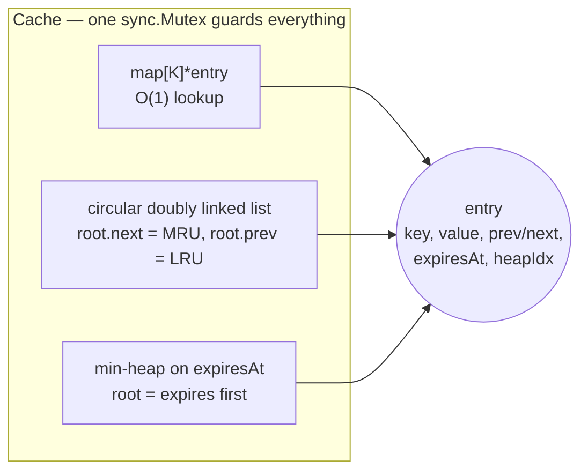
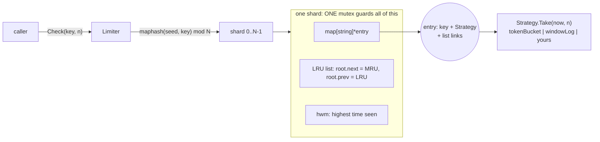

# B3 Unit 1 — Caches and limiters

> Time: ~6 h · CORE: §1–§2 · STRETCH: Stage 4 discussions · Labs: `labs/b3/lrucache`, `labs/b3/ratelimit`

## Before you start

You need B0 (goroutines, channels, mutexes, `context`, the race detector) and B2 (strategy, decorator, functional options). This unit
turns them into two timed problems. Every problem in B3 follows the loop described in the [module README](README.md#how-a-problem-works):
predict, then a timed attempt in `labs/b3/<pkg>/`, then the debrief. Do the attempt **before** you read the sections after *Build it*.

Warm-up (write the answers down first):

1. Why is `fatal error: concurrent map writes` worse than a panic from a nil dereference?
2. Your adapter calls a vendor that takes 40 ms at p50, at 200 req/s. About how many calls are in flight, and what happens to that number when the vendor slows to 400 ms?
3. A teammate says "our tests pass under `go test -race`, so there are no races". What is wrong with that?

<details data-kind="answer"><summary>Warm-up answers</summary>

1. A runtime-detected map race is a `fatal error`, not a panic: it cannot be `recover`ed and it kills the whole process, taking every other request with it. A nil dereference panic can be contained by a recover in the right place (though you usually should not).
2. Little's law (`docs/NUMBERS.md`): 200 × 0.04 ≈ 8 in flight; at 400 ms it is 200 × 0.4 ≈ 80, ten times more with no extra requests. Concurrency is a consequence of latency, which is why bounds and rate limits matter.
3. The race detector only reports races that *actually execute* in that run, and says nothing about deadlocks, leaks or logic errors. A green `-race` run proves "no race observed in these interleavings"; that is why concurrent tests use many goroutines and run with `-count=20`.

</details>

---

## §1 LRU cache with TTL

### The failure story

The SSO adapter on a credit-union banking platform resolves a member's profile from the identity vendor on every
request: ≈ 40 ms at p50, and the vendor's contract allows 200 calls per second. Someone adds a cache:
`map[string]Profile` behind a mutex, no bound. It works in staging. In production, 40 credit unions with ≈ 300k
members each produce ≈ 12M distinct keys over a month; at ≈ 1 KB per profile that is ≈ 12 GB, and the pods are
OOM-killed on the 9th day. The fix "bound it to 100k entries" is implemented the way most first drafts are: a
`[]string` of keys ordered by recency next to the map. On each hit the key is found by a linear scan, moved to the end,
and the front is dropped on eviction. On the reference box that costs ≈ 20 µs per operation at 100k entries, all of it
inside the one mutex: the cache that was supposed to take load off the vendor now caps the whole adapter at
≈ 50k lookups per second and adds a visible latency tail on every request.

Then tokens enter the picture: profiles carry short-lived entitlements, so the cache gets a TTL. Entries expire, but
nothing removes them until somebody reads them. The cache fills with dead entries while the hot, live ones sit at the
LRU end and get evicted first. Hit rate drops from ≈ 92% to ≈ 60%, the vendor sees 5× the traffic, and it starts
returning `429`.

None of this is hard to fix. It is hard to fix *in 60 minutes while narrating*, and an interviewer watching the first
draft will ask exactly these questions: what is Get's complexity, who holds the lock, what happens to an expired
entry, and what do you do when the cache calls your code.

### Predict

<!-- predict id="B3-U1-P01" -->
**Predict.** Your cache is a map plus a doubly linked list guarded by one `sync.Mutex`. A teammate says: "This cache
is read-heavy. Switch to `sync.RWMutex` and take `RLock` in `Get`." Write down (a) what the race detector reports
when 16 goroutines call `Get` and `Put` concurrently on the changed code, (b) whether the program can also crash
without `-race`, and (c) what you would answer.
<!-- /predict -->

<!-- predict id="B3-U1-P02" -->
**Predict.** Capacity 3. You `Put` `old` (no TTL), then `doomed` (TTL 5 s), then `newer` (no TTL), so `old` is the
least recently used. The clock moves 10 s forward, so `doomed` is expired but has not been read. Now you `Put` `fresh`.
Which entry should leave the cache, which one does a plain LRU evict, and what has to be true of your data
structures to find the right one without scanning?
<!-- /predict -->

<!-- predict id="B3-U1-P03" -->
**Predict.** You add an eviction callback `OnEvict(key, value, reason)` so a metrics layer can count evictions. The
metrics layer's callback calls `cache.Len()` to record the current size. Your `Put` calls the callback while still
holding the cache's mutex. What happens, when does it first show up in production, and how do you restructure `Put`
so that this class of bug cannot exist?
<!-- /predict -->

### Reveal

<details data-kind="reveal" data-for="B3-U1-P01">
<summary>Reveal</summary>

(a) Many `WARNING: DATA RACE` reports. `Get` is not a read: it **moves the entry to the front of the recency list**,
which writes `prev`/`next` pointers on three nodes and the list head. Under `RLock`, 16 goroutines do those pointer
writes at once. (b) Yes, and that is the dangerous part: the corrupted list can lead to a nil dereference
(`invalid memory address`, see Break it #1) or, worse, silently loses entries, and a data race is not recoverable the
way a panic you catch is. A race can also stay silent in a run without `-race`, which is why "it passed on my
machine" means nothing here. (c) `RWMutex` helps when readers *only read*. An LRU's read path mutates shared state by
definition, so every operation is a writer. A plain `Mutex` is the right primitive, and it is also faster than
`RWMutex` for short critical sections because it has less bookkeeping. If one lock becomes the bottleneck, the answer
is **sharding** (N independent LRUs chosen by key hash), not a read lock. Tempting wrong answer: "reads are
concurrent-safe, only writes need locking". True for a map nobody mutates, false for a structure whose reads reorder.

</details>

<details data-kind="reveal" data-for="B3-U1-P02">
<summary>Reveal</summary>

`doomed` should go: it is dead data, and evicting it costs nothing. A plain LRU evicts `old`, which is *live* and may
be hot, so the cache loses real value while keeping garbage. To find `doomed` without scanning every entry you need an
**index ordered by expiry**: a min-heap keyed on `expiresAt` whose root is the entry that expired first. Each entry
stores its own heap index so that `Delete`, a re-`Put` with a new TTL, and eviction can `heap.Remove`/`heap.Fix` it in
O(log n). The cache then holds the same entries in **three structures that must always agree**: the map, the recency
list, and the expiry heap. Most bugs in this problem are one of the three forgetting an entry (Break it #3). Tempting
wrong answers: "scan from the LRU end until you find an expired one" (O(n) when the dead entries are the *newest*,
see the scale test), and "run a background goroutine that deletes expired entries" (a good addition, but it only
shrinks the window; a full cache between sweeps still evicts the wrong entry).

</details>

<details data-kind="reveal" data-for="B3-U1-P03">
<summary>Reveal</summary>

A **self-deadlock**. `sync.Mutex` is not re-entrant, so the callback's `Len()` blocks on the lock the same goroutine
already holds, forever. It first shows up in production, not in unit tests, because the callback fires only on
eviction and a small test cache never fills; the first full cache under load freezes one goroutine per eviction, and
then every other caller queues behind the lock. The structural fix is a rule: **never call user code while holding
your lock**. Inside the critical section, do the state change and append a `removal{key, value, reason}` to a local
slice; after `Unlock`, loop over the slice and call the callback. Callbacks may then call back into the cache, can be
slow without stalling other callers, and cannot deadlock the cache. The cost: callbacks can run slightly after the
removal and from different goroutines concurrently, so the contract says so. Tempting wrong answer: "document that the
callback must not call the cache". Contracts that the compiler and the race detector cannot check get broken at 02:00.

</details>

### The problem

> Problem 1 of 18 · Time box: 60 min · Focus: data structures, concurrency safety · Lab: `labs/b3/lrucache`

*As the interviewer says it:*

"Implement an in-memory cache with a fixed capacity. When it is full, it should drop the entry that was used least
recently. It will be shared by every request goroutine in the service. Start with the basics; I'll add things as we go.
Talk me through your choices."

Questions worth asking (the interviewer's answers pin down the tests):

| You ask | Interviewer answers |
|---|---|
| Generic or one fixed type? | Generic over key and value: `Cache[K comparable, V any]`. |
| Is it used from many goroutines? | Yes, from the start. Safe for concurrent use without caller-side locking. |
| What counts as "use"? | `Get` and `Put` both. `Keys()` (for debugging) must not count as a use. |
| What does `Put` of an existing key do? | Replaces the value, counts as a use, never evicts anyone. |
| Complexity? | `Get` and `Put` must not slow down as the cache grows. |
| What about expiry, metrics, callbacks? | Not yet. I may ask. (They will: stages 2 and 3.) |

Checkpoints (be at or past these, or cut scope):

| Minute | Where you should be |
|---|---|
| 0–5 | Clarify, state the invariants out loud (below), pick map + list + one mutex |
| 20 | Stage 1 green under `-race`. Interviewer announces stage 2 |
| 40 | Stage 2 green. Interviewer announces stage 3 |
| 55 | Stage 3 green or knowingly partial. Stop coding |
| 55–60 | Walk through the concurrency story and the one thing you would do next |

#### Stage 1: the cache (minutes 0–20)

- `New[K, V](capacity, ...Option)`: `ErrInvalidCapacity` when `capacity < 1`.
- `Get`, `Put`, `Delete`, `Len`, `Keys` (most- to least-recently-used).
- O(1) `Get` and `Put`; safe for concurrent use.

#### Stage 2: TTL (announced at minute 20)

"Entries should expire. Some callers want a per-entry TTL, most want a default. Tests must not sleep."

- Injected `Clock`; `WithDefaultTTL`; `PutWithTTL(key, value, ttl)`.
- Expired means `now >= putTime + ttl`. `Get` of an expired entry is a miss and removes it.
- Reads do **not** extend the TTL; re-`Put` restarts it.
- `RemoveExpired()` for a background janitor to call.

#### Stage 3: observability and smarter eviction (announced at minute 40)

"Ops wants to know why entries leave, and I don't want to see a full cache evict live data when dead data is sitting
in it."

- `WithOnEvict(func(key, value, reason))` with reasons `Capacity`, `Expired`, `Deleted`; callbacks may call back
  into the cache.
- When a `Put` of a new key finds the cache full, evict an *expired* entry first if one exists, in sub-linear time.
- `Stats()`: hits, misses, capacity evictions, expirations.

#### Stage 4: discuss, don't code

- Lookups of a missing key from 1,000 goroutines all hit the vendor at once. What do you add?
- One mutex shows up as the top contended lock in a profile. What now, and what does it cost you?
- Capacity in *bytes*, not entries. What changes?
- A burst of one-off scans evicts the whole hot set. What would you add?

<details data-kind="answer"><summary>Model answers</summary>

- **Thundering herd:** a `GetOrLoad(key, loader)` that coalesces concurrent loads of the same key into one call
  (singleflight): the first caller loads, the rest wait on the same result. Track loads in a `map[K]*call` under the
  lock, but run the loader *outside* it. Negative-cache failures briefly. This is the `cacheaside` lab in module A3.
- **Contention:** shard by key hash into N independent caches (N ≈ 2× cores, power of two), each with its own lock,
  list and heap. Throughput scales almost linearly; the cost is that "least recently used" becomes *per shard*
  (approximate globally), capacity is split (hot shards evict early), and `Keys()`/`Stats()` must visit every shard.
- **Bytes:** every entry carries a `size`; the cache tracks `usedBytes` and evicts in a loop until the new entry fits.
  One `Put` may evict several entries, entries bigger than the cache are rejected, and updating a value changes the
  total. The callbacks and tests multiply accordingly.
- **Scan resistance:** an admission policy in front of eviction (TinyLFU, as in Caffeine and Ristretto) or segmenting
  the list (probationary vs protected, as in 2Q/SLRU). A new key must prove it will be reused before it can evict an
  established one.

</details>

### Build it

Lab: **`labs/b3/lrucache`**. Stage 1 is `lrucache.go`; `stage2.go` and `stage3.go` hold the later stages' stubs. Open
them only when the interviewer "announces" the stage; the stubs are written so your stage 1 design must grow into them.

```sh
go test -race ./labs/b3/lrucache/                       # everything
go test -race -run Stage1 ./labs/b3/lrucache/           # one stage
go test -race -count=20 ./labs/b3/lrucache/             # shake out schedule-dependent bugs
```

How to run it as a timed attempt: start a 60-minute timer, write stage 1, run `-run Stage1`, move on at the
checkpoint even if a test is red (note which), and stop coding at minute 55 for the walk-through. Write down which
tests were green at each checkpoint: that record, not the final state, is what the tutor scores for time management.

What the tests prove:

- **Stage 1:** eviction order, `Get` promotes, `Put` of an existing key updates and promotes but never evicts, capacity
  1, `Delete` frees a slot, `Keys` order without promotion, zero values are real hits, a **scale test** (100k entries,
  200k operations, 5 s cap) that an O(n) design misses by a wide margin, and concurrent tests whose invariants (length
  never above capacity, map and list agree) fail if the lock is wrong.
- **Stage 2:** the exact expiry boundary, lazy removal on `Get`, reads do not slide the TTL, `Put` restarts it,
  per-entry TTL, `ttl <= 0` falls back to the default, no promotion by an expired `Get`, `RemoveExpired` counts.
- **Stage 3:** callback reasons and ordering, re-entrant callbacks (5 s cap = deadlock detector), expired-first
  eviction picks the entry that expired *earliest*, a scale test (40k live LRU entries + 40k newer expired ones)
  that a scan-from-the-LRU-end solution fails, stats arithmetic, concurrent stats and callbacks.

**Do the timed attempt before reading the rest of this section.**

### How it actually works

Three structures, one lock, one rule:



- **Every entry is in all three structures** (the heap only if it has a TTL; `heapIdx == -1` otherwise). One helper,
  `remove(e, reason)`, unlinks it from all of them, updates the counters and returns the notification to deliver later.
  Having *one* place that removes an entry is what keeps the structures consistent.
- **Intrusive list with a sentinel.** `root` is a dummy node in the cache struct, so an empty list and a non-empty
  one have no special cases: `pushFront` and `unlink` are four pointer writes with no nil checks. (The standard
  `container/list` is also fine in an interview and saves minutes; the cost is an extra allocation per element and a
  type assertion on every read.)
- **The lock.** One `sync.Mutex`; every public method takes it and holds it for O(1) or O(log n) work. `Stats` live
  under the same lock, so a snapshot is internally consistent (hits + misses == gets observed).
- **The rule: no user code under the lock.** `remove` appends a `removal{key, value, reason}` to a local slice;
  each public method reads `c.onEvict` while locked, unlocks, and only then calls `notify`.
- **Time.** `Clock.Now()` is called once per operation, under the lock, so one `Put` uses one consistent "now".
  Expiry is `!now.Before(expiresAt)`, which is exactly "now >= expiresAt".
- **Eviction choice** (`evictOne`): look at the heap root; if it is expired, evict it (reason `Expired`), otherwise
  evict `root.prev` (reason `Capacity`). Only one entry is needed to make room, so one is evicted.
- **Re-`Put` of an existing key** updates the value and TTL in place (`heap.Fix` or push/remove as the TTL appears or
  disappears) and promotes it. No callback fires: the entry did not leave.

```go
func (c *Cache[K, V]) PutWithTTL(key K, value V, ttl time.Duration) {
	if ttl <= 0 {
		ttl = c.defaultTTL // set once by New: safe to read unlocked
	}
	var pending []removal[K, V]
	c.mu.Lock()
	now := c.clock.Now()
	if e, ok := c.items[key]; ok {
		e.value = value
		c.setExpiry(e, now, ttl)
		c.moveToFront(e)
	} else {
		if len(c.items) >= c.capacity {
			pending = append(pending, c.evictOne(now))
		}
		e = &entry[K, V]{key: key, value: value, heapIdx: -1}
		c.items[key] = e
		c.setExpiry(e, now, ttl)
		c.pushFront(e)
	}
	fn := c.onEvict
	c.mu.Unlock()
	notify(fn, pending) // user code runs only here, outside the lock
}
```

How the stages landed on the stage-1 design: stage 2 added fields to `entry` and the cache plus a few lines in
`PutWithTTL`; stage-1 `Get` gained one `expired` check. Stage 3 added `evictOne` and replaced the direct eviction
call. The heap is the only substantial new structure, and it plugs into `remove`. If your stage 3 required rewriting
`Get`, `Put` and `Delete`, the usual cause is that eviction logic was inlined in three places instead of living in one
`remove`.

### Rubric

| Dimension | below | approaching | meets (senior bar) | exceeds |
|---|---|---|---|---|
| Extensibility | Stage 2 or 3 needs a rewrite of stage-1 methods; TTL bolted on with `time.Now()` calls | TTL works but expiry logic is duplicated in `Get`, `Delete` and `Put`; eviction inlined in several places | One `remove` path updates every index; stage 2 and 3 land as additions (options, one new structure); the clock is injected | Anticipates stage 3 while writing stage 1 (leaves a single eviction seam), and names where sharding or byte-capacity would plug in |
| Concurrency safety | Races under `-race`, or no locking; `RWMutex` with mutating `Get` | Correct single mutex, but callbacks run under the lock, or `Stats` read without it | One mutex, short critical sections, no user code under the lock, invariants stated aloud; `-race -count=20` clean | Explains why sharding is the next step and its cost; considers lock hold time vs. allocation inside the lock |
| Clean interfaces | Exports internals (the list, the map); `Get` returns an internal pointer; sentinel values for "missing" | Works but options are ad hoc (setters called after use), or errors are strings | Generic API, `(V, bool)` for lookups, sentinel error for bad capacity, functional options, consumer-side `Clock` with one method, documented contract | Contract documents callback concurrency and expiry semantics precisely enough that the tests could be written from the doc comments |
| Tests | No tests, or sleeps on the real clock | Happy-path tests only; no concurrent test; no scale test | Tests per stage written as it goes, including boundaries (capacity 1, exact TTL instant), a concurrent test with an invariant, and a deadlock guard | Mutates its own solution to prove the tests catch bugs; adds a property test against a trivially correct model |
| Time management | Stage 1 not green at minute 30; no walk-through | Stage 2 done, stage 3 untouched, no summary | Stage 1 by minute 20, stage 2 by 40, a partial stage 3 with an honest list of what is missing, and a 5-minute walk-through | Finishes early and spends the time on the stage-4 discussion with numbers |

Overall **meets** = at least *meets* on Concurrency safety and Clean interfaces, and nothing at *below*.

### Common mistakes

- **`RWMutex` with `RLock` in `Get`.** `Get` reorders the list, so it writes. Symptom: `DATA RACE` under `-race`, or a
  nil-pointer crash in production. Fix: plain `Mutex`; shard if contended.
- **Linear scan for recency** (a slice or `for` over the list to find the key). Symptom: fine in the demo, ≈ 20 µs per
  operation at 100k entries, and the scale test times out. Fix: map from key to list node.
- **Map and list drift.** Evicting from the list but not deleting from the map (or the reverse). Symptom: `Len()`
  disagrees with `len(Keys())`, or `Get` returns a node that is no longer linked and the next move crashes. Fix: a
  single `remove` helper.
- **`Put` of an existing key treated as an insert.** Evicts someone for no reason, or leaves two nodes for one key.
  Fix: look up first; update in place and promote.
- **Capacity off by one.** Evicting when `len > capacity` after insert (briefly over capacity, and wrong with
  capacity 1), or `>` instead of `>=` before insert. Test capacity 1 first.
- **Calling the callback under the lock.** Deadlock as soon as the callback touches the cache, and a slow callback
  stalls every caller. Fix: collect, unlock, notify.
- **`time.Now()` inside the cache.** Untestable without sleeping, and tests become flaky. Fix: a one-method `Clock`.
- **Sliding TTL by accident**: refreshing `expiresAt` in `Get`. The hot entries then never expire, which for
  entitlements or tokens is a security bug. Say which semantics you chose.
- **Returning the internal slice from `Keys()`** or a pointer into the entry. Callers mutate your state without the
  lock.
- **Scanning for expired entries on every `Put`.** O(n) per write on exactly the workload (full cache, many dead
  entries) where you can least afford it.

### Debrief: senior-level design choices

What the reference chose, what else was on the table, and what a senior says while coding:

- **Map + intrusive list over `container/list` or a slice.** "Lookups are O(1) through the map; recency is a linked
  list because I need O(1) move-to-front; I'll embed the node in the entry so there's one allocation per key."
  `container/list` is a legitimate time-saver; say so and note the cost.
- **One mutex.** "I'm going to start with the simplest thing that is correct: one `Mutex`, critical sections that are
  O(1) or O(log n). A contended lock is a measured problem, and the fix is sharding, which I can describe but would not
  write unmeasured." This sentence shows you know where the design ends.
- **Callbacks after unlock.** "The cache must never call code it doesn't own while holding its lock. I collect
  removals and notify after unlocking. The price is that callbacks can arrive slightly after the removal, from several
  goroutines, and I document that."
- **Lazy expiry plus an expiry heap, not a timer per entry.** A `time.AfterFunc` per entry costs a runtime timer and
  a goroutine start per expiry (≈ millions of timers at scale), races with `Get`, and still needs a map to cancel
  them. Lazy checking is exact (the clock decides, not a goroutine's scheduling), and the heap gives sub-linear
  "who expired first".
- **Why `Len()` counts stored entries.** Counting only live entries would need an O(n) scan or a second structure. The
  honest contract ("includes expired entries not yet reaped; call `RemoveExpired`") is cheaper than a clever lie.
- **Stats under the same lock.** Atomics would make each counter cheap, but a consistent snapshot (hits + misses ==
  gets) needs either the lock or a lot of care. A cache that is already serialising on a mutex gains nothing from
  atomic counters.
- **Functional options.** The constructor is `New(capacity, opts...)` from stage 1 so that clock, TTL and callback
  arrive without breaking callers. Generic options need explicit type arguments at the call site
  (`WithClock[string, int](clk)`), the same trade-off `jellydator/ttlcache` accepts.

### Break it

Apply each mutation to a copy of your solution (or the reference in `solutions/b3/lrucache`), one at a time. Predict
the failing tests first, then run `go test -race -count=1 ./solutions/b3/lrucache/`.

1. `Get` takes `RLock`/`RUnlock` (and the field becomes an `RWMutex`).
2. Run the eviction callbacks before `Unlock`.
3. `remove` forgets to delete the entry from the expiry heap.
4. `Put` of an existing key updates the value but forgets `moveToFront`.
5. Evict-expired-first scans from the LRU end instead of using the heap.
6. The expiry check uses `now.After(expiresAt)` instead of `!now.Before(expiresAt)`.

<details data-kind="answer"><summary>What you should see (reference solution, Go 1.24, linux/amd64)</summary>

1. `TestStage1_ConcurrentUseIsSafeAndBounded` fails with about nine `WARNING: DATA RACE` reports followed by
   `panic: runtime error: invalid memory address or nil pointer dereference`: the list was corrupted by concurrent
   pointer writes, then dereferenced. Every other test passes, because they are single-goroutine. That is why the
   concurrent test exists and why `-race` is non-negotiable.
2. `TestStage3_CallbackMayReenterTheCache` fails after its 5 s guard ("did not finish within 5s"). Everything else
   passes: this bug is invisible until a callback calls back into the cache.
3. `TestStage2_RemoveExpired` fails, and the run also ends in a nil-pointer panic: the heap still holds an entry that
   the list and map have forgotten, so the next heap pop unlinks a node that is already unlinked.
4. `TestStage1_PutExistingUpdatesValueAndPromotes` fails: the entry that should have been refreshed is evicted.
5. `TestStage3_ExpiredFirstEvictionIsNotLinear` fails after its 5 s guard; the two small expired-first tests still
   pass. Correct behaviour, wrong complexity: the case for scale tests.
6. `TestStage2_EntryExpiresAtExactlyTTL` and `TestStage2_ReadsDoNotExtendTTL` fail: an off-by-one at the boundary
   that real-clock tests would almost never hit, and a fake clock hits every time.

</details>

### In the wild

- **Redis** does not keep a strict LRU list. With `maxmemory-policy allkeys-lru` it **samples** a few random keys
  (`maxmemory-samples`, default 5) and evicts the least recently used of the sample, using a small eviction pool to
  improve accuracy. The saving is a linked list and its pointer overhead per key; the cost is approximation. Redis
  also expires keys lazily on access *and* with a periodic sampled sweep: the same lazy-plus-janitor split as here.
- **Memcached** runs an LRU per slab class and, since 1.5, a segmented LRU (hot/warm/cold) maintained by a background
  thread, so that a read does not need the global LRU lock on every hit. TODO-VERIFY: exact segment names and defaults
  for the version you cite.
- **Caffeine** (Java) and **Ristretto** (Go) use TinyLFU admission: plain LRU loses its hot set to a one-time scan,
  so a candidate must out-score the victim to enter. Both buffer reads and apply recency updates in batches instead of
  taking the lock on every `Get`, which is the production answer to "`Get` mutates shared state".
- **`hashicorp/golang-lru`** wraps a non-thread-safe LRU in a lock to make a concurrent one; `container/list` is the
  list used by the Go standard library's own LRU-shaped code. TODO-VERIFY: lock type and shard options in the
  version you use.
- **Postgres' buffer pool** uses a clock-sweep (a usage count decremented by a sweeping hand), and the Linux page cache
  uses active/inactive lists: both are LRU approximations chosen because exact recency under a global lock does not
  scale across cores.

### Trade-offs

| Option | Wins when | Loses when | When the answer flips |
|---|---|---|---|
| One mutex, exact LRU (the reference) | Interview-sized code; throughput below roughly 10⁶ ops/s per instance (≈, hardware dependent) | Dozens of cores hammering one cache; the lock is the top profile entry | Measured contention: shard |
| Sharded LRUs (N locks) | Many cores, keys spread evenly | Skewed keys (one hot shard); global recency matters; `Keys()`/`Stats()` need all shards | Hot-key skew or a tiny cache: one lock again, or per-key replication |
| Sampled LRU (Redis-style) | Huge caches where per-entry list pointers cost memory | Needs an exact order (tests, audits); small caches where sampling is a large fraction | When predictability beats memory: exact |
| Lazy expiry only | Simplicity; expiry accuracy matters more than memory | Dead entries linger and fill memory | Add the heap (exact "who expired first") or a periodic sweep |
| Expiry heap (the reference) | Full caches with TTLs where dead entries must be reclaimed first | Every TTL write costs O(log n); more code and one more invariant | No TTL, or TTLs all equal (a FIFO queue replaces the heap: expiry order equals insertion order) |
| Timer per entry (`AfterFunc`) | Few entries; each expiry must trigger an action | Millions of entries; races with `Get` | Never at cache scale |

### Senior bar

- **Failure modes.** Map/list/heap disagree (crash or ghost entries). Callbacks that deadlock or panic (a panicking
  callback unwinds through `Put` *after* the state change; decide whether to recover and say so). Unbounded key
  cardinality in the *values* (capacity counts entries, not bytes: 100k entries of 5 MB each is 500 GB). A thundering
  herd when a hot key expires. Clock jumps: with a wall clock, a backwards step makes entries live longer; prefer a
  monotonic reading (`time.Now()` in Go carries one) for TTL arithmetic.
- **Numbers.** An uncontended mutex lock/unlock ≈ 15–25 ns (`docs/NUMBERS.md`); a hit costs a map lookup plus four
  pointer writes, ≈ 100 ns single-threaded. Hit-rate arithmetic decides whether the cache is worth it: expected
  latency = h × t_hit + (1 − h) × t_miss. With a 40 ms vendor call, 92% hits bring the average to
  ≈ 0.92 × 0.0001 + 0.08 × 40 ≈ 3.2 ms; at 60% it is ≈ 16 ms, and the vendor's request rate is 5× higher (0.40 vs
  0.08 misses per lookup).
- **Ops.** Expose `Stats` as metrics: hit ratio, evictions per second by reason, size. A rising `Capacity` eviction rate
  with a falling hit ratio means undersized or a scan. Alert on `Expired` evictions far above the TTL rate (the janitor
  is not running). Keep the janitor's interval a fraction of the shortest TTL.
- **Cost.** Memory per entry ≈ key + value + ≈ 64–100 bytes of list/heap/map overhead (≈, Go 64-bit, depends on key
  type). At 100k entries that overhead is ≈ 10 MB: noise next to the values.

**Interviewer probes**

<details data-kind="answer"><summary>"`Get` is a read. Why not an `RWMutex`?"</summary>

Because in an LRU a read is a write: it moves the node to the front. With `RLock` many goroutines would mutate the
list at once, which is a data race and can corrupt it. A plain `Mutex` is correct and, for critical sections this
short, faster than `RWMutex`. If I need read parallelism I would shard, or do what Caffeine and Ristretto do: record
reads in a buffer and apply the recency updates in batches off the hot path, accepting slightly stale recency.

</details>

<details data-kind="answer"><summary>"The lock is hot at 16 cores. What do you change first?"</summary>

First measure: confirm with a mutex profile that this lock is the contention, not the map or allocation. Then shard:
N = 2–4× cores, a power of two, shard index from a hash of the key (`hash/maphash`), each shard a complete
cache with its own lock, list and heap and capacity/N. Cost: recency is per shard, a hot shard evicts early, and
`Keys()`/`Stats()`/`RemoveExpired()` iterate over all shards, so I'd make the aggregate operations take shard locks one
at a time rather than all at once. I would not do lock-free structures in an interview or in production without a
measured need.

</details>

<details data-kind="answer"><summary>"A hot key expires and 1,000 requests miss at once. What happens at the vendor?"</summary>

A thundering herd: 1,000 identical vendor calls. I'd add `GetOrLoad(ctx, key, loader)` with single-flight: the first
caller registers an in-flight call in a map (under the lock), runs the loader *outside* the lock, and the rest wait on
that call's result or their own context. Related mitigations: jitter on TTLs so a batch of entries loaded together do
not expire together; serve-stale-while-revalidate for a short grace window; a short negative cache for failures so a
down vendor is not hammered. The cache must not hold its lock during the load: a 40 ms call under a global mutex would
serialise the whole service.

</details>

<details data-kind="answer"><summary>"How do you pick the capacity, and how will you know it is wrong?"</summary>

From the working set and the hit-rate curve: sample real key traffic, estimate how many distinct keys cover, say, 95%
of lookups, and size to that with headroom for memory. In production I watch hit ratio and the eviction rate by
reason. If hit ratio is flat when capacity doubles, the workload is a scan or is uncacheable; if it climbs steadily,
the cache is undersized. Memory per entry matters more than entry count, so I'd also track bytes if values vary
widely.

</details>

### Check yourself

1. Why does the reference read `c.onEvict` while holding the lock but call it after unlocking?
2. A `Put` replaces the value of an existing key whose TTL has already passed (but nobody has read it). Should the old
   value's callback fire with reason `Expired`? What does the reference do, and why is either defensible?
3. Your `Len()` says 10 but `len(Keys())` says 9 in a stress test with no TTLs. Which invariant broke, and where do
   you look first?

<details data-kind="answer"><summary>Answers</summary>

1. `WithOnEvict` is applied during `New`, before the cache is shared, so the field is effectively immutable. The read is
   under the lock anyway to keep the "everything is read under the mutex" rule simple and to be safe if a later
   change adds `SetOnEvict`. The *call* must be outside the lock, because the callback is user code that may call back
   into the cache or block.
2. The reference treats it as a replacement: a re-`Put` restarts the entry's life, no callback fires, and the old
   value is simply overwritten. The alternative, reporting the old value as `Expired`, is also defensible, because the
   old value really did outlive its TTL, and metrics might want to count it. Pick one, document it, test it; the cost
   of the alternative is extra bookkeeping on every replacement.
3. The map and the list disagree: an entry was inserted into or removed from one but not the other. Look at every path
   that removes an entry (eviction, `Delete`, expired `Get`, `RemoveExpired`) and check that they all go through the
   one `remove` helper; the usual culprit is an eviction path that unlinks the node but forgets `delete(items, key)`
   or vice versa.

</details>

---

## §2 Rate limiter library

### The failure story

The platform calls a card-processor vendor on behalf of 40 credit unions. The contract says each credit union may
make at most 50 calls per second; go over and the vendor answers `429` to *everything* from the platform for a
penalty period. Version 1 of the limiter is what most first drafts look like: a `map[string]*bucket` behind one
`sync.Mutex`, where a bucket is `{tokens float64; last time.Time}`, refilled with
`tokens += time.Since(last).Seconds() * rate`, and, to "keep the buckets topped up", one `time.Ticker` goroutine
per key. It passes a demo. Then production happens.

The inbound side is worse. The same library throttles the member API per client IP and per API key, and scanners
send ≈ 3M distinct one-off keys a day. Each key costs a map entry and a bucket (≈ 100–150 B) plus, with the ticker,
a goroutine (≈ 2.5 KiB of stack and runtime structures, ≈): ≈ 7.5 GiB a day, never freed, and the pods are
OOM-killed on day two. After the ticker is removed the heap is ≈ 400 MB a day instead, still unbounded. Meanwhile
`time.Since` reads the wall clock for the `last` field; an NTP step back of a few seconds makes `Seconds()` negative
and the bucket *shrinks*, and a step forward hands every key a full bucket. Probe a 10/s limit every 10 ms for
100 s and it admits 999 requests instead of 1000, because the float64 sum of ten `0.01 * 10` refills lands on
`0.9999999999999999`, not `1.0`. And the one mutex, held while the
buckets are updated, is the top entry in the CPU profile at ≈ 30k decisions per second per pod.

Each of those is a one-line story in a post-mortem. In a 60-minute machine-coding round the interviewer is waiting
for you to *say* them before they bite: how time is measured, what happens when it jumps, what a key costs, who is
allowed to wait for whom, and what you tell a rejected caller.

### Predict

<!-- predict id="B3-U1-P04" -->
**Predict.** The vendor contract is "at most 100 calls in any 60-second period". You consider three
implementations: (a) a fixed-window counter that resets every minute on the minute; (b) a token bucket with rate
100/minute and burst 100, starting full; (c) a sliding-window log with limit 100 and window 60 s. A client that
wants to hurt you sends 100 calls at 12:00:59 and tries again continuously until 12:01:59. Write down how many calls
each implementation admits (i) in the two seconds 12:00:59 to 12:01:01 and (ii) in the worst 60-second period, and
which of them keeps the contract.
<!-- /predict -->

<!-- predict id="B3-U1-P05" -->
**Predict.** Your `Allow` reads the clock, *then* takes the key's lock, then refills with
`elapsed := now - b.last; b.last = now`. Goroutine A reads `now = 100 ms` and is descheduled before it locks.
Goroutine B reads `now = 101 ms`, locks, refills (`last = 101 ms`) and leaves. A locks. Write down what A computes
for `elapsed` and what `last` is afterwards, and what the bucket does 1 ms later when goroutine C arrives with
`now = 102 ms`. Then say whether `-race` can see this bug.
<!-- /predict -->

<!-- predict id="B3-U1-P06" -->
**Predict.** A blocking `Wait(ctx, key)` is implemented as a loop: try to take a permit, otherwise sleep for the
advertised `RetryAfter`, then try again. The limiter admits 10 requests per second with burst 1, the bucket is
empty, and 1,000 goroutines call `Wait` for the same key at the same instant. Roughly how many take-attempts (and
timer wake-ups) does the limiter serve before the last goroutine is admitted, and in what order are they admitted?
What design would make it O(n)?
<!-- /predict -->

### Reveal

<details data-kind="reveal" data-for="B3-U1-P04">
<summary>Reveal</summary>

(i) In the two seconds around the boundary: **(a) 200**, because the counter resets at 12:01:00 and the client's
second batch is in a fresh window; (b) 100 plus a trickle of ≈ 3 refilled tokens ≈ 103; (c) 100. (ii) In the worst
60-second period: (a) **200** (a window that straddles the boundary sees both batches); (b) **200**, which surprises
people: a token bucket admits at most *burst + rate × window* in any window, here 100 + 100 = 200, because a full
bucket can be spent at once and then refills at the full rate while you are still inside the same 60 seconds; (c)
**100**, exactly, because it counts the permits that fall inside the sliding interval. Only (c) keeps the contract as
written. To make (b) keep it you must shrink `burst + rate × 60 s` to 100, for example rate 50/minute and burst 50.
Tempting wrong answer: "token bucket and sliding window are the same thing with different bookkeeping". They answer
different questions: the bucket controls the *sustained rate* and the *largest burst*; the window controls the *count
in any interval*. Vendor contracts are usually written as the second, and token buckets are usually deployed as if
they were the first. The sliding-window *counter* (two fixed windows weighted by overlap) is the O(1)-memory
approximation of (c); it can admit slightly more or less than the limit near a boundary.

</details>

<details data-kind="reveal" data-for="B3-U1-P05">
<summary>Reveal</summary>

A computes `elapsed = 100 − 101 = −1 ms` and sets `last = 100 ms`, *moving it backwards*. With signed arithmetic that
subtracts a millisecond of tokens (the bucket can go negative and deny legitimate callers); if you clamp `elapsed` to
zero but still assign `last = now`, you lose nothing yet. Then C arrives at 102 ms: `elapsed = 102 − 100 = 2 ms`,
although only 1 ms of real time has passed since B's refill. **The same millisecond is counted twice.** Replayed over a
wall-clock step of an hour, the catch-up credits an hour of tokens twice: a free full bucket for every key.
`-race` sees nothing: every access is under the lock, the bug is in the logic. The fix has two parts. Keep a
**high-water mark** per shard (`if now < hwm { now = hwm } else { hwm = now }`, inside the lock), so time as the
strategies see it never goes backwards and an old reading is simply treated as "no time has passed". And never assign
`last` a smaller value than it already holds. Reading the clock *before* locking is deliberate (user code, the
injected `Clock`, never runs under the lock), and the high-water mark is what makes that safe. Go's `time.Now()`
carries a monotonic reading and `Sub` uses it, so real-clock production code is protected from NTP steps; the guard is
for fake clocks, for readings taken out of order, and for the day someone replaces `time.Now()` with a Unix-nanosecond
integer.

</details>

<details data-kind="reveal" data-for="B3-U1-P06">
<summary>Reveal</summary>

All 1,000 goroutines compute the same `RetryAfter ≈ 100 ms` and sleep on 1,000 timers. At +100 ms they all wake, one
wins the single permit, and 999 compute a new `RetryAfter ≈ 100 ms` and sleep again. The next round has 999 wake-ups,
then 998, and so on: **n + (n−1) + … + 1 ≈ n²/2 ≈ 500,000 take-attempts and timer firings** over the 100 seconds it
takes to admit them all (each attempt a lock acquisition, each wake-up a scheduler event). The order is whatever the
scheduler and the timer heap happen to produce: not FIFO, and a waiter that asks for `n = 5` can be starved
indefinitely by a stream of waiters asking for one. An O(n) design either **reserves** (as `golang.org/x/time/rate`
does with `Reserve`): take the permits now, let the bucket go into debt, and sleep exactly the returned delay once,
giving every waiter a distinct delay and FIFO-by-arrival fairness, with a way to hand the permits back if the waiter is
cancelled; or keeps an explicit **waiter queue** per key and wakes only the head. The reference implements the simple
retry loop, because it works for both algorithms and is easy to get *correct* (no lost permits, no leaked timers); the
quadratic cost is stated in its doc comment and is the first thing to fix if `Wait` is on a hot path.

</details>

### The problem

> Problem 2 of 18 · Time box: 60 min · Focus: strategy, clocks, concurrency · Lab: `labs/b3/ratelimit`

*As the interviewer says it:*

"We need a rate limiter library that services in the platform can share. It limits per key: a credit union, a member,
an API key. A caller asks whether a request may go ahead right now. Start with the basics; I'll add to it as we go.
Talk me through the decisions."

Questions worth asking (the interviewer's answers pin down the tests):

| You ask | Interviewer answers |
|---|---|
| In-process or distributed? | In-process library for now. We'll talk about running it across pods at the end. |
| What does a limit look like? | A rate and a burst: "50 per second, burst 50". Different keys are independent; same config for all. |
| What does a new key get? | A full allowance: burst requests are fine immediately. |
| One permit per call or batches? | Mostly one, but a bulk endpoint spends `n` at once. All or nothing. |
| How do you measure time? | Injected `Clock` with `Now()`. Tests never sleep, and the clock can misbehave: jumps, and goes backwards. |
| Do I run a goroutine that refills? | No. Compute it when asked. There is no `Close`, and the library must not leak when a limiter goes out of scope. |
| How many keys? | Unbounded in principle: assume scanners. Memory must follow *recent activity*, not cardinality (stage 3). |
| What happens to a request that can never succeed (more than the burst)? | Rejected, and it must not allocate any per-key state. |

Checkpoints (be at or past these, or cut scope):

| Minute | Where you should be |
|---|---|
| 0–5 | Clarify, choose integer arithmetic and lazy refill, say how time can misbehave, pick shard-able structure |
| 20 | Stage 1 green under `-race`. Interviewer announces stage 2 |
| 40 | Stage 2 green. Interviewer announces stage 3 |
| 55 | Stage 3 green or knowingly partial. Stop coding |
| 55–60 | Walk-through: invariants, what you would measure, the one thing you would do next |

#### Stage 1: a per-key token bucket (minutes 0–20)

- `New(Rate{Events, Per}, burst, ...Option)`, `WithClock`; `ErrInvalidConfig` for impossible parameters (including
  ones whose arithmetic would overflow).
- `Allow(key)`, `AllowN(key, n)`, `Len()`. A key's bucket starts full; refill is lazy; `AllowN` is all or nothing; `n < 1`
  and `n > burst` are `false` and create no state.
- Exact refill (no float drift), no overflow on huge time jumps, no tokens minted by a clock that goes backwards.
- Safe for concurrent use; per-key decisions are atomic; no background goroutines.

#### Stage 2: another algorithm, retry-after, sharding (announced at minute 20)

"Some vendors specify 'N calls in any minute', not a rate and a burst. I want to switch algorithm per limiter without
touching callers. Callers also want to know *when* to retry, and the lock is going to be hot."

- A `Strategy` interface (single-threaded per key) and a `Factory`; `NewWithStrategy`; `TokenBucket` and
  `SlidingWindow(limit, window)` (an exact log). `New` keeps working and means the token bucket.
- `Check(key, n)` returns `Decision{Allowed, Remaining, RetryAfter}`; `RetryAfter` is exact; `ErrInvalidN`,
  `ErrExceedsLimit`.
- `WithShards(n)`: unrelated keys must not wait for each other; shard choice must not be predictable by clients.

#### Stage 3: bounded memory, Wait, stats (announced at minute 40)

"Scanners will send us millions of keys. And some callers would rather wait for a permit than get a `429`."

- Idle keys are reclaimed without a janitor goroutine; `Sweep()`; `WithMaxKeys(n)` as a hard backstop that fails open.
  Never forget a key that is not idle.
- `Wait(ctx, key)` / `WaitN`: block until the permits are available, honour `ctx`, take nothing on cancellation, use an
  injectable timer (`WithTimer`), release it on every path, start no goroutine.
- `Stats()`: allowed, denied, keys, idle-evicted, forced-evicted.

#### Stage 4: discuss, don't code

- Ten pods each enforce 100 requests/s locally; the vendor's contract is 100/s in total. What do you do?
- A Redis-backed limiter: what is atomic, what is the failure mode when Redis is slow or down, and what does it cost
  per decision?
- You return `429`. What do you put in the response, and how do clients behave when ten thousand of them see it at
  the same moment?
- One tenant is 90% of the traffic. Where does the design hurt?

<details data-kind="answer"><summary>Model answers</summary>

- **Ten pods, one contract.** Local limiting multiplies the limit by the pod count (or divides it by a guess that is
  wrong whenever load is uneven or a pod restarts). Options in increasing cost: give each pod `limit / N` (cheap, wasteful,
  breaks on autoscaling); a **central counter** in Redis with a Lua script (atomic read-modify-write, one network
  round trip ≈ 0.1–0.5 ms inside a datacenter per decision, `docs/NUMBERS.md`) and a local fallback when Redis is unreachable;
  or a **hybrid**: each pod leases a batch of permits from the central store (e.g. 10% of the per-second allowance),
  spends them locally, and renews, trading some precision for far fewer round trips; or route by key (consistent
  hashing at the load balancer) so that each key has one owner pod. Module C2 (rate-limiter service) works the HLD.
- **Redis.** A Lua script (`EVAL`) runs atomically on the single-threaded server: read state, refill from a time
  argument, take, write back, set a TTL so idle keys expire by themselves. Failure modes: Redis down or slow (decide
  fail-open vs fail-closed *per limiter*: fail-open for member-facing throttles, fail-closed for vendor-contract
  limits), clock skew if pods supply the time (use Redis `TIME`), hot keys on one shard, and replication lag if you read
  from replicas. Cost: one round trip per decision on the request path, which is why hybrid leasing exists.
- **`429` and herds.** Return `Retry-After` (and `RateLimit-*` headers) *with jitter*, because an exact value is the same
  number for every caller denied in the same instant. Clients: exponential backoff with full jitter, honour
  `Retry-After` as a floor, and a retry budget. Server side, queueing (a `Wait` with reservations) smooths what rejection
  turns into a retry wave.
- **Hot tenant.** One shard (and one key) takes the load: per-key decisions are serial by nature, ≈ 20–100 ns each, so
  one key can do millions of decisions per second per core, which is rarely the bottleneck; the risk is *fairness*
  (the hot tenant starving others of the shared downstream) and a skewed `WithMaxKeys` cap. Mitigate with per-tenant
  limits *under* a global one (hierarchical limiting) and metrics per tenant.

</details>

### Build it

Lab: **`labs/b3/ratelimit`**. Stage 1 is `ratelimit.go`; `stage2.go` and `stage3.go` hold the later stages' stubs. Open
them only when the interviewer "announces" the stage. The stubs are written so that your stage-1 design must grow
into them: a stage-1 solution that bakes the token bucket into `Allow` will need a rewrite at minute 20.

```sh
go test -race ./labs/b3/ratelimit/                       # everything
go test -race -run Stage1 ./labs/b3/ratelimit/           # one stage
go test -race -count=20 ./labs/b3/ratelimit/             # shake out schedule-dependent bugs
```

How to run it as a timed attempt: start a 60-minute timer, write stage 1, run `-run Stage1`, move on at the
checkpoint even if a test is red (note which), and stop coding at minute 55 for the walk-through. Write down which
tests were green at each checkpoint: that record, not the final state, is what the tutor scores for time management.

What the tests prove (all on a fake clock; nothing sleeps through a real duration except where noted):

- **Stage 1:** start-full and burst ceiling; refill exact to the nanosecond at 3 events/s; **no float drift** (admits
  exactly 1000 requests in 100 simulated seconds at 10/s); a 250-year clock jump does not overflow; a clock that
  rewinds mints nothing, neither during the rewind nor on catch-up; `AllowN` all-or-nothing; negative and impossible `n`
  create no state; **exactly `burst` admitted** under 64 contending goroutines; permits neither lost nor minted under
  concurrent mixed `AllowN`; rate respected while the clock advances concurrently; no goroutines left behind; a scale
  test (50k keys, 200k calls, 5 s cap).
- **Stage 2:** sliding-window boundaries exact to the nanosecond, no boundary burst, batch accounting; `RetryAfter` is
  exact under 400 random requests for both algorithms (a property test); a custom `Strategy` plugs in, is created once
  per key, is never entered concurrently, and sees time that never goes backwards; **two keys inside the limiter at
  once** (the sharding test: a global lock fails it, and with `WithShards(1)` the same workload must be serialised); the window log is
  trimmed (heap growth under a memory cap).
- **Stage 3:** idle keys reclaimed by new-key traffic with no janitor; `Sweep` never drops a key that is still
  recovering; **200,000 one-off keys stay under 5,000 tracked**; `WithMaxKeys` is a hard LRU cap that fails open and
  counts it; `Wait` sleeps for exactly `RetryAfter` on the injected timer, stops the timer and consumes nothing on
  cancel, takes nothing for a done `ctx`, rejects impossible requests without sleeping, admits 20 concurrent waiters no
  faster than the rate, and leaks neither goroutines nor timers; one test uses the real clock and a 5 ms timer.

**Do the timed attempt before reading the rest of this section.**

### How it actually works

One limiter, N shards, one small state machine per key:



- **Lazy refill, integer units.** No timer ever "adds a token". `Take(now, n)` computes the elapsed time since the
  last call and applies it. Tokens are counted in units of `1/Per` of a token: one token is `Per` units (in
  nanoseconds), the bucket holds `burst × Per`, and it gains exactly `Events` units per elapsed nanosecond. Everything is
  `int64`: the bucket's content at any instant is `min(capacity, start + elapsed × Events)` however the elapsed time
  was sliced into calls, and `RetryAfter` is the exact ceiling `⌈deficit / Events⌉` ns, so waiting one nanosecond less
  is provably too early. Validation (`burst × Per + Events` fits in `int64`) and a clamp (`elapsed ≥ fullIn` means
  "full" before multiplying) rule out overflow, even for a 250-year jump.
- **Time is an offset from an epoch.** The limiter records `epoch = clock.Now()` at construction and passes
  strategies `clock.Now().Sub(epoch)`. `time.Time.Sub` uses the monotonic reading when both operands have one, the state
  per key is an `int64` rather than a 24-byte `time.Time`, and a custom strategy cannot be tempted into wall-clock maths.
- **The lock owns a shard, the strategy owns no lock.** A key's whole decision (find or create the entry, advance time,
  `Take`) happens inside one critical section of its shard, so per-key atomicity falls out for free and strategies are
  plain single-threaded code. The price is a contract on strategy authors: no blocking, no I/O, no calling back into the
  limiter. The `Clock` is read *before* locking (user code is never run under the lock) and the shard's high-water mark
  turns any out-of-order reading into "no time passed".
- **Shards.** `maphash.String(seed, key) mod N` with a per-limiter random seed: with client-chosen keys a predictable
  hash lets an attacker aim every key at one shard and turn N locks back into one. A key lives in exactly one shard, so
  per-key semantics are unchanged by sharding; `Len`, `Stats` and `Sweep` visit shards one at a time and are therefore
  not instant-consistent snapshots.
- **Eviction is invisible by construction.** Each strategy answers `Idle(now)`: "my state equals a fresh one". A token
  bucket is idle when it would be full by now; a window log when its newest event has left the window. A new key arriving
  in a shard sweeps up to two idle entries from the LRU end (amortised O(1): every insertion pays for removing two), so
  steady-state memory is the number of keys active within the *recovery time*, and no janitor goroutine exists.
  `Sweep()` is for quiet periods. `WithMaxKeys` is the backstop: when a shard is full, evict the LRU entry *even if it is
  not idle*, and count it separately (`ForcedEvicted`), because that one fails open.
- **Wait is a loop, not a queue.** Check `ctx.Err()`, try to take, otherwise sleep on the injected timer for
  `RetryAfter`, and go round again. The ctx check comes first *every* iteration, so a caller that has given up never
  takes a permit (`select` picks randomly when the timer and `Done` are both ready); the timer is stopped on the cancel
  path.

```go
func (l *Limiter) take(key string, n int) (Decision, error) {
	if n < 1 {
		return Decision{}, ErrInvalidN
	}
	if n > l.burst {
		return Decision{}, ErrExceedsLimit // hopeless: allocate nothing for it
	}
	now := l.since() // the injected Clock runs before the lock
	sh := l.shardFor(key)
	sh.mu.Lock()
	defer sh.mu.Unlock()
	if now < sh.hwm {
		now = sh.hwm // time stands still until the clock catches up
	} else {
		sh.hwm = now
	}
	e := sh.m[key]
	if e == nil {
		sh.sweep(now, 2) // pay for reclaiming two idle keys per new key
		e = &entry{key: key, s: l.factory(now)}
		sh.m[key] = e
		sh.pushFront(e)
		sh.trim(now) // WithMaxKeys backstop
	} else {
		sh.moveToFront(e)
	}
	return e.s.Take(now, n), nil // Stats counters omitted
}
```

How the stages landed on the stage-1 design: what you write at minute 20 is `Limiter{clock, epoch, mu, m map[string]*bucket}`
and a `take` of ten lines. Stage 2 is a rename plus two moves: `bucket` becomes one implementation of `Strategy` (its
`Take(now, n)` is the old method, returning a `Decision` instead of a `bool`), and `mu`/`m` move into a `shard` that
is indexed by a hash. `Allow` and `AllowN` never change; `New` becomes a one-line wrapper around `NewWithStrategy`. The
sliding window is a new type, not an edit. Stage 3 adds the LRU links to `entry`, two calls inside `take`, and new
methods (`Sweep`, `Stats`, `Wait`). If stage 2 required rewriting `Allow`'s callers or its tests, the usual cause is a
`bool`-returning `Allow` that was the only seam: expose one internal function that returns the full decision from day one.

### Rubric

| Dimension | below | approaching | meets (senior bar) | exceeds |
|---|---|---|---|---|
| Extensibility | Token bucket baked into `Allow`; the sliding window forces a rewrite or a `switch algo` in every method; `time.Now()` called directly | A strategy interface exists but exposes locking or the map to implementors; sharding or eviction require touching `Allow`'s callers | `Allow`/`AllowN` unchanged across stages; the algorithm sits behind a small `Strategy`/`Factory`; `New` wraps `NewWithStrategy`; `Check` is the full-detail seam; options for clock, shards, timer, cap | Names the next seams unprompted (per-key config via the factory, GCRA as a one-int strategy, a reservation API for `Wait`) and says which test would pin each |
| Concurrency safety | Races under `-race`; check-then-act (`Allow` reads tokens, then locks to subtract); `Wait` holds a lock while sleeping | One lock, correct, but the `Clock` or strategy code runs under it in ways that can deadlock; `Stats` read without the lock | Per-key decision in one critical section; no user code that can re-enter under the lock; sharded with a seeded hash; high-water mark for time; `-race -count=20` clean | Explains the linearisation point per key and why aggregates are not instant-consistent; shows the contended-key ceiling with numbers |
| Clean interfaces | `Allow` returns `(bool, error)` or panics on bad `n`; exported internals; `float64` rate with `time.Second` baked in | Works, but `RetryAfter` conventions are ad hoc (`-1`, `0` mean different things), or errors are strings | `Rate{Events, Per}`; `bool` for the hot path and `Decision` plus sentinel errors for detail; documented concurrency contract; impossible requests rejected without state | Contract precise enough to write the tests from the doc comments, including "denial consumes nothing" and "RetryAfter is exact" |
| Tests | Real `time.Sleep`; one happy-path test | Fake clock, but no boundary (1 ns early/late), no concurrency invariant, no memory/scale test | Boundaries to the nanosecond; a property test for `RetryAfter`; a concurrency test whose invariant is *exactly* `burst` admitted; a scale test for key cardinality; a goroutine/timer-leak check for `Wait` | Mutates its own solution to prove the tests catch the bugs; a differential test of both algorithms against a naive model |
| Time management | Stage 1 not green at minute 30; strategies/eviction/Wait half-started together | Stage 2 done, stage 3 untouched, no walk-through | Stage 1 at 20, stage 2 at 40, a deliberate partial stage 3 (idle reclamation first, `Wait` second) with an honest gap list, and a 5-minute walk-through | Finishes early and spends the time on stage 4 with numbers and a failure-mode table |

Overall **meets** = at least *meets* on Concurrency safety and Clean interfaces, and nothing at *below*.

### Common mistakes

- **Float tokens.** `tokens += elapsed.Seconds() * rate` loses a permit at boundaries (999 of 1000 in the drift test) and
  makes `RetryAfter` an approximation. Fix: integers: nanoseconds × events in units of `1/Per` tokens; round
  `RetryAfter` up.
- **A refill goroutine or ticker per key (or per limiter).** Leaks with every limiter that goes out of scope, costs ≈ 2.5 KiB
  per key, and drifts when the scheduler is late. Fix: lazy refill from elapsed time.
- **Lock, then read the clock, then call user code, all under one global mutex.** Contention, plus a deadlock waiting to
  happen when a fake or instrumented clock touches the limiter. Fix: read time first, shard the lock, keep strategies
  non-blocking.
- **Check-then-act.** `if b.tokens >= n { mu.Lock(); b.tokens -= n }`. Symptom: 64 goroutines admit 100+ requests with
  burst 100; `-race` may stay silent if both halves are individually locked. Fix: one critical section for check and take.
- **`last = now` with an out-of-order `now`.** Double-counts time after a rewind or a descheduled goroutine. Fix: a
  high-water mark; never move `last` backwards.
- **Overflow on big time jumps.** `elapsed × events` wraps negative after a long suspend; the bucket denies forever or
  mints burst-many repeatedly. Fix: clamp `elapsed ≥ fullIn` to "full" before multiplying; validate `burst × Per`.
- **Creating state for requests that can never succeed.** `AllowN(key, burst+1)` or `n ≤ 0` allocating an entry per key
  is a free memory-exhaustion attack. Fix: validate `n` before any lookup; `n ≤ 0` must also never *add* tokens.
- **Unbounded key map, or a TTL that is shorter than the recovery time.** The first OOMs; the second silently disables the
  limit for slow-refill keys (rate 1/hour, burst 5, evicted after 60 s ⇒ five free calls a minute). Fix: evict only
  strategies that are `Idle`, with a hard LRU cap as a counted backstop.
- **`time.After` in the `Wait` loop.** On `go 1.22` semantics each cancelled waiter pins its timer until it fires; with a
  1 h `RetryAfter` and a cancel storm that is real memory. Fix: an injectable timer you can `Stop`, stopped on every
  exit path.
- **Not checking `ctx` before taking.** A client that disconnected still burns a permit that another tenant's request
  needed. Fix: `ctx.Err()` at the top of every loop iteration.
- **Telling every rejected caller the same exact `Retry-After`.** They all return in the same millisecond. Fix: jitter at
  the edge; queue (reserve) instead of rejecting where waiting is acceptable.

### Debrief: senior-level design choices

What the reference chose, what else was on the table, and what a senior says while coding:

- **Token bucket first, behind a seam on day one.** "The requirement is a rate and a burst, so a token bucket. I'll keep
  `Allow` as a thin wrapper over one internal `take(key, n)` that returns the full decision, because I expect to be asked
  for retry-after and another algorithm." That sentence buys the stage-2 edit.
- **Integer arithmetic in units of `1/Per`.** "I don't want floats near a contract limit. Tokens are `int64` in units of
  `1/Per` of a token, so refill is `elapsed × Events` with no division, and retry-after is a ceiling." The alternative
  is GCRA, which keeps *one* timestamp per key (the theoretical arrival time) and is the same bucket in 8 bytes; worth
  naming, and worth not writing in a 60-minute round.
- **Lazy refill, no goroutine, no `Close`.** "A library that starts goroutines needs a lifecycle; this one derives
  everything from the clock it is handed." Test: the goroutine count before and after.
- **Time as an offset plus a high-water mark.** "I read the clock before locking so user code never runs under the lock;
  the shard clamps any older reading, so time is monotone for the algorithms." Alternatives: read under the lock
  (simpler reasoning, user code under the lock), or one global atomic maximum (cross-shard ordering you do not need).
- **Strategy owns no lock.** "The limiter serialises per shard, so strategies are plain structs. That makes a new
  algorithm 40 lines and testable without goroutines. The cost is a no-blocking contract." The alternative, a lock per
  key, allows a slow strategy to hurt only its own key at the cost of a mutex per key and a delete-versus-use race when
  evicting; I'd take it only if strategies could block.
- **Sliding-window log, not counter.** "The log is exact and O(limit) per key; the counter is O(1) and approximate. Vendor
  contracts penalise overshoot, so exact first; if memory per key matters (1000 × 16 B = 16 KB at a limit of 1000), I'd
  move to the counter or to a token bucket sized so that `burst + rate × window ≤ limit`."
- **Idle-based eviction with a counted hard cap.** "Dropping a key is only free when its state is the same as a new
  key's, so the algorithm tells me when that is. The cap is a backstop and fails open; I'd flip it to fail closed for
  vendor limits and say that out loud." The cost of LRU-ordered sweeping is head-of-line blocking: one slow-recovering
  key at the tail delays reclaiming the faster ones behind it, by at most one recovery time. An expiry heap fixes that
  at O(log n) per request.
- **`Wait` as a retry loop.** "Simplest correct thing: sleep for the decision's `RetryAfter`, retry, re-check `ctx` each
  time. It is not FIFO and it is quadratic under a stampede; the production fix is reservations. I'd say that and move on."

### Break it

Apply each mutation to a copy of your solution (or the reference in `solutions/b3/ratelimit`), one at a time. Predict the
failing tests first, then run `go test -race -count=1 ./solutions/b3/ratelimit/`.

1. In `take`, release the shard lock right after the map lookup/insert and call `e.s.Take` outside it.
2. Delete the high-water-mark clamp (`if now < sh.hwm { now = sh.hwm } else { sh.hwm = now }`).
3. `Idle` of the token bucket always returns `true`.
4. In `WaitN`, (a) delete the `stop()` call on the `ctx.Done()` path; (b) separately, delete the `ctx.Err()` check at the top
   of the loop.

<details data-kind="answer"><summary>What you should see (reference solution, Go 1.24, linux/amd64)</summary>

Baseline before mutating: `gofmt -l` empty, `go vet` clean, `go test -race -count=20` green on the reference (≈ 7 s per
run on a loaded box), `GOMAXPROCS=1 go test -race -count=3` and `-cpu 1,4 -count=3` green, the lab stubs fail with 44
failing tests and no panic in ≈ 0.1 s, and the lab/solution test files are byte-identical (`cmp`).

1. **Fails:** `ConcurrentCallersOnOneKeyAdmitExactlyBurst` ("109 requests admitted for one key under contention, want exactly
   100"; the number varies per run), `ConcurrentAllowNNeitherLosesNorMintsPermits` and
   `ConcurrentTrafficWhileTheClockAdvancesRespectsTheRate`, with eight `WARNING: DATA RACE` reports and, on some schedules,
   `fatal error: sync: unlock of unlocked mutex` when the custom-strategy overlap detector panics inside `Take` while the lock is
   not held and the deferred `Unlock` then runs. Every single-goroutine test passes: a limiter with this bug works in the
   demo and lets the wrong number through under load, which for a vendor contract is the failure that costs money.
2. **Fails:** `Stage1_ClockGoingBackwardsMintsNothing` ("allowed after the clock returned to its old value: the rewind and the
   catch-up were both counted") and `Stage2_StrategyTimeNeverGoesBackwardsAndMatchesTheClock`. Removing only the clamp is
   absorbed by the bucket's own `now <= last` guard (defence in depth); removing both is the double-counting of
   Predict P05. The rewind test is the only thing that notices.
3. **Fails:** `Stage3_EvictionIsInvisibleBecauseOnlyIdleKeysAreDropped`, `Stage3_MaxKeysIsAHardCap...`,
   `Stage3_NewKeyTriggersAmortisedReclamation...`, `Stage3_StatsCountDecisions`, `Stage2_ManyKeysManyGoroutinesBothAlgorithms` and
   even the stage-1 scale test ("Len = 32, want 50000"): with every key declared idle, sweeping deletes keys that are still
   recovering, so drained keys come back full. The first of them is the intended catch: "a was given a free burst".
   The others fail as collateral because they relied on keys surviving.
4. (a) **Fails:** `Stage3_WaitCancellationStopsTheTimerAndConsumesNothing`, `Stage3_CancellingManyWaitersLeaksNothing` and
   `Stage3_WaitHonoursContextDeadlines`: "1 timers still active after a cancelled Wait". Nothing else notices; the
   real-clock version of this bug is invisible until a cancel storm. (b) **Fails:** only
   `Stage3_WaitWithADoneContextConsumesNothing` ("Wait = <nil>, want context.Canceled even though permits were
   available"): a caller that has given up still takes a permit.

Also run during authoring (not in the list above): rounding `RetryAfter` down fails the property test
`Stage2_RetryAfterIsExactUnderRandomTraffic` and the `Wait` timer-duration test; removing the opportunistic sweep fails the
50k-key test and `Stage3_ManyOneOffKeysStayBounded` (200,000 keys, tracked count not bounded); hashing every key to shard 0
fails only `Stage2_UnrelatedKeysDoNotContend`; deleting the window-log compaction fails only `Stage2_SlidingWindowLogIsTrimmed`
("heap grew by 7087 KiB serving one key"); accepting `n < 1` fails four tests across the three stages. One mutation
survived, on purpose to be noted: changing `>=` to `>` in the bucket refill's saturation check is an *equivalent mutant*
(both branches leave the bucket at capacity), so no test can or should fail.

</details>

### In the wild

- **`golang.org/x/time/rate`** is the Go reference: a token-bucket `Limiter` with `Allow`/`AllowN`, `Wait`/`WaitN` and
  `Reserve`/`ReserveN`, where a `Reservation` reports `Delay()` and can be `Cancel()`led to give the tokens back.
  Its `WaitN` returns early with an error when the wait would exceed the context's deadline, rather than sleeping into a
  guaranteed timeout. It limits one bucket; keyed limiting (this lab) is the layer you write around it.
  TODO-VERIFY: exact method list and error text for the version you cite.
- **Stripe's "Scaling your API with rate limiters"** (engineering blog) describes four limiter types layered on token
  buckets in Redis: per-user request rate, concurrent-request limiter, and two load shedders (fleet usage, worker
  utilisation). The point for this problem: rate limiting is a family, and "requests per second per key" is the
  least interesting member.
- **NGINX `limit_req`** implements a leaky bucket per key (`rate=`, `burst=`, `nodelay`) in a shared-memory zone whose
  state is about 64 bytes per key (≈ 16k states per MB, per the NGINX docs). When the zone is exhausted it evicts the
  least recently used state and, if it still cannot create one, rejects the request: a *fail-closed* backstop where this
  lab fails open. TODO-VERIFY: wording and numbers against the current docs.
- **Envoy** has both a local rate-limit filter (a token bucket per listener/route, tokens refilled by interval) and a
  global rate-limit service protocol (gRPC; the open-source `envoyproxy/ratelimit` service uses Redis). That is the
  local-versus-central split from stage 4. TODO-VERIFY: filter and field names for the Envoy version you cite.
- **Cloudflare's rate-limiting write-up** describes a sliding-window *counter* (two adjacent fixed windows weighted by
  overlap) chosen for O(1) memory per key, and reports that the approximation was wrong for a tiny fraction of
  requests. TODO-VERIFY: the exact error figure and dataset size before quoting them.

### Trade-offs

| Option | Wins when | Loses when | When the answer flips |
|---|---|---|---|
| Token bucket (rate + burst), integer units | You want a sustained rate with a bounded burst; O(1) time and ≈ 24–32 B state per key | The contract is "N per any window": it admits up to `burst + rate × window` | Contract is a window count: sliding window, or size `burst + rate × window ≤ N` |
| Sliding-window log | Exact count in any interval; contracts with penalties; small limits | Memory per key is O(limit) (16 KB at limit 1000 with 16 B records), cleanup work per call | Large limits or many keys: sliding-window counter or a token bucket |
| Sliding-window counter | O(1) memory, smooth, cheap in Redis | Approximate near boundaries (can admit slightly over or deny slightly under) | When an overshoot has a price (vendor penalty): exact log or a conservative bucket |
| Fixed window counter | Simplest; one `INCR`; fine for coarse abuse limits | Boundary burst: up to 2× in a window of the same length | Anything contractual |
| Shared lock (one mutex) vs sharded vs lock per key | One mutex: simple, ≈ 15–25 ns uncontended (`docs/NUMBERS.md`); sharded: many cores, many keys; per key: strategies may block | One mutex: contended at tens of cores; sharded: aggregates not atomic, hot key still serial; per key: mutex per key, eviction races | Profile shows the lock: shard. Strategies must block or do I/O: per-key locks and a different eviction protocol |
| Fail open vs fail closed at the key cap (and when a central store is down) | Open: member-facing throttles, availability matters more | Open: a flood can evict a heavy user's state and reset it | Vendor-contract and security limits: fail closed (reject, or use a coarse local limit) |
| Reject (`429`) vs wait (`Wait`) | Reject: protects your own latency and memory; the caller decides | Reject: clients retry in a herd; wait: holds goroutines/timers and connections while queued | Interactive paths: reject with jitter; background jobs and vendor calls you must make: wait (with reservations) |

### Senior bar

- **Failure modes.** Time: wall-clock steps, out-of-order readings, overflow after suspend/resume. State: key
  cardinality (scanners), eviction that resets a heavy user (free burst), TTL shorter than recovery time. Concurrency:
  check-then-act, a global lock on the hot path, user code (clock, strategy, callback) under the lock, `Wait` holding
  a lock while sleeping, timers and goroutines leaked by cancelled waiters. Semantics: a token bucket mistaken for a
  window guarantee, `Retry-After` herds, rejecting `n > burst` with a retry hint that can never be true.
- **Numbers.** A decision is a hash, a map lookup, a mutex pair and ≈ 20 integer operations. The reference measured
  ≈ 150 ns for one hot key and ≈ 450–500 ns when keys churn and entries are allocated (a loaded 4-core VM, Go 1.24;
  measure your own), so one core serves ≈ 2–6M decisions/s and a single hot key is rarely the bottleneck.
  Memory per token-bucket key ≈ 100–150 B all-in (string header and bytes, map slot, entry, list links, strategy);
  10M live keys ≈ 1–1.5 GB, which is why recovery-time-based reclamation matters. A sliding-window log is 16 B per
  event: limit 1000 ⇒ up to 16 KB per active key. A central Redis decision is one in-datacenter round trip ≈ 0.1–0.5 ms
  (`docs/NUMBERS.md`), i.e. ≈ 2,000–10,000 sequential decisions per second per connection.
- **Ops.** Export `Stats` as metrics: allowed and denied per second, **denial ratio per tenant**, tracked keys,
  forced evictions (any non-zero value is an incident: a flood or an undersized cap), `Wait` latency histogram. Alert on a
  tenant pinned at 100% denial for minutes (a bug in the caller, or a limit set too low), and on sudden growth in
  tracked keys. Make limits configuration, not code, and log changes (audit trail); a limit change must not reset state.
  Return `Retry-After`/`RateLimit-*` so clients can self-regulate.

**Interviewer probes**

<details data-kind="answer"><summary>"Ten pods each run this limiter. The vendor allows 100/s in total. Walk me through what you'd do."</summary>

Say the problem first: local limiters multiply the limit by the pod count. Then pick by the cost of being wrong. If a
small overshoot is tolerable and load is even: `limit / N` per pod, recomputed on scale events. If the contract is hard:
a central store with an atomic script. For the vendor-call path I'd also use fail-closed with a conservative local
fallback (e.g. `limit / N` with N from the autoscaler's maximum) so a Redis outage reduces throughput instead of
risking the contract. To cut round trips: lease permits in batches (each pod takes 10 permits at a time and spends
them locally), accepting that unspent leases are wasted at the end of a second. Or make one pod the owner of each key
via consistent hashing at the load balancer, at the cost of coupling the limiter to routing. I'd start with the lease
design, measure the overshoot, and write the number down.

</details>

<details data-kind="answer"><summary>"Why not a lock per key, or `sync.Map`? Isn't a shard lock too coarse?"</summary>

A lock per key means a mutex per key (8 bytes, fine) but it forces a two-step protocol: look up the entry under a map
lock, then lock the entry, and eviction can delete an entry another goroutine is about to lock, so you need a "dead" flag
and a retry. It only pays if strategies can block. Sharding by key hash gives most of the parallelism with one lock
acquisition and no delete race, and it makes the strategy a plain struct. `sync.Map` is optimised for keys written once
and read many times, or disjoint key sets per goroutine; a limiter *mutates* every entry on every call, and its entries
churn, so it fits poorly and still needs a per-entry lock. If a profile shows one shard hot (a dominant tenant), that is
the hot-key case: its decisions are serial anyway, at ≈ 100 ns each.

</details>

<details data-kind="answer"><summary>"A cancelled `Wait` must not lose a permit, and waiters should be served in order. How would you change `Wait`?"</summary>

Move from retrying to **reserving**. For the token bucket, let the token count go negative: `Reserve(key, n)` takes the
permits now and returns the delay until the debt is paid (`⌈debt / Events⌉`); `Wait` sleeps exactly that delay *once*.
Because each reservation increases the debt, waiters get strictly increasing delays: FIFO by arrival and O(n) wake-ups
instead of O(n²). Cancellation returns the permits (`tokens += cost`, capped at capacity), which is only exact if no
later reservation was made in between; `x/time/rate` handles that by restoring just the part that has not yet been
"used up" by later reservations. For a sliding-window log you can book a future-timestamped event, but cancelling means
removing it from the middle of the log, so I'd hold per-key waiters in an explicit FIFO queue and wake only the head.
The tests change in one place: "cancelled waiter consumes nothing" becomes "cancelled waiter's reservation is returned".

</details>

<details data-kind="answer"><summary>"What exactly do you return to a client you reject, and what do you do about clients that retry in lockstep?"</summary>

`429` with `Retry-After` in whole seconds rounded **up** (a client that retries early is rejected again, and a rounded-down
value invites exactly that), and `RateLimit-Limit/Remaining/Reset` headers so well-behaved clients can pace themselves
instead of probing. The exact value is the same for every client denied at the same instant, so I add jitter: server-side
by randomising a small fraction of the delay when many clients are being rejected for the same key, and client-side
(documented, and in our SDKs) by exponential backoff with full jitter and a retry budget. For internal callers that can
afford to wait, I'd rather not reject at all: `Wait` with reservations turns a retry storm into a queue. And I'd never
return `Retry-After` for `ErrExceedsLimit`: that request can never succeed, so it is a `4xx` for the caller's bug.

</details>

### Check yourself

1. A token bucket (rate 20/s, burst 20) and a sliding window (20 per second) both protect a vendor whose contract is
   "at most 20 calls in any one-second period". Which one needs to change, and how, to keep the contract under a
   worst-case client?
2. Why does `Idle` have to be part of the `Strategy` interface rather than the limiter evicting keys that have not been
   touched for a fixed time?
3. What does the reference do when the clock moves backwards by an hour and then forward by an hour and a second? Why does
   `-race` not help you find the bug in a version that gets this wrong?

<details data-kind="answer"><summary>Answers</summary>

1. The token bucket: it can admit `burst + rate × window = 20 + 20 = 40` calls in one second (spend the full bucket,
   then ride the refill). To keep the contract it needs `burst + rate × 1 s ≤ 20`, for example rate 10/s with burst 10,
   at the cost of halving the sustained rate. The sliding window already counts exactly the calls in any one-second
   interval and keeps the contract as is, at O(limit) memory per key.
2. Because only the algorithm knows when forgetting a key is invisible: a bucket with a slow refill (1/hour, burst 5)
   needs hours to recover, a window of one second needs one second. A fixed idle TTL is either too short (the key gets a
   free burst each time it is evicted, silently disabling the limit) or so long that memory is not bounded by recent
   activity. `Idle(now)` makes eviction exact for any strategy, including ones written later.
3. During the rewind time stands still at the high-water mark, so nothing is minted and nothing is subtracted. When the
   clock returns to its old value still nothing is minted; one second after that point (the "forward by an hour and a
   second") exactly one second of refill is credited. A version that overwrites `last` with the smaller reading credits the
   whole hour twice. `-race` reports unsynchronised memory accesses; this bug is a logic error inside correctly locked code,
   so it needs a test that moves a fake clock backwards and checks the arithmetic.

</details>

---

## Unit wrap-up

| Decision | Choose | When the answer flips |
|---|---|---|
| Lock for an LRU whose reads reorder | One `Mutex` (exact LRU) | `RWMutex` is never right here; shard by key hash when a mutex profile shows contention, or batch recency updates (Caffeine/Ristretto style) |
| Recency structure | Map to intrusive list node | Slice/scan only for tiny caches; sampled LRU when per-entry pointers cost too much memory |
| Expiry | Lazy check on read plus a heap on `expiresAt` for "who expired first" | Timer per entry only when expiry must trigger an action; plain lazy when no cache is ever full |
| User callbacks | Collect under the lock, run after `Unlock` | Never run user code under a lock; hand slow consumers a bounded channel |
| Time | Inject a one-method `Clock` (and a timer abstraction where needed) | Real time only at the edge (`main`) |
| Rate-limit algorithm | Token bucket in integer units: sustained rate, bounded burst, O(1) state | Sliding window when the contract is "N in any window" and an overshoot has a price |
| Per-key limiter state | Sharded locks, idle keys evicted by an exact `Idle` check as the table grows | Per-key locks if strategies block; a central store when limits must hold across instances (module C2) |
| At the key cap | Fail open for member-facing throttles | Fail closed for vendor-contract and security limits |

Next: `sd lab B3` runs these labs with `-race`; `sd quiz B3` is the optional practice deck, and `sd review` brings missed questions back.
