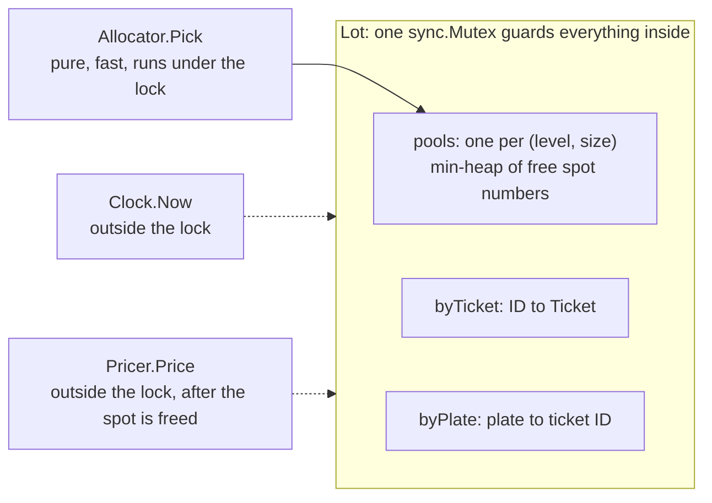
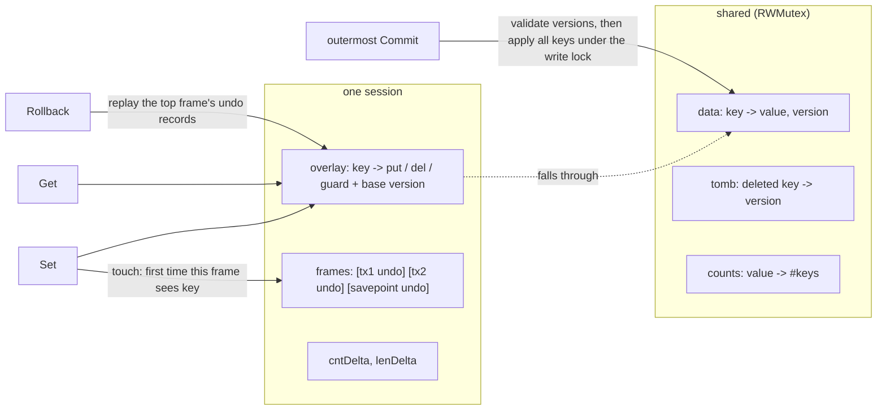

# B3 Unit 2 — Modelling and state

> Time: ~6 h · CORE: §1–§2 · STRETCH: Stage 4 discussions · Labs: `labs/b3/parkinglot`, `labs/b3/kvtx`

## Before you start

Unit 1 taught the timed-attempt loop and the habits that every later problem scores: state ownership, no user code under a lock, injected time,
stage 2 and 3 landing as additions. This unit is about *modelling* (what are the entities, where will the requirements change) and about *state that
must be undone*.

Warm-up (write the answers down first):

1. Why does the LRU reference run eviction callbacks after `Unlock`?
2. An invariant spans a map and a counter. What goes wrong if you update them in two separate critical sections?
3. Your tests need "now". Name two ways to get it wrong and the one way to get it right.

<details data-kind="answer"><summary>Warm-up answers</summary>

1. User code may call back into the cache (self-deadlock, `sync.Mutex` is not re-entrant) or block (stalling every other caller). Collecting removals under the lock and notifying after `Unlock` makes both impossible.
2. Another goroutine can observe (or act on) the state between the two sections, where the map says one thing and the counter another; check-then-act on either becomes racy. Update everything that belongs to one invariant inside one critical section, or give it a single owner goroutine.
3. Wrong: `time.Now()` inside the logic (untestable without sleeping) and a sleep-based test (slow and flaky). Right: inject a small `Clock` interface and advance a fake one by exact amounts.

</details>

---

## §1 Parking lot

### The failure story

A shopping-mall garage has 6 levels and ≈ 2,400 spots. The first version of its software is what most interview
answers look like: an abstract `Vehicle` with `Car`, `Motorcycle`, `Truck` subclasses; an abstract `ParkingSpot` with
`CompactSpot`, `LargeSpot`, `MotorcycleSpot`; a `ParkingFloor`, a `ParkingLot` singleton, a `Ticket`, a `Payment`, a
`FeeCalculator`, and a `SpotFactory`: fourteen types in all. The hierarchies add no behaviour (every subclass
differs from its parent by one constant), but they spread one rule, "what fits where", over four `instanceof` checks.
`Park` loops over all 2,400 spots, finds the first free one that fits, writes the ticket to the database (≈ 5 ms), and
only then marks the spot occupied.

Two failures arrive in the first month. First, the check and the mark are separated by that 5 ms write. At the peak
the garage admits ≈ 1,800 cars an hour, so ≈ 0.5 arrivals per second; the chance that another car is allocated inside
someone's 5 ms window is ≈ 0.5 × 0.005 ≈ 0.25%. With ≈ 18,000 arrivals on a busy day that is ≈ 45 double-booked spots
a day: two drivers, one space, a security guard. Nobody reproduces it in a single-threaded test. Second, the owner
asks for a weekend flat rate and a 24-hour cap. The pricing `switch` lives inside `Unpark`, so the change touches
`Unpark`, three subclasses and the ticket printer, and the regression it causes (the grace period silently stops
applying to motorcycles) is found by customers.

The interviewer is not testing whether you know what a parking lot is. They want to see **which parts of the problem
you identified as "will change" before you wrote a line** (pricing, spot choice, time), which parts you left as plain
data, and whether the one place that must be atomic (take a spot, record the ticket) really is.

### Predict

<!-- predict id="B3-U2-P01" -->
**Predict.** Before coding, the interviewer says: "The owners will change how spots are chosen and how fees are
computed, probably every quarter." Write down (a) which of these become an interface now and which stay a plain
struct or function: *vehicle kind, spot size, the fit rule, the allocation rule, the fee rule, the clock, the ticket*;
(b) how many named types you would create for "kinds of vehicle"; (c) one sentence for why you stop there.
<!-- /predict -->

<!-- predict id="B3-U2-P02" -->
**Predict.** Hourly pricing: 15-minute grace period, 300 cents per started hour for a car, 2,000 cents cap per 24
hours. Compute the fee for stays of (a) 15 min 1 s, (b) 1 h 10 min, (c) 6 h 40 min, (d) exactly 24 h, (e) 24 h plus one
nanosecond. State your rule for the grace period and your rule for the cap *before* computing. Write down which of
the five is where two reasonable people disagree.
<!-- /predict -->

<!-- predict id="B3-U2-P03" -->
**Predict.** 8 entry gates and 8 exit gates call the lot concurrently; peak demand is ≈ 1 operation per second.
Design A: one `sync.Mutex` around the whole lot. Design B: a mutex per level, `atomic` counters for availability, and
a lock-free `plate -> ticket` map. Write down (a) how much throughput you need versus how much A can give, (b) the two
operations in B that cannot be done correctly with per-level locks, and (c) which design you choose and what number
would make you change your mind.
<!-- /predict -->

### Reveal

<details data-kind="reveal" data-for="B3-U2-P01">
<summary>Reveal</summary>

(a) **Interfaces now:** the allocation rule (`Allocator`), the fee rule (`Pricer`) and the clock (`Clock`). Those are
the things the interviewer just told you will vary, or that tests must replace. **Plain data:** vehicle kind and spot
size (two small enums), the ticket (a value struct). The **fit rule** is a single function `Fits(kind, size)`: it is a
domain fact that happens to be encoded in one place, and if it changes, it changes in one place. It does not need an
interface until a second *implementation* exists. (b) **One**: `VehicleKind`, an `int` with three constants. `Car`
differs from `Truck` by the size of spot it needs, and that is data, not behaviour. (c) Because an interface earns its
place when the *caller* needs to substitute behaviour, and a type earns its place when it has behaviour or invariants of
its own. A subclass that only carries a constant is a lookup table with extra steps, and every extra type is a place
the fit rule can drift. Tempting wrong answers: "`Vehicle` interface with `Car`, `Truck` implementations" (the lot
never calls a method on a vehicle that depends on the kind); "`ParkingSpot` interface so spots can be EV later" (add a
field when EV arrives; the stage-4 discussion shows how that lands); "make everything an interface for testability"
(you can test `Fits` by calling it).

</details>

<details data-kind="reveal" data-for="B3-U2-P02">
<summary>Reveal</summary>

Rules (the reference pins them; you must say yours): a stay **up to and including** the grace period is free, and
grace is a **free pass, not a deduction**; every started hour costs the rate; the cap applies to each started 24-hour
block counted from entry. (a) 15 min 1 s: over grace, one started hour: **300**. (b) 1 h 10 min: not free, and the
stay is 2 started hours: **600**. Under the "deduction" reading (70 − 15 = 55 min, one hour) it is 300. This is the
case where reasonable people disagree, and why you ask. (c) 6 h 40 min is 7 started hours = 2,100, capped: **2,000**.
(d) Exactly 24 h: one full block, which costs the cap: **2,000** (not 24 × 300 = 7,200). (e) 24 h + 1 ns: the second block
has started, so cap + 1 started hour = **2,300**. Tempting wrong answers: computing `hours := d.Hours()` as a float
and rounding (floating-point error moves the boundary cases; use integer nanoseconds and ceiling division), and
capping the *total* instead of each block (a 50-hour stay would cost 2,000 instead of 4,600). Money is `int64` cents
throughout: the same rule as on the banking platform, where nobody puts a float near a balance.

</details>

<details data-kind="reveal" data-for="B3-U2-P03">
<summary>Reveal</summary>

(a) Needed: ≈ 1 operation per second at peak (1,800 entries an hour is 0.5/s, exits are similar). Design A: a critical
section is a handful of map operations and one heap pop, ≈ 1 µs per Park + Unpark pair measured on a 4-core sandbox
(varies), so ≈ 10⁶ pairs per second: **≈ 10⁶× headroom**. A single mutex is not a bottleneck; it is the specification.
(b) In design B, **Availability** reads several independent counters, so a snapshot can show `occupied + free ≠ total`
while a Park is half-applied (the reference's mutation test sees "Occupied 19 + Free 24 != Total 45" within a
second). **"Not already parked"** is a check across *all* levels followed by an insert, which needs one lock that
spans every level anyway. The "spread across levels" strategy also has to read every level's state to choose.
Per-spot CAS has the same problem with the plate map and counters. (c) Choose **A**. It makes every invariant a
statement about one critical section. You would revisit it when a profile shows the lot's lock as hot, which on this
problem means ≳ 10⁵ operations per second, or when one lot object must serve many independent garages, and then the
answer is **one lot (and one lock) per garage**, not finer locks inside a garage. Tempting wrong answer: "finer locks
are always better".

</details>

### The problem

> Problem 3 of 18 · Time box: 75 min · Focus: modelling, extensibility · Lab: `labs/b3/parkinglot`

*As the interviewer says it:*

"Design a multi-level parking lot. Cars, motorcycles and trucks come in, get a ticket and a spot; when they leave they
hand the ticket back and we know how long they stayed. I'd like to see how you model it and how easily it changes. I'll
add requirements as we go."

Questions worth asking (the interviewer's answers pin down the tests):

| You ask | Interviewer answers |
|---|---|
| What kinds of vehicle, what kinds of spot? | Three of each: Motorcycle, Car, Truck; Small, Compact, Large spots. A motorcycle fits any spot, a car fits Compact or Large, a truck fits only Large. |
| How is a spot chosen? | For now: of the free spots that fit, take the smallest size; among equals the lowest level, then the lowest spot number. Numbers within a level start at 0: Small spots first, then Compact, then Large. |
| What if nothing fits? | `ErrLotFull`, returned as an error value. It means "nothing that fits *this* vehicle": a full Large row does not stop motorcycles. A failed `Park` changes nothing. |
| Same car twice? | `ErrAlreadyParked`. Plates are opaque, case-sensitive strings; the camera has normalised them. Invalid vehicle (empty plate, unknown kind) is `ErrInvalidVehicle`. Precedence: invalid, then already parked, then full. |
| What is on the ticket? | ID (unique, never reused, opaque), plate, kind, spot, entry time. A ticket can be redeemed once. |
| What does leaving return? | A `Receipt`: the ticket, exit time, stay, fee, lost flag. The stay is never negative, even if the clock steps back. |
| Where does time come from? | An injected `Clock`; tests never sleep. |
| Money? | Integer cents (`Cents int64`). No floats. |
| Concurrency? | Not yet. One caller at a time. I'll tell you when that changes. |
| Persistence, payment, UI, reservations? | Out of scope: in-memory, and the receipt carries a fee, nothing charges a card. |

Checkpoints (be at or past these, or cut scope):

| Minute | Where you should be |
|---|---|
| 0–8 | Clarify; write the "what changes / what doesn't" list; sketch types and the three things that will vary |
| 30 | Stage 1 green. Interviewer announces stage 2 |
| 50 | Stage 2 green. Interviewer announces stage 3 |
| 68 | Stage 3 green or knowingly partial. Stop coding |
| 68–75 | Walk-through: invariants, the lock, the two seams, and one thing you would do next |

#### Stage 1: the lot (minutes 8–30)

- `New(cfg, ...Option)`: levels, each with a count of Small, Compact and Large spots. `ErrInvalidConfig` for no levels,
  a negative count or zero spots.
- `Park(Vehicle) (Ticket, error)`, `Unpark(ticketID) (Receipt, error)`, `Availability()`.
- Errors as values: `ErrLotFull`, `ErrAlreadyParked`, `ErrUnknownTicket`, `ErrInvalidVehicle`.
- Entry and exit times from an injected `Clock` (`WithClock`).
- Free parking for now: `Receipt.Fee` is 0.

#### Stage 2: pricing, allocation, lost tickets (announced at minute 30)

"The owners want a weekend tariff next month and a 'park on the top floor first' promotion after that. Don't make me
read `Park` and `Unpark` again to add either. Also, drivers lose tickets."

- A `Pricer` seam and two built-ins: hourly (grace period, started hours, per-vehicle-kind rates, optional daily cap)
  and flat-per-entry, both validated and defensively copied.
- An `Allocator` seam with three built-ins: `BestFit` (what you already have), `FirstFit`, `SpreadLevels`. The lot
  shows the strategy only the *pools* that can take the vehicle; the strategy picks a pool; the lot hands out the lowest
  free number in it.
- `UnparkLost(plate)`: charges `max(normal fee, lost-ticket fee)`, invalidates the old ticket.
- A buggy plug-in (bad index) must fail `Park` cleanly and leave the lot untouched.

#### Stage 3: many gates (announced at minute 50)

"The garage has eight entry lanes and eight exit lanes, one goroutine each. And the airport wants this for a
50,000-space long-stay lot."

- Safe for concurrent use. No spot is ever given to two vehicles, no plate is ever parked twice, a ticket is redeemed
  at most once, and `Availability` is always a consistent snapshot.
- A slow pricer must not stop other gates (user code stays out of your critical section).
- Cost per operation must not grow with the number of spots.
- `Parked()` returns a snapshot of all live tickets.
- State the lock granularity you chose and defend it.

#### Stage 4: discuss, don't code

- "Spots can now be reserved for 20 minutes." What changes?
- "Some spots have EV chargers, and some cars need one." What changes, and what does it do to the fit rule?
- "We operate 300 garages." What changes?
- "The server restarts while 900 cars are inside." What is the source of truth?

<details data-kind="answer"><summary>Model answers</summary>

- **Reservations:** a reservation is a *claim on a pool with an expiry*, not a state of a spot. `Reserve(kind, from, until)`
  decrements a "held" counter per pool (so `Free` for the allocator becomes `Free - Held`) and returns a token;
  `Park` with the token consumes it, a janitor (or lazy check against the `Clock`) releases expired holds. The seams
  hold: `Pool` gains a `Held` field, and the allocator and pricer stay untouched. The new invariant is
  `free - held >= 0`, and it lives in the same critical section.
- **EV:** add `Features` to spots and `Needs` to vehicles; the fit rule becomes a predicate over both, and a car that
  does not need a charger should *avoid* EV spots (a soft preference, so it belongs in the allocator, not in `Fits`).
  Pools become `(level, size, features)`. Still enumerable, still small. If features multiply, pools stop being
  enumerable, and you move to an index per feature set.
- **300 garages:** a `Lot` is already the unit of consistency, so make a registry `map[LotID]*Lot` above it, with no
  cross-lot locks and no cross-lot invariants. Routing and cross-garage "find me a spot nearby" are read-only queries over
  per-lot `Availability` snapshots, allowed to be slightly stale.
- **Restart:** the tickets are the truth: a printed ticket is in a driver's hand. Persist every `Park` and `Unpark` (a
  write-ahead log or a table keyed by ticket ID, written *before* the barrier opens), and rebuild pools and indexes by
  replaying live tickets on boot. IDs must survive restarts and must not repeat, so use a database sequence or random
  IDs rather than an in-memory counter. Same story as the platform's audit trail: the log is the record, memory is a cache.

</details>

### Build it

Lab: **`labs/b3/parkinglot`**. Stage 1 is `parkinglot.go` (the API sheet and the stage-1 contract); `stage2.go` and
`stage3.go` hold the later stages' stubs. Open them only when the interviewer "announces" the stage. The types and
signatures are given so the tests can compile against any solution; how you store things, and where the lock goes, is
yours. `Fits` is a stub on purpose: the fit rule is the first thing you model.

```sh
go test -race ./labs/b3/parkinglot/                     # everything
go test -race -run Stage1 ./labs/b3/parkinglot/         # one stage
go test -race -count=20 ./labs/b3/parkinglot/           # shake out schedule-dependent bugs
```

Start a 75-minute timer, spend the first 8 minutes writing the "what changes / what doesn't" list on paper, write
stage 1, run `-run Stage1`, and move on at the checkpoint even if a test is red (note which). Stop coding at minute 68.
Write down which tests were green at minutes 30, 50 and 68: that record is what the tutor scores for time management.

What the tests prove:

- **Stage 1 (12 tests):** bad configs, ticket contents, the fit rule as a table, best-fit order with exact spot IDs on a
  two-level lot, per-kind `ErrLotFull`, error precedence, receipts and stay arithmetic, a clock that steps back, lowest
  free number first after unordered frees, a ticket that works exactly once (and no double free), unique IDs, and
  availability by size and level with a snapshot the caller owns.
- **Stage 2 (12 tests):** the three built-in strategies on exact sequences, a recording allocator that checks what the
  lot shows it (fitting, non-empty, ordered pools; never called on a failure), a custom strategy the lot has never heard
  of, a bad index that must not corrupt anything, nil options, a pricing table of 19 boundary cases, validation and
  defensive copying, the flat pricer, end-to-end fees, the arguments a custom pricer receives, and lost tickets.
- **Stage 3 (7 tests):** `Parked` order and ownership; 200 gates racing for 40 spots (exactly 40 win, all distinct);
  300 rounds of 8 gates scanning one plate (exactly one gets in); 200 rounds of mixed `Unpark`/`UnparkLost` on one
  ticket (exactly one redemption, no double free); a stress test (12 gates × 2,500 operations, three allocators, an
  auditor goroutine hammering `Availability` and `Parked`, a ground-truth oracle, goroutine-leak check); a pricer that
  blocks while other gates keep working; and a 50,000-spot fill-and-drain under a 5 s cap.

**Do the timed attempt before reading the rest of this section.**

### How it actually works

One lot lock, four small structures, and three seams.



- **Pools, not a grid of spots.** The lot never scans spots. For each `(level, size)` it keeps a min-heap of free spot
  numbers, so "lowest-numbered free spot in this pool" is `heap.Pop`, O(log n). A level has three pools, so the
  candidates for a vehicle are at most `3 × levels` pools: a loop over ≈ 30 items for a 10-level garage. `Availability`
  is derived by summing pool sizes. There is no separate `freeCount` that could drift from the heaps; `Occupied` comes
  from `len(byTicket)`, so the invariant `Occupied + Free == Total` is a real cross-check between two structures.
- **Two indexes, one source.** `byTicket` is authoritative (it holds the ticket value); `byPlate` maps a plate to a
  ticket ID. `release(ticket)` is the single place that deletes from both and pushes the spot number back on its heap.
  A ticket can only be released if it is found in `byTicket` in the same critical section, which makes a double free
  impossible by construction.
- **The fit rule is one function.** `Fits(kind, size)`; `candidates` filters pools with it. `FirstFit`, `BestFit` and
  `SpreadLevels` never look at kinds at all.
- **Seam 1: `Allocator.Pick(v, pools) int`.** The strategy chooses a *pool*, never a spot, so a plug-in cannot hand out an
  occupied spot or a spot that does not fit; the worst it can do is return a bad index, which `Park` validates
  (`ErrBadAllocation`) before touching anything. The pool list is small, sorted, and never empty, which makes strategies
  3–10 lines each and testable as pure functions. The cost of running under the lock is the contract "pure and fast".
- **Seam 2: `Pricer.Price(ticket, exit) Cents`.** `Unpark` frees the spot and forgets the ticket under the lock, then
  prices after unlocking. A slow or panicking pricer can neither stall other gates nor keep a space blocked.
- **Seam 3: `Clock`.** One method, read before taking the lock (user code stays outside it). Exit is clamped to entry,
  so a stay is never negative.
- **Errors are values.** Sentinels wrapped with `%w` and detail; the tests use `errors.Is`.

```go
func (l *Lot) Park(v Vehicle) (Ticket, error) {
	if v.Plate == "" || !validKind(v.Kind) {
		return Ticket{}, fmt.Errorf("%w: plate %q kind %v", ErrInvalidVehicle, v.Plate, v.Kind)
	}
	now := l.clock.Now() // user code: outside the lock

	l.mu.Lock()
	defer l.mu.Unlock()
	if id, dup := l.byPlate[v.Plate]; dup {
		return Ticket{}, fmt.Errorf("%w: %q holds ticket %s", ErrAlreadyParked, v.Plate, id)
	}
	cands, view := l.candidates(v.Kind) // pools with a free, fitting spot, in (level, size) order
	if len(cands) == 0 {
		return Ticket{}, fmt.Errorf("%w: %v", ErrLotFull, v.Kind)
	}
	i := l.alloc.Pick(v, view) // seam: which pool?
	if i < 0 || i >= len(cands) {
		return Ticket{}, fmt.Errorf("%w: Pick returned %d for %d pools", ErrBadAllocation, i, len(cands))
	}
	p := cands[i]
	l.nextID++
	t := Ticket{
		ID: fmt.Sprintf("T%06d", l.nextID), Plate: v.Plate, Kind: v.Kind, EnteredAt: now,
		Spot: Spot{Level: p.level, Number: heap.Pop(&p.free).(int), Size: p.size},
	}
	l.byTicket[t.ID] = t
	l.byPlate[t.Plate] = t.ID
	return t, nil
}
```

**The lock decision, stated the way you would say it:** one `sync.Mutex` for the lot. The invariants are cross-structure
(a spot is in exactly one of {heap, a live ticket}; a plate is in `byPlate` iff its ticket is in `byTicket`;
availability sums the heaps), so the cheapest way to keep them true is for every mutation to be one critical section.
That critical section is ≈ 1 µs (measured: ≈ 1.0 µs per Park + Unpark pair single-threaded, ≈ 1.2 µs per pair with 4
and 8 parallel goroutines on a 4-core sandbox, varies by machine), against a demand of ≈ 1 operation per second. Per-level
locks cannot protect the plate check, the global availability snapshot or a cross-level strategy; per-spot CAS cannot
keep the counters and maps in step. The honest limit of this design is a single `Lot` object serving more than ≈ 10⁵
operations per second; the answer there is more lots, not finer locks.

**How stages 2 and 3 landed on stage 1.** (The reference has the seams from the start; a first draft that keeps best-fit
as a private function and `Fee: 0` as a literal needs exactly these two edits.) Stage 2 touched stage 1 in two places: the line that chose the spot became
`l.alloc.Pick(...)` over a candidate list (the old hard-coded rule is now `BestFit`, byte for byte), and the line that
set `Fee: 0` became `l.pricer.Price(...)`. Everything else was additive: `stage2.go` holds the interfaces, the built-ins,
`UnparkLost` and three options; `New` gained nothing because `Option` was there from stage 1. Stage 3 added `Parked`.
The concurrency work was a *discipline* rather than a feature: everything already ran inside one lock, and the only
real change was to make sure that clock reads and pricing happen outside it. If your stage 2 required editing the loop
that finds a free spot in three places, the fit rule or the release path was duplicated.

### Rubric

| Dimension | below | approaching | meets (senior bar) | exceeds |
|---|---|---|---|---|
| Extensibility | A `switch` on vehicle or pricing mode inside `Park`/`Unpark`; stage 2 rewrites stage-1 methods; `Car`/`Truck` subclass hierarchy | Pricing is an interface but allocation is still hard-coded, or the strategy returns a *spot* the lot trusts; fit rule appears in several places | "What changes" named before coding; `Allocator`, `Pricer`, `Clock` are small consumer-side interfaces; stage 2 lands as additions plus two call-site changes; kinds and sizes are two enums and `Fits` is one function | Predicts stage 2 while writing stage 1 (leaves the two seams visible), explains where reservations, EV and multi-lot would plug in, and why no `Spot` interface |
| Concurrency safety | Races under `-race`; check-then-act across two lock acquisitions; availability read without the lock | One lock and correct, but the pricer runs under it, or `Availability` can tear, or double free is possible via `UnparkLost` | One lot lock, invariants stated aloud, pricer and clock outside it, ticket redeemable once under any interleaving, `-race -count=20` clean | Defends the granularity with numbers (≈ 1 µs vs ≈ 1 op/s), says exactly what per-level locks or CAS would break, proposes a lot-per-garage scale-out |
| Clean interfaces | Exports internal slices or `*Ticket`; panics or `bool` for failures; floats for money; `time.Now()` inside | Errors are strings, or options are setters called after use, or the allocator interface takes the whole lot | Sentinel errors with `errors.Is`, `(Ticket, error)`, functional options, `Cents` integers, one-method `Clock`, strategies see read-only `Pool` values, documented contracts (including "Pick must not call the lot") | Contracts precise enough to write the tests from the doc comments; says what each error means to the caller (retry? show a message? page someone?) |
| Tests | No tests, or tests that sleep on the real clock | Happy path only; no boundary cases for grace and cap; no concurrent test | Table tests for fit and pricing boundaries, exact spot IDs for best-fit, failed `Park` changes nothing, a gate-race test per invariant, an invariant checker (`occupied + free == total`, unique spots and plates) | Mutates its own solution to prove the tests bite; adds a model-based test against a naive scan implementation |
| Time management | Stage 1 not green at minute 35; no walk-through | Stage 2 done, stage 3 untouched, no summary | Stage 1 by 30, stage 2 by 50, stage 3 at least with the lock and an honest list of what is missing, then a 7-minute walk-through | Finishes early and spends the time on stage 4 with numbers |

Overall **meets** = at least *meets* on Concurrency safety and Clean interfaces, and nothing at *below*.

### Common mistakes

- **The inheritance zoo.** `Vehicle` ← `Car`/`Truck`, `Spot` ← `CompactSpot`/`LargeSpot`, `ParkingFloor`, `SpotFactory`.
  Symptom: ≥ 10 types, none with behaviour, the fit rule duplicated in each. Fix: two enums, one `Fits`, three
  interfaces only where behaviour varies.
- **Scanning for a free spot, or for a plate.** Fine at 20 spots; at 50,000 spots it is ≈ 1.25 billion steps to fill the
  lot, and the scale test times out. Fix: per-pool free heaps and a plate map.
- **Check-then-act with two critical sections** ("lock, check the plate is new, unlock, lock, insert"). Symptom: two
  gates admit the same car; the plate-race test shows "3 successes and 5 ErrAlreadyParked, want 1 and 7". Fix: one
  critical section from the check to the insert.
- **A strategy that returns a spot.** The lot then trusts a plug-in to pick a free, fitting spot, and one bug is a
  double allocation. Fix: the strategy picks among *candidates the lot built*, and the lot validates the answer.
- **Pricing inside the critical section, or before freeing the spot.** A slow or panicking pricer blocks every gate or
  strands a spot. Fix: free and forget under the lock, price after unlocking.
- **Float money and float hours** (`math.Ceil(d.Hours())`, `float64` prices). Symptom: a 60-minute stay billed as two
  hours on some inputs, or off-by-one-cent totals. Fix: integer nanoseconds, integer ceiling division, `Cents int64`.
- **Leaving the fit rule as `if kind == Truck` in four places.** The fifth place (the allocator) forgets one. Fix: one
  function, one table test.
- **Double free.** `Unpark` and `UnparkLost` both succeed for the same car, or a second `Unpark` pushes the spot onto
  the free list again. Symptom: later, the lot hands one spot to two cars. Fix: release only after finding the live
  ticket in the same critical section; test it by filling the lot afterwards.
- **Wrong precedence or half-applied failures.** `ErrLotFull` for a car that is already inside, or a spot popped
  before the allocator's answer was validated. Fix: validate, then check duplicates, then candidates, then mutate.
- **Handing out internal state.** Returning the live `FreeByLevel` slice or a `*Ticket` from the map. The caller edits
  your state with no lock held. Fix: return values and fresh slices.

### Debrief: senior-level design choices

- **Two enums and a function, not a class tree.** "A vehicle's kind only matters through the size of spot it needs, so
  it's data. I'll put the rule in one `Fits` function and test it as a table. I'd introduce a type when it has behaviour
  of its own." This sentence prevents ten minutes of boilerplate and answers the first design question.
- **Say what changes before you type.** "Three things will vary: how we choose a spot, how we price a stay, and what time
  it is. Each gets a one-method interface defined where the lot consumes it. Everything else is data." Interviewers write
  that sentence down.
- **Strategies choose pools.** "The allocator never sees individual spots, so it can't double-book one. It sees a few
  `(level, size, free)` rows and picks a row; the lot owns the spot numbers." The alternative (a strategy over all free
  spots) is more general and O(n) per call; if a stage-4 requirement needs per-spot preferences (distance to a lift),
  the pool grows a field or pools get finer, and the contract stays.
- **Errors are part of the API.** Sentinels, wrapped with detail, with a stated precedence. `ErrLotFull` means "nothing
  *that fits*", and a Large row being full must not stop motorcycles.
- **One lock, justified with numbers.** "Peak is about one operation a second; one lock does about a million. I'd only go
  finer after a profile, and even then I'd shard by garage." Compare that with "per-level locks for performance".
- **User code outside the lock, except the allocator.** "The clock and the pricer are called without holding the lot's
  lock. The allocator has to run inside it, because its answer must be applied atomically, so its contract says pure
  and fast, and it only ever sees copies."
- **Defensive copies at the boundary.** Pricer constructors copy their maps; `Availability` returns fresh slices and
  maps; `Parked` returns a new slice. "A caller mutating my config later must not change prices."
- **Stage 2 and 3 landed with two call-site edits and one discipline.** `l.alloc.Pick` replaced the hard-coded choice,
  `l.pricer.Price` replaced `Fee: 0`; concurrency added a method and a rule about what runs outside the lock.

### Break it

Apply each mutation to a copy of the reference in `solutions/b3/parkinglot` (or to your own), one at a time. Predict the
failing tests first, then run `go test -race -count=1 ./solutions/b3/parkinglot/` (add `-cpu 4` for the first and last).

1. In `Park`, split the duplicate-plate check from the insert: after the `byPlate` check, `Unlock()`,
   `time.Sleep(20 * time.Microsecond)`, `Lock()` again (the shape of "check, then call the database, then insert").
2. In `Unpark`, replace `l.mu.Unlock()` before `receipt` with `defer l.mu.Unlock()`, so the pricer runs under the lock.
3. In `Park`, replace the `byPlate` lookup with a loop over every ticket in `byTicket`.
4. Remove `l.mu.Lock()` / `defer l.mu.Unlock()` from `Availability`.

<details data-kind="answer"><summary>What you should see (reference solution, Go 1.24, linux/amd64, 4 cores)</summary>

1. `TestStage3_ConcurrentParksOfOnePlateAdmitExactlyOne` fails on round 1: "2 successes and 6 ErrAlreadyParked, want 1
   and 7". The stress test fails in all three allocator variants with "plate PL074 admitted again (ticket T000021) while
   ticket T000016 is live" and "Parked snapshot inconsistent while gates run: plate PL029 is parked twice". The
   single-threaded stage 1 and 2 tests all pass: check-then-act bugs are invisible without concurrency. The sleep only
   widens the window; with `runtime.Gosched()` or a real database call in that gap, the bug shows up in production at
   the rate computed in the failure story. (The scale test also times out in this run, but that is an artifact of the
   injected 20 µs sleep times 50,000 parks.)
2. Only `TestStage3_SlowPricerDoesNotStallOtherGates` fails, after its 5 s guard: "Park, Availability and Parked while
   another gate sits in the pricer did not finish within 5s". No race detector report, no wrong value: a *liveness*
   bug, which is why it needs a test that holds the pricer open.
3. Only `TestStage3_CostDoesNotGrowWithLotSize` fails ("filling and draining a 50000-spot lot did not finish within
   5s"). Every behavioural test passes, and a 20-spot demo would too: correct behaviour, wrong complexity.
4. `TestStage3_StressManyGatesKeepsEveryInvariant` fails in all three variants with `WARNING: DATA RACE` (6 reports) and
   with the auditor's own message "Availability snapshot inconsistent while gates run: Occupied 18 + Free 26 != Total
   45". The race detector finds the unsynchronised read; the invariant checker shows what it means to a caller: a display
   board that says 44 spots are known for a 45-spot lot.

Other mutations tried: removing the lock from `Park` entirely produced 14 `DATA RACE` reports and then
`panic: runtime error: index out of range [-1]`, which kills the whole test binary and hides every later result; a
`<=` tie-break in `BestFit` failed `DefaultAllocationIsBestFit`, `AvailabilityCountsBySizeAndLevel` and the stage-2
strategy table ("motorcycle #1 got spot {Level:1 ...}, want {Level:0 ...}"); `d < grace` instead of `d <= grace` failed
the pricing table ("car stay 15m0s: fee = 300, want 0"); dropping the bad-index check made
`InvalidAllocatorChoiceFailsCleanly` panic.

Reference verification: `go test -race -count=20` green (≈ 3 s per run); `GOMAXPROCS=1 go test -race -count=3` and
`go test -race -cpu 1,4 -count=3` green; the lab stub fails 31 tests in < 1 s with no panic.

</details>

### In the wild

- **Memory allocators** are this problem at a smaller scale: *first-fit*, *best-fit* and *next-fit* free-list strategies
  are the classic allocation policies (Knuth, *The Art of Computer Programming*, vol. 1), and **slab / size-class
  allocators** (the Linux slab allocators, the Go runtime's size classes) are "spot sizes". Best-fit keeps big blocks
  free for big requests and pays with fragmentation of small leftovers: `BestFit` versus `FirstFit` is the same trade.
- **Kubernetes' scheduler** separates *filtering* (can this pod run on this node at all?) from *scoring* (which feasible
  node is best?), and both are plug-in points. That is the `Fits` / `Allocator` split. TODO-VERIFY: the current names of
  the scheduling framework's extension points.
- **DHCP and IP address management** hand out addresses from pools with leases that expire; a lost ticket is a client
  that vanished without releasing, and the server reclaims on expiry. TODO-VERIFY: lease semantics differ between DHCP
  implementations.
- **Fee engines in banking** look like `Pricer`: tiered fees, grace periods, daily caps and rounding rules are exactly the
  parameters in `HourlyConfig`, money is held in minor units, and the rule "state your rounding" is the same one that
  keeps a ledger reconcilable. On the platform you may have met the same shape as a vendor adapter behind an interface.
- **Redeeming a ticket exactly once** is the idempotency problem from the callback handlers you already wrote: the
  second delivery of the same event must not apply twice, and the cheapest correct implementation is "find and remove
  in one atomic step".
- **Real parking systems** (access control, barrier hardware) sit on a database and sensors rather than process memory:
  the ground truth is the physical garage, and software reconciles against it. TODO-VERIFY: vendor architectures vary;
  treat as a design inference, not a description of a specific product.

### Trade-offs

| Option | Wins when | Loses when | When the answer flips |
|---|---|---|---|
| One lot lock (the reference) | Cross-structure invariants; demand far below ≈ 10⁵ ops/s | Profile shows the lock hot; one process serving thousands of garages | Shard by garage first; finer locks inside one garage only after measurement |
| Lock per level | Strategies and queries are strictly per-level | Plate uniqueness, global availability and "spread" need all levels, so you need ordered multi-lock or a global lock anyway | Levels become independent sub-lots (separate entrances, separate plates) |
| Per-spot atomics / CAS | Millions of ops/s, lock-free required, a single counter to maintain | Any invariant across structures (plates, counters, tickets) | Pure slot reservation with no other state (a bitmap allocator) |
| `Allocator` over pools (the reference) | Few distinct pool kinds; strategies must not break invariants | A strategy needs per-spot data (distance to the lift, sensor health) | Add fields to `Pool`, or make pools finer (per zone), before exposing spots |
| `Allocator` over all free spots | Arbitrary strategies; small lots | O(n) per Park under the lock; plug-ins can return occupied spots | Never at 50,000 spots without an index per strategy |
| Pricing as an interface | Logic varies (weekends, events, subscribers) | A single hard-coded tariff that will not change | Pure data changes (rates, caps): configuration of the built-in is enough |
| Pricing as a rules table (data) | Non-engineers change tariffs; auditability matters | Rules interact in ways a table cannot express | When a rule needs code (promotions with conditions), keep the interface and generate it from the table |
| In-memory state only | Interview, tests, a single process | Restart with cars inside; multiple instances | Production: a durable log of Park/Unpark, rebuild on boot |

### Senior bar

- **Failure modes.** Double allocation (check-then-act, or a plug-in choosing spots); double free (second redemption,
  `Unpark` racing `UnparkLost`); a spot stranded by a panicking pricer; availability that tears; a clock that steps back
  and bills a negative stay; predictable sequential ticket IDs that let someone redeem another driver's ticket
  (use random or MAC'd IDs in production); a ticket ID reused after a restart; a pricing change at midnight applied to cars
  that entered before it (decide: tariff at entry or at exit, and say which).
- **Numbers.** Peak ≈ 1,800 entries an hour ≈ 0.5/s; one critical section ≈ 1 µs measured here (an uncontended mutex
  lock/unlock is ≈ 15–25 ns, `docs/NUMBERS.md`); candidate building is ≈ 3 × levels pool checks; a 50,000-spot lot holds
  ≈ 50,000 ints in heaps plus up to 50,000 tickets in two maps, a few MB. The cost of a scan design: ≈ n²/2 steps to
  fill n spots ≈ 1.25 × 10⁹ at n = 50,000.
- **Ops.** Metrics: occupancy by level and size, `ErrLotFull` rate by kind (a growing truck-full rate with free compact
  spots means a mix problem, not a capacity problem), lost-ticket rate, mean stay, `ErrBadAllocation` count (a plug-in
  bug). Audit: every receipt is a financial record, so write it durably before the barrier opens. Reconcile the
  in-memory occupancy with the ground truth (sensors, a count at the barrier) on a schedule.
- **Cost.** Compute is irrelevant here; the cost drivers are correctness (a double-booked spot costs a refund and a
  guard) and the lost-ticket policy (the lost fee must exceed a typical long stay or it is an exploit).

**Interviewer probes**

<details data-kind="answer"><summary>"Why does the allocator get pools instead of spots?"</summary>

Because the lot has to stay in charge of the invariant "a spot is free and fits". If a plug-in can name any spot, one
bug becomes a double allocation. With pools, the strategy decides a *policy* (which level, which size) from a few
numbers, and the lot does the unforgiving part (pop the lowest free number, validate the index). It also keeps
`Park` at O(log n): a spot-level interface has to materialise or index free spots per call. If a requirement needs
spot-level preferences, I would first make pools finer (per zone) or add a field such as a distance bucket; I would
expose individual spots only with an index behind them.

</details>

<details data-kind="answer"><summary>"Why compute the fee after unlocking? What if the pricer fails?"</summary>

Pricing is user code; it can be slow (a rules service), or panic. If it runs under the lot's lock, one slow call stops
every gate, and `TestStage3_SlowPricerDoesNotStallOtherGates` shows exactly that. I free the spot and delete the
ticket first, because the car has physically left; the receipt is computed from the ticket value I copied out. If the
pricer fails, I still have the ticket and the exit time, so I log them (they are a financial record) and retry or
reconcile the charge later. The unacceptable outcome is a spot that stays "occupied" because billing hiccuped.

</details>

<details data-kind="answer"><summary>"The lot's lock shows up in a profile. What now?"</summary>

First check what is under the lock: allocation of candidate slices, `fmt.Sprintf` for IDs, logging. The reference reuses
scratch slices and holds the lock for ≈ 1 µs, so a hot lock means the process is serving far more than one garage's
demand. Then shard by garage: one `Lot`, one lock, per physical garage, with a registry on top and no cross-lot
invariants. Within a garage I would not split the lock: availability, duplicates and cross-level strategies all span
levels. If one huge garage really needs more throughput, I would reduce the critical section further (pre-formatted
IDs, no maps churn) before I split any state.

</details>

<details data-kind="answer"><summary>"Tickets are T000001, T000002, … What is wrong with that?"</summary>

Two things. Guessable: anyone who holds ticket T000417 can try T000418, and `Unpark` would release someone else's
car (and, in a system with receipts, fees go to the wrong account). In production, tickets carry an unguessable value
(random, or a MAC over the ID), and `Unpark` checks it. Restart safety: an in-memory counter restarts at 1 and issues
IDs that are already printed on tickets inside the garage. Use a database sequence, or random IDs with a uniqueness
check on insert. The lab's counter is fine for tests because tests treat IDs as opaque.

</details>

### Check yourself

1. Why does `Availability` compute `Occupied` from the ticket map instead of from `Total - Free`?
2. A teammate proposes making the `Allocator` return a `Spot` so it can implement "nearest to the lift". What breaks,
   and what do you offer instead?
3. Two exit gates read the same ticket at the same moment, one by ticket and one as a lost ticket by plate. Walk through
   what the lot does, and say which line of code guarantees exactly one receipt.

<details data-kind="answer"><summary>Answers</summary>

1. If both were derived from the same data, `Occupied + Free == Total` would be true by arithmetic and could not catch a
   bug. `Occupied` comes from the ticket map and `Free` from the heaps, so the invariant is a real cross-check between
   the two structures: a double free or a leaked spot shows up as a mismatch.
2. The lot would have to trust the plug-in to return a free, fitting spot; one bug is a double allocation. Offer: add a
   field to `Pool` (for example a distance bucket) or make pools finer (per zone), so the allocator still chooses among
   candidates the lot built, and the lot still pops the spot and validates the index.
3. Both calls take the lot's lock, so they run one after the other. The first one finds the ticket (by ID, or by plate
   through `byPlate`), calls `release` (deleting it from `byTicket` and `byPlate` and pushing the spot back) and unlocks.
   The second finds nothing and returns `ErrUnknownTicket` or `ErrUnknownPlate`. "Found in the map in the same critical
   section that deletes it" is the guarantee; the test `ConcurrentRedemptionsOfOneTicketSucceedOnce` then fills the lot
   to prove no spot was freed twice.

</details>

---

## §2 In-memory KV store with nested transactions

### The failure story

A credit union's "close account" workflow has five steps against the in-memory projection that the adapter serves
balances from: place a hold, sweep the balance to savings, write the audit row, flip the status to `closed`, queue the
final statement. Step 4 fails on ≈ 0.1% of runs (a stale status version). Without a way to undo steps 1–3, those runs
leave a swept balance, an audit row and an account that still says `open`: "half-applied money movement". At ≈ 40,000
closures a month that is ≈ 40 accounts a month for someone to reconcile by hand, and every one of them is a support
call that starts with "my balance is zero but my account is open".

The interview-day answer to "add transactions" is usually `Begin` = copy the whole map. On a 200,000-key store that
is ≈ 12–20 MB of map and strings per `Begin` (≈ 60–100 B per entry), and nested transactions copy again. At 1,000
transactions a second that is ≈ 12–20 GB/s of allocation churn for transactions that touch three keys each. The work
done is proportional to the size of the store; the work needed is proportional to what the transaction changed.

Then a second client arrives. Two requests for the same member both read a balance of 100, both subtract 30, and
both write 70: a lost update, and nothing in either request failed. A third client, an auditor, reads the debit
side of a transfer before it and the credit side after it and reports money that does not exist. Making
transactions nest was the easy part; deciding what other sessions are allowed to see, and what happens when two
sessions write the same key, is the part interviewers are actually listening for.

### Predict

<!-- predict id="B3-U2-P04" -->
**Predict.** Key `a` is committed with the value `"0"`; key `b` does not exist. Level 1 runs `Set(a, "1")`. Level 2
(nested inside it) runs `Set(a, "2")` and `Set(b, "")`, then **commits**. Level 1 then runs `Delete(a)` and
**rolls back**. What do `Get(a)`, `Get(b)` and `Len()` return afterwards? And which undo records must level 1's log
hold at the moment level 2 commits, for each of `a` and `b`? Write your answer down first.
<!-- /predict -->

<!-- predict id="B3-U2-P05" -->
**Predict.** `a` and `b` both hold `"x"` (committed). Inside a transaction: `Set(a,"y")`, `Delete(b)`,
`Delete(b)` again, `Set(c,"x")`, `Set(c,"x")` again, then `Rollback()`. A candidate maintains `counts[value]` inside
`Set` and `Delete` (decrement the old value's count if the key existed, increment the new one) but implements
`Rollback` by just restoring the saved map entries. (1) What should `Count("x")` and `Count("y")` be after the
rollback? (2) What does the candidate's store return? Write your answer down first.
<!-- /predict -->

<!-- predict id="B3-U2-P06" -->
**Predict.** Read-committed store, two sessions, a ledger with `a = 100` and `b = 0`. Session 1 runs `Begin`,
`Set(a, 70)`, `Set(b, 30)`, `Commit` (atomic). (1) Session 2 does `Get(a)` then `Get(b)` as two separate calls while
that commit happens. Which sums can it observe? (2) Now sessions 1 and 3 each run `Begin`, plain `Get(a)`,
`Set(a, a-10)`, `Commit` at the same time, with first-committer-wins comparing the version recorded at the
transaction's first *write*. Which final values of `a` are possible? Write your answer down first.
<!-- /predict -->

### Reveal

<details data-kind="reveal" data-for="B3-U2-P04">
<summary>Reveal</summary>

`Get(a) = "0"`, `Get(b)` is **absent**, `Len() = 1`. Level 2's commit is only provisional: it merges into level 1,
and level 1's rollback undoes it together with level 1's own `Set` and `Delete`.

Level 1's log after the merge must say: `a` → "was `"0"`" (the state before **level 1's first touch**, taken when level
1 ran `Set(a, "1")`) and `b` → "**did not exist**". Two traps hide here.

- **The merge rule.** Level 2's own record for `a` says "was `"1"`". If the merge lets the child overwrite the
  parent's record, rolling back to `"1"` leaves a value that was never committed. The parent's older record wins; the
  child's is adopted only for keys the parent has not touched (`b`).
- **Absence is not `""`.** `b` was written as the empty string, but before that it did not exist. A record that
  stores only "the old value" cannot tell those apart and resurrects `b` as `""`. The record needs a presence flag
  (or a pointer, or a sentinel).

The tempting wrong answers: `Get(a) = "1"` (merge overwrote), `Get(b) = ""` and `Len() = 2` (absence lost), and
`Get(a) = "2"` ("a committed inner transaction is durable": only the outermost commit is).

</details>

<details data-kind="reveal" data-for="B3-U2-P05">
<summary>Reveal</summary>

(1) The rollback restores the original state: `Count("x") = 2`, `Count("y") = 0`.

(2) Inside the transaction the candidate's counters go `x:2` → `Set(a,y)`: `x:1, y:1` → `Delete(b)`: `x:0` → second
`Delete(b)`: nothing, the key is gone → `Set(c,x)`: `x:1` → second `Set(c,x)`: decrement then increment, `x:1`.
`Rollback` restores `a`, `b` and removes `c` but never touches the counters, so the store reports `Count("x") = 1`
and `Count("y") = 1`. Both wrong, and wrong forever: nothing recomputes them.

The fix is structural, not a patch. **Every change to the data goes through one function that also adjusts the
counters, and Rollback uses that same function to put values back.** Then there is no second code path to forget.
The two classic variants of the same bug: decrementing on `Delete` of an absent key (counts go negative) and
counting an overwrite with the same value twice. Recomputing counts by scanning the map on every `Count` is correct but
O(n), and the stage-2 test with a large open transaction catches it.

</details>

<details data-kind="reveal" data-for="B3-U2-P06">
<summary>Reveal</summary>

(1) Two sums are possible: **100** (both reads before the commit, or both after: 70 + 30) and **130** (`a` read
before the commit, `b` read after it: 100 + 30). **70** would need `b` to be read before `a`, which the order of
calls rules out. A multi-key commit being *atomic* means nobody sees half of it **within one read**; two separate
calls are two instants, and between them the whole commit can land. Read committed allows that, and it is exactly
what the auditor in the failure story saw: money that does not exist. The fix is a single call that reads several
keys under one lock acquisition (`MGet`); snapshot isolation would give the same guarantee for a whole transaction
at a higher price.

(2) Both **80** and **90** are possible. If session 3 reads `a = 100` *before* session 1 commits but performs its
`Set` *after*, the version it records at its first write already includes session 1's commit, validation passes,
and it overwrites 90 with 90: a **lost update**. If both write before either commits, the second committer fails
with a conflict, retries, and the result is 80. First-committer-wins on the *write* version protects two
overlapping writers; it does not protect a read-modify-write whose read happened earlier. The remedy is to record
the version at **read** time (`GetForUpdate`, the optimistic form of `SELECT ... FOR UPDATE`) or to make the
operation atomic in the store. Isolation levels are a menu of which anomalies you accept; read committed accepts
this one.

</details>

### The problem

> Problem 4 of 18 · Time box: 75 min · Focus: state, undo logs · Lab: `labs/b3/kvtx`

Say it the way the interviewer would:

> "Build an in-memory key-value store. Keys and values are strings. `Get`, `Set`, `Delete`. Then add transactions:
> `Begin`, `Commit`, `Rollback`. Transactions can nest."

**Questions worth asking** (and what the interviewer answers):

| You ask | Interviewer says |
|---|---|
| One client, or many? | One for now. If that changes I will tell you. |
| What does `Set` do with no transaction open? | Applies immediately; nothing to undo. |
| `Commit` or `Rollback` with nothing open? | An error you can test for, and the store is unchanged. |
| Is `""` a valid value? Is "absent" different from it? | Yes, and yes. `Get` returns whether the key exists. |
| What does `Commit` of an inner transaction mean? | It merges into the parent. Only the outermost commit is final. |
| Size? | Up to ≈ 1M keys; a transaction touches ≈ 10–1,000 of them. Do not make `Begin` cost O(store). |
| Persistence? | No, memory only. We can talk about durability at the end. |

**Checkpoints.**

| Minute | You should have |
|---|---|
| 0–5 | Clarifying questions asked, API on the page, the undo-record idea stated |
| 5–30 | Stage 1 working, with tests for the traps below |
| 30 | Interviewer announces stage 2 (`Count`, savepoints) |
| 50 | Stage 2 working. Interviewer announces stage 3 (concurrent sessions) |
| 70–75 | Stop coding. Walk the interviewer through isolation, conflicts and what you did not get to |

Most candidates will not finish stage 3 inside the box. That is the design: record what passed, and finish stage
3 *after* the clock stops so you see the whole shape.

#### Stage 1: nested transactions through an undo log (minute 0)

1. `New() (*Store, error)`, `Get(key) (string, bool)`, `Set(key, value)`, `Delete(key) bool` (was it present?),
   `Len() int`, `Depth() int`.
2. `Begin()`, `Commit() error`, `Rollback() error`. `Commit`/`Rollback` with nothing open return `ErrNoTransaction`
   and change nothing.
3. `Rollback` undoes only the innermost transaction. An inner `Commit` merges into the parent, so an outer
   `Rollback` still undoes it. The outermost `Commit` is final.
4. A transaction reads its own writes. A write outside a transaction is immediate and permanent.
5. Do **not** copy the map. Keep an undo log: for each key a transaction touches, what it held *before the first
   touch*, including "did not exist". First touch only: a key written a million times has one record.

#### Stage 2: counts and savepoints (announced at about minute 30)

1. `Count(value) int`: how many keys currently hold `value` (`Count("")` counts keys holding the empty string). O(1),
   correct across `Set`, `Delete` (also of an absent key), `Rollback`, nested `Commit` and savepoints.
2. `Savepoint(name)`, `RollbackTo(name)`, `Release(name)`. `RollbackTo` undoes everything since the savepoint and
   keeps it open; `Release` keeps the changes and forgets the name. Repeated names resolve to the innermost one.
   Errors: `ErrNoTransaction`, `ErrNoSavepoint`, `ErrInvalidName`.

#### Stage 3: concurrent sessions (announced at about minute 50)

1. `store.NewSession()` returns another handle onto the same data, with its own transaction stack. A `*Store` is
   itself a session. A session is used by one goroutine at a time; different sessions run concurrently under `-race`.
2. Pick an isolation level and state it precisely. The reference: **read committed**. A session sees committed
   data plus its own uncommitted writes, never anybody else's uncommitted or rolled-back writes. The outermost commit
   applies all its keys atomically.
3. Two sessions writing the same key: **first committer wins**. The loser's `Commit` returns an error satisfying
   `errors.Is(err, ErrConflict)`, applies nothing, and aborts its transaction. Say whether you detect that with versions
   or by serialising writers, and why.
4. `MGet(keys...)` reads several keys as one consistent state. `GetForUpdate(key)` is a read that guards the key
   against later commits by others.

#### Stage 4: discuss, don't code

<details data-kind="answer"><summary>"How would you make this durable?"</summary>

Write-ahead log. At the outermost commit, append the write set as a single record (all keys, new values or
tombstones, the commit sequence number) to an append-only file and `fsync` before applying it to the map and
acknowledging. Recovery replays the log into an empty store; checkpoints (snapshot the map, then truncate the log
up to that sequence number) bound recovery time. Rolled-back and uncommitted work is never logged, which is another
benefit of keeping uncommitted writes in a private overlay. The `fsync` is the throughput limit: group commit
batches several sessions' records into one `fsync` (`docs/NUMBERS.md`: small transactional writes are ≈ 1k–10k TPS
per primary, bounded by WAL and lock contention).

</details>

<details data-kind="answer"><summary>"What would MVCC change?"</summary>

Instead of one current value per key, keep versions: each write creates a new version stamped with the commit
sequence number. A transaction takes a snapshot number when it begins, and reads the newest version at or below it.
Then repeated reads are stable (repeatable read / snapshot isolation), readers never block writers, and `MGet`
becomes the default behaviour of every read. The costs: garbage collection of old versions (nobody can free a
version a running snapshot may still need), and write skew becomes possible (next question).

</details>

<details data-kind="answer"><summary>"Where could write skew or a deadlock show up?"</summary>

Write skew needs snapshot isolation: two transactions each read an overlapping set, each write a *different* key
based on what they read, and both commit. Classic: the rule "at least one doctor on call" and two doctors going off
call, or, in ledger terms, two withdrawals from two accounts that must jointly stay above a limit. First-committer-wins
on write-write conflicts does not see it because the write sets are disjoint; serializable snapshot isolation or
explicit read-set validation does. Deadlock needs *blocking* locks held in a cycle: two sessions each holding a key
lock and waiting for the other's. This design is optimistic and never blocks, so it cannot deadlock; the price is
retries under contention (and, if you add pessimistic per-key locks, you need lock ordering or a wait-for graph with a
timeout). See the isolation material in A2 (`modules/A2-storage`) for the anomaly catalogue.

</details>

### Build it

Lab package: **`labs/b3/kvtx`**. Stage 1 lives in `kvtx.go`, stage 2 in `stage2.go`, stage 3 in `stage3.go`; the
later files are sealed until the interviewer "announces" them. Keep the stage-1 public API unchanged: later stages
only add methods, errors and one type alias.

```text
go test -race ./labs/b3/kvtx/                       # everything
go test -race -run Stage1 ./labs/b3/kvtx/           # one stage
go test -race -count=20 -run Stage3 ./labs/b3/kvtx/ # concurrency: shake out flakes
```

What each stage's tests prove:

- **Stage 1** (12 tests): rollback restores overwritten and deleted values; rollback of a first write removes the key
  and a write of `""` over absence rolls back to absence (not `""`); many writes to one key roll back to the
  original; rollback is innermost-only; an inner commit merges and keeps the parent's older record; commit in the
  middle of nesting; the outermost commit is final. A randomised test compares the store with a "copy the whole
  map on `Begin`" model over 300 seeds; a scale test fails a design whose `Begin` costs O(store); a memory test fails
  an undo log that records every write.
- **Stage 2** (11 tests): `Count` across overwrite, same-value overwrite, delete of an absent key, rollback, nested
  rollback and commit; `Count("")`; a constant-time test with a large open transaction; savepoint errors,
  `RollbackTo` keeping the savepoint, `Release` merging, name shadowing, savepoints as frames; the random model test
  again, now with `Count` and savepoints.
- **Stage 3** (11 tests): independent stacks; no dirty reads (`Get`, `Len`, `Count`, `MGet`); inner commit invisible
  until the outermost one; first-committer-wins with the loser aborted atomically; version (not value) conflicts
  including ABA, delete and recreate; rolled-back claims do not conflict; `GetForUpdate` stops lost updates;
  `Count` stays right when another session commits under your uncommitted writes; concurrent multi-key commits are
  never seen half applied; concurrent transfers conserve money while an auditor reads; a mixed random workload.

**Time-box yourself.** Start a timer now. Stop at 75 minutes wherever you are and write down which tests pass
(`go test -race ./labs/b3/kvtx/ 2>&1 | grep -c '^--- FAIL'`). Do the timed attempt **before reading the next
sections**.

### How it actually works

The reference splits state in two. **Committed data** is one map behind an `RWMutex`. Each **session handle**
(a `*Store`) owns a private **overlay**, its write set, plus a **stack of frames**, one per open transaction or
savepoint. A read is "overlay, else committed". A write goes into the overlay, never into committed data, until the
outermost commit.



**Why an undo log when there is an overlay?** The overlay holds the session's *current* uncommitted state. A nested
rollback has to return a *subset* of that state (the keys the inner transaction touched) to what it was when the
inner transaction began. The undo record of a frame is exactly that: per key, the overlay entry before the frame's
first touch. There are three possible "before" states and they must not be confused:

```go
type undoRec struct {
	prev slot // what the overlay held: a value, a tombstone, or a read-guard
	had  bool // false: no overlay entry at all (the key is not part of this write set yet)
}
```

First touch only is one `if`, and it is what keeps a frame's log proportional to the number of *distinct* keys:

```go
func (s *Store) touch(key string) {
	top := &s.frames[len(s.frames)-1]
	if _, done := top.undo[key]; done {
		return // an older record in this frame already says how to get back
	}
	if top.undo == nil {
		top.undo = map[string]undoRec{}
	}
	prev, had := s.overlay[key]
	top.undo[key] = undoRec{prev: prev, had: had}
}
```

Rolling back replays the log through `setSlot`, the same function writes use. An inner commit merges, and the parent
keeps its own record when it has one:

```go
for k, rec := range top.undo {
	if _, has := parent.undo[k]; !has { // the parent's record is OLDER, so it wins
		parent.undo[k] = rec
	}
}
```

| Level 1 does | Level 1 log | Level 2 does | Level 2 log | After level 2 commits, level 1 holds |
|---|---|---|---|---|
| `Set(a,"1")` | `a: was "0"` | `Set(a,"2")` | `a: was "1"` | `a: was "0"` (parent wins) |
| | | `Set(b,"")` | `b: did not exist` | `b: did not exist` (adopted: parent never touched `b`) |

**Count and Len are deltas.** The committed side keeps `counts[value]`, updated only when a commit applies. Each
session keeps `cntDelta[value]` and `lenDelta`: the effect of its overlay on the committed data. `setSlot` is the
only function that changes the overlay, and it adds or removes that effect, so `Set`, `Delete` and `Rollback` cannot
disagree. `Count(v) = counts[v] + cntDelta[v]`, O(1). One subtlety: the delta is relative to the committed data *as
it was when computed*. If another session commits a key this session has uncommitted writes for, the delta is stale.
The reference tags the delta with the commit sequence number (`seen`) and rebuilds it from the overlay, O(write set),
only when the sequence has moved. Stage 3's `Count` test pins this.

**Isolation, in one table.**

| Question | Reference answer |
|---|---|
| What does a session read? | Latest committed data plus its own writes (read committed). Not repeatable across reads, on purpose. |
| What does the outermost commit do? | Under the write lock: check versions, then apply every key and stamp them with one new sequence number. Nothing is applied if any check fails. |
| What is checked? | For each key in the write set, the committed *version* now equals the version recorded at this transaction's first touch. Versions, not values, so ABA and delete-and-recreate are caught. |
| What does the loser see? | `ErrConflict`; its transaction is aborted (`Depth() == 0`); it retries from the start. |
| How are deleted keys versioned? | A `tomb` map holds the version of the last delete, but only while some session has a non-empty write set. When none does, it is cleared, so tombstones cannot grow without bound. |
| Why `GetForUpdate`? | Read committed loses updates for read-modify-write (P06). The guard records the version at read time. |

**Why optimistic first-committer-wins and not serialised writers?** Serialising means the first write of a transaction
takes a global write lock held until commit. It is simpler to reason about (no `ErrConflict`, no retries, no
tombstones) and it is the right answer when transactions are long or conflicts are common. But the lock is held
across caller code: a slow or stuck session blocks every other writer, two sessions used from one goroutine
deadlock themselves, and throughput is one writer at a time. Ledger-style transactions are short, touch few keys, and
mostly touch different accounts; optimistic validation costs one map lookup per key at commit and never blocks a
reader. The flip is a hot key: when many sessions write the same account, retries thrash and a per-key lock queue
beats them. Whichever you pick, say it out loud and test it; the lab only requires that conflicts are detected
and that nothing is half applied.

**Locking model.** One `RWMutex` per store. Reads, first touches and rollbacks take the read side (they only read
committed data; each session mutates only its own overlay). Commit and autocommit writes take the write side.
`writers`, the number of sessions with a non-empty overlay, is atomic because many readers update it. Critical sections
are O(write set) at commit and O(1) otherwise; no user code runs under the lock because there are no callbacks.

### Rubric

| Dimension | below | approaching | meets (senior bar) | exceeds |
|---|---|---|---|---|
| Extensibility | `Begin` copies the map; stage 2 and 3 need a rewrite; `Count` is a scan | Undo log works for one session; stage 3 needs new structures and edits to `Get`/`Set`/`Commit`; counters patched in three places | One mutation function (`setSlot`) keeps overlay, counters and undo in step; stage 2 is three methods; stage 3 adds `NewSession`, one validation, and reuses commit | Anticipates stage 3 in stage 1 (committed vs working set) without building it; names the layered-overlay alternative and when it wins |
| Concurrency safety | No lock, or the lock is held across user code; reads see another session's uncommitted writes | Locks correct but commit applies key by key; `-race` clean only by luck; lost updates unmentioned | `-race` clean; commit atomic; dirty reads impossible; isolation level and conflict rule stated precisely; `GetForUpdate`-style guard for read-modify-write | Explains the anomalies read committed allows, shows the interleaving that triggers each, and what snapshot isolation or per-key locks would change |
| Clean interfaces | `Rollback` panics on empty stack; absent vs `""` collapsed; errors are strings | Sentinel errors, but `Commit` conflict aborts silently or leaves a half-open stack | `ErrNoTransaction`, `ErrConflict` via `errors.Is`; failed calls change nothing; conflict aborts the whole transaction and says so; a session's concurrency contract is documented | API shaped so misuse is hard: `MGet` for consistent reads, a `Tx`/closure helper that retries on `ErrConflict`, discussed |
| Tests | Happy path only | Rollback and nesting tested; no absence/`""` case; no concurrency test | Tests for each trap (absence vs `""`, first-touch, parent keeps older record, `Count` after rollback, ABA, atomic apply); a model-based random test; `-race` | Mutation-checks own tests; property test across sessions; scale test for `Begin` |
| Time management | No working stage 1 at minute 30 | Stage 1 by 40, stage 2 not started | Stage 1 by 30, stage 2 by 50, stage 3 designed and partly working; last 5 minutes spent explaining | All three stages with tests, plus the stage-4 discussion without being asked |

Overall meets = ≥ meets on Concurrency safety and Clean interfaces, nothing at below.

### Common mistakes

- **`Begin` copies the whole map.** Symptom: correct on small tests, `TestStage1_BeginAndRollbackCostDoesNotGrowWithStoreSize`
  times out. Fix: undo log over the keys touched.
- **Absence stored as `""`.** Symptom: rollback of the first write of a key leaves it present with an empty value; `Len`
  and `Count("")` drift. Fix: a presence flag in the undo record.
- **Logging every write.** Symptom: correct, but a million writes to one key leak a million records
  (`TestStage1_UndoLogKeepsOneRecordPerKey`). Fix: record only on the frame's first touch of a key.
- **Child overwrites the parent's record on inner commit.** Symptom: outer rollback restores an intermediate value.
  Fix: keep the parent's record when it has one.
- **Commit pops the stack but forgets to merge** (or merges on `Rollback`). Symptom: outer rollback no longer undoes a
  committed inner transaction. Fix: merge exactly on inner commit; discard exactly on rollback.
- **Counters updated in `Set` and `Delete` but not in `Rollback`**, or decremented for a key that was absent. Symptom: negative
  or stale counts. Fix: one setter used by all three.
- **Applying the commit key by key.** Symptom: an auditor sees a debit without its credit; only shows up under
  `-race` plus enough iterations. Fix: validate and apply inside one write-lock section, read multi-key
  with one read-lock section.
- **Detecting conflicts by value.** Symptom: ABA and delete-then-recreate slip through. Fix: a version per key, also
  for deleted keys.
- **Conflict aborts only the inner frame, or returns the error but leaves the transaction open.** Symptom: the caller
  retries inside a stale write set. Fix: a failed outermost commit discards the whole transaction.
- **Holding the lock while calling user code or while a transaction is open** ("serialise writers" implemented as a
  mutex locked in `Begin`). Symptom: one slow session blocks everyone, and a single goroutine using two sessions deadlocks.
  Fix: optimistic validation, or a lock with a timeout and a clear owner.

### Debrief: senior-level design choices
**What the reference chose.** (1) *Undo log over a per-session overlay*, not in-place edits of the shared map.
With one client, writing in place and keeping an undo log is the textbook answer and perfectly good. The moment a
second reader exists, in-place edits expose dirty data, so stage 3 needs a private working set. I wrote the
split in stage 1 because it costs about ten lines once you are already writing a stack. (2) *First touch per frame
and merge-on-commit*, so a frame's size is bounded by distinct keys and an inner commit costs O(its size).
(3) *One mutation function* so overlay, counters and write-set accounting cannot diverge. (4) *Optimistic
first-committer-wins with per-key versions* over serialised writers, for the reasons in the table above.

**Alternatives.** A *stack of overlays* (each frame is a map of its own writes; reads search from the top down;
inner commit merges the child map into the parent; rollback discards it) is simpler to get right and has no undo
records at all. Reads cost O(depth) and a deep stack of mostly-empty frames is slow. The undo log makes reads O(1)
and moves the cost to rollback and merge. Both pass these tests; the brief asked for an undo log, and a senior
says why they might choose the other. A *persistent (immutable) map* makes `Begin` O(1) by structural sharing and
rollback "drop the pointer", at the cost of O(log n) everything and allocation per write.

**What a senior says out loud while coding.**

- "`Begin` must not be O(store), so I will record what each transaction touches, not copy anything."
- "Absent and empty string are different states, so the undo record carries a presence flag."
- "First touch only: the parent's record is older than the child's, so on inner commit the parent's wins."
- "Every change to the data goes through one function so the counters cannot drift. Rollback uses it too."
- "Before I add sessions I want to name the isolation level. Read committed, first committer wins on writes,
  and I know that loses updates for read-modify-write unless the read is guarded."
- "Commit validates and applies under one write lock, so readers never see half a commit."

**How stage 2 and 3 landed.** Stage 2 touched `setSlot`'s accounting and added `Count` plus three savepoint methods
that reuse `Begin`, `Rollback` and `Commit` (a savepoint is a named frame). Stage 3 added `NewSession` (one line:
a new handle onto the same `shared`), `MGet`, `GetForUpdate` and the version check. Stage 1's `Get`, `Set` and
the undo code did not change, because the overlay and the shared map already existed. A candidate who wrote the
in-place version has to rewrite `Get`, `Set` and `Commit` for stage 3 but keeps the undo-log logic; that is a fine
outcome and worth saying in the walk-through.

### Break it

Copy `solutions/b3/kvtx` somewhere scratch, apply each mutation **alone**, predict which tests fail, then run
`go test -race -count=1 .`.

1. In the inner-commit merge, let the child's record overwrite the parent's (`parent.undo[k] = rec` without the `has` check).
2. Keep the first-touch map, but also append a record to a per-frame slice on every write (a "log everything" undo log).
3. In the outermost commit, release and re-take the write lock between applying two keys.
4. Make `removeLocked` stop recording the delete version (the `tomb` entry).

<details data-kind="answer"><summary>What you should see (reference solution)</summary>

1. Five tests fail: `TestStage1_InnerCommitMergesIntoParent`, `TestStage1_CommitInTheMiddleOfNesting`,
   `TestStage2_CountAcrossNestedRollbackAndCommit` and both random model tests. The outer rollback restores an
   intermediate value that was never committed. The seeded model test names the exact step and key.
2. Exactly one test fails: `TestStage1_UndoLogKeepsOneRecordPerKey`, with `heap grew by 21 MB across 500000 writes to
   two keys`. Every behavioural test passes, because the extra slice is never read. Memory and cost are
   properties no functional assertion can see, which is why the lab measures them.
3. `TestStage3_ConcurrentMultiKeyCommitsAreAtomic` and `TestStage3_ConcurrentTransfersConserveMoney` fail, at
   `-cpu 1`, `2` and `4` alike: readers see `MGet` results with mixed generations, and the auditor sees a debit
   without its credit. `-race` stays quiet, because every access is still locked. This is a logic race, not a data
   race, and only an invariant test finds it.
4. Exactly one test fails: `TestStage3_ConflictsComeFromVersionsNotValues` (the "deleted by someone else" case):
   a deleted key has no version left, so the loser's check compares 0 with 0 and passes.

Also tried and killed by at least one test each: `touch` without its early return (last touch wins); rollback
restoring absence as `""` (21 tests fail); `Count` by scanning (`CountIsConstantTime`); the delta never refreshed
(`CountStaysCorrect...`); conflict validation disabled; `GetForUpdate` without a guard; `MGet` locking per key;
`Delete` of an absent key not a no-op; the base version re-captured at every write; `Get` without the read lock (the
mixed-workload test, under `-race`).

Evidence from authoring runs of the reference solution: `gofmt` and `go vet` (also `-tags breakit`) clean;
`go test -race -count=20` passes; `GOMAXPROCS=1 go test -race -count=3` passes; `go test -race -cpu 1,4 -count=3`
passes; one run of the whole package takes ≈ 4-6 s under `-race`; the lab stubs fail in ≈ 0.8 s with no panics; lab and
solution test files are byte-identical.

</details>

### In the wild

- **Redis `MULTI`/`EXEC`/`WATCH`.** `EXEC` runs the queued commands without interleaving, but does **not** roll back
  when one fails. `WATCH key` is optimistic first-committer-wins: if a watched key changed before `EXEC`, the
  transaction is aborted and the client retries. That is `GetForUpdate` plus `ErrConflict`.
- **Postgres.** `SAVEPOINT` / `ROLLBACK TO` / `RELEASE` are exactly stage 2, and `ROLLBACK TO` keeps the savepoint,
  like here. `READ COMMITTED` is the default isolation level; a plain read-modify-write under it can lose updates,
  and `SELECT ... FOR UPDATE` is the pessimistic fix. Rollback is cheap because old row versions simply stay invisible
  (MVCC); there is no undo pass. `SERIALIZABLE` uses serializable snapshot isolation to catch write skew.
  TODO-VERIFY: the per-backend cache of 64 subtransaction ids and the performance cliff when it overflows.
- **InnoDB (MySQL).** Updates modify pages in place and write an **undo log**; rollback applies it, and consistent
  reads reconstruct older row versions from the same undo records. This is the "in place + undo log" design that
  stage 3 forces you to separate into committed data and a working set.
- **SQLite.** A rollback journal (or WAL) plus `SAVEPOINT`; nested savepoints are the supported way to nest.
  `database/sql.Tx` in Go has no nesting: libraries emulate it with savepoints.
- **etcd.** `Txn().If(compare...).Then(...).Else(...)` compares per-key revisions (`ModRevision`) atomically: version
  checks as the commit condition, i.e. first-committer-wins, used for leader election and CAS. TODO-VERIFY: the
  exact comparison target names for your client version.
- **Ledgers and core banking.** A posting is several entries that must all land or none (debit, credit, fee, audit
  row). Real systems get atomicity from a database transaction; the idempotency key you attach to the request is
  what makes the retry after `ErrConflict` (or after a timeout) safe.

### Trade-offs

| Option | Wins when | Loses when | When the answer flips |
|---|---|---|---|
| Undo log (first touch, merge on inner commit) | Transactions touch few keys of a big store; reads must stay O(1) | Rollback of a huge transaction replays a huge log; merge code is easy to get subtly wrong | Deep nesting with tiny frames and rare rollback: stack of overlays is simpler |
| Copy on `Begin` | Tiny stores; throwaway scripts; correctness over speed | Anything big or hot: cost ∝ store size, allocation churn | Never in an interview that says "do not copy", but fine for a 100-key config |
| Persistent (immutable) map | You need cheap snapshots (repeatable reads) and `Begin` in O(1) | Every read and write is O(log n) and allocates | Snapshot isolation or time-travel reads are requirements |
| Optimistic, first-committer-wins | Short transactions, mostly disjoint keys, readers must never block | Hot keys (retry storms); long transactions that keep losing | Contention on a few keys: per-key lock queue, or serialise those writers |
| Serialised writers (global write lock from first write) | Conflicts frequent; you want no retries and simple reasoning | One slow session stalls all writers; deadlock if one goroutine drives two sessions | Many independent keys and short transactions: optimistic wins |
| Read committed | Each statement needs the latest data; simplest to build and fastest | Non-repeatable reads, lost updates on read-modify-write, no consistent multi-read | Reports or invariants spanning several reads: snapshot isolation / `MGet` |
| Snapshot isolation (MVCC) | Readers need a stable view; long reads must not block writers | Version GC, memory, write skew | The invariant spans keys that different transactions write: serializable |

### Senior bar

- **Failure modes.** Absent vs `""` collapsed; parent's older record overwritten; counters drift on rollback; stale
  `Count` after a foreign commit; commit applied non-atomically; conflict by value (ABA); lost update on
  read-modify-write; tombstones that grow forever; a failed commit that leaves a stale transaction open; a stuck session
  holding a lock; unbounded nesting depth as a memory attack.
- **Numbers.** Undo record ≈ 64–100 B per distinct key touched (key header, slot, flag, map overhead), so a
  1M-key bulk transaction carries a ≈ 100 MB log. Copy-on-`Begin` ≈ 60–100 B per *store* entry per `Begin`. Commit
  holds the write lock for ≈ O(write set) map operations, ≈ 100 ns each: a 1,000-key commit blocks readers for ≈ 0.1 ms.
  A durable version is bounded by the log's `fsync`, ≈ 1k–10k transactions/s per node before group commit (`docs/NUMBERS.md`).
- **Ops.** Count and alert on `ErrConflict` rate per key prefix (a hot key shows up as retries before it shows up
  as latency), transaction age (a forgotten open transaction pins memory and, with MVCC, version GC), write-set size,
  and commit lock hold time. Cap transaction depth and size. Retries on `ErrConflict` must be bounded, jittered, and
  idempotent.

**Interviewer probes**

<details data-kind="answer"><summary>"Two clients each transfer from the same hot account 1,000 times a second. What breaks?"</summary>

Optimistic validation: nearly every pair of overlapping transactions conflicts, so throughput collapses into retries
and wasted work. I would measure the conflict rate first. Options: a per-key queue (serialise writers of that account
only), batching postings for the account into one transaction, or splitting the hot balance into sub-balances that are
summed on read. I would also make sure retries are bounded with jitter, or the retry traffic becomes the load.

</details>

<details data-kind="answer"><summary>"Your commit returned ErrConflict. The caller retries. What must be true for that to be safe?"</summary>

The transaction must be a pure function of what it reads: re-run from the start, re-read inside the new transaction
(with `GetForUpdate` for values it computes from), and any side effects outside the store (emails, vendor calls) must
be idempotent or deferred until after commit. In banking terms: the posting carries an idempotency key, so a retry
after a conflict (or a timeout whose outcome is unknown) cannot post twice.

</details>

<details data-kind="answer"><summary>"Why not just hold one big mutex for the whole transaction?"</summary>

It works and is trivially correct, but the lock is held across caller code, so latency of every writer is the sum of
all other writers' transaction times, a hung client blocks everyone, and a goroutine that opens two sessions
deadlocks itself. For short transactions on a small store it is a legitimate choice, and I would say so. I chose
optimistic validation because readers never block, writers only pay on conflict, and the lock is held for O(write set)
inside commit only.

</details>

<details data-kind="answer"><summary>"A savepoint inside a savepoint inside a transaction: walk me through RollbackTo of the outer one."</summary>

A savepoint is a frame with a name. `RollbackTo(outer)` first rolls back and pops every frame above the outer
savepoint's frame (each replays its own undo log through the same setter), then replays the outer frame's log and
leaves that frame open and empty. Names resolve from the top of the stack, so a repeated name means the innermost one;
`Release` instead merges frames down to and including the savepoint into its parent. Because first-touch records are
per frame, the order of replay between frames is just "top to bottom".

</details>

### Check yourself

1. A transaction runs `Set("k", "")` on a key that did not exist, and rolls back. What three observable things would
   be wrong if the undo record stored only the old value?
2. Why does `Count` need a per-session delta *and* a refresh when the commit sequence moves?
3. Session A holds an open transaction with `Set(x, ...)`. Session B autocommits `Set(x, ...)` and then `Delete(x)`.
   A commits. Why must that fail, and what data structure makes it detectable?

<details data-kind="answer"><summary>Answers</summary>

1. `Get(k)` would return `("", true)` instead of "absent", `Len()` would be one too high, and `Count("")` would be one
   too high. The record needs "did not exist" as a distinct state.
2. The delta is the effect of A's uncommitted writes *relative to the committed data at the time it was computed*.
   If another session commits a key A has overwritten, the committed side of that comparison changed, and the delta
   no longer describes the difference. Rebuilding it from the overlay when the commit sequence number has moved keeps
   `Count` correct without scanning the store.
3. Because B committed `x` twice (a set, then a delete) while A's transaction was open, and first committer wins, so
   A must lose. Comparing values would not reliably see it: `x` may be absent in both A's starting view and the
   committed state afterwards, or hold the same value again. A **per-key version** changes on every commit, and a
   delete must leave one too (the `tomb` map, kept while any session has a write set), so A's recorded version no
   longer matches and `Commit` returns `ErrConflict`.

</details>

---

---

## Unit wrap-up

| Decision | Choose | When the answer flips |
|---|---|---|
| Parking-lot lock | One lot lock around every structure that shares an invariant (plates, counters, tickets) | Shard by garage first; per-spot atomics only for pure slot reservation with no other state |
| What an allocation strategy sees | Pools (level, size, free count), not spots | Add fields to `Pool` or make pools finer before exposing spots to plug-ins |
| Pricing | An interface (`Pricer`) with built-in policies | A rules table when non-engineers change tariffs; keep the interface behind it |
| Modelling restraint | Few types, composition, an interface only at the seam you identified up front | A hierarchy only if behaviour truly varies by type and callers need to treat them uniformly |
| Transaction undo | Undo log with first-touch-only entries; inner commit merges into the parent | Copy-on-begin for tiny stores; persistent maps when you need cheap snapshots |
| Isolation | Read committed with first-committer-wins (per-key versions, tombstones) | Serialised writers when conflicts are frequent; snapshot isolation when reads must be repeatable |
| Maintained aggregates (`Count`) | Update incrementally in the same places the undo log restores | Recompute lazily only when reads are rare and the store is small |

Next: `sd lab B3`, then the practice deck (`sd quiz B3`).
