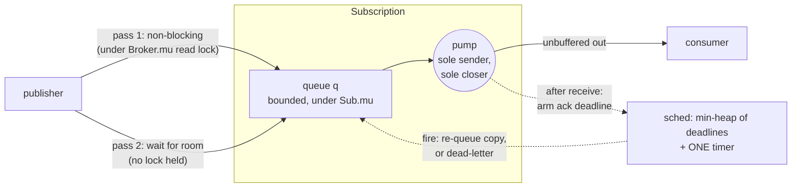
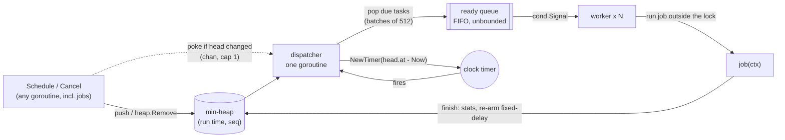

# B3 Unit 3 — Messaging and scheduling

> Time: ~7.5 h · CORE: §1–§2 · STRETCH: Stage 4 discussions · Labs: `labs/b3/pubsub`, `labs/b3/scheduler`

## Before you start

These are the two problems where goroutines, channels and timers are the *product*, not an implementation detail, so B0 Unit 2 (cancellation, bounded
concurrency, leak-free shutdown) is the real prerequisite. Both are 90-minute boxes: at this length, the checkpoints matter more than the code.

Warm-up (write the answers down first):

1. A goroutine abandoned by its caller sends its result on an unbuffered channel. What happens, and what is the fix?
2. What does a `nil` channel do in a `select`, and why is that useful for a run loop?
3. Why does the LRU reference use an expiry heap instead of one timer per entry?

<details data-kind="answer"><summary>Warm-up answers</summary>

1. It blocks forever on the send (a leaked goroutine per abandoned call). Fix: a result channel with capacity 1, so the send completes and the goroutine exits even if nobody receives.
2. A nil channel blocks forever, so that `select` case never fires. A run loop sets a timer channel to nil when no timer is armed and to the timer's channel when one is, without separate code paths.
3. A runtime timer per entry costs memory and scheduling work at scale, races with reads, and still needs a map to cancel. One lazy check plus a heap gives exact expiry and "who is next" in O(log n). The scheduler problem generalises that idea: one dispatcher, one heap, one timer.

</details>

---

## §1 Pub-sub broker with acks and redelivery

### The failure story

A credit-union platform posts a "transaction posted" event for every ledger write: ≈ 50M a day, so ≈ 600/s on average and
several times that at month end (≈ 2–3× peak factor, `docs/NUMBERS.md`). Four internal services subscribe: statements,
fraud scoring, push notifications and the audit trail. Version 1 is the obvious thing: `map[string][]chan Event`, and
`Publish` loops over the subscribers doing `ch <- ev` under an `RWMutex` read lock. Then fraud scoring calls its vendor
and stalls for ≈ 8 s (a bad GC pause plus a slow response). `Publish` is now parked on fraud's channel inside the read
lock, so statements, push and audit receive nothing for 8 s, and a deploy that wants to `Subscribe` needs the write
lock and queues behind it. Making the channels buffered (100) only moves the stall: at 600/s the buffer is full in
≈ 0.17 s.

The "fix" is `go func() { ch <- ev }()` per subscriber per event. The publisher never blocks, but the stalled subscriber
now owns ≈ 600 × 8 ≈ 4,800 parked goroutines per outage (≈ 10 MB of stacks, growing with every second of stall), and
when the subscriber finally unsubscribes and the broker closes its channel, every parked sender panics with
`send on closed channel`. The process dies, and so does every other subscription with it.

Then the real requirement arrives: the statements service must not lose an event when it crashes between receiving a
message and writing the row. Plain channels have no notion of "processed", so the next version retries after a timer,
with a `time.AfterFunc` per message (≈ 600/s × a 30 s timeout ≈ 18,000 live timers). That fixes the loss and creates
duplicates: a consumer that took 31 s gets the event twice and sends the member two push notifications. The interviewer
for this problem is going to ask about each of those four failures, in that order.

### Predict

<!-- predict id="B3-U3-P01" -->
**Predict.** One topic, two subscribers. Fraud has stopped reading; statements is healthy. A publisher sends 600
messages/s, every subscriber has a 64-message queue. For each of these policies on fraud's queue, write down what the
publisher experiences, what statements receives, and what fraud's data looks like after a minute: (a) Block with
`context.Background()`, (b) Block with a 100 ms context per `Publish`, (c) DropNewest, (d) DropOldest. Then pick the
policy for (i) the audit trail and (ii) a "your balance changed" push to a mobile app, and say why they differ.
<!-- /predict -->

<!-- predict id="B3-U3-P02" -->
**Predict.** Ack timeout is 10 s. The consumer spends 8 s on message 1 while messages 2 to 5 wait in its queue.
(a) If the ack timer starts when the broker *puts a message in the queue*, what does the consumer see when it finally
reads message 2, and what happens to messages 3 to 5? (b) How could a broker start the timer when the consumer
*receives* the message, given that a receive on a plain Go channel is invisible to the sender? (c) The consumer
finishes message 1 at 10.001 s and calls `Ack`. The timeout fired at 10 s and queued a redelivery. Does the `Ack`
succeed, what will the consumer's channel deliver next, and what must the consumer do about it?
<!-- /predict -->

<!-- predict id="B3-U3-P03" -->
**Predict.** Messages m1 (debit 100) and m2 (credit 100) for account `acct-7` are published in that order to a consumer
group of three members. The member that owns `acct-7` is slow on m1; its ack timeout fires and m1 is redelivered to
that same member. Assuming the member processes whatever arrives first and the broker does nothing special for keys:
in which orders can the ledger see m1 and m2, and could the balance briefly go negative? Name a rule that restores
the order, what it costs, and what happens to `acct-7` if m1 is a poison message.
<!-- /predict -->

### Reveal

<details data-kind="reveal" data-for="B3-U3-P01">
<summary>Reveal</summary>

(a) **Block, no deadline:** the publisher parks on fraud forever, and so does every publisher on that topic. Statements
receives the message (if the broker serves everybody with room first) or nothing (if it delivers in a loop and blocks
on fraud before reaching it). Fraud's data is complete but falls ≈ 36,000 messages further behind every minute. (b) **Block with a
100 ms context:** each `Publish` waits 100 ms and returns `context.DeadlineExceeded`; statements has the message
because it had room. The publisher sees 10 messages/s of throughput on this topic, and fraud's queue holds the first
64, with every later message *not delivered to fraud* even though `Publish` reported an error, so the error has to
mean "partially delivered". (c) **DropNewest:** the publisher never waits; fraud keeps the 64 oldest and loses
≈ 36,000 messages a minute; a counter says how many. (d) **DropOldest:** same cost to the publisher; fraud has the
64 *freshest* messages and has lost the oldest ≈ 36,000.

(i) The audit trail must not lose anything, so Block (and a deadline so a dead consumer cannot pin publishers forever;
better still, a durable log, see stage 4). (ii) A balance push is worthless if it is stale and harmless if it is
skipped: DropOldest (the newest balance is the only one that matters). Tempting wrong answers: "just make the buffer
bigger" (it only delays the same decision by buffer/rate seconds), and "use a goroutine per send" (an unbounded queue
spread over goroutines, with a panic when the channel closes). The senior answer is that the **policy is a per-subscriber
decision made explicitly at `Subscribe`**, and that the slow subscriber must not be able to hurt the others.

</details>

<details data-kind="reveal" data-for="B3-U3-P02">
<summary>Reveal</summary>

(a) The timers for messages 2 to 5 have been running since they were queued. When the consumer reads message 2 at 8 s,
it has 2 s left; messages 3 to 5 are redelivered at 10 s, before the consumer has even read them, and the queue now
holds duplicates of everything. At scale that means every message that ever waits behind a slow one is delivered
twice: the timeout measures queue time plus processing time, so it can only be right for an idle consumer. (b) With
`C() <-chan Message` the receive is a plain channel operation, so the broker cannot see it. The reference puts one
goroutine (the *pump*) between the queue and an **unbuffered** channel: the pump's `out <- msg` completes at the
instant the consumer receives, and the pump starts the timer right after. Alternatives: an explicit `Receive(ctx)`
method (what SQS and Pub/Sub pull do), or a buffered channel plus a documented "the clock includes queue time".
(c) **The `Ack` succeeds**: it was still pending when it arrived; the consumer did the work, and refusing it would
only cause another redelivery. The copy that was queued is cancelled if the pump has not yet offered it; if it already
has, the consumer receives a **duplicate of the same ID with Attempt 2**, and the broker answers `ErrNotPending` to
the second `Ack`. The consumer must make the duplicate harmless: skip IDs it has already handled. That record must be
durable and written in the same transaction as the side effect, or a crash between the two brings the duplicate back.
Tempting wrong answers: "the late ack should fail so the message is redelivered once more" (it creates the duplicate it
claims to avoid) and "a timeout longer than the slowest handler removes duplicates" (it lowers the rate; it never
reaches zero).

</details>

<details data-kind="reveal" data-for="B3-U3-P03">
<summary>Reveal</summary>

Both orders can happen: m1 then m2 (m1 acked in time), or **m2 then m1**: m2 is delivered right behind m1, the member
processes it while m1 is slow, and m1's redelivery arrives after. The ledger applies the credit before the debit, and
with other messages in between it may be applying the debit to a balance that has since gone negative (or, with a
duplicate of m1, apply the debit twice). FIFO delivery does not help, because redelivery by definition re-sends an old
message *after* newer ones. The rule is **at most one message per key in flight**: m2 is accepted but *held back*
until m1 is acked or dead-lettered, so m1's redelivery comes before m2's first delivery. The cost is head-of-line
blocking per key: `acct-7`'s throughput is one message per handling time, and held-back messages occupy the bounded
queue (a hot key can fill it). If m1 is poison, `acct-7` is **stalled until m1 is dead-lettered**, which is exactly why
the attempt cap and the DLQ are part of the ordering design, not an extra. Tempting wrong answers: "sort by sequence
number in the consumer" (needs unbounded buffering, and a gap cannot be told from a late message) and "round robin the
keys across members" (that maximises concurrent processing of one account).

</details>

### The problem

> Problem 5 of 18 · Time box: 90 min · Focus: channels, at-least-once · Lab: `labs/b3/pubsub`

*As the interviewer says it:*

"Build an in-process message broker for our services. Publishers publish to named topics; every subscriber of a topic
gets every message. Subscribers consume from a Go channel. Some of them will be slow, and one of them will
occasionally hang. I'll tell you more as we go. Talk me through the failure cases as you hit them."

Questions worth asking (the interviewer's answers pin down the tests):

| You ask | Interviewer answers |
|---|---|
| Is it durable? Does a new subscriber see history? | No. In-process, in memory. A message published to a topic with no subscribers is discarded. |
| What happens when a subscriber is slower than the publishers? | That is your call, per subscriber, stated at `Subscribe`. I want an explicit policy, not an accident. |
| Can one hung subscriber hurt the others? | It must not. It may hurt the publisher that is waiting for it, but only as long as that publisher allows. |
| How do publishers say how long they will wait? | `Publish(ctx, topic, msg)`. |
| Ordering? | One publisher's messages arrive at each subscriber in publish order. Nothing across publishers. |
| How is shutdown handled? | `Close` must not panic whatever else is running, and nothing may leak. Stage 3 adds a graceful version. |
| Message IDs? | The broker assigns them. A consumer uses the ID to recognise a message it has seen. |
| Delivery guarantee? | Not yet. I may ask. (They will: stage 2.) |

Checkpoints (be at or past these, or cut scope):

| Minute | Where you should be |
|---|---|
| 0–8 | Clarify; state the ownership rule for the subscriber channel out loud (who sends, who closes); choose a queue per subscriber |
| 30 | Stage 1 green under `-race`. Interviewer announces stage 2 |
| 58 | Stage 2 green: acks, one timer, dead letters. Interviewer announces stage 3 |
| 83 | Stage 3: keyed routing and one-in-flight green, or knowingly partial (name what is missing: rehome? Shutdown?). Stop coding |
| 83–90 | Walk-through: the lock order, the duplicate you cannot remove, and one thing you would do next |

Most candidates will not finish all of stage 3 in the box. A partial stage 3 with an honest list is a **meets**; a
stage 3 that breaks stage 1 tests is not.

#### Stage 1: the broker (minutes 0–30)

- `New(...Option)`, `Subscribe(topic, ...SubOption) (*Subscription, error)`, `Publish(ctx, topic, Message) (id, error)`,
  `Close`, and on a subscription `C()`, `Len()`, `Dropped()`, `Unsubscribe()`.
- A bounded queue per subscriber (`WithBuffer`) and an explicit slow-consumer policy (`WithPolicy`): **Block** (the
  publisher waits, honouring ctx), **DropNewest**, **DropOldest**, the last two counted by `Dropped()`.
- Fan-out to every subscriber; per-publisher order; **a stuck subscriber must not stall the others**.
- `Unsubscribe` and `Close` close `C()` exactly once, release blocked publishers, never panic, never leak goroutines.

#### Stage 2: acks and redelivery (announced at minute 30)

"The statements service must not lose an event when it crashes. I want at-least-once delivery. Tests must not sleep."

- `WithAckTimeout(d)`; messages carry the ID and an `Attempt` count; the consumer calls `Ack(id)` or `Nack(id)`.
- Unacked after `d` (counted from when the consumer *receives* it) or Nacked: redeliver with `Attempt+1`, same ID.
  After `WithMaxAttempts` (default 5): copy to the `WithDeadLetter` topic and forget it.
- Injected `Clock` (`Now`, `AfterFunc`), **one timer** for the whole broker however many messages are in flight.
- Duplicates are allowed; say and show how a consumer dedupes. A late ack still settles the message.

#### Stage 3: groups, per-key order, graceful shutdown (announced at minute 60)

"Three instances of the statements service should share the work, but all the events for one account must be processed
in order. And I want deploys to finish what is in flight."

- `WithGroup(name)`: competing consumers. Each group gets every message; within a group, each message goes to one
  member. Same `Key` → same member; unkeyed → any member with room.
- In ack mode, at most **one message per key in flight**; later ones are held back (and still count toward the bound).
- A member that leaves gives back what it owed. `Shutdown(ctx)` stops intake, waits for in-flight acks until ctx ends,
  then closes everything.

#### Stage 4: discuss, don't code

- Make it survive a restart: where do messages live, and what is an *offset*?
- Your broker promises at-least-once. The product manager asks for "exactly-once". What do you say?
- A publisher faster than every consumer, forever. Where does the backpressure go?
- A member joins or dies while messages for key `acct-7` are in flight. What can go wrong with order?

<details data-kind="answer"><summary>Model answers</summary>

- **Durability:** an append-only log per topic (partition) with a monotonically increasing *offset*; each consumer
  group stores its committed offset. Delivery becomes "read from my offset, process, commit". Redelivery after a crash is
  then simply re-reading from the last committed offset, there is no per-message ack timer, and a new subscriber can
  replay history. The price is disk, retention and partition management. This is Kafka's model; the in-memory broker is
  the queue-with-acks model of SQS/RabbitMQ.
- **Exactly-once:** it does not exist between two systems that can each crash independently. What exists is
  at-least-once delivery plus an idempotent effect: the consumer records the message ID and applies the effect in one
  transaction (or relies on a unique constraint), which makes the *effect* happen once. Kafka's "exactly-once" is
  exactly this, scoped to read-process-write inside Kafka. Say "effectively once, and here is where the dedupe key
  lives".
- **Backpressure:** it must land somewhere deliberate. Options: block the publisher with a deadline (what stage 1 does);
  shed load at the edge with a counted drop; spill to disk (a log); or reject with a retryable error so that the client
  slows down. Unbounded queues are not an option, they convert a rate mismatch into an out-of-memory kill with a delay.
- **Rebalancing:** when membership changes, key→member mapping changes (hash mod N). Messages for `acct-7` may be in
  flight at the old owner while newer ones are routed to the new one: order can break across the change. Kafka solves it
  with generations (a fenced-off old owner cannot commit) and by revoking partitions before reassigning them (stop the
  world, or the incremental protocol); consistent hashing limits how many keys move. In the lab's reference, rehoming
  keeps publish order among the handed-over messages and holds publishers out during the hand-over, but a Block publisher
  already waiting can still land a newer message first, which is why the contract says "best effort".

</details>

### Build it

Lab: **`labs/b3/pubsub`**. Stage 1 is `pubsub.go`; `stage2.go` and `stage3.go` hold the later stages' stubs. Open them
only when the interviewer "announces" the stage; stage 1 has to grow into them.

```sh
go test -race ./labs/b3/pubsub/                          # everything
go test -race -run Stage1 ./labs/b3/pubsub/              # one stage
go test -race -count=20 ./labs/b3/pubsub/                # shake out schedule-dependent bugs
go test -race -run 'Stage2_Redelivery|Stage2_DeadLetters' -v ./labs/b3/pubsub/
```

Run it as a timed attempt: start a 90-minute timer, write stage 1, run `-run Stage1`, move on at minute 30 even if a
test is red (note which), and stop coding at minute 83 for the walk-through. Write down which tests were green at
each checkpoint; that record is what the tutor scores for time management. Do the timed attempt **before reading the
rest of this section.**

Two things about the test suite make it faster to work with. Time comes from a fake `Clock` whose `Advance` runs due
`AfterFunc` callbacks synchronously on the test's goroutine, so when `Advance` returns, the redelivery is already
queued. And the broker only learns that a consumer received a message a few microseconds *after* the receive, so the
tests wait for `InFlight()` to reach the expected value before moving the clock; your `Subscription` must expose it.

What the tests prove:

- **Stage 1:** argument validation; fan-out with identical IDs, `Topic`, `Attempt == 1`; unique IDs; no-subscriber
  publish is not an error; order under constant backpressure (queues of 4 and 1, 2,000 messages); DropNewest keeps the
  oldest and counts, DropOldest keeps the newest and counts; Block waits for the consumer and honours ctx; **isolation**
  (a stuck Block subscriber, a stuck dropping subscriber, and two full Block subscribers one of which is alive: the
  live one must get the message while the publisher is still waiting); `Unsubscribe` releases a blocked publisher with
  success; `Close` drains what is queued, is idempotent, and releases blocked publishers with `ErrClosed`; a
  Close/Unsubscribe/Publish storm with a goroutine-leak settle loop; churn that must never cost a stable subscriber a
  message; a **scale test** (3,000 topics, 100,000 publishes under a 5 s cap) that a design which scans all subscribers
  fails.
- **Stage 2:** option validation; `ErrAckDisabled`/`ErrNotPending`; redelivery at exactly the timeout (1 ns before: nothing);
  ack stops it and leaves no timer armed; the ack clock starts at **receive**, not at publish; redeliveries keep publish
  order; dead letter after N attempts with `Origin`; Nack counts as an attempt; a poison message does not hold up the
  next one; late ack settles and an acked message's queued copy is cancelled; a consumer that dedupes by ID processes
  50 messages once though each was delivered twice; **Ack and Nack immediately after receive** are never lost; a full
  subscriber never blocks the clock or other subscribers; Ack racing the timeout 100 times; a **scale test** (5,000
  messages in flight must use exactly one armed timer and no goroutine per message); Close forgets timers.
- **Stage 3:** every message goes to exactly one member of a group while every group and every plain subscriber gets
  all of them; same key → same member in order; only one message per key in flight, including across a redelivery;
  different keys are independent; held-back messages count toward the bound; a leaving member's unacked and held-back
  messages move to the survivor, and a churn test loses nothing; `Shutdown` waits for acks, keeps redelivering while it
  waits, gives up when its context ends (and reports it), and drains plain subscribers; a concurrent run with 4
  publishers and 4 acking members that checks per-key order and total delivery.

### How it actually works

One goroutine per subscription owns the consumer's channel; everything else talks to a queue:



The ownership model, stated once, because every bug in this problem is a violation of one of these lines:

| State | Owner / guard | Rule |
|---|---|---|
| Topic table, group membership | `Broker.mu` (RWMutex) | Read-locked by `Publish` pass 1 only; never held while waiting |
| Queue `q`, `pending`, held-back messages, counters | `Subscription.mu` | Held for O(1)/O(log n) work; never across a channel op, a ctx wait or user code |
| Deadline heap and the single timer | `sched.mu` | Leaf lock; `fire` pops under it and calls subscriptions after releasing it |
| `out` (the consumer's channel) | the pump goroutine, nobody else | Only the pump sends, only the pump closes |

Lock order, always outer to inner: `Broker.mu`, `Subscription.mu`, `sched.mu`.

**Publish is two passes.** Pass 1 runs under the read lock and never blocks: each target either accepts (room), or its
policy decides immediately (DropNewest: count; DropOldest: evict), or it is reported *full under Block*. Everybody who
could take the message has it before anybody waits. Pass 2 has no lock held: the full Block subscribers are waited for
**concurrently** (one goroutine each, joined before `Publish` returns, so nothing outlives the call), so a dead
subscriber cannot consume the time a slow-but-alive one needs.

```go
b.mu.RLock()
if t := b.topics[topic]; t != nil {
	full = t.offer(msg) // never blocks; returns the Block subscriptions that had no room
}
b.mu.RUnlock()
return msg.ID, b.waitAll(ctx, msg, full) // no lock held while waiting
```

**The pump is the answer to three problems at once.** (1) *Closing*: with one sender and one closer there is no "send on
closed channel" to avoid; `Unsubscribe` closes `done`, the pump notices, tears down and closes `out`. (2) *Observing the
receive*: `out` is unbuffered, so `out <- head` completing means the consumer has the message; the ack timer starts
there. (3) *Exact capacity*: the head stays in `q` until the receive happens, so "accepted but not received" is exactly
`len(q)` (plus held-back messages), which is what `Len()` and the bound mean.

```go
func (s *Subscription) run() {
	defer s.finish() // unregister, forget pending work, close(out), close(finished)
	for {
		head, ok := s.nextHead() // waits; drops queued copies of already-acked messages
		if !ok {
			return // Unsubscribe, or intake closed and q drained
		}
		select {
		case s.out <- head:
			s.afterReceive(head) // pop; start the ack timer for this attempt
		case <-s.wake: // q changed under us (DropOldest may have evicted head): re-peek
		case <-s.done:
			return
		}
	}
}
```

**Acks.** In ack mode every accepted message gets a `pending` record (`Attempt`, `offered`, `inflight`, deadline).
`afterReceive` sets the deadline `now + AckTimeout` and puts it in the heap. `Ack` deletes the record and removes it from
the heap. The scheduler keeps **one** timer armed for the earliest deadline and re-arms only when that changes:

```go
func (sc *sched) rearmLocked() {
	if len(sc.h) == 0 { /* stop the timer */ return }
	head := sc.h[0].deadline
	if sc.stop != nil {
		if sc.armed.Equal(head) { return } // unchanged: nothing to do
		sc.stop()
	}
	sc.armed = head
	sc.stop = sc.clock.AfterFunc(max(head.Sub(sc.clock.Now()), 0), sc.fire)
}
```

`fire` pops everything due, re-arms, **then** calls each subscription's `expire` (never a subscription lock under
`sched.mu`). `expire` either dead-letters (attempts used up), or appends a copy with `Attempt+1` to the queue, **without
waiting**: if the queue is full the redelivery is deferred by one more ack timeout without consuming an attempt, because
a clock goroutine that blocks on one slow subscriber stalls every other subscriber's redelivery.

Four details carry the correctness of the ack path:

- **Two flags, one gap.** `offered` turns true just *before* the consumer can have an attempt (the pump is about to
  offer it); `inflight` turns true just *after* the receive (the timer runs). `Nack` keys on `offered`; if it keyed on
  `inflight`, a Nack sent in the microseconds between the receive and the bookkeeping would be silently ignored.
- **`afterReceive` checks the attempt.** If an `Ack` or `Nack` got in between, the attempt the pump just delivered is
  no longer the current one and no timer is started for it.
- **Stale copies.** The pump skips a queued copy whose message has since been acked. A copy it is already offering can
  still reach the consumer: that is the duplicate that the contract allows and the consumer must tolerate.
- **Dead letters never wait.** The copy goes to the DLQ topic through the same non-blocking first pass; a DLQ subscriber
  that is full under Block loses it and a counter says so.

**Groups and keys.** A topic holds its ungrouped subscriptions and a list of groups. `group.offer` picks the member for
a message: keyed messages hash to exactly one member (FNV-1a, inlined so routing allocates nothing); unkeyed messages
try the members round robin and take the first with room, so a stuck member costs the group nothing while any other
member has room. "One in flight per key" is a map from key to the ID that holds it plus a per-key FIFO of held-back
messages; settling the holder releases the next one. Held-back messages count toward the bound, otherwise one hot key
would turn the bounded queue into an unbounded one.

When a member leaves, `Unsubscribe` takes the **write lock**, removes the member from the group first (so publishers
stop choosing it), collects everything it owed (pending and held back, sorted by publish sequence), and hands it to the
remaining members before releasing the lock. Holding the write lock is what keeps a newer message for the same key from
overtaking the hand-over. `Shutdown(ctx)` sets the closed flag, waits on each subscription's "outstanding" count with the
same broadcast channel that Block publishers use, then closes intake and waits for the pumps; if ctx ends first it
force-closes everything and returns an error that says how many messages it abandoned.

How the stages landed on the stage-1 design: stage 2 touched stage-1 code in six places, each a one-line call into a
function that lives in `stage2.go` (`afterReceive` → `deliveredLocked`, `nextHead` → `staleLocked`/`offeringLocked`,
`offerLocked` → `admitLocked`, `finish` → `discardLocked`, plus the clock and scheduler fields in `Broker`). Stage 3
added six more (`topic.offer` → `offerGroups`, the group branches in `register` and in `unregister`, `Unsubscribe` →
`owedLocked` + `rehome`, the `reroute` loop in `waitAll`, and one call to `holdBackLocked` in stage 2's `admitLocked`). Everything else is
new code in the new files. The seams exist because stage 1 keeps three decisions in single functions: *who accepts a
message* (`offerLocked`), *what the pump does around a receive* (`afterReceive`), and *how a subscription ends*
(`finish`). A solution that inlined those three in five places needs a rewrite at minute 60.

### Rubric

| Dimension | below | approaching | meets (senior bar) | exceeds |
|---|---|---|---|---|
| Extensibility | Acks or groups need a rewrite of `Publish`/`Subscribe`; policy hard-coded to one behaviour; `time.Now()`/`time.AfterFunc` called directly | Acks work but timers are per message, or the group logic is spliced into three places in the publish path | Slow-consumer policy is an option; stage 2 and 3 land as options, new methods and a few seams; `Clock` is a consumer-side interface with two methods | Names the seams while writing stage 1 (`offerLocked`, `afterReceive`, `finish`) and says where a log-based backend or a pull `Receive(ctx)` would plug in |
| Concurrency safety | A send can race `Close` (panic: send on closed channel); `Publish` blocks while holding the topic lock; races under `-race` | Correct locking, but a blocked publisher holds a lock other subscribers need, or goroutines leak on `Unsubscribe` | One owner for each channel, no lock held across a blocking operation, lock order stated, a stuck subscriber costs the others nothing, `-race -count=20` clean, no leaks | Explains why the redelivery path must never block the clock, why `Nack` keys on `offered`, and proves a lock order with the three-lock table |
| Clean interfaces | Subscriber receives an internal struct it can mutate; `Publish` returns nothing; overflow decided by `bool` flags | Works, but ack semantics are implicit (when is a message acked? what does a late ack return?) | `Publish(ctx, ...)` returns the ID and says it is not atomic across subscribers; documented `ErrNotPending`/`ErrClosed`; `Ack(id)` by ID; the contract states that duplicates are possible and how to dedupe | Contract specifies where the ack clock starts, what a stuck subscriber can and cannot do, and what `Shutdown` promises, precisely enough to write the tests from the doc comments |
| Tests | No tests, or `time.Sleep` to wait for redelivery | Happy-path fan-out and one ack test; no isolation or leak test | Per-stage tests as it goes: stuck-subscriber isolation, ctx on a blocked publish, ack vs timeout, max attempts, dedupe by ID, a goroutine-leak check, and a fake clock | Mutates its own solution to show the tests catch each bug; adds a stress test that checks per-key order and no-loss under churn |
| Time management | Stage 1 not green at minute 40; no walk-through | Stage 2 started but red at minute 70 | Stage 1 by 30, stage 2 by 58, a partial stage 3 with an honest list, a 5-minute walk-through | Finishes stage 3 including `Shutdown` and spends the remainder on the stage-4 discussion with numbers |

Overall **meets** = at least *meets* on Concurrency safety and Clean interfaces, and nothing at *below*.

### Common mistakes

- **Closing a channel that publishers may still send on.** Symptom: `panic: send on closed channel` the first time an
  `Unsubscribe` races a `Publish`, in production under load rather than in the unit test. A `closed` flag checked before
  the send does not help (check-then-act). Fix: one sender-and-closer goroutine per subscription, or a lock that excludes
  send and close.
- **Blocking while holding the topic lock.** `Publish` takes the read lock, loops, and blocks on a full channel inside
  it; `Subscribe` and `Unsubscribe` (write lock) queue behind the blocked publisher, and so does the deploy. Fix: copy
  the targets or do a non-blocking pass under the lock, and wait with no lock held.
- **Delivering in a loop and blocking on the first slow subscriber.** Symptom: the healthy subscribers get nothing while
  one is stuck. Fix: serve everybody with room first, then wait for the full ones, concurrently.
- **`Publish` with no way out.** A dead subscriber with policy Block pins every publisher forever. Fix: `ctx` on
  `Publish`, `Unsubscribe` in a `defer`, and DropNewest for subscribers whose data is expendable.
- **A goroutine per message** (to avoid blocking) or **a timer per message** (for redelivery). Symptom: thousands of parked
  goroutines or live timers during an incident, and leaks after `Unsubscribe`. Fix: bounded queues, one pump per
  subscription, one timer over a heap.
- **Starting the ack timer at publish or enqueue.** Messages that wait behind a slow one are redelivered before the
  consumer reads them: duplicates proportional to queue depth. Fix: start it when the consumer receives (the pump).
- **Rejecting the late `Ack`.** The consumer did the work; telling it `ErrNotPending` and redelivering once more doubles
  the effect. Fix: ack by message ID, settle whatever attempt is current, and cancel queued copies.
- **Blocking the clock goroutine on a full subscriber.** Redelivery waits for room under the timer callback and every
  other subscriber's redelivery stalls behind it. Fix: never wait there; defer by one timeout without spending an attempt.
- **Unlimited retries.** One poison message cycles forever and, with per-key ordering, stalls its key. Fix: max
  attempts, a dead-letter topic somebody subscribes to, and an alert on its depth.
- **In-memory dedupe sold as exactly-once.** A `map[string]bool` of seen IDs disappears on restart and grows forever
  (≈ 52M IDs a day at 600/s is ≈ 2 GB at ≈ 40 B each, ≈). Fix: a durable record in the same transaction as the effect,
  with a retention window longer than the longest redelivery horizon.

### Debrief: senior-level design choices

- **A pump goroutine per subscription.** "The consumer's channel has exactly one owner. Publishers hand messages to a
  queue under a mutex; the pump is the only goroutine that sends on the channel and the only one that closes it, so
  'send on closed channel' is not a case I have to reason about. It also lets me see the receive, so I can start the ack
  timer at the right moment." The alternative (a buffered channel with a `RWMutex` that excludes send and close) is
  simpler for stage 1 and is what most candidates write; it cannot tell you when the consumer took the message, so the
  ack clock then includes queue time and you must say so.
- **Policy per subscriber, as an enum.** "Block is the default because silent loss is the worse surprise. DropNewest and
  DropOldest are options the subscriber picks and the broker counts." A strategy interface is overkill for three
  policies; a fourth (sample, coalesce by key) would be the moment to introduce one.
- **Two-pass publish.** "Serve everybody who has room under the read lock, then wait for the rest with no lock held.
  That is what makes isolation true instead of aspirational." Say that `Publish` is not atomic and what its error means.
- **`DropOldest` with acks is rejected at `Subscribe`.** "Evicting a message the broker has already accepted would break
  the at-least-once promise, so the combination is an error rather than a footgun."
- **One timer over a heap, lazy cancellation by removal.** "A timer per message is 18,000 live timers at 600/s and a
  30 s timeout, and each needs a map entry to cancel. A heap with each entry knowing its index gives O(log n) insert and
  cancel and exactly one runtime timer. A fixed-interval sweep is a legitimate simplification if redelivery precision
  does not matter, at O(n) per tick."
- **The clock is `Now` plus `AfterFunc`.** "A one-method `Clock` would have forced a goroutine and a channel per
  timer; `AfterFunc` lets the fake run callbacks inside `Advance`, so tests are deterministic and need no sleeps."
- **Ordering is an ack-mode property, not a delivery-mode property.** "Per key there is one message in flight, so the
  redelivery of m1 comes before the first delivery of m2. I pay head-of-line blocking per key, which I bound with the
  queue limit and the attempt cap."
- **At-least-once plus idempotent consumers.** "I cannot make duplicates impossible: an ack can be lost, a consumer can
  crash after the side effect. I make them detectable (stable ID) and tell the consumer where the dedupe record must
  live."

### Break it

Apply each mutation to a copy of your solution (or to `solutions/b3/pubsub`, after `cp` of the file), one at a time.
Predict the failing tests first, then run `go test -race -count=1 ./solutions/b3/pubsub/`.

1. Arm one `AfterFunc` per message instead of one timer for the heap (add a second `clock.AfterFunc` call in `sched.set`).
2. In `waitAll`, wait for the full subscribers one after another instead of concurrently.
3. In `Nack`, decide with `p.inflight` instead of `p.offered`.
4. Remove the lock from `tryOffer`.
5. Remove the stale-copy check in `nextHead` (the loop that pops copies of acked messages).

<details data-kind="answer"><summary>What you should see (reference solution, Go 1.24, linux/amd64)</summary>

1. `TestStage2_OneTimerNoMatterHowManyMessagesAreInFlight` fails at once: `5001 timers armed for 5000 in-flight
   messages, want exactly 1`. `TestStage2_CloseForgetsPendingWorkAndTimers` fails after its 5 s guard (`timed out ...
   waiting for all timers to be cancelled after Close`): the extra timers were never stopped, so they would fire into a
   dead subscription for as long as the process lives. Everything else passes; a timer per message is correct at small
   scale, which is exactly why the scale test exists.
2. `TestStage1_StuckSubscribersDoNotStallOthers/TwoBlockedSubscribersAreWaitedForTogether` fails (`no message within 5s`):
   the publisher waits for the dead subscriber first, so the live one, also full, never gets the message before the
   context ends. All other tests pass, because a single stuck subscriber is handled by pass 1.
3. `TestStage2_AckAndNack/AckAndNackRightAfterReceiveAreNeverLost` fails (`no message within 5s`): a Nack that arrives
   between the consumer's receive and the pump's bookkeeping is ignored, so no redelivery follows until the timeout.
   It failed on 8 of 8 runs of that test; a schedule that is lazy about the gap could hide it, which is why the test
   loops 300 times.
4. The first test that publishes fails with `race detected during execution of test` (17 `WARNING: DATA RACE`
   reports in the stage 1 run), between `enqueueLocked` (publisher) and `nextHead` (pump). The unsynchronised queue then
   hands the consumer an empty `Message`, and the ordering test dies with `panic: interface conversion: interface {} is
   nil, not int`. The race report names the bug; the panic is the symptom you would see in production.
5. `TestStage2_AtLeastOnceDuplicates/AckCancelsAQueuedRedelivery` fails: `got m before the sentinel: a copy queued for
   redelivery must be dropped once its message is acked`. The consumer sees a duplicate it had no reason to see.

Also tried, each caught: the redelivery path ignoring a full queue (`SlowSubscriberDoesNotBlockTheClockOrOthers`: `slow.Len() = 2,
want 1`); no one-in-flight gate (`KeyOrdering`, and the leaving-member test); `Shutdown` not waiting (`Shutdown/...WaitsForInFlightAcks`);
max attempts off by one (all four dead-letter tests); keyed messages routed round robin (`Groups/SameKeyAlwaysGoesToTheSameMember`);
a leaving member not removed from the group before the hand-over (`MembersLeaving`: the message is orphaned); a late
ack rejected once a redelivery was queued (`AckAndNack`, `AckRacingTheTimeout`, `AtLeastOnceDuplicates`); `Publish` scanning every
topic (`PublishCostDoesNotGrowWithOtherTopics`); `Unsubscribe` not closing `done` (every test that unsubscribes fails its
5 s cleanup guard, and `Unsubscribe` hangs). Verified with `-race -count=20`, `GOMAXPROCS=1 -count=3`, `-cpu 1,4 -count=3`,
and 8 test binaries running in parallel to simulate a loaded machine.

</details>

### In the wild

- **Kafka** is the log-based answer: a topic is split into partitions, each an append-only log; a *consumer group*
  gets each partition assigned to exactly one member (competing consumers); ordering holds per partition, and a
  producer picks the partition by key (same key, same partition: the lab's key→member rule); progress is a committed
  *offset* per group and partition, so redelivery after a crash means re-reading from the last committed offset.
  Committing after processing is at-least-once; Kafka's "exactly-once" (idempotent producer plus transactions) holds for
  read-process-write inside Kafka. Rebalances can be stop-the-world (eager) or incremental (cooperative). TODO-VERIFY:
  exact config names and defaults for the version you cite.
- **RabbitMQ** is the ack-based queue: consumers `basic.ack`/`basic.nack`; unacked messages are requeued when the
  channel closes; `prefetch` (`basic.qos`) bounds in-flight messages per consumer, the knob that makes "one in flight"
  a configuration; dead-letter exchanges receive rejected or expired messages. TODO-VERIFY: delivery-limit behaviour on
  quorum queues.
- **Amazon SQS** standard queues are at-least-once with a *visibility timeout* (a received message is hidden for that
  long, then reappears: the ack timer); a redrive policy moves a message to a DLQ after `maxReceiveCount` receives (the
  attempt cap). FIFO queues add a message-group ID (the key) with one-in-flight-per-group ordering and a deduplication
  window. TODO-VERIFY: default and maximum visibility timeout, FIFO dedup window length.
- **Google Cloud Pub/Sub** has an *ack deadline* that client libraries extend while a handler is still running (a lease),
  optional ordering keys, and dead-letter topics with a max delivery attempts setting. TODO-VERIFY: default deadline and
  limits, and the scope of its exactly-once delivery option.
- **NATS JetStream** consumers have `AckWait` and `MaxDeliver`, the same two knobs under different names. TODO-VERIFY:
  defaults.
- **Webhooks in banking and payments.** Vendors retry callbacks with backoff for hours or days and send an event ID;
  the receiving side must dedupe on it (Stripe's event `id` is the common example; TODO-VERIFY: current retry window).
  The vendor adapters of a banking platform sit on exactly this contract: at-least-once in, idempotent effect out, a
  DLQ for payloads that cannot be processed, and a replay tool for it.

### Trade-offs

| Option | Wins when | Loses when | When the answer flips |
|---|---|---|---|
| Block (with ctx) | Data must not be lost: audit, ledger events | A dead consumer slows every publisher up to the deadline | Subscriber is expendable or stale data is useless: drop policy; need durability: a log |
| DropNewest / DropOldest | Telemetry, UI pushes, "latest wins" | Anything where a missing message is a defect | DropOldest when the freshest value matters, DropNewest when the earliest does (a burst's start) |
| Channel as the queue (buffered `chan`) | Stage 1, simplest code; `Close` drains for free | Cannot see the receive, so the ack clock includes queue time; exact blocking needs a send under a lock | Acks with a precise clock: pump + unbuffered channel, or a `Receive(ctx)` pull API |
| Pump goroutine per subscription | Exact capacity, receive observed, single closer | One goroutine per subscriber (fine for thousands; the race detector caps live goroutines at ≈ 8,000, TODO-VERIFY); one extra hop | Millions of subscribers: callback or pull API with no goroutine per subscription |
| One timer + min-heap | Many in-flight messages, exact deadlines | More code than a sweep; heap bookkeeping per message | Few messages or coarse deadlines: a periodic sweep is enough |
| Sweep every tick over all pending | Tiny code; precision of a tick is fine | O(n) per tick; redelivery late by up to a tick | n large or tick small: heap |
| At-most-once (no ack) | Duplicates are worse than loss (rare) | Any crash loses messages | Never for money movement |
| At-least-once + idempotent consumer | The default for payments and webhooks | Consumers must dedupe durably; duplicates cost work | When the sink is naturally idempotent (upsert by key) the dedupe is free |
| One-in-flight per key | Per-account ordering with redelivery | Head-of-line blocking; hot key fills the queue | Order does not matter: drop the gate; strict global order: one partition |

### Senior bar

- **Failure modes.** A consumer that stops reading with policy Block (publishers pinned until their deadlines). A poison
  message that cycles until the cap, or stalls its key. An ack timeout below the p99 handling time, producing a
  steady stream of duplicates. Redelivery storms after an outage when thousands of timers expire together (no backoff).
  Dedupe state lost on restart. A DLQ nobody reads. A hot key that fills a subscriber's bounded queue with held-back
  messages. A crash between the effect and the ack (duplicate by design).
- **Numbers.** Queue length ≈ rate × latency (Little's law): 600/s × 0.2 s ≈ 120 messages, so a 64-message buffer is
  too small for a 200 ms consumer pause. With the ack timeout equal to the p99 handling time, ≈ 1% of messages are
  redelivered while still being processed (≈ 6/s at 600/s); set it to a multiple of the p99 and extend it for long jobs.
  A parked goroutine costs ≥ 2 KB of stack. A poison message with 5 attempts and a 30 s timeout occupies its key for
  ≈ 2.5 minutes before the DLQ; with unlimited attempts, forever. Retry with exponential backoff (for example 1 s, 2 s,
  4 s, ... capped) rather than at a fixed timeout, or an outage's backlog redelivers in one burst.
- **Ops.** Metrics per subscription: queue depth, oldest queued age, in-flight count, `Dropped`, redeliveries per
  second, attempts histogram, DLQ depth, publish latency including time blocked. Alert on DLQ depth > 0, on redeliveries
  above a small fraction of deliveries, and on a subscription with a growing queue and zero acks. Ship a DLQ replay
  tool: dead letters are only an asset if they can be re-injected after the bug is fixed. During deploys call
  `Shutdown(ctx)` with the pod's termination grace period, and log how many messages it abandoned.
- **Cost.** In-memory and in-process: no network, and nothing survives a crash. The moment the answer must survive a
  restart or cross a process boundary, the broker is a log or a managed queue and the lab's contract becomes a client
  library contract.

**Interviewer probes**

<details data-kind="answer"><summary>"Your subscriber is stuck. Walk me through exactly who is blocked."</summary>

Under Block: only publishers that publish to that topic, and only for as long as their context allows; everybody
with room already has the message because pass 1 served them under the read lock without waiting. `Subscribe`,
`Unsubscribe` and publishers of other topics are not affected, because the wait happens with no lock held. The stuck
subscriber's own queue is full and its pump is parked in `out <- head`. If the stuck consumer is simply dead,
`Unsubscribe` (or the broker's `Close`) releases the waiting publishers. Under DropNewest nobody is blocked and a
counter increases; I would alert on that counter.

</details>

<details data-kind="answer"><summary>"Can a message be delivered twice? Can it be lost?"</summary>

Twice: yes, by design. A late ack after a redelivery, a lost ack (consumer crashes after the side effect), or an
ack timeout that is shorter than a slow handler all produce a second delivery with the same ID and a higher
`Attempt`. That is why the contract says so and why consumers dedupe on the ID. Lost: not once the broker has accepted
it in ack mode, with two honest exceptions: DropNewest refuses before acceptance (counted), and the broker is in memory,
so a crash of the *broker process* loses everything pending. Beyond that you need a log. After the attempt cap it is
not lost either, it is moved to the dead-letter topic, which somebody has to be subscribed to.

</details>

<details data-kind="answer"><summary>"A consumer crashes after sending the SMS but before acking. How do you stop a second SMS?"</summary>

I cannot stop the redelivery; I make the effect idempotent. The consumer derives an idempotency key from the message
ID, for example `sms:{id}`, and the SMS gateway call or the "sent" record is guarded by it: insert the key in the same
database transaction as the record that triggers the send (outbox), and let a unique constraint reject the second
attempt; or pass the key to a vendor that deduplicates on it. The record must outlive the longest redelivery horizon
(max attempts × timeout, plus operator replays from the DLQ), so a 24 h to 7 day retention is normal. A process-local
set only protects against the duplicates that arrive without a restart in between.

</details>

<details data-kind="answer"><summary>"How would you make this survive a restart without rewriting it?"</summary>

Keep the broker's API and swap what sits behind the queue: an append-only log per topic with offsets, and each
subscription (or group) storing its committed offset. The pump then reads from the log at its offset instead of from
the in-memory queue, `Ack` advances the committed offset (per key, only past a contiguous prefix), and redelivery
becomes "rewind to the last committed offset". The ack timer, the dead-letter rule and the per-key gate keep their
meaning. What changes is the failure model: fsync cost per batch instead of per message, retention, and compaction. At
that point I would question building it at all and use Kafka, SQS or Pub/Sub, whose client libraries expose the same
three knobs: ack deadline, max attempts, ordering key.

</details>

### Check yourself

1. Why does the reference put an unbuffered channel behind a pump goroutine instead of giving the consumer a buffered
   channel as the queue? Name two things the pump makes possible.
2. `Publish` returns `context.DeadlineExceeded`. What can you say about which subscribers have the message, and what
   must the doc comment promise?
3. An `Ack` arrives for a message whose redelivery was already queued but not yet offered. What should happen to the
   queued copy, and what if the pump had already offered it?

<details data-kind="answer"><summary>Answers</summary>

1. A buffered channel hides the receive, so the broker cannot start the ack timer at the moment the consumer takes the
   message and cannot know exactly how many messages are waiting; and closing it safely needs the sender and the closer
   to be the same goroutine or to exclude each other. The pump makes the receive observable (`out <- head` completing)
   and makes "send on closed channel" impossible because it is the only sender and the only closer. It also gives an
   exact bound (the head stays queued until it is received).
2. Every subscriber that had room (or a drop policy) already has the message; only the Block subscribers that were
   still full did not get it. The doc comment must say that `Publish` is not atomic across subscribers and that an
   error means "delivered to the subscribers that had room", so callers do not retry blindly and create duplicates.
3. The ack settles the message and the queued copy is cancelled: the pump drops it when it reaches the head. If the pump
   had already offered it and the consumer receives it, that is a duplicate of the same ID with the next `Attempt`,
   which the consumer's idempotent handler must absorb; its later `Ack` returns `ErrNotPending`, which is harmless.

</details>

---

## §2 Job scheduler

### The failure story

The back-office platform needs "run this later" in three places: a payment-due reminder three days before each loan instalment, a vendor sync every 15 minutes, and a statement run at each credit union's month end. The first version is what most interview answers look like. Delayed work is `go func() { time.Sleep(d); job() }()`, cancellation is a boolean the goroutine checks after it wakes, and recurring work is `for range time.Tick(interval) { job() }`.

At 500,000 pending reminders that is 500,000 parked goroutines. At ≈ 2 KB of minimum stack each, that is ≈ 1 GB of memory just to hold the *intention* to do something later, and a cancelled reminder still holds its goroutine until its original wake-up time. At 00:00 on the 1st, 200,000 of them wake in the same few milliseconds and call the core-banking vendor concurrently: nothing bounds the fan-out, so the vendor answers 429s, the connection pool is gone, and the jobs that did get through compete with live member traffic. The ticker loop has its own failures: a run that takes 25 s on a 10 s interval piles runs up behind each other (or, with the usual `go job()` inside the loop, on top of each other); one panic in `job()` kills the process; and "every 15 minutes" quietly becomes "every 15 minutes plus however long the run took" as soon as someone moves the work after the sleep.

Nothing here is a Go limitation. It is a missing component: something that owns *time* (one clock, one sleeper, an ordered set of pending work), something that owns *concurrency* (a bounded pool), and an explicit answer to "what does every interval mean when a run is late, long, failing or cancelled".

### Predict

<!-- predict id="B3-U3-P04" -->
**Predict.** Your dispatcher goroutine is asleep on a timer armed for a job due in one hour. A caller now calls `Schedule` for a job due in 5 seconds. Three candidate designs: (a) `Schedule` just pushes onto the heap; (b) `Schedule` pushes, then does a blocking send on an unbuffered `wake` channel; (c) `Schedule` pushes, then does a non-blocking send on a `wake` channel with capacity 1, and only when the new job became the earliest. For each, say what the caller observes, and give one situation in which (b) deadlocks. Write your answer down before opening the reveal.
<!-- /predict -->

<!-- predict id="B3-U3-P05" -->
**Predict.** A recurring job has interval 10 s, its first run is due at t = 10 s, and every run takes 24 s. Workers are plentiful (4). List the start times (in seconds) in the first 100 s for: (a) fixed-delay, (b) fixed-rate that skips a tick if the previous run is still active, (c) fixed-rate that remembers one missed tick and runs it as soon as the previous run finishes, (d) fixed-rate that allows overlapping runs. Which of these can never overlap itself, and which one's n-th run time does not depend on how long earlier runs took? Write your answers down first.
<!-- /predict -->

<!-- predict id="B3-U3-P06" -->
**Predict.** In your process a job panics, and nothing recovers it. (a) What happens to the process? (b) Suppose you add a `recover` in the worker so the process survives. The panicking job was the third run of a recurring statement-generation job. Should runs 4, 5, ... still happen? Name one executor from another ecosystem that makes the opposite choice and say which of the two a payments back-office wants. Write your answer down before opening the reveal.
<!-- /predict -->

### Reveal

<details data-kind="reveal" data-for="B3-U3-P04">
<summary>Reveal</summary>

(a) The caller sees nothing wrong, and the 5-second job runs ≈ 59 minutes late: the dispatcher computed its sleep from the old heap head and nobody told it the head changed. This is the "stale earliest job" bug, and it passes every test that schedules jobs in increasing time order. (b) With an unbuffered blocking send, `Schedule` blocks until the dispatcher next receives. If the dispatcher is busy (firing a batch, or blocked handing a due job to a busy worker) the caller stalls. The deadlock: `Workers(1)`, the dispatcher is blocked sending job X to the only worker, and the worker is running a job that calls `Schedule`, which blocks sending on `wake`. Each waits for the other. (c) is the answer: a capacity-1 channel holds "something changed, look again" as a token; sends coalesce, so a thousand inserts while the dispatcher is busy cost one extra loop iteration, and a token sent just before the dispatcher goes to sleep is not lost because the dispatcher's `select` sees it immediately. Only signalling when the new job became the head (heap index 0) avoids waking the dispatcher for every far-future insert, but waking it too often is harmless and waking it too rarely is the bug.

</details>

<details data-kind="reveal" data-for="B3-U3-P05">
<summary>Reveal</summary>

(a) Fixed-delay: 10 (run until 34), 44 (until 68), 78 (until 102): **10, 44, 78**. The next run starts `interval` after the previous one ends, so it never overlaps itself, but the cadence stretches to 34 s. (b) Fixed-rate + skip: ticks are on the grid 10, 20, 30, ... Run 1 occupies 10–34, so the ticks at 20 and 30 are dropped; 40 starts (until 64), 50 and 60 are dropped; 70 starts (until 94); 80 and 90 are dropped; 100 starts: **10, 40, 70, 100**. (c) Fixed-rate + remember one: run 1 at 10 (until 34); ticks 20 and 30 collapse into one remembered tick, which starts at 34 (until 58); 40 and 50 collapse, start at 58 (until 82); 60, 70, 80 collapse, start at 82 (until 106); so **10, 34, 58, 82** by t = 100 (the next is 106). Runs are back to back, never overlapping, but they start off the grid. (d) Fixed-rate + overlap: **10, 20, 30, ..., 100**, ten runs, up to three in flight at once (24 s / 10 s). Fixed-delay and the two non-overlapping fixed-rate policies never overlap themselves; only fixed-rate's n-th *due time* is independent of run time: `first + n × interval`, no drift. The tempting wrong answers: (a) is often given as "10, 20, 30...", forgetting the delay starts at *completion*; (c) is often given as "10, 20, 30" (queue everything) or "10, 40, 70" (same as skip). Queueing every missed tick is the policy that turns a persistently slow job into unbounded memory and ever staler runs, which is why the reference remembers at most one.

</details>

<details data-kind="reveal" data-for="B3-U3-P06">
<summary>Reveal</summary>

(a) An unrecovered panic in any goroutine terminates the **whole process**; there is no "the worker died" in Go. One adapter bug in one tenant's job takes down every other tenant's jobs and the HTTP API next to it. (b) Yes, keep going. A transient failure in one run (a vendor payload nobody expected) must not silence the schedule: the failure is reported, counted and alerted on, and the next tick tries again. Java's `ScheduledThreadPoolExecutor` makes the opposite choice: if an execution of `scheduleAtFixedRate` or `scheduleWithFixedDelay` throws, **subsequent executions are suppressed**, which is a classic way for a "daily job" to stop running with no log line. A back-office wants the Go-scheduler behaviour above, *plus* visibility: `OnError` receives a `*PanicError` with the value and stack, and `Stats().Failed` goes up, so an alert fires on the first panic and not on the day someone notices there are no statements. The wrong middle ground is `recover()` that swallows the value: the process lives and nobody knows.

</details>

### The problem

> Problem 6 of 18 · Time box: 90 min · Focus: heaps, timers, worker pools · Lab: `labs/b3/scheduler`

The interviewer says:

> "We need a job scheduler for the back-office platform. Callers hand it a function and say 'run this in 10 minutes' or 'run this every hour', and they can cancel it. Build it in Go. I care that it behaves under load, that I can test it without waiting, and that it shuts down cleanly."

**Questions worth asking** (and the interviewer's answers, which are the assumptions the tests encode):

- *In process, or distributed?* In process and in memory for now. We'll talk about restarts and replicas at the end.
- *How many jobs, how precise?* Up to ≈ 100,000 pending, schedule rate ≈ 1,000/s, millisecond precision is plenty.
- *What does a job look like?* `func(ctx context.Context) error`. It should stop when ctx is cancelled, but assume some won't.
- *How many run at once?* Configurable, bounded. Default 4.
- *Same-instant jobs?* They start in the order they were scheduled.
- *What if a job is late because all workers are busy?* It runs as soon as a worker frees up; being late is better than being dropped.
- *Time?* Inject it. I want to drive the scheduler with a fake clock.

| Minute | Checkpoint |
|---|---|
| 0:05 | API sketched aloud (Clock, Schedule/Cancel, options), data structures named (heap, ready queue), you have said which goroutines exist |
| 0:35 | Stage 1 passing, including the scale tests; **stage 2 announced** |
| 0:60 | Stage 2 passing; **stage 3 announced** |
| 0:85 | Stage 3 passing under `-race`, no leaks |
| 0:85–0:90 | Walk-through: draw the loop, name the invariants, say what you would test next |

#### Stage 1: delayed jobs, cancellation, worker pool

- `New(opts...)` with `WithClock` and `WithWorkers`. `Workers < 1` is an error.
- `ScheduleAt(t, job)` and `ScheduleAfter(d, job)` return a `JobID`. A time in the past runs as soon as possible.
- Time comes from a small `Clock` interface that you define: `Now()` and `NewTimer(d)`. The test fake advances time and fires timers in order.
- One dispatcher goroutine and a min-heap keyed by run time. **Not** a goroutine or `time.AfterFunc` per job: a test schedules 100,000 jobs and checks the number of goroutines and armed timers.
- Jobs due at the same instant start in the order they were scheduled.
- `Cancel(id) bool`: a pending job never runs; cancelling a running job cancels its context.
- A bounded pool of `Workers` goroutines. A slow job must not stop the dispatcher from firing other due jobs, and a job may schedule or cancel other jobs, even with one worker.
- `Stop()`: discard pending, cancel running, wait for all goroutines. `ErrClosed` afterwards.

#### Stage 2 (announced at 0:35): recurring jobs

"Product wants jobs that repeat."

- `ScheduleEvery(interval, job, opts...)` with fixed-rate (default) and fixed-delay modes, and an initial-delay option.
- Fixed-rate must not drift: the n-th run is due at `first + n × interval` no matter how long runs take.
- What happens when a run outlasts its interval? Pick and implement an overlap policy: skip, queue, or allow. (Implement all three.)
- If the clock jumps forward (or the process was frozen), do not replay 3,600 missed ticks in a burst.
- `Cancel` must work between runs and during a run; a cancelled series never runs again.

#### Stage 3 (announced at 0:60): lifecycle and observability

"Ops wants to deploy this without losing jobs, and to know when something is wrong."

- `Shutdown(ctx)`: graceful drain versus `Stop`, which is immediate. Decide and document what happens to jobs that are running, due, in the future, and recurring.
- A panic in a job must not crash the process; it is contained and reported through an `OnError` hook, and a recurring job keeps going.
- `Stats()`: pending, running, completed, failed (plus skipped and cancelled).
- Scheduling after shutdown returns `ErrClosed`. No goroutine leaks.
- A failing job's `OnError` hook can schedule a retry with backoff. It must not deadlock.

#### Stage 4: discuss, don't code

1. "The process restarts at 03:00. What happens to the 400,000 pending reminders? What would you persist, and how do you avoid firing a reminder twice after recovery?"
2. "Run three replicas. How do you stop all three firing the month-end statement job?"
3. "Add cron expressions. A credit union in Chicago wants statements at 00:00 local on the last day of each month. What breaks?"

<details data-kind="answer">
<summary>Stage 4 model answers</summary>

1. Persist `(id, run_at, payload, status)` in the database (a `jobs` table with an index on `run_at` where `status = 'pending'`), not the closure: closures do not survive a restart, so jobs become *data* plus a registry of named handlers. On boot, load the pending rows with `run_at` in the next horizon (say 10 minutes) into the in-memory heap and re-query the horizon periodically; far-future rows stay in the database. Firing is a state transition (`pending` to `running`, with a lease expiry) done in the database before the handler runs, and handlers are **idempotent** (keyed by job id plus fire time), because "crash after the side effect, before the status update" cannot be excluded. That gives at-least-once delivery with effectively-once effects, the same contract as the vendor callbacks you already handle.
2. Elect one runner per fire: either every replica tries `UPDATE jobs SET status='running', leased_by=$me, lease_until=now()+$ttl WHERE id=$id AND status='pending'` and only the one that updates a row proceeds (or `SELECT ... FOR UPDATE SKIP LOCKED` to claim a batch), or a single leader runs the scheduler and the others stand by (leader election with a lease). Leases expire so a dead holder's job is re-claimed, which is why handlers must be idempotent. Clock skew between replicas should not decide *who* fires, only the database's `now()`, and the jobs' `run_at` is compared against the database clock.
3. A cron expression is a rule evaluated in a **time zone**, not a duration. "Add 24 h to the last run" is wrong on the two DST days: the day is 23 or 25 hours long, so a naive daily job drifts to 01:00 local or 23:00 local. Compute the next fire as "next local date/time matching the rule, converted to an instant", store the zone with the job (per credit union), and decide the policy for a local time that does not exist (02:30 on the spring-forward night: run at 03:00? skip?) or exists twice (01:30 in autumn: run once, the first time). "Last day of the month" is a calendar rule too. Do the arithmetic with `time.Date` in `time.LoadLocation`, never with `Add(24*time.Hour)`, and test with fake clocks set to the DST boundaries.

</details>

### Build it

Lab package: **`labs/b3/scheduler`**.

| File | Stage | What you write |
|---|---|---|
| `scheduler.go` | 1 | `New`, `WithClock`, `WithWorkers`, `ScheduleAt`, `ScheduleAfter`, `Cancel`, `Stop`, the heap, the dispatcher, the workers. The production clock is provided. |
| `stage2.go` | 2 | `ScheduleEvery`, `WithMode`, `WithOverlap`, `WithInitialDelay` |
| `stage3.go` | 3 | `Shutdown`, `Stats`, `WithOnError`, `PanicError` |

Do the timed attempt like this: start a timer for 90 minutes. Work through stage 1 first (`go test -race -run Stage1 ./labs/b3/scheduler/`). When your stage 1 tests pass, or at minute 35, whichever comes first, open `stage2.go` and carry on. Same for stage 3 at minute 60 (`-run Stage2`, `-run Stage3`). Stop the clock at 90 minutes, run `go test -race -count=20 ./labs/b3/scheduler/`, and write down what passed and when. **Do the timed attempt before reading the next sections.**

What the tests prove:

- **Stage 1**: validation; a job runs at its time and not 1 ns before; run-time order, with overdue jobs first; FIFO at the same instant; inserting an earlier job wakes a sleeping dispatcher; cancel of pending and running jobs; the pool bound; a busy pool never blocks the dispatcher, `Schedule` or `Cancel`; jobs scheduling jobs with `Workers(1)`; 100,000 jobs with a goroutine and timer budget; 100,000 cancels under a time cap; a concurrent schedule/cancel stress test (`-race`); `Stop` and no goroutine leak.
- **Stage 2**: grid and no drift; fixed-delay timing; the three overlap policies; initial delay; cancel between and during runs; the forward clock jump.
- **Stage 3**: graceful drain, deadline expiry, `Stop` escalation; contained and reported panics; errors versus cancellation; recurring jobs surviving failures; `Stats`; a retry hook that calls back into the scheduler; a backwards clock step; leaks; `Shutdown` racing with schedulers.

How the fake clock works (read it in `scheduler_test.go`, it is the interesting half of this lab): timers fire only when the test moves time. `StepTo(t, at)` waits until the dispatcher has really armed a timer due at or before `at`, then moves time to that deadline; `WaitArmed(t, at)` waits for a timer at exactly `at`; `Advance(d)` is a raw jump and is only safe while the dispatcher is parked. The reason: a dispatcher computes `d = at − Now()` and *then* calls `NewTimer(d)`. If a test moves time between the two, the timer lands at the wrong deadline. A real clock has the same microsecond-wide gap; a fake clock makes it observable, so the tests never move time unless the dispatcher is known to be asleep.

### How it actually works

The reference (`solutions/b3/scheduler`) has one mutex, one dispatcher goroutine and a fixed set of workers.



Everything shared lives under one lock: the heap, the `id` to task map, the ready queue, the counters and the `closed` flag. Critical sections are O(log n) or O(1) and **never call user code or wait**; jobs, `OnError` and the dispatcher's sleep all happen outside the lock. With one lock and short sections there is no lock ordering to get wrong. The things worth defending out loud:

- **The heap and its index.** Each task stores its own heap position (`idx`), maintained in `Swap`. That makes `Cancel` an O(log n) `heap.Remove` instead of a scan, and it is also what lets the recurring path call `heap.Fix(&h, 0)` after changing the head's key. Ordering is `(at, seq)` where `seq` is a counter assigned at insert: the heap is not stable, so FIFO among equal run times has to be in the key.
- **The dispatcher loop.** Lock; read `Now()`; move every task with `at <= now` to the ready queue (at most 512 per lock hold, so a burst of 100,000 due jobs cannot starve `Schedule`); compute `wait = head.at − now`; unlock; create a **new** timer for `wait`; `select` on the timer, the `wake` channel and `quit`; stop the timer; loop. `wait` is strictly positive because everything with `at <= now` was just popped, so the loop cannot spin, even if the clock steps backwards. A fresh timer per sleep costs a few dozen bytes of garbage per wake-up and removes the whole `Reset`/drain race class; reusing one `time.Timer` correctly (stop, drain if needed, reset) is exactly the kind of thing that works on your laptop.
- **Waking the dispatcher.** `Schedule` and `Cancel` poke a `chan struct{}` with capacity 1 using a non-blocking send, only when the head changed. A token left in the channel is consumed by the next `select`, so a poke that arrives between "compute `wait`" and "go to sleep" is not lost. This is the answer to the first predict question.
- **Handing work to workers without blocking.** The dispatcher appends to a FIFO ready queue and signals a `sync.Cond`; workers wait on the cond. There is no channel between them, so the dispatcher can never block on a busy pool, and `Schedule` called from inside a job never needs a free worker. A slow job delays only the jobs *behind it in the queue* when every worker is busy, never the timing of anything else. The cost: the ready queue is unbounded. It can only hold jobs that already exist in the heap, so memory is bounded by the number of scheduled jobs, but if you want back-pressure you need a policy (drop, reject at `Schedule`, or priority classes), which is a stage 4 conversation.
- **Context per run.** A worker creates `context.WithCancel(s.base)` for each invocation and registers the cancel function on the task. `Cancel` cancels all running invocations of the task; `Stop` cancels `s.base`, which cancels everything. The context is created at start, not at schedule time, so 100,000 pending jobs do not hold 100,000 contexts.
- **Recurring jobs.** A recurring task lives in the heap between runs. For fixed-rate, when the dispatcher pops a due tick it **first** moves the task to its next grid instant (`at += interval`, and if that is still in the past, to the first grid point after `now`, counting the skipped ones) and only then enqueues a run. The grid therefore depends on nothing a run does. The overlap policy is applied at enqueue time by looking at `queued + running` for the task: skip drops, queue sets a `deferred` flag that `finish` turns into an immediate run, allow just enqueues. For fixed-delay the task is **not** in the heap while it runs; `finish` pushes it back at `Now() + interval`. That is why a fixed-delay job cannot overlap itself, and why `Cancel` during a run must set `cancelled` (otherwise `finish` re-arms a cancelled series).
- **Panics and errors.** The worker calls the job through `invoke`, which recovers into a `*PanicError{Value, Stack}`. An error that is just the job's cancelled context after `Cancel`/`Stop` is not a failure. Other errors and panics increment `Failed` and call `OnError` outside the lock.
- **Shutdown.** `Shutdown` flips `closed` (new work gets `ErrClosed`), moves every task that is due *now* to the ready queue, drops the rest of the heap, and lets the workers drain. It waits on a `done` channel that the last goroutine closes. If the caller's ctx ends first it cancels `s.base` and returns `ctx.Err()` without waiting for jobs that ignore their context. `Stop` is the same flip plus discarding the ready queue and cancelling `s.base`, then waiting for `done`.

The decision a reader should be able to defend: **why a heap and one timer** and not a timing wheel or a timer per job. With ≈ 100,000 pending jobs a heap costs ≈ 17 comparisons per insert/pop (log₂ 100,000) and about a hundred bytes per task; it supports exact ordering, arbitrary precision and O(log n) removal. A timing wheel gives O(1) insert and cancel but quantizes time to a tick and needs a hierarchy for long delays; it wins at millions of short timers (network timeouts), not for a back-office with thousands of heterogeneous jobs.

### Rubric

| Dimension | below | approaching | meets (senior bar) | exceeds |
|---|---|---|---|---|
| **Extensibility** | A goroutine per job with `time.Sleep`; recurring jobs bolted on as a second mechanism; stage 2 means a rewrite | One structure, but stage 2 needs the heap, `Schedule` and the worker changed; overlap policy hard-coded | Stage 1 API is unchanged by stages 2 and 3 (new methods and options only); `task` carries the recurrence; the three overlap policies are a switch at enqueue time, not three code paths; says what a persistent store would replace (the heap) and what it keeps (the loop) | Offers the pluggable seams unprompted (a `Store` for persistence, a per-tenant `Queue` for fairness, a `Schedule` interface for cron) and shows where they would attach, without building them |
| **Concurrency safety** | Data race on the heap or the map; lock held while running a job; `Schedule` from a job deadlocks; no `-race` run | Mostly locked, but the dispatcher sleeps on a stale head, or the ready hand-off can block (unbuffered channel to workers), or `OnError` runs under the lock | One lock, short sections, no user code under it; dispatcher cannot miss an insert (cap-1 wake); hand-off cannot block the dispatcher; `Cancel` of a running recurring job cannot be undone by `finish`; goroutine accounting proven by a leak test; `-race -count=20` green | Also reasons about the Now/NewTimer gap and fake-clock determinism; bounds lock hold time (batching); states the ordering guarantee precisely ("start order, not completion order") |
| **Clean interfaces** | `time.Now` called directly; exported heap types; `Schedule(func())` with no context or error | `Clock` injected but too wide (copies the `time` package); no `ErrClosed`; `Cancel` returns nothing | Consumer-side `Clock` with two methods; `Job func(ctx) error`; `Cancel` reports whether it did anything; errors are sentinel values; doc comments state the concurrency and ordering contract; options for everything optional | The `Timer` abstraction is minimal and justified (no `Reset`); `Shutdown(ctx)` and `Stop` have crisply different, documented semantics; the `OnError` hook's threading contract is written down |
| **Tests** | Tests sleep real seconds; one happy-path test | A fake clock, but tests race it (advance time while the dispatcher is mid-arm) and flake; no cancel or scale tests | Deterministic fake clock that only moves time when the dispatcher is armed; a test per trap (stale head, saturated pool, jobs scheduling jobs, tie-break, drift, forward jump, cancel during a run); a scale test with a time cap; leak test; stress under `-race` | Mutation-checks the suite (removes the wake-up, drops the sequence, re-arms after Cancel) and shows each is caught; tests express the overlap table from the predict question |
| **Time management** | Still debugging the heap at minute 35; no stage 2 | Stage 1 at 0:45; stage 3 is only the happy path | Stage 1 at 0:35, stage 2 at 0:60, stage 3 core at 0:85, 5 minutes to walk through; said "I'm skipping persistence, here is why" out loud | Stage 3 done by 0:75 with time to walk the stage 4 questions with a concrete schema |

Overall meets = ≥ meets on Concurrency safety and Clean interfaces, nothing at below.

### Common mistakes

- **The dispatcher sleeps on a stale head.** Symptom: a job scheduled for +5 s runs an hour late when an hour-long job was scheduled first; every test that inserts in increasing order passes. Fix: poke the dispatcher whenever the heap head changes (insert at index 0, cancel of the head), through a capacity-1 channel with a non-blocking send. `TestStage1_InsertingAnEarlierJobWakesTheDispatcher`.
- **A blocking hand-off to the pool.** Symptom: with every worker busy, the dispatcher is stuck in `workCh <- job`, so a later job misses its time; `Cancel` hangs if the dispatcher holds the lock while sending; with `Workers(1)` a job that calls `Schedule` deadlocks. Fix: a ready queue the dispatcher appends to under the lock and never waits on; workers pull. `TestStage1_SlowJobsDoNotStopTheDispatcher`, `TestStage1_JobsMayScheduleAndCancelJobs`.
- **Waiting for a worker from inside a worker.** Symptom: job A schedules B and blocks on B's result; two As occupy two workers; nothing ever finishes, with no lock involved. Fix: never wait inside the pool; schedule the continuation from B, or give the dependent work its own pool.
- **Heap order without a tie-break.** Symptom: 30 jobs scheduled for the same instant start in a seemingly random order, and the flaky "FIFO" test passes one run in three. Fix: sequence number in the key; `container/heap` is not stable.
- **`Cancel` scans the heap, or tombstones without a bound.** Symptom: cancelling 100,000 jobs takes minutes; or, with lazy tombstones, a timeout service that cancels 99% of its timers carries a heap 100x its live size. Fix: store the heap index in the task and use `heap.Remove`; use tombstones only when cancels are rare.
- **Recomputing the schedule from the wrong moment.** Symptom: a "every 15 minutes" job runs at :00, :15.3, :30.6, ... Fix: fixed-rate derives each run time from the previous *scheduled* time (`at + interval`), never from `Now()`; fixed-delay derives it from *completion*. Name which one you built.
- **Replaying missed ticks.** Symptom: after a VM freeze or an NTP step the job runs 3,600 times in a row. Fix: when the next grid instant is already in the past, jump to the first grid instant after `now` and count the skipped ticks. Also reject `interval <= 0`, or the catch-up loop never ends.
- **Cancelling a running recurring job and then re-arming it.** Symptom: `Cancel` returns true, the job's context is cancelled, and 10 seconds later it runs again (fixed-delay re-arms in the completion path). Fix: `finish` checks the task's `cancelled` flag under the same lock `Cancel` used.
- **No `recover`, or a `recover` that swallows.** Symptom: one panicking vendor job ends the process; or the process survives and nobody knows. Fix: recover in the worker, convert to an error with the stack, count it, call `OnError`; keep the recurring series alive.
- **`OnError` (or any callback) under the lock.** Symptom: a retry hook that calls `Schedule` deadlocks the only worker. Fix: collect what you need under the lock, call user code after unlocking.
- **A fake clock that races the code under test.** Symptom: a test passes 99 times in 100 and then hangs because time advanced between the dispatcher's `Now()` and `NewTimer()`. Fix: move time only when the dispatcher is known to be parked (`WaitArmed`), and make failures time out with a message, not hang.

### Debrief: senior-level design choices
What the reference chose, and what a senior says out loud while building it:

- **Heap plus one timer over a goroutine per job.** "I'm keeping pending jobs as data, not as goroutines. The cost of a pending job should be ≈ 100 bytes, not a stack." Alternative: `time.AfterFunc` per job. Go's runtime keeps timers in a heap per P, so that is not 100,000 goroutines while they wait, but it gives you no worker bound (a burst starts a goroutine per due job), no ordering among same-instant jobs, and nothing to hang a fake clock on without a per-job abstraction. The heap makes those four properties explicit and testable.
- **One lock and a ready queue over channels.** "I'll guard everything with one mutex because every operation is O(log n) and I never call user code under it; channels would add a place to block." Alternative: dispatcher feeds workers through a buffered channel. That works until the buffer is full, and then you have chosen between blocking the dispatcher and dropping jobs.
- **Fresh timer per sleep.** "I'm not reusing the timer. `Reset` has a drain rule, and its behaviour changed between Go versions; a new timer per wake-up is a few dozen bytes of garbage." (This repo's `go 1.22` line selects the older semantics; the same code is correct under both.)
- **Bounded batches.** "Popping 100,000 due jobs in one critical section is a 30 ms pause for everyone who wants the lock, so I pop 512 and let others in."
- **Fixed-rate re-arms before it runs; fixed-delay re-arms after.** "I'm saying which one I mean, because 'every 10 minutes' is ambiguous."
- **Remember at most one tick.** "Unbounded catch-up is a memory leak with a schedule attached."
- **`Cancel` returns a bool and cancels the running context.** "Cancelling something that already ran is not an error but it's information; callers use it to decide whether to compensate."

How stage 2 and 3 landed: the stage 1 `task` already had an `idx`, a `seq` and a place for a closure; recurrence added a handful of fields and three changes: `fireDue` got a branch for fixed-rate (re-arm on the grid, then enqueue), `enqueue` got the overlap switch, and `finish` got the fixed-delay re-arm and the deferred-run check. `Cancel` gained a loop over running invocations. No stage 1 signature changed: `ScheduleEvery` is a new method with variadic options. Stage 3 added `Shutdown`, `Stats` and `WithOnError`, and two hooks in the worker (`invoke` instead of calling the job directly, and `report` after it). If your stage 1 had a blocking hand-off or user code under the lock, stage 3 is where it breaks, which is the point of the exercise.

### Break it

Apply each mutation to `solutions/b3/scheduler` alone, predict the failing tests first, run `go test -race ./solutions/b3/scheduler/`, then restore the file (`cp` a backup first). The answers below are what actually happened when these were run against the reference.

1. In `insert`, change `if t.idx == 0 { s.poke() }` to `if len(s.heap) == 1 { s.poke() }`: wake the dispatcher only when it was idle, not when the new job is earlier than the one it sleeps on.
2. In `Cancel`, replace `heap.Remove(&s.heap, t.idx)` with a loop that scans `s.heap` for the task and removes it at the position it finds.
3. In `taskHeap.Less`, delete the `seq` tie-break: `return a.at.Before(b.at)`.
4. In `finish`, make fixed-rate tasks re-arm like fixed-delay ones: `if t.mode == FixedDelay || t.mode == FixedRate {`, and in `fireDue` pop them instead of calling `rearmOnGrid` (change the condition to `if false`).
5. In `invoke` (stage 3), delete the `recover`.

<details data-kind="answer">
<summary>What you should see (reference solution)</summary>

1. **Three tests fail**, the first being `TestStage1_InsertingAnEarlierJobWakesTheDispatcher` after its 5 s guard: `no timer armed for a deadline <= 1s (clock is at 0s)`. The dispatcher is asleep on the 1-hour timer and never hears about the 1-second job. `TestStage1_JobsMayScheduleAndCancelJobs` and the 100,000-job scale test fail too, since both insert jobs whose run times are earlier than what the dispatcher is sleeping on. Every test that schedules in increasing time order passes, which is how this bug survives a quick demo.
2. **Exactly one test fails**: `TestStage1_Scale_CancelDoesNotScanEveryJob`, `cancelling 100000 jobs did not finish within 5s`. 5 × 10⁹ pointer comparisons. Every other test passes: with a few jobs the scan is invisible, which is why the scale test exists. (Native, the correct version cancels 100,000 jobs in a fraction of the 0.33 s the whole test takes.)
3. **Two tests fail**: `TestStage1_SameInstantRunsInScheduleOrder` fails instantly and prints a shuffled order (`[early last job-14 job-29 job-28 ... job-00 job-01]`, a heap's arbitrary tie order), and the scale test fails its `(run time, schedule order)` check because its offsets repeat. `TestStage1_RunsInRunTimeOrderNotInsertionOrder` still passes: its run times are all different.
4. **Seven tests fail**, the first being `TestStage2_FixedRateDoesNotDrift`: `timed out after 5s waiting for the dispatcher to arm a timer for +2s`. The next tick is armed 1 s after the run *finished* (at 2.3 s), not on the grid (2 s). `TestStage2_FixedRateRunsOnTheGrid` still passes, because its jobs take zero fake time and so completion and tick coincide; drift is only visible when a run takes time, which is why the drift test makes every run last 300 ms. The overlap, cancel-during-a-run, clock-jump and skipped-ticks tests depend on the grid too.
5. **The whole test binary dies**: `panic: boom` with the stack of the job closure at `stage3_test.go:156`, and every test result after it is lost. That is what the API server beside the scheduler would do too: one tenant's bad job takes the process down.

Other mutations worth trying (also run): calling the `OnError` hook while holding the lock fails `TestStage3_OnErrorRunsOutsideTheLockAndCanRetry` after 10 s (the retry hook calls `Stats` and `ScheduleAfter` on the only worker, so it deadlocks; the reported symptom is `no timer armed`, because the retry never got scheduled). Removing `s.stop()` from the expired-`Shutdown` path fails `TestStage3_ShutdownDeadlineCancelsRunningJobsAndDoesNotHang` and `TestStage3_NoGoroutineLeakAcrossLifecycles` (`an expired Shutdown did not cancel the running job's context`, then a leak report with a job goroutine parked on `<-ctx.Done()`). Removing the worker's `t.cancelled` check fails `TestStage1_SlowJobsDoNotStopTheDispatcher` (`jobs ran in order [x y], want [x]`: a job cancelled while queued ran anyway). Removing `finish`'s `t.cancelled` check **alone survives**: the worker's own check drops the stray run, leaving only a dead entry in the heap that no public call can observe. Removing both checks fails `TestStage2_CancelRecurringDuringARun` (`2 runs, want 1`). That survivor is a lesson about defence in depth: two guards hide each other's removal, so test the behaviour (the series never runs again), not the line.

</details>

### In the wild

- **Java `ScheduledThreadPoolExecutor`** is this design: a heap-backed `DelayedWorkQueue` feeding a pool, with `scheduleAtFixedRate` and `scheduleWithFixedDelay` as the two recurrence modes, and the documented behaviour that an exception in a periodic task suppresses its later executions. Its `setRemoveOnCancelPolicy` is the tombstone-versus-removal choice from the common-mistakes list.
- **Go's runtime timers** (`time.NewTimer`, `time.AfterFunc`) are kept in per-P heaps since Go 1.14, TODO-VERIFY: exact structure (4-ary heap) and the Go 1.23 change to unbuffered timer channels and garbage-collectable unreferenced timers. They solve "many timers in one process"; they do not give you a bounded pool, ordering among equal times, or an injectable clock.
- **Quartz** (Java) models what this lab calls overlap and catch-up as *misfire instructions* per trigger (fire once now, skip to the next, fire all) and has a "do not run concurrently" annotation for jobs; the policy surface is the same, written as configuration.
- **Kubernetes CronJob** has `concurrencyPolicy` with `Allow`, `Forbid` and `Replace` (allow, skip, cancel-the-old-and-start), and `startingDeadlineSeconds` for how late a missed run may still start. TODO-VERIFY: the exact behaviour when many schedules were missed (older controllers refused to start a job after more than 100 missed schedules).
- **Hierarchical timing wheels** are what Kafka uses for request purgatory timeouts and what Netty's `HashedWheelTimer` uses for connection timeouts: O(1) insert and cancel for enormous numbers of short timers, at the price of tick-granularity precision. TODO-VERIFY: current Kafka implementation details.
- **robfig/cron** (Go) offers job wrappers for exactly the overlap choices here (skip-if-still-running, delay-if-still-running). TODO-VERIFY: current wrapper names.
- **Database-backed schedulers** (a `jobs` table polled with `FOR UPDATE SKIP LOCKED`, Sidekiq-style Redis sorted sets keyed by run time, Temporal timers) are the persistent, multi-replica answer from stage 4: the in-memory heap becomes a cache of the next horizon.

### Trade-offs

| Option | Wins when | Loses when | When the answer flips |
|---|---|---|---|
| Min-heap + one timer + worker pool (this lab) | Thousands to a few million pending jobs, ms precision, need ordering, cancel and a fake clock | Many millions of short timers (heap depth and lock contention); jobs must survive restarts | Move to a timing wheel for network-timeout-style load; to a database for durability |
| Hierarchical timing wheel | Huge numbers of short, mostly-cancelled timers (RPC timeouts) | Precision finer than the tick; long delays need extra levels; harder to test and to order same-slot jobs | Back to a heap when precision and ordering matter more than raw insert cost |
| `time.AfterFunc` per job | A handful of timers, no ordering or bound needed, no fake clock | A burst of due jobs (unbounded goroutines); same-instant ordering; testing without sleeping | When the jobs are few and idempotent and you can live with a goroutine per fire |
| Database polling (`run_at <= now()`, `SKIP LOCKED`) | Durability, multiple replicas, audit trail are required; seconds of precision is fine | Sub-second precision; very high schedule rate (write load); polling latency | When a job must fire within milliseconds: keep a heap of the next horizon in memory in front of the table |
| Fixed-rate | Wall-clock cadence matters (a report at :00 and :30; metrics sampling) | Runs are long and the job is not safe to overlap; a long freeze means a burst of catch-up | Fixed-delay when the gap *between* runs matters more than the cadence (polling a vendor that rate-limits you) |
| Overlap: skip / queue-one / allow | Skip: idempotent "refresh" jobs. Queue-one: "run at least once after every change" jobs. Allow: independent, bounded work | Skip silently loses a tick; queue-one runs off the grid; allow can exhaust the pool or the vendor | Flip to allow only with a bound (the worker pool) and an owner for the vendor's rate limit |

### Senior bar

- **Failure modes.** A stale head (late jobs). A blocking hand-off (stalled dispatcher, deadlock when jobs schedule jobs). Pool starvation from jobs waiting on jobs. Drift. A catch-up burst after a pause. Panics ending the process or, worse, being swallowed. A cancelled series that re-arms. A shutdown that waits for a job that ignores its context. Callbacks under a lock. In a distributed deployment: double fire and lost fire.
- **Numbers.** 100,000 pending jobs ≈ 17 levels of heap, a task ≈ 100–150 B, so ≈ 10–15 MB; in the sandbox where the reference was written, scheduling and running 100,000 jobs takes ≈ 0.6 s and scheduling then cancelling 100,000 jobs ≈ 0.3 s without `-race` (≈ 3 s and ≈ 2 s with it; the lab's cap is 5 s); re-measure on your own machine. A goroutine per pending job: ≈ 2 KB minimum stack, so 500,000 ≈ 1 GB. A dispatcher wake-up is one timer fire plus one lock acquisition per distinct due instant; at 1,000 distinct instants per second that is nothing.
- **Ops.** Export `Stats` as gauges and counters (pending, running, completed, failed, skipped). Alert on `skipped > 0` for jobs that must not skip, on `failed` rate, and on **lag**: `actual start − scheduled time` per job (the metric that tells you the pool is too small before the vendor does). Log job id, scheduled time, actual start and duration for the audit trail. Tag by tenant. On deploy: `Shutdown` with a deadline slightly under the termination grace period, then `Stop`; make sure what was *dropped* is either persisted or regenerable. Jobs that ignore their context are an adapter bug to fix, not just to time out.
- **Cost.** One dispatcher goroutine and `Workers` goroutines are free; the cost is in what jobs do. The bounded pool is also your cost control: it caps concurrent vendor calls, and therefore your worst-case bill and rate-limit exposure.

**Interviewer probes**

<details data-kind="answer">
<summary>"One tenant schedules 200,000 jobs for midnight. Everyone else's jobs now run late. What do you do?"</summary>

The ready queue is FIFO across tenants, so a burst is a head-of-line block. Options in increasing cost: reserve a slice of workers for latency-sensitive classes (two pools, jobs choose a class at schedule time); keep one ready queue per tenant and have workers round-robin between non-empty queues (fair share); cap per-tenant concurrency so one tenant cannot hold every worker. I would add the per-tenant queue, because it also gives a natural place for per-tenant rate limits toward the vendor, and I would export per-tenant lag so the problem is visible before a member notices. The heap and the dispatcher do not change; only the structure between the dispatcher and the workers does, which is why I kept that boundary narrow.

</details>

<details data-kind="answer">
<summary>"How do you know the scheduler fires jobs on time in production, not just in tests?"</summary>

Measure lag: for each run, `started_at − scheduled_for`, as a histogram per job type and tenant. In the fixed-rate case, also `scheduled_for − previous scheduled_for`, which should equal the interval exactly; a deviation means the grid logic is wrong. Alert on p99 lag above the SLO (say 1 s for reminders). Separately track queue depth in the ready queue and `skipped`. A synthetic job that fires every minute and records its own lag gives a canary independent of customer jobs. Lag spikes with a flat pool utilisation point at the dispatcher or GC; spikes with high utilisation say add workers or shed load.

</details>

<details data-kind="answer">
<summary>"The process restarts. What did you lose, and how do you get it back without double-firing?"</summary>

Everything pending, because jobs are closures in memory. To get it back, make jobs data: a row with id, handler name, payload, `run_at`, status, plus a handler registry; load the next horizon of rows into the heap on boot and refresh it periodically. To avoid double fire, the claim is a conditional database update (pending to running with a lease), and the handler is idempotent on `(job id, scheduled time)`. Recovery then has two cases: rows still `pending` whose `run_at` has passed (fire late, subject to a per-job "too late to matter" rule), and rows `running` whose lease expired (the previous owner died mid-way; run again, which only works because of idempotency). The in-memory scheduler from this lab is the part that decides *when to look*; the database is the part that decides *who owns it*.

</details>

<details data-kind="answer">
<summary>"Why not just use a ticker that checks the database every second?"</summary>

For a modest schedule rate it is a perfectly good design and I would start there if durability is required: the table is the heap, `ORDER BY run_at LIMIT n FOR UPDATE SKIP LOCKED` is the pop, and replicas coordinate through row locks. What I give up is precision (up to a poll interval of lag), a constant background load (one query per second per replica, forever), and testability with a fake clock unless the poller takes the clock too. Where it stops working: sub-second precision, or hundreds of schedules per second creating write amplification. Then I keep the table as the source of truth and put the heap in front of it as a cache of the next few minutes.

</details>

### Check yourself

1. Your fixed-rate job's interval is 1 minute, a run takes 90 s on average, and the policy is skip. How many runs per hour happen, and what would you change if the business wanted every minute?

<details data-kind="answer">
<summary>Answer</summary>

The first run starts at the 1-minute tick and ends at 2.5 minutes. The tick at 2 minutes arrived mid-run and is skipped; the tick at 3 minutes is free, so the next run starts there and ends at 4.5 minutes, which skips the tick at 4. Runs start every 2 minutes (1, 3, 5, ...): ≈ 30 runs per hour and ≈ 30 skipped ticks. To honour "every minute" the job must be allowed to overlap (which needs a bound and an idempotent job, since two runs now work concurrently), be made faster, or be sharded so that each run does half the work. Queueing would not help: with run time above the interval the backlog only grows, which is why the reference remembers at most one tick.

</details>

2. A colleague's `Cancel(id)` returns true and the job's context is cancelled, yet the job runs again 10 s later. It is a fixed-delay job. Where is the bug?

<details data-kind="answer">
<summary>Answer</summary>

The completion path re-arms the job (fixed-delay pushes it back into the heap when a run finishes) without checking that the task was cancelled while it ran. `Cancel` found the task in the id map, saw it was not in the heap (it is running), cancelled the context, and returned true; then `finish` pushed it back. The fix is a `cancelled` flag set by `Cancel` under the lock and checked by `finish` under the same lock. The test is `TestStage2_CancelRecurringDuringARun`.

</details>

3. Credit union A is in Chicago and wants statements at 00:00 local on the last day of the month. You compute the next run as `last + 30*24*time.Hour`. Give two ways this is wrong.

<details data-kind="answer">
<summary>Answer</summary>

Months do not have 30 days, so the fire drifts off the last day (28, 29, 30 or 31 days apart). And the local day is not always 24 hours: on the DST transition nights it is 23 or 25 hours, so a fixed number of hours lands at 01:00 or 23:00 local. Compute the next fire as a calendar date in the credit union's `time.Location` (`time.Date(y, m+1, 0, 0, 0, 0, 0, loc)` for the last day), convert to an instant, store the zone with the job, and decide what to do for local times that do not exist or exist twice.

</details>

---

## Unit wrap-up

| Decision | Choose | When the answer flips |
|---|---|---|
| Slow subscriber policy | An explicit policy per subscription (block with ctx, drop newest, drop oldest) with counters | Never an unbounded queue; a durable log (Kafka-style offsets) when messages must not be dropped |
| Delivery guarantee | At-least-once: ack, timeout, redelivery, max attempts, dead letter; consumers dedupe by message ID | At-most-once for best-effort telemetry; "exactly-once" only inside a transaction boundary you own |
| Ordering | Per-key, one in flight per key within a consumer group | Global ordering costs a single consumer; no ordering when handlers are commutative |
| Redelivery timers | One timer plus a heap of deadlines | A timer per message only for small counts |
| Scheduler core | One dispatcher goroutine, a min-heap with a sequence tie-break, a bounded worker pool | A goroutine per job only when jobs are few and long |
| Recurring jobs | Choose fixed-rate or fixed-delay explicitly, and an overlap policy (skip, queue, allow) | Cron expressions, time zones and DST once wall-clock semantics matter |
| Shutdown | Graceful drain with a deadline, then forced cancel; panics contained and reported | Immediate stop for work that is cheap to redo |

Next: `sd lab B3`; then the practice deck.
