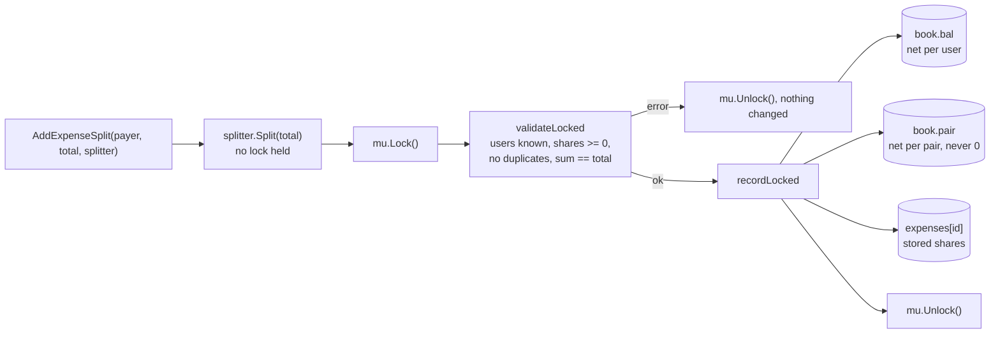
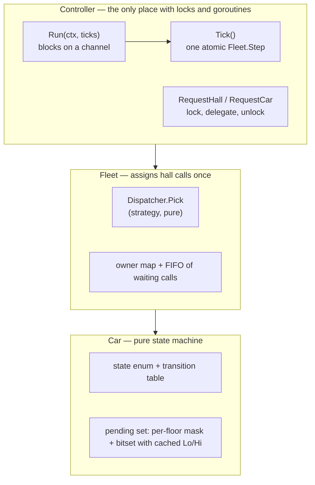
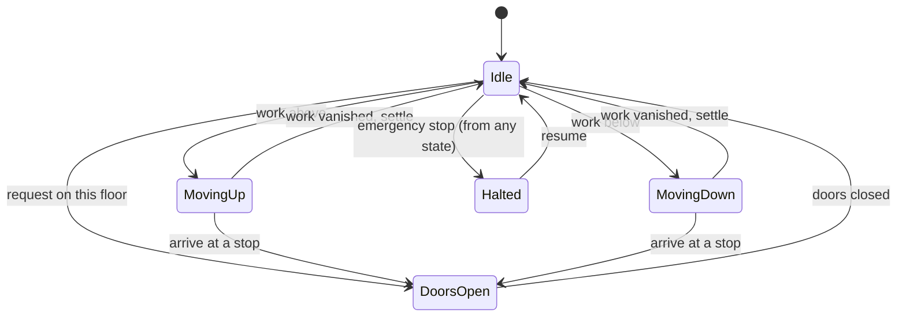
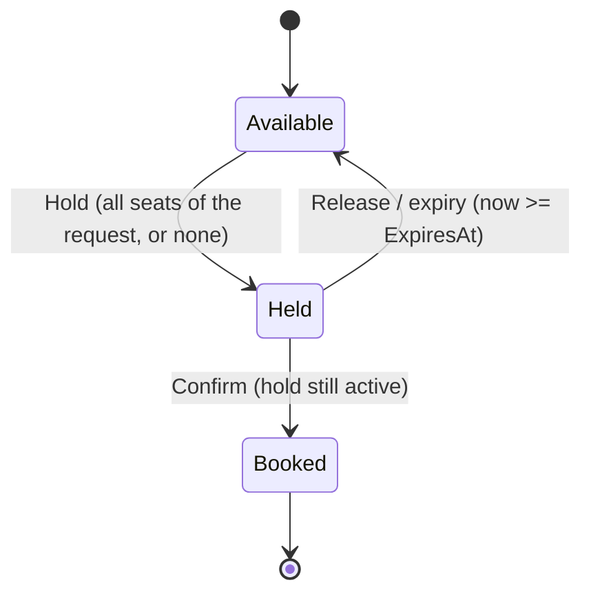
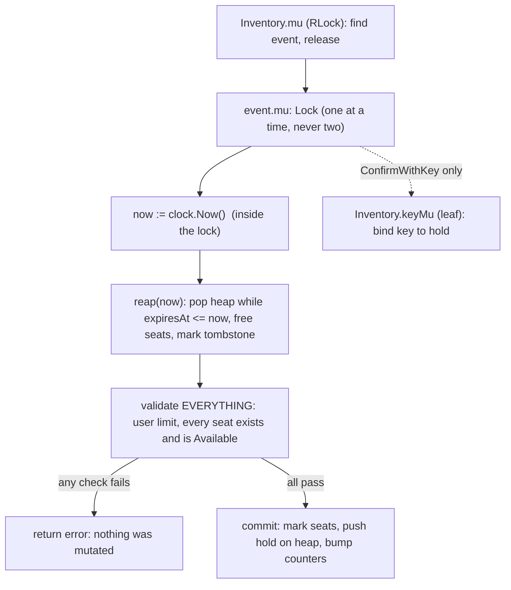

# B3 Unit 4 — Algorithms, state machines and contention

> Time: ~9 h · CORE: §1–§3 · STRETCH: Stage 4 discussions · Labs: `labs/b3/splitwise`, `labs/b3/elevator`, `labs/b3/ticketing`

## Before you start

Three different flavours of correctness: exact arithmetic and an invariant that must always hold (Splitwise), a state machine you can test deterministically
(elevator), and many goroutines fighting for the same resources (ticket booking). The last one is the hardest problem in part 1 of B3 and a direct preview of
the C8 ticket-booking case study. After it, schedule the gated [design exercise](design-exercise.md).

Warm-up (write the answers down first):

1. Why must money never be a `float64`? Give a concrete failure.
2. Two goroutines each need locks A and B. What is the standard way to rule out deadlock?
3. A client retries a payment after a timeout. What must the server remember in order to make the retry safe?

<details data-kind="answer"><summary>Warm-up answers</summary>

1. `0.1 + 0.2 != 0.3` in binary floating point, and errors accumulate: splitting 100.00 three ways in floats leaves a sum that is not exactly 100.00, so balances never reach exactly zero. Use integer minor units (cents) and an explicit remainder rule.
2. A global lock order: every goroutine acquires locks in the same sorted order (or you use one coarser lock). Deadlock needs a cycle in the wait-for graph, and a total order makes cycles impossible.
3. An idempotency key mapped to the first outcome (and the request it belonged to), so the retry returns the stored result instead of executing again, and the same key with different parameters is rejected. See A1's idempotency lab.

</details>

---

## §1 Expense sharing with debt simplification

### The failure story

A trip-planning app lets friends log shared costs: dinner, a rental car, a cabin. Version 1 is `map[string]float64`
of balances and `share := amount / float64(len(participants))`. In the demo it is flawless. After a four-week trip
with 10 people and ≈ 400 expenses, three things show up on the "settle up" screen. The balances do not sum to zero:
they sum to `1e-13` or, after a few `math.Round(x*100)/100` "fixes", to a whole cent that nobody paid. Somebody is
shown as owing `0.00` yet still appears in the payment list, because the stored value is `-0.0000000001`. And the
screen lists up to 45 payments (10 people have C(10,2) = 45 pairs) when at most 9 transfers are needed to settle
everyone. Support gets the ticket "the app invented a cent and made me send four payments".

Switching to integer cents fixes the drift and creates a quieter bug: `100 / 3 = 33`, so a $1.00 dinner split three
ways records $0.99. One cent has vanished from the ledger, and the payer is owed 66 cents while the two others owe
33 each. Fix it by "give the remainder to `participants[0]`" and the participants come out of a Go map: the same
expense lands on a different person on every run, the unit tests become flaky, and two replicas of the service
disagree about who owes the extra cent.

Then it becomes a shared service. Thousands of groups, many request goroutines, and a "balances" endpoint that
reads while expenses are being added. A reader that catches an expense halfway (payer credited, debtors not yet
debited) shows balances summing to +$40.00 for a few microseconds. Nobody notices until a customer screenshots it.

### Predict

<!-- predict id="B3-U4-P01" -->
**Predict.** A ledger stores balances as `float64` dollars. In Go, with `a, b := 0.1, 0.2` as variables: (a) is
`a+b == 0.3`? (b) You add `0.10` to a balance one million times: is it exactly `100000`, and if not, by roughly how
much is it off? (c) What do you store instead, and what is the largest amount it can hold before it overflows? Write
your answers down first.
<!-- /predict -->

<!-- predict id="B3-U4-P02" -->
**Predict.** Users `a`, `b`, `c`. `a` pays $1.00 (100 cents) for all three, including `a` themself. You write
`share := amount / n` in integer arithmetic. (a) What are the three balances and what do they sum to? (b) You "fix"
it by giving the remainder to `participants[0]`, where `participants` was built by ranging over a `map[UserID]...`.
What happens when you run the same program twice? (c) What rule makes the split both exact and reproducible?
<!-- /predict -->

<!-- predict id="B3-U4-P03" -->
**Predict.** Four people. `b` owes `a` $0.10, `c` owes `b` $0.10, `d` owes `c` $0.10 (a chain, so `Debts()` has three
entries). (a) What does a good `Simplify` return? (b) You apply that plan to the ledger as real `Settle` calls. Are
all `Balances()` zero afterwards? Is `Debts()` empty? (c) Can a polynomial-time algorithm always find the *minimum*
number of transfers?
<!-- /predict -->

### Reveal

<details data-kind="reveal" data-for="B3-U4-P01">
<summary>Reveal</summary>

(a) **No.** `0.1 + 0.2` is `0.30000000000000004` in binary floating point, because neither 0.1 nor 0.2 has an exact
binary representation. (A Go trap inside the trap: the *constant* expression `0.1+0.2 == 0.3` is `true`, because Go
evaluates untyped constants exactly at compile time. Only values that went through a `float64` variable misbehave, so
a quick check in the playground can lie to you.) (b) **No.** Measured with Go 1.24 on amd64: a million additions of
`0.10` give `100000.000001333`, and a million additions of `0.01` give `10000.000000171856`. Each addition rounds, the
errors do not cancel, and they grow with the number of operations. That is fine for a physics sim and fatal for a
ledger, whose whole value is that `== 0` means settled. (c) An **integer count of minor units**: `type Money int64`
in cents. `int64` holds ≈ 9.2 × 10¹⁸ cents ≈ 9.2 × 10¹⁶ currency units, far beyond any real balance; the practical
limit is *intermediate products* such as `amount × basisPoints`, which is why the lab caps a single amount at 10¹²
minor units (`MaxAmount`). Tempting wrong answers: "round to 2 decimals after every operation" (it hides the error
instead of removing it, and rounding twice in different orders gives different answers), and `float32` (worse).
Arbitrary-precision decimals (`math/big`) are correct but pay a cost you do not need when the unit is always the cent.

</details>

<details data-kind="reveal" data-for="B3-U4-P02">
<summary>Reveal</summary>

(a) Each share is `100/3 = 33`, so `a` is owed `100 − 33 = 67`, while `b` and `c` owe 33 each. The balances are
`+67, −33, −33`, which sum to **+1**. A cent has been *created* out of nothing; the invariant "balances sum to zero"
is broken, and it will never come back, because every later operation adds exactly zero to the sum. (If you instead
credit the payer with `3 × 33 = 99` you lose a cent. Same bug, other sign.) (b) Go randomises map iteration order, so
`participants[0]` is a different person from one run to the next: the extra cent lands on `a`, `b` or `c`
unpredictably. Tests become flaky, and two replicas replaying the same expenses disagree about a cent. (c) Allocate
with a **deterministic remainder rule**: sort participants by id; each owes `amount / n` rounded down, and the first
`amount % n` of them in that order owe one cent more. Then shares sum to exactly `amount`, the result is independent
of the order the caller listed people in, and any replica computes the same thing. The rule is slightly unfair (the
alphabetically first person pays the extra cent every time); that is the price of reproducibility, and rotating the
start with the expense id is a one-line change if anyone cares. The general form is the **largest-remainder method**,
which the "How it actually works" section below uses for percentages and weights too. Tempting wrong answer: "give the remainder to the
payer": deterministic, but then the payer's share is wrong by up to n−1 cents on every expense.

</details>

<details data-kind="reveal" data-for="B3-U4-P03">
<summary>Reveal</summary>

(a) Net positions are `a +10`, `b 0`, `c 0`, `d −10`, so **one transfer**: `d → a, 10`. The middle people were only
pass-through; the pairwise view keeps three debts where one payment settles everyone. (b) **Balances: yes, all zero.**
**Debts: no.** The plan has `d` pay `a`, and `Settle` records that payment between `d` and `a` in the pairwise book,
where `d` and `a` had no debt. After the call, `Debts()` shows `a → d 10` alongside the original `b → a`, `c → b`
and `d → c`: a four-person cycle, each leg $0.10, with every net balance at zero. The pairwise view is a *history*
of who transacted with whom; the balances are the truth about who is ahead or behind. Simplification deliberately
discards the history, so after you apply a plan you must stop treating `Debts()` as a to-do list. The reference's
test pins exactly this behaviour. (c) **No** (unless P = NP). Finding the minimum number of transfers is equivalent
to splitting the non-zero balances into the *largest possible number of zero-sum groups* (each group of k people
needs k−1 transfers), which is a partition problem and NP-hard. The greedy "largest debtor pays largest creditor"
heuristic always uses at most n−1 transfers for n non-zero balances, and often fewer, but not always the minimum:
balances `A +10, B +9, C −4, D −6, E −9` split into the zero-sum groups `{A, C, D}` and `{B, E}`, so 3 transfers
suffice, yet greedy produces 4. Tempting wrong answer: "just net each pair", which is the pairwise view and does
nothing about chains.

</details>

### The problem

> Problem 7 of 18 · Time box: 75 min · Focus: modelling, algorithms · Lab: `labs/b3/splitwise`

*As the interviewer says it:*

"Build the backend of an expense-sharing app. Friends add shared expenses, and at any time we want to show how much
each person owes or is owed, and who owes whom. Later, add a way to settle up with as few payments as reasonable.
It'll be used by lots of requests at once. I'll add things as we go, so keep it open to change. Talk me through your
choices."

Questions worth asking (the interviewer's answers pin down the tests):

| You ask | Interviewer answers |
|---|---|
| What is an amount? Which currency? | One currency, two decimal places. Amounts are positive. Use whatever type you can defend. |
| Do users exist up front? | Yes: users are registered by id first; an expense naming an unknown user is an error. |
| Is the payer always one of the participants? | No. Someone can pay for others and take no share. |
| How is an uneven amount split, say 1.00 among three? | Equal split. The shares must add up to exactly the amount, and the same input must always give the same answer. Document your rule. |
| What if an expense is invalid? | Return an error and change nothing. |
| What other ways to split? | Not yet. I may ask. (Stage 2: exact amounts, percentages, weights.) |
| Persistence? | Out of scope: in memory. |
| Scale? | Groups of ≈ 50 people; the service holds up to ≈ 100k users. Reading a balance must not get slower as history grows. |

Checkpoints (be at or past these, or cut scope):

| Minute | Where you should be |
|---|---|
| 0–5 | Clarify; state the invariant out loud (below); decide the money type and the remainder rule |
| 30 | Stage 1 green under `-race`. Interviewer announces stage 2 |
| 50 | Stage 2 green. Interviewer announces stage 3 |
| 70 | Stage 3 green or knowingly partial. Stop coding |
| 70–75 | Walk through the invariant, the concurrency story and the one thing you would do next |

The invariant to state at minute zero: **every user's balance changes only as part of an operation that moves money
between users, so the balances of all users sum to exactly zero, always, and no observer can see a state where they
do not.**

#### Stage 1: the ledger (minutes 0–30)

- `New(users...)`, `AddUser`; money is an integer number of cents (`type Money int64`), never a float.
- `AddExpense(payer, amount, participants) (ExpenseID, error)`: equal split. Shares sum to exactly `amount`; the
  remainder cents go to the first `amount % n` participants in **sorted-id order**, whatever order the caller used.
- Errors (and no state change) for: amount outside `[1, MaxAmount]`, unknown payer or participant, no participants,
  a participant listed twice.
- `Balance(user)`, `Balances()` (a snapshot copy; zeros included), and `Debts()`: the pairwise view, opposite
  directions netted, sorted by `(From, To)`.
- `Balance` must not replay history.

#### Stage 2: more ways to split, groups, settling, undo (announced at minute 30)

"Not every bill is split evenly, friends settle up in cash, and people enter expenses wrong."

- A `Splitter` interface and `Equal`, `Exact`, `Percent` (basis points) and `Weights`; `AddExpenseSplit`. Exact
  amounts must sum to the total; percentages must sum to exactly 100%; rounding must never lose or invent a cent.
- The ledger must not trust a `Splitter`'s output: it checks sums, signs and users itself.
- Groups: `CreateGroup`, `AddGroupMember`, `AddGroupExpense` (everyone must be a member), `GroupBalances`.
- `Settle(from, to, amount)` and `SettleInGroup`: a payment moves balances; paying too much flips the debt.
- `RemoveExpense(id)`: exact reversal, invariant intact.

#### Stage 3: simplify and share (announced at minute 50)

"Four payments to settle a weekend is silly, and this is now a service, not a script."

- `Simplify(balances)`: a plan of transfers that, once paid, zeroes everyone, with at most (non-zero balances − 1)
  transfers. Say out loud that the true minimum is NP-hard and use the greedy heap. It must be deterministic (ties
  broken by id), must not modify its input, and must stay fast for 100k+ users. `Ledger.Simplify()` plans from one
  consistent snapshot.
- Every method is safe for concurrent use; `Balances()` is a consistent snapshot (it always sums to zero) while
  other goroutines add, remove and settle.

#### Stage 4: discuss, don't code

- Expenses in several currencies, with exchange rates. What changes in the model?
- The auditor wants to know *how* a balance got to its current value, and a user disputes an expense from three
  weeks ago. What do you store?
- A group has 10,000 members. What breaks first?
- The mobile app retries `AddExpense` after a timeout. What now?

<details data-kind="answer"><summary>Model answers</summary>

- **Multi-currency:** an amount is `(minor units, currency)`, and the number of minor units per currency differs (JPY
  has 0 decimals, USD 2, KWD 3, per ISO 4217). Never convert implicitly. Keep balances **per currency**, so the
  zero-sum invariant holds per currency; store the exchange rate and its source *on the expense* when it is entered;
  simplify per currency (netting across currencies is a policy decision with an FX risk, not arithmetic). Converting
  at settlement time is a separate, explicit operation with its own rate and its own rounding rule.
- **Audit and disputes:** make the log the source of truth. The ledger becomes a fold over append-only events
  (`ExpenseAdded`, `ExpenseRemoved`, `Settled`, each with who/when/why); balances and the pair book are
  *projections* that can be rebuilt. Undo is a compensating event that references the original, never an in-place
  edit; an "edit" is remove-plus-add with a link. `RemoveExpense` in the lab already reverses the **stored** shares
  rather than recomputing, which is the same instinct. Banking ledgers do this: postings are never updated, only
  reversed.
- **10,000 members:** `Balances()` copies O(n) per call, so serve snapshots by version and cache them; the pair book
  is O(distinct pairs that ever transacted), not O(n²), but a dense group makes it large; `Simplify` is
  O(n log n) and should be computed on demand and cached by ledger version, not on every read; one mutex per ledger
  becomes contended, so shard by group (a group is the natural unit of consistency: expenses never span two) and
  keep cross-group users out of the hot path.
- **Retries:** `AddExpense` is not idempotent: a retried request adds a second expense and everyone is charged twice.
  Take a client-generated idempotency key, store `key → ExpenseID` with the expense, and return the original id on a
  repeat. The same pattern as payment callbacks in a banking integration, and for the same reason.

</details>

### Build it

Lab: **`labs/b3/splitwise`**. Stage 1 is `splitwise.go`; `stage2.go` and `stage3.go` hold the later stages' stubs.
Open them only when the interviewer "announces" the stage; the stubs are written so your stage 1 design must grow
into them.

```sh
go test -race ./labs/b3/splitwise/                       # everything
go test -race -run Stage1 ./labs/b3/splitwise/           # one stage
go test -race -count=20 ./labs/b3/splitwise/             # shake out schedule-dependent bugs
```

How to run it as a timed attempt: start a 75-minute timer, write stage 1, run `-run Stage1`, move on at the
checkpoint even if a test is red (note which), and stop coding at minute 70 for the walk-through. Write down which
tests were green at each checkpoint: that record, not the final state, is what the tutor scores for time management.

What the tests prove (11 + 12 + 12 tests; the reference passes the whole package under `-race` in ≈ 5 s):

- **Stage 1:** the exact remainder rule (1.00 among three, 0.10 among four, payer outside the group), independence
  from the order participants are listed, a sweep over every `n` in 1..9 and amount in 1..250 that checks shares
  sum to the amount, every rejected call leaves the ledger untouched, `Balances()` returns a copy, balances sum to
  zero after 5,000 random expenses, **no drift** after 100,000 tiny expenses (a float design fails here), the
  pairwise view nets and sorts, and a **scale test** (60,000 writes, each followed by a `Balance` read, 5 s cap)
  that an "add up the whole history on read" design misses by a wide margin.
- **Stage 2:** each splitter's arithmetic including basis-point rounding ties, a randomised check that percentage
  shares always sum to the total and stay within one cent of exact, validation and atomicity, a custom `Splitter`
  written in the test file (the extensibility check), a *broken* `Splitter` the ledger must reject, a `Splitter`
  that calls back into the ledger (a deadlock detector), settle direction and overpayment, exact reversal of
  removed expenses, a random add/remove/settle mix that keeps the invariant, and group scoping.
- **Stage 3:** the hand-computed greedy plan, tie-breaking determinism over 200 repetitions (map-order flakes),
  edge cases, no input mutation, 500 random plans checked for correctness, the n−1 bound and one-directionality, the
  chain collapse from P03, group simplification, a **scale test** (120,000 balances, 5 s cap), and two
  concurrency tests: writers against readers that assert every `Balances()` sums to zero, and a mixed
  add/remove/settle/group workload.

**Do the timed attempt before reading the rest of this section.**

### How it actually works

One mutex, two incrementally maintained views, one validation point:



- **Money is `int64` minor units.** Floats are gone from the design, so `==` means what it says. `MaxAmount`
  (10¹² units) is checked at the boundary so products like `total × weight` cannot overflow.
- **The `book`: two views, one mutation.** `book.owe(debtor, creditor, amt)` is the *only* function that changes
  balances. It adds `amt` to one side, subtracts it from the other and updates the pair entry, all in one call, so
  the zero-sum invariant holds by construction, not by testing. A negative `amt` reverses an earlier debt, which is
  all `RemoveExpense` needs. Pair entries are keyed by the sorted pair and deleted when they hit zero, so `Debts()`
  never lists settled pairs.
- **Reading is O(1) or O(output).** `Balance` is a map lookup; `Balances()` clones a map; `Debts()` sorts the
  non-zero pairs. Nothing replays history; history is only kept (as stored shares) for reversal.
- **One validation point.** `validateLocked` is the single place that proves a share list is acceptable: every user
  known, each share in `[0, MaxAmount]`, no user twice, `sum == total`. `AddExpense`, `AddExpenseSplit` and
  `AddGroupExpense` all go through it, which is why a buggy third-party `Splitter` cannot corrupt the ledger.
- **`Split` runs before the lock.** A `Splitter` is user code; calling it while holding the mutex is the same
  re-entrancy deadlock as an eviction callback in the cache lab. It is pure (a function of `total`), so computing it
  first costs nothing and the lock covers only validate-and-apply.
- **Largest-remainder allocation.** `allocate(total, weights)` gives every entry `floor(total × w / Σw)`, then hands
  the leftover cents (always fewer than `n`) one each to the entries with the largest fractional remainders, ties to
  the lowest index (the lowest sorted id). Equal split is `weights = 1,1,1,…` (all remainders tie, so the first
  `total % n` get the cent: exactly the stage-1 rule), `Percent` uses basis points as weights, `Weights` uses the
  caller's. One function, three features.
- **Groups are books.** A group owns a `book` and a member set. A group expense is applied to the group's book *and*
  to the global book, so `Balances()` is always the sum over every scope and `GroupBalances` costs a map clone.
- **`Simplify` is a pure function over a map.** Split the non-zero balances into a creditor max-heap and a debtor
  max-heap (order: amount descending, then id ascending, a total order, so map iteration order can never leak into
  the output). Repeat: pop the largest of each, emit `Transfer{debtor → creditor, min(c, d)}`, push back whichever
  has a remainder. Each step settles at least one person, so there are at most n−1 transfers, and O(n log n) work.
  Because it takes a `map[UserID]Money`, the same code simplifies the whole ledger (`Ledger.Simplify`), one group
  (`Simplify(l.GroupBalances(g))`), or any what-if input, and it cannot mutate live state.

```go
func (b *book) owe(debtor, creditor UserID, amt Money) {
	b.bal[debtor] -= amt // the only place balances change:
	b.bal[creditor] += amt // both sides, together
	k := keyOf(debtor, creditor)
	if debtor == k.lo {
		b.pair[k] += amt
	} else {
		b.pair[k] -= amt
	}
	if b.pair[k] == 0 {
		delete(b.pair, k)
	}
}

func allocate(total Money, weights []int64) []Money {
	var sum int64
	for _, w := range weights {
		sum += w
	}
	out, rem := make([]Money, len(weights)), make([]int64, len(weights))
	var given Money
	for i, w := range weights {
		p := int64(total) * w // safe: total <= MaxAmount, w <= MaxWeight
		out[i], rem[i] = Money(p/sum), p%sum
		given += out[i]
	}
	order := make([]int, len(weights))
	for i := range order {
		order[i] = i
	}
	slices.SortFunc(order, func(a, b int) int {
		if rem[a] != rem[b] {
			return cmp.Compare(rem[b], rem[a]) // larger remainder first
		}
		return cmp.Compare(a, b) // tie: lower index
	})
	for _, i := range order[:int(total-given)] {
		out[i]++ // the leftover cents, one each
	}
	return out
}
```

How the stages landed on the stage-1 design: stage 1 already routed `AddExpense` through `equalShares`, the
validator and `recordLocked`, so `AddExpenseSplit` is those same three calls with a different share list. Stage 2
added one field to `Ledger` (`groups`) and one to `expense` (`group`) and touched **no stage-1 method body**; the
splitters reuse `allocate`, groups reuse `book`, and `RemoveExpense` is `applyExpense` with `sign = -1`. Stage 3 is
purely additive: a pure function and a one-line method. If your stage 2 required rewriting `AddExpense`, the usual
cause is that the equal split was inlined into it instead of producing a `[]Share` for a shared validator.

### Rubric

| Dimension | below | approaching | meets (senior bar) | exceeds |
|---|---|---|---|---|
| Extensibility | Money is `float64`; split rules hard-coded in `AddExpense`; stage 2 rewrites stage-1 methods | Splitters exist but each re-implements validation and rounding; reversal recomputes shares | One `[]Share` path with one validator; `Splitter` interface defined consumer-side; reversal uses stored shares; stage 2 and 3 land as additions | Anticipates stage 4 (currency on `Money`, event log behind `book`), and says where idempotency keys and a version counter would plug in |
| Concurrency safety | No locking, or `Balances()` returns the live map; races under `-race` | One mutex, but `Balances()` reads outside it, or a `Splitter` runs under the lock | One `RWMutex`, writes atomic, reads clone under `RLock`, no user code under the lock, "sum is always zero" stated as the invariant; `-race -count=20` clean | Explains sharding by group as the next step and why a group is the consistency boundary; versions snapshots so reads don't copy |
| Clean interfaces | Exposes the maps; amounts as `float64` or bare `int`; errors as strings | Typed money but errors are ad hoc; `Debts()` and `Balances()` disagree on sign convention | `Money`, `UserID`, `ExpenseID` types; sentinel errors compared with `errors.Is`; sign convention documented once; callers own returned maps and slices | The doc comments are precise enough that the tests could be written from them (tie rules, ordering, what `Debts()` means after `Simplify`) |
| Tests | No tests, or happy path with `float64` comparisons | Sums checked on a few hand-picked expenses; no invariant, concurrency or scale test | Table of rejected inputs that also assert "nothing changed", a remainder sweep, a random workload asserting sum == 0, a scale test, and a concurrent reader asserting the snapshot sum | Property test against a naive model; mutates their own code to prove the tests bite; tests the greedy against brute force on small n |
| Time management | Stage 1 not green at minute 40; no walk-through | Stage 2 done, `Simplify` untouched or sketched without tests | Stage 1 by minute 30 and stage 2 by 50, stage 3 partial with an honest list, a 5-minute walk-through covering the invariant and NP-hardness | Finishes early and spends the time on stage-4 numbers (audit log shape, idempotency) |

Overall **meets** = at least *meets* on Concurrency safety and Clean interfaces, and nothing at *below*.

### Common mistakes

- **`float64` money.** Symptom: `0.30000000000000004`, balances that sum to `1e-13`, "owes 0.00" users in the payment
  list. Fix: `int64` minor units, convert at the edge only.
- **Dividing and dropping the remainder.** `share := amount / n` loses up to n−1 cents per expense and the balances no
  longer sum to zero. Fix: allocate the remainder explicitly and assert the sum in a test.
- **Giving the remainder to "the first participant" of an unsorted slice or a map.** Symptom: the extra cent moves
  between runs, flaky tests, replicas disagree. Fix: sort by id (or any total order you document) before allocating.
- **Rounding each percentage independently.** 33.33% of 1.00 three times is 0.99. Fix: floor all, then give the spare
  cents to the largest remainders; test with 3333/3333/3334 bp.
- **Recomputing balances from the expense list on every read.** Fine at 20 expenses, ≈ 2 billion share-visits in the
  scale test. Fix: update balances incrementally in the one function that books an expense.
- **A second place that changes balances.** `AddExpense`, `Settle` and `RemoveExpense` each adjust the maps by hand and
  one forgets a side; the sum drifts after a specific sequence. Fix: a single `owe(debtor, creditor, amt)`.
- **Reversing by recomputing.** Removing an expense by re-running the split with today's rules or membership can
  produce different shares than the original, leaving residue. Fix: store the shares and subtract exactly them.
- **Trusting the `Splitter`.** A custom splitter that returns total−1 corrupts the ledger silently. Fix: validate
  `sum == total`, non-negative, unique, known users at the single commit point.
- **Calling `Split` under the lock.** A splitter that reads a balance deadlocks the service. Fix: compute shares
  first, lock only to validate and apply.
- **`Simplify` mutating live balances** (zeroing entries as it goes, or being written as a method that settles).
  Symptom: calling "show me the plan" changes what everyone owes. Fix: a pure function over a snapshot.
- **Iterating the balance map to pick the largest creditor.** Ties resolve differently on each run, so plans are
  non-deterministic and flaky in tests. Fix: heaps ordered by (amount, id), a total order.
- **`Balances()` returns the live map**, or reads without the lock. Symptom: `concurrent map iteration and map
  write` or a torn sum. Fix: clone under `RLock`.

### Debrief: senior-level design choices

What the reference chose, what else was on the table, and what a senior says while coding:

- **`int64` minor units over `big.Rat` or a decimal library.** "Money is an integer number of cents. It's exact,
  comparable, cheap, and overflow is a boundary check (`MaxAmount`), not a worry. If we add currencies, `Money`
  gains a currency and the exponent comes from the currency, but the arithmetic stays integer."
- **Largest remainder, not ad hoc rounding.** "Whatever split I support, I allocate with one function: floor
  everything, then hand out the leftover cents by largest remainder with a documented tie-break. That gives me
  'shares sum to the total' for free, and the rule is the same for equal, percent and weights."
- **One `owe`, two views.** "Balances and the pairwise view are both derived from the same primitive, so I can't
  update one and forget the other. I keep the pairwise net incrementally too; otherwise `Debts()` would need the whole
  history."
- **Validate, then apply, under one lock.** "Every operation is all-or-nothing: I validate everything first, then
  mutate. A rejected call leaves no trace, and a reader sees the state before or after, never between. The lock is
  the transaction."
- **An interface only where there is variation.** `Splitter` has four implementations and an open set; the ledger
  itself is a concrete type. "I'm not putting an interface in front of the ledger; I'd do that at the consumer if a
  test needed a fake."
- **`Simplify` as a pure function.** "It takes balances and returns transfers. No ledger, no locks, nothing to
  mutate. The ledger method is a one-liner on top of a snapshot. That also lets me simplify a single group or a
  what-if."
- **Greedy, and saying it's greedy.** "The exact minimum is a partition problem, NP-hard. Greedy gives me ≤ n−1
  transfers in O(n log n), and for groups under ≈ 20 people I could do a bitmask DP for the true minimum if product
  cared. I'd rather ship the bound and say so."
- **A single `RWMutex` for the whole ledger.** "Reads are real reads here, unlike an LRU `Get`, so `RLock` is
  correct for `Balance`, `Balances` and `Debts`. If one ledger got hot I would shard by group, because a group is
  where consistency matters, not by user."

### Break it

Apply each mutation to a copy of your solution (or the reference in `solutions/b3/splitwise`), one at a time. Predict
the failing tests first, then run `go test -race -count=1 ./solutions/b3/splitwise/`.

1. `Balances()` clones the map without taking the read lock.
2. `recordLocked` credits the payer with the sum of the others' shares, releases the lock, then debits the debtors
   under a second lock acquisition.
3. `allocate` computes the floors but never hands out the leftover cents.
4. `equalShares` keeps the caller's participant order instead of sorting.

<details data-kind="answer"><summary>What you should see (reference solution, Go 1.24, linux/amd64)</summary>

1. `TestStage3_ConcurrentWritersAndReadersSeeConsistentSnapshots` fails with `WARNING: DATA RACE` reports (and on an
   unlucky schedule the runtime kills the whole binary with `fatal error: concurrent map iteration and map write`,
   which also swallows every other result). All 34 other tests pass: they are single-goroutine. That is the case for
   the concurrent test and for `-race`.
2. `TestStage3_ConcurrentWritersAndReadersSeeConsistentSnapshots` and
   `TestStage3_ConcurrentAddRemoveSettleAndGroupsStayBalanced` fail with a reader seeing a non-zero sum
   (`Balances() summed to 12: a reader saw part of an expense (torn snapshot)`). Every sequential test
   passes, because the final state is correct. A torn snapshot is a bug in *when* state becomes visible, which only a
   concurrent observer can catch, and it does not need a data race to exist, since every access is still locked.
3. 18 tests fail across all three stages: the remainder tests, the sweep, the percent and weights tests, the random
   workloads (sum off by a few cents), even `TestStage1_BalanceDoesNotReplayHistory` (its closing sum check). The one
   missing line manufactured the P02 bug, and the sum-to-zero assertion is what catches it everywhere.
4. Exactly two tests fail: `TestStage1_SplitDoesNotDependOnTheOrderParticipantsAreListed` and
   `TestStage2_EqualSplitterMatchesAddExpenseAndRejectsUnknownUsersAtomically`. Sums are still right, so every
   invariant test passes: the bug is *reproducibility* and only the tests that permute the input see it.

Also tried (all caught, one test each unless noted): `Balance` replaying every expense (`BalanceDoesNotReplayHistory`,
5 s guard); calling `Split` under the lock (`SplitterMayCallBackIntoTheLedger`, 5 s guard); dropping the
`sum == total` check from the validator (`CustomSplittersPlugInButTheLedgerDoesNotTrustThem`); `RemoveExpense`
forgetting the group book (`GroupSettleAndRemoveKeepGroupAndGlobalViewsInStep`); `Simplify` zeroing the caller's
map (five tests); heap ties ignoring the user id (two tests, flaky by design); keeping zero-valued pair entries
(four tests); and a linear-scan `Simplify` (`SimplifyScalesToHundredsOfThousandsOfUsers` only, at the 5 s cap).

</details>

### In the wild

- **Splitwise** ships a "simplify debts" option that rewrites who pays whom within a group while leaving each person's
  net position unchanged. TODO-VERIFY: the exact algorithm it uses; the greedy heap is the standard textbook answer to
  the "minimum cash flow" problem, not a statement about their implementation.
- **The minimum-transactions problem.** Settling with the fewest payments is equivalent to partitioning the non-zero
  balances into the maximum number of zero-sum subsets, a partition-type problem known to be NP-hard. TODO-VERIFY:
  Verhoeff, "Settling Multiple Debts Efficiently", *Informatics in Education* (2004), for the formal treatment.
- **Stripe and most payment APIs** take amounts as integers in the currency's smallest unit (`amount: 1099` for
  $10.99), with zero-decimal currencies such as JPY handled by the currency's exponent. ISO 4217 defines the number of
  minor-unit digits per currency (JPY 0, USD 2, KWD 3). TODO-VERIFY: Stripe's current list of special-case
  currencies.
- **Martin Fowler's *Money* pattern** (*Patterns of Enterprise Application Architecture*) has an `allocate` operation
  that distributes the remainder so the parts sum to the whole: the same idea as the allocator here. TODO-VERIFY: which
  parts receive the extra unit in his version.
- **Apportionment.** Allocating seats to states by floor-then-largest-remainder is **Hamilton's method**, used for
  the US House in the 19th century and displaced partly because of the Alabama paradox (adding seats could remove one
  from a state). TODO-VERIFY: the years it was in force. The remainder rule here is the same algorithm at cent scale; the paradox needs changing totals
  across a fixed set of parties, which an expense does not do.
- **Double-entry bookkeeping** is the same invariant at industrial scale: every posting has equal debits and credits,
  and corrections are new reversing entries, never edits. In a core-banking or credit-union ledger, "balances sum to
  zero" is checked by a nightly reconciliation job; here it is checked on every read in the tests.
- **Event sourcing** (stage 4): Postgres WAL and Kafka-backed ledgers are logs from which state is rebuilt. The
  stored-shares reversal in this lab is the smallest version of that idea.

### Trade-offs

| Option | Wins when | Loses when | When the answer flips |
|---|---|---|---|
| `int64` minor units (the reference) | One exponent per currency, add/subtract/allocate only | Fractional minor units (FX, per-unit pricing), mixed exponents without a currency tag | Money gets a currency and an exponent; or sub-cent rates appear: use a scaled integer with a wider exponent or a decimal type |
| `float64` | Never for balances | Always: drift, no exact `== 0` | Never, except analytics where ± 1e-9 is noise |
| `math/big` decimals | Arbitrary precision, regulatory rounding modes | Allocation cost, no overflow to guard against but more code and slower | When the unit isn't fixed (crypto, FX rates, interest) |
| Remainder: first *r* by sorted id (the reference) | Reproducible with no state; the lab's rule | The alphabetically first user always pays the extra cent | Fairness is a product concern: rotate by expense id, or alternate with a per-user "cents owed" ledger |
| Remainder: payer absorbs | Simple to explain; the payer chose to pay | The payer's share is wrong by up to n−1 cents on every expense | A payer-is-not-a-participant flow where the payer takes the rounding by policy |
| Greedy heap simplification (the reference) | Always ≤ n−1 transfers, O(n log n), deterministic | Not always the minimum | Groups ≲ 20 where the product wants the true minimum: bitmask DP over subsets |
| Exact minimum (subset DP / ILP) | Small groups, a feature that sells on "fewest payments" | Exponential in n; useless for 10,000 members | Large groups: back to greedy, with a cap on group size for the exact mode |
| No simplification (pairwise only) | People need to see *who owes me* and settle directly; no trust in intermediaries | Chains and cycles produce needless payments | Users are strangers (never route money through them) vs friends who don't mind: a per-group setting |
| One `RWMutex` per ledger (the reference) | Operations are O(1)–O(n) and groups are small | One huge or hot ledger serialises all writes | Contention is measured: shard by group; cross-group operations are the cost |
| Event log + projections | Audit, disputes, rebuilds, multiple read models | More code and storage, projections must stay in sync | You never need history, or the reversal-by-stored-shares of this lab is enough |

### Senior bar

- **Failure modes.** The invariant breaks (a cent created or destroyed) and nothing notices: assert `sum == 0` in
  tests, in a periodic self-check, and on every snapshot you export. A reader sees half an expense. An expense is
  applied twice because a client retried. A custom splitter returns shares that don't sum. A reversal recomputes
  instead of replaying. Overflow in `total × weight` for large amounts (bounded here by `MaxAmount × MaxWeight` ≈
  10¹⁸ < 9.2 × 10¹⁸). Plans applied to a ledger that has changed since the snapshot: the plan's transfers may no
  longer match (stage 4: plans carry the ledger version and are rejected if stale).
- **Numbers.** Uncontended mutex lock/unlock ≈ 15–25 ns (`docs/NUMBERS.md`), so a ledger write is dominated by
  allocation and map updates: `AddExpense` with 3 participants measured ≈ 3 µs and ≈ 415 B in 8 allocations on the
  4-core reference box (≈, includes sorting and the pair-book updates), and a `Balances()` snapshot of 50 users
  ≈ 5.6 µs.
  Pair book: O(distinct pairs that ever transacted) entries, ≤ n(n−1)/2 = 1,225 for a 50-person group. `Simplify`
  of 120,000 balances took ≈ 0.3 s on the reference box (≈ 1.7 s under `-race`; the test cap is 5 s). A naive
  re-scan for the maximum each step is up to ≈ 7 × 10⁹ steps at that size and misses the cap.
- **Ops.** Export the self-check as a metric (`ledger_balance_sum` must be 0; any other value pages someone).
  Version every snapshot. Log every write with the idempotency key. For multi-tenant deployments (one ledger per
  credit union or per group) isolate by tenant: a bug in one tenant's data must not read across, and the lock should
  not be shared.
- **Cost.** Memory ≈ one map entry per user plus one per active pair plus the stored expenses kept for reversal
  (a `Share` is a string header plus an `int64`, ≈ 24 bytes on 64-bit Go, plus the user-id bytes shared with the
  caller's strings). One million 4-share expenses is therefore on the order of 100 MB (≈, TODO-VERIFY with a heap
  profile before quoting); an event log on disk is cheaper than keeping everything hot, and old expenses can be
  compacted once the books for a period are closed.

**Interviewer probes**

<details data-kind="answer"><summary>"Why not floats and round at display time?"</summary>

Because the error is in the stored value, not the display. Float addition is not associative, so the same set of
expenses added in a different order gives a different balance, and `balance == 0` ("settled") becomes unreliable.
Rounding at display hides small errors but not the case where the sum of the displayed balances is a cent off from
zero, and two services showing different cents for the same group. Integer minor units make every operation exact,
every comparison meaningful, and the zero-sum invariant testable with `==`.

</details>

<details data-kind="answer"><summary>"Your greedy isn't optimal. When does that matter, and what would you do?"</summary>

It matters when the product's promise is "fewest payments" for small groups, because greedy can use up to n−1
transfers where fewer exist (e.g. `{+10, +9, −4, −6, −9}` needs 3 but greedy returns 4). For n up to about 20 I can
find the true minimum: transfers = (non-zero people) − (maximum number of disjoint zero-sum subsets), and the maximum
can be computed with a bitmask DP, `dp[mask] = max over i in mask of dp[mask \ {i}] + (sum[mask] == 0 ? 1 : 0)`,
in O(n · 2ⁿ). Beyond that I'd keep the greedy bound, since 2ⁿ for n = 50 is not an option, and say clearly in the
product that the plan is "at most n−1" rather than "the minimum".

</details>

<details data-kind="answer"><summary>"Does simplifying change what anybody owes?"</summary>

No person's *net* position changes: after the plan is paid, every balance is zero, which is exactly what they'd have
after paying their pairwise debts. What changes is *who* gets the money: `d` pays `a` although `d` never owed `a`
anything. For friends that is fine; for strangers or in a regulated setting, routing money through an intermediary
needs consent, so it should be a per-group opt-in. The other side effect is the one in P03: the pairwise `Debts()`
view is history, not a to-do list, so after applying a plan it isn't empty even though every balance is zero.

</details>

<details data-kind="answer"><summary>"A read sees the balances sum to +40.00. What happened and how do you prove it's fixed?"</summary>

A writer updated the credit side and the debit side in separate critical sections (or with per-user locks or atomics),
and the reader came in between. I fix it by making each expense one atomic step under a single lock (validate, then
apply both sides), with readers cloning under the read lock. To prove it, a concurrent test has several writers adding
expenses while readers loop on `Balances()` asserting `sum == 0`, run with `-race -count=20`; then mutate the
implementation to split the critical section and watch the test fail. A sharded design needs a different answer
(versioned snapshots, or a single sequencer per group) because "just lock per user" will always tear.

</details>

### Check yourself

1. 10.00 is split among `a`, `b`, `c` by weights 1:1:1 after `c` is removed from the group and re-added. Does the
   remainder rule give the same shares as before? What property of the rule guarantees it?
2. `RemoveExpense(id)` is called twice for the same id. What should the second call do, and why is "do nothing and
   return nil" a risky choice in a ledger?
3. Your plan from `Simplify` has 6 transfers for 9 non-zero balances, and your colleague's has 5. Is yours wrong?

<details data-kind="answer"><summary>Answers</summary>

1. Yes, identical. The shares depend only on the set of participant ids, the total and the weights, never on
   insertion order, membership history or time: sorted ids plus largest remainder with an id tie-break is a pure
   function. That is also why a replica replaying the same events gets the same cent in the same place.
2. Return `ErrUnknownExpense`. A silent success hides a double-click, a retry or a logic error, and in a ledger the
   caller usually needs to know whether *this* call changed the books. If you want idempotent removal, make it
   explicit (an idempotency key, or "removed" as a recorded state), and have it return the same result on a repeat.
3. Not necessarily. Any plan with ≤ 8 transfers (n−1) that zeroes everyone is valid; the minimum depends on how many
   zero-sum subsets the balances contain, and greedy doesn't search for them. Check correctness (applying the plan
   zeroes every balance, each transfer goes from a debtor to a creditor) and the bound; then ask whether the product
   needs the exact minimum, which is the subset-DP conversation.

</details>

---

## §2 Elevator controller

### The failure story

A 12-storey office building, 4 cars, ≈ 900 people. The first version of the controller treats every button press as an
independent job: `go moveTo(floor)` starts a goroutine that loops `time.Sleep(2 * time.Second); car.floor += step`
(≈ 2 s per floor), then sets `car.doorsOpen = true`, sleeps ≈ 5 s and sets it back. It demos beautifully with one
request. The test suite is the first casualty: "ride from 0 to 11 and open" takes ≈ 22 s of wall clock, so the 30
tests that cover the behaviour take ≈ 10 minutes in CI, and half of them are timing-sensitive enough to flake.

In the morning peak, ≈ 200 presses arrive in a minute. That is 200 goroutines, each one believing it owns the car,
all writing `car.floor` with no lock. After a few minutes the simulator reports the car at floor 14 of a 12-floor
building, `doorsOpen == true` while `moving == true`, and two goroutines carrying the car up and down at the same time.
Someone adds a mutex around each `floor += step`; the data race is gone and the car now oscillates, because nothing
anywhere decides which request the car should serve *next*. The scheduling policy was never a piece of code. It was
an accident of which goroutine woke first.

An interviewer who asks for "an elevator system" is checking five things, in this order: do you make the state
explicit, do you separate *deciding* from *waiting*, can you test it without sleeping, is your scheduling policy a
named algorithm with a guarantee, and only then, where does concurrency go.

### Predict

<!-- predict id="B3-U4-P04" -->
**Predict.** A car at floor 0 has two outstanding requests: a car call for floor 8 and a hall call at floor 4 with
the **down** button pressed. (a) Does the car stop at 4 on its way up? (b) In what order does it stop, and in which
direction does the lantern at each stop point? (c) What does a car that *does* stop at 4 on the way up do to the
passenger who pressed "down"? Write your answers down before opening the reveal.
<!-- /predict -->

<!-- predict id="B3-U4-P05" -->
**Predict.** Your first draft is `type Car struct { floor int; dir Direction; moving bool; doorsOpen bool }` with
`Direction` ∈ {none, up, down}. (a) How many field combinations does the type allow, and how many of them describe
something a real car can be doing? (b) Name two of the impossible ones and say where in the code each would be
"prevented". (c) What does an explicit `State` enum with a transition table change about who is responsible?
<!-- /predict -->

<!-- predict id="B3-U4-P06" -->
**Predict.** The controller's run loop is `for { select { case <-ctx.Done(): return; default: c.Tick(); time.Sleep(time.Second) } }`
and `RequestHall` locks the same mutex as `Tick`. (a) Name three things wrong with the loop even though it sleeps.
(b) A caller invokes `RequestHall(5, Up)` and `Tick` runs at the same moment. Which outcomes are acceptable, and
which one must be impossible? (c) What would you change so a test can run 10,000 ticks in milliseconds?
<!-- /predict -->

### Reveal

<details data-kind="reveal" data-for="B3-U4-P04">
<summary>Reveal</summary>

(a) **No.** A car moving up passes a *down* call unless that call is the highest request in the building (the
turnaround). (b) It rides to 8 and stops there; the lantern points **down**, because nothing lies above 8 and there is
still work below. It then travels down and stops at 4, lantern down. So the arrivals are `[8/down, 4/down]`.
(c) A car that stops at 4 going up opens its doors for someone who wants to go *down*. They either board and get carried
further from their destination (the car still has to reach 8 first), or they refuse to board and have to press again.
Either way the controller served the request badly while looking busy. The rule of the elevator algorithm (SCAN, and its
LOOK refinement): keep going in your direction while there is anything ahead; stop for car calls and for hall calls
*in your direction*; reverse only when nothing remains ahead. Tempting wrong answers: "stop at 4 because it is nearer
than 8" (that is nearest-first, which also starves far calls, see the fairness test) and "serve requests in arrival
order" (the car zig-zags: 0 → 8 → 4 → ... for every arrival pattern).

</details>

<details data-kind="reveal" data-for="B3-U4-P05">
<summary>Reveal</summary>

(a) 3 directions × 2 × 2 = **12** combinations, and a real car is in one of only about **four** situations: idle,
moving up, moving down, or stopped with the doors open. (b) `moving && doorsOpen` (driving with the doors open) and
`dir == none && moving` (moving nowhere). With flags, "prevention" is a convention: every method that sets one flag
has to remember to check the others, and the check is discovered missing in production. (c) With an enum
`Idle | MovingUp | MovingDown | DoorsOpen` the impossible combinations *do not exist*, and a transition table
(`Idle → MovingUp`, `MovingUp → DoorsOpen`, `DoorsOpen → Idle`, ...) makes the remaining question mechanical: *is this
edge in the table?* The table is also the review artifact: adding emergency stop in stage 3 is one new state and a
handful of new edges, visible in a diff. Heading is **not** a state: the car keeps a direction of travel while the
doors are open (the lantern), so direction lives next to the state, not inside it. Tempting wrong answer: "add a
`validate()` method that checks the combinations". It runs after the damage and nobody calls it.

</details>

<details data-kind="reveal" data-for="B3-U4-P06">
<summary>Reveal</summary>

(a) First, cancellation latency: `ctx` is only looked at once per iteration, so `Run` can take up to a second to
notice cancellation. Second, it is not testable: time is whatever `time.Sleep` says, so a test either waits for real
seconds or cannot control the number of ticks. Third, it drifts: the period is one second *plus* however long `Tick`
took, and a slow tick never gets caught up or dropped on purpose; nobody decided which. (It also polls, which is the
cheap version of a busy loop; without the sleep it pins a core.) The fix for all three is the same: the loop *blocks*
on `select { case <-ctx.Done(): case <-ticks: }` and the tick source is an injected channel. Production feeds it from a
`time.Ticker`; a test feeds it by hand. (b) Either order is acceptable: the request is applied just before the tick (a
car may start moving toward it in this very tick) or just after (next tick). What must be impossible is the request
being applied **in the middle** of a tick, with half the cars stepped and the dispatcher looking at a fleet in an
inconsistent state. One mutex that covers all of `Step` gives that; so does a single owner goroutine. (c) Move the
clock out of the core: `Step()` is a plain function call, `Tick()` is a locked `Step()`, and `Run(ctx, ticks)` only
forwards ticks. Tests call `Tick()` directly or send on a channel they own.

</details>

### The problem

> Problem 8 of 18 · Time box: 90 min · Focus: state machines, scheduling strategy · Lab: `labs/b3/elevator`

*As the interviewer says it:*

"Design the control software for the elevators in an office building. Start with one car: people press buttons on the
landings and inside the car, and the car goes and serves them. I'll add more cars and some real-world constraints as
we go. I want to be able to run your code in a test without waiting for anything. Talk me through your choices."

Questions worth asking (the interviewer's answers pin down the tests):

| You ask | Interviewer answers |
|---|---|
| Real time or simulated time? | Neither is the point. Time advances in discrete ticks that something outside your core calls. No sleeping inside the logic. |
| What are the inputs? | Hall calls (a floor and an up or down button) and car calls (a destination floor, from inside a specific car). No passenger objects. |
| How many floors and cars? | Floors 0..N-1 for any N ≥ 2, up to a few hundred. One car first; a handful later. |
| What does the output look like? | Whatever happened during a tick: moved, arrived, doors opened, doors closed. I want to read it as a trace. |
| What is the scheduling policy? | Yours. Name it, say why, and tell me what it guarantees. |
| What about two buttons at the car's own floor? | Serve them in a sensible order and tell me which. |
| Is it used from several goroutines? | Not at first. It will be, and I will care where you put the lock. |

Checkpoints (be at or past these, or cut scope):

| Minute | Where you should be |
|---|---|
| 0–8 | Clarify; sketch the state diagram and the stop rule on paper; pick the tick model out loud |
| 30 | Stage 1 green: one car, all scenarios. Interviewer announces stage 2 |
| 60 | Stage 2 green: fleet + dispatcher, fairness test. Interviewer announces stage 3 |
| 85 | Stage 3 green or knowingly partial. Stop coding |
| 85–90 | Walk-through: the state table, the tick contract, who owns what, what you would do next |

#### Stage 1: one car (minutes 0–30)

- `NewCar(floors, opts...)` with `WithStartFloor` and `WithDoorTicks`; sentinel errors for bad configuration.
- State is an explicit enum (`Idle`, `MovingUp`, `MovingDown`, `DoorsOpen`) behind a transition table
  (`CanTransition`): illegal transitions must be impossible to reach, not merely discouraged.
- `RequestCar(floor)` and `RequestHall(floor, dir)`; duplicates coalesce; invalid floors and directions are errors
  that leave no trace.
- `Step()` advances one tick and returns events (`Moved`, `Arrived`, `Opened`, `Closed`).
- LOOK policy: keep going while there is work ahead, stop for car calls and for hall calls in your direction, stop at
  an opposite-direction call only if it is the last thing ahead, then reverse. A request for the current floor opens
  the doors.

#### Stage 2: more cars (announced at minute 30)

"Now four cars share the hall buttons. Which car answers a button should be a decision I can swap out."

- `Fleet` of identical cars, `Dispatcher` strategy interface, `NearestCar` and `LeastLoaded` implementations.
- A hall call is assigned **once** and the assignment is stable; duplicate presses are coalesced before the
  dispatcher is consulted.
- If nobody can take a call it waits; it is never dropped.
- State the fairness guarantee: *how long can a call wait under continuous nearby traffic?* The test measures it.

#### Stage 3: real-world constraints and concurrency (announced at minute 60)

"Cars have a weight limit, maintenance takes cars out of service, someone hits the emergency stop. And the request
side now runs on a web server's goroutines."

- Capacity: an overloaded car keeps its doors open and says so; a full car takes no new hall calls.
- Maintenance: a car drains (finishes its passengers, takes nothing new), then goes offline; its hall calls move to
  other cars without losing any. Emergency stop freezes a car and reassigns its hall calls; passengers' car calls stay.
- A `Controller` that makes the fleet safe for many goroutines, with `Run(ctx, ticks)` driven by an **injected**
  tick channel and a production `Ticker` that never builds a backlog.

#### Stage 4: discuss, don't code

- Passengers enter their destination floor at the landing (destination dispatch) and the system assigns a car. What
  changes in the model, the dispatcher interface and the state machine?
- Morning up-peak: 80% of requests start at the lobby. What would you change, and how would you know it helped?
- You can predict how many people are waiting at each floor. Where does that go in the design?
- How would you gain confidence that the state machine has no deadlocks or unsafe states beyond testing?

<details data-kind="answer"><summary>Model answers</summary>

- **Destination dispatch:** the input changes from `HallCall{floor, dir}` to `Trip{from, to}`, so the dispatcher can
  group passengers by destination and give each a specific car. `Dispatcher.Pick` takes the trip and the *planned
  route* of each car, not just its position. The car's pending set becomes pickups and drop-offs; the stop rule stays
  the same. The state machine does not change at all, which is the point of keeping the policy outside it. The cost:
  passengers cannot change their mind inside the car without a new request, and a car's route is now a commitment.
- **Up-peak:** add a mode, chosen by a policy object from measured traffic: park idle cars in the lobby, answer lobby
  calls first, and optionally let cars skip the intermediate-floor hall calls on the way up. Measure the tail of
  *call to arrival* time (p95) and *call to destination* time, before and after, with a recorded workload replayed
  through the deterministic core.
- **Prediction:** it is another input to the dispatcher (expected waiting counts per floor), never to the car. The car
  stays a pure function of its requests, so a bad forecast can make the schedule worse but cannot make the car unsafe.
  Compare against the baseline with replay.
- **Verification:** the state machine is small enough to model-check (TLA+, Alloy, or exhaustive search over a tiny
  building in a Go test): check safety (never move with the doors open, never leave the shaft) and liveness (every
  accepted request is served) under all request interleavings. Exhaustive search over 3 floors and a few requests is
  a 100-line test and finds the same bugs.

</details>

### Build it

Lab: **`labs/b3/elevator`**. Stage 1 is `elevator.go` (the package doc there is the whole stage-1 contract: read it
twice, the tests are written from it); `stage2.go` and `stage3.go` hold the later stages' stubs. Open them only when the
interviewer "announces" the stage.

```sh
go test -race ./labs/b3/elevator/                       # everything
go test -race -run Stage1 ./labs/b3/elevator/           # one stage
go test -race -count=20 ./labs/b3/elevator/             # shake out schedule-dependent bugs
```

How to run it as a timed attempt: start a 90-minute timer, write the state table and `Step` for one car first, run
`-run Stage1`, move on at minute 30 even if a test is red (note which), and stop coding at minute 85 for the
walk-through. Write down which tests were green at each checkpoint: that record is what the tutor scores for time
management. Tests print the event trace of the failing scenario (one entry per tick), so read the trace before you
change code.

What the tests prove:

- **Stage 1:** the exact tick timeline of a trip (`move@1`, `move@2`, `move@3 arrive@3/up open@3`, a quiet tick,
  `close@3`), the transition table including the illegal edges, opposite-direction calls passed on the way up and
  served on the way back, the turnaround at the highest call, LOOK instead of SCAN (the car never visits a floor
  beyond the farthest request), "keep your direction" versus nearest-first, a floor that was just passed waits for the
  return trip, coalescing, request validation, requests for the open floor (absorbed or deferred, never lost, door
  timer not extended), a seeded random workload that checks physical invariants after **every** tick (one floor at a
  time, no moving with the doors open, only legal transitions) and drains to idle, and a **scale test** (a 200,000-floor
  building, one request at the top, 5 s cap) that an O(floors)-per-tick design misses by orders of magnitude.
- **Stage 2:** nearest-car chooses the closer idle car and is **direction-aware** (a car 2 floors away heading the
  wrong way loses to one 4 floors away), least-loaded prefers the idle car, a counting dispatcher proves `Pick` runs
  once per call, duplicates across the fleet wake exactly one car, a declining dispatcher leaves the call waiting, a
  bad `Pick` result is an error that leaves no phantom call, the **fairness bound** (a far call under continuous
  traffic is served within `2·(floors−1) + 2·floors·(doorTicks+2)` ticks), every accepted call in a seeded random
  workload is eventually served, two runs of the same workload produce the identical trace, and a second scale test
  (100 idle cars, 5,000 floors, 20,000 ticks).
- **Stage 3:** overload keeps the doors open and reports once per stop, e-stop and resume (including balanced
  `Opened`/`Closed` when the doors were open), a full car receives no new calls and calls wait when every car is full,
  maintenance drains then goes offline and reassigns without loss, the last car leaving service queues calls, and a
  seeded chaos run (maintenance, e-stops and traffic together) loses nothing. For the shell: requests are accepted with
  no tick loop running, a swarm of goroutines submits distinct hall calls while another goroutine ticks flat out and an
  operator toggles maintenance and e-stops (`-race` plus "every call served"), ticks and observer calls are serialised
  and the observer may re-enter the controller, `Run` blocks between ticks (25 ms with nothing sent must produce zero
  ticks), stops on cancel without a leaked goroutine, and `Ticker` never queues a backlog.

**Do the timed attempt before reading the rest of this section.**

### How it actually works

Four layers, each one a plain value that knows nothing about the layer above it:



**The car is a state machine with a table, and the table is the spec.** Four states, and `to()` is the only function
that assigns `c.state`:

```go
var transitions = map[State][]State{
	Idle:       {MovingUp, MovingDown, DoorsOpen, Halted},
	MovingUp:   {DoorsOpen, Idle, Halted},
	MovingDown: {DoorsOpen, Idle, Halted},
	DoorsOpen:  {Idle, Halted},
	Halted:     {Idle},
}
```



Notice what is absent: `MovingUp → MovingDown` (to reverse, the car stops, opens or settles, and only then leaves)
and `DoorsOpen → Moving*` (the doors close on one tick; the car may leave on the next). Those two missing edges are the
whole safety story, and they cost one tick each.

**One tick is one action.** From `Idle`, a car with work elsewhere picks a direction and moves a floor in the same
tick. A moving car moves one floor. Arriving at a stop emits `Moved`, `Arrived{Dir: lantern}` and `Opened` in that tick;
`DoorLeft` counts down on later ticks and the tick where it reaches 0 emits `Closed`. `Step` returns the events, so
"what happened" is data (a test asserts on the trace; production forwards it to an audit log) rather than a callback.

**The pending set is a per-floor bit mask plus a bitset with cached extremes.** `mask[floor]` holds three bits (car
call, hall-up, hall-down), which makes coalescing free and keeps the direction of each hall call. `floorSet` keeps
`lo`, `hi` and a count. "Is there anything above me?" is `hi > floor`, O(1), and that is the only question the policy
ever asks. Removing an extreme rescans a word at a time, once per stop at an extreme, not once per tick.

**The stop rule and the lantern are two small functions:**

```go
// A car passing the current floor in direction dir stops for a car call, for a hall call in its own
// direction, and for an OPPOSITE hall call only when nothing lies further ahead (the turnaround).
func (c *Car) shouldStop(dir Direction) bool {
	m := c.mask[c.floor]
	if m == 0 {
		return false
	}
	if m&carBit != 0 || m&hallBit(dir) != 0 {
		return true
	}
	return m&hallBit(dir.opposite()) != 0 && !c.ahead(dir)
}
```

`lantern()` decides which direction a stop serves: keep the heading if there is work ahead or a hall call in that
direction here; otherwise turn around. A stop clears the car call and the hall call *in the lantern direction* only. If
the other button here was also pressed it gets its own stop right after the doors close, **unless** other work is
waiting, in which case the car leaves and picks it up on the return pass (the `lastStop` rule). That rule is not a
nicety: without it a car with a leftover button on a floor its lantern logic will not serve reopens forever (Break it
#3).

**Fleet and dispatcher.** `Dispatcher.Pick(call, cars []Status) (pos, ok)` receives cheap O(1) snapshots (`Status`
carries floor, state, heading, pending count and the lowest and highest pending floor), never the cars themselves, so a
strategy cannot mutate the fleet and is trivially testable. `Status.ETA` is direction-aware travel under LOOK: a car
at 3 heading up to 9 needs `(9−3)+(9−5) = 10` ticks to reach a *down* call at 5, not 2. The `Fleet` records
`owner[call] = car` the first time a call arrives and never asks again; the entry is deleted when that car emits an
`Arrived` whose lantern matches. Calls nobody can take get `owner = -1` and a place in a FIFO that is retried at the end
of every tick and whenever a car becomes eligible. Taking a car out of service (or e-stopping it) removes its hall calls
from the car and places them again inside one method, so there is no instant where a call exists nowhere.

**The shell.** `Controller` owns the fleet behind one mutex. Requests take it briefly; `Tick` takes it for one
`Step`, then calls the observer **after** unlocking (the same "no user code under the lock" rule as the LRU lab). A second
mutex serialises ticks so observer calls are in tick order. `Run` is the whole loop:

```go
for {
	select {
	case <-ctx.Done():
		return ctx.Err()
	case _, ok := <-ticks:
		if !ok {
			return nil
		}
		if ctx.Err() != nil { // select picks at random when both are ready
			return ctx.Err()
		}
		c.Tick()
	}
}
```

**The fairness guarantee, and why it holds.** LOOK reverses only when nothing is ahead, a floor is stopped at at most
once per pass (requests for the floor just left wait for the return), and new calls can only be added at floors that
exist. A pending call therefore waits at most two sweeps of the shaft, `2·(F−1)` moves, plus the door time of the stops
made on the way: at most `2F` of them, each adding `doorTicks` ticks (the quiet ticks and the closing tick; the
arrival and the departure are move ticks already counted). The test uses a deliberately loose `doorTicks+2` per stop. For `F = 20` and
`doorTicks = 2` that is `2·19 + 2·20·4 = 198` ticks, and the test hammers floors 13–17 every tick while a call at floor 0
waits. *Nearest-first has no such bound*: while new nearby calls keep arriving, the far call is
never the nearest.

How the stages landed on the stage-1 design: stage 2 added `Fleet`, `Dispatcher` and `ETA` as new types and one method
on `Status`; `Car` was untouched, because the fleet only uses its public methods. Stage 3 touched stage-1 code in
exactly three places, all visible in a diff: the transition table gained `Halted`, `stepMoving` gained a three-line "the
work vanished, settle" check (reassignment can take a car's destination away mid-flight), and `Car` gained a few fields
(in the reference they sit in `elevator.go` only because Go cannot add fields to a struct from another file; in your lab
you add them when the stage arrives). Everything else was new methods and new types.

### Rubric

| Dimension | below | approaching | meets (senior bar) | exceeds |
|---|---|---|---|---|
| Extensibility | Policy is entangled with movement (`if` chains over flags); stage 2 means rewriting the car; dispatching is hard-coded | Car and fleet separate, but the dispatcher is a function pointer or a switch on a name; assignments recomputed each tick | Pure `Step` core; `Dispatcher` is a small consumer-side interface; assignment made once; stage 3 adds states and edges to the table without touching the stop rule | Names where destination dispatch, peak modes and prediction plug in (dispatcher input, not car logic) and shows that the state machine does not change |
| Concurrency safety | Goroutine per request or per car; `time.Sleep` in the core; shared floor counter with no lock | Mutex on the request path but `Tick` not covered, or observers called under the lock | One lock around `Step` so a tick is atomic against requests; observers outside it; blocking `Run` on an injected channel; `-race -count=20` clean | Explains the single-owner-goroutine alternative and why the mutex fits here (callers need the assigned car back); reasons about tick backlog and dropped ticks |
| Clean interfaces | Direction + `doorsOpen` flags; exported mutable fields; magic ints for events | Enum state but transitions are scattered `c.state = ...` assignments; events are strings | Enum + table with one `to()`; `Step` returns typed events; sentinel errors with `%w`; options for door ticks and start floor; contracts (per-tick timeline, tie-breaks, absorption) written in doc comments | Doc comments precise enough that the trace tests could be written from them; `Status` snapshots keep strategies pure |
| Tests | Sleeps on the real clock, or only a happy-path trip | Trip tests, but no invariants after every tick and no concurrency or scale test | Traces for each rule, illegal-edge table test, a seeded random workload with per-tick invariants, fairness measured, determinism checked, a concurrent submit-while-ticking test, a scale test | Mutates its own solution to prove each test bites; adds an exhaustive search over a tiny building |
| Time management | Stage 1 not green by minute 40; no walk-through | Stage 2 done, stage 3 untouched | Stage 1 by 30, stage 2 by 60, a partial stage 3 with an honest list (for example "capacity done, controller not"), 5-minute walk-through | Finishes stage 3 and spends the remaining minutes on the stage-4 questions with numbers |

Overall **meets** = at least *meets* on Concurrency safety and Clean interfaces, and nothing at *below*.

### Common mistakes

- **Doors as a boolean next to the motion state.** Symptom: `moving && doorsOpen` appears in a log, and the fix is another
  `if`. Fix: one enum whose values are the situations, one `to()` that checks a table.
- **Sleeping or spawning goroutines inside the logic** (`time.Sleep` per floor, `go serve(request)`). Symptom: a 12-floor
  test takes 24 s, results depend on the scheduler, two goroutines drive the same car. Fix: `Step()` is a plain call; time
  is whoever calls it.
- **Direction and state conflated at the turnaround.** The car arrives at the top, stops, and its heading still says "up",
  so the next request below is served by driving up first. Symptom: a wrong lantern, a car that goes the wrong way after
  the doors close. Fix: the stop decides the lantern; heading is separate from state and survives the door cycle.
- **Stopping for opposite-direction calls on the way** (the passenger boards a car going the wrong way), or never stopping
  at them even at the turnaround (the highest request is a down call and nobody ever comes). Fix: stop for them only when
  nothing lies ahead.
- **Nearest-first or arrival-order scheduling.** Symptom: it looks fine in a demo; under continuous traffic a far call
  waits forever (nearest-first) or the car zig-zags (FIFO). Fix: LOOK, and state its bound.
- **Reopening at the same floor forever.** A leftover button the lantern never serves, or a door timer that every
  same-floor press extends, holds the car in place. Symptom: a livelock found by the random workload. Fix: absorb
  same-direction presses without extending the timer, and do not reopen the floor just served while other work waits.
- **Re-dispatching on every tick, or calling the dispatcher for duplicates.** Symptom: lamps flicker and cars change
  their minds in front of passengers. Fix: assign once, coalesce first, reassign only when the owner cannot serve.
- **Losing requests during reassignment.** `delete` from the old car, `dispatch` fails because every other car is out of
  service, error returned, call gone. Fix: remove and re-place in one step; if nobody can take it, queue it.
- **O(floors) work per tick** (scan every floor to find the next stop, sort the pending list, allocate a slice for an
  idle car). Symptom: invisible at 10 floors, 100% CPU at 100 cars. Fix: cached lowest and highest pending floor; an
  idle car does nothing.
- **Races between submit and tick.** Locking the request path but not `Step`, or locking `Step` per car, lets a request
  land in the middle of a tick. Symptom: rare wrong-car assignments, a stale `owner` entry. Fix: one lock around the whole
  `Step`, or one owner goroutine.
- **A polling `Run` loop or a real `time.Ticker` inside the core.** Symptom: an uncancellable test, a leaked goroutine, a
  backlog that fast-forwards the simulation after a stall. Fix: block on an injected channel; the production ticker
  drops ticks instead of queuing them.

### Debrief: senior-level design choices

What the reference chose, what else was on the table, and what a senior says while coding:

- **A pure, tick-driven core.** "Time is an input, not something the elevator does. `Step` takes no arguments and
  returns events, so I can script a scenario in a test and read the trace. The only code that knows what a second is,
  is the ten-line `Ticker` at the edge." Alternatives: a goroutine per car with a ticker (concurrency everywhere, no
  determinism), or an event-driven simulator with a priority queue of timed events (right for physics, overkill here).
- **An enum with a table, not the State pattern.** "The State pattern gives me a class per state with its own `Step`.
  That is fine, but the transitions end up hidden in the classes. I would rather have one table I can print in the
  walk-through, because the table *is* the safety argument."
- **LOOK, not SCAN, not nearest-first.** "SCAN goes to the end of the shaft; LOOK turns at the last request. Nearest-first
  minimises the next hop and has no bound on the wait of far calls. LOOK has a bound I can state, and the bound is a
  test." If the interviewer asks for the cost: LOOK's average wait is worse than nearest-first when traffic is light and
  better when it is heavy, and it is always bounded.
- **Assign once.** "A hall call goes to a car when it is pressed, and stays there. I will not re-optimise every tick:
  passengers are watching the lamp. The only time I move a call is when its car stops being able to serve it." The
  alternative is continuous re-allocation with a hysteresis margin; I would describe it and not build it unmeasured.
- **Strategy takes snapshots.** "The dispatcher sees `[]Status`, plain values. It cannot mutate a car, and I can test it
  without a fleet." The price is that `Status` has to carry what any reasonable policy needs (`Lo`, `Hi`, `Pending`).
- **Mutex shell, not an actor.** "Callers want the assigned car back from `RequestHall`. With a mutex that is the return
  value; with an owner goroutine I need a reply channel per request, and a request submitted after cancellation can block
  forever unless every send also selects on `done`. The owner goroutine buys nothing here because the critical section
  is microseconds. If the core ever did I/O, I would flip."
- **Observer after unlock, ticks serialised.** "The observer is where audit logging goes, so it must see ticks in order
  and exactly once. It runs outside the fleet lock so it can call back in."
- **Bugs I found in my own reference** (worth saying out loud, because a good candidate expects to have them): the
  first version tracked every assigned call in `owner`, including calls absorbed by a car whose doors were already open,
  and nothing ever cleared those entries, so the random workload left calls stuck "outstanding". And the mutation run
  showed that without the `lastStop` rule a leftover button turns into a livelock, which no hand-written scenario had
  found.

### Break it

Apply each mutation to a copy of your solution (or the reference in `solutions/b3/elevator`), one at a time. Predict
the failing tests first, then run `go test -race -count=1 ./solutions/b3/elevator/`.

1. In `shouldStop`, drop the `&& !c.ahead(dir)`: stop for an opposite-direction call on the way.
2. In the transition table, let `DoorsOpen` go to `MovingUp`.
3. In `stepIdle`, drop the `lastStop` condition: always reopen a floor that has a request.
4. Make `Run` poll: add `default: c.Tick()` to its `select`.
5. In `reassign`, delete the call from the car and the owner map but never place it again.
6. Remove the lock from `Controller.RequestHall`.

<details data-kind="answer"><summary>What you should see (reference solution)</summary>

Reference results (Go 1.24, `-race`, every mutation applied alone to a backup-restored copy):

1. `TestStage1_HallCallInOpposingDirectionIsServedOnTheWayBack` fails and nothing else does:
   `arrivals = [{Arrived 4 up} {Arrived 8 down} {Arrived 4 down}], want [{Arrived 8 down} {Arrived 4 down}]`. The
   car opens at 4 on the way up for the down button, then again on the way back. One test, because every other scenario
   uses calls in the car's direction; that is why this rule has its own test.
2. `TestStage1_StateMachineTable` fails (`CanTransition(DoorsOpen, MovingUp) = true, want false: this edge would let the
   car do something physically impossible`) and so does `TestStage3_HaltedStateTransitions`. No *behaviour* test fails,
   because the code never takes that edge. The table test is what pins the safety property; it is the cheapest test in
   the file and the one a reviewer reads first.
3. Six tests fail, none with an obvious message about doors: `TestStage1_RandomWorkloadKeepsEveryInvariant` reports
   `car still busy after 2000 ticks (status {Floor:2 State:DoorsOpen Heading:up Pending:15 Hi:14 Lo:0 ...}): livelock or
   lost request`, plus `FarCallIsServedWithinABound...`, `EveryAcceptedHallCallIsEventuallyServed`,
   `FleetIsDeterministic` and both stage-3 chaos tests. The car reopens forever at a floor whose leftover button its
   lantern logic will not serve while other work is ahead. The livelock was found by the seeded random workload, not by
   a hand-written scenario.
4. `TestStage3_RunAdvancesOnlyOnTicksAndStopsOnCancel` fails: `10648 ticks happened with nobody sending on the tick
   channel: Run must block, not poll` (the count varies per run), and
   `TestStage3_RunReturnsWhenTicksCloseAndDoesNotTickAfterCancel` fails too.
5. Five tests fail, for example `Owner = (0, false) right after maintenance began, want (1, true): hall calls move to a
   working car at once` and `Owner = (0, false), want (-1, true): no car is left, the call must wait`, plus the two
   chaos tests (a hall call "accepted but never served"). Without the queue the only symptom in production would be a
   passenger pressing a button that does nothing.
6. `go test -race` prints `WARNING: DATA RACE` reports (64 in one run) and `TestStage3_ConcurrentRequestsTicks...`
   fails. Without `-race` the binary died in 6 of 6 runs with `fatal error: concurrent map read and map write` (or
   `concurrent map writes`), but only because the racy state here includes a map, whose runtime check is built in. A race
   on a plain `int` field (the tick counter, say) would sail through. That is the argument for `-race -count=20` as part of
   the definition of done.

Also run during authoring (all caught): polling `ahead()` by scanning floors (`TestStage1_TickCostDoesNotGrowWith...`
times out at 5 s), an unserialised `Tick` (`DATA RACE` in the observer test), a `Ticker` with a 100-slot buffer,
the dispatcher consulted again for duplicate calls, `NearestCar` using plain floor distance (fails the direction-aware
test), and tracking absorbed calls in `owner` (stuck "outstanding" calls). The suite also passed `-count=20`,
`GOMAXPROCS=1 -count=3` and `-cpu 1,4 -count=3` unmutated; one `-count=1` run takes ≈ 0.4 s.

</details>

### In the wild

- **Disk scheduling.** The elevator algorithm is where SCAN, LOOK and C-SCAN come from, and early Linux block layers
  literally called their request sorter "the elevator" (the 2.4 series "Linus elevator" merged and sorted requests by
  sector; later deadline-style schedulers added per-request expiry because pure sorting starves far requests, the same
  lesson as the fairness test). TODO-VERIFY: exact kernel versions and which schedulers are default today.
- **Destination dispatch** (passengers choose the floor at the landing, the system assigns a car) is sold by the large
  vendors under product names such as Schindler PORT, Otis Compass and KONE DX/Polaris. TODO-VERIFY: product names and
  which of them re-optimise assignments after the first one.
- **Explicit state machines in software you already use.** `net/http` exposes connection states (`StateNew`, `StateActive`,
  `StateIdle`, `StateHijacked`, `StateClosed`) through `Server.ConnState`, and `time.Ticker` documents that it drops ticks
  for slow receivers, the behaviour `Ticker` in this lab copies. Erlang/OTP's `gen_statem` and Harel's statecharts are the
  same idea with hierarchy.
- **Deterministic cores.** FoundationDB and TigerBeetle test their cores by running them under a deterministic simulator
  with injected time and faults; Go's `testing/synctest` (experimental in 1.24, TODO-VERIFY when it became stable) gives
  ordinary Go code a fake clock. The elevator's `Step()` is the same trick in miniature.
- **Banking: workflow state machines.** A loan application (`submitted → underwriting → approved → funded → servicing →
  paid_off / charged_off`) and an ACH payment (`created → submitted → accepted → settled → returned`) are tables of
  allowed transitions with an audit record per transition: who, when, from, to, why. Rejecting an illegal transition
  (a "settled" payment cannot become "created") is `CanTransition`; the return window rules are the "doors" of that
  machine. TODO-VERIFY: NACHA return time limits per return code before quoting them.

### Trade-offs

| Option | Wins when | Loses when | When the answer flips |
|---|---|---|---|
| Pure `Step` core + mutex shell | You need exact traces, fast tests, and request methods that return a value | The core must do blocking I/O inside a tick (a hardware bus) | When ticks must overlap with I/O: move to an owner goroutine that serialises the I/O and talks to the core by channel |
| Single owner goroutine (actor) | Many writers, long critical sections, or state that mixes with I/O; no shared memory at all | Callers need synchronous answers; shutdown must not strand blocked senders | When the critical section is microseconds and a return value is part of the API: mutex |
| LOOK (stop only in your direction, reverse at the last request) | Mixed traffic; you need a provable wait bound | Pure up-peak (all requests start at the lobby): empty cars travel up and fill again | When traffic is strongly directional: a mode that parks cars in the lobby and ignores intermediate down calls on the way up |
| Nearest-first (shortest seek) | Light, uniform traffic; minimising average hop | Any sustained local traffic: far calls starve, no bound | When fairness is not a requirement (never for people), or combined with an aging term that bounds the wait |
| Assign once, stable | Passengers watch lamps; cars are far apart; reassignment is costly | Estimates go stale: a car that was nearest at press time is now busy | When the cost model is good and hysteresis stops flapping: re-allocate with a margin (for example 30%) |
| Observer callback after unlock | Audit/metrics that must see every event in order | A slow observer stalls the tick loop | When consumers are slow or untrusted: buffer events into a bounded channel and drop or count overflow |

### Senior bar

- **Failure modes.** The car leaves with its doors open (missing table edge); a request vanishes during reassignment;
  a leftover button livelocks a car; a call is assigned to a halted car; a far call starves; a tick interleaves with a
  request; the run loop spins or leaks; a backlog of ticks fast-forwards time after a pause; an observer deadlocks by
  re-entering under the lock; O(floors) work per tick on an idle fleet.
- **Numbers (≈).** Choose one tick = 1 s of simulated time: a floor takes ≈ 2 ticks and a door cycle
  ≈ 5–6 ticks (`DoorTicks` 4–5, plus the arrival tick); TODO-VERIFY against a real spec sheet. The reference costs: a 200,000-floor
  trip takes ≈ 0.1 s under `-race`; 100 idle cars × 5,000 floors × 20,000 ticks take ≈ 0.15 s; the whole package
  takes ≈ 0.4 s per run. `Step` on an idle car is a handful of loads; the dispatcher is O(cars) per *new* call, not per tick.
  The fairness bound is `2(F−1) + 2F(doorTicks+2)`: 198 ticks for 20 floors at 2 door ticks.
- **Ops.** The events are the product: log every transition with car, tick, from and to (the audit trail), and replay a
  recorded request log through the deterministic core to reproduce an incident or compare policies. Metrics worth
  alerting on: call-to-arrival p95, `Overloaded` count per car, reassignments per hour (a spike means a car is flapping
  in and out of service), queue length of waiting calls (should be zero when any car is up), cars stuck in `Draining`.
  A deploy that restarts the controller loses the pending sets: either persist them (cheap, small) or accept that
  passengers press again, and say which.

**Interviewer probes**

<details data-kind="answer"><summary>"Why can't I just use a goroutine per car with a ticker?"</summary>

You can, and the first version of many designs does. The cost is that every property you care about becomes a statement
about timing: "the car reached 5 before the request at 6 arrived" depends on the scheduler, so tests sleep and flake,
and the interleavings you did not think of are exactly where the bugs are. My structure keeps the part that decides
(`Step`) a pure function of its inputs, and puts exactly one goroutine at the edge that decides *when*. Each car can
still be a goroutine later if I need to scale out: the per-car `Step` would run in parallel inside a tick, with the
fleet joining before it returns, and the trace would stay deterministic if I sort the events by car.

</details>

<details data-kind="answer"><summary>"A passenger holds the door-open button forever. What is your guarantee now?"</summary>

The guarantee I stated assumes a finite number of stops per pass and a bounded door cycle. A held button breaks the second
assumption, so I cap it: same-floor presses while the doors are open are absorbed, never extend the timer, and the
overload and hold logic (a sensor, not a button) is the only thing that keeps the doors open, with a ceiling (say 3
extensions or 15 ticks) after which the car sounds an alarm event and closes. The honest statement is: the wait bound
is `2(F−1) + stops × (door cycle + hold ceiling)`. If safety wins over fairness (an obstructed door must not close),
the car stays and the dispatcher must stop sending new hall calls to it: that is the `Full`/`Offline` path I already have.

</details>

<details data-kind="answer"><summary>"Two web servers both run your Controller. What now?"</summary>

Then there are two fleets and two sets of cars; that is a bug, not a deployment. The controller is the single writer of the
state of one physical bank, so the options are: leader election with a lease (and fencing, so a paused ex-leader cannot
send commands), or one controller per bank with the web tier forwarding requests to it by bank ID. The state is tiny, so I
would persist the pending set on every change (or derive it from the request log) so a failover resumes where the
old leader stopped. The tick source is also single: the new leader starts its own ticker. I would not try to make two
controllers agree on a tick count.

</details>

<details data-kind="answer"><summary>"How do you know the policy is good, not just correct?"</summary>

Correctness is the tests; goodness is a measurement. I would record a day of requests, replay it through the deterministic
core under each policy (nearest-first, LOOK, LOOK with a lobby mode), and compare the distributions of call-to-arrival
and call-to-destination time, not the averages: the p95 is what people remember. The replay is cheap because a day
is 86,400 ticks and a tick is microseconds. I would also replay the *worst* day. Any policy change ships behind a flag
and with the bound re-checked by the fairness test.

</details>

### Check yourself

1. Why is `MovingUp → MovingDown` absent from the transition table, and what happens in the reference when a car moving up
   must turn around?
2. What exactly does `lastStop` prevent, and what would a candidate see if they forgot it?
3. A `Controller` user calls `RequestHall` from a `WithObserver` callback. Why does that work, and what would make it
   deadlock?

<details data-kind="answer"><summary>Answers</summary>

1. A car cannot reverse in the shaft; it has to stop first. In the reference a car heading up that reaches the turnaround
   enters `DoorsOpen` (the stop), the lantern flips to down, the doors close into `Idle`, and the next tick leaves
   downward. If the work ahead vanishes mid-flight, `stepMoving` settles it to `Idle` at the floor it is at, and the same
   tick starts the new direction from there. In both cases the reversal passes through a state where the car is not
   moving.
2. It stops a car from reopening the floor it has just served while other work is waiting. The case is a floor with both
   buttons pressed when the lantern serves only one of them while there is work ahead: without `lastStop` the car reopens
   forever and nothing else is ever served. The visible symptom is a livelock in a random workload (`car still busy after N
   ticks`), not a failing hand-written scenario.
3. `Tick` releases the fleet mutex before calling the observer, so the observer's `RequestHall` can take it. It would
   deadlock if the observer ran under the fleet lock (Break it variant), and `Tick` itself must not be called from the
   observer because the tick mutex is still held (documented).

</details>

---

## §3 Ticket booking with concurrent seat holds

### The failure story

A venue with 18,000 seats puts a tour on sale at 10:00. About 500,000 people are waiting (≈ 28 users per seat), and
each picks two to four seats together. Version 1 of the booking service does what the whiteboard says: read the
seat, `if status == available`, then write `status = held`. In a quiet test that is perfect. At 10:00:01 several
hundred requests per second are doing the read at the same moment; the gap between the `if` and the write is only
microseconds wide, but hundreds of requests fall into it. The same seat is "held" by three people, all three get a
checkout page, and two of them are told at payment time that their seats are gone. That is a check-then-act bug, and
no amount of testing one request at a time will find it.

Version 2 puts a lock around each seat. Now a request for seats A1 and A2 locks A1, then A2, in the order the
customer clicked; a friend's request for A2 and A1 locks A2, then A1. Each holds the lock the other wants. The
booking threads for that pair of seats sit forever, the connection pool fills with them, and by 10:00:30 the whole
site is down although the CPU is idle. Version 3 fixes the order and adds a ten-minute hold so people can pay. Now
the *time* bugs arrive: a reaper that frees expired holds runs at the same moment as a payment callback that confirms
one; the reaper wins, the seat is resold, and the first customer has been charged for a seat that belongs to
somebody else. Meanwhile the payment provider retries a callback it thinks was lost, and a customer is charged
twice.

Every one of those failures is a state-machine bug under concurrency, not a scaling problem. A single mutex costs
≈ 15–25 ns uncontended (`docs/NUMBERS.md`), and a hold is a handful of map lookups, so one core can apply
on the order of a million holds per second to one event. The hard part is getting the rules exactly right when
requests overlap, expire and repeat.

### Predict

<!-- predict id="B3-U4-P07" -->
**Predict.** Version 2's `Hold` takes one mutex per requested seat, in request order, checks that every seat is
available, marks them held, and unlocks. Two requests arrive together: R1 wants `[A1, A2]` and R2 wants `[A2, A1]`.
(a) What can happen? (b) Name two different fixes that keep the all-or-nothing behaviour, and say what each one costs.
(c) A teammate proposes `TryLock` on each seat and "if any fails, unlock what you have and return an error". What
does that do under 300 goroutines fighting for the same four seats? Write your answers down first.
<!-- /predict -->

<!-- predict id="B3-U4-P08" -->
**Predict.** A hold is created at `t0` with a 10-minute TTL, so `ExpiresAt = t0 + 10m`. A background reaper calls
`Sweep` every second. The clock reads *exactly* `ExpiresAt` and, at that instant, a payment callback calls
`Confirm(hold)` while the reaper is also running `Sweep`. List every outcome you consider legal, and say which
single rule makes the answer independent of how the goroutines interleave. What does your system owe the customer if
the provider had already captured the money?
<!-- /predict -->

<!-- predict id="B3-U4-P09" -->
**Predict.** A payment provider delivers `payment_succeeded` for hold H with event ID `evt_77`. Your handler calls
`ConfirmWithKey(H, "evt_77")`. The provider times out waiting for your 200 and retries three times, two of them in
parallel with the first, one of them 20 minutes later (the hold's TTL was 10 minutes). Separately, a buggy upstream
sends `evt_77` once with a different hold, H2. What should each call return, how many bookings and charges exist at
the end, and in what order must the inventory do "bind the key" and "look at the hold"? Write your answer down first.
<!-- /predict -->

### Reveal

<details data-kind="reveal" data-for="B3-U4-P07">
<summary>Reveal</summary>

(a) Both succeed, one wins, or they **deadlock**. R1 locks A1 and R2 locks A2 in the same instant; R1 now waits for
A2 and R2 waits for A1; neither can proceed and neither will ever release. This is the classic circular wait. It
needs bad timing, which is why it passes code review, passes a unit test and appears at 10:00:01 under load.
The test `TestStage3_OppositeOrderRequestsDoNotDeadlock` exists to make the timing common.

(b) Two real fixes. **One lock per event** (the reference): every operation takes the event's single mutex, so there
is no second lock to wait for and no order to get wrong. It costs parallelism *within* an event (all operations on
one show serialise), which is fine while the critical section is ≈ a microsecond. **Per-seat locks acquired in a
global order** (sort the requested seat IDs, lock ascending, release in reverse): operations on disjoint seats run in
parallel, and a total order on the locks makes a cycle impossible. It costs a sort, up to k lock operations, and a
more complicated expiry/booking path, because anything that touches seats must also honour the order. A third option,
optimistic versioning (compare-and-swap each seat, roll back on conflict) works, but needs rollback code and a retry
policy.

(c) `TryLock`-and-back-off removes the deadlock but trades it for **livelock and starvation**: two requests lock one
seat each, both fail on the second, both back off and retry at the same moment, forever or until a random jitter
breaks the symmetry. With 300 goroutines the overlapping requests keep invalidating each other, and a request for
four popular seats may never win. It also needs rollback code, which is exactly where "partial hold on failure" bugs
live. Ordering the locks, or having one lock, avoids all of it.

</details>

<details data-kind="reveal" data-for="B3-U4-P08">
<summary>Reveal</summary>

Exactly one outcome is legal: **`Confirm` fails with `ErrHoldExpired` and the seats are Available**. The rule is
"expired means `now >= ExpiresAt`", evaluated against the clock *read inside the same critical section* that applies
the operation. With the clock frozen, `Confirm` and `Sweep` give the same verdict in either order: if `Sweep` runs
first it frees the seats and `Confirm` sees an expired tombstone; if `Confirm` runs first it reaps the hold itself
before looking at it. The outcome is a function of the clock, not of the scheduler. That is what
`TestStage2_ConfirmRacingSweepAtTheBoundary` checks, 100 holds at a time, with 8 confirmers and 4 sweepers.

The tempting wrong answers: "either is fine, it's a race" (then the same request can book or fail depending on
luck, and no test can pin it); `>` instead of `>=` (the boundary instant is then still valid for `Confirm` but not for
`Sweep`'s own check, so the verdict depends on which runs first); and reading the clock *before* taking the lock (a
stale `now` lets a `Confirm` that waited for the lock succeed after the deadline).

What you owe the customer: the money was captured against a hold that no longer exists, so the inventory cannot
help. The caller must refund or re-offer seats and record the mismatch for reconciliation. Make the failure loud
(`ErrHoldExpired`, not a silent success and not a generic "unknown hold") so that path can trigger.

</details>

<details data-kind="reveal" data-for="B3-U4-P09">
<summary>Reveal</summary>

The first call (and each of the parallel retries) returns the **same** `Booking`; the retry 20 minutes later also
returns that same booking, *not* `ErrHoldExpired`, because a booking never expires and the key is bound to the hold.
`evt_77` with H2 returns `ErrIdempotencyKeyReused`, and H2 stays held for someone else's key. At the end there is one
booking and exactly one charge (the `WithOnConfirmed` hook ran once).

Order matters: **bind the key first, then look at the hold**, both under the event lock. If you record the key only
after a successful confirm, two racing callbacks with the same key but different holds can each pass the "not seen"
check and each confirm: two bookings, two charges, one key. If you check the hold's state first and return
`ErrAlreadyConfirmed` for the retry, you reject the very request idempotency exists to answer. The same shape is a
database `INSERT` into a dedup table with a unique key, *before* the work, in the same transaction.

</details>

### The problem

> Problem 9 of 18 · Time box: 90 min · Focus: contention, correctness under `-race` · Lab: `labs/b3/ticketing`

The interviewer says:

> "Build the core of a ticket-booking service. An event has a set of seats. A customer picks some seats and we hold
> them for a while so they can pay. If they pay, the seats are booked; if they don't, the seats come back. Lots of
> people will be doing this at once, and the payment provider sometimes sends the same callback more than once. It
> must never sell a seat twice."

**Questions worth asking** (and the interviewer's answers; state these assumptions at the top of your file):

| You ask | Interviewer answers |
|---|---|
| In memory, one process? | Yes. Persistence and multi-node are for the discussion at the end. |
| What is a seat? | A string ID like `A1`, unique within an event. Different events may reuse IDs. |
| Can one request ask for several seats? | Yes, 1 to about 8, and it is all or nothing: never hold some and fail on the rest. |
| What does the error say when it fails? | Errors are values. A seat that is taken is named in the error. Make them testable with `errors.Is`. |
| How do I get the current time? | Injected. The tests drive a fake clock; you never sleep and never call `time.Now` yourself. |
| What happens to a seat after payment? | It is Booked, permanently. Cancelling bookings is out of scope. |
| Do I need a database? | No. Keep it in memory and be ready to talk about what changes if it isn't. |
| How many seats and holds? | Up to ≈ 100,000 seats and 50,000 live holds per event; one event may be very hot. |

**Checkpoints**

| Minute | Where you should be |
|---|---|
| 0:00–0:05 | Assumptions written down, API sketched, error values chosen |
| 0:25 | Stage 1 working and tested; interviewer announces stage 2 |
| 0:50 | Stage 2 working (expiry, limits, snapshots); interviewer announces stage 3 |
| 1:15 | Stage 3 working: contention tests green under `-race`; start stage 4 discussion |
| 1:25–1:30 | Walk-through: lock strategy, the two invariants, what you would do next |

#### Stage 1: holds that are all or nothing

- `AddEvent(eventID, seatIDs)` registers an event. `Hold(eventID, userID, seatIDs, ttl)` claims every requested seat
  or none. `Confirm(holdID)` books a hold. `Release(holdID)` gives it back. `SeatStatus` reports
  Available, Held or Booked.
- A failed `Hold` names the first bad seat in the error and changes nothing. `Confirm` works once per hold.
- Exactly one of many racing `Hold`s wins a seat.

#### Stage 2: holds expire (announced at about 0:25)

"People abandon checkout. Holds must expire."

- A hold expires at `holdTime + ttl`; at exactly that instant it is expired. Its seats become Available again.
- Nobody may be blocked by an expired hold, whether or not a background job has run. `Sweep()` reaps proactively;
  `RunReaper(ctx, ticks)` calls it on a tick channel you are given.
- `Confirm`, `Release` and `Extend` on an expired hold fail with `ErrHoldExpired`.
- At most N active holds per user per event. `Availability(eventID)` returns a snapshot that never counts expired
  holds as held. `Extend` pushes a hold's expiry back, once.

#### Stage 3: contention and retries (announced at about 0:50)

"Now it's a sale. Hundreds of goroutines, overlapping seats, and the payment provider retries."

- Hundreds of goroutines racing for overlapping seat sets, asked for in any order, must never deadlock and must
  never produce two winners for a seat. Say which lock strategy you use and why.
- `ConfirmWithKey(holdID, key)`: a retry with the same key returns the same booking and does not charge twice
  (`WithOnConfirmed` is your "charge"); the same key with a different hold is rejected.
- `CheckInvariants()` proves `booked + held + available == total` and that no seat is in two holds or two bookings.
  `Bookings(eventID)` is the audit log.

#### Stage 4: discuss, don't code (last 15 minutes)

1. A flash sale sends 500,000 users at 18,000 seats. What do you put in front of this service? (Link: module C8.)
2. You now run 8 instances. Where does the lock live, and what is a fencing token for?
3. Seats live in Postgres. Row locks (`SELECT … FOR UPDATE`) or an optimistic version column?
4. Holds live in Redis with a TTL. What does that give you, and what new failure appears?

<details data-kind="answer"><summary>Model answers for the discussion (open after you have tried)</summary>

1. **Admission control, not a faster lock.** A virtual waiting room / queue admits users at the rate the inventory
   and the payment path can serve (for example a few hundred per second), hands out a signed token with a position,
   and only token holders reach seat selection. The inventory then sees a few hundred holds per second, not 500,000
   arrivals in one. Module C8 builds this. Keep per-event serialisation: it is the simplest correct core, and with
   admission control it is nowhere near saturated.
2. The lock moves from a `sync.Mutex` to a single authority for the event: one owner node per event (shard by event
   ID), or a row/key in a store with conditional writes. A lease-based lock can expire while its holder is paused
   (GC, VM stall) and the holder, still believing it owns the lock, writes late. A **fencing token** is a number that
   increases with each lock grant; the storage layer rejects any write carrying a token lower than the highest it has
   seen, so a stale holder is refused by the data store rather than by its own belief.
3. With **row locks**: `BEGIN; SELECT … WHERE seat IN (…) AND status='available' ORDER BY seat_id FOR UPDATE;`
   then update. Note `ORDER BY`: it is the same sorted-lock-order rule, now enforced in the database to avoid
   deadlocks. Cost: long-held locks under contention, deadlock detection. With **optimistic** versioning:
   `UPDATE seats SET status='held', version=version+1 WHERE id=… AND version=…` per seat inside one transaction,
   retry on zero rows affected. Wins when conflicts are rare; on a hot event conflicts are the common case, so
   retries stampede. `SKIP LOCKED` is a third option when "any N seats" is acceptable, which it is not for chosen seats.
4. Redis gives you the expiry for free (`SET hold:<seat> <holdID> NX PX 600000`) and ≈ 100k+ ops/s on one instance
   (`docs/NUMBERS.md`). New failure modes: a multi-seat hold is several keys, so all-or-nothing needs a Lua script or
   `MULTI`, not a loop; expiry is no longer exactly the boundary you defined; failover can lose the last writes, so a
   seat can be handed out twice after a promotion; and "booked" must live in a durable store, because a cache that
   evicts a booking is an oversell.

</details>

### Build it

Lab package: **`labs/b3/ticketing`**. Stage 1 goes in `ticketing.go`, stage 2 in `stage2.go`, stage 3 in
`stage3.go`. The stubs compile and return `errNotImplemented`; `New` returns `(nil, errNotImplemented)`, and every test
fails cleanly until you build it.

```text
go test -race ./labs/b3/ticketing/                    # everything
go test -race -run Stage1 ./labs/b3/ticketing/        # one stage
go test -race -count=20 -run Stage3 ./labs/b3/ticketing/
go test -race -cpu 1,4 ./labs/b3/ticketing/           # schedules differ with GOMAXPROCS
```

What each stage's tests prove:

- **Stage 1 (14 tests).** Seats change state correctly; a rejected `Hold` changes nothing (all-or-nothing, including an
  unknown seat in the middle of the request); hold IDs are unique; returned slices are copies; a 100,000-seat event
  does not make operations slower (scale test); 200 goroutines racing for one seat produce exactly one winner, 20
  rounds in a row.
- **Stage 2 (15 tests).** A hold is live 1 ns before its TTL and expired exactly at it; expiry works with no `Sweep`
  call; `Confirm` at the boundary fails; `ErrHoldExpired` is reported identically whether or not a sweep ran; a
  released hold's old deadline never frees the new owner's seat; quotas; snapshots; `Extend` and the reaper's view
  of the new deadline; `RunReaper` driven by a channel the test controls, with a goroutine-leak check; `Confirm`
  racing `Sweep` at the exact boundary and under a moving clock; a scale test with 50,000 live holds.
- **Stage 3 (12 tests).** Replays return equal bookings and charge once, even after the TTL; 64 concurrent duplicates
  charge once; same key, different hold is rejected, including when two holds in two events race for it; the key
  state matrix; the charge hook may call back into the inventory; opposite-order requests do not deadlock;
  300 goroutines with random overlapping seat sets produce disjoint winners and a matching `Availability`; snapshots
  are never torn while writers run; confirm vs release has one winner; and a chaos test with every operation, a
  reaper and a jumping clock, followed by an independent audit of the books.

**Time-box yourself.** Start a timer. At 0:25 note which stage-1 tests pass; at 0:50 stage 2; stop at 1:30 and write
down what passed. Do the timed attempt **before** reading the next sections; the lock-strategy decision is the whole
point and it is spoiled by the reference design.

### How it actually works

The reference is split across the same three files. In one sentence: **one mutex per event guards the event's seats,
holds, expiry heap, per-user counters and booking log; every operation locks the event, reads the clock, reaps, then
validates everything and only then mutates.**



Data structures:

- `Inventory`: `events map[string]*event` behind an `RWMutex` that is only used to *find* an event, plus a small
  `keys map[string]string` (idempotency key to hold ID) behind its own leaf mutex.
- `event`: `seats map[string]*seat`, `holds map[string]*hold`, a min-heap of **active** holds ordered by expiry (each
  hold stores its heap index, so `Extend`, `Release` and `Confirm` are O(log n)), `byUser` active counts, and the
  `bookings` log. Plain counters `nAvail/nHeld/nBooked` make `Total == Available+Held+Booked` checkable in O(1).
- Hold IDs are `"<eventID>#<n>"`. The event is encoded in the ID, so routing a `Confirm` needs no global hold index and
  no global write lock on the hot path (the same trick as shard-prefixed IDs).



The two-phase `Hold` is the heart of it, and it is shorter than the rollback code it replaces:

```go
// Phase 1: validate everything. Nothing is mutated yet, so a failure at
// seat k leaves seats 0..k-1 exactly as they were: no rollback to forget.
picked := make([]*seat, len(seatIDs))
for i, id := range seatIDs {
	s, ok := e.seats[id]
	if !ok {
		return Hold{}, fmt.Errorf("%w: seat %s", ErrUnknownSeat, id)
	}
	if s.state != Available {
		return Hold{}, fmt.Errorf("%w: seat %s", ErrSeatUnavailable, id)
	}
	picked[i] = s
}
// Phase 2: commit. Cannot fail.
```

Key decisions:

- **Lock strategy: one lock per event.** Documented in the package comment: there is no code path that holds two
  event locks, so lock-order deadlock cannot exist, and "validate then commit under one lock" removes both the
  check-then-act window and the need for rollback. The critical section is k map lookups plus a heap push, ≈ 1 µs
  even at 100,000 seats; the scale tests prove it does not grow with the amount of state. Different events never
  contend. The alternative, per-seat locks taken in sorted order, wins when one event is so hot that a single core is
  saturated; see Trade-offs.
- **Expiry is lazy and also swept.** Every operation reaps its own event first (amortised O(log n) per expired hold),
  so correctness never depends on a background job. `Sweep` and `RunReaper` exist to free seats in events nobody is
  touching, and are driven by a tick channel so tests need no sleeps and the library starts no goroutines.
- **One `now` per operation, read inside the lock.** The boundary rule (`now >= ExpiresAt`) is applied by `reap` for
  everyone; `Confirm` does not do its own comparison. There is one definition of "expired", in one function.
- **A hold may only free what it owns.** `freeSeats` checks `seat.holder == hold`. Together with removing a hold from
  the heap on `Release` and `Confirm`, a stale deadline can never free a seat that has moved on to another owner.
- **Tombstones for exact errors.** Expired holds stay in the map as tiny records so `Confirm` says `ErrHoldExpired`
  even after a sweep freed the seats. The reference never prunes them; production would (Senior bar).
- **Idempotency is bound before the state check**, under the event lock, with `keyMu` as a leaf: the only lock
  nesting in the package is `event.mu` then `keyMu`, and nothing is acquired while holding `keyMu`. A confirmed hold
  keeps its booking, so a replay is a map lookup that ignores the clock.
- **Callbacks run after unlocking.** `WithOnConfirmed` is called once per new booking on the confirming goroutine, so a
  hook that talks to a payment provider (or back into the inventory) cannot stall other seats.
- **`Availability` takes the full lock**, not a read lock, because lazy expiry makes a "read" a write. A read lock
  would need a second code path that counts expired holds as free without freeing them, and then the two paths could
  disagree.

### Rubric

| Dimension | below | approaching | meets (senior bar) | exceeds |
|---|---|---|---|---|
| Extensibility | Stage 2 rewrites `Hold`'s signature or copies the state machine; expiry is a field nobody checks | Expiry bolted on with a per-hold `time.AfterFunc` that fires into unlocked state | Stage 2 and 3 land as options and new methods; expiry is one `reap(now)` that every operation calls; `Confirm` keeps one body for keyed and unkeyed | Says where a per-seat lock or sharded store would slot in without changing the public API; keeps `Clock` and the tick channel as the only time seams |
| Concurrency safety | Check-then-act across two critical sections; partial holds under contention; races under `-race`; `Release` and expiry free the same seat twice | Correct on `-race` but with per-seat locks in request order (deadlock under opposite-order requests) or `TryLock` livelock | One lock per event or sorted per-seat locks; validate-then-commit; clock read inside the lock; owner-checked frees; hooks outside the lock; the lock strategy is written down | Proves it: runs `CheckInvariants` after chaos, names the lock hierarchy, explains why `Availability` is not an `RLock` |
| Clean interfaces | Seat states as bools or strings; errors as `fmt.Errorf` text that callers must string-match; hold IDs are bare integers | Sentinel errors, but a seat error does not say which seat; returns internal slices | Sentinels plus the seat in the message; `Hold`/`Booking` returned by value with copied slices; consumer-side `Clock`; `Option`s; self-routing hold IDs | Typed `SeatError` with `errors.As`; no exported mutable state; stable error vocabulary mapped onto HTTP/gRPC codes in the discussion |
| Tests | Happy path only, sequential | Concurrency test with one winner but a `time.Sleep` for expiry, no boundary test | Boundary at exactly TTL and 1 ns before; `Confirm` vs `Sweep` race with a frozen clock; opposite-order test; replay after TTL; scale tests; every concurrent test has a timeout | Invariant checker run after a chaos test; mutation-checks its own tests; test names read like the spec |
| Time management | Still on stage 1 at 0:45 | Stage 2 at 1:00, stage 3 not started | Stage 1 by 0:25, stage 2 by 0:50, contention green by 1:15, 5 minutes left to narrate | Stage 3 by 1:05 and the stage-4 discussion is driven by the candidate |

Overall meets = ≥ meets on Concurrency safety and Clean interfaces, nothing at below.

### Common mistakes

- **Check, unlock, then act.** `Hold` checks seats under the lock, unlocks to "do some work", relocks to mark them.
  Symptom: 28 winners for one seat in the observed mutation run. Fix: validate and commit in one critical section.
- **Mutating while validating, no rollback.** Marking seats held inside the check loop leaves A1 and A2 held after A3
  fails. Symptom: `TestStage1_HoldIsAllOrNothing`. Fix: two phases, or (with per-seat locks) a rollback that is itself
  tested.
- **Per-seat locks in request order.** Deadlocks under opposite-order requests; passes every sequential test. Fix:
  sort before locking, or one lock.
- **Two comparisons of "expired".** `Confirm` uses `>` while the reaper uses `>=`, or `Confirm` compares the deadline
  against a `time.Now()` taken before it got the lock. Symptom: boundary test flakes with the schedule. Fix: one
  `reap(now)`, `now` read inside the lock.
- **A background goroutine as the only expiry.** Seats stay held until the next tick, and a test that advances the fake
  clock sees held seats. Fix: expire lazily on access; the reaper is an optimisation.
- **A stale heap entry frees someone else's seat.** `Release` deletes the hold from the map but leaves it queued for
  expiry. Symptom: a new owner's hold vanishes at the old deadline. Fix: remove from the index on every exit path
  and check `seat.holder == hold` when freeing.
- **`Extend` without re-sorting the expiry index.** The heap's root stays the old deadline, so an earlier-expiring hold
  hides behind it. Symptom: `Sweep` returns 0 although a hold expired. Fix: `heap.Fix` after changing a key.
- **Counting expired holds toward the user's quota, or letting a failed `Hold` use quota.** Fix: reap before counting,
  and only count after the request is known to succeed.
- **Idempotency key recorded after the work.** Two racing callbacks pass the "not seen" check. Fix: bind first, under
  the lock; make a retry return the stored result, which means a confirmed hold must outlive its TTL.
- **Returning internal slices.** The caller edits `Booking.Seats` and corrupts the log. Fix: copy on the way in and
  out.

### Debrief: senior-level design choices
What the reference chose, and the alternatives:

- **One lock per event** over sorted per-seat locks. Alternatives: a global lock (simplest, but unrelated events
  queue behind each other), per-seat locks (parallel within an event, but sort + k locks + a more careful expiry path),
  a single owner goroutine per event reading a request channel (serialises like a mutex but makes the ownership
  explicit; costs a goroutine and a reply channel per call and needs shutdown handling), and optimistic CAS on seat
  versions (no blocking, but rollback and retry storms on a hot event).
- **Lazy plus swept expiry** over per-hold timers. `time.AfterFunc` per hold means 50,000 timers whose callbacks
  race with `Confirm` and need their own cancellation, and a callback that fires after `Release` is the stale-entry bug
  in a new coat.
- **Validate-then-commit** over rollback. Rollback is correct only if every undo is itself infallible and visible to
  nobody in between; validate-then-commit makes both facts true by construction.

What a senior says out loud while coding:

- "I'll state the invariants first: a seat has at most one owner, and Available+Held+Booked equals Total. Everything
  I write either preserves them or can't run."
- "Hold must be all-or-nothing, so I check every seat before I change any. No rollback to get wrong."
- "I'll take one lock per event. The critical section is a few map operations, so I'm nowhere near the cost of the
  network call in front of it. If a profile says otherwise I'll shard seats, sorted, and revisit."
- "I'm reading the clock inside the lock and defining expired in exactly one place, so the boundary can't depend on
  scheduling."
- "I'll expire lazily on every access and treat the reaper as an optimisation. Correctness can't hinge on a goroutine
  that might be late."
- "A confirmed hold keeps its record so a retry gets the same answer, and the idempotency key is bound before I look
  at the hold."

How stages 2 and 3 landed: stage 1 already took a `ttl` and a `Clock`, read the clock inside the lock and routed
hold-state errors through one `lookup`. Stage 2 added `reap` and one call to it at the top of each operation, plus new methods
and one `Option`; no stage-1 signature changed. Stage 3 added `ConfirmWithKey` as a new method sharing `confirm` with
`Confirm`, a new `Option`, and read-only audit code. The only edits to stage-1 code were one `bindKey` call and a
hook call, both inside functions that already existed.

### Break it

Copy the reference, apply each mutation alone, and predict the failing tests first. I applied these to the reference
(from a backup, restored after each); all of the numbers below are observed.

1. In `Hold`, unlock after the validation loop, call `runtime.Gosched()`, and relock before the commit.
2. In `Hold`, lock each requested seat's own mutex in request order (added to `seat`), then the event lock.
3. Change the expiry test in `reap` from `!now.Before(expiresAt)` to `now.After(expiresAt)`.
4. Delete the line in `bindKey` that records `inv.keys[key] = holdID`.

<details data-kind="answer"><summary>What you should see (reference solution)</summary>

Baseline first: `go test -race -count=20 ./solutions/b3/ticketing/` is green (≈ 74 s for 20 runs, ≈ 3.7 s each),
and so are `GOMAXPROCS=1 go test -race -count=3` and `go test -race -cpu 1,4 -count=3`.

1. **Check-then-act.** Five tests fail. `TestStage1_ConcurrentSingleSeatHasExactlyOneWinner`: "round 0: 28 winners,
   172 ErrSeatUnavailable, … the seat was sold more than once". `TestStage3_SnapshotsStayConsistentDuringTheStorm`
   reports a torn snapshot (total 40, available 36, held 2, booked 2, but the seat map says 37/2/1). The random
   overlapping test, the opposite-order test and the chaos test fail on their own checks as well.
2. **Per-seat locks in request order.** `TestStage3_OppositeOrderRequestsDoNotDeadlock` and
   `TestStage3_RandomOverlappingRequestsEachSeatHasOneWinner` fail with "did not finish within 5s (deadlock, …)".
   Run alone, those are the only two that fail, which is the point: the bug is invisible to sequential tests. (In a
   full run the deadlocked goroutines are leaked, and later tests, including a scale test, starve and fail too; run
   the named test on its own for a clean signal.)
3. **`>` instead of `>=`.** Nine tests fail, almost all of them sequential: `HoldExpiresAtExactlyTTL` ("seat A1 is held,
   want available"), `ConfirmAtAndAfterExpiryFails/exactly_at_expiry_fails` ("error = <nil>, want hold expired"),
   `ConfirmRacingSweepAtTheBoundary`, the snapshot, quota, `Extend` and error-vocabulary tests. One character, and the
   spec's exact-boundary sentence is violated everywhere.
4. **Key never recorded.** `TestStage3_SameKeyDifferentHoldIsRejected` ("error = <nil>, want idempotency key already
   used …") and `TestStage3_ConcurrentSameKeyDifferentHoldsHaveOneWinner` ("round 0: charged 2 times for one key").
   Replays of the same hold still pass, because the confirmed hold remembers its own key; only the *cross-hold* check
   needs the registry.

Also tried, each caught: no `heap.Fix` in `Extend` (`ExtendReordersWhoExpiresFirst`, "Sweep = 0, want 1"); linear scan
instead of the heap in `reap` (both scale tests); `Release` leaving its heap entry plus no owner check
(`ReleasedAndConfirmedHoldsAreNotExpiredLater` and three stage-3 tests); the charge hook called under the lock (the
re-entrancy test hangs); the replay branch removed (six tests); no lock in `Hold` (`-race` reports a data race in `reap` in
the first concurrent test, and the run is aborted).

</details>

### In the wild

- **Relational databases** do this with row locks: `SELECT … FOR UPDATE` on the seat rows, with an `ORDER BY` on the key
  so every transaction locks in the same order (that is the sorted-lock rule, enforced by you instead of the
  runtime), or `SELECT … FOR UPDATE SKIP LOCKED` for "any available seat" work queues. Optimistic alternatives use a
  `version` column or conditional writes (DynamoDB `ConditionExpression`, a `WHERE version = ?` update).
- **Redis** holds: `SET key value NX PX <ttl>` is an atomic create-with-expiry, the usual building block for
  short-lived seat or inventory holds. A multi-key hold needs a Lua script or a transaction to stay all-or-nothing.
- **Distributed locks and fencing.** Martin Kleppmann's essay "How to do distributed locking" (2016) is the standard
  argument that a lease-based lock needs a fencing token checked by the resource, and that Redis-based Redlock alone
  does not provide one; the Redis author published a rebuttal. TODO-VERIFY: current Redis documentation wording on
  Redlock.
- **Payment providers** deliver webhooks at least once and retry on timeouts, so handlers are written as
  idempotent consumers keyed on the provider's event ID. Stripe also accepts an `Idempotency-Key` request header on
  its API. TODO-VERIFY: how long Stripe retains idempotency keys (documented as ≈ 24 h at the time of writing).
- **Airlines and consumer ticketing** use time-limited holds of many minutes (airline reservations carry a ticketing
  time limit; web checkouts show a countdown). TODO-VERIFY: specific hold durations for any named vendor.
- **etcd and ZooKeeper** provide leases and revision numbers; an etcd transaction can compare a key's `mod_revision`
  before writing, which is optimistic versioning built into the store.

### Trade-offs

| Option | Wins when | Loses when | When the answer flips |
|---|---|---|---|
| One mutex per event | Operations are short (a few map ops); simplest to prove correct; no lock ordering to maintain | One event is so hot that a single core is saturated (≳ 10⁵–10⁶ holds/s); a long operation sneaks in under the lock | When profiling shows the event lock is the bottleneck even after admission control: shard seats into sections, lock in sorted order |
| Per-seat locks, acquired in sorted order | Disjoint requests dominate and one event is very hot | Requests are large or overlapping (more lock ops, more convoys); expiry and booking must also respect the order | When contention is on a few "best seats": sorted locks serialise on those anyway, so you pay complexity for nothing |
| Optimistic CAS on seat versions | Conflicts are rare and the store does conditional writes natively | A flash sale: almost every attempt conflicts, retries stampede, rollback is where bugs hide | When you put an admission queue in front and per-user concurrency drops so far that conflicts become rare |
| Lazy expiry only (no reaper) | You want no background goroutine; traffic touches every event | Quiet events show stale "held" counts to dashboards; memory for tombstones is never reclaimed | When someone outside the service reads availability without calling it: add `Sweep` on a ticker |
| Per-hold timers (`time.AfterFunc`) | Few holds; expiry must trigger a callback (send an email) | 50,000 timers, callbacks racing `Confirm`/`Release`, late fires after cancellation | When you need a notification at expiry: keep lazy correctness, add the timer purely for the side effect |
| Idempotency key bound before the work | Always, for money | Never worse; it costs a map entry per key that you must expire | When keys come from untrusted callers: scope them per tenant so one cannot burn another's key |

### Senior bar

- **Failure modes.** Oversell (check-then-act, a second source of truth); partial holds after a failed multi-seat
  request; deadlock from lock order; expired-but-unreaped holds blocking sales; a reaper freeing a seat that was
  just confirmed or resold; double charge from a retried callback; payment captured for a hold that expired (needs
  refund or re-offer); holders hoarding seats by cycling holds (quota, extension limit, `ErrTooManyHolds`); an
  unbounded tombstone and idempotency-key map.
- **Numbers (≈).** Critical section: k ≤ 8 map lookups and one heap push at ≈ 17 comparisons for 100,000 holds,
  ≈ 1 µs total, so ≈ 10⁶ holds/s per event on one core, against ≈ 100 µs for the network hop in front of it. Demand in
  a hot sale: 500,000 users for 18,000 seats is ≈ 28:1; no data structure fixes 28:1, only admission control and a
  clear sold-out experience do. Tombstones and keys: ≈ 100 bytes per hold, so a million holds a day is ≈ 100 MB/day if
  never pruned.
- **Ops.** Metrics: holds created, conflicts (`ErrSeatUnavailable`), expiries, confirm-after-expiry (this is your
  refund queue), replays served, lock wait time, tombstone count. Run `CheckInvariants` from a periodic job and on
  every deploy's canary, and alert on any violation. Emit an audit event for every state transition: it is the data a
  reconciliation job needs. Prune tombstones and keys by age with `Sweep` (retain at least as long as the provider's
  retry window; ≈ 24 h is a common choice). Deploys drop in-memory holds: either drain or accept that holds are lost
  and bookings are persisted.
- **Cost.** In memory this is nearly free; the cost is in the durable store behind it and the waiting room in front.

**Interviewer probes**

<details data-kind="answer"><summary>"You have 8 instances behind a load balancer. What breaks?"</summary>

Everything that relied on the process being the single owner: two instances can each hold the same seat. Options in
order of effort: route by event ID (consistent hashing) so one instance owns an event, and fail over with a lease and
a fencing token; or move the seat state into a store with conditional writes (a transaction that updates all seats of
a request or none) and treat the instances as stateless. Either way the invariants stay the same; only the place that
enforces "one owner per seat" changes. I would keep the in-memory design as the hot cache of one owner and make the
durable record of bookings the source of truth.

</details>

<details data-kind="answer"><summary>"Payment succeeded but Confirm returned ErrHoldExpired. Now what?"</summary>

The money moved, the seats may already belong to someone else. Never make `Confirm` succeed anyway. Check whether
the seats are still free (`SeatStatus`); if they are, offer to rebook them with a fresh hold and confirm under the
same payment reference; otherwise refund automatically, and in both cases write an audit record and put the case in
the reconciliation report. To make this rare, extend the hold when the user starts paying (that is what `Extend` is
for) and make the hold TTL comfortably longer than the provider's p99 authorisation time plus its callback delay.

</details>

<details data-kind="answer"><summary>"Why not make Availability use an RLock?"</summary>

Because with lazy expiry a read is a write: to report an honest count I must free the expired holds first. An
`RLock` version would have to count expired holds as free without freeing them, which is a second implementation of
"expired" that can drift from the first; and `RWMutex` read-lock bookkeeping is itself a shared cache line, so under
heavy parallel reads it is not much faster than a mutex around a few-microsecond section. If dashboards need cheap
reads at high rate I would publish a snapshot periodically (an atomic pointer to an immutable copy) and tell them it
is a few hundred milliseconds stale.

</details>

<details data-kind="answer"><summary>"How would you stop a bot from holding every seat?"</summary>

Layered: the per-user active-hold quota (`WithMaxActiveHoldsPerUser`), one `Extend` per hold, short TTLs, a cap on
seats per request, rate limits per user and per IP in front, and the waiting room. The quota only helps if "user" is
hard to fabricate; against many accounts you need identity and payment-instrument checks upstream. Measure it: the
ratio of holds created to holds confirmed per user is the signal.

</details>

### Check yourself

1. Why does the reference not need rollback code in `Hold`, and which design would?
2. `Confirm` runs exactly at `ExpiresAt` while `Sweep` runs. Why is "the outcome depends on who got the lock first"
   a bug, and what single design choice removes it?
3. A retry with the same idempotency key arrives after the hold's TTL. What does `ConfirmWithKey` return, and why is
   that not a contradiction with "holds expire"?

<details data-kind="answer"><summary>Answers</summary>

1. It validates every seat before mutating any, under one lock, so nothing needs undoing. A design that locks and
   marks seats one at a time (per-seat locks, or marking while validating) must undo the earlier marks on failure,
   and that undo must itself be safe against other goroutines.
2. Two callers with the same inputs would get different answers depending on scheduling, and no test could pin the
   behaviour. Defining "expired" once (`now >= ExpiresAt` inside `reap`), reading the clock inside the lock, and
   having every operation reap first makes the verdict a function of the clock alone.
3. It returns the original booking. The hold expired, but it had already been confirmed: a confirmed hold is no longer
   a hold, it is a booking, and bookings do not expire. Idempotency means "same request, same answer", so answering
   a retry with an error would convert a success into an apparent failure.

</details>

---

---

## Unit wrap-up

| Decision | Choose | When the answer flips |
|---|---|---|
| Money | `int64` minor units; deterministic remainder rule (first *r* by sorted ID) | A scaled integer or decimal type when currencies, FX rates or sub-cent prices appear |
| Debt simplification | Greedy max-creditor/max-debtor heap: at most n−1 transfers, deterministic | Exact minimum (subset DP) only for small groups where "fewest payments" is the feature |
| Ledger concurrency | One `RWMutex` per ledger, snapshots under the lock | Shard by group when a ledger is measurably hot |
| Elevator core | Pure `Step()` state machine driven by ticks, with a thin mutex shell | An owner goroutine (actor) when the core must mix with I/O |
| Scheduling policy | LOOK/SCAN with a provable wait bound; assign hall calls once | Nearest-first only with an aging term; destination dispatch for tall buildings |
| Seat holds | One mutex per event, all-or-nothing holds, expired holds as tombstones | Per-seat locks in sorted order only for very hot events with disjoint requests; optimistic CAS behind an admission queue |
| Confirm | Idempotency key bound before the work, same key + different hold rejected | Scope keys per tenant when callers are untrusted |

Next: `sd lab B3`, then the gated [design exercise](design-exercise.md). Part 2 of B3 continues with problems 10–18.
