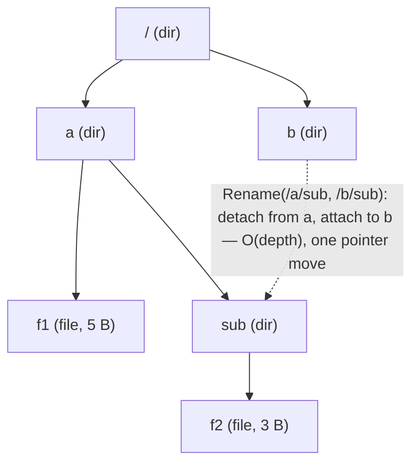
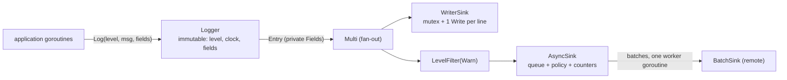
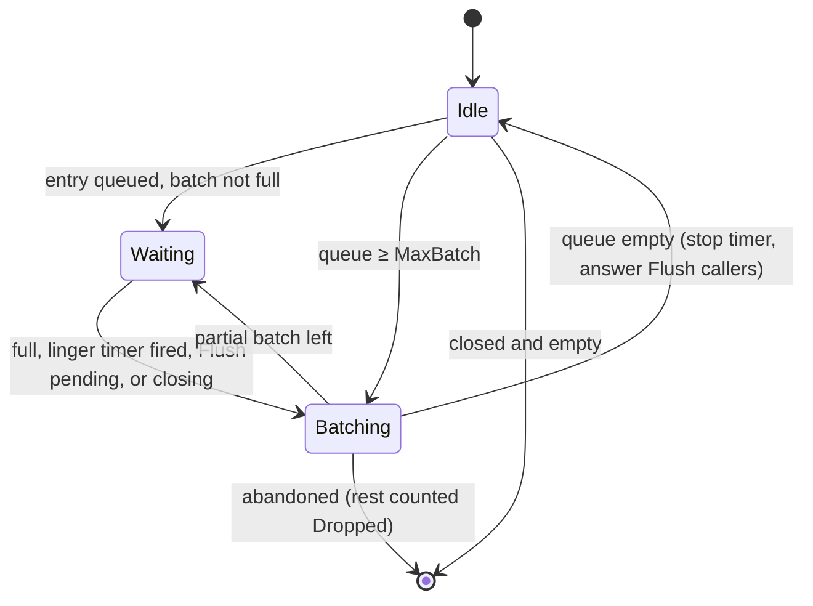

# B3 Unit 5 — Trees and sinks: in-memory file system, async logging

> Time: ~6 h · CORE: §1–§2 · Labs: `labs/b3/memfs`, `labs/b3/logx`

## Before you start

You should have finished B0 (channels, locks, context, bounded concurrency) and B2 (decorator in particular), and read
the module README's [How a timed attempt works](README.md#how-a-timed-attempt-works). Warm-up (answers below; write
yours down first):

1. A goroutine holds `RLock` on a `sync.RWMutex` and calls a function that takes `Lock` on the same mutex. What
   happens, and what does the race detector say?
2. Why does the B0 `batcher` flush from a single goroutine and never touch a batch after handing it to `flush`?
3. What is the difference between a *data race* and a *race condition*, and which one does `-race` find?

<details data-kind="answer"><summary>Warm-up answers</summary>

1. It deadlocks: `RWMutex` is not re-entrant and `Lock` waits for all readers, including the caller. The race detector
   reports nothing, because a deadlock is not a data race (B0 Unit 1 §3).
2. Ownership: one goroutine owns the in-progress batch, so no lock is needed, and handing the slice to `flush` transfers
   ownership, so nobody mutates it afterwards (B0 Unit 1 §2).
3. A data race is two unsynchronised accesses to the same memory, at least one a write: `-race` finds those when they
   execute. A race condition is a logical bug in the timing of correctly synchronised operations (check-then-act across
   two critical sections): `-race` cannot find it (B0 Unit 1 §4).

</details>

## How to work a problem section

Problem sections differ from the concept units in one way: **Build it comes before How it actually works**, because a
machine-coding problem is only practice if you attempt it before you see the reference design. The full protocol is in
the [module README](README.md#how-a-timed-attempt-works); in short:

1. Read *The failure story* and *The problem*. Only Stage 1 is visible; Stage 2 and Stage 3 sit in closed hint blocks
   and in the `stage2.go` / `stage3.go` stubs. Keep them closed until you reach them.
2. Write down your answers to the **Predict** blocks, then open the Reveals. These are the design decisions you make
   in the first ten minutes of the real round.
3. Start the clock and do the timed attempt in **Build it**, stage by stage, running the tests as you go.
4. Stop at the time box even if tests are red; note which stage you reached and where the minutes went.
5. Only then read *How it actually works*, *Common mistakes* and *The debrief*, score yourself on the rubric and say
   the 2-minute narration out loud once.

---
## §1 Problem 10 — In-memory file system

> **75 min** · focus: trees, path handling · CORE · lab `labs/b3/memfs` · ids `B3-U5-P01…P04`

Protocol reminder (full text in the unit's "How to work a problem section"): attempt in **Build it** before you read **How it actually works**, **Common mistakes** or **The debrief**.

### The failure story

A statement-export service on a credit-union platform assembles each credit union's month-end package in a staging
area: `/exports/cu-17/2026-09/statements/…`, thousands of PDFs per tenant, zipped and shipped when the run
finishes. For tests, someone wrote a tiny in-memory file system: a `map[string][]byte` keyed by the full path and a
`map[string]bool` of directory names. It took twenty minutes and it passed every test. Three things went wrong, in
this order.

1. **The prefix bug.** `RemoveAll("/exports/cu-1")` deleted every key with `strings.HasPrefix(key, "/exports/cu-1")`,
   which also removes `cu-10` through `cu-19`. The tests used one tenant at a time. Run in parallel for ten
   tenants, one test in nine cleaned up a sibling's files and failed with "file not found", never the same one twice.
2. **Directory operations scan everything.** `ls /exports/cu-17` iterates every key in the map to find children:
   ≈ 200,000 keys × ≈ 15 ns ≈ 3 ms per listing, while holding the lock that every writer needs. Moving a tenant's
   tree to `/archive` rewrites every key beneath it (≈ 20,000 delete+insert pairs) under the write lock, so every
   other goroutine stalls for ≈ 5–10 ms, and a crash halfway leaves the tree split across two names.
3. **No empty directories, no types.** `Mkdir` and `WriteFile` share one namespace, so a file can be created
   "inside" another file, and `ls` of a file returns nothing instead of an error.

None of it is exotic. All three come from choosing the wrong **data model** in the first ten minutes (a flat map
instead of a tree), and each fix means rewriting every method. In the interview the same thing plays out on a
smaller scale: a flat map is done in 15 minutes, and then "now add `Rename` for directories" arrives at minute 40.

### The problem

*As the interviewer says it* (you have **75 minutes**):

> "Design and implement an in-memory file system library in Go. It stores directories and files. Paths are
> absolute and slash-separated. Support creating directories, writing and reading files, and listing a directory.
> It'll be used from many goroutines. Start with the basics; I'll add requirements as we go."

Questions worth asking in the first two minutes (or state as assumptions, out loud):

- Absolute paths only? What do `.`, `..`, `//` and a trailing `/` mean? (Here: absolute only, cleaned lexically.)
- Are there symbolic links, permissions, owners? (No: out of scope; say so, because symlinks would make lexical
  `..` resolution wrong.)
- Case sensitive? Unicode names? (Case-sensitive byte strings; no name validation beyond what `path.Clean` does.)
- Does `WriteFile` need to create parent directories? (No: like `os.WriteFile`, the parent must exist.)
- What should errors look like? (Sentinel errors wrapped with the operation and path, checked with `errors.Is`.)
- How big can it get, and is it read-heavy or write-heavy? (Say "metadata-light, read-mostly; tens of thousands of
  nodes" and design for correctness first.)
- Who calls it concurrently, and do callers need multi-step atomicity? (Each call atomic; no transactions.)

**Stage 1 — basics (≈ minute 0–35).** `New`, `Mkdir`, `MkdirAll`, `WriteFile`, `ReadFile`, `List`. Path cleaning,
error semantics, defensive copies of file data. This is the whole of what you must show before minute 35.

<details data-kind="hint">
<summary>Stage 2 — the interviewer adds this at ≈ minute 35 (open only when you get there)</summary>

"Good. Now I want `Stat` with a modification time (injectable clock, please), `Remove` for files and *empty*
directories, `RemoveAll`, and `Rename`, which moves files or whole directories. Follow POSIX semantics when the
destination exists. Also a `Walk` that calls a callback for every node under a path."

Pay attention to: renaming a directory into its own subtree, renaming `/a` to `/ab` (a *sibling* whose name starts
with the same characters), callbacks that call back into the file system, and what a directory's `ModTime` means.

</details>

<details data-kind="hint">
<summary>Stage 3 — the interviewer adds this at ≈ minute 60 (open only when you get there)</summary>

"Last thing: a total size quota for the whole file system, a `du`-style `Usage`, and I want you to convince me it's
safe under concurrent use: a rejected write must not damage the old file, the quota must hold with a hundred
writers, and two directories renamed into each other at the same time must not corrupt the tree."

Pay attention to: check-then-act on the quota, `Rename` being atomic to observers, and whether `Walk` shows a
consistent view.

</details>

### Predict

<!-- predict id="B3-U5-P01" -->
**Predict.** You are choosing the data model. Option A: `map[string]*entry` keyed by full path. Option B: a tree of
nodes, each directory holding `map[string]*node` of children. For **each** of these operations, write down the
cost in Option A and in Option B, and one correctness bug that is easy to write in Option A: (1) `List("/a")` in a
file system with 100,000 nodes where `/a` has 5 children, (2) `Rename("/a", "/z")` where `/a` holds 20,000 files,
(3) `RemoveAll("/data")` when `/database` also exists.
<!-- /predict -->

<!-- predict id="B3-U5-P02" -->
**Predict.** What do `path.Clean` and your path-splitting code need to return for each of these? Write the cleaned
form, and say which ones must be `ErrInvalidPath`: `"/a/../../b"`, `"//a///b/"`, `"/"`, `"/.."`, `"a/b"`, `""`,
`"/a/b/../b/./c"`. Then say why resolving `..` *textually* (before looking anything up) is correct here, and what
single feature would make it wrong.
<!-- /predict -->

<!-- predict id="B3-U5-P03" -->
**Predict.** Your `Walk(root, fn)` holds `RLock` while it traverses and calls `fn` for each node. A caller's `fn`
calls `fs.WriteFile(p+".bak", …)`. What happens? Now fix it without giving up consistency: what are your two
options, and what does each cost?
<!-- /predict -->

<!-- predict id="B3-U5-P04" -->
**Predict.** You make `Rename` lock-per-node (hand-over-hand) so that unrelated renames run in parallel. Two
goroutines run at the same instant: `Rename("/p", "/q/p")` and `Rename("/q", "/p/q")`. Name two distinct ways this
can go wrong. What does a single `sync.RWMutex` around the whole tree cost you in comparison?
<!-- /predict -->

### Reveal

<details data-kind="reveal" data-for="B3-U5-P01">
<summary>Reveal</summary>

| Operation | Option A (flat map by full path) | Option B (tree of nodes) |
|---|---|---|
| `List("/a")` | O(N): scan all 100,000 keys and keep those whose parent is `/a` (≈ 1–3 ms) | O(children): iterate 5 map entries, then sort (≈ 1 µs) |
| `Rename("/a","/z")`, 20,000 files | O(subtree): delete and re-insert 20,000 keys, and a failure halfway leaves two half-trees | O(depth): detach one pointer from the old parent and attach it to the new one (≈ 1 µs) |
| `RemoveAll("/data")` | O(N) scan; `strings.HasPrefix(k, "/data")` also matches `/database/…` and deletes it | O(subtree) to free (or O(1) to unlink and let the GC do it), and it can only reach nodes below `/data` |

The bug in all three is the same: in Option A the *hierarchy is not represented*, so every directory operation
has to reconstruct it from strings, and string prefixes are not path prefixes (`/ab` starts with `/a`). In
Option B the hierarchy *is* the data structure, so "is X inside Y" is a question about pointers, and a sibling can
never be confused with a descendant. Tempting wrong answer: "Option A is simpler, add an index later". The index
is exactly the tree, built on the side and kept in sync, with two sources of truth to get wrong.

</details>

<details data-kind="reveal" data-for="B3-U5-P02">
<summary>Reveal</summary>

| Input | Result |
|---|---|
| `"/a/../../b"` | `/b` (`..` at the root stays at the root) |
| `"//a///b/"` | `/a/b` |
| `"/"` | `/` (root: zero components) |
| `"/.."` | `/` |
| `"a/b"` | **`ErrInvalidPath`**: not absolute (never silently treat it as `/a/b` or "relative to cwd"; there is no cwd) |
| `""` | **`ErrInvalidPath`**: `path.Clean("")` returns `"."`, which is not absolute |
| `"/a/b/../b/./c"` | `/a/b/c` |

Check the *raw* string for a leading `/` before cleaning: after `path.Clean`, `"a/../.."` becomes `".."`, and
`"."` for `""`, and you must not let those through. Reject NUL bytes too (a real OS would).

Resolving `..` lexically is correct only because there are **no symbolic links**: `/a/b/..` is `/a` no matter what
`b` is. With a symlink `b -> /x/y`, the kernel resolves `/a/b/..` to `/x`, not `/a`, so `..` must be applied during
the walk, one component at a time, after following each link. Symlinks are the standard "interviewer adds one more
feature" follow-up for exactly this reason.

</details>

<details data-kind="reveal" data-for="B3-U5-P03">
<summary>Reveal</summary>

**Self-deadlock.** `WriteFile` needs the write lock, and this goroutine already holds a read lock on the same
`RWMutex`. A Go `RWMutex` is not re-entrant, and the write lock waits for all readers to leave, including the
caller itself: `fatal error: all goroutines are asleep` in a test, a silent hang in a server (the accept loop keeps
the runtime from noticing). Worse, if some *other* goroutine is also waiting for the write lock, every new reader
queues behind it and the whole file system freezes. Rule: **never call user code while holding your lock.**

Two fixes:

1. **Snapshot, then call.** Under `RLock`, copy the entries (path + `Info`) into a slice; release the lock; then
   iterate and call `fn`. Consistent (one instant), lock-free callbacks, O(subtree) extra memory, and `fn` may see
   entries that no longer exist by the time it runs. This is the reference design.
2. **Lock per level / hand-over-hand.** Read-lock a directory, copy its child list, unlock, recurse. Less memory,
   but the view is *not* a single instant: a concurrent `Rename` can make a node appear twice, or not at all. That is
   fine for `ls -R` on a live system (real file systems behave this way) and not fine if you promised a consistent
   `Walk`.

Tempting wrong answer: "document that `fn` must not call the file system". It works until the first caller forgets,
and the failure mode is a hang.

</details>

<details data-kind="reveal" data-for="B3-U5-P04">
<summary>Reveal</summary>

Two distinct failures:

1. **Deadlock (lock-order inversion).** Goroutine 1 locks `/p` then wants `/q`; goroutine 2 locks `/q` then wants
   `/p`. Fix: always lock in a global order (for example by node ID or path), which also means finding both nodes
   before locking anything, which is itself racy.
2. **Cycle (the ancestor check races).** Each rename checks "is the destination inside the source?" and sees *no*,
   because it looked before the other rename happened. Both then succeed: `/p` becomes a child of `/q` and `/q` a
   child of `/p`. Neither is reachable from `/` any more: two orphaned subtrees pointing at each other, silently
   lost, and a `Walk` that follows children would loop forever. Real kernels serialise cross-directory renames
   with a per-file-system lock for exactly this reason (TODO-VERIFY: Linux's `s_vfs_rename_mutex`).

One `RWMutex` over the whole tree makes every operation atomic and linearizable, so neither failure is
representable. What it costs: all writers serialise, and readers wait while a writer holds the lock. With
operations that take ≈ 0.2–2 µs of work under the lock (path walk of depth 5–10, map lookups), a single lock
sustains on the order of 10⁶ operations per second before it is the bottleneck, far above what an in-process
metadata store sees. Fine-grained locking is a bigger design (and a longer interview) for a gain nobody measured.

</details>

### Build it

**Goal:** make `go test -race ./labs/b3/memfs/` pass, in stages, inside the time box.

Files: `labs/b3/memfs/memfs.go` (Stage 1), `stage2.go`, `stage3.go`. Tests: `memfs_test.go` (Stage 1 and shared
helpers), `stage2_test.go`, `stage3_test.go`. Do not open the next stage's files until you reach it.

```sh
go test -race -run 'Stage1' ./labs/b3/memfs/     # first 35 minutes
go test -race -run 'Stage[12]' ./labs/b3/memfs/  # by minute 60
go test -race -count=20 ./labs/b3/memfs/         # before you call it done
```

| Minutes | Do |
|---|---|
| 0–10 | Ask questions, state assumptions, draw the tree on paper: node fields, who owns what, the lock. Write the error table. **Decide the lock now.** |
| 10–35 | Stage 1. Write `split`/`walk` helpers first; every method is then ≈ 15 lines. Run Stage 1 tests as each method lands. |
| 35–60 | Stage 2. `Rename` is the long pole: write down the case table before the code. |
| 60–75 | Stage 3. Quota under the same lock as the write. Then read your own code once, as the interviewer would, for the concurrency note. |

Acceptance, per stage: all `TestStage1_*` (8 tests), `TestStage2_*` (12), `TestStage3_*` (10) pass with `-race`. Stage 3 includes
concurrent tests (200 writers racing a quota, observers racing `Rename`, opposite renames, a mixed random workload),
so a green Stage 1 says nothing about them. When a test fails, read the message: each one says which property
broke and why it matters.

**Self-check before you read on:** write the 5-line "concurrency note" you would say aloud: what is shared, who
owns it, which lock guards it, what each operation holds it across, and what you do about callbacks.

### How it actually works

*(Read this after your attempt. Compare with your own design, not with your code.)*

**Data model.** A tree of nodes; directories own a `map[string]*node`, files own their bytes.



```go
type node struct {
	name     string
	dir      bool
	data     []byte           // files only
	children map[string]*node // directories only
	mod      time.Time
}

type FS struct {
	mu   sync.RWMutex
	root *node
	now  func() time.Time
	max  int64 // quota; 0 = unlimited
	used int64 // bytes in files, maintained incrementally
}
```

**Path handling, once.** Every public method starts with `parts, err := split(p)`: reject non-absolute and NUL,
`path.Clean`, split on `/`. The root is the empty slice. All lookups walk `parts` from the root; one `walk`
function returns `ErrNotExist` for a missing component and `ErrNotDir` when it must step *through* a file. Nothing
else in the package parses strings, so there is exactly one place where `/ab` vs `/a` could go wrong, and it
compares components, never substrings.

**Locking model.** One `sync.RWMutex` over the whole tree. Mutators take `Lock`, readers `RLock`, and every public
method takes the lock **once**, after path parsing and before the first tree access, and holds it to the end. No
method calls another public method while holding the lock (they call the unexported `walk`/`parentOf` helpers),
and no user callback ever runs under it. That gives atomicity for free: `Rename` is just three pointer
operations inside one critical section.

**Rename, as a decision table.** Check in this order, mutate last, so a failure changes nothing:

| Step | Check | Error |
|---|---|---|
| 1 | both paths valid, neither is `/` | `ErrInvalidPath` |
| 2 | source exists | `ErrNotExist` |
| 3 | source is a directory and destination is strictly inside it (component-wise prefix) | `ErrInvalidMove` |
| 4 | destination parent exists and is a directory | `ErrNotExist` / `ErrNotDir` |
| 5 | same node after cleaning | no-op, `nil` |
| 6 | destination exists: file→file replaces; dir→empty dir replaces; file→dir `ErrIsDir`; dir→file `ErrNotDir`; dir→non-empty dir `ErrNotEmpty` | as listed |
| 7 | mutate: unlink from old parent, set `name`, link into new parent, adjust `used` if a file was replaced, bump both parents' `mod` | |

**Walk.** Under `RLock`, build a pre-order slice of `(path, Info)` with children sorted by name; unlock; then call
`fn` per entry. `ErrSkipDir` skips entries whose path starts with `dir + "/"` (component-aware again, so
`/a/skipme-not` is not skipped). Cost: O(subtree) memory per walk.

**Quota.** `used` is maintained incrementally (`+= len(new) - len(old)` on write, `-= size` on remove/replace),
checked in the same critical section as the write: `if max > 0 && used+delta > max { return ErrNoSpace }` *before*
touching the node, so a rejected overwrite leaves the old bytes alone. `Usage` is a recursive count (O(subtree));
the invariant `used == sum of file sizes` is checked by the mixed-workload test.

**Complexity.** `walk` is O(depth) map lookups; `List` O(c log c) for c children (sort for determinism);
`Rename` O(depth); `RemoveAll` O(subtree) only to adjust `used`; `Walk` O(subtree).

### Break it

Do these on your passing solution. Predict the failing test and the message before you run it.

1. In your `Rename`, replace the "is the destination inside the source" check with
   `strings.HasPrefix(newp, oldp)`. Which test fails, and what does the failure look like?
2. In `Walk`, hold the read lock while calling `fn` (`defer fs.mu.RUnlock()` instead of unlocking before the loop).
3. Remove the defensive copy in `WriteFile` (`buf := data`).
4. In `WriteFile`, release the lock between the quota check and the write (unlock, `runtime.Gosched()`, lock).
5. Remove the `RLock` from `ReadFile`.

<details data-kind="answer"><summary>What you should see</summary>

1. `TestStage2_RenameSiblingWithSharedStringPrefix`: `Rename(/a, /ab) = rename /ab: memfs: cannot move a
   directory into itself, want nil`. Only this test notices: the bug passes every test that uses unrelated names.
2. `TestStage2_WalkCallbackMayCallBackIntoTheFS` after exactly 5 s: "Walk whose callback writes to the file system
   did not finish within 5s (deadlock…)". `-race` reports nothing; a deadlock is not a data race.
3. `TestStage1_DataIsCopiedBothWays`: "file content changed to "Xriginal" after the caller mutated its slice".
   Without `-race` the aliasing is silent; with concurrent callers it becomes a real data race.
4. `TestStage3_ConcurrentQuotaIsNeverExceeded`: more than 10 of the 200 writers succeed (or the sampling reader
   sees > 1000 bytes). The quota check passes for several goroutines, then they all write. This is the same
   check-then-act shape as the B0 `safemap.Update` lesson, with a lock held around each half but not around both.
5. `TestStage3_MixedOperationsKeepTheTreeConsistent` under `-race`: `WARNING: DATA RACE` with the read in `walk`
   and the write in `Mkdir`/`WriteFile`/`Rename`. In production, without `-race`, it would be `fatal error:
   concurrent map read and map write` and a dead process.

</details>

### In the wild

- **POSIX `rename(2)`** is the specification you are copying: atomic with respect to other processes, replaces an
  existing file, replaces an *empty* directory, fails with `ENOTEMPTY` for a non-empty one, `EISDIR`/`ENOTDIR` for a
  file/directory mismatch, and `EINVAL` when a directory would become its own descendant. `os.Rename` calls it on
  Unix.
- **The Linux VFS** is a tree of in-memory `dentry` objects (name + parent + child list) in front of per-file-system
  `inode`s; path lookup walks components with a dentry cache, which is your `walk`. `tmpfs` is the same idea with
  pages in RAM. Cross-directory renames take a per-superblock mutex so the ancestor check cannot race
  (TODO-VERIFY: exact lock name and conditions).
- **Go's `io/fs` and `testing/fstest.MapFS`.** `fs.FS` is a read-only interface (`Open`). `MapFS` is the *flat map*
  design from the failure story, and it works because it is immutable test data with no `Rename`: directories are
  synthesised from path prefixes on demand. Your problem is the read-write case where that stops working.
- **Persistent trees.** Immutable, path-copying trees (HAMT-style in Clojure and Scala, Merkle trees in Git
  and IPFS) give lock-free readers and cheap snapshots: a `Rename` creates a new root sharing everything but the
  changed spine. Git trees are exactly "directory = sorted list of (name, hash)".

### Trade-offs

| Option | Wins when | Loses when | When the answer flips |
|---|---|---|---|
| Tree of nodes + one `RWMutex` (reference) | Metadata-sized ops, correctness first, ≤ ~10⁶ ops/s | Writers serialise; many cores hammering writes | Profile shows lock wait > ~10–20% of time: shard by top-level directory (rename across shards then needs two locks in a fixed order) |
| Flat `map[string]` keyed by full path | Immutable data, no directory ops (`fstest.MapFS`) | Any directory `List`, `Rename` or `RemoveAll`; prefix bugs | Never for a mutable FS with directory operations |
| Per-node locks (hand-over-hand) | Huge trees with disjoint hot subtrees, long-running ops | Rename (lock ordering, ancestor races), big complexity | When one global lock is a *measured* bottleneck and you can afford a global rename mutex |
| Immutable tree + `atomic.Pointer[root]` | Read-heavy, wants cheap consistent snapshots (`Walk`, `Usage`) | Every write copies the spine (O(depth) allocation), writers still serialise on the CAS/mutex | Snapshot reads dominate and writes are rare, or you need MVCC / time travel |
| `Walk` as a snapshot slice | Consistent view, callbacks free to re-enter | O(subtree) memory | Subtree too big: lazy per-directory iteration with documented weaker semantics |
| Lexical `..` resolution | No symlinks | — | Symlinks appear: resolve component by component while walking |

### Senior bar

**Rubric (score yourself per row, then send the code to the tutor).** *Meets* needs a row at "meets" or better on
every row, with no "below".

| Dimension | below | approaching | meets (senior bar) | exceeds |
|---|---|---|---|---|
| Extensibility | Flat map; Stage 2 means a rewrite | Tree, but path logic duplicated in every method; Stage 2 touches Stage 1 code | Tree + one `split`/`walk`; Stage 2 and 3 added in new files without editing Stage 1 methods (except to add the quota check) | Also sketches symlinks, permissions and watchers as follow-ups, naming which functions change |
| Concurrency safety | No lock, or lock released between check and act | Lock exists but `Walk` calls `fn` under it, or `Rename` is two critical sections | One lock, every method atomic, no callbacks under the lock, quota checked and applied together; passes `-race -count=20` | Argues linearizability, names the fine-grained alternatives and why rename breaks them |
| Clean interfaces | Returns internal slices/maps; unwrapped bare errors | Sentinels exist but are compared with `==` or lack path context | Defensive copies both ways; `*PathError` with `Unwrap`; documented error table; callbacks documented | Small consumer-side interface (`type Reader interface{ ReadFile… }`) shown for testability / `fs.FS` adapter |
| Tests | Happy path only | Edge cases but no concurrency | Own tests for error table, `Rename` matrix, prefix bug, plus one concurrent test under `-race` | Property test against a flat-map model; a deliberately broken variant shown to fail a test |
| Time management | Nothing running at minute 35 | Stage 1 at 35, Stage 2 incomplete at 60 | Stage 1 by 35, Stage 2 by 60, Stage 3 or an honest status by 75, with a spoken concurrency note | Stage 3 by 65 and time left for the note and a refactor |

**Failure modes in production use.** Unbounded memory (no quota → one tenant's export fills the heap; quota is a
safety feature, not a feature request). `Walk` on a huge tree allocating a large snapshot (cap with a limit or a
lazy walker). Lock hold times growing with subtree size (`RemoveAll` and `Usage` are O(subtree) under a lock;
tolerable at 10⁴ nodes, an incident at 10⁷). Time: `ModTime` from a clock that goes backwards.

**Numbers.** Uncontended `RWMutex` lock+unlock ≈ 20–30 ns; map lookup per path component ≈ 20–50 ns; a depth-6 path
walk ≈ 0.2–0.5 µs (≈ ranges; benchmark on your box). 100,000 files × ≈ 100 B of node overhead ≈ 10 MB, so memory is
dominated by file contents, which is why the quota exists.

**Interviewer probes**

<details data-kind="answer"><summary>"Make `Rename` not block readers of unrelated directories."</summary>

First ask whether it is a measured problem: a rename holds the write lock for ≈ 1 µs. If it genuinely is, I would
shard the tree by top-level directory (each shard its own `RWMutex`), take one lock for same-shard operations and
two locks in a fixed (shard-index) order for cross-shard renames, and add a global rename mutex so the
"destination inside source" check can't race. I would say out loud that this is where I stop being able to
promise simple linearizability, and I would keep a stress test that compares against the single-lock version.
The alternative is an immutable tree behind `atomic.Pointer`, which makes readers lock-free at the price of
copying the spine on every write.

</details>

<details data-kind="answer"><summary>"Add symbolic links."</summary>

A new node kind with a target path. Lexical `Clean` is no longer valid: path resolution must go component by
component, following links, applying `..` to the *resolved* directory, with a depth limit (Linux uses 40 nested
links) to catch loops. `Rename` of a link renames the link, not the target; `Remove` removes the link; `Stat` needs
an `Lstat` sibling. All of this lives in `walk`, which is why having exactly one resolver mattered in Stage 1.

</details>

<details data-kind="answer"><summary>"How would you persist it?"</summary>

An append-only log of mutations (op, path, args, timestamp) fsynced in batches, replayed on start, with periodic
snapshots of the tree to bound replay time. The in-memory tree stays the source of truth for reads. Each public
method becomes "validate under the lock, append to the log, then apply", so replay applies only operations that
already succeeded. This is the same shape as the WAL in A2 and E2.

</details>

<details data-kind="answer"><summary>"Two goroutines write the same new file at the same time. What happens?"</summary>

Both calls take the write lock in some order; the second sees the file the first created and overwrites it. The
final content is whichever ran last, which is legal: `WriteFile` is atomic per call and has last-writer-wins
semantics, like `os.WriteFile`. If the caller needs create-exclusive semantics I would add `CreateExclusive`
returning `ErrExist` (the `O_EXCL` flag), not change `WriteFile`.

</details>

### Common mistakes

| Mistake | How the tests catch it | Fix |
|---|---|---|
| Flat `map[string]` keyed by path | Stage 2 `Rename` of a directory moves nothing, or the whole attempt becomes a rewrite | Tree of nodes from minute 10 |
| `strings.HasPrefix` for "inside" / "skip" checks | `TestStage2_RenameSiblingWithSharedStringPrefix`, `TestStage2_WalkSkipDir` | Compare components (`isPrefix([]string, []string)`) |
| Not cleaning the path, or cleaning `""`/relative paths into valid ones | `TestStage1_PathsAreCleaned`, `TestStage1_InvalidPathsRejectedEverywhere` | `split` once: check leading `/` on the raw string, then `path.Clean` |
| Returning `n.data` or storing the caller's slice | `TestStage1_DataIsCopiedBothWays` | `append([]byte(nil), data...)` both ways |
| `List` returns full paths, or unsorted map order | `TestStage1_ListIsSortedNamesOnly` | Names only, `sort.Strings` |
| `MkdirAll` creates some directories, then fails | `TestStage1_MkdirAll` (the directory listing after the failed call) | Walk and create in one pass; a file in the way can only appear *before* the first missing component |
| `Rename` mutates, then discovers the destination is invalid | `TestStage2_RenameInvalid` (listing after the failed renames) | Validate everything, mutate last |
| Forgetting `used -= len(replaced)` when `Rename` overwrites | `TestStage3_QuotaAccountingTracks…` | Every path that deletes or replaces a file adjusts `used` |
| Truncating the file before the quota check | `TestStage3_FailedOverwriteLeavesOldContent` | Compute the delta first; mutate after the check passes |
| Calling `fn` (or any user code) under the lock | `TestStage2_WalkCallbackMayCallBackIntoTheFS` (deadlock after 5 s) | Snapshot under the lock; call after releasing |
| `defer mu.Unlock()` missing on an early-return path | Hang in the next test, or `-race` stress test deadlocks | Lock + `defer Unlock` on the line after, in every method |

### The debrief: the senior-level design choices

1. **Model the hierarchy, don't simulate it.** The decision made in minute 5 is the one that decides whether
   Stage 2 is 25 minutes or a rewrite. A tree makes directory operations pointer operations and removes a whole
   class of string bugs. *In the interview, say:* "I'll represent directories as nodes with child maps, because
   the follow-ups will all be tree operations."
2. **One parser, component-wise.** All path semantics (absolute only, cleaned lexically, NUL rejected, root =
   zero components) live in `split`; all traversal in `walk`. Every sentinel error has exactly one place it is
   produced. This is "clean interfaces" applied to the inside of a package.
3. **Mutate last, check first.** Every mutator validates everything it can, then changes the tree in one
   uninterrupted step. That is what makes "a failed call changes nothing" cheap to promise (and to test).
4. **One lock, taken once, never across a callback.** The simplest locking model that gives linearizable
   operations. The senior move is not fine-grained locking; it is *knowing why you don't need it* (≈ 1 µs
   critical sections) and *what you would do if a profile said otherwise*.
5. **Make atomicity visible to observers.** `Walk` snapshots because "Rename is atomic" is a promise about what
   other goroutines can *see*, and the only way to see two nodes at once is a view taken at one instant.
6. **Copy at the boundary.** Data crosses the API twice; both crossings copy. The cost is a `memcpy` the caller
   would otherwise pay in a data race.
7. **Quota with the write, not near it.** Check-then-act is the concurrency bug that survives `-race`; putting
   the check and the effect inside one critical section is the whole fix.
8. **Errors are values with context.** `*PathError` + sentinels + `errors.Is` is Go's convention (`fs.PathError`
   in the standard library has the same shape), and it keeps the error table testable.

**The 2-minute narration** (say it aloud once after your attempt): "State is a tree of nodes under one
`sync.RWMutex`; the lock guards the tree, the `used` counter and `max`. Every public method parses its path
outside the lock, then takes the lock once and holds it until it returns. No method calls another public method
under the lock and no callback runs under it: `Walk` copies a snapshot under `RLock` and calls the callback
afterwards. Rename validates first and mutates last, in one critical section, so observers see the file at the
old path or the new one, never neither. The quota check and the write share a critical section. Evidence: the
concurrent quota test, the rename-observer test, and the mixed workload with an accounting invariant, all under
`-race -count=20`."

**What the interviewer adds next** (Stage 4, if there's time): symlinks; permissions and owners; file handles with
offsets (`Open`/`Read`/`Seek`); watchers (`Subscribe(path)` → events, with a slow-subscriber policy: you built
that in B0); a persistent log; or "make `ReadFile` zero-copy". Each one maps onto a function you already have
a single place for.

### Check yourself

1. Why is `strings.HasPrefix(a, b)` the wrong test for "a is inside directory b", and what is the right one?
2. Which two things must happen inside the *same* critical section for a quota to hold under concurrency?
3. Why can't `Walk` just hold the read lock for the whole traversal?
4. Why does `Rename` check `ErrInvalidMove` before it checks the destination's parent?

<details data-kind="answer"><summary>Answers</summary>

1. `/ab` starts with `/a` but is a sibling. Compare cleaned path *components*: `b`'s components must be a proper
   prefix of `a`'s.
2. The comparison `used + delta > max` and the application of the write (`used += delta`, node updated). Anything
   between them lets several writers pass the check on the same free space.
3. The callback may re-enter the file system, and `RWMutex` is not re-entrant: a callback that writes would wait for
   the very read lock its caller holds. Snapshot under the lock, call after releasing it.
4. Any order that validates everything before mutating is correct; checking `ErrInvalidMove` first gives the most
   specific error for the common mistake. If the destination's parent is inside the source, the parent lookup
   *succeeds* (the subtree still exists), so skipping the ancestor check would sail through, and the mutation would
   create a cycle.

</details>

---

## §2 Problem 11 — Logging library with async batching sinks

> **60 min** · focus: decorator, backpressure · CORE · lab `labs/b3/logx` · ids `B3-U5-P05…P08`

Protocol reminder (full text in the unit's "How to work a problem section"): attempt in **Build it** before you read **How it actually works**, **Common mistakes** or **The debrief**.

### The failure story

A credit-union platform logs every request: ≈ 12 lines per request, 2,000 requests/s at peak, so ≈ 24,000 lines/s,
shipped to a central log aggregator over HTTPS. The first version of the logger calls the shipper synchronously,
once per line. In staging the shipper answers in ≈ 5 ms, so each request spends ≈ 12 × 5 ms = 60 ms in logging,
which nobody notices. On a Friday the aggregator degrades to ≈ 800 ms per call.

1. **Synchronous logging.** Each request now spends ≈ 9.6 s inside `log.Info`. By Little's law, in-flight requests go from
   2,000 × 0.1 s = 200 to 2,000 × 9.6 s ≈ 19,000. The service runs out of connections and goroutines; health checks
   time out; the load balancer ejects healthy pods. The outage is caused by the *log pipeline*, not by anything the
   service was doing.
2. **"Make it async": `go ship(line)`.** 24,000 goroutines start per second. With the aggregator hanging until its
   10 s client timeout that is 240,000 live goroutines, each holding an HTTP request on its stack (≈ 8 KB each, so ≈ 2 GB).
   The pods are OOM-killed instead of slow.
3. **"Use a queue": an unbounded slice.** 24,000 lines/s × ≈ 300 B ≈ 7 MB/s, so ≈ 2 GB after five minutes. Same OOM, slower fuse.
4. **"Use a bounded channel": `ch <- line` blocks when full.** Back to failure 1: the request goroutine is parked on a
   log call, and its latency is the aggregator's latency.

Two quieter failures follow once the pipeline is bounded. A deploy sends `SIGTERM`; the process exits with the last
second of lines (the ones describing the crash) still in memory. And a login endpoint logs the username verbatim:
a user named `bob\n2026-… ERROR admin password reset` forges a log line that an on-call engineer will read as real.

The senior answer is not a trick; it is four explicit decisions: a **bounded queue**, a **batch** per network call
(500 lines per POST is ≈ 48 calls/s instead of 24,000), a **named overflow policy** (drop, and count what you drop), and
a **shutdown that has a deadline and a result**.

### The problem

*As the interviewer says it* (you have **60 minutes**):

> "Build a small structured logging library in Go. A logger has levels and structured fields, and writes to one or
> more destinations. One destination ships batches to a remote service that can be slow or down, and the application
> must not suffer for that. It will be used from thousands of goroutines. Start with the basics; I'll add things as
> we go."

Questions worth asking in the first two minutes (or state as assumptions, out loud):

- Is logging allowed to lose entries? Which ones, and when? (Debug/info: yes, counted. Audit events: no, and then it is the wrong tool.)
- Does a caller ever wait for the destination? (Default no; blocking only by explicit opt-in.)
- Ordering: per goroutine, or global? (Per goroutine; entries from different goroutines have no meaningful order.)
- Sink errors: should they reach the caller? (No: a logger never fails or panics its caller. They go to a hook and a counter.)
- Shutdown: how long may it take, and what happens to what is left? (Bounded; report the count.)
- Where does the clock come from? (Injected.) Do fields have a fixed set of types? (No: `any`, formatted with `fmt.Sprint`.)

**Stage 1 — decorators (≈ minute 0–25).** `Logger` with levels and `With`; the `Sink` interface; `LevelFilter`, `Multi`,
and a `WriterSink` that formats one entry as one line, with a mutex so lines never interleave.

<details data-kind="hint">
<summary>Stage 2 — the interviewer adds this at ≈ minute 25 (open only when you get there)</summary>

"The remote destination takes a batch. Write an `AsyncSink` that wraps a `BatchSink`: bounded queue, one background
goroutine, batches by size *or* by linger time, a policy for a full queue (block, drop the newest, drop the oldest),
`Flush`, `Close` that drains, and `Stats`. A slow destination must not slow the code that logs."

Pay attention to: who owns the slice you pass to `WriteBatch`, the linger timer of a batch that was flushed by size,
what `Flush` promises, and what a blocked writer sees when `Close` is called.

</details>

<details data-kind="hint">
<summary>Stage 3 — the interviewer adds this at ≈ minute 45 (open only when you get there)</summary>

"The destination will fail, sometimes with a panic. Retry with backoff, then give up on that batch and carry on. I
want to see every failure reported. And `Close` must not hang forever: if the deadline passes, tell me what you
couldn't flush. Finally, prove no entry is silently lost."

Pay attention to: a panic inside a goroutine you started, a retry sleep that outlives the shutdown, and the identity
`Received == Written + Dropped + Failed`.

</details>

### Predict

<!-- predict id="B3-U5-P05" -->
**Predict.** A first-draft `With` is `child := *l; child.fields = append(l.fields, fields...); return &child`. What
does this print?

```go
base := root.With(F("a", 1)).With(F("b", 2)).With(F("c", 3))
s1 := base.With(F("d", 4))
s2 := base.With(F("e", 5))
s1.Info("one")
s2.Info("two")
```

Write the fields of both lines, explain why, and say what makes the bug invisible in a test that creates only one
child per parent.
<!-- /predict -->

<!-- predict id="B3-U5-P06" -->
**Predict.** The queue of your `AsyncSink` is full because the destination has been stuck for a minute. Three
policies: block the caller, drop the newest entry, drop the oldest queued entry. For each one write down (1) what the
calling goroutine observes, (2) which entries survive, (3) a kind of log line for which that policy is the right
default and one for which it is dangerous. Then say which you would make the zero value of `Policy`.
<!-- /predict -->

<!-- predict id="B3-U5-P07" -->
**Predict.** `Linger` is 1 s and `MaxBatch` is 3. At t = 0 entry 1 arrives and the worker starts a linger timer T1.
At t = 0.1 s entries 2 and 3 arrive and the batch is flushed by size. At t = 0.9 s entry 4 arrives. If T1 was *not*
stopped, when is entry 4 written, and why does it matter even though no entry is lost? Then: if you do stop T1,
what can still go wrong with the channel it returned (think about `Stop` racing a timer that has just fired)?
<!-- /predict -->

<!-- predict id="B3-U5-P08" -->
**Predict.** `Close(ctx)` is called with a 2 s deadline while the destination's `WriteBatch` has been blocked for a
minute. There are 3 entries in the in-flight batch and 40 in the queue. Who is waiting for whom? What are your
options when the deadline passes, which one do you pick, and what exactly do you return to the caller? What should
`Stats` say afterwards, once the destination finally returns?
<!-- /predict -->

### Reveal

<details data-kind="reveal" data-for="B3-U5-P05">
<summary>Reveal</summary>

`one` prints `a=1 b=2 c=3 e=5` and `two` prints `a=1 b=2 c=3 e=5`: **both** carry `e`, and `d` is gone.

`append` grows capacity 1 → 2 → 4, so after three `With` calls `base.fields` has length 3 and capacity 4. `base.With(d)`
writes `d` into the spare slot of that shared backing array and returns a slice of length 4; `base.With(e)` writes `e`
into *the same slot*. Both children now hold length-4 views of one array. Your test passes if each parent has one
child (the append reallocates, or nobody overwrites), and fails only under siblings, which is also how it fails in
production: a request-scoped child logger derived from a shared logger, in two goroutines, with fields leaking
between requests (a tenant ID from one request showing up in another's log lines is a data-isolation incident in a
multi-tenant platform).

The fix is to never append into a slice you don't own: allocate `make([]Field, 0, len(a)+len(b))`, then append both.
A related trap: `Log(msg, fields...)` receives the caller's slice; if you store it (no `With` fields, so it
"needs no copying"), the caller's later mutation changes your entry.

</details>

<details data-kind="reveal" data-for="B3-U5-P06">
<summary>Reveal</summary>

| Policy | The caller observes | Survivors | Right for | Dangerous for |
|---|---|---|---|---|
| **Block** | `Write` stops until space appears: its latency is the destination's latency (failure 4 in the story) | Everything, in order | A batch job or CLI where the log *is* the output, or a test | Any request path |
| **DropNewest** | `Write` returns at once; the new entry vanishes | The oldest queued entries: the lead-up to the outage | Debug/info chatter; protecting the service; cheapest to implement | When the *latest* line matters most (a crash report) |
| **DropOldest** | `Write` returns at once; the queued head is evicted | The most recent entries | "What is happening *now*" views, tailing | Reconstructing how a failure started |

None is correct for audit events: a regulator-grade record must not depend on a lossy queue at all (that needs a
transactional outbox, discussed in the debrief). For the zero value pick **DropNewest**: a library whose default can
take the host application down is a worse library, and the safe default needs no goroutine bookkeeping. Whatever you
pick, count it: `Dropped` must be visible, and a silent drop is a bug. Tempting wrong answer: "block, because losing
logs is unacceptable". The unacceptable thing is the outage; the logs of an outage are lost anyway if the process dies.

</details>

<details data-kind="reveal" data-for="B3-U5-P07">
<summary>Reveal</summary>

Entry 4 is flushed at t = 1.0 s, only 0.1 s after it arrived, as a batch of one. Nothing is lost, so every
correctness assertion on "all entries delivered" passes. What breaks is the *batching*: under steady load there is
always an old timer about to fire, so batches get cut short, the number of destination calls climbs back towards one
per line, and the destination (the thing batching was protecting) sees the original load. A latency/throughput
regression with a clean test suite is the signature of a timer bug.

If you do stop T1, the second trap is the channel: `Stop` returns `false` when the timer has already fired, and (with the
pre-Go 1.23 timer semantics this repo's `go 1.22` line selects) the tick can still be sitting in the channel buffer. A
worker that keeps selecting on the same channel reads that stale tick and flushes the *next* batch early. Rules:
one timer per batch, created when the first entry starts waiting; when the batch goes out, stop the timer *and drop
your reference to its channel*; never reuse a channel across batches. Injecting the timer factory (as in the B0
`batcher` lab) is what lets a test fire the stale timer on purpose. `TestStage2_AStaleLingerTimerDoesNot…` does.

</details>

<details data-kind="reveal" data-for="B3-U5-P08">
<summary>Reveal</summary>

`Close` waits for the worker; the worker waits inside the destination's `WriteBatch`; the destination waits for the
network. Nothing you own is making progress, and `Close` cannot interrupt a call into code it does not control. Options at the
deadline: (a) keep waiting (no: that is the hang); (b) return immediately and leave the worker running (it will
quietly drain 40 more entries to a dead destination and mutate state after the caller believes it is closed); (c)
**stop waiting, tell the worker to abandon**, and report. Pick (c): mark the sink abandoned, cancel the context the
worker uses for retry sleeps so it never sleeps through the shutdown, and let the worker exit as soon as the call it
is stuck in returns, counting the queued entries as `Dropped` instead of writing them.

Return an error that carries the number of entries not delivered (43 here: 3 in flight + 40 queued) and wraps the
context error, so the caller can `errors.Is(err, context.DeadlineExceeded)` *and* log "lost 43 log lines on
shutdown". When the destination finally returns, the in-flight 3 are written (or failed), the 40 are `Dropped`, and
`Received == Written + Dropped + Failed` still holds. The principle: *every wait has a bound, and every bound has a
result*. Tempting wrong answer: "just `os.Exit` after the deadline": that is (c) without the report.

</details>

### Build it

**Goal:** make `go test -race ./labs/b3/logx/` pass, in stages, inside the time box.

Files: `labs/b3/logx/logx.go` (Stage 1), `stage2.go`, `stage3.go`. Tests: `logx_test.go` (Stage 1 and shared helpers),
`stage2_test.go`, `stage3_test.go`. Do not open the next stage's files until you reach it.

```sh
go test -race -run 'Stage1' ./labs/b3/logx/       # first 25 minutes
go test -race -run 'Stage[12]' ./labs/b3/logx/    # by minute 45
go test -race -count=20 ./labs/b3/logx/           # before you call it done
```

| Minutes | Do |
|---|---|
| 0–8 | Questions and assumptions. Draw the pipeline: Logger → decorators → sinks. Write the ownership table: who owns an `Entry`'s slice, who owns a batch, who closes what. Decide the queue policy default. |
| 8–25 | Stage 1. `Entry` construction and `With` first (that is where the aliasing bug lives); then `LevelFilter`, `Multi`, `WriterSink`. |
| 25–45 | Stage 2. Sketch the worker loop on paper before coding: what does it wait on, and what are its states? |
| 45–60 | Stage 3. Retries and panic containment are small; the bounded `Close` is the design problem. Leave 5 minutes for the narration. |

Acceptance, per stage: all `TestStage1_*` (12 tests), `TestStage2_*` (16), `TestStage3_*` (10) pass with `-race`. Stage 2
and 3 tests inject a timer factory (`AsyncConfig.NewTimer`) and a sleeper (`FailurePolicy.Sleep`), so nothing waits
for real time; every wait has a 5 s timeout, so a wrong implementation fails with a message rather than hanging.
Note that **a panic in a goroutine your code starts kills the whole test binary**: if you see `panic: boom` and no
test names, the panic escaped your worker.

**Self-check before you read on:** write the 5-line "concurrency note": which goroutine calls the destination, what
protects the queue and the counters, how a blocked writer is woken, what `Flush` waits for, and how `Close` gives up.

### How it actually works

*(Read this after your attempt. Compare with your own design, not with your code.)*

**Pipeline.** Everything is a `Sink`. Decorators wrap sinks; only the `AsyncSink` owns a goroutine.



| Piece | Owns | Does not own |
|---|---|---|
| `Logger` | its (immutable) options and `With` fields | the sink, which is shared and must be concurrency-safe |
| `LevelFilter`, `Multi` | nothing: stateless wrappers | the sinks they forward to (nobody closes through a decorator) |
| `WriterSink` | the mutex that serialises writes | the `io.Writer` (the caller closes the file) |
| `AsyncSink` | queue, counters, worker goroutine, timer, retry sleeps | the destination; it calls it but doesn't close it |
| `Entry` | its `Fields` slice (private per entry) | — |
| a batch | the destination, from the moment `WriteBatch` is called | — |

**Logger.** Immutable after `New`, so it needs no lock. `Log` checks the level first, so a disabled call costs one
comparison (no clock read, no field copy), then builds one `Entry` with a freshly allocated `Fields` slice
(`With` fields first, then the call's). `With` allocates `make([]Field, 0, n)` and appends both parts.

**AsyncSink state, one mutex.**

```go
type AsyncSink struct {
	dst BatchSink; cfg AsyncConfig; fp FailurePolicy
	mu      sync.Mutex
	notFull *sync.Cond     // Block writers wait here
	queue   []Entry        // bounded by cfg.QueueSize
	closed, abandon bool
	stats   Stats
	wake    chan struct{}      // cap 1: "something changed" for the worker
	flushCh chan chan struct{} // Flush requests, handled by the worker
	done    chan struct{}      // closed when the worker exits
	wctx    context.Context    // cancelled when Close gives up
}
```

`Write` takes the lock once, applies the policy (`DropNewest`: count and return; `DropOldest`: `queue = queue[1:]`
and count; `Block`: `cond.Wait()` in a loop), appends, counts `Received`, and pokes `wake` (non-blocking send into a
channel of capacity 1: a poke already pending is as good as two). A mutex-protected slice rather than a channel
because `DropOldest` must remove from the head and the counters must change *atomically* with the queue; a buffered
channel can do `DropNewest` with `select/default`, but evicting the oldest from the producer side races the consumer
and splits "queue changed" from "counter changed" into two steps.

**The worker is the only goroutine that calls the destination.** That one fact gives: batches in queue order, no
concurrent `WriteBatch` calls to reason about, retries that don't reorder, and a single owner for the timer.



The loop is: *take* a batch under the lock (up to `MaxBatch`, sub-sliced so the worker owns that part of the backing
array; the destination still gets its own copy per attempt); write it outside the lock; repeat while there is a
reason to flush; then `select` on `wake`, the linger timer's channel, and `flushCh`. `Flush` sends a request to the
worker and waits for it to close the reply: the worker answers when the queue it saw is empty, which includes
everything accepted before the call, because it is the same goroutine that does all the writing.

**Linger timer.** Started when entries begin waiting with no timer running; stopped (and the channel reference
dropped) whenever the queue goes empty. A fire sets `due`, which means "flush whatever is queued", cleared at idle.

**Failures.** `safeWrite` copies the batch for each attempt, calls the destination under `recover`, and turns a panic into
`*PanicError`. `writeBatch` loops: on error, call `OnError` (itself under `recover`), and if retries remain and the
worker is not being abandoned, sleep `Backoff · 2^(attempt-1)` through the injected sleeper using `wctx`, which `Close`
cancels when it gives up. Out of retries: `Failed += len(batch)`, one `Final` event, move on.

**Close.** Mark closed, wake blocked writers (`Broadcast`) and the worker; wait for `done` or `ctx.Done()`. On the
context path: mark `abandon`, cancel `wctx`, compute `pending = Received − Written − Dropped − Failed`, return
`*UnflushedError{Remaining: pending, Err: ctx.Err()}`. The worker checks `abandon` between batches and drops the rest.

**Conservation.** Every accepted entry ends in exactly one of three counters, so
`Received == Written + Dropped + Failed` once quiescent; `TestStage3_ManyLoggersConserveEveryEntry` checks it with 16
writers, an overflowing queue and a concurrent `Flush` loop.

### Break it

Do these on your passing solution. Predict the failing test before you run it.

1. In `With`, replace the allocate-and-copy with `child.fields = append(l.fields, fields...)`.
2. In `Log`, store the caller's `fields` slice directly when the logger has no `With` fields.
3. Make the worker reuse one `MaxBatch`-sized buffer for every batch (and hand it to the destination without copying).
4. When the queue goes empty, don't stop the linger timer or clear its channel.
5. In `Close`, forget to wake the writers blocked by the `Block` policy.
6. Remove the `recover` in the code that calls `WriteBatch`.
7. Don't cancel the retry-sleep context when `Close` gives up.
8. Let `WriterSink` write the line and the trailing newline with two separate `Write` calls and no mutex.

<details data-kind="answer"><summary>What you should see</summary>

1. `TestStage1_WithAddsFieldsAndNeverLeaksIntoSiblings`: `entry "one" has fields "a=1,b=2,c=3,e=5,x=9", want
   "a=1,b=2,c=3,d=4,x=9"`. Only a test with two siblings of a parent of length 3 notices.
2. `TestStage1_EntriesDoNotAliasCallerOrLoggerSlices`: `first entry's fields became "k=changed after the call"`.
3. `TestStage2_BatchesAreNeverReused` and `TestStage2_FlushesWhenTheBatchIsFull` (plus the drop-policy tests) fail;
   the latter prints `batches = [[m3 m4 m5] [m3 m4 m5]], want [m0 m1 m2] then [m3 m4 m5] in arrival order`. The
   destination retained the slice, and the next batch overwrote it. (If you keep the per-attempt copy in `safeWrite`
   the bug is masked, which is a fine reason to keep it.)
4. `TestStage2_AStaleLingerTimerDoesNotFlushTheNextBatchEarly`: `no linger timer was created: a new batch needs a new
   linger timer`. The mutant never starts a timer for the second batch, so it would flush on the *old* timer's
   schedule. In a real implementation of this bug the symptom is early, tiny batches.
5. `TestStage2_CloseReleasesWritersBlockedByTheBlockPolicy` after 5 s: `Close did not release the writer blocked on a
   full queue`. This is the stuck-shutdown bug: a goroutine parked in `cond.Wait` forever.
6. The whole test binary dies: `panic: boom` plus a goroutine trace, with no `--- FAIL` lines. An unrecovered panic
   in any goroutine ends the process; in production that is the application, killed by its logger.
7. `TestStage3_CloseDoesNotSleepThroughARetryBackoff`: `timed out waiting for the interrupted batch to be counted`
   (the worker is still asleep in an hour-long backoff). `Close` returned, but the goroutine is leaked until the
   sleep ends.
8. `TestStage1_WriterSinkLinesNeverInterleave`: `two Write calls reached the underlying writer at the same time;
   the sink must serialise them`. `-race` is silent unless the writer itself has a data race; interleaved lines are a
   *logical* race.

</details>

### In the wild

- **Go `log/slog`** (standard library, Go 1.21) is this design: `Logger.With` returns a child with attributes;
  `Handler` is the sink interface (`Enabled`, `Handle`, `WithAttrs`, `WithGroup`); handlers wrap handlers; and
  `Enabled` is checked before a `Record` is built, for the same cheap-disabled-level reason. The older `log.Logger`
  guards its writer with a mutex so lines don't interleave, like `WriterSink`.
- **Logback `AsyncAppender`** (Java) has a bounded queue, a worker thread, a `neverBlock` switch (the Block policy
  made opt-in) and a `discardingThreshold` that sheds low-level events first when the queue is nearly full
  (TODO-VERIFY: default values, currently queue size 256 and a 20% threshold). **Log4j 2** offers asynchronous
  loggers built on the LMAX Disruptor and a configurable queue-full policy that can block or discard (TODO-VERIFY: exact policy names and defaults).
- **Kafka producer.** `batch.size`, `linger.ms`, `buffer.memory` and `max.block.ms` are this problem's `MaxBatch`,
  `Linger`, `QueueSize` and a *bounded* Block policy. The producer's send blocks up to `max.block.ms` when the buffer is full and then
  throws; the lesson is that "block" needs a timeout in production.
- **Agents that ship logs** (Fluent Bit, Vector, the OpenTelemetry Collector) put a bounded buffer, batching and
  retry-with-backoff between your process and the backend, with an explicit choice of memory vs disk buffering
  (TODO-VERIFY: option names per agent).
- **Log injection** is a catalogued weakness (CWE-117, "Improper Output Neutralization for Logs"); neutralising newlines
  in untrusted strings, as `WriterSink` does, is the standard mitigation.
- **Audit trails** are not logs. A record that must survive failures is written in the same database transaction as
  the business change and shipped from there (the transactional outbox, A6), never through a lossy in-memory queue.

### Trade-offs

| Option | Wins when | Loses when | When the answer flips |
|---|---|---|---|
| Synchronous `WriterSink` to a local file/stdout | Local destination whose latency is bounded (a pipe the container runtime drains) | Remote or unbounded latency | Destination can block (a full pipe, a network disk): put an `AsyncSink` in front |
| `AsyncSink` + `DropNewest` (default) | Protecting the service; chatter | You need the *latest* lines in an incident | Tail views, "last N seconds" semantics: `DropOldest` |
| `AsyncSink` + `Block` | Batch jobs, tests, CLIs: completeness over latency | Any request path; a stuck destination stalls the app | Only with a timeout (Kafka's `max.block.ms`) or off the request path |
| Mutex + slice queue | Policies that evict, exact counters, `Queued` in `Stats` | Contention on the one lock at millions of entries/s | Lock shows in profiles: per-P / sharded queues, or a lock-free ring (Disruptor-style) |
| Buffered channel queue | Only `Block` and `DropNewest`; least code | `DropOldest`, atomic counters, flush by request | Never for a queue with eviction |
| One queue for a `Multi` of sinks | Cheap | A slow sink starves the fast ones | Give each remote sink its own `AsyncSink` (isolation) |
| Retry inside the logger | Short blips (seconds), simple destination | Long outages: you buffer and retry data nobody will read | Long outages need the shipper's persistent buffer; the library just drops and counts |
| At-most-once logging | Diagnostics | Audit, money movement, compliance | Anything that must not be lost: transactional outbox, not a logger |

### Senior bar

**Rubric (score yourself per row, then send the code to the tutor).** *Meets* needs a row at "meets" or better on
every row, with no "below".

| Dimension | below | approaching | meets (senior bar) | exceeds |
|---|---|---|---|---|
| Extensibility | One concrete logger writing to stdout; Stage 2 means a rewrite | Interfaces exist, but the async path is wired into `Logger` | `Sink` + decorators; `AsyncSink` is just another `Sink` that wraps a `BatchSink`; Stage 2 and 3 land in new files with `NewAsync` delegating to the Stage 3 constructor | Names the next decorators (sampling, rate-limit, redaction, per-tenant routing) and where each plugs in |
| Concurrency safety | Shared mutable slice or map without protection; `With` aliases; lines interleave | Locks exist but a callback or `WriteBatch` runs under the lock; `Flush` can miss entries | One owner goroutine for the destination; queue and counters under one lock; entries and batches have a single owner; `-race -count=20` clean | Argues the conservation invariant and the happens-before of `Flush`; discusses sharded queues and when the lock matters |
| Clean interfaces | Exported fields; errors are strings; callers must know about goroutines | Sentinel errors, but `Close` has no deadline or result | Small interfaces (`Sink`, `BatchSink`); explicit `Policy` with a safe zero value; documented ownership of `Entry` and of batches; `Close(ctx)` with a typed result | Shows the `slog.Handler` mapping and how a context-carrying API would extend it |
| Tests | Happy path only | Edge cases, no concurrency, real sleeps | Injected timer and sleeper; a blocked destination; policy outcomes asserted exactly; conservation checked under concurrent writers; leak check | A mutation shown to fail a test; a deterministic test for the stale-timer trap |
| Time management | Nothing async by minute 45 | Stage 2 done at 45, Stage 3 untouched | Stage 1 by 25, Stage 2 by 45, Stage 3 or an honest status by 60, with the spoken concurrency note | Stage 3 done by 55 and time to discuss audit-vs-debug logging |

**Failure modes in production.** Silent drops (no counter, so no alert; export `Dropped` and alert on its rate).
A stuck destination with `Block` that propagates into the request path. Unbounded retries that turn a 2-minute outage
into a 2-hour backlog. A worker killed by a panic, so the queue fills and everything drops with no error. Shutdown
that exits before the last batch. Logging the same value that causes the outage (a log call that allocates or formats a
huge struct on every request). Field values with secrets or user input (redaction, quoting).

**Numbers.** A queue of 8,192 entries × ≈ 300 B ≈ 2.5 MB per sink. 24,000 lines/s ÷ 500 per batch ≈ 48 destination
calls/s instead of 24,000. An uncontended mutex round trip ≈ 15–25 ns (`docs/NUMBERS.md`), and a `Log` call that reads the
clock, copies a few fields and takes one lock is on the order of ≈ 0.3–1 µs (≈, benchmark it), so one `AsyncSink`
absorbs on the order of 10⁶ entries/s before its lock is the bottleneck. Retry budget: with `Backoff` 100 ms and 3
retries the worst case is 0.1 + 0.2 + 0.4 = 0.7 s of sleeping per failed batch, during which the queue keeps filling.

**Interviewer probes**

<details data-kind="answer"><summary>"The destination is down for ten minutes. What happens, and what does the on-call see?"</summary>

The worker retries each batch (bounded, with backoff), gives up, counts `Failed`, and moves on; meanwhile the queue
fills to `QueueSize` and the policy sheds load, counted in `Dropped`. Memory is flat: ≈ 2.5 MB of queue plus one
batch. Nothing the application does slows down. The on-call sees `Dropped` and `Failed` rates climbing (both
exported as metrics, alerting on the rate), `OnError` events with the destination's errors, and a gap in the
aggregator. A persistent buffer (disk spill) would trade that gap for disk and complexity; I would only add it if the
logs are needed for compliance, in which case I would use an outbox instead.

</details>

<details data-kind="answer"><summary>"Is the order of entries preserved?"</summary>

Per goroutine, yes: one goroutine's `Write` calls are sequential, the queue is FIFO and one worker drains it, so
they arrive in order (a test checks it). Across goroutines there is no meaningful order: each entry's timestamp is
taken before it competes for the queue lock, so entries can arrive slightly out of timestamp order. Consumers sort by
timestamp (and a monotonic sequence number if they need a tiebreaker). I wouldn't buy a global order with a global
lock on the hot path.

</details>

<details data-kind="answer"><summary>"SIGTERM, 30 s grace period. Walk me through shutdown."</summary>

Stop taking new work first (the HTTP server's `Shutdown` with its own deadline, which finishes in-flight requests
that are still logging), *then* close the logging pipeline, because it must outlive everything that logs. `Close` the
`AsyncSink` with a context sized from the grace period, say 5 s, leaving margin. If it returns an `UnflushedError`, write one line to stderr
saying how many entries were lost, then exit. The ordering mistake to avoid is closing the logger first: requests
still draining then log into a closed sink and the most interesting lines vanish.

</details>

<details data-kind="answer"><summary>"We need every funds-transfer audit event persisted. Use this?"</summary>

No. An in-memory queue loses data on crash, drop, or deadline; it is the wrong guarantee by construction. The audit
event is inserted in the same database transaction as the transfer (a transactional outbox), and a relay ships it
at-least-once with an idempotency key so the consumer deduplicates. I'd still emit an ordinary log line for
operators, through the lossy path, and make clear which of the two is the record of truth.

</details>

### Common mistakes

| Mistake | How the tests catch it | Fix |
|---|---|---|
| `append(l.fields, …)` in `With` (shared backing array) | `TestStage1_WithAddsFieldsAndNeverLeaksIntoSiblings` | Allocate a new slice and copy both parts |
| Storing the caller's variadic `fields` slice | `TestStage1_EntriesDoNotAliasCallerOrLoggerSlices` | Copy into the entry's own slice |
| Reading the clock / copying fields before the level check | `TestStage1_DisabledLevelIsCheap` | Check the level first |
| `Multi` returns at the first error | `TestStage1_MultiFansOutAndOneFailureDoesNotStarveTheOthers` | Collect errors, `errors.Join` |
| Writing a line in two `Write` calls, no mutex; raw newlines in messages | `TestStage1_WriterSinkLinesNeverInterleave`, `…OneEntryIsOneLine` | Build the whole line, one `Write` under a mutex; quote control characters |
| Unbounded queue, or `Block` as the zero-value policy | `TestStage2_ALoggerNeverBlocksOnASlowSink`, `…DropNewestNeverBlocks…` | Bounded queue; zero value drops; count drops |
| Reusing one batch buffer | `TestStage2_BatchesAreNeverReused` | A fresh slice (or copy) per batch and per attempt |
| One timer for all batches / stale tick flushes the next batch | `TestStage2_AStaleLingerTimerDoesNotFlushTheNextBatchEarly` | Timer per batch, stop it and drop the channel |
| Calling the destination while holding the queue lock | `TestStage2_ALoggerNeverBlocksOnASlowSink` (writers stall behind a stuck destination) | Take the batch under the lock, write after releasing |
| `Close` that waits forever, or returns and leaves the worker running | `TestStage3_CloseWithADeadline…`, `…DoesNotSleepThroughARetryBackoff` | Abandon flag + cancel the sleep context + typed result |
| Counting wrongly (a drop not in `Received`, a failed batch in no counter) | `TestStage2_StatsAddUp…`, `TestStage3_ManyLoggersConserveEveryEntry` | Every accepted entry ends in exactly one of three counters |
| No `recover` around the destination (or the hook) | The whole test binary dies with `panic: boom` | `defer recover()` at every call into foreign code |

### The debrief: the senior-level design choices

1. **One small interface, decorators on top.** `Sink` is one method; `LevelFilter`, `Multi`, `WriterSink` and
   `AsyncSink` are all just Sinks, so Stage 2 adds a type instead of changing one. Each decorator owns only its own
   state and nobody closes *through* a wrapper; the thing that owns a goroutine owns the shutdown. *Say:* "Anything
   that starts a goroutine gets a `Close`; everything else stays stateless."
2. **Immutable at the edge.** The `Logger` never changes after `New`, so it is shared without a lock; `With` copies.
   Immutability moves the concurrency problem out of the hot path, and that is why it is a good answer to "thousands of goroutines".
3. **Ownership is handed over, like a channel send.** An `Entry`'s `Fields` slice is private to the entry; a batch is
   private to the destination from the call onwards. The rule "whoever receives a slice owns it" is what makes the
   async path safe without copying on every read.
4. **Backpressure is a product decision, written down.** `Policy` is an explicit field with a safe zero value
   (`DropNewest`), `Block` is opt-in, and the drop is counted. *Say:* "A logging library must not be able to take the
   application down by default."
5. **One goroutine calls the destination.** It buys ordering, a single owner for the timer and the retry state, and
   batch ownership, for the price of one goroutine and a queue lock.
6. **Observability by construction.** The `Received == Written + Dropped + Failed` identity is both the metric you
   export and the invariant you test. If the three counters don't add up, entries are vanishing somewhere unmeasured.
7. **Timers belong to batches.** The linger timer starts with the first waiting entry, dies with the batch, and is
   injected so tests can fire a stale one on purpose.
8. **Every wait has a bound, and every bound has a result.** Retries have a limit; sleeps are cancellable; `Close`
   takes a context and returns *how much* it lost. That is the difference between a shutdown path and a hope.
9. **Contain foreign code.** The destination and the error hook are other people's code running in your goroutine:
   `recover` at that boundary, convert to an error, count it, keep going.
10. **Loss tolerance is part of the contract.** Diagnostic logs may be dropped; audit records may not, and they
    shouldn't be produced by this component at all.

**The 2-minute narration** (say it aloud once after your attempt): "A `Logger` is immutable: level, clock, fields. Each
call checks the level, then builds one entry with its own fields slice and writes it to a `Sink`; sinks are
decorators: filter, fan-out, a writer with a mutex, and the `AsyncSink`. That one owns a queue guarded by a mutex, a
set of counters, and a single worker goroutine, which is the only caller of the destination. `Write` applies the
overflow policy under the lock and never waits for the network unless the caller opted into `Block`. The worker
takes a batch under the lock, writes it outside the lock, retries with backoff, and recovers panics.
`Flush` is a request to that worker; `Close` stops intake, drains, and gives up at its deadline by cancelling the
retry sleeps and returning how many entries it abandoned. The invariant `Received = Written + Dropped + Failed` is
tested with sixteen concurrent writers, an overflowing queue and a racing `Flush`, under `-race -count=20`."

**What the interviewer adds next** (Stage 4, if there's time): sampling and per-key rate limiting (one line per second
per message key); a `context.Context`-aware API that carries fields and a trace ID; dynamic level changes with an
`atomic.Int32`; a redaction decorator for secrets; per-sink queues so a slow sink can't starve a fast one; spilling
to disk; metrics for queue depth and drop rate; log rotation inside `WriterSink`. Each one is a new decorator or one
new field, which is what Stage 1's shape was for.

### Check yourself

1. Why is a mutex-protected slice a better queue than a buffered channel for this component?
2. What are the three things `Close` does when its context expires, and why must the retry sleep be among them?
3. After `Close`, `Received` is 1,000, `Written` 950, `Dropped` 40, `Failed` 0. What does that tell you?
4. Why does the `WriterSink` quote a message containing `\n`?

<details data-kind="answer"><summary>Answers</summary>

1. The policies need to remove from the head (`DropOldest`) and the counters must change in the same atomic step as
   the queue. With a channel the eviction races the consumer and the count and the queue change in two steps, so
   conservation can be violated momentarily or permanently. A channel is fine for `Block` and `DropNewest` only.
2. It stops waiting for the worker, marks the sink abandoned so the worker drops the queue after its current call,
   and cancels the context used by retry sleeps; then it returns a typed error with the count of entries lost.
   Without cancelling the sleep, the worker would sleep through the shutdown (up to the whole backoff) and leak.
3. Ten entries were accepted and then disappeared with no counter: a bug in the accounting or in a path that discards
   without counting (a panic recovered silently, a dropped batch). The three counters must sum to `Received`.
4. A user-controlled string containing a newline could otherwise forge a second log line (log injection, CWE-117). One entry must
   always be exactly one line, so control characters are quoted.

</details>

---

## Unit wrap-up

| Decision | Use X when… | Flip to Y when… |
|---|---|---|
| Data model for hierarchical data | A tree of nodes (`memfs`): directory operations are pointer operations, and "inside" is a question about structure | A flat map keyed by path is enough only for immutable data with no directory operations (`fstest.MapFS`) |
| Locking | One `RWMutex` over the tree, taken once per public method, never across a callback | A measured hot lock: shard by an independent key (top-level directory), with a fixed lock order for cross-shard operations |
| Observing multi-node state | A snapshot taken under the lock, callbacks called after releasing it | The tree is too big for a snapshot: lazy per-directory iteration with documented weaker semantics |
| Invariants that span operations (quota) | Check and effect inside one critical section | Never split them; if you need throughput, shard the counter, don't loosen the check |
| Logger sink composition | Small `Sink` interface + decorators (`LevelFilter`, `Multi`, `Async`) | One concrete logger type when there will only ever be one destination |
| Backpressure in an async sink | Drop (newest or oldest) with a counter for debug/diagnostic logs; the app must never be slowed down | Block for data that must not be lost, and then ask whether a queue/outbox (durable) is the right tool instead of a logger |
| Shutdown | `Close(ctx)` drains within a deadline, is idempotent, and reports what it could not flush | Fire-and-forget only for components whose loss is irrelevant |

Next: [Unit 6](unit-6-state-and-matching.md). Practice with `sd lab B3` (`go test -race ./labs/b3/memfs/ ./labs/b3/logx/`),
and run `sd review` for the Unit 5 questions you missed. Rubric scores below *meets*: refactor with the debrief, then
redo the problem on a different day.
