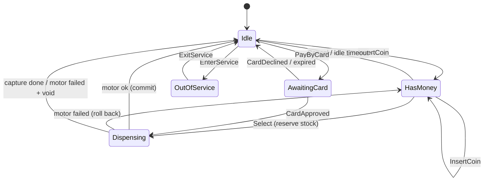
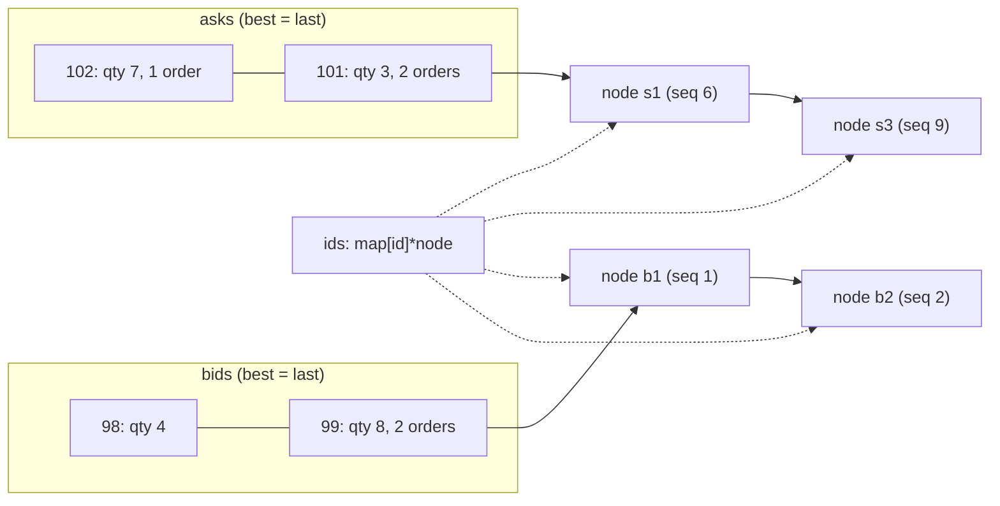
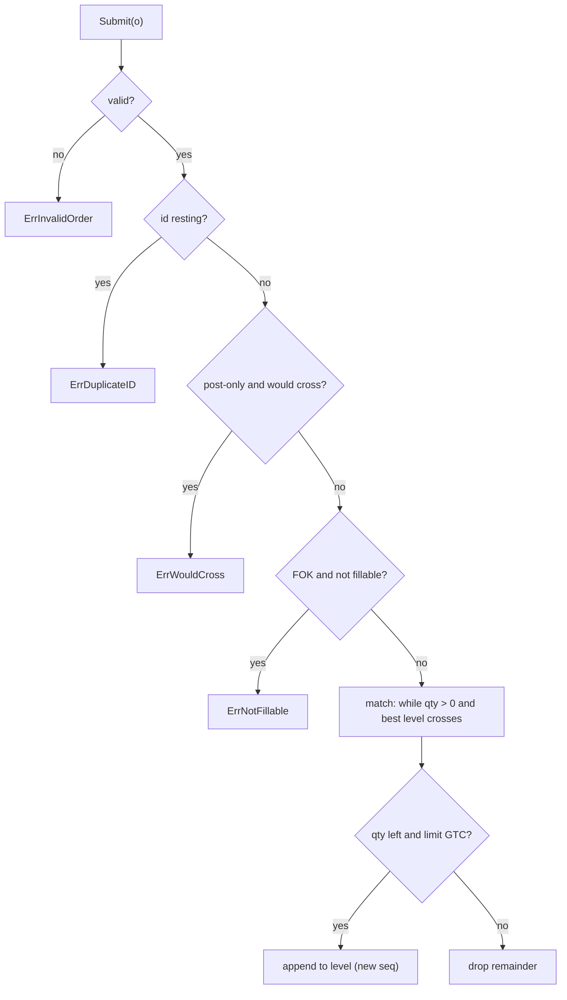

# B3 Unit 6 — State and matching: vending machine, order book

> Time: ~6 h · CORE: §1–§2 · Labs: `labs/b3/vending`, `labs/b3/orderbook`

## Before you start

You should have finished Unit 5 (or be able to say why a callback must never run under a lock, and why a quota check
and its write share a critical section). Warm-up (answers below; write yours down first):

1. In `memfs`, why did the quota check and the write have to share one critical section?
2. Which backpressure policy would you choose for a debug logger, and which for an audit-event writer? Why different?
3. A `select` has two ready cases. Which one runs?

<details data-kind="answer"><summary>Warm-up answers</summary>

1. Otherwise several writers all pass the check against the same free space and then all write: check-then-act. Each
   half held a lock separately would still pass `-race`, which is why the concurrent test checks the end state.
2. Debug: drop (newest or oldest) and count, so the application is never slowed. Audit: never drop; block with a
   deadline, or better, write to a durable outbox in the same transaction as the business change. Loss tolerance is a
   product decision, not a library default.
3. One is chosen uniformly at random; `select` has no priority. If one case must win, check it explicitly before or
   after (B0 Unit 1 §2).

</details>

## How to work a problem section

Problem sections differ from the concept units in one way: **Build it comes before How it actually works**, because a
machine-coding problem is only practice if you attempt it before you see the reference design. The full protocol is in
the [module README](README.md#how-a-timed-attempt-works); in short:

1. Read *The failure story* and *The problem*. Only Stage 1 is visible; Stage 2 and Stage 3 sit in closed hint blocks
   and in the `stage2.go` / `stage3.go` stubs. Keep them closed until you reach them.
2. Write down your answers to the **Predict** blocks, then open the Reveals. These are the design decisions you make
   in the first ten minutes of the real round.
3. Start the clock and do the timed attempt in **Build it**, stage by stage, running the tests as you go.
4. Stop at the time box even if tests are red; note which stage you reached and where the minutes went.
5. Only then read *How it actually works*, *Common mistakes* and *The debrief*, score yourself on the rubric and say
   the 2-minute narration out loud once.

---
## §1 Problem 12 — Vending machine

> **60 min** · focus: the State pattern · CORE · lab `labs/b3/vending` · ids `B3-U6-P01…P04`

Protocol reminder (full text in the unit's "How to work a problem section"): attempt in **Build it** before you read **How it actually works**, **Common mistakes** or **The debrief**.

### The failure story

A snack-and-drink operator runs ≈ 400 machines in office lobbies and branch waiting rooms. The firmware is a single `int state` and a 200-line `switch`, grown over three years. Illustrative numbers from the support queue:

1. **Double delivery.** The motor takes ≈ 2 s to drop an item. A customer who taps *Select* twice in that window gets two items for one payment, because the second tap arrives in a state the `switch` never considered and falls into `default:`, which calls the dispense routine again. At ≈ 60 sales a day per machine and 0.4% double taps, that is 400 × 60 × 0.004 ≈ 100 free items a day.
2. **Stuck money.** A customer inserts a $1 coin for a 70¢ item. The machine has one quarter and three dimes. The change routine is greedy ("largest coin first"): it takes the quarter, needs 5¢ more, finds no nickel, and gives up *after* dispensing the item. The customer gets the item and no change, and the ticket reads "machine kept my 30 cents". The right answer was three dimes, and the right moment to find that out was *before* the motor ran.
3. **Boolean soup.** Each fix added a flag: `isDispensing`, `inMaintenance`, `cardPending`. Three flags are eight combinations; five states are valid. Nobody could say what *Cancel* does when `isDispensing && cardPending`, so it does whatever the `if` order happens to do.
4. **Duplicate card callbacks.** The card terminal reports "approved" by webhook and retries when it doesn't get a 200 in time. On slow cellular links ≈ 1 in 300 card sales sees the callback twice, and the platform captured the payment twice. This is the same shape as a duplicate vendor callback in your adapters, and it costs real money plus a support call.

All four are the same design failure: the set of states was never written down, so "what happens if event X arrives in state Y?" has no single answer. In the interview the same thing shows up as an `enum` plus nested `if`s that works for the first demo and falls apart when the interviewer says "now add card payments" at minute 35.

### The problem

*As the interviewer says it* (you have **60 minutes**):

> "Design and implement a vending machine in Go. Customers insert coins, pick a product, get the product and their change. They can cancel and get their money back. I care about how you model what the machine is doing, and about what happens when someone does something at the wrong time. I'll add requirements as we go."

Questions worth asking in the first two minutes (or state as assumptions, out loud):

- Currency and denominations? Is money integer cents? (Yes: integers, never floats.)
- Does the machine have a finite stock of coins for change? (Yes. This is where the interesting algorithm lives.)
- Are the customer's inserted coins usable as change for that same purchase? (Yes, as in real coin mechanisms.)
- One customer session at a time? Does the machine keep credit after a purchase? (One session; change is always returned in full; no stored credit.)
- What if exact change is impossible? (Reject the sale before dispensing; the customer can add a coin, pick another product or cancel.)
- What should an out-of-order event do (Select with no money, Cancel with nothing inserted)? (An error you can test for: `ErrInvalidState`. Never a panic, never a silent no-op.)
- Is the machine used from one goroutine or several? (Say "assume several; I'll make every call safe" and then design the lock as part of the state model.)

**Stage 1 — the core (≈ minute 0–25).** `New`, `InsertCoin`, `Select`, `Cancel`, `Snapshot`; states `Idle` / `HasMoney` / `Dispensing`; sold-out, unknown slot, insufficient funds; **exact change from a finite coin stock** (including the customer's own coins), rejected before dispensing when impossible.

<details data-kind="hint">
<summary>Stage 2 — the interviewer adds this at ≈ minute 25 (open only when you get there)</summary>

"A technician needs a maintenance mode: restock, change prices, load coins and collect cash, only when it's safe. If a customer walks away with money inside, the machine should refund after 30 seconds of no activity; give me a testable clock. And I want the operations dashboard to be told when something happens: state changes, sales, refunds, low stock. A buggy dashboard must not be able to hurt the machine."

Pay attention to: which states may enter maintenance, whether a clock tick is an "event" that can be invalid, what a listener is allowed to do (call back into the machine?), and what happens when a listener is slow or panics.

</details>

<details data-kind="hint">
<summary>Stage 3 — the interviewer adds this at ≈ minute 45 (open only when you get there)</summary>

"The motor is real hardware: it's slow and it can jam. And we're adding a card reader: the terminal authorises the payment and calls us back, sometimes twice. Show me the customer's money is never lost or double-charged, that two buttons pressed at the same moment can't both win, and that nothing blocks while the motor runs."

Pay attention to: reserve-then-commit for stock, never holding your lock across the motor or the gateway, making the in-between visible as a state, and idempotency keyed by *sale*, not by machine state.

</details>

### Predict

<!-- predict id="B3-U6-P01" -->
**Predict.** Design A is `type State int` plus one `switch state { … }` inside each method (`InsertCoin`, `Select`, `Cancel`). Design B is a `state` interface with one method per event and one small type per state. The interviewer now says "add `PayByCard`" (one new event) and later "add an `OutOfService` state" (one new state). For each design and each change, count the places in the code that must change, and say what the compiler or the tests tell you if you forget one. Then name one situation where A is the better answer.
<!-- /predict -->

<!-- predict id="B3-U6-P02" -->
**Predict.** The change box holds one quarter and three dimes. A customer inserts a $1 coin for a 70¢ item, so 30¢ of change is owed. What does the greedy algorithm return? What is the correct answer? How would you decide, from the code alone, that your algorithm is correct for *every* coin set and stock, and what does it cost for 4 denominations, an amount of 200 cents and at most 50 coins of each kind?
<!-- /predict -->

<!-- predict id="B3-U6-P03" -->
**Predict.** Your `Select` holds the machine's mutex across the motor call (≈ 2 s). While the motor runs, the customer presses *Cancel*, the card-reader goroutine reports a sale, and the technician's remote console polls `Snapshot`. What does each of the three observe? Now release the mutex during the motor call but add no state. What can *Cancel* do now? What is the third design, and what does each caller see in it?
<!-- /predict -->

<!-- predict id="B3-U6-P04" -->
**Predict.** The terminal sends "approved for sale 17, auth A-9" twice, 30 ms apart; a third copy arrives concurrently on another connection. Your handler is `if state == AwaitingCard { dispense(); capture(); state = Idle }`. Walk through what each copy does. Then a different case: the machine gave up on sale 18 after 60 s, and the terminal's approval for it arrives at 75 s. What should the machine do with the approval, and what happens if it does nothing?
<!-- /predict -->

### Reveal

<details data-kind="reveal" data-for="B3-U6-P01">
<summary>Reveal</summary>

| Change | Design A (enum + `switch` in each method) | Design B (state interface) |
|---|---|---|
| New event `PayByCard` | One new method whose own `switch` must list every state (miss one and it falls into `default:`); the existing methods are unchanged | One new method on the interface and one default in the embedded base type: **existing states untouched**; override it only in `Idle` |
| New state `OutOfService` | A new `case` in **every method's switch** (≈ 4–8 places). Forget one and the compiler is silent: it falls into `default:` | One new type that embeds the base; every event it doesn't override is `ErrInvalidState` by default. Nothing existing changes except the legal-edges table |
| What catches a forgotten case | Only a test that enumerates (state × event) pairs | The same test, but the *default is safe* (reject) rather than *arbitrary* (whatever `default:` does) |

The principle is that **the default for an unhandled (state, event) pair must be "reject", and it should be impossible to forget by omission.** Design B gets this from embedding; Design A gets it only by discipline.

When A is better: few states and events (≈ 3 × 3), behaviour that is mostly *data* (a transition table `map[[2]int]int`), or a machine that will never grow. Then the table or the `switch` fits on one screen, and 5 small types and an interface are ceremony. A table-driven machine is also the best answer when the transitions come from configuration. The senior move is to say both and pick one for a reason: "behaviour differs a lot per state here (change-making in one, a motor wait in another, admin ops in a third), and the next requirement is a new payment path, so I'll use state objects with a shared base."

</details>

<details data-kind="reveal" data-for="B3-U6-P02">
<summary>Reveal</summary>

Greedy takes the quarter (25¢), needs 5¢, has no nickel, and fails ("cannot make change") even though **three dimes** pay 30¢ exactly. Greedy is only guaranteed optimal for *canonical* coin systems with *unlimited* supply; with finite stock (or odd denominations) it can fail to find any solution that exists.

A correct algorithm is a **bounded coin-change DP**. Let `best[a]` be the fewest coins that make amount `a` using the denominations processed so far, with at most `count[d]` coins of denomination `d`. For each denomination in turn, `best'[a] = min over k = 0..count[d] of best[a − k·d] + k`. Reconstruct by remembering the chosen `k` per denomination and amount. Feasibility is "`best[amount]` is finite". Cost: **O(D · A · K)** time and O(D · A) memory for D denominations, amount A and per-denomination count K. With D = 4, A = 200 and K ≤ 50 that is ≈ 4 × 200 × 50 = 40,000 steps (tens of microseconds); dividing everything by the gcd of the denominations (5¢ here) shrinks A to 40. A backtracking search with memoisation is equivalent. How do you know it is right? Brute force on small cases: the test suite compares your `Select` with an exhaustive search on 400 random pools.

Tempting wrong answers: "keep a greedy and fall back to refusing" (refuses sales that could be served, which is a revenue bug); "give change in any denomination, the display shows credit" (changes the product rules without asking). Also decide **which coins are in the pool**: the box *and* the coins the customer just inserted. Leaving the latter out rejects perfectly good sales on an empty change box.

</details>

<details data-kind="reveal" data-for="B3-U6-P03">
<summary>Reveal</summary>

With the mutex held across the motor, **every caller blocks for ≈ 2 s**: *Cancel* hangs on the lock (and the customer, seeing nothing happen, presses it again), the card-reader goroutine blocks (its network handler times out and the terminal retries), and the technician's `Snapshot` poll hangs, which looks like a dead machine on the dashboard. It is at least *correct*: nobody gets both the item and a refund.

Releasing the mutex during the motor without adding a state is the dangerous middle: the machine still *looks* like `HasMoney`, so *Cancel* succeeds and refunds the money while the item drops, and the customer gets both. Anything that makes a decision, drops the lock and then acts on that decision has this check-then-act hole.

The third design: **make the in-between a state.** Phase 1 under the lock: validate, find change, reserve stock, move to `Dispensing`. Phase 2 with the lock released: run the motor. Phase 3 under the lock: commit (money into the box, change out, state `Idle`) or roll back (stock back, state `HasMoney`). While in `Dispensing`, *Cancel* and every other customer event is answered **immediately** with `ErrInvalidState`, and `Snapshot` works at once (showing `Dispensing` and the reserved stock). Cost: you must write phases 1 and 3 so that the world between them is consistent, and you must handle the collaborator panicking (recover, treat as failure) or the machine is stuck in `Dispensing` forever.

</details>

<details data-kind="reveal" data-for="B3-U6-P04">
<summary>Reveal</summary>

The handler checks the *machine's* state, not the *sale's*. Copy one sets the state to dispensing and, with the lock released around the slow calls, copy two (30 ms later) and copy three (concurrent) may still see `AwaitingCard` or may see `Idle` and be treated as a brand new event. Depending on the interleaving you get two dispenses, two captures, or a second sale started for the wrong item. Even a "correct" version that rejects copies two and three with an error is wrong in practice: the terminal sees an error, retries again, and pages someone.

The fix is to make the operation **idempotent per sale**: look the sale up by ID. If it is already being processed or finished, return success without acting (the effect already happened or is in progress). Exactly one caller wins the right to dispense, and the same holds for settlement: each authorisation ends in **exactly one** `Capture` (delivered) or **exactly one** `Void` (not delivered).

For the late approval of an expired sale, the customer's card has a hold on it for an item the machine will never deliver. If the machine ignores the callback, the hold stays until the issuer expires it (days, depending on the issuer, TODO-VERIFY), which looks like a charge. The machine must **void the authorisation** (once, however many late copies arrive) and answer the callback so the terminal stops retrying. Idempotency is "at-least-once delivery plus de-duplication on a key you own", which is the only way to get exactly-once *effects*.

</details>

### Build it

**Goal:** make `go test -race ./labs/b3/vending/` pass, in stages, inside the time box.

Files: `labs/b3/vending/vending.go` (Stage 1), `stage2.go`, `stage3.go`. Tests: `vending_test.go` (Stage 1 and shared helpers), `stage2_test.go`, `stage3_test.go`. Do not open the next stage's files until you reach it.

```sh
go test -race -run 'Stage1' ./labs/b3/vending/     # first 25 minutes
go test -race -run 'Stage[12]' ./labs/b3/vending/  # by minute 45
go test -race -count=20 ./labs/b3/vending/         # before you call it done
```

| Minutes | Do |
|---|---|
| 0–8 | Ask questions, state assumptions. Draw the states and the edges between them (not just the happy path). List the events. Decide the lock and what is allowed to run outside it. |
| 8–25 | Stage 1. Write the change-making function and test it on its own first (it is pure). Then the state types, then `InsertCoin`/`Select`/`Cancel`. |
| 25–45 | Stage 2. Admin ops are one `admin()` gate away; the timeout is one `Tick`; the notices need a delivery rule you can state in one sentence. |
| 45–60 | Stage 3. Hardware and gateway calls outside the lock; sale-keyed idempotency; then a last read of your own code for the concurrency note. |

Acceptance, per stage: all `TestStage1_*` (13 tests), `TestStage2_*` (13), `TestStage3_*` (11) pass with `-race`. Stage 3 includes a full (state × event) matrix over 5 states and 8 events, 12 goroutines hammering one machine while a sampler checks invariants, and 300 rounds of `Select` racing `Cancel`. A green Stage 1 tells you nothing about them. When a test fails, read the message: each says which property broke.

**Self-check before you read on:** write the 5-line concurrency note: what is shared, what the single lock guards, which calls run *outside* it and why that is safe, how a second event is answered while the motor runs, and how a duplicate card callback is recognised.

### How it actually works

*(Read this after your attempt. Compare with your own design, not with your code.)*

**The states and their edges.** Five states, ten legal edges. The edge list is data (`edges` in the solution) and `setState` refuses to take an edge that is not in it, so a handler bug cannot create an impossible state.



**State objects with a shared default.** Each state is a small stateless type that embeds `baseState`; the base returns `ErrInvalidState` for every event. A concrete state overrides only what it accepts.

```go
type state interface {
	id() State
	insertCoin(m *Machine, cents int) error
	selectSlot(m *Machine, code string) (*cashTx, error) // phase 1 only
	cancel(m *Machine) (map[int]int, error)
	enterService(m *Machine) error
	// ...one method per event...
	tick(m *Machine, now time.Time) map[int]int // valid (and a no-op) everywhere
}

type baseState struct{}
func (baseState) insertCoin(*Machine, int) error { return ErrInvalidState }
// ...

type dispensingState struct{ baseState } // overrides only id(): rejects everything
```

Adding Stage 3's `PayByCard`, `approve` and `decline` meant one method each on the interface, a default in `baseState`, and overrides in two states. `Idle`, `HasMoney`, `Dispensing` and `OutOfService` were not edited for the new events.

**Events versus queries.** `State()`, `Balance()` and `Snapshot()` are *queries*: allowed in every state, never rejected. `Tick(now)` is an event but is valid everywhere (a clock that ticks must not be an error source). Everything the customer or technician does is a real event with a defined answer per state, and the matrix test in Stage 3 enumerates all 5 × 8 pairs.

**Purchase in three phases.**

```mermaid
sequenceDiagram
  participant C as Customer goroutine
  participant M as Machine (mutex)
  participant H as Dispenser (motor)
  C->>M: Select(code)  [lock]
  Note over M: phase 1: validate, find exact change,<br/>qty--, state = Dispensing  [unlock]
  C->>H: Dispense(code)  (no lock held; 1–3 s)
  Note over M: other events: ErrInvalidState immediately
  C->>M: finish  [lock]
  Note over M: ok: box += escrow − change, state = Idle<br/>fail: qty++, state = HasMoney (money untouched)  [unlock]
```

Money moves only in phase 3. Phase 1 changes nothing that cannot be undone by phase 3's failure branch (`qty++`, `setState(HasMoney)`).

**Change-making.** `makeChange(amount, denoms, pool)` is the bounded DP from the reveal, with `pool = box + escrow` and the amount divided by the gcd of the denominations. It prefers the fewest coins (a tie-break that also protects the box from running out of large coins). It is a pure function, which is why it can be tested (and brute-forced) without a machine.

**Notices.** Effects are appended to a pending queue under the lock (`emit`). When the operation leaves the lock (`leave`), one goroutine at a time becomes the *drainer*: it takes the queue, releases the lock, calls each listener (with `recover`), re-takes the lock, and stops only when the queue is empty. Result: per-listener order, no lock held in user code, a stuck listener delays only the goroutine that is draining (other callers enqueue and return), and a panic is contained.

**Card sales are keyed by sale ID.**

| Sale status when `CardApproved` arrives | Action |
|---|---|
| `Pending` | Reserve stock, `AwaitingCard → Dispensing`; dispense (no lock); capture (no lock) or, on a jam, void; then `Idle` |
| `Dispensing` / `Completed` / `CaptureFailed` | Return `nil`: the effect is done or in progress |
| `Declined` / `Failed` | `ErrSaleClosed` |
| `Expired` | `ErrSaleClosed`, and `Void(auth)` exactly once (a `voidClaimed` flag set under the lock before the call) |
| unknown ID | `ErrUnknownSale` |

The **claim-under-lock, act-outside-lock** pattern is the heart of it: set `voidClaimed = true` while holding the mutex, then call the gateway after releasing it. Concurrent duplicates see the flag and skip the call.

**Lock discipline.** One `sync.Mutex` guards: the state object, slots, change box, escrow, balance, sale table, notice queue. Never under it: `Dispenser.Dispense`, `Gateway.Capture/Void`, listeners. `call()` wraps each collaborator and turns a panic into an error so the machine can never be stuck in `Dispensing`.

### Break it

Do these on your passing solution. Predict the failing test and the message before you run it.

1. Replace the change algorithm with greedy (largest coin first, no backtracking).
2. Hold the mutex across the `Dispenser` call in `Select` (no unlock between phase 1 and phase 3).
3. Make `Cancel` valid in `Dispensing` (the state refunds the escrow).
4. Remove the "already being processed or completed" case from `CardApproved`.
5. Deliver notices to listeners while still holding the machine's lock.

<details data-kind="answer"><summary>What you should see</summary>

1. `TestStage1_GreedyChangeFailsButExactChangeExists`: `Select = vending: cannot make exact change; exact change {10:3} exists, so the sale must go through (greedy is not enough)`. The brute-force test also fails, with a generated case such as `case 31: box map[5:0 10:3 25:3 100:0] inserted map[10:1 100:1] price 45: change 65 is possible but Select = vending: cannot make exact change`. Hand-picked examples alone would not find every greedy failure; the brute-force comparison does.
2. `TestStage3_WhileTheMotorRunsOtherEventsFailFastInsteadOfBlocking` after 5 s: `events while the dispenser is running did not finish within 5s (a lock held while waiting on something slow, or a deadlock?)`; the matrix test reports `InsertCoin in Dispensing did not finish within 5s`. `-race` is silent: nothing is racy, it is simply slow, and in production the keypad and the card reader would freeze for the length of the motor run.
3. The matrix test: `Cancel in Dispensing = <nil>, want ErrInvalidState: the event is illegal there` and `rejected Cancel moved the machine from Dispensing to Idle`. The concurrent-customers test shows the damage in money terms: `negative coin count -2 x 25` and `money in 83980 != refunds+change 74720 + prices kept 16160` (numbers vary per run). Customers were refunded money that had already been paid out as change.
4. `TestStage3_DuplicateAndConcurrentApprovalsCaptureExactlyOnce`: `duplicate approval 1 = vending: event not valid in this state, want nil: a retried callback must look like success`. The state machine itself stopped a double dispense here, which is the point: the state objects give you safety, but the *protocol* answer to a retried callback is still "success, nothing to do".
5. `TestStage2_ListenersMayCallBackIntoTheMachine`: `a listener that queries the machine did not finish within 5s`, and `TestStage2_ASlowListenerDoesNotBlockTheMachine`: `Balance while a listener is stuck did not finish within 5s`. A listener calling `m.State()` under the machine's own non-re-entrant mutex deadlocks itself.

</details>

### In the wild

- **Go's `net/http`** exposes connection life cycle as `http.ConnState` (`StateNew`, `StateActive`, `StateIdle`, `StateHijacked`, `StateClosed`) reported through `Server.ConnState`. That is a state machine whose transitions are announced to a callback, with exactly the "listener must not break the server" concern you handled in Stage 2.
- **TCP** is the canonical textbook state machine (`LISTEN`, `SYN_SENT`, `ESTABLISHED`, `FIN_WAIT_1`, …, specified in RFC 9293, which obsoletes RFC 793): a table of (state, event) → (action, next state), and the spec explicitly says what each unexpected event does. HTTP/2 stream states (`idle`, `open`, `half closed`, `closed`) in RFC 9113 are another.
- **Erlang/OTP `gen_statem`** serialises events through a process mailbox and implements each state as a function of the event. That is the "event loop" alternative to a mutex: one goroutine owns the state and everything else sends it messages. It trades some latency and complexity for never having a lock ordering question.
- **Payment authorisation lifecycles.** Card payments are typically authorise → capture (or void/cancel); the authorisation puts a hold on the cardholder's funds, and gateways document idempotency keys for creating charges. Webhook senders (payment providers, source hosts) retry on a non-2xx response and say in their docs that an event can be delivered more than once, so receivers must de-duplicate on the event ID. TODO-VERIFY: the exact hold-expiry period and retry schedule of whichever provider you name.
- **Vending machines themselves** talk to their coin mechanisms, bill validators and cashless readers over a bus protocol (MDB, from the vending industry's trade bodies; TODO-VERIFY the details), and real machines show an "exact change only" lamp when the coin tubes can no longer cover change: a hardware version of your `ErrNoChange` policy.

### Trade-offs

| Option | Wins when | Loses when | When the answer flips |
|---|---|---|---|
| State objects + shared `baseState` (reference) | Behaviour differs a lot per state; new events and states keep arriving | Tiny machines; more types than logic | ≤ 3 states × 3 events, or transitions come from config: use a table |
| Enum + `switch` per method | Very small machine, one screen of code | Every new state touches every switch; a forgotten case falls to `default:` | When the number of states or events passes ~4 each |
| Table-driven FSM (`map[state][event]handler`) | Transitions are data (config-driven, generated, visualised); easy to print and test | Handlers lose locality; guards and actions get awkward | When per-state behaviour has real logic: state objects read better |
| Hierarchical statechart (sub-states, entry/exit actions) | Shared behaviour across states (e.g. "any state may go OutOfService on fault") | Heavy for a 60-minute problem; a library or code generator in practice | When ≥ 8–10 states with common handlers |
| One mutex + a visible `Dispensing` state (reference) | Callers are few and the slow part is a call you can name | You must write reserve/commit/rollback by hand | Throughput matters or ordering is complex: single-goroutine event loop |
| Event-loop goroutine owning the state | Strict ordering, no lock questions, easy to log every event | Callers need reply channels; shutdown and panics need care | Simple request/response callers: the mutex is shorter |
| Greedy change | Canonical denominations with *unlimited* supply | Finite stock: refuses or mis-handles sales | Never with a finite change box |
| Bounded-DP change (reference) | Small amounts, finite stock, any denominations | Large amounts (use gcd scaling, or ILP/branch-and-bound) | Amounts in the millions: a different algorithm class |
| Synchronous notices under the lock | Never | Deadlocks on re-entry, blocked machine | Never |
| Queue + single drainer (reference) | Ordered delivery, light machinery | A slow listener slows whichever caller drains | Many slow consumers: a buffered channel and goroutine per subscriber with a drop policy (the B0 batcher/pub-sub lessons) |

### Senior bar

**Rubric (score yourself per row, then send the code to the tutor).** *Meets* needs a row at "meets" or better on every row, with no "below".

| Dimension | below | approaching | meets (senior bar) | exceeds |
|---|---|---|---|---|
| Extensibility | Booleans or one big `switch`; Stage 2 rewrites Stage 1 | States modelled, but each new event edits every state | State objects (or a table) with a safe default; Stage 2 and 3 add methods/states without editing existing states; options for optional behaviour | The legal edges are data, enforced in one place, and tested as a (state × event) matrix |
| Concurrency safety | No lock, or lock released between check and act | One lock, but held across the motor/gateway, or a Cancel can slip in mid-dispense | One lock; reserve → act outside the lock → commit/rollback with an explicit `Dispensing` state; fail-fast on a second event; passes `-race -count=20` | Idempotency claimed under the lock and acted on outside it; argues the alternative (single event loop) and why not |
| Clean interfaces | Returns internal maps; sentinel errors compared with `==`; panics on bad input | Copies on some paths; `ErrInvalidState` for some wrong-state events but silent no-ops for others | Defensive copies both ways; one error vocabulary; every wrong-state event is `ErrInvalidState`; collaborators behind small interfaces (`Dispenser`, `Gateway`) | Queries vs events distinguished and documented; `Tick` as the one always-valid event, with the reason |
| Tests | Happy path only | Edge cases, but change-making verified by a few examples | Own tests for: greedy-fails case, impossible change, wrong-state events, timeout with a fake clock; one concurrency test under `-race` | Brute-force comparison for change-making and a full (state × event) matrix; a deliberately broken variant shown to fail |
| Time management | Nothing running at minute 25 | Stage 1 at 25, Stage 2 unfinished at 45 | Stage 1 by 25, Stage 2 by 45, Stage 3 or an honest status by 60, plus a spoken concurrency note | Stage 3 by 55 and time for the note, with the card path done without rewriting existing states |

**Failure modes in production use.** A hung motor with a lock held (the whole machine frozen); a collaborator panic leaving the machine in `Dispensing` forever (hence `recover` in `call`); the sale table growing without bound (needs a TTL or ring buffer); coin tubes depleted by always giving large coins (hence "fewest coins" plus an "exact change" alert); a clock that jumps (idle timeout fires early or never; use a monotonic clock for durations); duplicate and out-of-order terminal callbacks.

**Numbers.** One session every ≈ 20–60 s at a busy machine, so contention on one mutex is irrelevant; the design problem is a ≈ 1–3 s motor call (assumption; check the spec sheet), which is ≈ 10⁸ times longer than a lock acquisition (≈ 20 ns). Change DP: ≈ D · A · K = 4 · 40 · 50 = 8,000 steps after gcd scaling, ≈ tens of µs. A fleet of 400 machines × 60 sales/day ≈ 24,000 sales/day ≈ 0.3 sales/s overall: no scaling concern, all about correctness.

**Interviewer probes**

<details data-kind="answer"><summary>"The motor takes ten seconds and the customer hits Select again. What do they see?"</summary>

The second *Select* arrives while the machine is in `Dispensing`, so it is answered immediately with `ErrInvalidState` (the UI can show "please wait"), and `Snapshot` shows the state and the reserved stock. Nothing queues behind the motor, and nothing can double-dispense, because there is no state in which two *Select*s are both legal. If the product wants the second tap ignored rather than an error, that is a UI mapping, not a change to the state model.

</details>

<details data-kind="answer"><summary>"How do you know the money adds up?"</summary>

An invariant, checked in tests at every instant and at the end: inserted value = refunded value + change value + prices of completed sales + current escrow, per denomination (the coins are conserved, not just the value). The concurrent test tallies every successful `InsertCoin`, `Cancel` refund and `Receipt.Change`, and asserts the final change box equals initial + inserted − refunded − change. In production I'd export the same as counters and alert on drift, since a drift means a bug or a hardware fault.

</details>

<details data-kind="answer"><summary>"What if the process crashes between Capture and the next state?"</summary>

The machine is in-memory, so a crash loses the session. The protection is on the settlement side: because each authorisation ends in exactly one `Capture` or `Void` keyed by `authID`, a restarted machine (or a reconciliation job) can ask the gateway for the status of authorisations it did not close and settle them: void the ones with no delivery record, capture the ones with one. For that to be safe, the delivery record has to be durable *before* capture is attempted. That's an outbox: write "delivered sale 17 / auth A-9" locally, then settle, and settle again after a restart.

</details>

<details data-kind="answer"><summary>"Add a new payment method, say a mobile wallet. What changes?"</summary>

If the wallet behaves like the card (authorise elsewhere, call back), nothing in the state machine changes: it is a second source of the same `approve`/`decline` events, perhaps with a different `Gateway`. I'd extract a small `Settler` interface (`Capture`, `Void`) and pass the right one per sale. If it needs a new state (say a QR code displayed while waiting), that is one new type embedding `baseState`, plus its row in the edge table and a row in the matrix test. The existing states don't change.

</details>

### Common mistakes

| Mistake | How the tests catch it | Fix |
|---|---|---|
| Booleans (`isDispensing`, `inMaintenance`) instead of states | The (state × event) matrix: some pair does something arbitrary | One `State`, one object per state, a safe default |
| Greedy change | `TestStage1_GreedyChangeFailsButExactChangeExists`, `…AgreesWithBruteForce` | Bounded coin-change DP |
| Leaving the customer's inserted coins out of the change pool | `TestStage1_InsertedCoinsCanBeHandedBackAsChange` | `pool = box + escrow` |
| Dispensing first, then discovering change is impossible | `TestStage1_NoExactChangeIsRejectedBeforeDispensing` (stock and balance checked) | Compute change in phase 1, before anything irreversible |
| `Cancel` refunds an equivalent set of coins instead of the same coins | `TestStage1_CancelRefundsExactlyTheInsertedCoins` | Track escrow per denomination and return it |
| Wrong-state events ignored silently (`return nil`) | `TestStage1_EventsInTheWrongStateAreErrorsNotNoOps`, the matrix | `ErrInvalidState` from the base state |
| Lock held across `Dispense`/`Capture`, or released with no state | `TestStage3_WhileTheMotorRuns…`, `…CancelRacingSelect…` | Phase 1 / unlocked call / phase 3, with a `Dispensing` state |
| Stock reservation not released when the motor fails | `TestStage3_DispenserFailureNeverTakesTheCustomersMoney` | `qty++` and back to `HasMoney` in the failure branch |
| Idle timer measured from the first coin, not the latest | `TestStage2_EachCoinRestartsTheIdleTimer` | Stamp the time on every accepted coin |
| Listener called under the machine lock; panic not contained | `TestStage2_ListenersMayCallBack…`, `…SlowListener…`, `…PanickingListener…` | Queue under the lock, deliver after unlocking, `recover` |
| Idempotency keyed on machine state, not on the sale | `TestStage3_DuplicateAndConcurrentApprovals…`, `…ExpiredCardSale…` | Look up the sale; claim the effect under the lock |
| Returning internal maps from `Snapshot`/`Config` | `TestStage1_InitialSnapshotIsACopy` | Copy at the boundary |

### The debrief: the senior-level design choices

1. **Write the states down; make the default "reject".** The first ten minutes decide the design: five states, their legal edges, and one answer per (state, event). A shared base that returns `ErrInvalidState` means a forgotten case is safe instead of arbitrary. *In the interview, say:* "I'll model states as types with a rejecting default, because the next requirement will add an event or a state."
2. **Transitions as data, enforced in one place.** `edges` plus `setState` means an impossible state cannot be created by a handler bug, and the matrix test is a second, independent statement of the same table. Two descriptions of the table that must agree catches mistakes in either.
3. **Separate events from queries.** `Snapshot`/`State`/`Balance` never fail; `Tick` is the one event valid everywhere. Naming that distinction (and why `Tick` errors would be noise) shows you thought about the API, not only the happy path.
4. **Reserve → act → commit/rollback.** Irreversible things (moving money, dropping an item) happen at the end, after everything that can fail has been checked; the middle is undoable. This is the machine-sized version of a saga step or a two-phase hold, and it's why a jam never costs the customer money.
5. **Never hold a lock across a collaborator; make the gap a state.** The mutex protects *data*; the `Dispensing` state protects the *protocol* while the lock is released. The same rule applies to listeners and gateways.
6. **Change-making is a real algorithm, and the pool is a design decision.** Bounded DP, fewest coins, amounts scaled by the gcd, pure and brute-force-tested; the box plus the customer's coins; rejection before dispensing with a way to recover (add a coin, pick something else, cancel).
7. **Exactly-once effects = at-least-once delivery + dedupe + a claim.** Duplicate callbacks are normal; key them by sale; claim under the lock, act outside it; every authorisation ends in exactly one capture or void, including the late approval of an expired sale. This is the same discipline as an idempotency key on a money-movement endpoint.
8. **Observers are untrusted.** Queue under the lock, deliver outside it, one drainer for ordering, recover from panics. A monitoring hook must never be able to take the machine down.
9. **Grow by options and embedding, not edits.** `Option` functions and the embedded base let Stages 2 and 3 land in new files without editing Stage 1's states, which is the extensibility story in one sentence.

**The 2-minute narration** (say it aloud once after your attempt): "The machine has five states, and every event has exactly one answer in every state: a base type rejects everything with `ErrInvalidState` and each state overrides only what it accepts. The legal edges are a table that `setState` enforces, and the tests enumerate all state × event pairs. One mutex guards the data. A purchase has three phases: under the lock I validate, find exact change from the box plus the customer's coins, reserve the stock and move to `Dispensing`; then, with the lock released, the motor runs; then under the lock I commit the money or roll back the reservation. While in `Dispensing` any other event fails fast, so Cancel and Select can't both win. Card sales are keyed by sale ID: duplicates return success, a claim flag set under the lock means exactly one capture or one void per authorisation, and a late approval of an expired sale is voided once. Listeners are called after unlocking, in order, with panics contained. Evidence: brute-force change comparison, the state × event matrix, 300 Select/Cancel races, a conservation test with twelve goroutines, all under `-race -count=20`."

**What the interviewer adds next** (Stage 4, if there's time): bill acceptance with escrow and a "return bill" path; a loyalty or promo price rule (a `PriceStrategy`); temperature-controlled slots with faults that move the machine to `OutOfService` from any state (this is where a hierarchical statechart earns its keep); remote price updates arriving while a session is open (apply at the next session? snapshot the price at `Select`?); persistence of the sales log and recovery after a power cut (the outbox from the probe above); or "run 400 machines from one controller" (now it is an HLD problem: the C-track covers it).

### Check yourself

1. Why must the default behaviour for an unhandled (state, event) pair be "reject", and how does embedding a base type in Go help?
2. Why is greedy change wrong with a finite coin stock, and what is the cost of the correct algorithm?
3. Why can't you simply release the mutex around the motor call and leave the state as `HasMoney`?
4. How do you make a card-terminal callback safe to receive three times, even concurrently?

<details data-kind="answer"><summary>Answers</summary>

1. Because forgetting a case is the common bug when states and events grow, and a "reject" default makes the omission safe and visible (an error a test can assert) instead of an arbitrary behaviour. In Go, a concrete state embeds `baseState`, so a new event added to the base is inherited by every state automatically, and only the states that really accept it override it.
2. Greedy takes the largest coin first and can paint itself into a corner when a needed coin is out of stock: 30¢ from one quarter and three dimes is three dimes, but greedy takes the quarter and fails. The correct bounded coin-change DP costs O(D · A · K); for 4 denominations, 200¢ and ≤ 50 coins each that is ≈ 40,000 steps (less after gcd scaling).
3. The machine would still look like `HasMoney`, so `Cancel` (or a second `Select`) would be legal while the item is dropping: the customer could get the item and a refund. Check-then-act across an unlocked gap needs a state that makes the gap visible, so other events are rejected.
4. Make the handler idempotent per sale: look the sale up by ID; if it is being processed or finished, return success without acting; claim the dispense, capture and void effects by flags set under the lock so exactly one goroutine performs each, and perform the calls outside the lock. A late approval of an expired sale gets one void.

</details>

---

## §2 Problem 13 — Order book and matching engine

> **90 min** · focus: price-time priority, invariants · CORE · lab `labs/b3/orderbook` · ids `B3-U6-P05…P08`

Protocol reminder (full text in the unit's "How to work a problem section"): attempt in **Build it** before you read **How it actually works**, **Common mistakes** or **The debrief**.

### The failure story

A platform team builds an internal "rate board" where credit unions post offers to buy and sell loan participations
at a price in basis points, and the board matches them automatically. The first version is a day's work: prices
are `float64` percentages, every order is stamped with `time.Now()`, and the book is one slice of orders that is
scanned for the best match on every fill. It passes its demo. Three things go wrong in the first month.

1. **Two prices that look the same but aren't.** A client SDK computes an offer as `base + 3*tick` and another
   client sends the literal `0.3`. In `float64`, `0.1 + 0.2` is `0.30000000000000004`, not `0.3`. The book shows
   two levels both printed as `0.30`, and a bid and an ask that "obviously" match sit side by side without ever
   trading, because `0.3 >= 0.30000000000000004` is false. The audit export, which sums `qty × price`, is off by a
   few cents in a way nobody can reproduce on paper.
2. **A dispute that can't be replayed.** Two credit unions post offers within the same clock tick; the engine breaks
   the tie by iterating a Go map. A dispute arrives: "our offer was first". Operations replays the day's input log
   on a test box and gets a *different* set of trades, because the tie went the other way. There is no ground truth
   to show anyone.
3. **O(n) per fill.** With ≈ 50,000 resting orders, scanning for the best match costs ≈ 50,000 × ≈ 5 ns ≈ 250 µs
   per fill. A market order that sweeps 100 offers holds the lock for ≈ 25 ms, and at month end, when sweeps are
   common, the board answers in seconds while every cancel queues behind them.

Every one of these is a decision made in the first ten minutes: the **number representation**, the **source of
time priority**, and the **data structure**. They are also exactly what an interviewer probes: "what type is
price?", "what if two orders arrive in the same nanosecond?", "what's the complexity of cancel?".

### The problem

*As the interviewer says it* (you have **90 minutes**):

> "Implement a limit order book for one instrument, in Go. Orders are buy or sell, with a price and a quantity.
> When a new order can trade against the other side, it trades; otherwise it rests until someone takes it or it is
> cancelled. I care about correctness: trade in the right order, partial fills, and I want you to show me that the
> book can never end up in an impossible state. I'll add requirements as we go."

Questions worth asking in the first three minutes (or state as assumptions, out loud):

- What are price and quantity? (Integers: price in ticks, quantity in lots. Say *why* not `float64`.)
- Which rule decides who trades first? (Price priority, then time priority: first in, first out within a price.)
- At whose price does a trade execute? (The resting order's price: the taker accepts the maker's quote.)
- What is "time"? (Arrival order, as a logical sequence number your book assigns. No wall clock.)
- Does `Submit` return what happened? (Yes: the trades, in order. A rejected order changes nothing.)
- One symbol or many? Who calls it, from how many goroutines? (One book first; concurrency comes in Stage 3, so
  say now that the book itself is a single-threaded core.)
- What are the performance expectations? (Say "O(1) best price, O(1) cancel by id, O(log L) or better for a new
  price level"; don't promise numbers you haven't measured.)

**Stage 1 — limit orders (≈ minute 0–35).** `NewBook`, `Submit`, `Cancel`, `Lookup`, `Depth`. Price-time priority,
partial fills, resting remainder, validation, duplicate IDs, trades at the maker's price, a book that is never
crossed after `Submit` returns.

<details data-kind="hint">
<summary>Stage 2 — the interviewer adds this at ≈ minute 35 (open only when you get there)</summary>

"Good. Real markets have more order types. Add **market** orders (sweep, never rest), **IOC** (immediate or
cancel), **FOK** (all or nothing: if it can't fill completely, nothing happens), and **post-only** (reject rather
than trade). Add `Amend(id, qty, price)`: I want to be able to reduce size without losing my place in the queue.
And add **self-trade prevention**: the same owner must not trade with themselves; let the book be configured with
a policy."

Pay attention to: FOK must not touch the book if it fails, equal prices are a cross for post-only, which amends
keep priority and *why*, and how FOK interacts with self-trade prevention.

</details>

<details data-kind="hint">
<summary>Stage 3 — the interviewer adds this at ≈ minute 65 (open only when you get there)</summary>

"Now run many symbols in one process, called from many goroutines. Each symbol must behave as if its orders
arrived one at a time. Consumers want a live trade stream per symbol, and one slow consumer must never slow the
matching engine. And prove to me it works: give the book a function that checks its own invariants, run it after
every operation in a randomised test, and show me the output is deterministic: the same inputs give the same
trades, every time."

Pay attention to: where the lock lives (book or exchange?), publishing trades inside or outside the lock, what
"slow subscriber policy" means in code, and which of your data structures iterate maps.

</details>

### Predict

<!-- predict id="B3-U6-P05" -->
**Predict.** Pick the data structure before you write any code. The book must support: (a) "what is the best
price on this side?", (b) "give me the oldest order at the best price", (c) insert an order at a price that may or
may not exist yet, (d) cancel an order *by id* from anywhere in the book, (e) `Depth(n)`: the top n levels with
aggregate quantities. For each of these candidates, write the cost of (a)–(e): **1)** one slice of all orders
sorted by (price, arrival), **2)** a binary heap of orders keyed by (price, arrival) with lazy deletion for cancels,
**3)** a sorted slice of price levels, each level a FIFO list of orders, plus a `map[id]*order`. Which would you
choose at minute 5, and what is the one workload that would make you change your mind?
<!-- /predict -->

<!-- predict id="B3-U6-P06" -->
**Predict.** Without looking at any tests, write the **invariants**: statements that must be true of your book
after *every* operation, whatever happened. Aim for at least eight. Then say how you would check them in a test,
and how you would find out whether the matching logic itself (not just the structure) is right, given that you
cannot compare against a production exchange.
<!-- /predict -->

<!-- predict id="B3-U6-P07" -->
**Predict.** (1) A FOK order for 50 lots arrives; the book can fill only 40 within its limit. You have already
written a `match` loop that mutates the book as it goes. What are two ways to make FOK all-or-nothing, and what
goes wrong with the one that "rolls back"? (2) A resting order is 4th in the queue at its price. Which of these
amends should keep its place, and which must send it to the back: reduce the quantity, increase the quantity,
change the price by one tick? Give the fairness argument for each.
<!-- /predict -->

<!-- predict id="B3-U6-P08" -->
**Predict.** 16 goroutines submit orders for 8 symbols. Compare three designs: **one global mutex**, **one mutex
per book**, **one goroutine per book fed by a channel**. For each: what runs in parallel, what is the ordering
guarantee, and what is the failure mode under load? Then: a subscriber reads trades far slower than they are
produced. List three things the engine could do when the subscriber's buffer fills, and what each costs. Finally,
list every source of **nondeterminism** that could make two runs of the same input produce different trades.
<!-- /predict -->

### Reveal

<details data-kind="reveal" data-for="B3-U6-P05">
<summary>Reveal</summary>

L = number of distinct price levels per side, n = resting orders. Typically L ≪ n, and activity clusters near the
best price.

| Operation | 1) sorted slice of orders | 2) heap + lazy delete | 3) sorted levels + FIFO lists + id map |
|---|---|---|---|
| (a) best price | O(1) (last element) | O(1) peek (after skipping dead entries) | O(1) (last level) |
| (b) oldest at best | O(1) | O(1) amortised | O(1) (`level.head`) |
| (c) insert | O(n): binary search + shift ≈ n × 8–16 B memmove | O(log n) | existing price: O(1) append; new price: O(log L) search + O(L) pointer shift |
| (d) cancel by id | O(n): find, then shift | O(1) mark dead, but the garbage stays until it reaches the top | O(1) unlink from a doubly linked list (+ O(L) shift only if it empties a level) |
| (e) `Depth(n)` | O(n): must aggregate runs | O(n log n): a heap is not sorted, you must copy and sort | O(n) levels, each already aggregated |
| memory | one slot per order | one slot per order + dead entries | one node per order + one level per price |

Option 3 is the reference choice: every operation on the hot path (match at the touch, append to an existing
level, cancel) is O(1), and the O(L) shift only happens when a *new price* appears, which is rare relative to
order flow and cheap (L = 1,000 levels is an 8 KB pointer shift ≈ 100–200 ns). Option 1 puts an O(n) shift on every
insert and cancel. Option 2 is fast for insert and match but cannot answer `Depth` or aggregate quantity without
sorting, and lazy deletion makes memory depend on the cancel rate (a market maker that cancels 99% of what it posts
fills the heap with corpses).

What would change my mind: a market with **very many sparse levels** (L in the hundreds of thousands, for example
a wide-range instrument with a tiny tick) where inserting a new level and cancelling out of the middle are
frequent. Then the O(L) shift hurts and a balanced tree, skip list or treap of levels (O(log L)) is worth its
code.

Tempting wrong answer: "a heap, because priority queue". It models "best first" but not "cancel by id" or "level
aggregate", which are two of the five requirements.

</details>

<details data-kind="reveal" data-for="B3-U6-P06">
<summary>Reveal</summary>

A good list, each one checkable by a few lines of code:

1. **Not crossed:** if both sides are non-empty, best bid < best ask.
2. **Levels sorted and unique:** strictly descending bids, strictly ascending asks; no price appears twice.
3. **No empty levels** and no resting order with quantity ≤ 0.
4. **Level aggregate = Σ orders:** each level's `Qty` and `Orders` equal the sum/count over its list.
5. **Time priority:** within a level, arrival sequence numbers strictly increase from head to tail.
6. **Index consistency:** the id map holds exactly the resting orders (no ghosts, no missing) and each points to the
   right level.
7. **Trade correctness:** every trade executes at its maker's price, within the taker's limit, for qty > 0, and
   trade IDs are consecutive.
8. **Conservation of quantity:** for each order, `submitted = filled + resting + deliberately removed` (cancelled,
   IOC/market remainder, amended away), and the change in total resting quantity after an operation is fully
   explained by that operation's fills.
9. **No double fills:** no order's cumulative fills exceed its quantity.

Check them with an `Invariants()` method on the book (the structure invariants: 1–6), called after **every**
operation in a randomised test, plus assertions on returned trades (7–9). That is "invariants as executable
checks": a bug that corrupts the structure is caught at the operation that caused it, not 5,000 operations later.

To check the *logic*, use **differential testing**: write a second, deliberately naive matcher (a slice and a full
scan: ≈ 80 lines) that shares no code with the real one, feed both the same seeded random operations, and require
identical trades and identical depth after every step. The naive version is slow but obviously correct, so
agreement across thousands of operations is strong evidence. This is the senior move for any stateful algorithm
(caches, schedulers, matchers, allocators): the oracle is cheaper to get right than the fast version.

</details>

<details data-kind="reveal" data-for="B3-U6-P07">
<summary>Reveal</summary>

**(1) FOK.** Two ways:

- **Dry run first (reference):** walk the opposite side in priority order, summing quantity at prices the order
  could trade at (honouring self-trade prevention), *without changing anything*. If the sum is < the order's
  quantity, return `ErrNotFillable`; otherwise run the normal match loop, which is now guaranteed to fill
  completely. Cost: a second walk bounded by the quantity needed.
- **Match, then roll back:** run the match loop and undo it if the order isn't filled. This needs an undo log of every
  node unlinked, every quantity changed, every level removed, and it has already consumed trade IDs and
  sequence numbers, possibly published trades to subscribers, and changed observable state for other goroutines
  (if the lock was released). It is more code, harder to prove correct, and the first thing to go wrong under
  concurrency. Prefer *validate, then mutate*.

**(2) Amends.** Priority is a promise about *who is ahead of whom*; an amend may keep it only if nobody behind is
worse off than if the order had not changed.

| Amend | Keeps priority? | Fairness argument |
|---|---|---|
| Reduce quantity, same price | **Yes** | Orders behind you are no worse off: less size ahead of them in the queue. It also lets participants *shrink* risk without punishment. |
| Increase quantity, same price | **No** (back of the queue) | Otherwise you could post 1 lot, sit at the front, and amend to 10,000 later: queue-jumping with size you never exposed. The extra size is effectively a new order. |
| Change price | **No** (new level, new sequence) | It is a different level, so there is no queue position to keep; and it may cross and trade, so it is processed like a fresh order. |

Tempting wrong answer: "any amend keeps priority, it's the same order id". The id is bookkeeping; the queue
position is an economic right.

</details>

<details data-kind="reveal" data-for="B3-U6-P08">
<summary>Reveal</summary>

| Design | Parallelism | Ordering guarantee | Failure mode under load |
|---|---|---|---|
| One global mutex | None: all 8 symbols serialise | Total order across symbols | Throughput capped at one core; a slow operation on one symbol (a 100-fill sweep) stalls all the others. |
| **One mutex per book** (reference) | 8 symbols in parallel | Per-symbol serial order = lock acquisition order | Hot symbol: its mutex is the bottleneck, but only for that symbol; callers on it queue up (fairness not guaranteed by `sync.Mutex`). |
| One goroutine per book + channel | 8 symbols in parallel | Per-symbol order = channel order (explicit, can be logged) | A hot symbol's channel fills: you must choose block, bounded-with-reject, or drop. Every call becomes a round trip (reply channel); more moving parts, more shutdown logic. |

Per-book mutex is the simplest design that gives you the one property that matters: *each book behaves as if
operations arrived one at a time*. The goroutine-per-book (actor) design earns its keep when you want to log the
input sequence explicitly, batch, or pipeline; real exchanges put a **sequencer** in front of the engine for that
reason, and the engine is a single-threaded deterministic function of the sequenced input log.

**Slow subscriber, when its buffer is full:**

| Policy | Matching speed | Cost |
|---|---|---|
| **Block** the engine until there is room | Stalls for everyone | One stuck consumer freezes every producer and every other subscriber: head-of-line blocking. Never do this inside the matching critical section. |
| **Unbounded queue** per subscriber | Unaffected | Memory grows without limit while the consumer is slow: an OOM later and elsewhere. |
| **Drop** (newest or oldest) with a counter | Unaffected | The consumer loses data, so it must detect gaps (consecutive trade IDs make that trivial) and recover from a snapshot or a replay. Drop-newest keeps the oldest data and is O(1); drop-oldest keeps the freshest and costs an extra receive. |

The reference drops the newest trade and counts it. Disconnecting a persistently slow subscriber is the production
extension.

**Sources of nondeterminism:** iterating a Go `map` in the matching path (or picking "any" element), `time.Now()`
for priority or ids, goroutine scheduling (two goroutines racing to submit: order is *input*, so it must be fixed by
a sequencer or by the lock, and logged), random ids or random tie-breaks, `float64` arithmetic if operations are
reordered, and `select` with several ready channels. A deterministic engine is a pure function of its input
sequence; that is what makes replay, audit and "show me what happened at 10:42" possible.

</details>

### Build it

**Goal:** make `go test -race ./labs/b3/orderbook/` pass, in stages, inside the time box.

Files: `labs/b3/orderbook/orderbook.go` (Stage 1), `stage2.go`, `stage3.go`. Tests: `orderbook_test.go` (Stage 1 and
shared helpers), `stage2_test.go`, `stage3_test.go` (which contains the naive reference matcher used for the
differential test). Do not open the next stage's files until you reach it.

```sh
go test -race -run 'Stage1' ./labs/b3/orderbook/     # first 35 minutes
go test -race -run 'Stage[12]' ./labs/b3/orderbook/  # by minute 65
go test -race -count=10 ./labs/b3/orderbook/         # before you call it done
```

| Minutes | Do |
|---|---|
| 0–8 | Ask questions, state assumptions. Draw the book: two sides, levels, a FIFO per level, an id map. Write the invariants list on paper (it becomes `CheckInvariants` later). Decide: ints, logical sequence, single-threaded core. |
| 8–35 | Stage 1. Order of work: types and errors → `rest` and `Depth` → `Cancel` → the `match` loop → validation. Run the Stage 1 tests as each lands. |
| 35–65 | Stage 2. Dry-run feasibility (FOK, post-only) first, then market/IOC, then `Amend`, then self-trade prevention. |
| 65–90 | Stage 3. `CheckInvariants` first (it will find bugs in Stages 1–2), then `Exchange`, then the subscription policy. Leave 5 minutes to say the narration aloud. |

Acceptance: all `TestStage1_*` (12 tests), `TestStage2_*` (13) and `TestStage3_*` (8) pass with `-race`. Stage 3 is where
concurrency and the randomised tests live: a differential test against a naive reference matcher (4 seeds × 2,500
operations, comparing trades and depth after every step and calling your `CheckInvariants`), a quantity
conservation test, concurrent submitters on 4 symbols and on one hot symbol, a stalled subscriber, and a
three-way replay comparison. A green Stage 1 says nothing about them. Read failure messages: they say which
property broke.

**Self-check before you read on:** can you say, in 30 seconds, *why* `Book` has no mutex while `Exchange` does?

### How it actually works

*(Read this after your attempt. Compare with your own design, not with your code.)*

**Data model.** Two `bookSide`s, each a slice of price levels sorted *worst to best* so the best level is the last
element. Each level owns an intrusive doubly linked FIFO of resting orders. An `ids` map points each live order id
at its node.



```go
type node struct {
	o          Order  // o.Qty is the REMAINING quantity
	seq        uint64 // logical clock value when it came to rest
	lvl        *level
	prev, next *node
}

type level struct {
	price      int64
	qty        int64 // aggregate, maintained incrementally
	n          int
	head, tail *node
}

type bookSide struct {
	buy    bool
	levels []*level // worst first, best last
}
```

**Submit, step by step.** `validate` → duplicate-id check (before anything mutates) → post-only check
(`crossesBest`) → FOK dry run (`fillable`) → `match` → rest the remainder if it is a GTC limit order.



All rejections happen *before* the first mutation, so a rejected `Submit` provably changes nothing.

**The match loop.** While the incoming order has quantity and the best opposite level crosses its limit (a market
order crosses everything): take `level.head`; apply self-trade prevention if the owners match; trade
`q = min(incoming, resting)` at the **level's** price; decrement the incoming order, the resting node and the level
aggregate; unlink the node if it is exhausted (which removes the level if it was the last order). Because the best
level is the last slice element, removing it is a truncation. Trades are *returned*, not passed to a callback: the
caller decides what to do with them after the engine is done.

**Cancel** is `ids[id]` → unlink from its level's list → delete from the map → drop the level if empty.
O(1) except for the pointer shift when a mid-book level disappears.

**Amend** is the table from the Predict reveal, in code: same price and smaller → decrement node and level
aggregate in place; same price and larger → detach, re-push at the tail with a new `seq`; new price → check
post-only, `unlink`, then run the order through `execute` as if it were new (so it may trade).

**FOK feasibility** walks levels from the best while they cross, summing quantity (with the shortcut `level.qty`
when there is no self-trade policy in play, and a per-order walk when there is), and returns early once the
requirement is met.

**CheckInvariants** re-derives everything from the lists: ordering of levels, non-empty levels, aggregate sums,
increasing `seq` inside a level, link integrity, id-map equality and "not crossed". It is O(n); it exists for tests.

**Exchange.** `map[symbol]*market` guarded by an `RWMutex` (taken only to find or create a market), and each
`market` holds its own `Mutex`, its `Book`, and its subscriber list. Every operation takes the market's mutex once,
runs the book operation, and publishes the trades **inside** the same critical section with a non-blocking send per
subscriber (`select` with `default`: drop and count). Publishing inside the lock is what guarantees that every
subscriber sees trades in execution order; making it non-blocking is what keeps a slow consumer out of the engine.
`Subscription.Close` closes its channel while holding the same mutex, so a send can never race with a close.

**Complexity.** Match: O(1) per fill. Rest at an existing price: O(log L) search + O(1) append. Rest at a new price:
O(log L) + O(L) pointer shift. Cancel: O(1) (+ O(L) if it empties a level). `Depth(n)`: O(n). FOK check:
O(levels walked). Memory: one node per resting order (≈ 100 B including the `Order`) plus one level per price.

### Break it

Do these on your passing solution. Predict the failing test and the message before you run each.

1. In the match loop, execute trades at the **incoming** order's limit price instead of the level's price.
2. Make FOK match first and return `ErrNotFillable` if quantity is left over (no dry run).
3. In `Amend`, when the quantity is reduced at the same price, re-queue the order at the back (`detach` + `push` with a
   new `seq`).
4. In the match loop, stop decrementing the level's aggregate quantity on a partial fill.
5. Remove the `market` mutex in `Exchange.Submit` (call `m.book.Submit` without locking).
6. In `publish`, replace the non-blocking `select` with a plain `s.ch <- t`.

<details data-kind="answer"><summary>What you should see</summary>

1. `TestStage1_TradeExecutesAtRestingOrdersPrice` (and three more Stage 1 tests): `trades = [{price:105 qty:5
   taker:b1 maker:s1}] want [{price:100 …}]`. The price is the maker's quote, not the taker's limit.
2. `TestStage2_FOKFillsCompletelyOrDoesNothing`: `a killed FOK changed the book: [{Price:100 Qty:5 Orders:1}
   {Price:101 Qty:5 Orders:1} {Price:103 Qty:5 Orders:1}] -> [{Price:103 Qty:5 Orders:1}] (check feasibility BEFORE
   mutating)`. The differential and conservation tests fail too.
3. `TestStage2_AmendDownKeepsTimePriority`: `trades = [{price:100 qty:4 taker:x maker:B}] want [{… maker:A} {…
   maker:B}]`: A lost its place. The differential test also fails, because the reference keeps priority.
4. `TestStage1_PartialFillsRestTheRemainder` (and others): `asks = [{Price:105 Qty:10 Orders:1}], want
   [{Price:105 Qty:6 Orders:1}]`. The structure invariant "level aggregate = Σ orders" is the one `CheckInvariants`
   exists to catch.
5. `TestStage3_ConcurrentSubmitsKeepEveryBookConsistent` under `-race`: `WARNING: DATA RACE`, read in
   `orderbook.(*Book).Submit` (the `ids` map lookup) called from `(*Exchange).Submit`, against a write from another
   goroutine. Without `-race` it is `fatal error: concurrent map read and map write`, or silently duplicated trade
   ids.
6. `TestStage3_ASlowSubscriberNeverBlocksMatching`, after 5 s: `5,000 matching pairs with a stalled subscriber did
   not finish within 5s (deadlock, endless loop, or an operation that waits on a slow subscriber?)`. The unread
   subscriber's buffer fills at trade 5, and the fifth `Submit` blocks forever *while holding the book's lock*.

</details>

### In the wild

- **Price-time priority (FIFO)** is the default allocation rule on many equity and futures venues; some products
  use **pro-rata** matching instead (fills shared in proportion to resting size at the best price). TODO-VERIFY:
  which products use which, before quoting an example.
- **Integer prices.** Exchanges quote prices as multiples of a **tick size** and clear in integers or fixed-point
  decimals; FIX carries prices as decimal strings precisely to avoid binary floating point. Your `int64` ticks is the
  same idea.
- **The LMAX architecture** (described in Martin Fowler's write-up) runs the core business logic on **a single
  thread** with an input event log and deterministic replay, reportedly at millions of orders per second on one core
  (TODO-VERIFY: the exact figure and hardware). The design lesson is the Book/Exchange split: a single-threaded
  deterministic core, with concurrency, I/O and queues outside it.
- **Sequenced feeds.** Market-data protocols number their messages so a consumer can detect a gap and resync.
  That is your consecutive `Trade.ID` plus the `Dropped` counter. TODO-VERIFY: the sequence-number field names in a
  specific feed (for example Nasdaq ITCH over MoldUDP64).
- **Self-trade prevention** is a standard venue feature with several modes (cancel newest, cancel oldest, cancel
  both, decrement). TODO-VERIFY: exact mode names per venue.
- **Go.** `sort.Search` for the level index and `container/heap` for the heap alternative are in the standard
  library; a skip list or balanced tree is not, which is one more reason the sorted-slice-of-levels is the
  interview-sized answer.
- **Your own work.** A ledger is the same shape: an append-only sequence of validated state transitions whose
  state can be rebuilt by replay. The matcher's determinism requirement is the ledger's reconciliation requirement.

### Trade-offs

| Option | Wins when | Loses when | When the answer flips |
|---|---|---|---|
| Sorted slice of levels + intrusive FIFO + id map (reference) | Few hundred–few thousand levels, activity near the touch | Many sparse levels with frequent new levels or mid-book cancels (O(L) shift) | L ≳ 10⁴–10⁵ and new levels are frequent: tree/skip list of levels |
| Heap of orders + lazy deletion | Insert/match-heavy, few cancels, no depth queries | Cancel-heavy flow (dead entries), any `Depth`/aggregate query | Never for a book that must show depth |
| Skip list / B-tree / treap of levels | Large L, need O(log L) everything and ordered iteration | More code (≈ 100+ lines), pointer-chasing, harder to snapshot | Interview-time budget: only after the simple version works |
| Single sorted slice of all orders | Tiny books, prototypes | O(n) insert and cancel | n < ~100 |
| Logical sequence number for priority | Determinism, replay, tests | Needs a single ingress order (a lock or sequencer) | Distributed ingress: assign sequence at a sequencer, never by wall clock |
| `time.Now()` for priority | Never for matching | Ties, clock steps, no replay | — |
| Mutex per book | Simple; per-symbol parallelism | Hot symbol queues on its mutex | You want an explicit input log, batching or pipelining: goroutine per book + channel, or a sequencer |
| Goroutine per book + channel | Explicit ordered input, easy logging | Round trips, shutdown complexity, bounded-queue policy | Low contention, simple callers: per-book mutex |
| Subscriber: drop newest + counter | Never blocks the engine; cheapest | Consumer must handle gaps | Consumers that cannot tolerate gaps: give them a replayable log, not a live channel |
| Subscriber: block / unbounded | — | Head-of-line blocking / unbounded memory | — |

### Senior bar

**Rubric (score yourself per row, then send the code to the tutor).** *Meets* needs a row at "meets" or better on
every row, with no "below".

| Dimension | below | approaching | meets (senior bar) | exceeds |
|---|---|---|---|---|
| Extensibility | Single sorted slice or heap; Stage 2 needs a rewrite; floats | Levels + lists, but `match` and `Submit` are one blob; adding FOK or STP edits many places | One `match` loop, one `execute` path used by `Submit` and `Amend`; validate-then-mutate; Stage 2 and 3 land in new files with small edits to Stage 1 | Sketches iceberg, stop and pro-rata orders, and replay/snapshots, and names the functions that change |
| Concurrency safety | No locks anywhere, or a lock in `Book` and none in `Exchange` | A mutex exists but trades are published after unlocking (order differs per subscriber) or `Block` on slow subscribers | Core is single-threaded by design; `Exchange` serialises each book; non-blocking publish inside the critical section; `-race -count=10` clean | Argues linearizability per symbol, names the sequencer design and when it replaces per-book locks |
| Clean interfaces | Returns internal structures, trades via callbacks under the lock | Works, but errors are strings or booleans; amend semantics undocumented | Sentinel errors with `errors.Is`; documented contracts (maker price, "rejected order changes nothing", slow-subscriber policy); trades returned as values | `Book` takes a small interface for its trade sink; `Exchange` is an adapter; an `fs`-style test double is shown |
| Tests | Happy-path only | Edge cases but no randomised test, or invariants not executable | `CheckInvariants` called after every op; differential test against a naive matcher; conservation; concurrency tests | A failing mutation is shown for each invariant; property-based shrinking of the failing sequence |
| Time management | Nothing matching by minute 35 | Stage 1 by 35, Stage 2 by 65, Stage 3 incomplete | Stage 1 by 35, Stage 2 by 65, `CheckInvariants` + `Exchange` by 90, with a spoken design narration | Stage 3 by 80 and time for a refactor or the follow-up |

**Failure modes in production.** Unbounded growth of resting orders (a client that never cancels): per-owner limits and
order-count caps. Stale subscribers: disconnect on persistent lag. Crash recovery: the book is derived state; persist
the *input log* and snapshot periodically, then replay. A panic in the match loop with the lock held (use `defer
Unlock`, and decide whether a panic poisons the book). Integer overflow in `price × qty` (use `int64` carefully, or
128-bit/`math/bits` for notional). Reject-storms from bad clients.

**Numbers.** Uncontended mutex lock+unlock ≈ 15–25 ns (`docs/NUMBERS.md`); a submit that fills once is a few map and
slice operations, so on the order of 0.3–1 µs on one core (≈, benchmark it), i.e. ≈ 10⁶ orders/s per book if the lock is
uncontended and allocation is kept low (one node per resting order; the trades slice is the main per-call
allocation). A pointer shift for a new level at L = 1,000 is ≈ 8 KB of memmove ≈ 100–200 ns.

**Interviewer probes**

<details data-kind="answer"><summary>"A client's network times out, so it retries its Submit. The first attempt was filled. What happens?"</summary>

With the reference, the first attempt filled and left the book, so its id is free again, and the retry is accepted as
a **new** order: a double execution. `ErrDuplicateID` only protects against resting duplicates. The fix is
idempotency at the boundary: dedupe on `(owner, client order id)` for a window (a map with expiry, or a per-owner
monotonic client sequence number), return the original outcome for a replay, and persist that table with the input
log. This is the same problem as duplicate transfer requests on the banking platform, and the same answer as an
idempotency key.

</details>

<details data-kind="answer"><summary>"How would you get from 10⁶ to 10⁷ orders per second?"</summary>

First measure: profile allocations and lock time. Then: shard by symbol across cores (already free); avoid per-call
slice allocation by letting the caller pass in a reusable trades buffer (`Submit(o, out []Trade) []Trade`); pool or
slab-allocate nodes; replace `string` ids with 64-bit ids; batch inputs through a sequencer so the engine processes a
batch per lock acquisition or per channel receive. For one hot symbol, the engine is inherently serial (price-time
priority is a total order), so the lever is making each operation cheaper, not adding goroutines.

</details>

<details data-kind="answer"><summary>"Add stop orders / iceberg orders / pro-rata matching."</summary>

Stop orders: a separate structure keyed by trigger price; after each trade, check whether the last trade price
triggers any stops and feed them through `execute` as new orders, in a defined order, inside the same critical
section (so the result is deterministic). Iceberg: a resting order with a visible slice and a hidden reserve; when
the visible part is filled, replenish and send the order to the back of the queue (it loses priority each refill).
Pro-rata: replace the FIFO walk at the best level with an allocation over the level's orders in proportion to size,
with a rounding rule (largest remainder, then time) that you can test for conservation. Each of these touches `match`
and one new structure, which is the point of keeping one `match` loop.

</details>

<details data-kind="answer"><summary>"Prove to me the book is correct."</summary>

I cannot prove it, but I can make it very hard to be wrong: structural invariants checked after every operation in
randomised tests; a differential test against an independent naive matcher over thousands of seeded operations
(identical trades and depth at each step); a conservation test (every lot is resting, traded or deliberately removed);
and a replay test (same inputs, same trades, every run). Mutating the code (trading at the taker's price, FOK that
mutates, amend that loses priority) makes specific tests fail, which tells me the tests can see those bugs.

</details>

### Common mistakes

| Mistake | How the tests catch it | Fix |
|---|---|---|
| `float64` prices or quantities | Not a test: a review item. It shows in the first question the interviewer asks | `int64` ticks and lots; format only at the edge |
| Executing at the taker's limit instead of the resting price | `TestStage1_TradeExecutesAtRestingOrdersPrice` | Use the level's price |
| FIFO broken: pushing at the head, or sorting orders by price only with an unstable sort | `TestStage1_FIFOWithinAPriceLevel`, differential test | Append at the tail; priority is arrival order, not sort order |
| Level aggregate not updated on a partial fill or cancel | `TestStage1_PartialFillsRestTheRemainder`, `CheckInvariants` | Maintain `level.qty` in exactly one place per mutation (`detach`, the fill step) |
| Empty level left in the book | Stage 1 `Depth` assertions, `CheckInvariants` | Drop the level when its count reaches zero; the best-level lookup then never returns an empty level |
| Duplicate-id check after matching (or not at all) | `TestStage1_DuplicateIDsOfRestingOrdersAreRejected` | Check before the first mutation |
| Market order or IOC remainder rests | `TestStage2_MarketOrderSweepsAndNeverRests`, conservation test | Rest only when `Type == Limit && TIF == GTC` |
| FOK that mutates and then fails | `TestStage2_FOKFillsCompletelyOrDoesNothing` | Dry-run feasibility first |
| Post-only treats equal price as non-crossing | `TestStage2_PostOnlyIsRejectedIfItWouldTrade` | Crossing is `<=` / `>=`, not strict |
| Amend: priority rules reversed or ignored | `TestStage2_AmendDownKeepsTimePriority`, `…AmendUpOrToANewPriceLosesTimePriority` | Smaller at the same price keeps place; everything else re-queues |
| Using `time.Now()` or map order for priority/ties | Differential test and `TestStage3_SameInputsGiveIdenticalTradesEveryRun` | A logical `seq` counter; never range over a map in the matching path |
| Publishing to subscribers with a blocking send, or after unlocking | `TestStage3_ASlowSubscriberNeverBlocksMatching`, `TestStage3_ConcurrentSubmitsKeepEveryBookConsistent` | Non-blocking send inside the critical section; drop and count |
| Closing a subscriber channel while a send may be in flight | `-race` in the concurrent tests | Send and close under the same mutex |

### The debrief: the senior-level design choices

1. **Integers for money, said out loud.** `int64` ticks and lots remove an entire class of "equal but not equal"
   bugs and make `qty × price` exact. *In the interview, say:* "Prices are integer ticks; I'll convert at the edge."
2. **Time is a counter you own.** Priority comes from a logical sequence number the book assigns, which makes the
   engine a pure function of its input order: replayable, testable and arguable in a dispute. Wall clocks give ties,
   steps backwards and no replay.
3. **Split the core from the shell.** `Book` is single-threaded and lock-free *because* `Exchange` serialises access.
   Each piece is simpler and testable on its own, and the concurrency story is one sentence: "one writer per book".
4. **Optimise the hot path, not the data structure's elegance.** Sorted levels with the best at the end, intrusive
   lists and an id map make match, append and cancel O(1). The O(L) shift is on the rare path, and you can say what
   would make it hot.
5. **Validate, then mutate.** Duplicate id, post-only, FOK and the post-only part of `Amend` are all decided before
   the first mutation, so "a rejected call changes nothing" is true by construction and cheap to test.
6. **Policies are explicit, named and tested.** Self-trade prevention, the slow-subscriber policy and amend priority
   are product decisions with fairness or safety consequences; the code gives each a name, a doc comment and a test,
   instead of an accident of implementation.
7. **Return trades, don't call out.** A callback under the lock lets user code re-enter the engine or block it.
   Returning values (and publishing non-blockingly inside the critical section for ordering) keeps the engine in
   control.
8. **Make invariants executable.** `CheckInvariants` is the engine's own test oracle, and the differential test is
   the independent one. Running both after every operation turns "I think it works" into evidence.
9. **Say the failure mode of your own design.** Retry after a fill is a double execution; a stalled subscriber loses
   data; a hot symbol queues on one mutex. A senior answer names these before being asked.

**The 2-minute narration** (say it aloud once after your attempt): "Prices and quantities are int64 ticks and lots.
Each side is a slice of price levels sorted worst-to-best, so the best level is the last element; each level has a
FIFO list of orders and an aggregate quantity; an id map gives O(1) cancel. Priority is price, then arrival, where
arrival is a sequence counter the book owns. `Submit` validates and rejects before mutating, then matches while the
best opposite level crosses, trading at the resting price, then rests the remainder of a GTC limit order. FOK and
post-only are decided by a dry run first. Amend keeps priority only for a pure quantity reduction. The book is a
single-threaded core; the Exchange gives each symbol its own mutex, publishes trades inside it with a non-blocking
send, and drops and counts for slow subscribers. Evidence: `CheckInvariants` after every operation, a differential
test against a naive matcher, a conservation check, and a replay test, all under `-race`."

**What the interviewer adds next** (Stage 4, if there's time): stop and iceberg orders; pro-rata matching; a
snapshot-plus-log for crash recovery; idempotent client order ids across retries; per-owner risk limits and rate
limits; an auction (opening/closing cross) with a single clearing price; cross-symbol atomic operations (and why you
resist them).

### Check yourself

1. A buy limit order at 105 arrives; the best ask is a resting sell at 100. At what price does the trade happen,
   and why?
2. Why does `Amend` that increases quantity at the same price send the order to the back of the queue?
3. Why is the FOK dry run preferable to "match, then undo"?
4. Why does `Exchange` publish trades while still holding the book's mutex, and what keeps that from letting a slow
   subscriber stall matching?

<details data-kind="answer"><summary>Answers</summary>

1. At 100, the resting (maker) order's price. The taker's limit is only a bound on how bad a price it will accept;
   price improvement goes to the taker.
2. Otherwise a participant could join the queue with a tiny order, wait at the front, and amend to a large size,
   jumping ahead of everyone who committed that size earlier. Reducing is safe because nobody behind is worse off.
3. The dry run changes nothing, so failure is free and success is guaranteed to complete; rollback needs an undo log
   and has already consumed trade ids/sequence numbers and possibly notified subscribers.
4. Publishing under the lock means every subscriber sees trades in execution order, because publishes for one book
   cannot interleave. The send is a non-blocking `select` with a `default` that drops and counts, so the critical
   section never waits on a consumer.

</details>

---

## Unit wrap-up

| Decision | Use X when… | Flip to Y when… |
|---|---|---|
| State pattern vs enum + switch | Several states each with their own behaviour for many events: a state interface (or table) with a test that enumerates every (state, event) pair | Two or three states and two events: an enum and one `switch` is clearer |
| Change-making with finite coins | A small search/DP over the available stock; reject before dispensing if exact change is impossible | Unlimited coin supply and a canonical denomination system: greedy is provably optimal |
| Extending behaviour (cash → card) | A strategy interface chosen at the call; existing states untouched | A one-off special case you will never extend |
| Matching engine structure | Sorted price levels + FIFO queue per level + id→node map; a single writer per book | A shared lock across books only if the book count is tiny; never lock-free level updates for price-time priority |
| Money | Integer ticks and quantities everywhere | Floats never; decimals only at the display boundary |
| Testing stateful algorithms | An executable invariant checker after every operation, plus a differential test against a naive reference model | Example-based tests alone when the state space is genuinely tiny |
| Determinism | Logical sequence numbers and ordered event application, so replays reproduce trades exactly | Wall-clock time only for display |

Next: [Unit 7](unit-7-reservations-and-resilience.md). Practice with `sd lab B3`
(`go test -race ./labs/b3/vending/ ./labs/b3/orderbook/`), then `sd review`.
