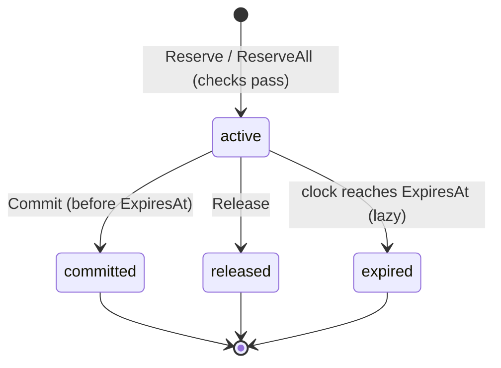
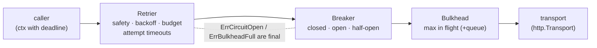
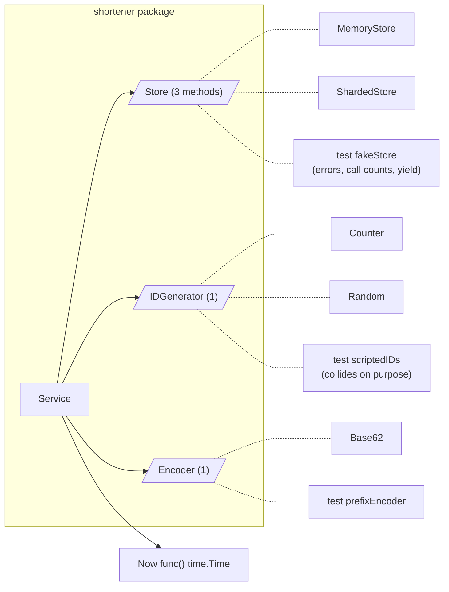
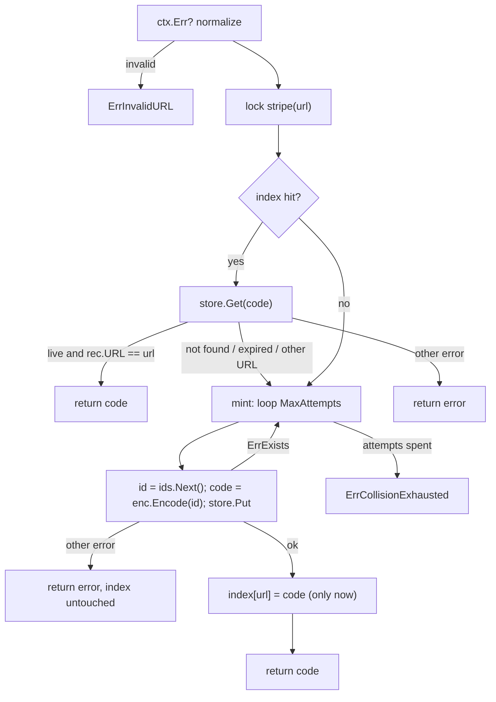

# B3 Unit 7 — Reservations and resilience: inventory, HTTP client, URL shortener

> Time: ~6 h · CORE: §1–§3 · Labs: `labs/b3/inventory`, `labs/b3/resilient`, `labs/b3/shortener`

## Before you start

You should have finished Units 5 and 6 and B0 Unit 2 (context deadlines, bounded concurrency). Warm-up (answers below;
write yours down first):

1. A parent context has 300 ms left. You derive a child with `WithTimeout(parent, 2*time.Second)`. What deadline does
   the child have?
2. The order book checks an invariant after every operation in tests. Name two invariants it checks.
3. Why must a state machine reject an event that is invalid in its current state instead of ignoring it?

<details data-kind="answer"><summary>Warm-up answers</summary>

1. The parent's: a derived deadline is the earlier of the two, so the child expires in ≈ 300 ms (B0 Unit 2 §1).
2. The book is never crossed (best bid < best ask); the total quantity is conserved (submitted = filled + resting +
   cancelled); resting orders have positive quantity; level aggregates equal the sum of their orders.
3. Ignoring hides bugs and duplicate callbacks (a second "payment captured" event must not capture twice). An explicit
   `ErrInvalidState` makes the misuse visible, testable and countable.

</details>

## How to work a problem section

Problem sections differ from the concept units in one way: **Build it comes before How it actually works**, because a
machine-coding problem is only practice if you attempt it before you see the reference design. The full protocol is in
the [module README](README.md#how-a-timed-attempt-works); in short:

1. Read *The failure story* and *The problem*. Only Stage 1 is visible; Stage 2 and Stage 3 sit in closed hint blocks
   and in the `stage2.go` / `stage3.go` stubs. Keep them closed until you reach them.
2. Write down your answers to the **Predict** blocks, then open the Reveals. These are the design decisions you make
   in the first ten minutes of the real round.
3. Start the clock and do the timed attempt in **Build it**, stage by stage, running the tests as you go.
4. Stop at the time box even if tests are red; note which stage you reached and where the minutes went.
5. Only then read *How it actually works*, *Common mistakes* and *The debrief*, score yourself on the rubric and say
   the 2-minute narration out loud once.

---
## §1 Problem 14 — Inventory and library with reservations

> **75 min** · focus: modelling, concurrency · CORE · lab `labs/b3/inventory` · ids `B3-U7-P01…P04`

Protocol reminder (full text in the unit's "How to work a problem section"): attempt in **Build it** before you read **How it actually works**, **Common mistakes** or **The debrief**.

### The failure story

A credit union launches a member-rewards store: 200 units of a limited "anniversary" gift item, redeemed with points,
announced to 10,000 members by push notification at 09:00. The first version of `Redeem` is four lines:
`if stock[sku] >= qty { stock[sku] -= qty; charge(member); }`. It has three lives, and each one fails differently.

1. **Check-then-act.** 6,000 members tap within the first minute. `stock` is read by many goroutines before any of
   them writes. The store sells 212 units of 200; 12 members get an "order confirmed" email and, a week later, an
   apology. Nothing crashed, and the unit tests (one goroutine) were green.
2. **Lock the whole flow.** The fix: one mutex around check, `charge()` and decrement. `charge()` calls the points
   ledger and takes ≈ 800 ms, so throughput is now 1 / 0.8 s ≈ **1.25 redemptions per second**, whatever the stock.
   The last of 10,000 members is told "sold out" after 10,000 × 0.8 s ≈ **2.2 hours**, and every request holds a
   goroutine and a connection while it waits.
3. **Decrement first, then charge.** The fix to the fix: decrement under the lock, release it, then charge. Fast, but
   ≈ 30% of charges fail or are abandoned at a flash event, and nothing puts the stock back: ≈ 60 of the 200 units
   are stranded as "sold" to members who never paid, while the page says sold out and nobody can buy. A cron job
   that "returns stuck stock every 5 minutes" brings units back late and sometimes twice, because the payment
   vendor's retry of an old callback arrives *after* the cron returned the unit.

What was missing is a **model**, not a mutex: stock is not one number but three (available, held, gone), a hold is a
thing with an owner and a clock, and "buy" is two steps (hold, then confirm) with the slow call between them *outside*
any lock. You already know the pattern from the platform you work on: a card authorisation reduces the member's
*available* balance without moving the *ledger* balance, and the capture or the expiry settles it. The interview
version of this problem is "a shop's cart" or "a library's lending desk", and the senior signal is stating those
invariants before writing a line.

### The problem

*As the interviewer says it* (you have **75 minutes**):

> "Build an in-memory inventory service in Go. It tracks units per SKU. A customer *reserves* some units for a
> limited time while they pay; if they pay, the reservation is *committed* and the units are gone; otherwise it's
> *released* or it expires and the units come back. Many goroutines call it. Start with single-item reservations; I'll
> add requirements as we go."

Questions worth asking in the first two minutes (or state as assumptions, out loud):

- Are units fungible (a count), or individually identified (seats, serial numbers)? (Fungible: a count. Seats are a
  different problem.)
- What does "available" mean exactly, and which numbers must always add up? (Write the invariant down: see below.)
- Who expires reservations, and how precisely? Is "within a second or two" fine, or must a hold stop counting at its
  deadline? (Exactly at the deadline, as seen by any caller, with no background goroutine: lazy expiry.)
- Can a reservation span several SKUs? Can a retry of the same request arrive twice? (Stage 2 will; ask anyway.)
- Is it one process, or the front end of a database? (One process; say what changes in the distributed version.)
- What happens to a commit that arrives after the hold lapsed? (It must fail. Taking the money for stock you already
  gave away is the failure this component exists to prevent.)

**Stage 1 — one SKU at a time (≈ minute 0–30).** `New(clock)`, `AddSKU`, `Reserve(sku, qty, ttl)`, `Commit`,
`Release`, `Available`, `Stock`. The four counters (`Total`, `Committed`, `Reserved`, `Available`) and the rule
*Total = Committed + Reserved + Available, Available ≥ 0* are the contract. Injected clock; lazy expiry; typed errors.

<details data-kind="hint">
<summary>Stage 2 — the interviewer adds this at ≈ minute 30 (open only when you get there)</summary>

"Checkout carts hold several SKUs at once: `ReserveAll`, all-or-nothing, one reservation ID. Payment callbacks get
retried by the vendor, so `ReserveKeyed` takes an idempotency key (same key, same request ⇒ same reservation, even if
two retries arrive at once; same key, different request ⇒ error). Customers sometimes need more time: `Extend`.
And ops can `Restock`."

Pay attention to: a failed cart leaving a partial hold behind, two carts `{A,B}` and `{B,A}` deadlocking, the replay
returning a *new* expiry, an `Extend` that corrupts your expiry ordering, and what a retry returns once the original
reservation has expired.

</details>

<details data-kind="hint">
<summary>Stage 3 — the interviewer adds this at ≈ minute 55 (open only when you get there)</summary>

"Now a library on the same core. `Borrow` lends one copy until a due date (reserve and commit as one step), `Return`
brings it back, and each member may have at most N loans. When nothing is free, members join a *waitlist*; when a copy
comes back (or a hold lapses, or you restock), the oldest waiter must get it: a hold they have to claim within a
time limit. Nobody may jump the queue. Prove it holds with a thousand goroutines."

Pay attention to: handing a freed copy to the head of the queue in the *same* critical section, the head asking for
more than is free, a newcomer calling `Reserve` while a copy is "idle", and records that pile up forever.

</details>

### Predict

<!-- predict id="B3-U7-P01" -->
**Predict.** Two ways to make reservations lapse. (A) A janitor goroutine wakes every second and deletes expired
reservations. (B) No goroutine: every public method first discards the reservations whose deadline has passed. For
each, write down: what does `Available` return 400 ms *after* a hold's deadline? How would you test it
deterministically with a fake clock? What happens to goroutines and memory if the caller creates 10,000
`Inventory` values in a test run? And which one has a data structure you must keep correct when `Extend` is added?
<!-- /predict -->

<!-- predict id="B3-U7-P02" -->
**Predict.** You give each SKU its own mutex (to let unrelated SKUs run in parallel) and implement `ReserveAll` as
"for each line in the order given: lock the SKU, check, reserve, unlock". Two goroutines run `ReserveAll({A,1},{B,1})`
and `ReserveAll({B,1},{A,1})` while `A` has 1 unit and `B` has 100. Describe two different bad outcomes this design can
produce (one involving a lock, one involving stock; for the second, think of a third cart that asks for `A` and `C`, where `C` is out of stock), then give two fixes and the price of each.
<!-- /predict -->

<!-- predict id="B3-U7-P03" -->
**Predict.** The payment vendor retries a callback with `key="order-77"` after your first attempt already created
reservation `r-1` for 2 units. Case 1: the retry arrives 10 seconds later. Case 2: it arrives 3 hours later, after
`r-1` expired. Case 3: the first attempt failed with `ErrInsufficient`, you restocked, and then the retry arrives.
What should each case return, and why is "remember every attempt, including failures" wrong?
<!-- /predict -->

<!-- predict id="B3-U7-P04" -->
**Predict.** The waitlist is `[W1 wants 3, W2 wants 1]` and one unit is free. (a) Who gets it? (b) A newcomer calls
`Reserve(sku, 1)` right now. What should happen? (c) The unit is then freed by a `Return` and the queue is still
`[W1, W2]`. Compare two policies, strict FIFO and "serve the first waiter whose request fits", on fairness and on
how many units sit idle.
<!-- /predict -->

### Reveal

<details data-kind="reveal" data-for="B3-U7-P01">
<summary>Reveal</summary>

**(A) janitor:** `Available` returns the *old* value for up to the janitor's period: a hold that expired 400 ms ago
still counts, so a customer is told "sold out" for stock that is free, and a `Commit` arriving in that window
*succeeds* on a reservation past its deadline unless `Commit` also checks the clock (then you have two expiry
mechanisms to keep consistent). A deterministic test needs a fake ticker plus synchronisation with the goroutine
("wait until the janitor has run"), which is exactly where flaky tests come from. With 10,000 `Inventory` values you
have 10,000 goroutines that never exit (the API has no `Close`) and 10,000 live tickers.

**(B) lazy:** `Available` is exact at every instant, because expiry is a *function of the clock*, applied before
every read. The test is three lines: `clock.Advance(ttl)`, `Available`, assert. There is no goroutine to leak. The
cost is that the work of discarding is paid by whichever call comes next (amortised O(log n) per expired
reservation with a min-heap on `ExpiresAt`), and that memory is held until someone looks (compaction: `Prune`).

The structure you must keep correct under `Extend` is B's min-heap: changing a key in place breaks the heap
invariant unless you call `heap.Fix` (so keep each reservation's heap index). A common bug is `Extend` that updates
`ExpiresAt` and forgets to re-heapify; the root then hides reservations that should already have expired.
Tempting wrong answer: "a `time.AfterFunc` per reservation". It is a timer and a goroutine per hold, it fires at
the mercy of the scheduler, and its callback needs the same lock as everything else, so it is lazy expiry with extra
steps and none of the exactness.

</details>

<details data-kind="reveal" data-for="B3-U7-P02">
<summary>Reveal</summary>

Two bad outcomes:

1. **Wrong stock (a partial hold).** Consider a third cart `{A,1},{C,1}` where `C` is out of stock. It reserves
   `A`'s only unit, fails on `C`, and unless the code rolls the `A` hold back, `A` stays unavailable. Even with a
   rollback, there is a window between "reserved A" and "rolled back A" in which other customers see `A` as sold out;
   under load that window is long enough to turn "1 unit left" into "sold out" for everyone. The "stock" failure.
2. **Deadlock (lock-order inversion).** If a cart keeps each SKU lock while it moves on to the next line, cart 1
   holds `A` and waits for `B` while cart 2 holds `B` and waits for `A`. The "lock" failure.

Fixes:

- **One lock for the whole inventory.** Check all lines, then apply all, in one critical section: atomic,
  deadlock-free, trivially correct. Price: all operations serialise. At ≈ 1 µs of work under the lock (measured in
  *How it actually works*: ≈ 3–5 µs per reserve+release pair including allocation), that is ≈ 2–4 × 10⁵ cart
  operations per second, orders of magnitude above what a checkout path sees, and per-SKU locks would not help the
  case that hurts (one hot SKU in a flash sale).
- **Per-SKU locks in a global order.** Sort the lines by SKU, lock in that order, check everything, apply everything,
  unlock in reverse. No deadlock, no partial holds, and unrelated carts run in parallel. Price: more code, a
  sorting step, and a lock-holding window that grows with cart size. Choose it when a profile shows contention
  across *many* SKUs.

Tempting wrong answer: "try-lock and back off on conflict". It trades a deadlock for livelock and unfairness unless
you add randomised backoff, which is more machinery than ordering the locks.

</details>

<details data-kind="reveal" data-for="B3-U7-P03">
<summary>Reveal</summary>

- **Case 1 (10 s later, same request):** return the *original* `Reservation`, unchanged (same ID, same `ExpiresAt`),
  and take no more stock. The point of an idempotency key is "the retry is indistinguishable from the first
  response". If the retry extended the expiry, a vendor that retries every 10 s could hold stock forever.
- **Case 2 (3 h later, reservation expired):** still the original value. The key identifies a *request*, not a live
  hold: the caller learns the hold is dead when it calls `Commit` (`ErrExpired`), which is the one place that
  decision belongs. Returning a fresh reservation here would silently re-reserve stock for an order the customer
  abandoned hours ago; returning an error would make a retry of a successful call look like a failure.
- **Case 3 (first attempt failed, restock, retry):** the key was never recorded, so the retry is a fresh attempt and
  succeeds. Remembering failures would make a transient "out of stock" permanent for that key. The rule is to
  record **successful** outcomes only (this is the same as for money movement: a duplicate transfer request returns
  the first transfer; a request that failed validation may be corrected and resubmitted).

Same key with a different request (different quantity or ttl) is a client bug: return `ErrKeyConflict`, don't guess
which one they meant. Keys must be forgotten eventually (they are memory): tie their lifetime to the reservation
record's retention, and say the window out loud (a vendor's retry horizon, hours to days).

</details>

<details data-kind="reveal" data-for="B3-U7-P04">
<summary>Reveal</summary>

(a) Under **strict FIFO** nobody: W1 needs 3, only 1 is free, so W1 keeps the head and W2 waits behind it. Under
**first-fit** W2 gets the unit.

(b) With strict FIFO the newcomer's `Reserve` must be **refused** (`ErrInsufficient`) even though a unit is free:
that unit is "owed" to the queue. If the newcomer could take it, every unit that frees up could be taken by
whoever calls at the right instant, W1's wait would be unbounded, and the waitlist would be decoration. The
check is simple: a SKU with waiters refuses direct reservations.

(c) FIFO is *fair* (bounded by queue position) but can leave units idle behind a big request: with a stream of
1-unit frees, the 1-unit W2 waits while the unit sits there for W1. First-fit has better utilisation and can
starve large requests forever. Library copies are one-at-a-time, so FIFO costs nothing; for quantities, a hybrid is
common ("serve the head if it fits, else the first fit, but cap how long the head can be skipped"). Say which you
chose and why. The reference uses strict FIFO and tests the head-of-line case explicitly.

Equally important is *when* the unit is handed over: a freed unit must go to the head **in the same critical
section** that freed it (turning it into a hold). "Notify the waiters and let them race" lets a newcomer win the
race, and makes fairness impossible to test.

</details>

### Build it

**Goal:** make `go test -race ./labs/b3/inventory/` pass, in stages, inside the time box.

Files: `labs/b3/inventory/inventory.go` (Stage 1), `stage2.go`, `stage3.go`. Tests: `inventory_test.go` (Stage 1 and
shared helpers, including the fake clock and the `within` timeout helper), `stage2_test.go`, `stage3_test.go`. Do
not open the next stage's files until you reach it.

```sh
go test -race -run 'Stage1' ./labs/b3/inventory/     # first 30 minutes
go test -race -run 'Stage[12]' ./labs/b3/inventory/  # by minute 55
go test -race -count=20 ./labs/b3/inventory/         # before you call it done
go test -run '^$' -bench . -cpu 1,4,8 ./labs/b3/inventory/   # optional: what your lock strategy costs
```

| Minutes | Do |
|---|---|
| 0–10 | Ask questions, state assumptions. Write the four counters and the invariant as a comment. Decide: one lock or several? how are reservations ordered by expiry? what does a reservation look like if it will later span several SKUs? |
| 10–30 | Stage 1. Build one private `tick()` that applies expiry, and call it at the top of every public method. Run Stage 1 tests as each method lands. |
| 30–55 | Stage 2. `Reserve` becomes the one-line special case of `ReserveAll`. Idempotency table next. |
| 55–75 | Stage 3. Waitlist `serve()` called from every path that frees units. Then run `-race -count=20` and write the 5-line concurrency note. |

Acceptance, per stage: all `TestStage1_*` (12 tests), `TestStage2_*` (16), `TestStage3_*` (18) pass with `-race`.
Stage 2 and 3 include concurrent tests (1,000 overlapping carts in opposite orders, 50 duplicate callbacks, 1,000
reservers across four SKUs, 40 concurrent waiters, a mixed random workload with an accounting check), so a green
Stage 1 says nothing about them. Every test that could hang runs under a 5-second `within` guard.

**Self-check before you read on:** state the invariant aloud, then say *which* line of your `Reserve` is the
check, which is the effect, and what keeps another goroutine from running between them.

### How it actually works

*(Read this after your attempt. Compare with your own design, not with your code.)*

**State machine of a reservation.** One reservation, four states, one way out of `active`:



**Data model.**

```go
type sku struct {
	name                       string
	total, committed, reserved int
	waiters                    []*ticket // FIFO, Stage 3
}                                         // Available = total - committed - reserved: never stored

type resv struct {
	id      string
	lines   []Line    // normalized: summed per SKU, sorted by SKU
	expires time.Time
	state   resvState // active | committed | released | expired
	ended   time.Time // for Prune
	idx     int       // position in the expiry heap, so Extend can heap.Fix
}

type Inventory struct {
	mu   sync.Mutex
	now  func() time.Time
	skus map[string]*sku
	resv map[string]*resv // every reservation, any state, until Prune
	exp  expiryHeap       // ACTIVE reservations only, min-heap on expires
	keys map[string]*keyEntry
	// loans, tickets, member counts: Stage 3
}
```

`Available` is **derived**, never stored: a stored copy is a second source of truth that some code path will
forget to update. The three stored counters are only ever changed together with the state transition that
justifies them.

**One discipline: `tick()` first.** Every public method does `mu.Lock(); now := inv.tick()` before anything else.
`tick()` reads the clock *once*, pops every heap entry with `expires <= now`, marks it `expired`, gives its units
back (`reserved -= qty`) and then offers the freed SKUs to their waitlists. Reading the clock once per call matters:
two reads can straddle a deadline and make one call see both "active" and "expired". The boundary is exclusive:
active means `now < ExpiresAt`, so a hold is gone *at* its deadline (tested one nanosecond either side).

```go
func (inv *Inventory) reserveLocked(now time.Time, lines []Line, ttl time.Duration) (*resv, error) {
	norm, err := normalize(lines) // ErrNoLines, ErrInvalidQty, sum duplicates, sort by SKU
	...
	for _, l := range norm { // CHECK everything first ...
		s, ok := inv.skus[l.SKU]
		if !ok { return nil, ErrUnknownSKU }
		if len(s.waiters) > 0 || s.avail() < l.Qty { return nil, ErrInsufficient }
	}
	return inv.newResv(now, norm, ttl, ""), nil // ... then APPLY everything, no failure possible in between
}
```

Check-all-then-apply-all inside one critical section is what makes `ReserveAll` all-or-nothing without any rollback
code: there is no state in which a half-applied cart exists, so there is nothing to undo.

**Commit / Release.** Look up, require `active` (map `expired` → `ErrExpired`, `committed`/`released` →
`ErrAlreadyDone`, missing → `ErrNotFound`), remove from the heap (`heap.Remove(idx)`), change the counters, mark the
state. `Release` frees units, so it ends by calling `serve` for each SKU; `Commit` frees nothing.

**Extend** changes `expires` and calls `heap.Fix(&exp, r.idx)`. That one line is the difference between a correct
and a quietly wrong expiry order.

**Idempotency table.** `keys[key] = {fingerprint, original Reservation}`; fingerprint = normalized lines + ttl.

| Situation | Result |
|---|---|
| unseen key | reserve; on success record; on failure record nothing |
| seen key, same fingerprint | return the recorded original (copy of `Lines`), take no stock |
| seen key, different fingerprint | `ErrKeyConflict` |
| empty key | not idempotent (plain `ReserveAll`) |

The lookup and the creation are in the same critical section as the reserve, so 50 concurrent duplicates create
exactly one reservation.

**Waitlist (`serve`).** `serve(sku)` is called after anything that can free units (`tick` expiries, `Release`,
`Return`, `Restock`, `CancelWait`): while the head's quantity fits `avail`, pop it and create a hold for it (TTL
from the ticket) as a real reservation, so the units stop being `Available` *in the same critical section*.
`Enqueue` appends, then calls `serve`, so a ticket is `Ready` immediately when stock is free and nobody is ahead.
A ticket's status is derived from its hold: active ⇒ Ready, committed ⇒ Claimed, expired ⇒ Expired, released ⇒
Cancelled; position is its index in `waiters`. `reserveLocked` and `Borrow` refuse (`ErrInsufficient`) while the
SKU has waiters: that single `len(s.waiters) > 0` is the entire "no barging" rule.

**Library.** `Borrow` = check member limit, check stock, `committed++`, record a `Loan`; `Return` = `committed--`,
member count `--`, `serve`. `BorrowHeld(reservationID, …)` converts a waitlist hold: it requires the hold's member
to match (`ErrNotYours`), then commits it and records the loan, so the unit is counted once.

**Lock strategy and what it costs.** One `sync.Mutex`, taken once per public method. Measured with
`BenchmarkReserveRelease_Parallel` in the repo sandbox (≈ figures, a reserve+release pair per op; yours will differ):

| `-cpu` | 1 SKU | 16 SKUs |
|---|---|---|
| 1 | ≈ 5 µs | ≈ 4 µs |
| 4 | ≈ 2.5 µs | ≈ 2.4 µs |
| 8 | ≈ 3 µs | ≈ 2.7 µs |

Two things to read from it. The numbers are dominated by allocation and map growth (every reservation is retained
until `Prune`), not by lock hold time. And **16 SKUs is not meaningfully faster than 1**, i.e. the lock is not
the bottleneck at this scale, so per-SKU locking would buy complexity (ordered acquisition, an ID-allocation lock,
a heap that spans SKUs) for nothing measurable. ≈ 2–4 × 10⁵ reserve+release pairs per second per process is far
above checkout traffic (a flash sale of 10,000 buyers over a minute is ≈ 170 req/s).

**Prune.** Terminal reservations, returned loans and finished tickets stay in their maps so that `Commit` of an old
ID can say `ErrExpired` instead of `ErrNotFound`, and so a late idempotent retry can be answered. `Prune(age)` is
the compaction step that bounds memory without a janitor: call it from whatever scheduler the host has.

### Break it

Do these on your passing solution. Predict the failing test and the message before you run it.

1. In `Reserve`, release the lock between "check" and "apply" (`Unlock(); runtime.Gosched(); Lock()`).
2. Make the multi-line reserve apply each line as soon as its check passes, with no rollback when a later line fails.
3. Make the expiry test inclusive of the deadline the other way: treat a hold as active *at* `ExpiresAt`
   (`expires.Before(now)` instead of `!expires.After(now)`).
4. Remove the `heap.Fix` call from `Extend`.
5. Make `ReserveKeyed` ignore the key (always reserve afresh).
6. Remove `serve(s)` from `Return`.
7. Remove the `len(s.waiters) > 0` condition from the reserve check.

<details data-kind="answer"><summary>What you should see</summary>

1. `TestStage2_OverlappingCartsInOppositeOrderDoNotDeadlock`: `143 carts succeeded, want exactly 100 (stock for
   100)` (the number varies); `TestStage2_ConcurrentCartsLeaveNoPartialHolds`: `353 carts succeeded, want exactly
   60`; and the Stage 3 hammer reports the impossible state itself: `observed impossible Stock(s0) =
   {Total:10 Committed:0 Reserved:151 Available:-141}` and `s0: 243 reservations succeeded for 10 units; the check
   and the hold must be one atomic step`. `-race` stays silent: every access is locked, the *logic* is a race.
2. `TestStage2_ReserveAllIsAllOrNothing`: `Available("a") = 3, want 5`: the failed cart left its hold on `a` behind.
3. `TestStage1_ExpiryIsLazyAndExact`: `Available("book") = 0, want 2` at exactly `ExpiresAt`; also
   `TestStage1_ManyReservationsExpireInTimeOrder`.
4. `TestStage2_ExtendKeepsExpiryOrderCorrect`: `Available("a") = 0, want 1`: the extended reservation sits at the
   heap root with a late expiry, hiding the 20-second hold behind it. Only a test that mixes extension with several
   other expiries catches this; a single-reservation `Extend` test passes.
5. `TestStage2_KeyedReserveReplaysTheOriginal`: the retry returns a new ID and a moved `ExpiresAt`; also
   `TestStage2_KeyReuseWithDifferentRequestIsAConflict` (`same key, different quantity = <nil>`).
6. `TestStage3_WaitlistServesOldestFirst`: `ticket of ann: state="waiting" position=1, want state="ready"
   position=0`: the copy came back and nobody was told.
7. `TestStage3_HeadOfLineBlocksSmallerRequestsBehindIt`: `Reserve of a free unit while a larger request heads the
   queue = <nil>, want an error satisfying errors.Is(err, inventory: insufficient stock)`.

</details>

### In the wild

- **Card authorisation and capture.** A card authorisation places a hold that reduces the cardholder's *available*
  credit; capture (usually at shipment) settles it, and an authorisation that is never captured lapses on its own.
  Hold durations vary by network and merchant category (TODO-VERIFY before quoting a number). It is `Reserve` /
  `Commit` / expiry with a different vocabulary.
- **Bank balances.** *Available balance* = ledger balance − pending holds; a debit-card authorisation lowers
  available but not ledger, and the clearing record later converts the hold into a posted debit. The invariant in
  this problem is your platform's balance model.
- **SQL.** The distributed version of `Reserve` is one conditional statement, which the database runs atomically
  under a row lock: `UPDATE stock SET reserved = reserved + $1 WHERE sku = $2 AND total - committed - reserved >= $1`,
  succeed iff one row was affected. The `SELECT … FOR UPDATE` form takes the row lock first and checks afterwards. Multi-item carts need a lock
  order (sort by SKU) for the same deadlock reason as in-process, and PostgreSQL reports deadlocks as `40P01`
  errors that callers must retry. Hold rows with an `expires_at` column are swept by a periodic job; reads filter on
  `expires_at > now()` (lazy expiry again).
- **Redis.** `DECRBY` plus a check is not atomic across two commands; a Lua script (`EVAL`) is, and a hold is a key
  with a TTL (`SET … EX`) whose expiry Redis itself handles lazily and by sampling.
- **Idempotency keys.** Stripe's `Idempotency-Key` header and the same pattern in most payment APIs: the first
  response for a key is saved and replayed for retries, a reused key with different parameters is an error, and keys
  are retained for a limited window (Stripe documents that keys may be pruned after at least 24 hours; TODO-VERIFY
  the current figure).
- **Ticketing and flash sales.** The same hold-then-confirm shape with a visible countdown; the waitlist-with-hold
  is how many ticketing systems release returned inventory, and the strict-FIFO-versus-first-fit choice is a product
  decision there.
- **Library systems.** Lending desks run "item on hold for patron X until Y": a hold on a returned copy that expires
  if not collected, exactly the `Ready` ticket here.

### Trade-offs

| Option | Wins when | Loses when | When the answer flips |
|---|---|---|---|
| One mutex over everything (reference) | Multi-item atomicity and invariants must be obvious; ≤ ~10⁵ ops/s | Many cores hammering many independent SKUs | A profile shows lock wait dominating *and* load spreads over many SKUs |
| Per-SKU locks, acquired in sorted order | Many SKUs, independent traffic, carts of 1–3 lines | A single hot SKU (still one lock); bigger code; heap spanning SKUs needs its own lock | The hot SKU problem is solved elsewhere (sharded counters, queueing) |
| Atomic counters / CAS per SKU | Single-line reserve, no waitlist, extreme read rates | Multi-item atomicity, expiry ordering, fairness | You only need "decrement if ≥ n" on one number |
| Lazy expiry (reference) | Exactness at the deadline, deterministic tests, no goroutines | Memory grows until someone calls Prune; first call after a quiet period pays the sweep | A host with no natural call pattern: add a periodic `Prune` caller (still no goroutine inside the type) |
| Janitor goroutine | Hundreds of thousands of idle reservations that must be freed promptly for memory | Stale `Available` between sweeps, lifecycle (`Close`), flaky tests | Memory pressure, not correctness, is the driver |
| `time.AfterFunc` per reservation | Very few, very long holds | A timer plus a lock acquisition per hold; callbacks race with `Commit` | Almost never |
| Strict FIFO waitlist | Fairness is a requirement (library, tickets) | Idle units behind a large head request | Quantities vary a lot and utilisation matters more: first-fit with a skip cap |
| Hand the unit over as a hold | Fairness must be testable; no races between waiter and newcomer | A hold nobody claims delays the next waiter until it lapses (TTL is a policy knob) | Waiters are machines that always claim instantly: notify-and-race can be fine |

### Senior bar

**Rubric (score yourself per row, then send the code to the tutor).** *Meets* needs a row at "meets" or better on
every row, with no "below".

| Dimension | below | approaching | meets (senior bar) | exceeds |
|---|---|---|---|---|
| Extensibility | Stock as one number; Stage 2 means a rewrite | Reservation hard-wired to one SKU; multi-item bolted on by looping over `Reserve` | Reservation holds lines from the start (or Stage 2 generalises it in place); `Reserve` is the 1-line special case; Stage 3 adds files, not rewrites | Names the distributed mapping (conditional UPDATE, row locks) and which functions would change |
| Concurrency safety | Check and act in separate critical sections; lock held across user callbacks | Single lock, but expiry runs in a goroutine that races `Commit`, or `ReserveAll` rolls back after releasing the lock | One lock (or ordered locks), check-all-then-apply-all in one critical section, one clock read per call, no goroutine; `-race -count=20` clean | Argues the invariants at every unlock and shows the benchmark that justifies the lock choice |
| Clean interfaces | Returns internal slices; `bool` results; panics on bad input | Errors are strings; a reservation can be committed twice without notice | Typed sentinel errors, defensive copies, documented replay semantics, derived `Available`, injected clock, no `Close` needed | Small consumer-side interface for the payment path (`Reserver`/`Committer`) so callers can fake it |
| Tests | Happy path only, one goroutine | Edge cases, no concurrency, real `time.Sleep` for expiry | Fake clock, exact-deadline test, all-or-nothing, opposite-order carts under `within`, concurrent duplicate keys, an accounting invariant | A model-based test against a naive implementation; a mutation shown to fail a test |
| Time management | Nothing running at minute 30 | Stage 1 at 30, Stage 2 unfinished at 55 | Stage 1 by 30, Stage 2 by 55, Stage 3 or an honest status by 75, with a spoken concurrency note | Stage 3 by 65 and time to discuss the distributed version |

**Failure modes in production.** Leaked holds (an abandoned checkout holds stock until TTL: size the TTL from the
payment flow's p99, not from hope: ≈ 10 minutes for a card form, seconds for a one-tap flow). Hold-and-forget
retries that extend holds forever (hence: `Extend` is explicit and idempotency replay does *not* extend). Memory
growth from retained records (`Prune`; an idempotency key window is a memory budget). Hot SKU: all load on one
counter (a queue in front, or pre-sharded stock). Clock changes: a wall-clock step backwards makes holds live
longer, forwards expires them early; use a monotonic clock source in production (Go's `time.Now()` carries one,
but a `time.Time` stored and compared after serialisation does not). Distributed: the double sell when two replicas
each hold "their" copy of the count.

**Numbers.** One lock/unlock ≈ 15–25 ns uncontended (`docs/NUMBERS.md`); the reserve+release pair costs ≈ 3–5 µs
in the reference *with allocation and a retained record each*; ≈ 2–4 × 10⁵ pairs/s per process. A hold sized at
10 minutes with 10 reservations per second means ≈ 6,000 live reservations (Little's law: 10 × 600), a few
hundred KB, so the janitor is not about memory at this scale.

**Interviewer probes**

<details data-kind="answer"><summary>"Make it distributed: three replicas, one database. What changes?"</summary>

The count lives in the database, so the check and the effect become one conditional `UPDATE … WHERE available >=
qty` (rows affected = 1 means success), which the database makes atomic with a row lock. Reservations become rows
with `expires_at`; `Available` is computed as `total − committed − SUM(active holds)` (or kept in a counter column
that the same transaction updates). Multi-item carts: one transaction, `UPDATE`s in SKU order to avoid deadlocks,
retry on `40P01`. Idempotency keys become a unique index, so the second inserter fails fast and reads the first
response. Expiry stays lazy (filters on `expires_at > now()`) plus a periodic sweep for housekeeping. The in-memory
type survives as a cache or a unit-test fake; its tests become the contract for the SQL version.

</details>

<details data-kind="answer"><summary>"A flash sale: 100,000 requests per second for 200 units. Does this design hold?"</summary>

The lock is fine (the reservations are cheap), but 99.8% of the traffic is going to be refused, and each refusal
still costs a lock acquisition, a request and a connection. I would put a cheap gate in front: a lock-free "sold
out" flag set when `Available` hits 0 (re-checked on release/expiry), admission control or a queue that lets only a
bounded number of buyers through to the reserve path, and the waitlist as the product answer to "I missed it". I
would also size the hold TTL tightly during the sale (a minute, not ten), since abandoned checkouts are what keep
the page on "sold out" while stock sits in holds.

</details>

<details data-kind="answer"><summary>"A payment succeeded but Commit returns ErrExpired. What do you do?"</summary>

That is a real race in the world, not a bug in the type: the hold lapsed while the customer was paying. The
component's job is to refuse (it must never commit stock it has already given away). The caller has to
compensate: attempt a fresh reservation (if stock remains, commit it), otherwise refund or void the authorisation
and tell the customer. To make it rarer: extend the hold when the payment starts (`Extend` is cheap), keep the TTL
above the payment p99, and commit before capturing where the payment API allows (authorise, commit stock,
capture). Same shape as a ledger hold and a late settlement.

</details>

<details data-kind="answer"><summary>"Reservation IDs are guessable. Does it matter?"</summary>

If IDs travel to browsers or webhooks, yes: someone who can guess `r-4311` can `Release` or `Commit` another
customer's hold. The reference uses a counter for readable tests. In a real service use unguessable IDs
(128 random bits, e.g. `crypto/rand`), and authorise the operation against the owner (the `Ticket`/hold already
carries a `Member` for exactly this reason: `BorrowHeld` returns `ErrNotYours`).

</details>

### Common mistakes

| Mistake | How the tests catch it | Fix |
|---|---|---|
| Check and decrement in separate critical sections (or a lock released between them) | `TestStage3_ConcurrentReservesNeverOversell`, `TestStage2_ConcurrentCartsLeaveNoPartialHolds` | One critical section from the check to the effect |
| Holding the lock across the slow call (the payment) | Not testable here; shows in the failure story (≈ 1.25 redemptions/s) | Reserve, release the lock, pay, then Commit/Release |
| Janitor goroutine instead of lazy expiry | `TestStage1_NoBackgroundGoroutines`, `TestStage1_ExpiryIsLazyAndExact` | Apply expiry from the clock at the top of every call |
| Expiry boundary off by one (`<=` vs `<`) | `TestStage1_ExpiryIsLazyAndExact`, `TestStage1_CommitJustBeforeExpiryWins` | Active means `now < ExpiresAt`; read the clock once per call |
| `Commit` of an expired reservation succeeds (no clock check on the commit path) | `TestStage1_ExpiryIsLazyAndExact` | `Commit` goes through the same `tick()`; expired ⇒ `ErrExpired` |
| `Release` twice (or after `Commit`) returns units twice | `TestStage1_ReleaseReturnsUnitsOnce`, `TestStage1_CommitRemovesStockForGood` | Terminal states are checked first; return `ErrAlreadyDone` |
| Cart reserved line by line without rollback | `TestStage2_ReserveAllIsAllOrNothing` | Check all lines, then apply all, inside one critical section |
| Duplicate SKUs in a cart checked one by one | `TestStage2_ReserveAllSumsDuplicateSKUs` | Normalize (sum, sort) before checking |
| Per-SKU locks in request order | `TestStage2_OverlappingCartsInOppositeOrderDoNotDeadlock` | Sort lines by SKU and lock in that order, or use one lock |
| Idempotent replay recomputes the expiry, or remembers failures | `TestStage2_KeyedReserveReplaysTheOriginal`, `TestStage2_FailedAttemptIsNotRemembered` | Store the original response; record successes only |
| `Extend` without re-heapifying | `TestStage2_ExtendKeepsExpiryOrderCorrect` | `heap.Fix` with a stored index |
| Returning internal slices in `Reservation` | `TestStage1_ReturnedReservationIsACopy` | Copy `Lines` on the way out |
| Freed units not offered to the waitlist on *every* path (Return, Release, expiry, Restock, Cancel) | `TestStage3_WaitlistServesOldestFirst`, `TestStage3_UnclaimedHoldExpiresAndPassesOn`, `TestStage3_CancelWait` | One `serve(sku)` called from the one place each path frees units |
| Newcomers barge past waiters | `TestStage3_NoBargingPastTheQueue`, `TestStage3_HeadOfLineBlocksSmallerRequestsBehindIt` | Direct reserves refuse while the SKU has waiters |
| `BorrowHeld` counts the unit twice, or lets another member claim the hold | `TestStage3_BorrowHeldChecksWhoOwnsTheHold` | Commit once; record the loan without a second increment; check the hold's member |

### The debrief: the senior-level design choices

1. **State the invariant before the code.** *Total = Committed + Reserved + Available, Available ≥ 0*, with every
   counter changed only together with its state transition. It turns "is this correct?" into a check you can run
   at every unlock, and it is what the observer goroutines in the Stage 3 tests assert. *In the interview, say:*
   "Available is derived, never stored, so it can't drift."
2. **Two-phase by design: reserve, then commit.** The slow, fallible step (payment) happens *between* the two phases
   and *outside* any lock. The component's contract is the three outcomes of the hold: committed, released, expired.
   This is the shape of card authorisation/capture, ledger holds and ticket purchase; naming that pattern shows
   you know why the API is not `Buy`.
3. **Lazy expiry as a function of the clock.** Exact at the deadline, trivially testable with a fake clock, no
   goroutine, no `Close`. The cost (memory until `Prune`, a sweep paid by the next caller) is real and stated.
4. **Check-all-then-apply-all in one critical section.** All-or-nothing without rollback code, because no
   half-applied state ever exists. The same idea as an SQL transaction, and a better answer than "try each line and
   undo".
5. **One lock, justified by a number.** Not "locks are slow" or "fine-grained is faster", but: the critical section
   is ≈ 1 µs, one SKU or sixteen costs the same in the benchmark, the hot-SKU case is unaffected by per-SKU locks,
   and ordered acquisition would add deadlock risk. Say what profile would change your mind.
6. **Idempotency is a stored response, not a flag.** Replay the original value, never extend it, record only
   successes, reject conflicting reuse, and bound the memory (Prune). It is the same machinery as your payment
   callbacks, which is why interviewers ask.
7. **Fairness is a policy with a mechanism.** Strict FIFO is a decision (units may idle behind a big head); the
   mechanism is "freed units become the head's hold inside the same critical section, and direct reservers are
   refused while a queue exists". Without the mechanism "FIFO" is a hope.
8. **Defensive copies and typed errors at the boundary.** `Reservation` is a value the caller may scribble on;
   `ErrExpired`, `ErrAlreadyDone`, `ErrNotFound` let the payment code decide what to do (compensate vs ignore).

**The 2-minute narration** (say it aloud once after your attempt): "State is SKUs with three counters plus a map of
reservations and a min-heap of the active ones by expiry; one mutex guards all of it. Every public method locks once,
reads the clock once, discards expired reservations, then does its work, so expiry is exact and lazy and there is no
goroutine. `ReserveAll` checks every line and then applies every line inside the same critical section, so a failed
cart changes nothing and there is no lock ordering to get wrong. Idempotency keys map to the original response and
are recorded only on success. The waitlist is a FIFO per SKU; every path that frees units calls `serve`, which turns
the head's request into a hold immediately, and direct reservers are refused while a queue exists. Evidence: a fake
clock for the deadline tests, a thousand-goroutine hammer that asserts exactly N winners and the stock invariant,
opposite-order carts under a deadlock timeout, and a mixed workload with an accounting check, all under
`-race -count=20`."

**What the interviewer adds next** (Stage 4, if there's time): reservations that belong to a customer with
per-customer quotas; partial fulfilment ("give me what you have"); backorders (negative stock with a promise date);
perishable batches with different expiry dates (FEFO picking); reservations across warehouses with a preference
order; an audit trail of every transition (append-only events, reconstruct state by replay); making it durable.
Each maps to a function you already have a single place for.

### Check yourself

1. Why is `Available` derived rather than stored?
2. A payment callback arrives twice, 200 ms apart, on two goroutines. Name the two things that must be in the same
   critical section for exactly one reservation to result.
3. Why does the reference refuse a `Reserve` of one free unit while a waiter wanting three is at the head?
4. `Extend(id, 30*time.Minute)` is called on a reservation that already expired a minute ago. What happens and why?

<details data-kind="answer"><summary>Answers</summary>

1. A stored copy is a second source of truth: some path (expiry, a failed cart, a double release) will forget to
   update it. Deriving it from `Total`, `Committed` and `Reserved` makes the invariant true by construction, and the
   three stored counters change only together with a state transition.
2. The lookup of the key (is there a recorded response?) and the creation plus recording of the reservation. If the
   lookup is a separate critical section, both goroutines see "unseen key" and both reserve.
3. Because that unit is owed to the queue: if newcomers could take free units whenever they called, the head could
   wait forever and the waitlist would not be fair. The refusal costs idle units (the trade-off), which is why
   first-fit with a skip cap is the alternative for quantity stock.
4. `ErrExpired`. The call goes through the same lazy sweep as everything else, so the hold is already gone when
   `Extend` looks it up; extending a lapsed hold would silently re-take stock that may have been given to someone
   else. The caller must make a fresh reservation.

</details>

---

## §2 Problem 15 — Resilient HTTP client

> **60 min** · focus: your vendor-adapter life, in an interview · CORE · lab `labs/b3/resilient` · ids `B3-U7-P05…P08`

Protocol reminder (full text in the unit's "How to work a problem section"): attempt in **Build it** before you read **How it actually works**, **Common mistakes** or **The debrief**.

### The failure story

A digital-banking platform onboards new members through a KYC vendor. The adapter is a thin wrapper around
`http.Client`: `POST /v1/verifications` with the member's details, a 30-second timeout (the vendor's
documentation says "typically 2–4 s, up to 20 s at month start"), and a loop that retries three times on any
error, with no backoff, because "the vendor is flaky on Mondays". On the first Monday of the month the vendor
degrades: ≈ 30% of calls hang until the timeout, and a further ≈ 12% are processed by the vendor but the
connection dies before the answer arrives.

1. **Duplicates.** The 12% "processed but unanswered" calls are retried. The vendor creates a second (and for
   some, a third) verification case per member, each billed per check, and compliance sees three records for one
   person. The adapter did exactly what it was written to do; nothing in it asks whether repeating a `POST` is
   *safe*.
2. **Amplification.** At the Monday peak of ≈ 40 onboarding requests/s, each hung attempt holds a goroutine and a
   connection for 30 s. Little's law: 40 req/s × up to 3 attempts × 30 s ≈ 3,600 in-flight calls, against a vendor
   contract of 200 concurrent connections. The vendor starts answering `429` to *everything* from the platform,
   including the members who would have succeeded, and the adapter retries those too. Offered load on the vendor
   was ≈ 3× normal at the moment it was least able to take it.
3. **Nobody stops.** For the 40 minutes the vendor is degraded, every request still spends its full 30 s × 3
   before failing. Members see a spinner for 90 seconds, then an error. The app's own thread pool (200 workers)
   fills with waiting calls, so the *login* endpoint, which shares the pool, times out too. A vendor problem has
   become a platform outage.

The fixes are three different mechanisms, and an interviewer expects you to know which problem each one solves:
**retry only what is safe** (idempotency), **stop sending when it's hopeless** (circuit breaker, retry budget),
and **limit what a single dependency can take from you** (bulkhead, deadlines). Getting the *order* in which they
wrap each other wrong undoes the others.

### The problem

*As the interviewer says it* (you have **60 minutes**):

> "Write a Go HTTP client wrapper for calling third-party vendors reliably. It should retry failed calls with
> backoff when that's safe. Build it so that cross-cutting behaviour is composable. I'll add requirements as we
> go. I care most about what could go wrong in production."

Questions worth asking in the first two minutes (or state as assumptions, out loud):

- Which calls are made through it: reads, writes, payments? Do writes carry an idempotency key? (Say: some do,
  some don't, and the wrapper must be safe either way.)
- What does the vendor return when overloaded: `429` with `Retry-After`, `503`, resets, timeouts?
- Who owns the deadline: the caller's context? Is there an end-to-end SLO per call (say 5 s)?
- How many wrappers are stacked above this one (SDK retries, gateway retries)? Is retry already done elsewhere?
- One vendor or many? Do failures need to be isolated per vendor?
- What must be observable: attempts per request, breaker state, rejections?
- Can I build on `net/http` types (`http.RoundTripper`) so it plugs into any `http.Client`? (Yes: assume so.)

**Stage 1 — retry with backoff (≈ minute 0–25).** A `RoundTripper` decorator: retry only safe requests, with
exponential backoff and jitter, honouring `Retry-After`, replaying bodies, and respecting the caller's context.

<details data-kind="hint">
<summary>Stage 2 — the interviewer adds this at ≈ minute 25 (open only when you get there)</summary>

"The vendor was down for forty minutes last month and we hammered it the whole time. Add a circuit breaker.
Closed, open, half-open. It should let a limited number of probes through when it recovers. And we call a few
different vendors through the same client, so one vendor's outage must not block the others."

Pay attention to: what counts as a failure (a `404`? a member who closed the app?), how many probes, results
that arrive from requests admitted before the state changed, what the retry loop does when the breaker opens
mid-request, and who calls the state-change callback and under what lock.

</details>

<details data-kind="hint">
<summary>Stage 3 — the interviewer adds this at ≈ minute 45 (open only when you get there)</summary>

"Last month's outage still tripled the load on the vendor before the breaker kicked in. I want a hard bound on
retry volume, a per-attempt timeout that respects the caller's overall deadline, a cap on concurrent calls per
vendor, and counters so on-call can see what it's doing. Then show me it holds up with a lot of goroutines."

Pay attention to: where in the retry loop a budget token is spent, what the attempt's context lifetime is
relative to the response body, whether a slot is held until the body is closed, and what you do when the backoff
is longer than the time that remains.

</details>

### Predict

<!-- predict id="B3-U7-P05" -->
**Predict.** Your retrier sees `POST /v1/verifications` fail with `read tcp: connection reset by peer` after the
request body was fully written. List every reason that retrying is dangerous *for this request*, then say exactly
what has to be true for retrying to become safe, and who is responsible for each part (client, vendor, you).
Finally: which of `GET`, `PUT`, `DELETE`, `PATCH` would you retry without asking anything, and why is `PUT`
different from `PATCH`?
<!-- /predict -->

<!-- predict id="B3-U7-P06" -->
**Predict.** The member app retries 3 times, your gateway retries 3 times, and your vendor adapter retries 3
times. The vendor has an outage and fails every call; the platform's healthy-day load on it is 200 req/s. What is
the worst-case load the vendor sees? Now keep the retries only in one layer: what is the load, and which layer
should it be? Finally, you add a retry budget of 10% to that layer: what is the bound now, and what happens to
the 90% of calls whose retry is denied?
<!-- /predict -->

<!-- predict id="B3-U7-P07" -->
**Predict.** 10,000 clients call a vendor that goes down for a few seconds and comes back with capacity for
500 requests per second. All clients use base delay 1 s, doubling, and a 30 s cap. Compare **no jitter** and
**full jitter** (uniform in `[0, ceiling)`): what does the arrival rate at the vendor look like at the first,
second and third retry round, and does the vendor recover? What does *equal jitter* (`ceiling/2 + rand*ceiling/2`)
change?
<!-- /predict -->

<!-- predict id="B3-U7-P08" -->
**Predict.** You stack three decorators on a transport: retry (R), circuit breaker (B), bulkhead (K). Write down
the order you would choose, outermost to innermost, and justify each adjacency by saying what goes wrong in the
opposite order. Then answer: a request admitted while the breaker was closed is still running when the breaker
opens, then goes half-open with one probe in flight; the old request now finishes successfully. What should the
breaker do with that result, and why?
<!-- /predict -->

### Reveal

<details data-kind="reveal" data-for="B3-U7-P05">
<summary>Reveal</summary>

The danger is not the network error, it is the *unknown outcome*. "Connection reset after the body was written"
means one of: the vendor never got it; it got it and is still processing; it processed it and the answer was lost.
A retry repeats the side effect in the last two cases: a second verification case, a second payment, a second
email. For a `POST` that creates something, the client cannot tell the cases apart, so **a retry is safe only if the
operation is idempotent by construction or the vendor can deduplicate it**.

What has to be true, and who owns it:

| Requirement | Owner |
|---|---|
| The vendor accepts an idempotency key and returns the *original* result for a repeated key | vendor |
| The key identifies one logical operation: generated **once per user intent**, stored *before* the first attempt (so a crash and restart reuses it), and sent unchanged on every attempt | you (the caller) |
| The body is byte-identical on every attempt (a different body with the same key is a bug: vendors answer `409`/`422`) | you |
| The wrapper refuses to retry an unkeyed `POST` and a request whose body can't be rewound (`GetBody == nil`) | the retrier |

`GET`, `HEAD`, `OPTIONS`, `PUT` and `DELETE` are idempotent by definition (RFC 9110): repeating them leaves the
server in the same state, so retry them without asking. `PUT` replaces a resource with a full representation
(doing it twice = once), while `PATCH` applies a change relative to the current state ("add 5") and is not
idempotent unless the patch format makes it so. Idempotent is about *state*, not about being free: a retried
`DELETE` may return `404` the second time, which a careful caller treats as success.

Tempting wrong answer: "retry it, the vendor probably deduplicates". Probably is how members get charged twice.

</details>

<details data-kind="reveal" data-for="B3-U7-P06">
<summary>Reveal</summary>

Attempts multiply across layers: 3 × 3 × 3 = **27 attempts** per member tap in the worst case, so the vendor sees
200 × 27 = **5,400 req/s** while it is least able to cope. Retrying in one layer only: 200 × 3 = 600 req/s. Pick
the layer that knows the most about safety and the deadline: usually the one **closest to the vendor call** (the
adapter owns the idempotency key and the vendor's `Retry-After` semantics), with the layers above configured to
fail fast and pass errors through. (The exception: a layer that holds the end-to-end deadline may decide *not* to
retry; layers should never silently retry on top of each other.)

A 10% retry budget bounds retries to ≈ 10% of requests: 200 first attempts/s + at most ≈ 20 retries/s = ≈ 220 req/s,
a **1.1×** amplification instead of 3×. The 90% of calls whose retry is denied **fail fast** with their last error
or response, which is the point: during a real outage the extra attempts would have failed too, and every denied
retry is load not added to a struggling vendor. When the vendor recovers, successes deposit tokens again and retries
resume. In steady state with a healthy vendor the budget is never the limiting factor; a burst allowance (a few
tokens) covers ordinary transient blips.

The budget is a *rate-limited insurance policy against retry storms*, not a substitute for a breaker: the breaker
cuts all traffic when failure is sustained; the budget bounds the extra traffic while you are still trying.

</details>

<details data-kind="reveal" data-for="B3-U7-P07">
<summary>Reveal</summary>

| Round | No jitter | Full jitter, ceiling = 1 s, 2 s, 4 s… |
|---|---|---|
| 1st retry | all 10,000 retry at t ≈ 1 s: a spike of 10,000 requests in the same few milliseconds (20× the 500/s capacity) | 10,000 spread over `[0,1)` s ≈ **10,000 req/s** on average (still 20× capacity, but not one instant) |
| 2nd retry | all (that failed) again at t ≈ 3 s | spread over `[0,2)` s ≈ 5,000 req/s |
| 3rd retry | all again at t ≈ 7 s | spread over `[0,4)` s ≈ 2,500 req/s |

The average arrival rate under full jitter is roughly *clients ÷ ceiling*, so it falls by half every round, and
the vendor can clear 500/s of it; it drops below capacity around the 5th round (ceiling ≈ 20–30 s, hence the cap).
Without jitter the clients stay **synchronised forever**: every wave is the whole population arriving together, a
thundering herd that can knock the vendor down again the moment it recovers. Backoff alone spaces the waves;
jitter *breaks* them apart.

Equal jitter keeps a floor of `ceiling/2`, so the earliest retry is never sooner than half the ceiling and arrivals
are concentrated in `[ceiling/2, ceiling)`: half the spread, so more contention at the same mean delay. The AWS
Architecture Blog's backoff experiment found full jitter (and the related decorrelated jitter) beat no-jitter and
equal-jitter on both total calls and completion time (TODO-VERIFY: exact figures). Choose full jitter by default, and say why in one
sentence: "randomising the whole interval de-synchronises clients; a floor only re-synchronises half of them."

Common trap: `delay << attempt` overflows `int64` nanoseconds after ≈ 33 doublings of 1 s, wrapping to a negative
sleep (which returns immediately) or zero. Cap while doubling, as in the reference code.

</details>

<details data-kind="reveal" data-for="B3-U7-P08">
<summary>Reveal</summary>

**Retry → Breaker → Bulkhead → transport** (outermost to innermost).

| Adjacency | Why this order | What goes wrong in the opposite order |
|---|---|---|
| Retry outside Breaker | The breaker sees every real attempt, so it counts failures at the rate the vendor produces them; when it opens mid-retry the next attempt is rejected fast and the loop ends | Breaker outside Retry sees one outcome per *logical* request, after all retries: it needs `N × attempts` real failures to trip, and every half-open "probe" runs a full retry loop, so a recovering vendor gets 3 requests per probe |
| Breaker outside Bulkhead | Rejecting at the breaker costs nothing; the bulkhead only ever guards calls that will really go out. Bulkhead rejections are *our* limit, not vendor failure, so the breaker ignores them | Bulkhead outside Breaker holds a slot for requests that the breaker is about to reject, and an open breaker still occupies capacity |
| Bulkhead innermost (not outside Retry) | A slot is held only while a call is really in flight | A bulkhead outside Retry holds its slot **through the backoff sleeps**, so a retrying request occupies capacity while doing nothing |

The retrier must treat `ErrCircuitOpen` and `ErrBulkheadFull` as **final**: those are decisions to shed load, and
retrying them with a backoff defeats them.

The old request's success: **ignore it.** The result describes the vendor as it was when the request *started*,
before the circuit opened; counting it as the probe's verdict could close the breaker on evidence from the wrong
era while the real probe is still pending. The implementation: each admitted request carries the breaker's
*generation* (a counter bumped on every state change); a result whose generation no longer matches is dropped.
(`sony/gobreaker` uses the same device, TODO-VERIFY naming.) The opposite stale case matters too: an old failure
arriving in half-open must not reopen a circuit whose probes are succeeding.

</details>

### Build it

**Goal:** make `go test -race ./labs/b3/resilient/` pass, in stages, inside the time box.

Files: `labs/b3/resilient/resilient.go` (Stage 1: `Retrier`, given: `Chain`), `stage2.go` (`Breaker`,
`PerHostBreakers`), `stage3.go` (`Budget`, options, `Bulkhead`, stats). Tests: `resilient_test.go` (Stage 1 and
shared fakes), `stage2_test.go`, `stage3_test.go`. Don't open the next stage's files until you reach it.

```sh
go test -race -run 'Stage1' ./labs/b3/resilient/         # by minute 25
go test -race -run 'Stage[12]' ./labs/b3/resilient/      # by minute 45
go test -race -count=20 ./labs/b3/resilient/             # before you call it done
```

| Minutes | Do |
|---|---|
| 0–5 | Ask questions. Write the three-line design: three decorators over `http.RoundTripper`, order R → B → K, injected `Sleep`/`Rand`/`Now`. Decide the failure taxonomy (what is retriable, what is a vendor failure). |
| 5–25 | Stage 1. First the single function "is this request safe to repeat" and the single function "is this outcome retriable", then the loop, then backoff, then Retry-After. Tests 1–9 first; the safety, body and cancellation tests next. |
| 25–45 | Stage 2. State machine first, as pure logic, with the generation counter from the start; then `Wrap`; then per-host. |
| 45–60 | Stage 3. `Budget` (15 lines), then the retry-loop gates, then `Bulkhead`; run the concurrent chain test with `-race`. Leave 5 minutes for the narration. |

Stage 1 is the biggest: if you are at minute 25 with Retry-After still red, park it (3 tests), move on, and come
back. Say that out loud in an interview: "I'm parking Retry-After; here's where it plugs in."

Acceptance, per stage: all `TestStage1_*` (21 tests, some table-driven), `TestStage2_*` (15) and `TestStage3_*` (14)
pass with `-race`. No test touches the network: the vendor is a scripted `RoundTripper`, sleeping and the clock are
injected, and every wait has a 5 s timeout. The Stage 3 chain test runs 480 requests through
Retry → Breaker → Bulkhead from 16 goroutines against a flaky vendor, and checks the in-flight cap, legal breaker
transitions, the retry bound, closed bodies and goroutine leaks.

**Self-check before you read on:** can you say, in one sentence each, why your retrier does not retry `POST`
without a key, why it drains discarded bodies, and why the breaker ignores a cancelled context?

### How it actually works

*(Read this after your attempt. Compare with your own design, not with your code.)*

**Composition.** Every concern is a `Wrapper`: `Wrap(next http.RoundTripper) http.RoundTripper`. `Chain(base,
ws...)` applies them so `ws[0]` is outermost. Each decorator owns its own small piece of state and never calls
`next` while holding a lock.



**The retry loop (one function, ordered gates).** For each attempt: call `next` on a private clone of the request
(rewound body from `GetBody`; optional per-attempt timeout). Then classify the outcome in this order, because
earlier rules must win:

| # | Gate | If it fails |
|---|---|---|
| 1 | caller's context done | return as-is; never retry, never wrap |
| 2 | outcome is retriable: transport error (not `ErrCircuitOpen`/`ErrBulkheadFull`) or status 429/502/503/504; `Retry-After` ≤ `MaxDelay` | return the outcome |
| 3 | request is safe to repeat (idempotent method or key) and replayable | return the outcome |
| 4 | attempts left | stop, count `GaveUp` |
| 5 | delay = `max(jittered backoff, Retry-After)` fits in the time left (and leaves `minRemaining`) | stop, count `GaveUp` (a real 503 beats a late "deadline exceeded") |
| 6 | budget token available | stop, count `BudgetDenied` |
| 7 | drain and close the discarded response; sleep (context-aware); loop | |

The budget gate is last on purpose: a token is spent only for a retry that will happen. Putting it before the
attempts check charges a token for the retry you were never going to make (`TestStage3_BudgetTokensAreOnlySpent…`).

**Backoff.** `ceiling(n) = min(MaxDelay, BaseDelay × 2^(n-1))`, delay = `Rand() × ceiling` (full jitter). The
doubling loop stops at the cap, so it can't overflow.

**Per-attempt context.** `context.WithTimeout(callerCtx, perAttempt)` can only shorten the caller's deadline, never
extend it. The cancel function is called when the response body is closed, not when `RoundTrip` returns: cancelling
earlier aborts the body read (`TestStage3_AttemptContextOutlives…`). Discarded responses are closed, which cancels
their contexts.

**Breaker.** A mutex guards `state`, a `gen` counter, `consecutive`, a ring buffer for the rolling window and the
probe counters. `allow()` runs under the lock: if open and the cooldown has elapsed (injected clock) it moves to
half-open (lazy; no timer goroutine); closed admits; half-open admits while `admitted < K`; otherwise
`ErrCircuitOpen`. `record(gen, outcome)` drops anything whose `gen` is stale; in closed it counts consecutive and
windowed failures; in half-open a failure reopens at once, and `K` successes close. Every state change resets
counters, bumps `gen` and calls `OnStateChange` *under the lock*, which makes transition order trivially correct at
the price of a contract ("don't call back into the breaker"); the alternative, queuing events and delivering after
unlock, is the next refactor.

**Bulkhead.** A buffered channel of capacity `MaxInFlight` as a semaphore, plus a counter of queued waiters guarded
by a mutex. `acquire` tries a non-blocking send; else queues if `waiting < MaxQueue`, waiting on the semaphore or the
caller's context; else `ErrBulkheadFull`. The slot is released when the **response body is closed** (via a `sync.Once`
wrapper), or immediately on an error or panic.

**Complexity.** Everything is O(1) per request except `drainClose` (bounded to 4 KiB). Memory: one ring of `Window`
booleans per breaker; one map entry per host for `PerHostBreakers` (unbounded in the number of hosts; fine for a
fixed set of vendors, a risk if hosts come from user input).

### Break it

Mutate your passing solution and predict the failing test first. (These are real mutations; the messages below
were produced by the reference suite.)

1. `isIdempotent` returns `true` for every method.
2. Compute the ceiling as `BaseDelay << (n-1)` and cap afterwards.
3. In `attempt`, `defer cancel()` right after `next.RoundTrip`.
4. In the breaker, remove the generation check in `record`.
5. In the bulkhead, release the slot when `RoundTrip` returns instead of when the body is closed.
6. Move the budget `TryWithdraw` above the "attempts left" check.
7. Let the retrier retry `ErrCircuitOpen` like any transport error.
8. Hold a mutex across `next.RoundTrip` in the breaker.

<details data-kind="answer"><summary>What you should see</summary>

1. `TestStage1_PostWithoutKeyIsNeverResent`: "the vendor processed the payment 3 times; a retried POST without an
   idempotency key would double-charge", plus `TestStage1_OnlyIdempotentMethodsAreRetried`: "POST was attempted 3
   times, want 1". The double-charge bug is the one that passes every test that uses `GET`.
2. `TestStage1_BackoffNeverOverflowsOrExceedsMaxDelay`: "last sleep = 0s; after 89 doublings the ceiling must have
   been the 5s cap". The shifted value wraps around (to zero or negative) once the base has been doubled past 2^63
   nanoseconds, about 43 doublings of 1 ms and 33 of 1 s; a negative sleep returns at once, so a long outage turns a
   backoff into a hot loop.
3. `TestStage3_AttemptContextOutlivesRoundTripUntilTheBodyIsClosed`: `reading the body after RoundTrip returned: "",
   context canceled; … (defer cancel() inside RoundTrip kills the body read)`. Against a real `http.Transport` the
   caller sees `context canceled` while reading a perfectly good response.
4. `TestStage2_ResultsFromBeforeTheStateChangedAreIgnored`: "state = closed: a success from a request admitted
   before the circuit opened was counted as the probe's verdict". Simple tests that run requests one at a time
   cannot see this.
5. `TestStage3_BulkheadSlotIsHeldUntilTheBodyIsClosed`: "InFlight = 0 with a response whose body is still open,
   want 1: the connection is busy until the body is read or closed". Queue tests then time out waiting for a
   waiter that is never needed.
6. `TestStage3_RetriesAreLimitedByTheBudget`: "20 vendor calls, want 25 = 20 requests + 5 budgeted retries", and
   `…BudgetTokensAreOnlySpentOnRetriesThatHappen`: "Tokens = 2, want 4: one retry happened, and exhausting
   attempts must not withdraw again".
7. `TestStage2_RetrierDoesNotRetryAnOpenCircuit`: "4 backoff sleeps [50ms 100ms 200ms 400ms], want 2: a rejection
   must end the retry loop, not start another backoff". Each rejection is retried, with growing sleeps, against a
   breaker that will keep saying no.
8. `TestStage2_HalfOpenAdmitsExactlyKProbesAndRejectsTheRest`: "timed out after 5s waiting for both probes to reach
   the vendor". With a lock held across the call, the second probe queues behind the first; every request through the
   breaker is serialised, so one slow vendor call blocks everything, including the rejections.

</details>

### In the wild

- **`net/http`.** `http.RoundTripper` is the standard extension point: implementations "should not modify the
  request" and must close its body, which is why the reference clones the request per attempt.
  `NewRequest` fills `GetBody` for `*bytes.Buffer`, `*bytes.Reader` and `*strings.Reader`. `http.Transport`
  itself retries a request on a reused connection that died, but only if the body is replayable and the request is
  idempotent, which its docs define as `GET`, `HEAD`, `OPTIONS` or `TRACE`, or any request carrying an
  `Idempotency-Key` or `X-Idempotency-Key` header (TODO-VERIFY wording against your Go version's docs).
- **RFC 9110** defines idempotent methods (`GET`, `HEAD`, `OPTIONS`, `TRACE`, `PUT`, `DELETE`) and the `Retry-After`
  header (delta-seconds or HTTP-date). **Idempotency keys:** Stripe's API accepts an `Idempotency-Key` header on
  `POST` and replays the stored result for a repeated key (retention window: TODO-VERIFY); an IETF HTTP API working
  group draft standardises the header (TODO-VERIFY status).
- **Envoy** has per-route retry policies (`retry_on` conditions, `num_retries`, per-try timeout, backoff), cluster
  *circuit breaker* limits that are really concurrency caps (`max_connections`, `max_pending_requests`,
  `max_requests`, `max_retries`, i.e. bulkheads) and *outlier detection*, which ejects hosts after consecutive
  5xx responses for a base ejection time (the breaker; defaults TODO-VERIFY). It also supports retry budgets as a
  percentage of active requests (TODO-VERIFY field names).
- **gRPC** retries are configured in the service config (`maxAttempts`, backoff, retryable status codes) with a
  *retry throttling* token bucket (`maxTokens`, `tokenRatio`): failures drain it, successes refill it, and retries
  stop below half full. That is your `Budget`. The cap on `maxAttempts` is a small number (TODO-VERIFY: 5).
- **Google's SRE book** (chapters on handling overload and cascading failures) recommends a per-request retry
  limit (about 3) and a per-client retry budget (about 10% of traffic), and warns about retrying at multiple
  layers: the 27× arithmetic above.
- **AWS Architecture Blog, "Exponential Backoff and Jitter"** compares no jitter, full, equal and decorrelated
  jitter by total calls and completion time.
- **Libraries.** `sony/gobreaker` (states closed/open/half-open, `MaxRequests` for half-open probes, `ReadyToTrip`,
  `OnStateChange`, generation counters), Resilience4j (Java: count- and time-based sliding windows,
  `failureRateThreshold`, `waitDurationInOpenState`, `permittedNumberOfCallsInHalfOpenState`, semaphore and
  thread-pool bulkheads), `hashicorp/go-retryablehttp` (retry loop with backoff; honours `Retry-After`, TODO-VERIFY
  default policy). Netflix Hystrix popularised the breaker + bulkhead + timeout trio and is in maintenance mode.

### Trade-offs

| Option | Wins when | Loses when | When the answer flips |
|---|---|---|---|
| Decorators over `http.RoundTripper` (reference) | Any `http.Client` can use it; each layer testable alone | Order is a design decision that is easy to get wrong; cross-layer info (e.g. "breaker just opened") is only visible via errors | Non-HTTP dependencies (gRPC, DB): wrap a generic `func(ctx) (T, error)` instead |
| One retry layer, nearest the vendor call | Single place that knows safety, keys and `Retry-After` | Upstream layers can't tune their own policy | A layer that owns an end-to-end SLO may need its own *deadline* (not its own retries) |
| Full jitter | Default: de-synchronises clients | Higher variance in individual delays | Latency-critical single caller on a private dependency: smaller base, or decorrelated jitter |
| Retry budget (ratio) | Brownouts: bounds amplification at ≈ 1.1× | Under sustained partial failure, some retries that would succeed are denied | Very low traffic (the ratio gives < 1 retry): use a minimum burst or a per-second floor |
| Breaker on consecutive failures | Cheap, obvious, trips fast on a hard outage | Misses 50% error rates that interleave successes | Spiky traffic with partial failures: rolling failure-ratio window with a minimum volume |
| Breaker per host / per vendor | One vendor's outage isolated | More state; per-host map grows with host cardinality | Many instances behind one hostname: consider per-endpoint or per-route breakers |
| Bulkhead with fast rejection | Protects your threads; fails in microseconds | Rejects work you could have served a moment later | Bursty traffic with slack in the deadline: small bounded queue |
| Hedged requests (not built here) | Tail latency on idempotent reads | Extra load; unsafe for non-idempotent calls | Only with a budget and only for reads |

### Senior bar

**Rubric (score yourself per row, then send the code to the tutor).** *Meets* needs a row at "meets" or better on
every row, with no "below".

| Dimension | below | approaching | meets (senior bar) | exceeds |
|---|---|---|---|---|
| Extensibility | One `Do(url)` function with retry, breaker and timeout interleaved; Stage 2 rewrites Stage 1 | Separate pieces, but they know about each other (retrier imports breaker state) | Three decorators behind one `Wrapper` interface, Stage 2 and 3 added without changing signatures (options); `ErrCircuitOpen` the only coupling | Also shows how it generalises to gRPC/DB calls (`func(ctx) (T, error)` core), and where hedging or per-route policy would plug in |
| Concurrency safety | Shared counters without sync; lock held across the network call | Locks correct, but stale results change state, or probe count unbounded | Each decorator guards only its own state; no lock across `next`; generation counter; atomics for stats; `-race -count=20` clean including the chain test | Argues the breaker's callback contract and the alternative (deliver after unlock); notes lock-free options and why not worth it |
| Clean interfaces | Mutates the caller's request; leaks response bodies; returns bare strings as errors | Request cloned, but errors are strings or bodies closed only on success | Honours the `RoundTripper` contract (clone, close, drain); typed errors with `errors.Is/As`; injected `Sleep`/`Rand`/`Now`; documented failure taxonomy | Typed outcome classification hook (`ShouldRetry`/`IsFailure` funcs) with sane defaults, and metrics hooks |
| Tests | Real sleeps and real network; asserts "eventually" | Fake transport, but tests only the happy path and a single failure | Scripted fake vendor, injected time, a double-charge test, a body-leak test, a half-open concurrency test, and a chain test under `-race` | Mutation-tested (a deliberately broken variant fails a test); property test over random vendor behaviour |
| Time management | Nothing green at minute 25 | Stage 1 green at 25, Stage 2 half-done at 45 | Stage 1 at 25, Stage 2 at 45, Stage 3 or an honest status by 60 with a spoken failure-mode summary | Stage 3 at 55, time to discuss deployment and metrics |

**Failure modes in production.** Retry storms (no budget, multi-layer retries). Duplicate side effects (unkeyed
`POST`s, or keys that change per attempt). Connection leaks (undrained bodies, bodies closed on success only).
Synchronised clients (no jitter). Breakers that never close (a probe that is never admitted because a previous one
leaked its slot on panic) or never open (counting only 5xx while the vendor hangs: timeouts must count). A breaker
that trips on members closing the app. Per-host state growing without bound. Clock jumps with wall-clock cooldowns
(use a monotonic clock source).

**Numbers.** Retry amplification = product of attempts per layer: 3 layers × 3 attempts = 27×. In-flight calls by
Little's law = arrival rate × latency: 40 req/s × 3 attempts × 30 s ≈ 3,600. A 10% budget bounds extra load to ≈ 1.1×.
Breaker detection time with consecutive-failure threshold `N` and attempt timeout `T`: first trip after about `T` if
the `N` calls are concurrent, up to `N × T` if sequential: with `T` = 30 s and `N` = 5, a single caller sees 150 s
of pain before the circuit opens, which is why per-attempt timeouts must be near the vendor's p99, not its max.

**Interviewer probes**

<details data-kind="answer"><summary>"Where do you put the retry: in the client, the gateway, or the app?"</summary>

In exactly one place, and the one that can answer "is this safe to repeat?" and "how much time is left?": usually
the layer that makes the vendor call, because it owns the idempotency key and sees `Retry-After`. Everything above
it passes errors through and carries a deadline. The reason is multiplication: 3 × 3 × 3 is 27 attempts per tap.
If a platform team insists on a gateway retry, I'd give the gateway a retry *budget* and disable the others for
that route, and I'd make sure the attempt count is a header or metric so I can see the total.

</details>

<details data-kind="answer"><summary>"How do you pick the breaker's thresholds and cooldown?"</summary>

From the dependency's behaviour, not from a template. Failure threshold: tolerate the normal error rate (say 1%)
and trip on a sustained deviation, using a rolling window with a minimum volume (so 3 requests at 3 a.m. can't open
it). Cooldown: roughly how long the vendor takes to recover from a typical incident (tens of seconds), short enough
that recovery is noticed quickly, long enough that probes aren't the load. Probes: few, because they are the first
traffic to a possibly fragile service. Then I'd watch breaker-open time and rejected counts in production and
adjust, and I'd alert on "open for more than X minutes", which is a vendor incident.

</details>

<details data-kind="answer"><summary>"A vendor returns 200 with an error body. How does your client know?"</summary>

It doesn't, and it shouldn't try to infer: the retrier and breaker act on transport semantics (errors, status
codes). I'd expose the classification as a function the adapter provides: `IsFailure(resp, err)` for the breaker
and `ShouldRetry(resp, err)` for the retrier, with defaults for HTTP semantics. The adapter that knows the vendor's
envelope (`{"status":"ERROR","code":"TEMP_UNAVAILABLE"}`) reads it and tells the layers. The cost of that hook is
that the body must be readable by the classifier and still by the caller, so it needs buffering or a tee.

</details>

<details data-kind="answer"><summary>"Retry-After says 60 s. Do you wait?"</summary>

It depends on my deadline. If the caller has 5 seconds, waiting 60 is pointless: I return the `429` immediately so
the caller can degrade (queue the work, show a message). If it's a background job with minutes of budget, yes, and
I use the vendor's number as a floor (never retry earlier than asked), plus jitter on top, because every client
that got the same `Retry-After` will otherwise come back at the same instant. My `MaxDelay` is the policy knob:
longer than it means "give up and report".

</details>

### Common mistakes

| Mistake | How the tests catch it | Fix |
|---|---|---|
| Retrying `POST` without an idempotency key | `TestStage1_PostWithoutKeyIsNeverResent`, `…OnlyIdempotentMethodsAreRetried` | One `isIdempotent` function: safe methods or a key header; unkeyed writes fail once |
| Not rewinding the request body | `TestStage1_RequestBodyIsReplayedOnEveryAttempt`, `…UnreplayableBodyIsNotRetried` | `req.GetBody()` per attempt; no `GetBody` means no retry |
| Not draining and closing discarded responses | `TestStage1_DiscardedResponsesAreDrainedAndClosed` | `io.Copy(io.Discard, io.LimitReader(body, 4096))`, then `Close` |
| `time.Sleep` for backoff (not cancellable) | `TestStage1_CancellationDuringBackoffReturnsPromptly` | Select on a timer and `ctx.Done()` |
| `base << attempt` overflow, or jitter applied before the cap | `TestStage1_BackoffNeverOverflows…`, `…FullJitterBackoffSequence` | Double with a cap check; `rand × min(cap, ceiling)` |
| Equal or no jitter | `TestStage1_DelayIsRandTimesCeiling` | Full jitter: `Rand() × ceiling` |
| Retrying the caller's own cancellation, or wrapping it as "retries exhausted" | `TestStage1_CallerCancellationIsNeverRetried` | Check `ctx.Err()` before classifying |
| Waiting for a `Retry-After` of an hour, or capping it silently | `TestStage1_RetryAfterBeyondMaxDelayGivesUp` | Over `MaxDelay` means give up and return the response |
| Retrying `ErrCircuitOpen` / `ErrBulkheadFull` | `TestStage2_RetrierDoesNotRetryAnOpenCircuit` | Rejections are final |
| Counting `4xx` (or the member's cancel) as vendor failure | `TestStage2_OnlyVendorTroubleCountsAsFailure`, `…CallerCancellationIsNotAVendorFailure` | Failure = transport error (incl. timeouts) or `>= 500`; cancel is ignored |
| Half-open admitting every caller / counting stale results | `TestStage2_HalfOpenAdmitsExactlyK…`, `…ResultsFromBeforeTheStateChangedAreIgnored` | Probe counter + generation counter |
| Lock held across the network call | `TestStage2_HalfOpenAdmitsExactlyK…` (probes serialised), concurrent tests | Lock only around state; call `next` unlocked |
| Cancelling the attempt context before the body is read | `TestStage3_AttemptContextOutlivesRoundTrip…` | Cancel in the body's `Close` |
| Spending a budget token before the retry is certain | `TestStage3_BudgetTokensAreOnlySpentOnRetriesThatHappen` | Budget gate is the last gate |
| Releasing the bulkhead slot on headers, not body close | `TestStage3_BulkheadSlotIsHeldUntilTheBodyIsClosed` | Wrap the body; release once on `Close` |

### The debrief: the senior-level design choices

1. **Compose, don't configure.** Retry, breaker, bulkhead are separate `RoundTripper` decorators. Each is testable
   alone, and the *order* is the design. Lead with the order and why. *In the interview, say:* "Retry outside
   breaker outside bulkhead: the breaker counts real attempts, the bulkhead guards real calls, and the retrier
   never sleeps while holding capacity."
2. **Safety is a precondition, not an option.** A retrier that doesn't know whether a call is repeatable is a
   duplicate-charge generator. Idempotent method or key, replayable body, and the caller's cancellation is never
   retried: three checks, in one place, before any backoff logic.
3. **One retry layer; budgets bound the rest.** Multiplication across layers (3 × 3 × 3 = 27) is how clients take
   vendors down. The ratio-based budget makes the bound explicit (≈ 1.1×) and turns "retry on failure" into
   "retry on failure *if the system can afford it*".
4. **Full jitter, a cap, and respect for `Retry-After`.** Randomise the whole interval to de-synchronise clients;
   cap so doubling can't overflow or sleep for minutes; treat the vendor's `Retry-After` as a floor, and give up
   when it exceeds what you'll wait.
5. **Define failure for the breaker.** Vendor trouble (5xx, timeouts, resets) counts; client errors (4xx, 429) and
   our own cancellations or rejections don't. Without this definition the breaker opens because members hit "back".
6. **State machines need generations.** Concurrent systems deliver results late. A generation counter turns "which
   state was this request admitted in?" into a comparison, and makes half-open's "exactly K probes" meaningful.
7. **Time is an input.** `Sleep`, `Rand`, `Now` are injected, and the breaker's cooldown reads the injected clock.
   This is why the suite runs in about a second with no `time.Sleep` for synchronisation and is stable under
   `-count=20`.
8. **Bound waiting everywhere.** Per-attempt timeouts derived from the remaining deadline; no sleeping past the
   deadline; bulkhead waiters leave when their context ends; response slots are held until the body closes. Every
   wait has an owner and an end.
9. **Make it observable.** `Stats` (requests, attempts, retries, budget denied, gave up) and breaker transitions are
   the metrics you'd alert on: attempts per request above ≈ 1.1, breaker open time, rejections.

**The 2-minute narration** (say it aloud once after your attempt): "Three `RoundTripper` decorators, composed with
`Chain`, outermost first: retrier, breaker, bulkhead. The retrier retries only safe requests: idempotent method or
an idempotency key, replayable body, and never the caller's own cancellation. It uses full-jitter exponential
backoff capped at `MaxDelay`, honours `Retry-After` as a floor, drains and closes discarded responses, and treats
open-circuit and full-bulkhead errors as final. Retry volume is bounded by a token-bucket budget, and a token is
spent only when a retry will really happen; each attempt gets a timeout that can only shorten the caller's
deadline, and I don't sleep into a deadline. The breaker has a mutex over a small state machine with a
generation counter, so late results from earlier states are ignored, half-open admits exactly K probes, and
only 5xx and transport errors count. The bulkhead is a semaphore that holds a slot until the body is closed.
Evidence: scripted fake vendors with injected time, a double-charge test, a body-leak test, a half-open
concurrency test, and a 480-request chain test under `-race -count=20` that checks the in-flight cap, legal
transitions, the retry bound and leaks."

**What the interviewer adds next** (Stage 4, if there's time): hedged requests for tail latency on idempotent
reads (with a budget); an adaptive concurrency limit instead of a fixed bulkhead (AIMD on observed latency);
per-route policies from config; request coalescing (singleflight) for identical reads; a `ShouldRetry`/`IsFailure`
hook for vendors that return `200` with an error body; metrics and tracing (attempt number as a span attribute); and
"how do you load-test this?" (inject a fault-injecting `RoundTripper` that you already have).

### Check yourself

1. A `POST` with an idempotency key times out. Name three things the caller must guarantee for the retry to be safe.
2. Retry R, breaker B, bulkhead K: why is "K outside R" wrong?
3. 10,000 clients fail together and all back off for exactly 1 s, 2 s, 4 s. What is the fix, and what does the
   arrival rate at the vendor look like with it?
4. Why does the breaker ignore the result of a request that was admitted before the circuit last changed state?

<details data-kind="answer"><summary>Answers</summary>

1. The key is generated once per logical operation and stored before the first attempt (so a restart reuses it);
   it is sent unchanged on every attempt; and the body is identical every time. (Plus: the vendor actually honours
   the key.)
2. A bulkhead outside the retrier holds its slot across the backoff sleeps, so a retrying request occupies
   capacity while idle; and a rejection from it would be retried or counted at the wrong layer. Innermost, it holds
   a slot only for real calls.
3. Full jitter: delay = `rand × ceiling`. Instead of the whole population arriving at t = 1, 3, 7 s, arrivals are
   spread across each interval at a rate of roughly clients ÷ ceiling, which halves every round, so the vendor sees
   a falling load rather than repeated spikes.
4. Its outcome describes the vendor before the state change; counting it could close a breaker whose real probe is
   still pending, or reopen one that is recovering. A generation counter bumped on each transition makes the check a
   single comparison.

</details>

---

## §3 Problem 16 — URL shortener (in-process)

> **60 min** · focus: interfaces, testing seams · CORE · lab `labs/b3/shortener` · ids `B3-U7-P09…P12`

Protocol reminder (full text in the unit's "How to work a problem section"): attempt in **Build it** before you read **How it actually works**, **Common mistakes** or **The debrief**.

### The failure story

A credit-union platform sends "your statement is ready" SMS messages with a short link, `go.example-cu.test/Ab3x`. The first shortener is a package with three hard-wired decisions: a package-level `var counter uint64`, a Postgres handle opened in `init()`, and `time.Now()` called inline. It works. Over eighteen months it fails in three ways, none of them in the happy path.

1. **It redirects anywhere.** `Shorten` stores whatever string it is given. Someone feeds it `https://mybank.example@evil.example/login` (which a browser sends to `evil.example`; `mybank.example` is just the user-info part) and `javascript:` URLs. The platform's own domain, which members trust, now fronts a phishing page. Nothing in the code looks wrong; the missing piece is a validation policy nobody wrote down.
2. **It is enumerable.** Codes are `1, 2, 3…` in base 62. A script at 50 requests per second walks 100,000 codes in ≈ 33 minutes, and every statement link in that range (some carry a signed token) is harvested. The fix, "use random codes", ships in a day.
3. **The fix was never executed.** Random 6-character base-62 codes are a space of 62⁶ ≈ 5.7 × 10¹⁰. By the birthday bound the first collision is expected after ≈ √(π/2 · 5.7 × 10¹⁰) ≈ 3 × 10⁵ links: about five months at 2,000 links a day. The code path that handles a collision had never run in any test, because the tests could not control the ID source or the store. When it ran, the insert was `ON CONFLICT DO UPDATE`: the *older* SMS link silently began redirecting to the newer member's statement.

All three are the same root problem seen from three angles: the service owned its dependencies instead of receiving them, so the behaviours that matter (what is a valid URL, what is a code, what happens when two codes collide) had no seam to test through. In an interview, a shortener is an easy problem that is almost always graded on exactly this: can you give the interviewer's "now swap the store" and "now use random IDs" requests a place to land in one small change?

### The problem

*As the interviewer says it* (you have **60 minutes**):

> "Build an in-process URL shortening service in Go: `Shorten(longURL)` returns a short code, `Resolve(code)` returns the long URL. It'll run inside a bigger service and be called from many goroutines. Storage and ID generation need to be swappable, because I'm going to ask you to swap both. Start with the basics."

Questions worth asking in the first two minutes (or state as assumptions, out loud):

- What counts as a valid URL? (http and https only, with a host, no user info, bounded length. Say the policy aloud: it is a security decision, not a parsing detail.)
- Should shortening the same URL twice return the same code? (Here: yes, idempotent. The alternative is a unique code per request. Say which and why.)
- Are codes guessable on purpose, or must they be unguessable? (Drives the ID strategy.)
- Do links expire? Custom aliases? Click counts? Deletion? (Stage 2.)
- Is it one process or several? (One process: in-memory state is fine, but say "the dedupe index would become a unique index in the database".)
- What do callers see on a collision, an invalid URL, a missing code? (Sentinel errors checked with `errors.Is`.)
- Does `Resolve` need to be fast on the hot path? (Yes: it is the read path, 100× the writes. Keep it to one store `Get` plus one counter increment.)

**Stage 1: the core (≈ minute 0–25).** `Service` with `Shorten(ctx, longURL)` and `Resolve(ctx, code)`; the interfaces `Store`, `IDGenerator` and `Encoder`; a base-62 encoder; URL validation and normalization; same URL, same code.

<details data-kind="hint">
<summary>Stage 2: the interviewer adds this at ≈ minute 25 (open only when you get there)</summary>

"Good. Now custom aliases (`go.example/summer`), links that expire, click counts, and delete. Also, sequential codes are guessable: I want a random strategy behind the same interface, and I want to see what happens when it collides."

Pay attention to: validating an alias before touching the store, what an expired alias means (can it be claimed again?), whether options create a *distinct* link or reuse the deduplicated one, a stale dedupe entry after `Delete`, and exactly how many times you retry a collision.

</details>

<details data-kind="hint">
<summary>Stage 3: the interviewer adds this at ≈ minute 45 (open only when you get there)</summary>

"Last round: a hundred goroutines hammer one URL, or fight over one alias. Show me it's safe. Then give me a second `Store` that shards the data, and prove it's a drop-in. Finally: what if the store fails halfway through a `Shorten`?"

Pay attention to: check-then-act on the dedupe index, losers of an alias race deleting the winner's record, a shared contract test for every `Store`, and "no half-created state" after an injected store error.

</details>

### Predict

<!-- predict id="B3-U7-P09" -->
**Predict.** Your `Service` needs to (a) get a number, (b) turn it into a code, (c) persist a record. Write down the interfaces: what is each one called, how many methods does it have, and *which package defines it*? A teammate then proposes one `Storage` interface with `Put`, `Get`, `Delete`, `FindByURL`, `IncrClicks`, `ListByOwner`, `Search` "so we don't have to change it later". What do you say, and what does it do to your tests?
<!-- /predict -->

<!-- predict id="B3-U7-P10" -->
**Predict.** Three ways to make a code: (A) a counter, base-62 encoded; (B) 36 random bits, base-62 encoded (≈ 6 characters); (C) the first 6 characters of a hash of the URL. For each, write down: can two *different* URLs collide, how would the service find out, can an attacker enumerate every link, and does the same URL always get the same code? For (B), roughly how many links until the first collision becomes likely?
<!-- /predict -->

<!-- predict id="B3-U7-P11" -->
**Predict.** `Shorten` is idempotent through a `map[url]code` guarded by a mutex that is held only while reading or writing the map. Fifty goroutines call `Shorten` with the same new URL at the same instant. How many codes are minted, how many records end up in the store, what do the 50 callers get back, and why does `-race` stay silent? Give two different fixes and what each costs.
<!-- /predict -->

<!-- predict id="B3-U7-P12" -->
**Predict.** A custom alias has expired. Two goroutines, A and B, both want it. Each runs: `Put` → sees `ErrExists` → `Get` shows the record expired → `Delete` → `Put`. Write an interleaving in which *both* callers are told they own the alias. Which of them is left with a dead link, and why does the `Store`'s atomic `Put` not save you? Give the smallest fix that is still correct for one process.
<!-- /predict -->

### Reveal

<details data-kind="reveal" data-for="B3-U7-P09">
<summary>Reveal</summary>

Three tiny interfaces, **defined in the package that uses them** (the `Service`'s package), each with the fewest methods the `Service` calls:

```go
type IDGenerator interface{ Next() (uint64, error) }
type Encoder     interface{ Encode(id uint64) string }
type Store       interface {
	Put(ctx context.Context, rec Record) error   // create-if-absent; ErrExists otherwise
	Get(ctx context.Context, code string) (Record, error)
	Delete(ctx context.Context, code string) error
}
```

The `Service` only *encodes* (it never decodes), so `Encoder` has one method; the decoder lives on the concrete `Base62` type for the caller that wants it. The clock is not an interface at all, just a `func() time.Time` in `Config`: one function is the smallest seam there is.

The `Storage` interface with seven methods is the failure mode: every fake in every test must implement all seven (or embed a stub and panic on the rest), a second implementation (Redis, Postgres, sharded memory) has to support `Search` on day one, and each "later" method silently becomes a promise. "The bigger the interface, the weaker the abstraction" is a Go proverb for a reason. If `FindByURL` is wanted later, add it as a *second small interface* that an implementation may also satisfy, and have the `Service` check for it. Note the quiet win in this design: Stage 2 and Stage 3 add aliases, TTL, stats and sharding **without changing the `Store` interface**. That is what "the abstraction held" looks like.

</details>

<details data-kind="reveal" data-for="B3-U7-P10">
<summary>Reveal</summary>

| | (A) counter + base-62 | (B) 36 random bits + base-62 | (C) hash prefix of the URL |
|---|---|---|---|
| Two different URLs, same code? | Never (IDs are unique) unless an alias took the name | Yes, by chance; the store's `Put` reports `ErrExists` and you draw again | Yes, and *deterministically*: both URLs always collide, so retrying cannot help without a salt |
| Enumerable? | **Fully** (`1, 2, 3…`) | No (needs ≈ 2³⁶ guesses per hit; but `math/rand` is not a secure source) | No, but anyone can compute the code for a known URL |
| Same URL, same code? | No, needs a dedupe index | No, needs a dedupe index | **Yes, by construction** (at the price above) |
| Needs shared state? | Yes: a counter every instance agrees on | No | No |

For (B), 62⁶ ≈ 5.7 × 10¹⁰ codes, and the birthday bound says the first collision is likely after about √(π/2 · N) ≈ 3 × 10⁵ links, long before the space is "full". So random codes **need** a collision path, and it must be tested, which is why this problem makes you retry against a fake generator that collides on purpose. Raising the length to 7 characters (≈ 3.5 × 10¹²) moves the first-collision point to ≈ 2 × 10⁶ links; it does not remove the path.

Note what the interface shape says about (C): `IDGenerator.Next()` takes no input, so a hash strategy **cannot** be expressed behind it. That is a legitimate design limit. If the interviewer wants hash codes, the seam moves up to a `CodeFor(url, attempt)` function, which is a different interface. Say that out loud rather than bending the existing one.

</details>

<details data-kind="reveal" data-for="B3-U7-P11">
<summary>Reveal</summary>

Possibly **up to 50 codes and 50 records**: each goroutine checks the map under the lock (miss), releases it, mints a code, stores it, then re-locks to record it. Callers receive different codes for the same URL, one code wins the index, and the other 49 records are orphans that nothing will ever clean up. The tests pass on a laptop because the window between "miss" and "insert" is microseconds, and `-race` stays silent because every access to the map *is* locked: it is a **race condition** (a logical check-then-act), not a *data race*, the same lesson as B0's `Update`.

Fixes:

1. **Striped locks keyed by URL** (the reference): hash the normalized URL to one of N mutexes and hold it across "check index, mint, store, record". Different URLs rarely share a stripe, so the store I/O inside the critical section is only serialized per URL. Cost: a fixed array of mutexes and the discipline to hold at most one at a time (no deadlock).
2. **Singleflight per URL** (`map[url]*call` with a `sync.WaitGroup`, or `golang.org/x/sync/singleflight`, which is not stdlib): the first caller does the work, the others wait and share the result. Cost: you write the bookkeeping yourself, and a failed first call fails all waiters.
3. **Let the store enforce it**: a unique index on the URL column with `INSERT … ON CONFLICT DO NOTHING RETURNING code`, then read back the winner. Cost: the `Store` interface grows a second unique key, and this is what you would do with a real database (it is also the only fix that works across processes).

Tempting wrong answer: "hold one global mutex over the whole `Shorten`". Correct, and it serializes every `Shorten` behind every store call.

</details>

<details data-kind="reveal" data-for="B3-U7-P12">
<summary>Reveal</summary>

Interleaving: A and B both see `ErrExists` and both read the expired record. **A** deletes it and puts its own record, succeeding. **B** (still holding its stale "it's expired" conclusion) now deletes: *A's fresh record is gone*. B puts its own record and succeeds. Both calls returned success; A's alias now resolves to B's URL, or, if a third claimant slips in, to nothing. The atomic `Put` protects the *insert*; the bug is that `Delete` is **unconditional**, so a decision made on an old read ("the record I looked at is expired") is applied to a different record. It is the ABA problem at the API level.

Smallest correct fix for one process: hold a **per-code lock** (a stripe keyed by the alias) across "read, delete, put", and have `Delete(code)` from the public API take the same stripe. Then the second claimant's turn starts after the first has finished, sees a live record, and gets `ErrAliasTaken`. For multiple processes you need a conditional write in the store (`DELETE … WHERE code = $1 AND expires_at <= now()`, or a compare-and-swap on a version), which is a `Store` interface change you should name as such.

The same bug lurks in "lazy cleanup": a `Resolve` that deletes an expired record when it notices it can destroy a record created a microsecond later. The reference never deletes from `Resolve`; expired records are only removed when a claim reclaims them, or by an explicit `Delete`. Production would add a janitor or a TTL index in the database.

</details>

### Build it

**Goal:** make `go test -race ./labs/b3/shortener/` pass, in stages, inside the time box.

Files: `labs/b3/shortener/shortener.go` (Stage 1), `stage2.go`, `stage3.go`. Tests: `shortener_test.go` (Stage 1, the fakes, and `RunStoreContract`), `stage2_test.go`, `stage3_test.go`. Do not open the next stage's files until you reach it. Read the test **fakes** before you write the Service: they are your first look at the contract (`fakeStore` wraps its errors, counts calls and can fail on demand; `scriptedIDs` returns the IDs you give it; `prefixEncoder` produces codes like `id-7`).

```sh
go test -race -run 'Stage1' ./labs/b3/shortener/     # first 25 minutes
go test -race -run 'Stage[12]' ./labs/b3/shortener/  # by minute 45
go test -race -count=20 ./labs/b3/shortener/         # before you call it done
```

| Minutes | Do |
|---|---|
| 0–8 | Questions, assumptions, the three interfaces on paper, the validation/normalization policy as a table, which state the `Service` owns (and which of it is only a hint). |
| 8–25 | Stage 1. `normalize` first (it is pure and the most testable), then `Base62`, then `Shorten`/`Resolve`. Run `Stage1` as each method lands. |
| 25–45 | Stage 2. `ShortenWith` is a thin dispatcher; `claim` is the long pole. Write the alias state machine (free / live / expired / lost race) before the code. |
| 45–60 | Stage 3. Decide the locking story first, then `ShardedStore`, then re-run the contract suite. Finish by saying the narration aloud. |

Acceptance: all 14 `TestStage1_*`, 17 `TestStage2_*` and 10 `TestStage3_*` pass with `-race`. Stage 3 includes concurrent tests (64 goroutines shortening one URL, 32 alias claimants, 100 goroutines × 50 resolves, resolvers racing a delete, a mixed workload over three different stores), so a green Stage 2 says nothing about them. Failure messages say which property broke.

**Self-check before you read on:** write the 5-line "seams note" you would say aloud: which interfaces exist, who defines them, which behaviours the tests drive through fakes, what state the `Service` owns, and what the locks protect.

### How it actually works

*(Read this after your attempt. Compare with your design, not your code.)*

**The dependency picture.** The `Service` knows three small interfaces and a clock; everything else is an implementation detail on the other side of the seam.



**What the `Service` owns.** Two maps behind one small mutex, plus a fixed array of 64 stripe locks:

- `index map[normalizedURL]code`: the dedupe index. It is a **hint**, not a source of truth. On a hit the service reads the record from the `Store` and uses the hint only if the record exists, is not expired, *and still points at the same URL* (a deleted code can be re-claimed as an alias by someone else). A stale hint is dropped and a new code minted.
- `clicks map[code]int64`: counters. Reset whenever a code is (re)created or deleted. It lives in the `Service` so the `Store` interface stays at three methods; the cost is that counts do not survive a restart, which you state out loud.
- `locks [64]sync.Mutex`: per-key critical sections, keyed by normalized URL (for `Shorten`) or by code (for `claim` and `Delete`). A goroutine holds at most one stripe at a time and never holds `mu` across a store call, so there is no lock ordering to get wrong.

**Normalization is a policy table, written once.**

| Step | Rule | Why |
|---|---|---|
| 1 | trim whitespace; reject empty or longer than `MaxURLLength` | bound memory and log lines |
| 2 | reject any byte `<= ' '` or `0x7f` | header injection, invisible characters |
| 3 | `url.Parse`; scheme lower-cased, must be `http` or `https` | no `javascript:`, `data:`, `file:` |
| 4 | reject user info (`user@host`) | `https://mybank.example@evil.example/` |
| 5 | host non-empty, lower-cased; drop the scheme's default port; IPv6 re-bracketed | two spellings of one origin share a code |
| 6 | empty path becomes `/`; path, query and fragment untouched | `example.com` and `example.com/` are the same resource; the rest is the caller's data |

**`Shorten` as a flow.**



The ordering that prevents dangling state is in two places: the index entry is written **after** `Put` succeeds, and a failed `Put` returns before touching `index` or `clicks`.

**`claim` (aliases), the long pole.** Hold the stripe for the alias. `Put`; on `ErrExists` read the existing record: live means `ErrAliasTaken`; expired (or vanished) means delete it and `Put` again; if that second `Put` still reports `ErrExists`, a *generated* code took the name in the gap, which is also `ErrAliasTaken`. The loser of a race never deletes anything, because it takes its turn only after the winner released the stripe.

**Contract tests.** `RunStoreContract(t, newStore)` is an exported-in-spirit helper that every `Store` must pass: round-trip every field, `Put` is create-if-absent, `Delete` frees the code, 32 concurrent `Put`s of one code have exactly one winner. It runs against `MemoryStore`, `ShardedStore` and the test fake. That last run matters: it validates the *harness*, so a failing implementation is never blamed on a broken suite.

**Complexity.** `Shorten` and `Resolve` are O(1) store calls; `normalize` O(length). `ShardedStore` spreads writers over N independent locks; with N = 8 and a uniform hash, contention drops roughly N-fold for writes to distinct codes, but `Put` to the *same* code still serializes, which is correct.

### Break it

Do these on your passing solution. Predict the failing test and the message before you run it.

1. In `Shorten`, return the indexed code whenever `store.Get` succeeds, without checking `rec.URL == u` or expiry.
2. Remove the stripe lock from `Shorten` (keep the `mu` around the map accesses).
3. In `mint`, replace `errors.Is(err, ErrExists)` with `err == ErrExists`.
4. In `Resolve`, return `ErrNotFound` for *every* error from `store.Get`.
5. Remove the stripe lock from `claim`.
6. Make `Resolve` increment the click counter without taking `mu`.
7. In `ShardedStore.Put`, check for the key under `RLock`, release, `runtime.Gosched()`, then take `Lock` and write.

<details data-kind="answer"><summary>What you should see</summary>

1. `TestStage2_StaleIndexIsCheckedAgainstTheStoreNotTrusted`: `Resolve("id-1") = "https://example.com/two", want "https://example.com/one"`. The first spelling of the URL was deleted and its code re-claimed as an alias for another URL; the stale hint hands the first URL someone else's destination, which is a redirect-to-the-wrong-site bug. `TestStage2_ShortenAfterDeleteMintsAWorkingCode` guards the simpler case (a deleted code).
2. `TestStage3_ParallelShortenOfOneURLYieldsOneCode`: `parallel Shorten of one URL returned "4" and "2": check-then-act on the dedupe index` (the exact codes vary). `-race` reports nothing: every map access is locked, so this is a race *condition*, not a data race.
3. `TestStage2_GeneratedCodeSkipsAnAliasThatTookItsName`: `Shorten("https://example.com/plain") = fake store: put "id-1": shortener: code already exists, want nil`, plus the bounded-retry and default-budget tests. The test fake wraps its errors on purpose, as real drivers do; `==` only works against the toy store you wrote yourself.
4. `TestStage1_StoreErrorsAreNotSwallowedOrRelabelled`: `Resolve while the store fails = shortener: not found, want an error satisfying errors.Is(err, boom (injected))`. A real outage would be reported to callers as "this link does not exist" (and cached as a 404).
5. `TestStage3_ParallelClaimsOfAnExpiredAliasHaveOneWinnerWhoseRecordSurvives`: `round 0: claimants 0 and 2 both reclaimed the alias` (the pair varies; usually within the first few rounds). Your own alias-race interleaving from the Predict block, in code.
6. With `-race`: `WARNING: DATA RACE` in `Resolve`/`Stats`. Without it: `fatal error: concurrent map read and map write`, which `recover` cannot catch.
7. `TestStage3_ShardedStorePassesTheContract/ConcurrentPutOfOneCodeHasExactlyOneWinner`: `10 concurrent Puts of one code succeeded, want exactly 1 (create-if-absent must be atomic)`. This is why the contract suite exists: the mutation passes every `Service` test and only the *store's own* suite sees it.

</details>

### In the wild

- **`INSERT … ON CONFLICT DO NOTHING`** (PostgreSQL), **`SET key value NX`** (Redis) and a DynamoDB **conditional put** (`attribute_not_exists(code)`) are the real-world spellings of `Store.Put`'s create-if-absent. If your database offers none of them, you cannot build a correct shortener on it.
- **TTL in stores.** Redis `EXPIRE`/`SET … EX` removes keys for you. DynamoDB's TTL feature marks items expired by timestamp but deletes them in the background, so a reader must still filter expired items itself (TODO-VERIFY: current deletion latency window). That is the same split the reference makes: the store holds `ExpiresAt`, the `Service` decides what expired means.
- **Codes in production systems.** YouTube video IDs are 11 characters from a 64-symbol alphabet. Twitter's Snowflake and similar time-ordered 64-bit IDs trade unguessability for sortability and need no coordination to generate (Track A3/C3 goes deeper). Bit.ly-style services popularised short base-62 codes; the specifics of any vendor's scheme are not public, so do not quote them.
- **HTTP semantics.** A `301` response is cacheable by browsers and intermediaries by default: after the first click, repeat visits may never reach your server, so you cannot count them or change the target. A `302` (or `307`) is not cached by default, so each click hits you, at the price of load. Analytics-driven shorteners use temporary redirects; this in-process library only returns the URL, and the HTTP handler owns that choice.
- **Open redirects** are catalogued as CWE-601 ("URL Redirection to Untrusted Site") and are a standard phishing enabler; user-info URLs (`https://trusted@evil/`) are a classic way to make a link look like it belongs to a trusted host.
- **Interface contract suites.** The standard library does this for file systems: `testing/fstest.TestFS` takes any `fs.FS` implementation and checks it against the documented contract. `RunStoreContract` is the same idea at lab scale.
- **This is C1's core.** The HLD module C1 (URL shortener) designs the system around exactly this service: ID generation across instances, the redirect cache, analytics. Whatever you fix here (idempotency, collisions, validation) is a bullet in that design.

### Trade-offs

**ID strategy** (behind `IDGenerator`):

| Option | Wins when | Loses when | When the answer flips |
|---|---|---|---|
| Counter + base-62 | Single writer or a coordinated range per instance; shortest codes; no collisions | Guessable; a shared counter is a coordination point across instances | Codes must be unguessable, or many instances generate without coordination: random or Snowflake-style |
| Random bits + collision retry | No coordination; unguessable (with a secure source) | Needs a tested collision path; birthday collisions from ≈ √N links | The space is small relative to volume (retries climb) or you need ordering: lengthen the code, or go time-ordered |
| Hash of the URL (outside this interface) | Same URL → same code with no index | Deterministic collisions between *different* URLs; reveals the code of any known URL | You need idempotency with no state and can salt/extend on collision |
| Time-ordered 64-bit IDs (Snowflake-style) | Distributed generation, roughly sortable | 11-character codes; the clock must not go backwards | Short vanity codes matter more than ordering |

**Where state and behaviour live:**

| Option | Wins when | Loses when | When the answer flips |
|---|---|---|---|
| Narrow `Store` (3 methods) + dedupe index and counters in `Service` | Fakes are trivial; stages 2–3 change nothing in the interface | Index/counts are lost on restart and not shared across processes | Several instances share links: move the index (unique key) and counters (atomic increment) into the store and widen the interface *deliberately* |
| Wide `Storage` interface | Convenient for one implementation | Every fake implements everything; weak abstraction | Never as a first design; add small optional interfaces instead |
| Striped lock per URL/code | Per-key atomicity without a global lock; simple | Fixed stripes can collide (harmless); in-process only | Multi-instance: a conditional write / unique index in the database |
| Singleflight per URL | Shares one result among waiters | More bookkeeping; a failure fans out to all waiters | Same-key bursts dominate and the work is expensive (e.g. a remote safety check) |
| Dedupe (same URL → same code) | Fewer rows; stable links | An index per URL; options need explicit rules; you can't give a user a private link | Per-user or per-campaign tracking links: a unique code per request, with no dedupe |
| Counters in memory | No store writes on the read path | Lost on crash; resets on reclaim | Counts are billing data: write through to the store, or log click events and aggregate (C1's analytics pipeline) |

### Senior bar

**Rubric (score yourself per row, then send the code to the tutor).** *Meets* needs a row at "meets" or better on every row, with no "below".

| Dimension | below | approaching | meets (senior bar) | exceeds |
|---|---|---|---|---|
| Extensibility | Hard-wired store/IDs/clock; Stage 2 or the random strategy means editing `Service` internals | Interfaces exist but are wide, or Stage 2 changes the `Store` interface | Three small consumer-side interfaces; Stage 2 and 3 land as new methods and files with no interface change; `Random` and `ShardedStore` drop in | Names exactly which requirement *would* force an interface change (multi-instance counts, conditional delete) and what it would look like |
| Concurrency safety | No locks, or one lock released between check and act | Map guarded, but dedupe and alias claims are check-then-act; a loser can delete the winner's record | Per-key critical sections (stripes or equivalent); alias race has one winner whose record survives; lock never held across a callback or held with another; `-race -count=20` clean | Argues the alias interleaving in words, and states what changes with multiple processes |
| Clean interfaces | `Resolve` returns `""` on error; stringly-typed failures; errors swallowed or compared with `==` | Sentinel errors, but store failures relabelled `ErrNotFound`, or panics on nil dependencies | Sentinels with `errors.Is`; store errors pass through; options struct; defaults for the zero `Config`; documented contract (idempotency, expiry, options semantics) | Accept-interfaces/return-structs applied consistently; a contract test shipped with the interface |
| Tests | Happy path against the real memory store only | Edge cases, but tests use the same implementation they test | Own fakes (failing store, scripted IDs, fake clock); collision path covered by a colliding generator; contract suite run against two stores; a concurrent test under `-race` | Mutation check: shows a deliberately broken variant failing the suite |
| Time management | Nothing running at minute 25 | Stage 1 at 25, Stage 2 half-done at 45 | Stage 1 by 25, Stage 2 by 45, Stage 3 or an honest status by 60, with the seams note spoken | Stage 3 by 55 and time for the follow-up discussion |

**Failure modes in production use.** Unbounded `index` and `clicks` maps (no eviction; fine at 10⁶ links ≈ 100 MB order of magnitude, an incident at 10⁸). Expired records never reclaimed unless someone claims them (needs a janitor or a database TTL). Counters lost on restart. A random source that is not secure, so "unguessable" is false. Open redirect on a trusted domain (validate, allow-list target hosts for sensitive deployments, and consider an interstitial warning page). A shared `Store` whose `Put` is not atomic (caught only by its own contract suite).

**Numbers.** 62⁶ ≈ 5.7 × 10¹⁰; 62⁷ ≈ 3.5 × 10¹²; birthday first-collision ≈ √(π/2 · N): ≈ 3 × 10⁵ (6 chars), ≈ 2.4 × 10⁶ (7 chars). A read-heavy redirect service runs perhaps 100 reads per write; at 1,000 `Resolve`/s one `Get` each is trivial for memory and dominated by the network for a remote store (≈ 0.5 ms same-datacenter round trip, per `docs/NUMBERS.md`), which is why C1 puts a cache in front.

**Interviewer probes**

<details data-kind="answer"><summary>"Swap the store for Redis. What changes in your code?"</summary>

Nothing in `Service`. I write a `RedisStore` that implements three methods: `Put` is `SET code <json> NX` (and `EXAT` or `PXAT` can carry `ExpiresAt` so Redis drops it for me), mapping a nil reply to `ErrExists`; `Get` is `GET` mapping `redis.Nil` to `ErrNotFound`; `Delete` is `DEL` returning `ErrNotFound` when zero keys were removed. I run `RunStoreContract` against it in an integration test. What I would change *deliberately*: the dedupe index and click counters should move into Redis (a hash for URL → code, `INCR` for clicks), because process-local copies diverge across instances. That is a conscious interface widening, and I would say so.

</details>

<details data-kind="answer"><summary>"How do you test the collision path of a random generator?"</summary>

I don't use the random generator in the test. I inject a scripted `IDGenerator` that returns `7, 7, 7, 8` and seed the store with the code for 7; `Shorten` must make three failed `Put` attempts and succeed on the fourth, and with `MaxAttempts = 3` it must return `ErrCollisionExhausted` after exactly three. The same seam lets me show that a failed attempt leaves no trace (the next call just works). The lesson from the failure story is that a code path guarded by a probability of 10⁻⁵ per link needs a test that makes the probability 1.

</details>

<details data-kind="answer"><summary>"Make the codes unguessable."</summary>

Switch `IDGenerator` to a random source with enough bits: 36 bits gives a space of ≈ 7 × 10¹⁰, so guessing is one hit per ≈ 7 × 10¹⁰ / (links in use) tries; with 10⁶ live links that is still ≈ 70,000 tries per hit, so I would say "unguessable enough to stop casual enumeration, not enough to protect a secret", and use ≥ 64 bits from `crypto/rand` if the link itself is a capability. The reference `Random` takes a source function so tests are deterministic; production passes a `crypto/rand`-backed function. Rate-limiting `Resolve` failures per client is the second layer.

</details>

<details data-kind="answer"><summary>"What status code do you return, and does it matter for this library?"</summary>

The library returns a URL; the HTTP handler picks the status. I'd choose `302` (or `307`) when I need to count clicks or be able to change or delete a target, since a `301` can be cached by browsers and CDNs so later visits never reach me. I'd choose `301`/`308` only for links that are truly permanent and where load matters more than analytics. This is why the click counter lives behind `Resolve`: it only means something if requests reach us.

</details>

### Common mistakes

| Mistake | How the tests catch it | Fix |
|---|---|---|
| Hard-wired `time.Now`, a global counter, or a concrete store | `TestStage1_ShortenResolveRoundTripUsesTheInjectedParts`, every TTL test | Everything arrives through `Config`; zero `Config` gets defaults |
| Wide or producer-defined `Store` interface | Fakes cannot compile against it; Stage 2 forces interface edits | 3 methods, defined next to the `Service` |
| Comparing store errors with `==` | `TestStage2_GeneratedCodeSkipsAnAliasThatTookItsName`, collision tests (fake store wraps errors) | `errors.Is` everywhere |
| Relabelling store failures as `ErrNotFound` | `TestStage1_StoreErrorsAreNotSwallowedOrRelabelled` | Only `ErrNotFound` maps to not-found; pass everything else through |
| Accepting any string as a URL (`javascript:`, user-info trick) | `TestStage1_URLValidation` | One `normalize` with a written policy |
| Normalizing for lookup but returning the raw input from `Resolve` | `TestStage1_NormalizationIsAStatedPolicy` | Store and return the canonical form |
| Dedupe check-then-act without a per-key critical section | `TestStage3_ParallelShortenOfOneURLYieldsOneCode` | Stripe lock (or singleflight, or a store-level unique key) |
| Trusting the dedupe index without checking the store | `TestStage2_ShortenAfterDeleteMintsAWorkingCode`, `…StaleIndexIsChecked…` | Treat the index as a hint: `Get`, compare the URL, check expiry |
| Writing the index before `Put` succeeds | `TestStage3_StoreFailureMidwayLeavesNoHalfCreatedState` | Index and counters change only after the store accepted the write |
| Minting a second code when the dedupe hit cannot be verified | `…/CannotVerifyDedupeHitDoesNotMintADuplicate` | Return the store error |
| Unbounded or unconditional retry loop on collision | `TestStage2_CollisionRetryIsBounded` | Bounded attempts, then `ErrCollisionExhausted` |
| Losing claimant deletes the winner's reclaimed record | `TestStage3_ParallelClaimsOfAnExpiredAlias…` | Per-code critical section around read-delete-put |
| Counters not reset on reclaim or delete | `TestStage2_AnExpiredAliasCanBeReclaimedALiveOneCannot`, `…DeleteRemovesTheLinkAndItsCounter` | Reset when a code is (re)created or deleted |

### The debrief: the senior-level design choices

1. **Define interfaces where they are used, and keep them small.** `Store` has three methods because the `Service` calls three. The test fakes are 30 lines each, the second store implementation is a copy of the first with a different map, and the Stage 2 and 3 requirements did not touch the interface. *In the interview, say:* "I'll define the store interface in the service's package with only what it calls, so any backend, and my test fake, is a few lines."
2. **Inject every source of non-determinism.** IDs, clock and store arrive through `Config`. That is what makes the collision path, the expiry boundary and a mid-way store failure *testable by construction*. Dependency injection here is a function parameter, not a framework.
3. **Write the policy down.** Validation, normalization, option semantics (a link with a TTL is a *distinct* link), idempotency: each one is a table of rules in the doc comment and a table-driven test. Most "bugs" in this problem are unstated policy.
4. **Treat caches and indexes as hints; the store is the truth.** The dedupe index is verified against the store on every hit. That one habit removes a family of stale-state bugs (deleted codes, reclaimed aliases, expired links) without any extra machinery.
5. **Make every critical section per-key and small.** Striped locks give "one code per URL" and "one winner per alias" without serializing unrelated work, and holding at most one at a time means no lock ordering. State what changes at several processes (unique index, conditional write).
6. **Mutate last, publish last.** The index and counters change only after the store accepted the write. A failed `Put` therefore leaves nothing behind, and "no half-created state" needs no cleanup code.
7. **Ship a contract suite with the interface.** `RunStoreContract` is how a second implementation proves it is a drop-in; it caught the non-atomic `ShardedStore.Put` that no `Service` test could. It is also the artifact you hand to the colleague writing the Redis adapter.
8. **Name the ID strategy trade-off instead of defending a favourite.** Counter, random, hash and time-ordered each fail differently (guessable, collides, deterministic collisions, clock). The senior move is the one-line table plus "the interface hides this choice, and here is the one strategy it cannot express".
9. **Treat redirect targets as hostile input.** On a bank's domain, an open redirect is a security finding. Reject user info, restrict schemes, bound length, and say that an allow-list of hosts and an interstitial page are the next layer.

**The 2-minute narration** (say it aloud once after your attempt): "The `Service` depends on three small interfaces it defines itself: `Store` with `Put`, `Get`, `Delete`, an `IDGenerator` and an `Encoder`, plus a clock function, all passed in through `Config` with defaults. It owns two pieces of state: a dedupe index, which is only a hint that I verify against the store on every hit, and click counters. Per-key stripe locks make 'same URL, one code' and 'one winner per alias' atomic; I hold one at a time and never hold the map lock across a store call. Collisions retry up to `MaxAttempts`, then return `ErrCollisionExhausted`; the index and counters change only after `Put` succeeds, so a failed store call leaves nothing behind. The tests supply their own fake store, scripted IDs and clock, and a contract suite that `MemoryStore` and `ShardedStore` both pass. Evidence: the parallel-claim and parallel-shorten tests, and the injected-failure tests, under `-race -count=20`."

**What the interviewer adds next** (Stage 4, if there's time): per-user private links (a unique code per request, with no dedupe); a host allow-list or a safety-check interface called before storing (and a singleflight so 50 concurrent requests make one remote call); rate limiting `Resolve` failures to slow enumeration; a janitor that sweeps expired records; write-through click counting to the store; a multi-instance design (unique index, conditional delete, a cache in front, which is C1).

### Check yourself

1. Why does the `Service` verify a dedupe-index hit against the store instead of returning the indexed code?
2. Which interface change would force every existing `Store` implementation to be edited, and which of this problem's stages came closest to requiring one?
3. Why can a random 6-character base-62 code strategy not be tested by running it and hoping?
4. What does `RunStoreContract` catch that all the `Service` tests cannot?

<details data-kind="answer"><summary>Answers</summary>

1. The index is an in-memory copy of a fact the store owns. The code may since have been deleted, expired, or re-claimed as an alias for a different URL; returning it blindly hands out a dead link or someone else's destination.
2. Adding a method to `Store` (every implementation, including every test fake, must now add it). Click counting and "find a record by URL" came closest; the reference keeps both in the `Service` so the interface stays at three methods, and says which requirement (several instances) would move them into the store.
3. A collision has a probability of ≈ 10⁻⁵ per link; in a test run it essentially never happens, so the retry path stays unexecuted. A scripted `IDGenerator` plus a seeded store makes the collision certain.
4. Properties of the store itself, such as `Put` being atomic create-if-absent under concurrency. A `Service` test can pass with a store whose `Put` has a check-then-act gap, because the `Service`'s own locks usually serialize the calls; only a test that hits the store directly from many goroutines sees it.

</details>

---

## Unit wrap-up

| Decision | Use X when… | Flip to Y when… |
|---|---|---|
| Holding scarce stock | Two-phase reserve → commit/release with a TTL and lazy expiry | A single atomic decrement is enough when nothing can fail between "take" and "done" |
| Multi-item reservations | One lock, or per-SKU locks acquired in a fixed order, all-or-nothing | Single-item operations only: per-SKU locks with no ordering concern |
| Retries | Only for idempotent methods or requests with an idempotency key; jittered backoff; a retry budget | Never retry a non-idempotent call you cannot de-duplicate on the server |
| Protecting a dependency | Timeout + budgeted retry + circuit breaker + bulkhead, each with a distinct job; one retry layer only | A single timeout is enough for a dependency you can lose without consequence |
| Deadlines | One overall deadline, per-attempt timeouts derived from the remaining budget | Fixed per-attempt timeouts only when there is no caller deadline |
| Pluggable components | Small consumer-side interfaces, injected clock/ID/store, a shared contract test for implementations | A concrete type when there is exactly one implementation and no test seam needed |
| ID strategies | Counter + base62 (unique, ordered, guessable) or random with collision retry (unguessable) | Hash-prefix when you need deterministic dedupe and can tolerate collision handling |

Next: [Unit 8](unit-8-stretch-and-capstone.md). Practice with `sd lab B3`
(`go test -race ./labs/b3/inventory/ ./labs/b3/resilient/ ./labs/b3/shortener/`), then `sd review`.
