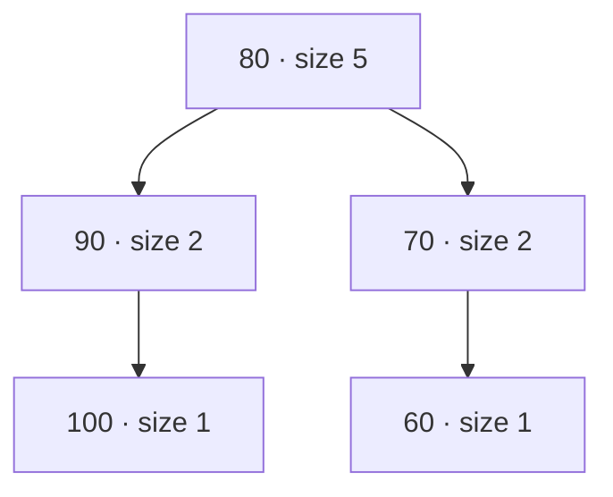
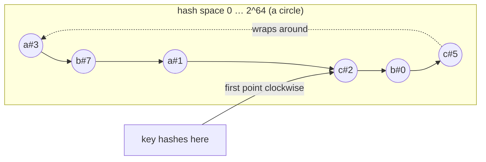
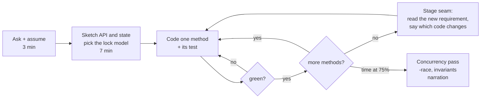

# B3 Unit 8 — Stretch problems and the round playbook

> Time: ~7 h · CORE: §3 (3 h, including the gated 90-minute design exercise) · STRETCH: §1–§2 (4 h) · Labs: `labs/b3/leaderboard`,
> `labs/b3/hashcache` (both stretch)

## Before you start

You should have finished Units 5–7 (or at least the problems the tutor assigned). §1 and §2 are STRETCH: do them when
the earlier problems score *meets* and you want more data-structure or distributed-systems depth; §3 is CORE and ends
with the gated design exercise. Warm-up (answers below; write yours down first):

1. In `inventory`, why must multi-item reservations take their locks in a fixed order?
2. Why should only one layer of a call stack retry?
3. What does a consistent snapshot buy a `Walk` over a tree that other goroutines are mutating?

<details data-kind="answer"><summary>Warm-up answers</summary>

1. Two carts that list the same items in opposite orders (A,B vs B,A) can each hold one lock and wait for the other:
   a classic lock-order deadlock. A fixed global order (for example sorted SKU) makes the wait-for graph acyclic.
2. Retries multiply: three layers of three attempts is 27 calls for one failure, exactly when the dependency is already
   struggling. One layer owns retries and a budget; the others just fail fast.
3. Atomicity visible to observers: a concurrent `Rename` appears either done or not done, so a node is never seen twice
   or not at all.

</details>

## How to work a problem section

Problem sections differ from the concept units in one way: **Build it comes before How it actually works**, because a
machine-coding problem is only practice if you attempt it before you see the reference design. The full protocol is in
the [module README](README.md#how-a-timed-attempt-works); in short:

1. Read *The failure story* and *The problem*. Only Stage 1 is visible; Stage 2 and Stage 3 sit in closed hint blocks
   and in the `stage2.go` / `stage3.go` stubs. Keep them closed until you reach them.
2. Write down your answers to the **Predict** blocks, then open the Reveals. These are the design decisions you make
   in the first ten minutes of the real round.
3. Start the clock and do the timed attempt in **Build it**, stage by stage, running the tests as you go.
4. Stop at the time box even if tests are red; note which stage you reached and where the minutes went.
5. Only then read *How it actually works*, *Common mistakes* and *The debrief*, score yourself on the rubric and say
   the 2-minute narration out loud once.

---
## §1 Problem 17 — STRETCH: Leaderboard (top-k with updates)

> **60 min** · focus: heaps, skip lists, order-statistic trees · **STRETCH** · lab `labs/b3/leaderboard` · ids `B3-U8-P01…P04`

Protocol reminder (full text in the unit's "How to work a problem section"): attempt in **Build it** before you read **How it actually works**, **Common mistakes** or **The debrief**.

### The failure story

A credit union runs a "round-up savings challenge": members earn points for on-time bill payments and round-ups,
and the app shows the top 100, "your rank", and "five members above and below you". Launch day: ≈ 500,000
enrolled members, ≈ 2,000 point events per second in the first hour, and ≈ 5,000 phones polling the top 100 every
5 s. The first version keeps a `[]entry` sorted by points. Three things go wrong.

1. **Updates are O(n).** Every point event removes the member and re-inserts them, which moves part of a
   500,000-entry slice (≈ 32 B each, ≈ 16 MB; on average ≈ 8 MB per move). At ≈ 10 GB/s that is ≈ 0.8 ms per move, two
   moves per update, 2,000 updates per second: ≈ 3 cores of `memmove` per second, behind one write lock. Reads queue
   behind the writer, and "my rank" p99 goes from 2 ms to seconds.
2. **Paging lies.** The app pages with `?offset=50&limit=50`. Between two requests, members above the cut-off earn
   points and shuffle. A member sees the same name on page 1 and page 2, and another member is on neither page.
   Support tickets: "I was rank 48 and then I vanished."
3. **Ties are an accident.** Hundreds of members sit on exactly 100 points. `sort.Slice` is not stable, so
   members with equal points swap places between refreshes, and the prize cut-off at rank 100 flips between two
   people who each have a screenshot.

None of this is exotic. It is what happens when the *data structure* is chosen from the first operation you
thought of (`TopK`) instead of from the whole operation mix (`Add`, `Rank`, `Around`, `Page`), and when "ranking"
is treated as an implementation detail instead of a rule.

### The problem

*As the interviewer says it* (you have **60 minutes**):

> "Build an in-memory leaderboard library in Go. Players have integer scores that go up and down. I want the top
> k, a player's rank, and to add or set scores. Start simple; I'll make it harder."

Questions worth asking in the first two minutes (or state as assumptions):

- How many players, how fast do scores change, and what is the read mix? (Say: ≈ 10⁵–10⁷ players, writes and reads
  both frequent, rank queries on demand.)
- Ties: what decides who is ahead when scores are equal? Do tied players share a rank? (Here: whoever reached
  the score first is ahead; a strict total order, no shared ranks. Name the alternative: competition ranking.)
- Are scores bounded integers (0..1000) or arbitrary? (Arbitrary `int64`; ask, because bounded scores allow a
  completely different structure.)
- Do reads have to be consistent with each other? (A page of results should be a consistent view.)
- Is it one process? Does it have to survive a restart? (One process, in memory; persistence is out of scope.)

**Stage 1 — correct first (≈ minute 0–20).** `Add`, `Set`, `Remove`, `Score`, `Rank`, `TopK`, `Len`, with the
tie-break rule. A sorted slice or a map plus a sort is acceptable *if you say what it costs*. The tests compare
you against a naive model over 20,000 random operations.

<details data-kind="hint">
<summary>Stage 2 — the interviewer adds this at ≈ minute 20 (open only when you get there)</summary>

"We have 100,000 players now, and rank queries are the hot path. I also want `Around(player, n)` (n above, the
player, n below) and `Page(offset, limit)`. It needs to stay fast when the scores arrive in sorted order, and when
everybody has the same score."

Pay attention to: which structure answers "how many are ahead of this key" in O(log n); what happens to an
unbalanced tree with sorted input; and that `Around` and `Page` are the same operation (a window over positions).

</details>

<details data-kind="hint">
<summary>Stage 3 — the interviewer adds this at ≈ minute 45 (open only when you get there)</summary>

"It's called from many goroutines. I want a `Snapshot()` so a client can page through a stable view while scores
keep changing. [If you finish early:] Then split it into shards by player name and give me a global top-k, and
build a daily board that resets at midnight and remembers the last few days."

Pay attention to: readers racing writers, what "consistent" means for a multi-call read, a tie-break clock that
means the same thing in every shard, and a reset that needs no goroutine.

</details>

### Predict

<!-- predict id="B3-U8-P01" -->
**Predict.** Operations: `Set(player, score)`, `TopK(100)`, `Rank(player)`, `Around(player, 5)`. Candidate
structures: (a) sorted slice, (b) map + sort on every read, (c) a size-100 min-heap, (d) balanced tree where each
node stores its subtree size, (e) skip list with "span" counters, (f) an array of counts when scores are integers in
0..1000. For each (a)–(f), write the cost of each of the four operations, and cross out every structure that cannot
meet `Rank` in O(log n) with n = 10⁶. Which survive, and what extra does each survivor need?
<!-- /predict -->

<!-- predict id="B3-U8-P02" -->
**Predict.** Rule: higher score first; ties go to whoever *reached* the score first; setting a player to the score
they already have is not a change. Starting from an empty board, run: `Set a 10`, `Set b 10`, `Set c 10`, `Set a 10`,
`Set b 7`, `Set b 10`, `Add c 0`, `Remove a`, `Set a 10`. Write the final order of the three players, and say which
two of these operations would change the answer under a different (equally plausible) rule.
<!-- /predict -->

<!-- predict id="B3-U8-P03" -->
**Predict.** You use a plain (unbalanced) binary search tree with subtree sizes. 100,000 players arrive with
scores 1, 2, 3, … in that order. What is the depth of the tree at the end, how many comparisons did loading take,
and what would random insertion order have given? Then: what one cheap trick makes the *expected* depth logarithmic
whatever order the keys arrive in?
<!-- /predict -->

<!-- predict id="B3-U8-P04" -->
**Predict.** A client pages with `Page(0, 50)`, `Page(50, 50)`, `Page(100, 50)` while writers update the live
board. (1) Describe two concrete anomalies the client can see. (2) You add `Snapshot()`. Compare two implementations
for a board of 2 million players: copy everything (O(n)), or an immutable tree where a write copies only the
root-to-leaf path. Give the cost of `Snapshot()` and of one write in each, and say when you would choose each.
<!-- /predict -->

### Reveal

<details data-kind="reveal" data-for="B3-U8-P01">
<summary>Reveal</summary>

| Structure | `Set` | `TopK(100)` | `Rank` | `Around(5)` |
|---|---|---|---|---|
| (a) sorted slice | O(n) memmove | O(k) | O(log n) binary search | O(log n + n₀) |
| (b) map + sort per read | O(1) | O(n log n) | O(n log n) (or O(n) scan) | O(n log n) |
| (c) size-100 min-heap | O(log k), only for players inside it | O(k log k) | **O(n)**: a heap has no "how many are better" | impossible |
| (d) balanced tree + sizes | O(log n) | O(log n + k) | O(log n) | O(log n + n₀) |
| (e) skip list + spans | O(log n) expected | O(log n + k) | O(log n) expected | O(log n + n₀) |
| (f) counts per score value | O(1) | O(S) scan or O(log S) with a Fenwick tree | O(S) or O(log S) | needs per-score player lists |

Crossed out for `Rank`: (b) and (c) always, (a) fails on `Set` at 10⁶ players (≈ 16 MB moved per update). Survivors
(d) and (e) both need a **player → current key** map, because `Set(player, …)` must find the old position to
remove it; (f) survives only when scores are small bounded integers, and then it also needs a way to list players
within one score (and the tie-break) for `Around`. Tempting wrong answer: "a heap, it's a top-k problem". The heap
answers the question you thought of first and none of the other three.

</details>

<details data-kind="reveal" data-for="B3-U8-P02">
<summary>Reveal</summary>

Logical clock ticks on every real change: `a`=1, `b`=2, `c`=3 (all at 10). `Set a 10` is not a change (no tick).
`Set b 7` ticks to 4 and `Set b 10` ticks to 5, so b *reached 10 later than c*. `Add c 0` is not a change. `Remove a`
deletes a. `Set a 10` re-adds a at tick 6. Among the players at 10: c (3), b (5), a (6). **Final order: c, b, a.**

The decisive operations are `Set b 7` followed by `Set b 10` (under "first time ever at this score", b would keep its
early place and the order would be b, c, a) and `Add c 0` (if a zero add counted as a change, c would drop behind b).
The repeated `Set a 10` looks decisive but is not here, because a is removed later: test cases for tie rules have
to be designed so that each rule produces a different answer. There is no right answer in the abstract, which is the point: the rule is a product decision, it must be written
down, and the tests must pin it. It also decides which structure works: a key of `(score, reached-at)` needs a
unique clock; a rule that lets two players tie completely needs a second tie-break such as the name.

</details>

<details data-kind="reveal" data-for="B3-U8-P03">
<summary>Reveal</summary>

Each new key is the largest so far (or, with "higher score first", the new best), so it becomes the right (or left)
child of the previous one: the tree is a **linked list of depth 100,000**. Loading costs 1 + 2 + … + 10⁵ ≈ 5 × 10⁹
comparisons, and every `Rank` is O(n). Random insertion order gives an average node depth of ≈ 2·ln n ≈ 23 and a
height of ≈ 4.3·ln n ≈ 50. So the unbalanced tree is fine on shuffled test data and a disaster on a ramp-up of
sorted IDs, timestamps or scores, and **sorted input is the common case**.

The cheap trick is a **treap**: give each node a random priority, keep the tree ordered by key *and* heap-ordered by
priority. The shape then depends only on the priorities, which are independent of the keys, so it has the same
distribution as a randomly built BST for any insertion order. A skip list reaches the same expected bounds with
random tower heights; red-black and AVL trees do it deterministically with rotations and more code. In an interview a
treap with split/merge is the shortest correct balanced tree to write. Derive priorities from a seeded hash of the
unique sequence number so runs are reproducible.

</details>

<details data-kind="reveal" data-for="B3-U8-P04">
<summary>Reveal</summary>

(1) **Duplicates and gaps.** Offsets are positions at the moment of each request. If a player moves from rank 49 to
rank 51 between page 1 and page 2, they are shown twice; if a player moves from rank 60 to rank 20 after page 1 was
served, and page 2 starts at 51, they are shown on neither. (The same drift as offset pagination in the API-design
module.) Also: `Len` read before the pages may no longer match the pages.

(2) Copy-everything: `Snapshot()` is O(n): ≈ 2M × ≈ 110 B ≈ 230 MB and ≈ 100–300 ms with the whole board
read-locked while copying; a write is the normal O(log n). Path copying (persistent tree + atomic root pointer):
`Snapshot()` is O(1) (copy the pointer), reads are lock-free on an immutable version, but every write allocates
O(log n) new nodes (≈ 20–40 nodes ≈ 2 KB of garbage per update, for two trees about double that) and in a path-copying
variant I benchmarked on this lab's random workload, writes ran ≈ 5× slower than in-place mutation (≈ 4.9 s against ≈ 0.9 s for the random
workload, one machine, no `-race`; treat as ≈). Choose the copy when snapshots are rare (a client opens a paging session once a minute)
and the board is small; choose the persistent tree when many readers need cheap consistent views or you want
lock-free reads. A third option avoids snapshots: **keyset (cursor) pagination** on `(score, reached-at, player)`
so the next page starts *after the last row seen*, which cannot duplicate or skip regardless of movement (it can only
miss rows that moved *into* the already-served range, which is correct for "everything after X").

</details>

### Build it

**Goal:** make `go test -race ./labs/b3/leaderboard/` pass, in stages, inside the time box. This is a STRETCH lab:
it does not gate B3, but it is the best practice for the structure question interviewers ask most often.

Files: `labs/b3/leaderboard/leaderboard.go` (Stage 1), `stage2.go`, `stage3.go`. Tests: `leaderboard_test.go` (Stage 1,
the naive model and helpers), `stage2_test.go`, `stage3_test.go`. Do not open the next stage's files until you
reach it.

```sh
go test -race -run 'Stage1' ./labs/b3/leaderboard/                         # first 20 minutes
go test -race -run 'Stage[12]' ./labs/b3/leaderboard/                      # by minute 45 (the scale tests take 5–15 s)
go test -race -run 'Stage3_(Concurrent|Snapshot)' ./labs/b3/leaderboard/   # the 15-minute Stage 3
go test -race -run 'Stage3_(Sharded|Windowed)' ./labs/b3/leaderboard/      # follow-ups if you finish early
go test -race -count=3 ./labs/b3/leaderboard/                              # before you call it done (≈ 40 s)
```

| Minutes | Do |
|---|---|
| 0–8 | Ask questions, fix the ordering rule in a comment, write down the cost table for your chosen structure, decide the lock. |
| 8–20 | Stage 1. The comparison function and the logical clock first; everything else is small. A sorted slice is acceptable: say its cost aloud. |
| 20–45 | Stage 2. Replace the structure. Rank = "count of nodes ahead of me", `Page`/`Around` = "collect positions [lo, hi)". |
| 45–60 | Stage 3: concurrency and `Snapshot`; narrate the locking model. Sharded and windowed are for the debrief, or the next sitting. |

Acceptance: `TestStage1_*` (8 tests), `TestStage2_*` (9, including three scale tests), `TestStage3_*` (14: 5 concurrency
and snapshot tests, 3 sharded, 6 windowed) pass with `-race`. The scale tests load 100,000 players under three
workloads (random scores, strictly ascending scores, all tied) with a generous wall-clock budget each (30–45 s under
`-race`; a correct O(log n) solution needs a few seconds) and abort the moment the budget is exceeded. They are not
benchmarks: they separate O(log n) per operation from O(n) per operation by two orders of magnitude.

**Self-check before you read on:** state, in one sentence each, (1) the total order you rank by, (2) what answers
"how many are ahead of me" in your structure, (3) what a reader sees while a writer runs.

### How it actually works

*(Read this after your attempt. Compare with your own design, not with your code.)*

**The order.** A strict total order on records `(player, score, seq)`: higher `score` first, then smaller `seq`
(reached the score earlier). `seq` comes from one logical clock that ticks only when a score actually *changes*
(including a first appearance), so it is unique per record and no two players ever compare equal.

**The structure: an order-statistic treap.** A binary search tree on that order, heap-ordered by a random priority
(here the splitmix64 hash of the record's unique `seq`, so runs are reproducible), with every node storing the size
of its subtree.



In-order (left, node, right) is rank order. Rank of the player on 60: at 80 the node is ahead, so add
`size(left) + 1 = 3` and go right; at 70 add `0 + 1` and go right; at 60 nothing is ahead: 4 players are ahead,
rank 5, after three steps.

```go
type node struct {
	rec  rec    // player, score, seq
	pri  uint32 // random heap priority
	size int    // nodes in this subtree, including itself
	l, r *node
}

// countBefore: how many records rank strictly ahead of key. One root-to-leaf walk.
func countBefore(t *node, key *rec) int {
	n := 0
	for t != nil {
		if before(&t.rec, key) { n += size(t.l) + 1; t = t.r } else { t = t.l }
	}
	return n
}
```

`Rank(p)` = `countBefore(root, record(p)) + 1`. `Page`/`Around`/`TopK` are one function: collect the records at in-order
positions `[lo, hi)`, skipping whole subtrees whose size shows they lie outside the window, in O(log n + k).
`Set` = remove the old record (found through the map), insert the new one, each O(log n) via `split`/`merge`.

**Two structures, one lock.** A `map[string]rec` holds each player's current record (needed to find the old key
for an update and to answer `Score`), the treap holds the ranking, and one `sync.RWMutex` guards both. Readers
(`TopK`, `Rank`, `Page`, `Around`, `Score`, `Len`) share the lock and run in parallel; writers (`Add`, `Set`, `Remove`)
serialise. Each method takes the lock once, so each is atomic: `Add` is a true read-modify-write, and a `TopK` can
never see a half-applied update. Allocation happens inside the lock only for the result slice, never a callback.

**Snapshot.** Under the read lock, deep-copy the treap and the map (O(n)) and copy the logical clock *after* the
tree, so it is ≥ every `seq` in the copy. The result is a normal independent `Board`. The persistent alternative
(path copying behind an atomic pointer) makes this O(1) and reads lock-free; see Trade-offs.

**Sharded.** `hash(player) % N` picks a shard; each shard is a `Board`; **all shards share one atomic logical
clock**, so "reached first" means the same thing everywhere. `Rank(p)` is 1 + the sum over shards of "records ahead
of p's record". `TopK(k)` asks every shard for its own top k and merges them with a heap. *Why k per shard is
enough:* a player in the global top k has fewer than k players ahead of them overall, so fewer than k ahead of them
in their own shard, so they are among their shard's top k. The merge reads shards one after another, so the result
is a combination of N slightly different instants (documented; each shard's part is consistent).

**Windowed.** Window index = `now / period`. Every call first compares it with the stored index; if the clock has
moved, the current board is closed into a list (most recent first, capped at `keep`) and *empty* boards stand in
for periods nobody called in, so `Previous(n)` always means "n periods ago". No timer, no goroutine, nothing to
leak or stop, and a fake clock makes it testable.

**Complexity.** `Add/Set/Remove` O(log n); `Rank` O(log n); `TopK(k)`, `Page(o, k)`, `Around(p, n)`
O(log n + k); `Snapshot` O(n); `Sharded.Rank` O(N log(n/N)); `Sharded.TopK` O(N·k + k log N).
Memory ≈ 110 B per player plus the name.

### Break it

Do these on your passing solution (they take a while under `-race`: the performance mutations run until the test's
budget aborts them). Predict the failing test before you run it.

1. Compute `Rank` by walking the whole tree and counting (O(n)) instead of descending.
2. Give every treap node the same priority (`return 0`).
3. Break ties by player name instead of the logical clock.
4. In `Set`, when the score is unchanged, still record it as a new arrival (tick the clock).
5. Run `Add` under `RLock` instead of `Lock`.
6. Make `Snapshot` return the board itself. Then a variant that copies the tree but shares the live `players` map.
7. Give each shard its own logical clock.
8. In `Sharded.TopK`, take only `k/N + 1` records from each shard.
9. In `Windowed`, close only the current window when the clock jumps several periods.

<details data-kind="answer"><summary>What you should see</summary>

1. `TestStage2_ScalesRandomScores`: `random scores: over the 45s budget after ~2xx,000 operations (…). Per-operation
   cost must grow like log n, not n`. The inserts and updates finish; the rank phase blows the budget.
2. `TestStage2_ScalesAscendingScores` and `TestStage2_ScalesAllTied` fail on their 30 s budgets (and the random one
   on 45 s): `merge` always makes the new node the root of a chain, so the tree is a list. Correctness tests still
   pass, so only the scale tests notice.
3. `TestStage1_TiesGoToWhoeverReachedTheScoreFirst`, `…AddPathReachesScoresTooForTiebreaks` and the differential
   test fail.
4. `TestStage1_TiesGoToWhoeverReachedTheScoreFirst` and `TestStage1_DifferentialAgainstNaiveModel`: re-setting 10 moved
   `late` behind `early`.
5. Hundreds of `WARNING: DATA RACE` reports and `TestStage3_ConcurrentAddsAreAtomic` fails. Note it is the race
   detector that finds it: two goroutines writing under a shared read lock is a data race on the tree.
6. Alias: `TestStage3_SnapshotIsAnIndependentPointInTimeCopy`, `…TiebreaksStayStable` and
   `…PagingIsDuplicateFreeWhileWritersRun` all fail. Shared map: `DATA RACE` in
   `TestStage3_SnapshotPagingIsDuplicateFreeWhileWritersRun` (one goroutine reading the copy's map while another writes the
   live one).
7. `TestStage3_Sharded_MatchesASingleBoardOperationForOperation` for 3 and 8 shards fails early (step 8 in the
   run I made): `TopK(22) differs` and the message tells you that ties need one shared logical clock.
8. The same differential test and `TestStage3_Sharded_ConcurrentUseKeepsInvariants` fail: entries are missing from
   the merged top k.
9. `TestStage3_Windowed_SkippedPeriodsAreEmptyWindows`: `Previous(1) = len 1, ok true; want len 0 (n counts calendar
   days back)`: "yesterday" returned the board from three days ago.

</details>

### In the wild

- **Redis sorted sets** (`ZADD`, `ZRANK`/`ZREVRANK`, `ZRANGE`/`ZREVRANGE`, `ZINCRBY`) are exactly this problem:
  members ordered by score, `ZRANK` and range queries in O(log N) (+ the size of the range). The implementation
  pairs a skip list (with span counters, like your subtree sizes) with a hash table from member to score. Equal
  scores are ordered lexicographically by member, a different tie rule from this lab's. A sorted set lives under one
  key, which lives on one node in Redis Cluster, so a leaderboard larger than a node needs application-level
  sharding and a merge (TODO-VERIFY: current small-set encodings such as listpack).
- **SQL** gives you `RANK()`, `DENSE_RANK()` and `ROW_NUMBER()` window functions for the three tie policies
  (1,2,2,4 vs 1,2,2,3 vs 1,2,3,4). Computing one player's rank with `SELECT count(*) … WHERE score > ?` is a range
  scan proportional to the number of players ahead, because ordinary B-tree indexes do not keep subtree counts
  (TODO-VERIFY per engine). That is why "my rank" at scale usually moves to a sorted-set service or a precomputed table.
- **Data-structure literature.** Treaps: Seidel and Aragon, "Randomized Search Trees" (1989/1996). Skip lists:
  Pugh (1990). Order-statistic trees: the classic augmented-BST exercise in *Introduction to Algorithms*. Go's
  standard library has no ordered map: you build one, or pull in a third-party package, which this course does not.
- **Persistent trees** (immutable, path-copying) back cheap snapshots in functional-language collections, and the
  same idea underlies copy-on-write B-trees in some databases (TODO-VERIFY which engines).

### Trade-offs

| Option | Wins when | Loses when | When the answer flips |
|---|---|---|---|
| Sorted slice | ≤ ~10⁴ players, rare updates, simplest code | Update cost O(n): 10⁶ players ≈ 16 MB moved per update | Updates per second × n × 32 B ≳ ~1 GB/s: switch to a tree |
| Map + sort per read | Prototype; reads are rare | Every read O(n log n) | Never past a toy |
| Heap + lazy deletion | Only `TopK` is needed, scores mostly increase | No `Rank`, no `Around`, stale entries accumulate | The moment anyone asks for a player's rank |
| Treap / skip list / balanced tree with sizes (reference) | Mixed reads and writes, arbitrary scores, any k | More code; pointer-chasing, ≈ 110 B per player | Scores are small bounded integers: counts per score |
| Counts per score (array or Fenwick tree) | Scores are integers in a small range S (e.g. 0..1000): rank O(log S) or O(S) | Needs per-score lists for `Around`; unusable for wide ranges | Range grows beyond ~10⁶ distinct values |
| Persistent tree + atomic root | Many readers, cheap consistent snapshots, lock-free reads | O(log n) garbage per write; writes ≈ several × slower than in place (measured ≈ 5× here) | Snapshots are rare: copy-on-demand under a lock is simpler |
| Sharded boards + k-way merge | Write contention on one lock; board too big for one lock | Cross-shard `Rank` O(N log n); global reads not one instant; needs a shared tie clock | A single shard's lock is not the bottleneck: do not shard |
| Redis sorted set (external) | Many app servers need the same board; durability matters | Network hop per call; single key on a single node | Board larger than a node: shard by tenant/season, merge in the app |

### Senior bar

**Rubric (score yourself per row, then send the code to the tutor).** *Meets* needs a row at "meets" or better on
every row, with no "below". (STRETCH: the tutor records it as practice; it does not gate B3.)

| Dimension | below | approaching | meets (senior bar) | exceeds |
|---|---|---|---|---|
| Extensibility | Rewrites the structure at each stage | Stage 2 rewrites Stage 1 but the API survives | Ordering isolated in one comparison; `TopK`/`Page`/`Around` share one window primitive; Stages 2–3 add files, not edits | Sketches competition ranking, keyset cursors and bounded-score counting, and says which function changes for each |
| Concurrency safety | No lock, or `Add` as `Get` then `Set` | Lock exists but reads copy-then-release without a consistent view, or `Snapshot` races writers | One lock, atomic `Add`, reads consistent, `Snapshot` correct, `-race -count=3` clean | Names the persistent-tree alternative with its cost, and explains cross-shard consistency honestly |
| Clean interfaces | Returns internal slices; ranks 0- and 1-based mixed | Behaviour of ties/ranks undocumented | Ordering rule in the type's doc comment; `Entry.Rank` 1-based everywhere; results owned by the caller; `k<=0`, unknown players and empty boards defined | Interface shaped for sharding/snapshots without a rewrite (`Reader` with `TopK/Rank/Page` implemented by `Board`, `Snapshot`, `Sharded`) |
| Tests | Happy path | Hand-written cases only | Differential test against a naive model, tie cases, sorted-input and all-tied scale tests, a concurrent test with invariants | Property test over operation sequences; one mutation shown to fail a test |
| Time management | Nothing correct at minute 20 | Stage 1 correct at 20, Stage 2 incomplete at 45 | Stage 1 at 20, Stage 2 at 45, Stage 3 core at 60 with the locking model narrated | Sharded or windowed also discussed with the proof that k per shard suffices |

**Failure modes in production use.** Unbounded growth (every visitor becomes a player; evict inactive players or cap
the board). Hot key: one celebrity player updated 10⁴ times per second contends on the writer lock; coalesce or
batch updates. The tie rule changing under users' feet. Snapshots held by slow clients pin O(n) memory each.
Windowed boards: a clock jump backwards must not rotate.

**Numbers.** n = 10⁶ players: tree depth ≈ 25–50, so `Rank` ≈ 25–50 pointer hops ≈ 1–3 µs when warm (≈); ≈ 110 MB for
the structure; an in-place update ≈ a few µs. For calibration, this lab's random-score workload (100,000 inserts,
100,000 updates, 50,000 rank queries, names built with `fmt.Sprintf`) ran in ≈ 1 s without `-race` and ≈ 6–7 s with
it on the machine I used. A sorted slice at 10⁶ players moves ≈ 16 MB per update ≈ 1–2 ms.

**Interviewer probes**

<details data-kind="answer"><summary>"Scores are integers between 0 and 1,000. Does your design change?"</summary>

Yes, and I'd say so before anyone asks. Keep an array of 1,001 counts and a per-score structure for the players
at that score. `Rank(p)` is the sum of counts for higher scores (O(S), or O(log S) with a Fenwick tree) plus the
position within the score bucket, which is a short list ordered by arrival. `TopK` walks buckets from the top.
All operations become O(log 1,000) ≈ 10 steps with tiny constants and no pointer chasing. The tree is the general
answer; bounded keys earn a specialised one. If the range later widens to millions of values, the array stops
fitting and I'm back to the tree.

</details>

<details data-kind="answer"><summary>"Tied players should share a rank (1, 2, 2, 4). What changes?"</summary>

The *ordering* can stay as it is, since stable display order is still wanted, but `Rank` must change: rank =
1 + number of players with a strictly higher score. That is a count by score only, so the tree needs a second
query (`countGreaterScore`) which descends comparing scores alone, and works because equal scores are contiguous
in the order. `Entry.Rank` for a page is then computed per entry, not as position + 1. I would add it as a new method
and keep the old one, because changing the meaning of `Rank` silently changes prize cut-offs.

</details>

<details data-kind="answer"><summary>"5,000 phones poll TopK(100) every 5 seconds. Is your lock a problem?"</summary>

1,000 calls per second of ≈ 100 hops each is nothing for a read lock shared by readers: ≈ 0.1 ms of CPU per second.
The risk is a *writer*: with `RWMutex`, a waiting writer blocks new readers, so a long write (a snapshot copy or
a bulk load) stalls every poll. Mitigations in order of cost: keep writes O(log n), take snapshots rarely, cache
the serialised top 100 keyed by a version counter (recompute when the version changes, at most once per second, so
5,000 phones share one computation), or move to the persistent tree where readers take no lock at all.

</details>

<details data-kind="answer"><summary>"Make it durable."</summary>

The board is derived data. I'd append every score change to a log (player, delta or absolute score, timestamp)
and rebuild the board by replay on start, with a periodic snapshot of (player, score, seq) so replay is bounded.
Rebuild order matters: replay in log order so the logical clock reproduces the same tie-breaks. In a banking
context I'd keep the system of record (the ledger of point events) elsewhere and treat the in-memory board as a
cache that can always be rebuilt.

</details>

### Common mistakes

| Mistake | How the tests catch it | Fix |
|---|---|---|
| Sort the whole slice on every read | Stage 2 scale tests exceed the budget | Keep an ordered structure; sort never |
| Sorted slice with O(n) insertion at 100,000 players | `TestStage2_ScalesRandomScores`: `over the 45s budget` | Order-statistic tree or skip list with spans |
| Unbalanced BST | Ascending/all-tied scale tests exceed their budget | Random priorities (treap) or rebalancing |
| Heap for top-k, scan for rank | `Rank` phase of the random scale test; `Around` impossible | A structure that can count "ahead of me" |
| No map from player to current key, so updates scan to find the old entry | Scale tests | `map[string]rec` next to the tree |
| `Add` implemented as `Score` then `Set` | `TestStage3_ConcurrentAddsAreAtomic` (lost increments) | One critical section per `Add` |
| Ties by name, or unspecified (`sort.Slice` instability) | `TestStage1_TiesGoToWhoeverReachedTheScoreFirst`, differential | Total order with a unique clock |
| Setting an unchanged score refreshes the tie-break | Same tests ("late keeps its place") | A change is a different value, not a call |
| `TopK` returns the structure's internal slice | `TestStage1_TopKIsBestFirstWithRanks` (mutating the result) | Build a fresh slice |
| Off-by-one between 0-based positions and 1-based ranks | `TestStage1_RankAgreesWithTopKPosition`, `TestStage2_AroundCentresOnThePlayer` | One helper converts; document `Rank` as 1-based |
| `Snapshot` returns the live board, or copies the tree but shares the map | `TestStage3_Snapshot*` | Deep copy under the read lock |
| Per-shard sequence numbers | `TestStage3_Sharded_Matches…` | One shared logical clock |

### The debrief: the senior-level design choices

1. **Choose the structure from the operation mix, out loud.** Write the table of operations first; a structure
   survives only if it serves every row. This is the whole problem: the heap is the tempting answer to the first
   operation and the wrong answer to the other three. *Say:* "I'll list the operations and their frequencies before
   I pick a structure."
2. **Make the ordering a total order and write it in the doc comment.** `(score desc, reached-at asc)` with a unique
   logical clock means no ties exist, so `Rank`, `TopK` and `Page` always agree, and paging is stable. Whether
   "reached" resets when a score leaves and returns is a product decision; surface it as a question.
3. **Count, don't scan.** Augmenting a balanced tree with subtree sizes turns rank and "positions [lo, hi)" into path
   walks. The augmentation is the idea; the treap is just the cheapest balanced tree to write.
4. **Randomise to stay balanced under adversarial order.** Sorted input is normal data, so average-case BST
   analysis does not apply. Seeded priorities keep tests reproducible.
5. **Key lookup and rank order are different indexes.** The player → record map is how an update finds the old
   position; the tree is how a read finds a position. Two structures, one lock, one place where they are updated
   together.
6. **Atomic read-modify-write for `Add`.** The race detector will not see a `Get`-then-`Set` bug (each call is
   locked); the test with 32 goroutines will.
7. **A multi-call read needs a consistent view, not a hope.** Paging across calls is where offset drift appears;
   `Snapshot` (or a keyset cursor) is the fix. Price both options (O(n) copy vs path copying) with numbers.
8. **Sharding is a correctness argument, not a decoration.** Be able to prove that top-k per shard suffices, and
   to say what is lost (a global atomic view) and what must be shared (the tie-break clock).
9. **Time without goroutines.** Lazy rotation from an injected clock removes a goroutine, a shutdown path, a race with
   `Add` and a day-long wait from the tests.

**The 2-minute narration** (say it aloud once after your attempt): "The ranking is an order-statistic treap
ordered by score descending and then by the logical time the player reached that score, so the order is total and
paging is stable. Each node knows its subtree size, so rank is one descent counting what is ahead, and `TopK`,
`Page` and `Around` are all 'collect positions lo to hi' in O(log n + k). A map from player to current record lets
updates find the old position. One `RWMutex` guards both: readers share it, writers serialise, every method takes
it once, so `Add` is atomic and no reader sees a half-applied update. `Snapshot` deep-copies under the read lock,
O(n), which is fine because it's rare; if snapshots were frequent I'd switch to a path-copying tree behind an
atomic pointer. Sharding hashes the player to a board, shares one logical clock for ties, and merges per-shard top-k;
k per shard is enough because anyone in the global top k has fewer than k ahead of them in their own shard. Evidence:
a differential test against a map-plus-sort model, three 100,000-player scale workloads including sorted input,
and concurrent tests under `-race -count=3`."

**What the interviewer adds next:** shared ranks for ties (competition ranking); "friends only" leaderboards (rank
among a set); time-decayed scores; bounded memory (evict the long tail); the same board across processes
(Redis sorted sets, with sharding by season); durability by replay; an `Observer` that notifies when a player enters
the top 10.

### Check yourself

1. Why can a min-heap of size k answer `TopK` but not `Rank`?
2. Why is it not enough to take `k/N` entries from each of `N` shards when merging a global top k?
3. Why does `Add` need to be atomic when each of `Score` and `Set` is already thread-safe?
4. Why use a lazily rotated window with an injected clock instead of a ticker goroutine?

<details data-kind="answer"><summary>Answers</summary>

1. A heap guarantees only that the root is the extreme element; it holds no information about how many elements are
   better than an arbitrary one. `Rank` needs a count of "ahead of me", which needs either a scan or subtree sizes.
2. The global top k can be concentrated in a single shard (all k winners hash to the same shard). Each shard must
   offer its own full top k; the proof is that anyone with fewer than k players ahead overall has fewer than k
   ahead in their shard.
3. `Score` then `Set` is two critical sections: two goroutines read the same old score and both write old+1,
   losing an update. Each call is race-free, so `-race` stays silent; the logic is not atomic. The read-modify-write
   must happen under one lock acquisition.
4. A ticker goroutine needs a shutdown path, can fire in the middle of an `Add`, and makes tests wait or sleep.
   Computing the window index from an injected clock on each call makes rotation a pure function of the clock and
   the state, deterministic to test and nothing to leak.

</details>

---

## §2 Problem 18 — STRETCH: Consistent-hashing cache client

> **75 min** · focus: hashing, rebalancing · STRETCH · lab `labs/b3/hashcache` · ids `B3-U8-P05…P08`

Protocol reminder (full text in the unit's "How to work a problem section"): attempt in **Build it** before you read **How it actually works**, **Common mistakes** or **The debrief**. The system-design theory behind this problem (partitioning, rebalancing, hot keys) is covered in module A4 and applied in C4 (distributed KV store); this section is self-contained and only needs what you already know about caches.

### The failure story

A credit-union platform caches member summaries (profile, balances, last 10 transactions) in four memcached-style nodes in front of a vendor-backed core-banking read API. The client library picks a node with `hash(key) % 4`. At the Monday-morning peak: ≈ 6,000 req/s, a 95% hit ratio, so ≈ 300 req/s of misses reach the origin, which is comfortable because the origin handles ≈ 1,000 req/s before its vendor adapter starts timing out.

At 10:05 memory pressure on the four nodes causes evictions, so someone adds a fifth node and updates the node list. Three things happen.

1. **The cache effectively empties.** With `% N`, a key keeps its node only if `hash % 4 == hash % 5`, which is true for 4 of every 20 hash values: ≈ 20%. The remaining ≈ 80% of keys now route to a node that never saw them. The hit ratio falls from 95% to ≈ 0.95 × 0.20 ≈ 19%, so the origin sees ≈ 6,000 × 0.81 ≈ 4,900 req/s, nearly **five times** what it can serve. Vendor timeouts trigger retries, the retries add load, and the incident outlasts the cache warm-up by an hour.
2. **Even the "good" version of this fix is not free.** Consistent hashing would have kept ≈ 80% of keys in place, so the hit ratio would be ≈ 0.95 × 0.80 ≈ 76% and the origin would see ≈ 1,440 req/s. That is better by a factor of three and *still* 1.4× over capacity at peak. Making a resize safe takes more than the right hash: migration, or an off-peak window.
3. **A dead node is the same incident in reverse.** Another night, node 3 is restarted. Its keys fail over, but the load lands on one neighbour (a ring with one point per node), which then runs at ≈ 2× its normal traffic, evicts its own data, and becomes the next failure.

All of this follows from three early decisions: how a key picks a node, how many positions each node holds, and what a request does when the node it picked is gone. In an interview it plays out as a single question: "you add a server; what happens to the cache?"

### The problem

*As the interviewer says it* (you have **75 minutes**):

> "Write a Go client library for a cluster of cache servers. Given a key, it decides which server holds it.
> Servers come and go, and I don't want a deploy that adds one server to flush the whole cache. Start with the
> routing; I'll add requirements as we go."

Questions worth asking in the first two minutes (or state as assumptions, out loud):

- How many nodes and keys? (Say "tens of nodes, millions of keys, values of ≈ 1 KB".)
- Is it a cache or a store? Can data be lost? (A cache: a miss is acceptable, wrong data is not.)
- Who knows the membership, and how often does it change? (Assume a config source hands the client a node list; changes are rare but must be safe.)
- Do I need replication, or is a miss on node failure fine? Heterogeneous node sizes?
- Is the hash required to be stable across processes and languages? (Yes: two clients must agree on where a key lives, so no per-process random seed.)
- Concurrency: many request goroutines plus one goroutine that applies membership changes.

**Stage 1 — the ring (≈ minute 0–30).** `Ring` with virtual nodes: `Add(node, weight)`, `Remove`, `Nodes`, `Get(key)`, `Replicas(key, n)`. Deterministic hash, binary search over a sorted slice, wraparound. Show that load is balanced, and that adding a node moves only about `1/(N+1)` of the keys, all of them to the new node.

<details data-kind="hint">
<summary>Stage 2 — the interviewer adds this at ≈ minute 30 (open only when you get there)</summary>

"Good. Now the actual client: a `Backend` interface per server, a `Client` that routes `Get`/`Set`/`Delete` with the ring, keeps R copies of every key, and doesn't fall over when a server is down: remember which servers are failing and route around them. Let me configure how many replicas must acknowledge a write."

Pay attention to: what a miss costs when R > 1, failure versus miss (they are different answers), consecutive-failure counting, probing a node that was marked down, and what the client does with a cancelled context.

</details>

<details data-kind="hint">
<summary>Stage 3 — the interviewer adds this at ≈ minute 55 (open only when you get there)</summary>

"Last part: membership changes at runtime. `SetMembership` must be safe while requests are in flight, and adding a node must not send a wave of misses to the database. Then, separately, a placement function with a load bound: no node may get more than 1.25 times its fair share, even if the keys are skewed."

Pay attention to: how a request sees a consistent ring and set of backends, reading through the old owners during a grace window, what the copy-forward does to a newer concurrent write, deletes during the window, and the order-dependence of bounded loads.

</details>

### Predict

<!-- predict id="B3-U8-P05" -->
**Predict.** A cluster has 4 nodes and routes by `hash(key) % N`. You add a 5th node. What fraction of keys keep their node? Then the same question for a consistent-hash ring with many virtual nodes per node. Finally: you go from 5 nodes back to 4 by removing a *different* node, at the same position in the list as the one you added. What does `% N` do now? Write down numbers, and the one-sentence reason a ring's number is better.
<!-- /predict -->

<!-- predict id="B3-U8-P06" -->
**Predict.** You build the ring with 1 virtual node per physical node (5 nodes, 20,000 keys). Roughly how uneven is the load: what would you expect the standard deviation of per-node load to be relative to the mean? How does that change with 10 and with 150 virtual nodes? What do 150 virtual nodes cost you for a 100-node cluster in memory, lookup time and membership-change time?
<!-- /predict -->

<!-- predict id="B3-U8-P07" -->
**Predict.** The node that owns a key is down. Your options for `Get`/`Set` are: (a) return an error, (b) treat it as a miss and let the caller read the origin, (c) route to the next node clockwise. Pick one for a *cache* and justify it. What does it do to (i) the load on the other nodes while the node is down, with 1 virtual node per node and with 150, and (ii) the data and correctness when the node comes back?
<!-- /predict -->

<!-- predict id="B3-U8-P08" -->
**Predict.** After adding a node you migrate lazily: a `Get` that misses on the new owner reads the old owner and copies the value forward. Two writers and a deleter run during the grace window. What is the worst thing that can happen if the copy-forward is a plain `Set`? What if a `Delete` only removes the key from the new owner? For each, name the fix and the hole that remains.
<!-- /predict -->

### Reveal

<details data-kind="reveal" data-for="B3-U8-P05">
<summary>Reveal</summary>

`% N`: a key keeps its node only if `hash % 4 == hash % 5`. Look at the residue mod 20 (lcm of 4 and 5): that holds for residues 0–3, so **4 of 20 = 20%** stay and ≈ **80% move**. We measured 80.4% with the lab's hash. Going back to 4 is symmetric: ≈ 80% move again. Removing a *different* node from the middle of the list is worse than it sounds, because every node after it shifts index, so the picture is unchanged: nearly everything moves. (With 4 → 3 nodes: `r < 3` of 12, so only 25% stay.)

Ring: adding the 5th node inserts its virtual nodes at fixed positions that depend only on its *name*. Every key whose owner changes must have a new virtual node as its new clockwise successor, so **every moved key moves to the new node, and no key moves between old nodes**. The new node ends up with ≈ 1/5 of the keys: ≈ 20% move, ≈ **80% stay**. Measured with the lab's reference: 8 → 9 nodes moves 11.1% (= 1/9). Removing a node moves exactly that node's keys, and only to the next node clockwise.

The sentence: a ring puts keys and nodes on the *same circle*, so a membership change only disturbs the arcs next to the points that changed; `% N` ties every key to the *count* of nodes, so changing the count disturbs everything. Tempting wrong answer: "consistent hashing means no keys move". Some must: the new node has to receive its share of the data.

</details>

<details data-kind="reveal" data-for="B3-U8-P06">
<summary>Reveal</summary>

Each node's load is the sum of v arcs. The relative standard deviation of a sum of v roughly independent arcs shrinks like **1/√v**. Measured on this lab's reference ring (5 nodes, 20,000 keys, averaged over 20 different node-name sets): **0.70** with 1 virtual node (one node commonly holds more than twice the mean and another almost nothing), **0.24** with 10, **0.064** with 150. At 150 virtual nodes the busiest of 8 nodes holds ≈ 1.1× the mean and the idlest ≈ 0.87× (measured over 60,000 keys).

Costs for 100 nodes × 150 = 15,000 points: memory ≈ 15,000 × ≈ 24 B (hash + string header) ≈ 0.4 MB, one copy per client process; lookup is a binary search of ≈ log₂ 15,000 ≈ 14 steps ≈ 0.2–0.5 µs (benchmark on your box), negligible next to a ≈ 0.1–0.5 ms in-datacenter round trip (NUMBERS.md); a membership change rebuilds and sorts the slice in ≈ 1–2 ms. So the cost is tiny; the usual limit on vnodes is operational (token-management and metadata size on the server side), not CPU.

Two more things: the *hash quality* matters as much as the vnode count. Plain FNV-1a on strings like `node-1#17` and `node-1#18` distributes poorly, so the lab's tests fail until the hash is mixed (see Break it). And weights are just "more virtual nodes": a node with twice the memory gets twice the points and ≈ twice the keys.

</details>

<details data-kind="reveal" data-for="B3-U8-P07">
<summary>Reveal</summary>

For a cache the right answer is **(c)** with the client remembering the failure, and **never (a)** for reads: a cache outage should degrade the hit ratio, not the service. (b) is acceptable only if the caller is protected from the stampede it causes: ≈ 1/N of all traffic hits the origin at once.

Load while the node is down: with **1 virtual node per node**, all of the dead node's arc belongs to exactly one successor, which suddenly serves ≈ 2× its normal keys and may fail next (a cascade). With **150 virtual nodes**, the dead node's points are scattered around the ring, so its keys spread across *all* the survivors, each taking ≈ 1/(N−1) extra. Virtual nodes are a failure-spreading mechanism as much as a balancing one.

When the node returns: keys written during the outage live on the neighbour, but the ring says the returned node owns them. Reads go to the (empty) returned node and miss; the neighbour's copies are orphaned until their TTL expires. That is acceptable for a cache (a one-time miss per key, bounded by TTL) and is why a cache is allowed this shortcut and a store is not. A store needs hinted handoff or read repair (A4, C4).

How the client knows the node is down: count *consecutive* failures (so one blip does not flap it), skip the node for a fixed time, then let requests through; one more failure marks it down again at once. Clean misses are successes, and errors caused by the caller's own cancelled context are not the node's fault.

</details>

<details data-kind="reveal" data-for="B3-U8-P08">
<summary>Reveal</summary>

**Plain `Set` copy-forward: a lost update.** Reader R1 misses on the new owner B, reads `v1` from the old owner A, and is delayed. Writer W stores `v2` on B. R1 resumes and `Set`s `v1` onto B, so the cache now serves the stale value until its TTL, and nothing in any log shows a failure. Fix: copy forward with **`Add` (set-if-absent: memcached `add`, Redis `SET … NX`)**. If a newer value is already there, the copy loses, which is the right outcome. The remaining hole: `Add` cannot tell "newer" from "different", so it relies on "anything on B is at least as new as what is on A", which holds because during the window all writes go to B.

**Delete only on the new owner: a resurrection.** `Delete(k)` removes `k` from B; A still holds the pre-migration copy; the next `Get(k)` misses on B, finds `k` on A and happily copies it back. Fix: during the grace window, `Set` and `Delete` also delete from previous owners that are no longer owners. The remaining hole: a `Delete` that interleaves with a *concurrent* migration read (read A → delete A and B → Add to B) can still resurrect the key once. Closing it needs tombstones (a short-lived "deleted" marker with a TTL) or versions; for a cache, the TTL on migrated entries (`Migration.TTL`) bounds the damage, which is why it is a required parameter.

Two more things the reader should say aloud: (1) migration only happens on reads, so cold keys are never copied and simply expire on the old node, which is fine; (2) the grace window is a trade: longer means fewer misses, but more stale-read exposure and double reads for genuine misses on moved keys (the client skips the second read when the previous owners are the same nodes).

</details>

### Build it

**Goal:** make `go test -race ./labs/b3/hashcache/` pass, in stages, inside the time box. This is a STRETCH problem: it does not gate B3, but it is the best exercise for hashing, atomic state swaps and conditional writes.

Files: `labs/b3/hashcache/hashcache.go` (Stage 1), `stage2.go`, `stage3.go`. Tests: `hashcache_test.go` (Stage 1 and shared helpers), `stage2_test.go` (fake backends with failure injection and call counters), `stage3_test.go`. Do not open the next stage's files until you reach it.

```sh
go test -race -run 'Stage1' ./labs/b3/hashcache/     # first 30 minutes
go test -race -run 'Stage[12]' ./labs/b3/hashcache/  # by minute 55
go test -race -count=5 ./labs/b3/hashcache/          # before you call it done
```

| Minutes | Do |
|---|---|
| 0–8 | Ask questions, state assumptions, sketch the circle: points, nodes, wraparound, vnodes. Decide the hash (stable, mixed) and the point data structure. |
| 8–30 | Stage 1. `Add` (generate points, sort), `Get` (`sort.Search` + wrap), `Replicas` (walk, skip nodes already seen). Run the balance and movement tests early: they tell you if the hash is bad. |
| 30–55 | Stage 2. Fakes first: read `fakeBackend` in `stage2_test.go`. Replica selection ("first R healthy nodes clockwise"), then `Get`/`Set`/`Delete`, then health. |
| 55–75 | Stage 3. Put `ring` + `backends` behind one immutable `state`, swap it atomically, add the previous generation with a deadline. `AssignBounded` last, if time remains. |

Acceptance, per stage: all `TestStage1_*` (12 tests), `TestStage2_*` (13), `TestStage3_*` (11) pass with `-race`. The Stage 3 tests include `SetMembership` racing with eight goroutines of Set/Get traffic. When a test fails, read the message: each says which property broke and why it matters.

**Self-check before you read on:** write the 5-line concurrency note you would say aloud: what a request holds while it runs, how membership changes without a lock on the read path, and what is shared between requests (the health table) and how it is guarded.

### How it actually works

*(Read this after your attempt. Compare with your own design, not with your code.)*

**The ring is a sorted slice.** Each physical node contributes `weight × vnodes` points `(hash("node#i"), node)`; the whole slice is sorted by `(hash, node)` (the node name breaks ties so that insertion order cannot matter). `Get` hashes the key and finds the first point with `hash >= h` using `sort.Search`; if there is none it wraps to index 0.



```go
type point struct {
	hash uint64
	node string
}

func (r *Ring) search(h uint64) int {
	i := sort.Search(len(r.points), func(i int) bool { return r.points[i].hash >= h })
	if i == len(r.points) {
		i = 0 // past the last point: wrap to the first
	}
	return i
}
```

**Why a new node only takes keys.** A point's position depends on the node's name and index only. Adding node N inserts new points; every other point stays where it was. A key's owner changes only if one of the new points lies between the key and its old owner, and then the new owner *is* N. So moved keys all go to N, and their number is N's share, ≈ 1/(N+1). Removal is the mirror image: the removed points vanish and their keys fall to the next point clockwise.

**The hash.** Deterministic across processes (no random seed), and mixed: FNV-1a followed by a 64-bit finaliser (the murmur3 `fmix64` steps) so that `node-1#17` and `node-1#18` land far apart. A weak hash makes the ring lumpy no matter how many virtual nodes you add.

**`Replicas(key, n)`.** Walk clockwise from the owner's index, collect nodes you haven't seen, stop at `n` distinct. The first is `Get(key)`; `Replicas(k, 2)` is a prefix of `Replicas(k, 3)`.

**The client's state.** Everything a request needs lives in one immutable value, published through an `atomic.Pointer`:

```go
type state struct {
	ring     *Ring
	backends map[string]Backend
	prev      *state    // previous generation during the grace window
	prevUntil time.Time
}
```

A request loads the pointer **once** and uses that snapshot throughout, so it can never combine a ring from one generation with backends from another. `SetMembership` builds a complete new `state` off to the side and stores it; no lock is held on the read path. Writers of membership serialise with a small mutex. The health table (`consecutive failures`, `down until`) is the only shared mutable data and is guarded by its own mutex, never held while calling a backend.

**Choosing replicas.** `replicasFor(st, key)` takes the first R *healthy* nodes clockwise. The trick that avoids walking the whole ring: ask the ring for `R + downCount` candidates, filter by health, keep R. With R=1 and the owner down, this is exactly "route to the next node clockwise".

**Get / Set / Delete.**

| Call | Behaviour |
|---|---|
| `Get` | replicas in order; first hit wins; a clean miss records "missed" and continues; if none hit: `ErrNotFound` if anyone missed, else `ErrUnavailable` |
| `Set` | write to **every** replica, count acks, succeed iff `acks >= W` (never stop at W: replicas must converge); the failures still count toward node health |
| `Delete` | same as `Set`; deleting an absent key is success |

**Health.** `record(node, err)`: success or clean miss → reset the count and clear `downUntil`; error while the caller's ctx is done → ignore; any other error → `fails++`, and if `fails >= threshold` set `downUntil = now + DownFor`. A node is "up" when `now >= downUntil`. Because the counter is *not* reset when `DownFor` elapses, the first failed probe re-marks the node down immediately.

**Migration (Stage 3).** `SetMembership` copies the current `state` as `prev` (dropping its own `prev`, so generations never chain) with `prevUntil = now + Grace`. In `Get`: if the current owners miss and the window is open and the previous owners are a *different* set of nodes, read them; on a hit `Add` the value to the current owners with `Migration.TTL` and return it. `Set`/`Delete` also delete from previous owners that no longer own the key.

**Bounded loads.** For `U` distinct keys and `N` nodes the capacity is `ceil(c·U/N)`. Walk the keys in order; for each, walk the nodes clockwise from its natural owner and take the first with `load < capacity`. The invariants the test checks: nobody exceeds capacity, and a key is off its natural owner only if every node before its assigned node, clockwise, is full. The price is order dependence and a global count: in a real client the "load" is usually in-flight requests per node, not stored keys.

**Complexity.** `Get` O(log P) for P points; `Replicas` O(P) worst case but O(n) typical; `Add` O(P log P) (re-sort; an insertion merge would make it O(P)); `SetMembership` rebuilds the ring O(P log P) off the read path.

### Break it

Do these on your passing solution. Predict the failing test and the message before you run it.

1. Make the virtual-node hash depend on the ring size: `hash64(node + "#" + i + "/" + len(nodes))`.
2. In `Replicas`, drop the "already chosen" check.
3. In `search`, clamp to the last point instead of wrapping to 0.
4. Remove the finaliser from `hash64` (plain FNV-1a).
5. In the migration copy-forward, call `Set` instead of `Add`.
6. In `Set`/`Delete`, skip deleting from the previous owners.
7. Store the state pointer in a plain field instead of an `atomic.Pointer`.
8. In `getFrom`, return `ErrNotFound` when every replica *failed*.
9. Drop the "same previous owners" check in the migration read.

<details data-kind="answer"><summary>What you should see</summary>

1. `TestStage1_PlacementIsDeterministicAndIndependentOfInsertionOrder`: "the same nodes added in a different order own different keys: positions must depend only on the node's name". `TestStage2_ReplicationWritesToRDistinctReplicas` fails too. Positions that depend on membership make every `Add` reshuffle everything: you have rebuilt `% N`.
2. `TestStage1_ReplicasAreDistinctNodesInClockwiseOrder`: `Replicas("key-0", 3) = ["node-5" "node-1" "node-5"] repeats a node`. With virtual nodes two consecutive points often belong to the same node; "three replicas" on two machines is no replication.
3. Only `TestStage1_KeysPastTheLastVirtualNodeWrapAroundToTheFirst` notices: `1 vnode/node, node 0 removed: key "key-1565" went to node-1, want its clockwise successor node-3`. With 150 vnodes per node only ≈ 1 key in 1,000 hashes past the last point, so every other test passes; the lab uses one virtual node per node to make the wrap arc large. This is the classic bug that survives code review and months of production.
4. `TestStage1_ManyVnodesBalanceTheLoad`: `the busiest node has 1.56x and the idlest 0.44x the mean load; want within [0.65, 1.35]`, and `FewVnodes…` and `WeightsScaleShare` fail as well (node `a` owns 0.165 instead of 0.25). 150 virtual nodes do not rescue a bad hash: FNV-1a multiplies by a small prime, so inputs that differ only in their last bytes (`node-1#17`, `node-1#18`) get hashes that are close together and the virtual nodes of one machine clump.
5. `TestStage3_MigrationNeverOverwritesANewerValue`: `Get("key-5") = "v1", want "v2"`. The lost update from Predict P08, caught deterministically by a hook that stores `v2` between the reader's old-owner read and its copy-forward.
6. `TestStage3_WritesDuringGraceCannotBeShadowedOrResurrectedByTheOldCopy`: `Get after Delete during grace = <nil>, want ErrNotFound: the old owner's copy was migrated back (a resurrected delete)`.
7. `TestStage3_MembershipChangesRaceWithTraffic` under `-race`: `WARNING: DATA RACE` (five reports): readers load the pointer while `SetMembership` stores it. Without `-race` this "works" until a reader sees a half-published pointer on a weaker memory model.
8. `TestStage2_GetIsUnavailableWhenNoReplicaCanAnswer`: `Get with every node failing = hashcache: not found, want an error satisfying errors.Is(err, hashcache: no replica available)`. During a cache outage callers would treat every request as a miss and repopulate from the database: a stampede caused by the cache layer's own error handling.
9. `TestStage3_AGenuineMissOnAnUnmovedKeyIsNotReadTwice`: `a miss on a key whose owner did not change cost 2 backend reads, want 1`. Most keys do not move, so most genuine misses during the window would be read twice.

</details>

### In the wild

- **Dynamo (Amazon, 2007)** is the paper that made this design famous: consistent hashing with virtual nodes, a preference list of N distinct nodes per key, sloppy quorums and hinted handoff when a replica is down. Your `Replicas` and the "first R healthy nodes" rule are its first two ideas; hinted handoff is what a *store* adds that a cache can skip.
- **Cassandra** assigns each node tokens on a hash ring (`num_tokens` virtual nodes per node; TODO-VERIFY: the default changed between versions) and places replicas on the next distinct nodes clockwise, with rack/datacenter awareness.
- **memcached clients: ketama.** The de facto client-side ring for memcached comes from `libketama` (Last.fm): many points per server derived from `md5("host:port-i")`, binary search over the sorted points. TODO-VERIFY: points per server in the original (≈ 100–200 is the usual range). Proxies such as `twemproxy` (Twitter) and `mcrouter` (Meta) do the routing server-side so that clients stay dumb; TODO-VERIFY: exact distribution options in each.
- **Envoy** offers `ring_hash` and `maglev` load-balancing policies for session affinity and cache routing. Maglev (Google, 2016) replaces the ring with a permutation-filled lookup table for O(1) lookup and more even spread. TODO-VERIFY: default minimum ring size.
- **Bounded loads.** "Consistent Hashing with Bounded Loads" (Mirrokni, Thorup, Zadimoghaddam) is the source of the `ceil(c × average)` capacity rule; Vimeo wrote it up for its video fleet and HAProxy exposes it as a `hash-balance-factor` setting. TODO-VERIFY: HAProxy version and exact semantics.
- **Redis Cluster does not use a ring.** It has 16,384 fixed hash slots (CRC16 of the key mod 16,384) assigned to nodes; resharding moves slots. A fixed-slot design makes ownership explicit and easy to inspect, at the cost of an assignment table to maintain.
- **Alternatives you should be able to name:** rendezvous (highest-random-weight) hashing, which needs no ring but O(N) work per lookup; Jump consistent hash (Lamping & Veach, Google, 2014), which is O(log N), stateless and perfectly balanced but only supports adding or removing the *last* bucket.

### Trade-offs

| Option | Wins when | Loses when | When the answer flips |
|---|---|---|---|
| `hash % N` | N never changes; tests | Any resize remaps ≈ N/(N+1) of keys | Never for a live cache cluster |
| Ring with virtual nodes (reference) | Nodes come and go; arbitrary names; weights | Lumpy without enough vnodes; O(P log P) rebuild; lookup O(log P) | Hundreds of thousands of points, or you want O(1) lookup: Maglev |
| Rendezvous (HRW) hashing | Few nodes (≤ ~50); no data structure; trivial to get right | O(N) per lookup | Lookups are hot and N is large: use a ring |
| Jump consistent hash | Buckets numbered 0…N−1 that only grow/shrink at the end | Cannot remove an arbitrary node; no weights | Nodes fail in arbitrary order, or heterogeneous capacity |
| Fixed slots (Redis Cluster style) | You want explicit, inspectable ownership and controlled migration | Needs a slot-assignment authority and a migration protocol | Membership is dynamic and a coordination service is unwelcome |
| Lazy read-through migration (reference) | Cache semantics; resize at peak | Stale-read window; double reads on genuine misses; one generation only | You need exact data movement: stream keys eagerly (a store) |
| Client-side routing | Few clients; low latency; no extra hop | Every client needs the membership and library upgrades | Many languages/clients: a routing proxy |
| Bounded loads | Skewed keys, per-request load matters | Order-dependent placement; needs load state | Hot *keys* (a single key can still exceed the bound): replicate or locally cache it |

### Senior bar

**Rubric (score yourself per row, then send the code to the tutor).** *Meets* needs a row at "meets" or better on every row, with no "below". This is a STRETCH problem: use it to practise, and score it honestly.

| Dimension | below | approaching | meets (senior bar) | exceeds |
|---|---|---|---|---|
| Extensibility | `hash % N`, or a ring whose points depend on membership; Stage 2 means a rewrite | Ring works, but the client hard-codes R=1 or health into `Get` and Stage 3 edits Stage 2 code | `Ring` is independent of the client; weights, replicas, health and migration are layered on without changing `Get`'s core; `AssignBounded` is a pure function of the ring | Names the next steps (zones/racks, hinted handoff, eager streaming migration, load-aware routing) and which layer each would live in |
| Concurrency safety | Shared ring mutated without a lock; `-race` fails | Lock on every `Get`, held while calling a backend; or ring and backends swapped separately | Ring is internally locked or immutable; one atomic snapshot per request; health under its own lock never held across I/O; passes `-race -count=20` | Argues why readers never block, shows the generation hand-off cannot mix rings, identifies the delete/migration hole and the fix (tombstones) |
| Clean interfaces | `Backend` is a concrete type; errors are strings | Interface exists, but miss vs failure are conflated | `Backend` is a small interface owned by the client; `ErrNotFound` ≠ `ErrUnavailable` ≠ `ErrQuorum`; `Add` for conditional writes; documented contracts | `Ring` exposed as its own small interface for reuse (sharded counters, job routing) |
| Tests | Happy path only | Distribution tested with one lucky hash | Distribution over many key/name sets; movement property; fakes with failure injection and call counters; deterministic clock; a concurrency test for membership changes | A property test comparing the ring to a brute-force "first point ≥ h" oracle; mutation shown to fail a test |
| Time management | Nothing running at minute 30 | Stage 1 at 30; Stage 2 half done at 55 | Stage 1 by 30, Stage 2 by 55, Stage 3 or an honest status at 75, with a spoken concurrency note | Bounded loads implemented; time left for the note |

**Failure modes in production use.** A *hot key* is not a distribution problem: the ring sends the one hot key to one node, so no hash or vnode count can help (replicate reads, add a short-TTL in-process cache, or split the key into suffixed copies). *Membership disagreement*: two clients with different node lists route the same key differently, producing misses and, with writes, silent duplicates; the source of truth (a config service or gossip) and its propagation delay are part of the design. *Flapping*: a node that alternates up/down thrashes ownership; hysteresis (consecutive failures, a `DownFor`) damps it. *Resize at peak*: the 1/(N+1) remap still hits the origin (see the failure story's arithmetic); schedule it or migrate. *Stale resurrection* of deleted data during migration (P08).

**Numbers.** Ring lookup ≈ 0.2–0.5 µs; memory ≈ 24 B/point (100 nodes × 150 vnodes ≈ 0.4 MB); rebuild ≈ 1–2 ms; cache round trip ≈ 0.1–0.5 ms (NUMBERS.md), so the routing layer is ≈ 0.1% of a request. Moved keys on adding one node: 1/(N+1); with `% N`: N/(N+1) (80% for 4→5). Load spread ∝ 1/√vnodes: 0.70 → 0.24 → 0.064 for 1 → 10 → 150 (measured with the reference hash, 5 nodes).

**Interviewer probes**

<details data-kind="answer"><summary>"One key gets 40% of the traffic. Does consistent hashing help?"</summary>

No. Consistent hashing balances *keys*, not *requests per key*. One key always maps to one node (or R replicas), so that node takes 40% of the traffic no matter how the other keys spread. Fixes sit above the ring: a small in-process cache with a ≈ 1 s TTL in each client (the hot key is then fetched ≈ once per second per client instead of per request), reading from a random replica instead of always the primary, or splitting the key into `k#0 … k#7` copies written together and read at random. Bounded loads helps only when load is tracked per request, and even then a single key can exceed the bound. I would first confirm it is really a hot *key* with a metric of per-key request counts.

</details>

<details data-kind="answer"><summary>"You're adding three nodes. Do it one at a time or all at once?"</summary>

All at once, in one `SetMembership`: one remap of ≈ 3/(N+3) of the keys instead of three overlapping ones, and one grace window instead of overlapping generations (my implementation keeps only the previous generation, so rapid successive changes would lose the older one, and its keys would just miss). The alternative, one at a time with warm-up between, bounds origin load better if the origin is the constraint: each step remaps only ≈ 1/(N+1). I'd pick by the arithmetic: peak origin capacity versus misses per step.

</details>

<details data-kind="answer"><summary>"What does R=2 buy a cache, and what does it cost?"</summary>

Availability and warm failover: when one replica dies the other still has the data, so the hit ratio does not crater. It costs memory (×2), write latency (two writes, or one parallel round trip), and read amplification on genuine misses (two backend reads instead of one in my design; a read-repair or "ask primary only unless it errors" policy trades that off). W=1 means a write is acknowledged by one replica, so a replica that was down serves stale data after it returns until its TTL; for a cache that is usually acceptable, for a store it is not. The quorum arithmetic (R + W > N) is the same as in A5/C4 but does little in a cache because there is no repair path.

</details>

<details data-kind="answer"><summary>"Where does the node list come from, and what if clients disagree?"</summary>

From a config/discovery source (a config service, DNS SRV, a file pushed by deploys) that the client polls or watches, and applies with `SetMembership`. Clients can disagree for seconds to minutes: a key written through a client that already sees the new node lives where an old client will not look. For a cache that shows up as extra misses and bounded staleness, not corruption, which is why TTLs are mandatory. To shrink the window: version the membership, apply changes in the same order everywhere, or move routing into a proxy so that there is one view. Gossip (Dynamo, Cassandra) trades a single source of truth for resilience.

</details>

### Common mistakes

| Mistake | How the tests catch it | Fix |
|---|---|---|
| `hash % N` routing | `TestStage3_ResizeKeepsAbout…` (≈ 20% hit ratio vs ≈ 80%) | Ring with virtual nodes |
| Vnode positions derived from ring size or insertion order | `TestStage1_PlacementIsDeterministicAndIndependentOfInsertionOrder` | Position = hash(node name, index) only; sort with a deterministic tie-break |
| Plain FNV (or another hash with weak avalanche) for ring points | `TestStage1_ManyVnodesBalanceTheLoad`, `…WeightsScaleShare` | Mix the hash (finaliser) or use a stronger hash |
| 1 point per node | `TestStage1_FewVnodesBalanceMuchWorse` | `vnodes ≈ 100–200` per unit of weight |
| No wraparound past the last point | `TestStage1_KeysPastTheLastVirtualNodeWrapAroundToTheFirst` | `if i == len(points) { i = 0 }` |
| Replicas that are virtual nodes of the same machine | `TestStage1_ReplicasAreDistinctNodesInClockwiseOrder` | Skip nodes already chosen; stop at `n` distinct |
| Counting a miss, or the caller's cancelled ctx, as a node failure | `TestStage2_CleanMissesAndCancelledContextsDoNotMarkANodeDown` | Only real backend errors count |
| Reporting "everything failed" as a miss | `TestStage2_GetIsUnavailableWhenNoReplicaCanAnswer` | Distinct `ErrUnavailable` |
| Resetting the failure count only on elapsed time, or never on success | `TestStage2_DownNodeIsProbedAfterDownForAndSuccessResetsTheCount` | Consecutive failures; success resets; failed probe re-marks immediately |
| Stopping `Set` after W acks | `TestStage2_WriteQuorum`, `…ReplicationWritesToRDistinctReplicas` | Write all replicas; count acks afterwards |
| Swapping ring and backends separately, or without atomics | `TestStage3_MembershipChangesRaceWithTraffic` (`-race`) | One immutable `state` behind `atomic.Pointer` |
| Copy-forward with `Set` | `TestStage3_MigrationNeverOverwritesANewerValue` | `Add` (set-if-absent) |
| Delete not applied to previous owners | `TestStage3_WritesDuringGraceCannotBeShadowedOrResurrectedByTheOldCopy` | Delete/overwrite on previous owners during the window |
| Double-reading genuine misses on unmoved keys | `TestStage3_AGenuineMissOnAnUnmovedKeyIsNotReadTwice` | Compare current and previous replica lists first |
| Capacity computed over the key slice instead of distinct keys | `TestStage3_AssignBoundedValidatesAndIgnoresDuplicates` | De-duplicate before computing `ceil(c·U/N)` |

### The debrief: the senior-level design choices

1. **Choose the invariant, then the structure.** The property you want is "a membership change disturbs only the keys next to it". That fixes the design: keys and nodes on one circle, positions independent of membership. *In the interview, say:* "I want adding a node to move only ≈ 1/(N+1) of the keys, all to the new node, so positions must depend only on a node's name."
2. **Quantify the alternative.** `% N` moves 80% of keys for 4 → 5. One sentence with a number turns "consistent hashing is better" into an argument. Then add the honest second half: the ring's 20% still hits the origin, so a resize needs a plan.
3. **Hash quality is part of the design.** A deterministic, well-mixed hash is a requirement of the *algorithm*, not an implementation detail: it determines balance and whether two processes agree. Say that determinism across processes rules out `hash/maphash`'s random seed.
4. **Virtual nodes do two jobs.** They smooth load (≈ 1/√v) and they spread failover load across all survivors instead of one neighbour. Weights are just more points. Name both jobs, and the cost: tiny.
5. **Degrade, don't fail.** For a cache, a down node means failover to the next healthy node and a worse hit ratio, never an error. But distinguish *unavailable* from *miss*, or an outage becomes a database stampede.
6. **One immutable snapshot per request.** The way to make membership changes safe without locks on the read path is to make ring+backends one value, publish it atomically, and have each request take it once. The senior move is saying *why* that rules out mixed generations, not just writing `atomic.Pointer`.
7. **Migration must be conditional and bounded.** Copy-forward with `Add`, delete on previous owners, TTL on migrated entries, one generation, a time limit. Each of those answers a specific race you can name (lost update, resurrection, unbounded staleness, memory/generation chains, a grace window that never ends).
8. **Know what hashing cannot fix.** Hot keys, membership disagreement and resize-at-peak are outside the ring. Naming them, with the fix that lives elsewhere (local cache, config source and proxy, scheduling or throttled warm-up), is what separates a candidate who knows the algorithm from one who knows the system.

**The 2-minute narration** (say it aloud once after your attempt): "Keys and nodes share a hash circle; each node owns `weight × 150` points at `hash(name#i)`, kept in a sorted slice; `Get` is a binary search with wraparound. Positions depend only on the name, so adding a node moves ≈ 1/(N+1) of the keys, all to the new node. The client keeps ring and backends in one immutable `state`; a request loads it once, so a concurrent `SetMembership` can't give it a mixed view, and the read path has no lock. Replicas are the first R healthy nodes clockwise; health is consecutive failures with a fixed down-time, guarded by its own mutex that is never held across a backend call. During a grace window a miss on a moved key reads the previous owner and copies forward with `Add`; writes and deletes also clear the previous owner. Evidence: the movement-property tests, the failure-injection fakes, the hit-ratio comparison against `% N`, the clobber hook test, and the membership-under-traffic test under `-race`."

**What the interviewer adds next** (Stage 4, if there's time): zone/rack awareness (replicas on distinct racks); hinted handoff or read repair so a returned node catches up; eager background migration with rate limiting; load-aware routing ("power of two choices" with in-flight counts); hot-key detection with automatic replication; a routing proxy instead of a client library; or gossip-based membership. Each one extends `replicasFor`, the migration path, or the `state`, and not the ring.

### Check yourself

1. A ring has 5 nodes with 1 virtual node each. What is the biggest problem, and what are two ways to fix it?
2. Why must moved keys all land on the new node when a node is added? What would break that property?
3. Why does the copy-forward use `Add` and not `Set`, and why do `Set`/`Delete` touch the previous owners during the window?
4. A single key receives 40% of all traffic. Name two fixes that work and one that doesn't.

<details data-kind="answer"><summary>Answers</summary>

1. Uneven load: with one point per node, arc lengths vary wildly (relative standard deviation ≈ 0.7 in the lab's measurement), so one node can hold more than twice the mean; a failed node also dumps its entire arc on one neighbour. Fixes: many virtual nodes per node (≈ 100–200, spread ∝ 1/√v), weights for unequal nodes, and a well-mixed hash.
2. Existing nodes' points don't move, so the only new "closest point clockwise" any key can acquire is one of the new node's points. It breaks if positions depend on membership (for example on the ring size, or on insertion order with unstable tie-breaking), or if you re-derive all positions on each change.
3. `Set` can overwrite a newer value written to the new owner while the reader was fetching the old one (a lost update); `Add` loses that race, which is the right outcome. Writes and deletes clear the old copy so that a later miss on the new owner cannot migrate stale or deleted data back (a resurrection).
4. Work: a short-TTL in-process cache in each client; reading from random replicas or splitting the key into suffixed copies. Doesn't work: more virtual nodes, a better hash, or bounded loads based on key counts: the key still maps to one node.

</details>

---

## §3 The machine-coding round: playbook and capstone

> **≈ 3 h** (reading 1 h + the gated 90-min design exercise + debrief) · focus: running the round, not the problem · CORE · no lab package (the lab is the design exercise, see [design-exercise.md](design-exercise.md)) · ids `B3-U8-P09…P12`

Protocol reminder (full text in the unit's "How to work a problem section"): this section is about the round itself. Do the predictions first; read *How it actually works* after you have done a timed problem or two.

### The failure story

A candidate who has solved ≈ 800 algorithm problems is given 90 minutes to build an elevator controller in Go. Here
is the clock, reconstructed from the interviewer's notes:

| Minute | What happened |
|---|---|
| 0–8 | Restates the problem. Asks no questions about scale, concurrency or what "elevator" includes. |
| 8–33 | Designs a class hierarchy (`Elevator`, `Door`, `Button`, `Floor`, `Request`, a factory) on the whiteboard. 25 minutes, nothing compiled. |
| 33–70 | Writes ≈ 300 lines in one go. First run at minute 70: nil-map panic. Two more panics by minute 76. Still no test. |
| 70–80 | Interviewer: "make it safe for concurrent use". Adds a `sync.Mutex` to every method in 6 minutes. |
| 80–88 | Interviewer runs `go test -race` on the one test that now exists: 14 data races, plus a deadlock (`Dispatch` holds the lock and calls `Status`, which locks). |
| 88–90 | "Strong coder, but I can't tell if they can run a project." No hire. |

Nothing in that table is an algorithms gap. The candidate lost to **time structure** (no working core by the
halfway point), **missing feedback loops** (no tests until the end), and **no concurrency model decided early**
(locks added by reflex at the end). A machine-coding round is a small project run on a clock, and the interviewer
is scoring how you run it. Every problem in this module trains the same loop, and this section writes the loop
down.

### The problem

*The round, as the interviewer frames it:*

> "You'll have 90 minutes. I'll give you a problem and you'll build it in Go with tests. Start simple; I'll add
> requirements as you go. At the end I'll run your tests with `-race` and ask you to walk me through the
> concurrency. I care about a working, extensible, tested design more than about completeness."

What you are scored on (the machine-coding rows of the TUTOR.md rubric): **requirements & modelling**, **interfaces
& extensibility**, **correctness & concurrency**, **tests**, **code quality**, **time management**. Typical shape of
such rounds (varies by company): 60–90 minutes, one problem with three requirement stages, a runnable test suite,
and a closing discussion.

Questions to ask in the first three minutes, for *any* problem (memorise this list):

1. Scope: what is in and out? (Persistence? Auth? A UI?) Say the out-of-scope list aloud.
2. Scale and shape: how many entities, read-heavy or write-heavy? (One sentence is enough.)
3. Concurrency: called from many goroutines? Does a caller need multi-step atomicity?
4. Time: does behaviour depend on the clock (expiry, rate, scheduling)? → inject it.
5. Failure: what do errors look like, what must never be lost, what may be dropped?
6. Extensibility: "what is the most likely next requirement?" Interviewers often answer, and it is the best
   signal for where to put an interface.

<details data-kind="hint">
<summary>The three requirement stages every problem in this module uses</summary>

Stage 1 is the **core model and happy path plus error semantics** (≈ 35–40% of the time). Stage 2 is a **new
dimension that stresses the model**: a new entity type, a new rule, a time dimension, a second implementation of an
interface (≈ 30%). Stage 3 is **concurrency, failure and invariants** (≈ 25%), ending with a spoken concurrency
note. The rest is slack. When you design in minutes 0–10, ask yourself: "which stage-2 requirement would hurt
most?" and leave the seam for it.

</details>

### Predict

<!-- predict id="B3-U8-P09" -->
**Predict.** You have 90 minutes for an unseen problem. Write down your own minute-by-minute budget with **named
checkpoints**: when must something be running, when do you stop adding features, when do you start the concurrency
review, when do you narrate? Then say what you cut first if you are 10 minutes behind at the halfway mark.
<!-- /predict -->

<!-- predict id="B3-U8-P10" -->
**Predict.** At minute 50 the interviewer says: "Now make it safe for concurrent use." You have ≈ 25 minutes left
and ≈ 400 lines of sequential code. List, in order, what you do for the next 15 minutes. Name one thing you
deliberately do **not** do.
<!-- /predict -->

<!-- predict id="B3-U8-P11" -->
**Predict.** You have time for exactly five tests before the interviewer runs your code. Which five (describe
each in one phrase), and which kind of test do you refuse to write under time pressure?
<!-- /predict -->

<!-- predict id="B3-U8-P12" -->
**Predict.** At minute 80 you notice a design flaw in your own code (say, `Rename` is two separate critical
sections, so another goroutine can observe the half-moved state). The interviewer has not noticed. What do you
do, and what do you say?
<!-- /predict -->

### Reveal

<details data-kind="reveal" data-for="B3-U8-P09">
<summary>Reveal</summary>

A budget that works for 90 minutes (scale proportionally for 60 or 75):

| Clock | Phase | Checkpoint |
|---|---|---|
| 0:00–0:10 | Questions, assumptions, API sketch, data model, **the concurrency decision**, the likely stage-2 seam | A written API (types and method signatures) the interviewer has nodded at |
| 0:10–0:40 | Stage 1 core, **tests written alongside** | Green Stage 1 tests by 0:40. Something *runs* by 0:20 |
| 0:40–1:05 | Stage 2 (the interviewer's new requirement) | Green by 1:05; if the seam was right it is mostly additive |
| 1:05–1:20 | Stage 3: concurrency pass, invariants, `-race` | `go test -race -count=5` clean |
| 1:20–1:30 | Narration, cleanup, honest status | The 2-minute concurrency note, spoken |

Rules behind the numbers: **running code by minute 20**, because untested code is a hypothesis and the cost of a
wrong assumption grows with every untested line; **stop adding features at 1:05**; **stage 3 gets a fixed slot**,
because it never feels urgent until it is too late. If you are 10 minutes behind at 0:45, cut **breadth**, never
tests or the concurrency pass: drop the optional method, keep the invariants. Say it out loud: "I'm behind, so I'll
skip `Amend` and finish `Cancel` properly."

Tempting wrong answer: "design for 30 minutes so the code is easy". Design beyond ≈ 10 minutes is guessing about
requirements you haven't seen; the interviewer's stage-2 requirement is what tests the design, and no amount of
upfront class diagrams predicts it.

</details>

<details data-kind="reveal" data-for="B3-U8-P10">
<summary>Reveal</summary>

In order:

1. **Say the model out loud** (≈ 1 min): "I'll use one mutex per instance guarding all mutable state, taken by every
   exported method for its whole body, with no callbacks under the lock." A decision beats a scramble.
2. **Inventory the shared state** (≈ 3 min): list every field that is read or written by more than one method.
   Everything on that list sits behind the lock; anything not on it stays outside (immutable config, injected
   clock).
3. **Lock the public surface, not the internals** (≈ 5 min): exported methods lock; unexported helpers assume the lock
   is held (name them `…Locked` if that helps). This prevents the "public method calls public method" self-deadlock
   from the failure story.
4. **Find the check-then-act and the callbacks** (≈ 3 min): any `if available { take }`, any quota check, any
   user-supplied function call. Each either happens inside one critical section or is restructured (snapshot, then
   call outside).
5. **Write one concurrent test** (≈ 4 min): N goroutines hammering the exported API, plus an invariant checked at
   the end (and, if cheap, sampled during). Run with `-race -count=5`.

What you deliberately do **not** do: **redesign** (channels, sharding, lock-free structures). That is a 40-minute
detour with a high risk of ending with neither version. Mention the alternative as a spoken trade-off ("per-key
locks would let unrelated keys proceed in parallel; I'd measure first"), and keep the simple lock.

</details>

<details data-kind="reveal" data-for="B3-U8-P11">
<summary>Reveal</summary>

Five tests that earn the most signal per minute:

1. **The happy path through the main use case**, end to end, with exact outputs (proves the model is wired).
2. **The error table**: one table-driven test over invalid inputs and invalid state transitions, asserting
   `errors.Is` on sentinels (cheap, and catches 30% of real bugs).
3. **The stage-1 invariant** in its most adversarial small form (for a cache: capacity+1 inserts evict the right
   key; for a ledger: the sum is conserved).
4. **The time-dependent behaviour with an injected clock** (expiry at exactly `t`, not `t±1`).
5. **One concurrent test** with N goroutines and an end-state invariant, run under `-race`.

The test you refuse to write: anything that sleeps for real time (`time.Sleep(2*time.Second)`) or depends on
scheduling luck. They are slow, flaky, and the interviewer will see you waiting. Inject the clock, use channels or
callbacks as events, put a timeout on every wait.

</details>

<details data-kind="reveal" data-for="B3-U8-P12">
<summary>Reveal</summary>

**Say it, scoped.** For example: "Before we wrap up, I want to flag a flaw in `Rename`: it's two critical sections,
so an observer could see the file in neither place. The fix is to do both steps in one critical section, which is a
five-line change. I have ten minutes, so I'll make it now and add a regression test with a concurrent observer."
Then do exactly that, or if time truly doesn't allow, state the fix and the test you would write.

Why: interviewers score **judgment under pressure** at least as heavily as the absence of bugs. A candidate who
finds, scopes and (ideally) fixes their own flaw demonstrates the review habit the job needs; one who hides it and
gets caught by `-race` demonstrates the opposite. Tempting wrong answers: "stay quiet and hope" (caught by the
closing discussion), or "rewrite half the design in the last ten minutes" (breaks green tests).

</details>

### Build it

**Goal:** one timed rehearsal of the whole round, as the gated **design exercise** for this module.

- Read [design-exercise.md](design-exercise.md): the prompt bank, the deliverables and the rubric.
- Ask the tutor for an *unseen* variant (or pick one you have not solved), set a 90-minute timer, and work in
  `labs/b3/_design/<variant>/` (directories starting with `_` are ignored by `./...`, so `sd lab B3` does not pick it
  up). Follow the playbook above, including the spoken 2-minute concurrency note at the end.
- The gated exercise announces its stages at minutes 0, 30 and 55 and adds a 10-minute note
  (see [design-exercise.md](design-exercise.md)); the budget in the *Reveal* above is the general template for a round
  that includes the narration inside the 90 minutes. Use the exercise's marks when the tutor runs it.
- Before sending it to the tutor: `go vet ./labs/b3/_design/...` and `go test -race -count=20 ./labs/b3/_design/<variant>/`.

No lab package accompanies this section: the earlier sections' labs are the practice, and this one is the exam.

### How it actually works

**The loop that every problem in this module repeats.**



**The concurrency-model menu**, which you will meet in all nine problems of this half:

| Model | State ownership | Use when | Seen in |
|---|---|---|---|
| One `sync.Mutex` / `RWMutex` per instance, methods lock for their whole body | The struct | Default. Critical sections are µs; correctness first | `memfs` (RW), `inventory`, `vending`, `shortener` |
| Single-writer goroutine fed by a channel, state private to it | The goroutine | Ordered event processing; you want determinism and no locks in the logic | `orderbook` (per symbol), `logx` async sink |
| Immutable snapshot swapped via `atomic.Pointer` | Nobody mutates; readers load | Read-mostly config/routing tables; consistent multi-field reads | `hashcache` ring |
| Sharding by key (`N` locks) | Each shard | A *measured* hot lock, keys independent | `leaderboard` (stretch), `memfs` (discussion) |
| Per-key lock / striped locks | Each key | Long operations on independent keys | `inventory` (SKU locks, discussion) |
| Lock-free / CAS loops | The word | Counters, flags, stats only | counters in `shortener`, `resilient` stats |

Default to row 1 and *say why* in a sentence. Moving down the table costs correctness risk; it must buy something
you can name.

**The concurrency note (≤ 120 words, five headings).** Prepare to say it for any code you wrote:
*Shared state and owners* — what is shared, which lock/goroutine owns it. *Bounds* — queues, goroutines, memory.
*Lifecycle* — what starts, what stops, what `Close` waits for. *Failure handling* — panics in callbacks, slow
consumers, errors from dependencies. *Evidence* — which test proves which property.

**Interfaces under time pressure.** Three rules cover most cases: (1) define an interface **where it is used** and
only with the methods the consumer calls; (2) inject every source of nondeterminism (clock, random, ID generation,
the network) as a function or small interface at construction; (3) return concrete types, accept interfaces. A
`Clock` is a `func() time.Time`; a `Sleeper` is a `func(ctx, d) error`; you almost never need a named interface for
them.

**Tests under time pressure.** Write the test for a method *before or right after* the method, keep helpers
(`mustX`, `within`, a fake clock) in the first five minutes, assert on `errors.Is`, put a timeout on every wait, and
keep one table-driven error test per type. The `-race` detector multiplies run time by roughly 2–20× and memory by
5–10× (documented by the Go project, ≈), so keep individual tests under a second.

**What to cut, in order, when behind:** optional methods → polish and docs → secondary error cases → *never* the
tests of invariants, the concurrency pass, or the spoken note.

**Defending out loud.** For every non-obvious decision use the shape from the [framework card](../../docs/INTERVIEW_FRAMEWORK.md#stating-a-trade-off-use-this-shape-every-time):
*claim → because → cost → flip*. Example from this half: "I'm using one `RWMutex` because each operation is ≈ 1 µs;
the cost is that writers serialise; if a profile showed more than ≈ 20% of time waiting on it I'd shard by top-level
directory."

### Break it

**The autopsy.** Take your *worst* timed attempt from this module (or from units 1–4). Reconstruct the clock from
your commit times or terminal history and fill in this table: minutes spent on (a) questions and design, (b) code
that was later deleted, (c) debugging a failure that a test written earlier would have caught, (d) the concurrency
pass, (e) idle or searching docs.

<details data-kind="answer"><summary>What you should see</summary>

Most candidates find that **(c) and (b) together exceed 25% of the time**, and that (d) was either skipped or
squeezed into the last five minutes. The fix is rarely "type faster". It is writing the test with the method
(shrinks (c)), settling the model after ≈ 10 minutes of design (shrinks (b)), and putting (d) in the calendar as a
fixed slot. Record the result with `sd record note B3 --tags time,machine-coding --notes "…"` so the tutor can
target it.

</details>

### In the wild

- **The round format.** Companies that run machine-coding rounds typically give a self-contained problem (parking
  lot, rate limiter, in-memory store), a fixed window and a runnable environment, and score extensibility and code
  quality alongside correctness. Formats vary by company and over time, so treat the numbers here as a planning
  assumption, not a specification (TODO-VERIFY against the company's current guidance for your target roles).
- **Go's own toolchain is the interviewer's checklist.** `go vet` (copylocks, lostcancel, loopclosure),
  `go test -race`, `-count=N` for flakiness and `-cpu 1,4` for scheduling variety are the checks reviewers run on
  real Go code; running them on your own submission before the interviewer does is the cheapest credibility there is.
- **Design docs and ADRs** use the same claim/because/cost/flip shape as the framework card. The skill transfers
  directly to the "why this design" section of an RFC.

### Trade-offs

| Option | Wins when | Loses when | When the answer flips |
|---|---|---|---|
| Design for ≈ 10 min, then code | Unseen problem, stages unknown | Problem has a known tricky data structure | The structure *is* the problem (order book, leaderboard): spend 15 min on it, with invariants written first |
| Tests alongside code | Almost always | Throwaway spikes | Never in a graded round |
| One lock, decided early | Default | Measured contention | The interviewer asks for throughput numbers or a parallel-reader scenario: say the alternative and what you'd measure |
| Complete all features, thin tests | Never, in practice | — | — |
| Fewer features, rigorous tests and concurrency pass | Time-boxed, scored on quality | Interviewer explicitly wants breadth | They tell you so; ask at minute 5 "breadth or depth?" |
| Silent fix of a self-found flaw | — | Always loses the signal | Say it, then fix it |

### Senior bar

**Rubric for the round (also the design-exercise rubric; see [design-exercise.md](design-exercise.md)).**

| Dimension | below | approaching | meets (senior bar) | exceeds |
|---|---|---|---|---|
| Extensibility | Stage 2 needs a rewrite | Stage 2 lands with edits across many files | Stage 2 lands mostly additively; seams were placed at the likely change | Names the stage-3/4 changes and where they would go, before being asked |
| Concurrency safety | Races under `-race`, or no lock | Safe on the happy path; callbacks under lock or check-then-act left | `-race -count=20` clean, a concurrent test with an invariant, spoken model matches the code | Chooses and justifies among the menu; states what would change at 10× |
| Clean interfaces | Concrete globals; real clock/network in tests | Interfaces exist but are producer-side or fat | Small consumer-side interfaces, injected clock/ID/network, errors as sentinels with `errors.Is` | Contract tests shared by implementations; API makes misuse hard |
| Tests | None or sleeps | Happy path only | Error table + invariant + time + concurrency, deterministic | Differential/property test against a model; shows a mutation failing |
| Time management | Nothing runs until the end | Core late; no concurrency pass | Running by 0:20, stage 1 green by 0:40, concurrency pass and narration reserved | Finishes early and uses the slack to refactor and re-test |

**Failure modes of the *process*:** perfectionism in stage 1 (a beautiful Stage 1 with no Stage 2 time); designing for
imagined requirements; adding locks last; hiding doubts; running out of time because the problem was large — the fix
is to ask "which stage-2 requirement would you add?" and descope on purpose.

**Numbers.** 90-minute round ≈ 35 min of typing code at a sustained pace (≈ 5–8 lines/min of tested code is
realistic, ≈); the rest is thinking, debugging and talking. So the code you ship in a round is on the order of
**250–400 lines plus ≈ 150–250 lines of tests**, which is exactly the size of the labs in this module.

**Interviewer probes**

<details data-kind="answer"><summary>"Why did you choose this lock granularity?"</summary>

Because the critical sections are short (hash lookups, a few pointer moves; ≈ 1 µs), a single lock sustains on the
order of 10⁶ operations per second, which is far above anything the caller can generate in-process. The cost is
that unrelated operations serialise. I'd revisit if a profile showed lock wait above ≈ 10–20% of wall time, and I'd
shard by an independent key rather than switch to per-node locks, because sharding keeps each shard's operations
linearizable.

</details>

<details data-kind="answer"><summary>"How would you know your tests are good?"</summary>

By mutation: I introduce a realistic bug (drop the lock, use `HasPrefix` instead of component comparison, skip the
defensive copy) and check a test fails with a message that names the property. I did that for each of the labs in
this module; a test that survives its mutation is a missing test. Beyond that: coverage of the error table, one
invariant checker run after random operations, and `-race -count=N` to shake out schedule-dependent bugs.

</details>

<details data-kind="answer"><summary>"You're out of time and the concurrent test fails intermittently. What now?"</summary>

I stop adding features, reproduce it with `-race -count=50`, and read the report: a DATA RACE names the two
accesses; a hang means I'm holding a lock across a call. I'll tell you which it is. If I can't fix it in the time
left I'll say precisely what the invariant violation is, which of my assumptions it breaks, and the fix I'd make,
and I'll leave the failing test in place rather than deleting it.

</details>

### Common mistakes

| Mistake | Symptom | Fix |
|---|---|---|
| Designing for 25+ minutes | Nothing runs at 0:30 | 10-minute design cap; running code by 0:20 |
| Tests only at the end | Debugging eats the clock | A test per method as you go |
| Locking everything last | `-race` finds 10+ races; deadlock from public→public calls | Decide the model at 0:10; exported methods lock, helpers assume the lock |
| Real clock / real sleeps in tests | Slow, flaky tests; waiting on camera | Inject `func() time.Time`; events and timeouts instead of sleeps |
| Fat interfaces, producer-side interfaces | Fakes with 12 methods; stage 2 breaks them | Define interfaces at the consumer with the 1–3 methods it calls |
| Silent failure paths (`_ = err`) | Wrong behaviour that tests don't see | Return errors; sentinel + context |
| Hiding doubts | Interviewer finds the flaw | Say it, scope it, fix it or test it |
| Gold-plating stage 1 | No time for stage 3 | Fixed slots; cut breadth, not tests |

### The debrief: the senior-level design choices

1. **Run the round like a project.** Questions → API → tests-with-code → stage seams → concurrency pass → narration,
   each with a time slot. The slots are the skill.
2. **Decide the concurrency model before writing logic.** A sentence at minute 8 beats a refactor at minute 80.
3. **Inject nondeterminism.** Clock, randomness, IDs, network. Every lab in this module has that seam, and it is
   what makes deterministic tests possible at all.
4. **Make invariants executable.** An `assertInvariants` helper that you call after random operations is the
   cheapest way to turn "I believe it's correct" into evidence.
5. **Descope on purpose and say so.** Seniors cut breadth to keep quality and announce it.
6. **Defend with claim/because/cost/flip.** The same sentence shape as in HLD; it works for lock choices as well as
   for caches.
7. **Own your flaws first.** Reviewing your own work out loud is the senior behaviour the interview exists to find.

**The 2-minute narration template:** "The problem is X with three stages. State lives in *S*, owned by *lock/goroutine*.
Every exported method *…*. Stage 2 added *Y* in *new file/type*, which needed *no/small* change to stage 1 because
the seam was *Z*. Concurrency: *model*, *no callbacks under the lock*, *check-then-act inside one section*. Evidence:
*tests*, run with `-race -count=20`. What I'd change for production: *two items*."

**What the interviewer adds next** (when you are ahead): persistence (a write-ahead log, snapshots), metrics hooks,
a second implementation behind your interface, "make it distributed" (hand-off to HLD: partitioning, replication,
which of your invariants now need consensus), or a performance target ("100k ops/s: where is your bottleneck?").

### Check yourself

1. What is the latest minute by which something must *run*, and why that early?
2. When the interviewer says "make it concurrent-safe" at minute 50, what do you refuse to do?
3. Name the five parts of the concurrency note.
4. Which kind of test is never worth writing under time pressure, and what replaces it?

<details data-kind="answer"><summary>Answers</summary>

1. About minute 20 of 90. Untested code is a hypothesis; each additional untested line raises the cost of a wrong
   assumption, and the stage-2 requirement tests the design only if there is a running design to extend.
2. Redesign. Add one lock with a clear scope, remove callbacks from under it, fix check-then-act, test with
   `-race`; mention alternatives as trade-offs only.
3. Shared state and owners; bounds; lifecycle; failure handling; evidence.
4. Tests that sleep for real time or depend on scheduling luck; replace them with an injected clock, event channels
   and timeouts on every wait.

</details>

---

## Unit wrap-up

| Decision | Use X when… | Flip to Y when… |
|---|---|---|
| Ranked collections | An order-statistic structure (treap / skip list with spans): O(log n) update, rank, neighbours | A heap if you only need top-k with no rank and no arbitrary update; bucket counting if scores are small bounded integers |
| Scaling a leaderboard | Shard by player hash and k-way merge each shard's top-k | One structure behind a lock until a profile says otherwise |
| Placing keys on nodes | Consistent hashing with virtual nodes (and weights), `R` distinct replicas clockwise | `hash % N` only if the node set never changes |
| Membership changes | Atomic ring swap, lazy read-through migration from the previous owner for a grace window | Eager bulk rebalancing when the data set is small and writes can be paused |
| Hot nodes and keys | Bounded-load consistent hashing for skewed placement; replicate or locally cache a genuinely hot key | Hashing alone never fixes one hot key |
| The round itself | A 10-minute design, running code by minute 20, tests with the code, a fixed concurrency-pass slot, a spoken note | A longer design only when the data structure *is* the problem (order book, leaderboard) |

Gate: `sd lab B3` (all core packages, `-race`), then the gated design exercise with the tutor
(`sd record design B3 --self <lvl> --tutor <lvl> --notes "…"`). Passing B3 unlocks D2 (the 90-minute machine-coding
mock). Run `sd review` for any B3 questions you missed.
