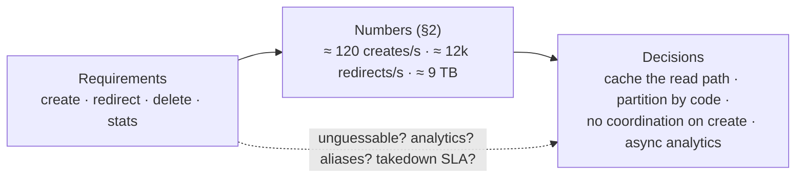
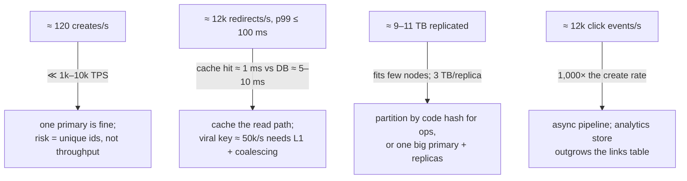
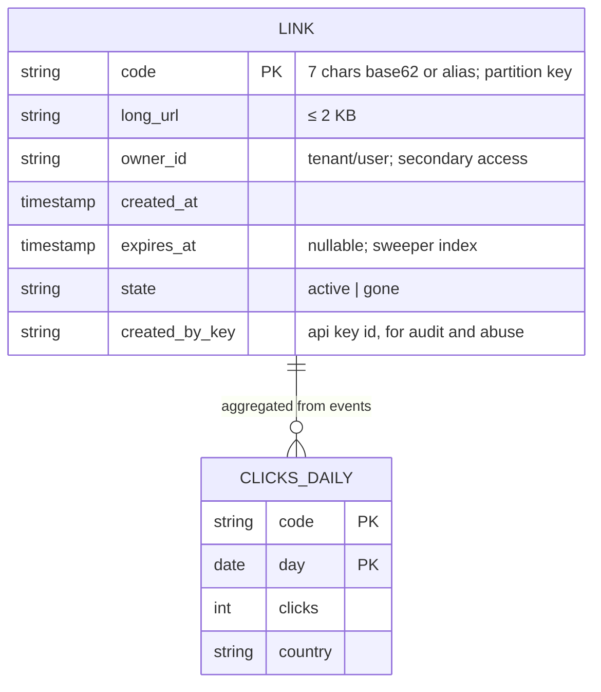
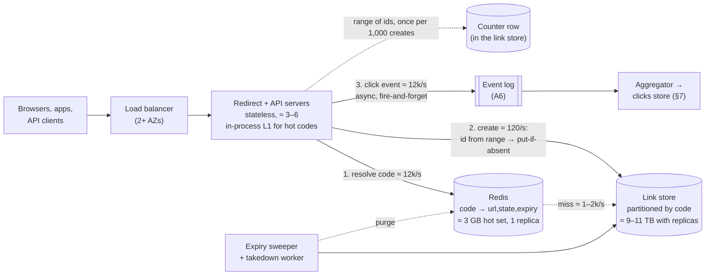
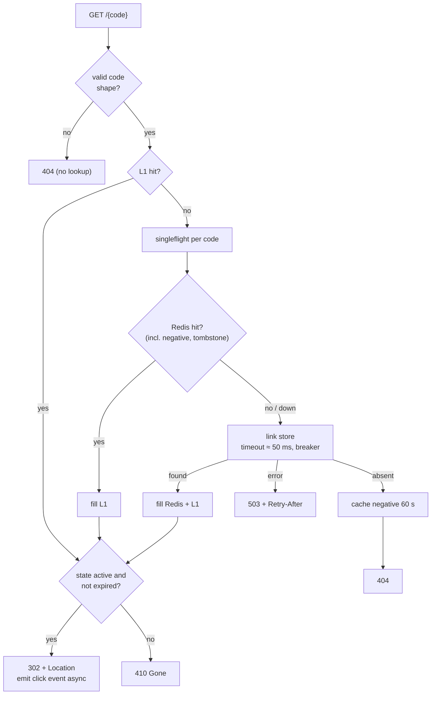
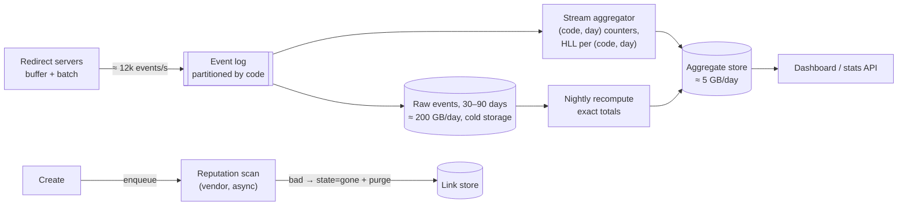

# C1 Unit 1 — Case study: URL shortener

> Time: ~6 h · CORE: §1–§7 and Common mistakes (5 h, incl. ≈ 1.5 h gate work) · STRETCH: the second half of §7 (1 h) · Lab:
> `labs/c1/keygen` · Framework card: [docs/INTERVIEW_FRAMEWORK.md](../../docs/INTERVIEW_FRAMEWORK.md)

This is the first case study, and it is deliberately the one every interview book opens with. That is not because
it is easy. It is because it *looks* easy: two endpoints and a table. Candidates who treat it that way produce a
CRUD app and get asked, at 0:28, "how do two servers avoid giving out the same code?", "what happens to the viral
link?", "how do you take down a phishing link in two minutes?", and the design falls over. The shortener is a
read-heavy key-value system with three genuinely hard parts (unique ids without coordination, a redirect path
that must be fast and almost never down, and an analytics and abuse pipeline that must not touch the hot path),
and this unit is about finding those three parts from the numbers, not from memory.

You run the 45-minute framework from [A0](../A0-framework-estimation/unit-1-interview-framework.md) end to end
on this problem, committing to each decision *before* you see the reveal. Keep your notes file open. In the
interview you'll have no reveal; the habit of committing first is the whole point.

## Before you start

You need the A0 framework, A1's API conventions, A2's access-pattern-first modelling and A3's cache patterns.
Warm-up (write the answers down, then check):

1. 100 million new links a month. Roughly how many creates per second is that, on average and at a 3× peak?
2. A 302 and a 301 redirect both send the browser to the long URL. Which one may the browser cache, and what does
   that do to your analytics and to a takedown?
3. Your cache in front of the link store has a 90% hit rate and the cache node restarts at peak. By how much does
   the store's read load rise, and what from A3 bounds the damage?

<details data-kind="answer">
<summary>Warm-up answers</summary>

1. 10^8 / (2.6 × 10^6 s) ≈ 38/s average; ≈ 115/s at 3×. Napkin: 100M/month ≈ 40/s. If you got 1,150/s you used
   seconds per day (86,400) instead of per month; the factor is ≈ 30.
2. A `301 Moved Permanently` is cacheable by default, so a browser that has seen it goes straight to the long URL
   next time without asking you: no click counted, and a takedown or edit never reaches that browser until its
   cache entry expires. A `302 Found` is not cached by default, so every click comes back to you. (A1 Unit 2 §1
   has the status-code semantics; RFC 9110 is the reference.)
3. By a factor of `1/(1 − h)` = 10×: the store sees 100% of reads instead of 10%. A3 Unit 2 §6: request
   coalescing (singleflight), TTL jitter, warming, and sizing the store for an agreed cold share. Links are
   immutable, which makes this cache unusually easy to keep correct, but not to keep warm.

</details>

**Session plan (3 × 2 h):** Session 1: §1–§4, every Predict in writing, ending with your own HLD on paper.
Session 2: §5 with the lab (`labs/c1/keygen`) and its break-its. Session 3: §6–§7 (the STRETCH half of §7 is
optional), then the gate work: first `sd quiz C1`, the [design exercise](design-exercise.md) (45 min, solo, a
*different* prompt from this unit's), and the [teach-back](teachback.md).

---

## §1 Requirements and the questions that change the design (0:00–0:06)

### The failure story

"Design a URL shortener like bit.ly." The candidate nods, says "sure, so we need to shorten URLs and redirect",
and starts drawing. Twelve minutes in, the interviewer asks three questions in a row. "Can a user choose their
own alias?" (The data model needs a uniqueness check on a user-supplied string, which the random-code scheme on
the board doesn't have.) "Do links expire?" (A sweeper, an index on expiry, and a decision about what an expired
link returns.) "We need click counts per link, by day, by country." (The redirect path on the board writes nothing;
adding a synchronous `UPDATE clicks = clicks + 1` to it would make the hot row the bottleneck at the numbers the
candidate hasn't computed yet.) Three questions, three redesigns, and the clock says 0:20 with no end-to-end
diagram.

A second candidate asks the questions first, but asks fifteen of them, including whether the short domain is
`.ly` or `.co`. Same outcome, different cause.

### Predict

<!-- predict id="C1-U1-P01" -->
**Predict.** Set a 5-minute timer. For "design a URL shortener", write down:

1. the 3–5 functional requirements you'd design for, and what you'd put out of scope;
2. the non-functional requirements, *each with a number* (scale of creates and redirects, latency, availability,
   durability, retention);
3. the **four clarifying questions whose answers change the architecture**, and for each one, what changes.

Then rank your questions: which single answer would change the most boxes?
<!-- /predict -->

### Reveal

<details data-kind="reveal" data-for="C1-U1-P01">
<summary>Reveal</summary>

A strong 5-minute card, with the numbers this unit uses from here on:

**Functional.** Create a short link for a long URL (optionally with a caller-chosen alias and an expiry); redirect
a short link to its long URL; delete or disable a link (owner or operator takedown); report clicks per link.
**Out of scope:** user accounts and dashboards, link previews, QR codes, A/B routing, browser extensions.

**Non-functional (assumptions stated out loud):** ≈ 100M new links/month; redirects ≈ 100 × creates (≈ 10B/month);
redirect p99 ≤ 100 ms end to end (≈ 10 ms of it ours), create p99 ≤ 500 ms; redirects available 99.99%
(≈ 4 min/month), creates 99.9%; an acknowledged link is never lost; links live 5 years by default; long URLs up
to 2 KB; codes short enough to type (≤ 8 characters).

**The questions that change the design**, in order of how much they move:

| Question | Why it changes boxes |
|---|---|
| Must codes be unguessable, or is sequential fine? | Sequential ids are enumerable (anyone can walk every link you ever created, including private ones) and leak your volume. The answer picks the ID scheme: random, or a counter with a permutation (§5). |
| Do we need analytics on the redirect, and how fresh? | It decides 302 vs 301 (a cached 301 never comes back to you), and it adds an asynchronous event pipeline that must not touch the redirect path (§7). |
| Caller-chosen aliases and dedupe of the same long URL? | Both need an atomic "claim this code if free" primitive (a unique index or conditional put) and a uniqueness semantic across tenants; dedupe also leaks "someone already shortened this" (§3). |
| Expiry and takedown within what time bound? | A takedown SLA of minutes means explicit cache purge (and a CDN purge if you cache at the edge), not TTL; expiry adds a lazy check on read plus a sweeper (§6). |

Also worth one sentence each: multi-region (where creates happen decides whether the ID scheme must be
coordination-free across regions), and abuse (phishing and malware are the operational reality of every public
shortener). Questions *not* worth the time: the domain name, the exact alphabet, whether the dashboard has dark
mode.

**Which answer moves the most boxes?** Usually analytics: it introduces a whole pipeline and a storage system that
ends up bigger than the links table (§7). Unguessability is second: it changes the ID scheme but not the shape of
the system.

Two common mistakes. (1) Treating "shorten and redirect" as the requirements and never asking about ids,
analytics or takedown, which are where the interviewer's questions will go. (2) Writing NFRs without numbers:
"low latency" cannot decide whether the redirect needs a cache, "100 ms p99 at 12k/s" can.

</details>

### How it actually works

**Scope by access pattern.** A shortener has exactly two hot operations, create and redirect, with a 100:1 skew
towards the second. Everything else (delete, stats, list my links) is cold and can be designed as "obvious
CRUD", said out loud and parked. The interviewer wants to see you notice the skew before you draw anything: it's
what makes the read path, not the write path, the thing to protect.

**Scope by consequence.** For each candidate feature, ask what it *forces*: a feature that forces a new atomic
primitive (aliases), a new pipeline (analytics), or a new time bound (takedown) is a requirement worth asking
about. A feature that only adds a column is not.

**Say what expired and deleted links return.** 404 for a code that never existed, 410 Gone for one that expired
or was removed. The distinction costs a tombstone and buys cacheable negatives and honest clients.



**Banking link.** The platform's transactional messages (statement ready, verify this device, complete this
application) carry links. Those links point at personal data, so unguessable codes aren't a nice-to-have; a
phishing campaign using your short domain is a brand incident with a takedown clock; and every link must be
traceable to the message, tenant and template that created it. When you scope a shortener for that context, the
"questions that change the design" are the first things the compliance team will ask.

### Build it

No Go lab for this section; the module's lab is in §5. Write the requirements card for two variants in ≤ 5
minutes each: (a) an internal shortener for one company's documentation links (private, no analytics, codes may be
sequential); (b) the transactional-link service for the banking platform above. Acceptance: the two cards differ in
at least three NFRs and in the ID requirement, and you can say which boxes each difference adds or removes.

### Break it

Take the card from the Reveal and flip one requirement at a time: (a) links must be creatable in three regions
with no cross-region call on the create path; (b) a takedown must be effective worldwide within 60 seconds; (c)
links are mutable (the owner can change the destination). For each, write what changes.

<details data-kind="answer">
<summary>What changes</summary>

- **(a) Create in three regions, no cross-region call:** the ID scheme must be coordination-free across regions.
  Random codes with an insert-if-absent work only if the insert is region-local, which means the code space is
  shared and a cross-region replication conflict is possible (two regions claim the same random code in the same
  second: at 62^7 that's ≈ 1 in 10^9 per pair of creates, tolerable with a reconciliation job). A counter-based
  scheme needs per-region ranges or region bits in the id (C3's territory). The link store becomes multi-leader
  or per-region-home (A4 Unit 1 §4).
- **(b) Takedown within 60 s worldwide:** you cannot rely on TTLs anywhere on the read path. Every cache layer
  (in-process L1, Redis, CDN) needs an explicit purge fan-out with a completion metric, and the browser must not
  be allowed to cache the redirect at all (302 with `Cache-Control: no-store`). The takedown becomes an
  event with an SLO, which is an A6 pipeline with a dead-letter queue.
- **(c) Mutable destinations:** every cached copy is now potentially stale, so you need versioned invalidation
  (A3 Unit 2 §5), a `version` on the row, and the 301 option disappears entirely. Mutability also opens an abuse
  vector: a link vetted as safe at creation can be pointed at malware later, so the URL scan must re-run on edit.

One flipped requirement redesigns a third of the system. That is why the questions come first.

</details>

### In the wild

- **bit.ly** and **TinyURL** are the public references; both offer caller-chosen aliases, click analytics and
  link management, and both run abuse detection because public shorteners are open redirectors by construction.
  (TODO-VERIFY: current public throughput figures; don't quote numbers for either in an interview without a
  source.)
- **t.co** wraps every link posted on Twitter/X, so that links can be scanned for malware and clicks measured;
  it shows that a shortener's redirect is an analytics *and* safety control point, not just a convenience.
  (TODO-VERIFY: whether it currently answers with 301 or 302, and its caching headers.)
- **Go links** inside companies (`go/standup`) are the internal variant from the Build-it exercise: sequential,
  guessable, no analytics, and still a surprisingly busy service because every bookmark hits it.

### Trade-offs

| Decision | Option | Wins when | Loses when | When the answer flips |
|---|---|---|---|---|
| Scope of analytics | Out of scope ("just a counter later") | 45 minutes are tight and the interviewer hasn't mentioned it | The interviewer asks about it at 0:30 and the hot path has no event hook | The moment the prompt or the interviewer says "like bit.ly": analytics are the product |
| | In scope as an async pipeline | The redirect path stays untouched and the design scores on depth | Costs 5 minutes of the HLD | Never put it on the synchronous path; if time is short, draw the hook and park the pipeline |
| Code guessability | Sequential (counter → base 62) | Internal tools; shortest codes; no collisions | Enumerable links, leaked volume | Any link that points at something private, or any public product |
| | Unguessable (random, or counter + permutation) | Public products, personal links | Slightly longer codes; collision handling (random) or a seed to protect (permutation) | Flip back to plain sequential only for internal, non-sensitive use |

### Senior bar

- **Failure modes.** Asking nothing (the three-redesign story); asking everything; NFRs as adjectives; not noticing
  that redirects dominate creates by two orders of magnitude; missing that "like bit.ly" implies analytics and
  abuse handling.
- **Numbers.** The scale card is what §2 needs: creates per month, the redirect ratio, size per link, retention,
  and the two latency targets. Without them you can't size anything.
- **Ops.** A senior candidate adds an operational requirement nobody asked for: "we need to take a link down
  within minutes, and we need to know who created it". It's the requirement that shapes §6 and §7.
- **Cost.** State early that egress and analytics storage, not the links table, are where the money goes (§7).

Interviewer follow-up probes:

1. "Why do you care whether codes are guessable? It's just a redirect."

<details data-kind="answer">
<summary>Model answer</summary>

Because a shortener is a directory of everything its users ever linked to. With sequential codes, anyone can
enumerate `/0000001`, `/0000002`, ... and harvest every destination, including unlisted documents and personal
links, at thousands of requests per second. It also tells competitors our creation volume. So I'd make codes
unguessable by default (random, or a counter behind a keyed permutation), rate-limit lookups of unknown codes,
and cache negatives so enumeration attempts don't reach the store. Internal go-links are the one case where
sequential is fine.

</details>

2. "You said 100M links a month. What if it's 100× that?"

<details data-kind="answer">
<summary>Model answer</summary>

Creates go from ≈ 120/s to ≈ 12k/s peak and redirects to ≈ 1.2M/s. The ID scheme must still be coordination-free
(range allocation or random codes both scale; a single database sequence on the create path does not), the link
store must be partitioned by code hash across tens of nodes, the cache tier becomes a sharded cluster with
consistent hashing (A4), and the redirect fleet is ≈ 200–1,000 servers depending on per-server throughput. The
shape is the same; the decision that flips is "one primary with replicas" versus "partitioned from day one".

</details>

### Check yourself

1. Which two features force a new atomic primitive in the store, and what is the primitive?
2. Why does "analytics in scope" decide the redirect status code?
3. Name the two hot operations and their ratio, and the first design consequence of the ratio.

<details data-kind="answer">
<summary>Answers</summary>

1. Caller-chosen aliases and same-URL dedupe: both need "claim this key only if it is free" (a unique index or a
   conditional put).
2. A 301 is cacheable by the browser, so repeat clicks never reach you and are never counted; analytics need a
   302 (or 307) that isn't cached, which also keeps takedowns effective.
3. Create and redirect at ≈ 1:100. The read path is the one to protect: cache it, replicate it, and keep
   everything else (analytics, abuse checks) off it.

</details>

---

## §2 Estimation: the five numbers that decide the shape (0:06–0:10)

### The failure story

The candidate computes storage for one year, two years and ten years, the bandwidth of the long URLs in both
directions, the number of characters needed in base 36, base 62 and base 64, and the memory for a Bloom filter.
Seven minutes. Then they draw a Cassandra cluster with twelve nodes, a Kafka cluster and three caches, for ≈ 120
creates per second. When the interviewer asks what the twelve nodes are for, the answer is "scale". None of the
numbers on the board had been compared with a threshold, so none of them ruled anything out.

### Predict

<!-- predict id="C1-U1-P02" -->
**Predict.** With the card from §1 (≈ 100M creates/month, 100:1 redirects, 5-year retention, ≈ 500 B per link
row, long URL ≤ 2 KB), compute in 4 minutes:

1. peak creates/s and peak redirects/s (state your peak factor);
2. total links and storage over the retention, with replication;
3. the code length (base 62) and the headroom it gives;
4. cache memory for a hot set (state your assumption about skew);
5. peak egress.

Next to each number, write the decision it drives. Then answer: is this a write-scale problem, a read-scale
problem, a storage problem, or none of those?
<!-- /predict -->

### Reveal

<details data-kind="reveal" data-for="C1-U1-P02">
<summary>Reveal</summary>

| Number | Value (≈) | Decision it drives |
|---|---|---|
| Creates | 10^8 / 2.6×10^6 s ≈ 38/s avg; × 3 ≈ **120/s** peak (a campaign launch might do 10× ≈ 400/s for minutes) | Any store handles this. The ID scheme, not write throughput, is the create-path risk. |
| Redirects | 100 × 38 ≈ 3.8k/s avg; × 3 ≈ **12k/s** peak; one viral link alone can be ≈ 50k/s for minutes (assumption) | Beyond a comfortable single database node once you add tail latency; a cache in front is justified by latency and by the viral case, not only by load. |
| Links and storage | 100M × 60 months = **6 × 10^9 links**; × 500 B ≈ 3 TB; × 3 replicas ≈ **9 TB** (+ ≈ 20% indexes ≈ 11 TB) | Fits a handful of nodes; fits one big node too. Partitioning is a choice about blast radius and operations, not a necessity (§3). |
| Code length | 62^6 ≈ 5.7 × 10^10 (≈ 9.5× headroom over 6B); 62^7 ≈ 3.5 × 10^12 (≈ 590×) | 7 characters: random codes collide ≈ 0.17% of the time even at the end of life, and a counter never runs out. 6 is fine for a counter, marginal for random (§5). |
| Cache | ≈ 50M distinct links read per day (assumption); the top 20% take ≈ 80% of reads → 10M entries × ≈ 300 B ≈ **3 GB** | One Redis node plus a replica; the hit rate (≈ 80–90%) sets the store's read load at ≈ 1–2k/s peak. |
| Egress | 12k/s × ≈ 500 B (a redirect response) ≈ 6 MB/s ≈ **48 Mbps**; ≈ 15 TB/month | Trivial for the network; not trivial for the bill (≈ $800–1,400/month at ≈ $0.05–0.09/GB, [NUMBERS.md](../../docs/NUMBERS.md)). |

**What kind of problem is it?** None of the four, at 1×. Writes are tiny, reads are moderate, storage is a few
TB. That finding is the most useful sentence you can say at 0:10: "this isn't a scale problem; the risks are
unique ids without coordination, redirect latency and availability, and the analytics and abuse pipeline. That's
where I'll go deep." Candidates who skip estimation shard it anyway.

Tempting wrong answers: computing storage *per year* and forgetting replication (3× under); a peak factor of 1
(you'll size for the average and fail on payday); counting the long URL at its 2 KB maximum (4× over; use the
average, say ≈ 200 B, and state it); and confusing the analytics volume with the link volume (12k events/s is
1,000× the create rate, §7).

</details>

### How it actually works

**Compute only numbers near a threshold.** A0 Unit 2 taught the arithmetic; here the discipline is the
threshold table. For a shortener the thresholds are: one relational primary ≈ 1k–10k small writes/s (we're at
120); indexed point reads ≈ 10k–50k/s per node (we're at ≤ 12k before caching); Redis ≈ 100k+ simple ops/s per
instance (a viral link at 50k/s is half an instance); a node holds several TB of NVMe (we're at ≈ 3 TB per
replica); RAM per box 128–512 GB (the 3 GB hot set is nothing).

**Headroom, not just fit.** "120 writes/s against ≈ 1k–10k is 10–100× headroom" tells the interviewer when you'd
revisit the choice. "3 TB on a node that holds 4 TB" is a fit with no headroom, and that is an argument for
partitioning even though the rates don't need it.

**Two numbers people forget.** The analytics event rate equals the redirect rate (every click is an event), so the
analytics pipeline is a 12k events/s system with its own storage math (§7). And the negative-lookup rate: bots
and typos produce lookups for codes that don't exist; at even 10% of traffic that's 1.2k/s of guaranteed cache
misses unless you cache negatives (§6).



### Build it

No Go lab for this section. Put the §1 card through `capacity.Estimate` from `labs/a0/capacity` (DAU-free
variant: feed creates per day directly) and check that your 0:06 numbers match the sheet. Then re-run it at 10×
and 100× and write down which decision flips at each step. Acceptance: at 100× you can name the first component
that must change and the number that forces it.

### Break it

Change one input: the average long URL is **1.5 KB** (people shorten tracking-parameter-laden URLs), not 200 B,
and the row is ≈ 1.8 KB. Re-derive the storage, cache and egress numbers and say which decisions move.

<details data-kind="answer">
<summary>What moves</summary>

Storage: 6B × 1.8 KB ≈ 11 TB raw, ≈ 33 TB replicated: still a handful of nodes, but no longer "fits one node
with headroom": partitioning stops being optional. Cache: the hot set grows to 10M × ≈ 1.6 KB ≈ 16 GB: still one
node, but the per-entry cost matters now and you'd consider caching only the long URL plus flags. Egress: the
redirect response carries the long URL in the `Location` header, so ≈ 12k/s × 1.8 KB ≈ 22 MB/s ≈ 170 Mbps and
≈ 56 TB/month: the egress bill (≈ $3–5k/month) becomes the biggest line. Request rates don't change at all, so the
ID scheme and the pipeline don't change. Byte numbers and rate numbers drive different decisions, which is why
you compute both.

</details>

### In the wild

- **Egress as the surprise bill** is a well-known cloud pattern: for read-heavy services the data transfer line
  often exceeds compute. [NUMBERS.md](../../docs/NUMBERS.md) carries the list prices to use (marked TODO-VERIFY
  there, because they drift).
- **Hot-set skew** of roughly 80/20 is the standard planning assumption (A3 Unit 1 §4). Shortener traffic is
  more skewed than that during viral events, which is why the cache's job is latency and spike absorption more
  than average load.
- **Redis** at ≈ 100k+ ops/s per instance ([NUMBERS.md](../../docs/NUMBERS.md)) is the threshold that makes a single
  viral key a real problem (§6).

### Trade-offs

| Option | Wins when | Loses when | When the answer flips |
|---|---|---|---|
| Six decision numbers, each with its decision | Every interview; it takes 4 minutes | Never | — |
| A full spreadsheet (per-year storage, bits per code, Bloom filter sizes) | You're asked for a capacity plan explicitly | 45-minute rounds: the numbers crowd out the design | Only if the interviewer says "let's do a detailed capacity plan" |
| Skipping estimation ("it's obviously small") | Never in an interview | You can't justify the cache or rule out sharding; you'll be asked anyway | — |

### Senior bar

- **Failure modes.** Forgetting replication (3×), using the maximum URL size (4×), using a peak factor of 1,
  mixing bits and bytes on egress (8×), confusing click events with creates (1,000×).
- **Numbers to carry into §3–§7.** 120 creates/s, 12k redirects/s (50k/s on one key), 6B links / ≈ 9–11 TB,
  7-character codes, 3 GB hot set, 12k events/s.
- **Ops.** Say which number you'd watch to know the design is drifting: distinct links read per day (the cache's
  working set) and the viral peak per key (the L1's job).
- **Cost.** Egress ≈ $1k/month and analytics storage (§7) dominate; the links table is cheap.

Interviewer follow-up probes:

1. "Do you actually need a cache at 12k redirects per second?"

<details data-kind="answer">
<summary>Model answer</summary>

For average load, no: ≈ 12k indexed point reads/s is inside one database node's range. I want it for two other
reasons: latency (a cache hit is ≈ 1 ms, a database read ≈ 5–10 ms, against a 100 ms end-to-end p99 that the
network eats most of) and the viral case, where one code gets ≈ 50k/s and a single database row becomes a hot
spot. If the product had no viral behaviour and a looser latency target, I'd drop it and let the replicas carry
reads; the flip is a per-key peak above ≈ 5–10k/s.

</details>

2. "How many characters, and why not just use the whole 64-bit id in base 62?"

<details data-kind="answer">
<summary>Model answer</summary>

Seven: 62^7 ≈ 3.5 × 10^12 gives ≈ 590× headroom over the 6 billion links we expect, keeps random-code collisions
below 0.2% even at end of life, and stays short enough to type. A 64-bit id is 11 characters in base 62, which is
fine for a counter-based scheme but longer than needed; the product wants short, and every character of code is
also a character in every SMS we send. If we expected 100× the volume I'd move to 8.

</details>

### Check yourself

1. Which of the five numbers would make you partition the link store, and at what value?
2. Why is the analytics event rate 1,000× the create rate, and what does that imply?
3. What's the cheapest line and the most expensive line in the monthly bill?

<details data-kind="answer">
<summary>Answers</summary>

1. Storage: once a replica's share stops fitting on a node with headroom (≈ several TB with ≥ 30% free), or the
   redirect rate exceeds what one node's replicas can serve with the cache in front (≈ 50k+/s of misses). At 1×
   neither applies, so partitioning is an operational choice.
2. Every redirect is a click event, and redirects are 100 × creates, so events are 100 × creates per link... and
   each link accumulates events for years: the analytics store outgrows the links table, and the pipeline must be
   asynchronous.
3. Cheapest: the links table (≈ 9–11 TB of block or managed storage, roughly $1k/month). Most expensive: egress
   (≈ 15 TB/month) and the analytics storage, both of which scale with clicks rather than links.

</details>

---

## §3 API and data model (0:10–0:16)

### The failure story

The API on the board is `POST /shorten {url}` returning `{id: 48213}` and `GET /expand?id=48213` returning the long
URL as JSON. The interviewer asks how a browser follows the link. The candidate adds `GET /{id}` with a 301. Then:
"a mobile client timed out on the create and retried; now the user has two links and shared the wrong one". No
idempotency. Then: "why can I fetch link 48212 and 48214?" The integer id is the database's auto-increment, so
the API has leaked the storage design *and* made every link enumerable. Then the data model: a single table with
`clicks INT` updated on every redirect. Four questions, four holes, and all of them were avoidable at 0:10 by
designing the contract from the requirements instead of from the table.

### Predict

<!-- predict id="C1-U1-P03" -->
**Predict.** Write the API for create, redirect and delete: method, path, request and response fields, status
codes, and where idempotency applies. Decide: 301 or 302 for the redirect, and why. Decide what the service
returns for an expired link and for a code that never existed.
<!-- /predict -->

<!-- predict id="C1-U1-P04" -->
**Predict.** Write the access patterns first, then the entities, keys and indexes. Which store would you pick for
the links, and why? Where does the click count live, and why not in the link row?
<!-- /predict -->

### Reveal

<details data-kind="reveal" data-for="C1-U1-P03">
<summary>Reveal</summary>

```
POST /v1/links
  Authorization: Bearer <api key or user token>
  Idempotency-Key: <client-generated UUID>
  { "long_url": "https://...", "alias": "spring-sale" (optional), "expires_at": "2027-01-01T00:00:00Z" (optional) }
→ 201 Created  { "code": "aZ3kQ9x", "short_url": "https://sho.rt/aZ3kQ9x", "expires_at": "..." }
→ 400 invalid URL (scheme, length, private address) · 409 alias taken · 422 URL blocked (unsafe)
   · 429 rate limited · the usual 401/403

GET /{code}
→ 302 Found   Location: <long_url>   Cache-Control: private, no-store
→ 404 never existed · 410 Gone (expired or taken down)

DELETE /v1/links/{code}   (owner or operator)
→ 204 · 404 · 403

GET /v1/links/{code}/stats?from=&to=   → 200 { clicks_total, by_day: [...], by_country: [...] }
GET /v1/links?cursor=&limit=            → the caller's links, newest first (cursor pagination, A1 Unit 2 §2)
```

**Idempotency on create** is non-negotiable: clients retry on timeouts, and without a key a retry creates a second
link with a different code, so the user shares one and sees another in their list (A1 Unit 3 §2). The key is
scoped per caller.

**302, not 301**, by default. A 301 is cacheable by browsers and intermediaries, so a repeat click never comes
back: no analytics, and a takedown cannot reach a browser that cached it. A 302 (or 307, which also preserves the
method for the rare non-GET) returns every click to you. The cost is one request per click, which is exactly the
load you estimated in §2. Offer 301 as a per-link option for permanent marketing links where the owner prefers the
load saving over analytics, and say so.

**404 vs 410.** 410 for expired or removed links needs a tombstone (the row stays with `state = gone`), costs
≈ 50 B per dead link, and buys two things: cacheable negatives (a bot hammering a dead link hits the cache) and
honest clients that stop retrying.

Tempting wrong answers: a JSON "expand" endpoint instead of a real redirect (browsers can't use it); the
auto-increment id in the URL (enumerable, leaks volume); 301 "because it's permanent" (the analytics requirement
decided this in §1); no idempotency key "because it's not payments".

</details>

<details data-kind="reveal" data-for="C1-U1-P04">
<summary>Reveal</summary>

**Access patterns, in order of rate:**

1. *Resolve code → long URL, state, expiry*: point lookup by code, ≈ 12k/s peak, latency-critical.
2. *Insert a link with a unique code*: ≈ 120/s, must fail if the code or alias exists.
3. *List my links, newest first*: by `owner_id`, paginated, rare.
4. *Find expired links*: range scan on `expires_at`, background.
5. *Count clicks*: ≈ 12k writes/s if done per click, which is why it does **not** live in the link row.



**Store choice.** The hot pattern is a point lookup by a key we control, with no joins and no transactions beyond
"insert if absent". That is key-value shaped, and both of these are honest answers:

- *A partitioned key-value or wide-column store* (DynamoDB, Cassandra-style) with `code` as the partition key:
  horizontal from day one, conditional put for uniqueness, native TTL as a backstop for expiry. Cost: a second
  table or a global secondary index for "list by owner" (A4 Unit 3 §9), and no ad-hoc queries.
- *A relational primary with replicas*, partitioned later by code hash if growth demands: 120 writes/s and ≈ 1–2k
  cache-miss reads/s are trivial, the unique index gives insert-if-absent for free, `expires_at` gets a plain
  index, and the owner listing is an ordinary query. Cost: at ≈ 3 TB per replica the node is full-ish, backups and
  failovers are slow, and the 6B-row index won't sit in RAM.

Say which you pick and why in one trade-off sentence. The reference design uses the partitioned KV store for the
link table (point lookups, TTL, conditional writes, and the operational blast radius of a 3 TB primary), and keeps
owner listings in a separate index table. Either is defensible; "MongoDB because it's web scale" is not.

**The click count** goes into the analytics path (§7): per-click `UPDATE link SET clicks = clicks + 1` would put
12k writes/s on the hottest rows of the hottest table, serialise on the viral link's row, and couple redirect
latency to the write path. Keep counters in a separate aggregate store fed asynchronously; show an eventually
consistent count in the API and say so.

</details>

### How it actually works

**The API is the contract; the table is an implementation.** Resource paths (`/v1/links/{code}`), opaque codes,
idempotency on the only non-idempotent operation, a redirect that browsers can follow, and error codes a client
can act on. Everything a client needs and nothing about how it's stored.

**The redirect response matters as much as the status code.** `Cache-Control: private, no-store` (or a short
`max-age` if you accept a little under-counting) decides whether the browser comes back; `Location` carries the
long URL, which is why the long URL's size shows up in egress; and a HEAD request must behave like GET without
the body (link checkers send them constantly).

**Validation at create is a security boundary.** Accept only `http`/`https`, reject private and link-local
addresses (your redirect must not become a way to probe internal networks: the shortener is an open redirector
by nature), cap the length, normalise the URL, and record which API key created it. The reputation check (is this
URL known-bad?) is asynchronous (§7): don't put a vendor call on the create path's latency budget.

**Partition key = code** because every hot read carries the code and nothing else. The owner listing is a second
access pattern with a second index; the expiry scan is a third, served by a secondary index on `expires_at` or by
the store's TTL plus a lazy check.

### Build it

No Go lab for this section (B3 problem 16, `labs/b3/shortener`, is the in-process version of this contract if you
want to code it). Write the create and redirect handlers' *contract* as a table: input, validation, status codes,
headers, idempotency scope, and what is logged. Acceptance: a teammate could implement it without asking you a
question about behaviour.

### Break it

Change the redirect to a `301` with default caching, keep everything else, and work through: (a) the daily click
count for a link embedded in a popular newsletter; (b) a takedown at 09:00 of a link that was phishing since 08:00;
(c) the egress bill.

<details data-kind="answer">
<summary>What you should conclude</summary>

(a) The count collapses to roughly the number of *distinct browsers* that clicked, not clicks: every repeat click
is served from the browser cache. Your analytics now undercount by an unknown factor that depends on client
caching behaviour. (b) Every browser that clicked between 08:00 and 09:00 keeps going to the phishing page for as
long as its cache keeps the 301 (hours to days; it depends on the client). Your takedown is effective only for
new visitors. (c) Egress drops, perhaps by half for repeat-heavy traffic: the one real benefit, worth ≈ $500/month
at our numbers, which is nothing against a takedown that doesn't work. Conclusion: 302 by default, 301 as an
opt-in for links where analytics and takedown don't matter.

</details>

### In the wild

- **RFC 9110** (HTTP semantics) defines 301/302/307/308 and their default cacheability; the practical rule is
  "301 and 308 may be cached by default, 302 and 307 are not unless headers say so". (TODO-VERIFY the exact
  heuristic-caching language before quoting it.)
- **Stripe-style idempotency keys** on `POST` are the pattern for the create call (A1 Unit 3 §2).
- **DynamoDB's conditional writes** (`attribute_not_exists(code)`) and **Cassandra's lightweight transactions**
  (`INSERT ... IF NOT EXISTS`) are the insert-if-absent primitives a KV-backed design relies on; a relational
  unique index is the same primitive for free.
- **Open-redirect hardening** (reject non-HTTP schemes, private addresses, and show an interstitial for untrusted
  destinations) is standard practice for public shorteners because they are, by definition, redirectors anyone can
  create.

### Trade-offs

| Decision | Option | Wins when | Loses when | When the answer flips |
|---|---|---|---|---|
| Redirect code | 302 / 307 | Analytics, takedown, mutable links | Every click costs a request | 301 only per link, by owner choice, for permanent links without analytics |
| | 301 / 308 | Load and egress savings on repeat clicks | No analytics on repeats; takedown reaches only new visitors | Never as the default for a public shortener |
| Link store | Partitioned KV / wide-column | Point lookups, TTL, conditional puts, growth beyond one node | Owner listings need an index table; no ad-hoc queries | Rich queries or a small deployment → relational |
| | Relational primary + replicas | Simple ops, unique index, owner queries | ≈ 3 TB per replica with little headroom; slow backups and failover | Data per replica ≳ a few TB or reads ≳ 50k/s of misses → partition |
| Click counter | Separate aggregate fed async | Hot path untouched; viral links don't serialise | Counts are eventually consistent (seconds to minutes) | Never put it in the link row at 12k/s; a per-link `INCR` in Redis is the fast approximate path (§7) |
| Dead links | Tombstone + 410 | Cacheable negatives; honest clients | ≈ 50 B per dead link forever | Delete the row and answer 404 for both if storage is the constraint |

### Senior bar

- **Failure modes.** No idempotency key; auto-increment id in the URL; a JSON "expand" instead of a redirect; a
  301 default; the click counter in the link row; a store chosen before the access patterns; missing URL
  validation (open redirect to `file://` or to an internal address).
- **Numbers.** 12k point reads/s against a single partition key per read; 120 inserts/s with a uniqueness check;
  ≈ 500 B per row; the owner index is a second copy of (owner, code, created_at).
- **Ops.** Say how you'd add a column (`expires_at` was nullable from day one for this reason) and how the
  tombstone table is pruned; the KV choice makes schema evolution cheap and ad-hoc investigation expensive, so
  plan an analytics copy (§7) for the latter.
- **Cost.** The owner index doubles the small part of the storage; the tombstones are noise; the long URL in the
  `Location` header is the egress.

Interviewer follow-up probes:

1. "Why not return the long URL as JSON and let the client redirect?"

<details data-kind="answer">
<summary>Model answer</summary>

Because the dominant client is a browser following a link in an email or a message: it needs an HTTP redirect,
not an API. A JSON endpoint is useful for a dashboard or a bot that wants to inspect without following, so I'd
offer `GET /v1/links/{code}` as a separate, authenticated resource. The redirect endpoint stays unauthenticated,
cached and tiny.

</details>

2. "Same long URL shortened twice: same code or two codes?"

<details data-kind="answer">
<summary>Model answer</summary>

Two codes by default. Dedupe sounds like a storage saving (a few percent at most) but it has costs: it needs a
second unique key (a hash of the normalised URL, per owner), it leaks "someone already shortened this" if done
across owners, and it breaks per-link analytics and per-link expiry. I'd dedupe only per owner, as an opt-in, and
only after normalising the URL carefully.

</details>

3. "What stops me from shortening `http://169.254.169.254/latest/meta-data/`?"

<details data-kind="answer">
<summary>Model answer</summary>

Validation at create: reject non-public addresses (RFC 1918 ranges, link-local, loopback, the cloud metadata
endpoint) after resolving the host, reject non-HTTP schemes, and re-check at redirect time if links are mutable.
The shortener itself never fetches the destination on the user's behalf, so it can't be used as a proxy; the
remaining risk is sending *other* users to internal addresses, which the redirect-time check and an interstitial
for untrusted domains cover.

</details>

### Check yourself

1. Which one of the API's operations needs an idempotency key, and what goes wrong without it?
2. Name the partition key and the two secondary access patterns it does not serve.
3. Why is `UPDATE links SET clicks = clicks + 1` on redirect a bad idea at 12k/s?

<details data-kind="answer">
<summary>Answers</summary>

1. Create. A retried create without a key makes a second link with a different code; the user shares one and
   sees the other.
2. `code`. Listing a user's links (by `owner_id`, newest first) and finding expired links (range on
   `expires_at`).
3. It puts the full redirect rate on the hottest rows, serialises all clicks of a viral link on one row's lock
   or conditional update, and makes redirect latency depend on the write path. Counts belong in an asynchronous
   aggregate.

</details>

---

## §4 High-level design: both paths, every box justified (0:16–0:25)

### The failure story

The board shows: CDN, WAF, API gateway, auth service, link service, ID service, ZooKeeper, Kafka, three consumer
services, Redis cluster, Cassandra, Elasticsearch, S3 and a data warehouse. Fifteen boxes for 120 writes/s. "Walk
me through a redirect." CDN → gateway → link service → Redis → Cassandra → ... "and where does the click go?"
"Kafka." "From which box?" Silence. "Why ZooKeeper?" "For the ID service." "What does the ID service do that the
link service can't?" The candidate can't say, because the boxes came from a diagram they'd seen, not from the
numbers they'd computed. Each extra box is a question they now have to answer, and none of them has an answer.

### Predict

<!-- predict id="C1-U1-P05" -->
**Predict.** Draw the HLD with as few boxes as the §1 requirements and §2 numbers justify. Next to each box write
the requirement or number that forces it. Trace the create path and the redirect path as numbered arrows with a
rate on each. Then answer: where does the click event leave the redirect path, and what guarantees it doesn't
slow the redirect down?
<!-- /predict -->

<!-- predict id="C1-U1-P06" -->
**Predict.** The interviewer says "this looks over-engineered". Which box do you remove first and what do you
lose? Then: "what's the single point of failure?" Name it and the mitigation.
<!-- /predict -->

### Reveal

<details data-kind="reveal" data-for="C1-U1-P05">
<summary>Reveal</summary>



| Box | Forced by |
|---|---|
| Load balancer, ≥ 2 app servers across AZs | 99.99% redirects: no single server or AZ may take the path down |
| Stateless redirect/API servers (≈ 3–6) | ≈ 12k/s peak at ≈ 5–10k req/s per server with N+1; one tier serves both endpoints because both are tiny |
| Redis in front of the link store | p99 latency budget (≈ 1 ms hit vs ≈ 5–10 ms store read) and the viral key; ≈ 3 GB hot set |
| In-process L1 on the app servers | The viral key at ≈ 50k/s would otherwise land on one Redis shard; links are immutable, so a 10–60 s L1 is safe with explicit purge |
| Link store, partitioned by code, 3 replicas | 6B rows / ≈ 9–11 TB; point lookups; conditional put for uniqueness |
| Counter row + range allocation in the app servers | Unique codes without a coordination call per create (§5); no separate "ID service" box needed |
| Event log + aggregator | Clicks at 12k/s must leave the hot path; the aggregate store is the analytics product (§7) |
| Expiry sweeper / takedown worker | Retention and the takedown SLA; purges caches explicitly |

**Create path:** validate → take the next id from the server's current range (no network call most of the time)
→ permute and encode to a 7-char code → `put-if-absent` into the link store (an alias goes through the same
primitive) → 201. The idempotency key check sits before all of this (A1's middleware), and the asynchronous
safety scan is enqueued after the put.

**Redirect path:** parse code → L1 hit? → Redis hit? → link store (cache the result, including negatives and
tombstones) → check `state` and `expires_at` → 302 with `Location`. The click event is written to a local
buffer and shipped asynchronously by a background goroutine (batched, bounded, dropped with a metric if the log
is down): the redirect never waits for it. That's the guarantee: no synchronous call to anything but the caches
and, on a miss, the store.

</details>

<details data-kind="reveal" data-for="C1-U1-P06">
<summary>Reveal</summary>

**Remove first: the in-process L1.** Without it, Redis takes the viral key directly; at ≈ 50k/s on one key that is
half of one instance's capacity, survivable but with no headroom, so you'd add it back the day a link goes viral
twice. The next candidate is the event log: at 1× you could write click events in batches straight to the
aggregate store from the app servers, and you'd lose durability of events during an aggregate-store outage. The
wrong answers are removing Redis (the latency budget and the viral case stop being met) or the replicas (the
availability requirement is gone).

**Single point of failure: the link store's partition that owns a code** (or the primary, in the relational
variant). Mitigation: three replicas across AZs with automatic failover, *and* the fact that links are immutable:
the caches keep serving every cached redirect while the store fails over, so a store outage degrades creates
(503, retry with the same idempotency key) long before it degrades redirects. The *counter row* is a second,
subtler one: if it's unreachable, servers keep creating until their current range runs out (≈ 1,000 ids each ≈ 8
seconds at 120/s fleet-wide, or minutes per server), then creates fail cleanly. Say that, and say that redirects
are unaffected.

</details>

### How it actually works

**Trace before you add.** The two paths are the whole system; everything else exists to serve them. Draw them
first, then ask of every remaining box "which requirement or number forces this?" The counter for ids lives in
the same store as the links (one row, touched once per 1,000 creates), so there's no ID-service box and nothing
for ZooKeeper to coordinate. The analytics pipeline exists because of the 12k events/s number. The CDN is *not*
on the board at 1×: redirects are dynamic (per-link state, per-click events) and 48 Mbps needs no edge; a CDN
comes back for the viral case if you're willing to edge-cache 302s for a few seconds (§6).

**Why one server tier.** Create and redirect have wildly different rates but both are cheap; separating them
buys isolation (a create-path bug can't take down redirects) at the cost of two deployments. At 1× keep one tier
and say that you'd split them when the create path grows features (scanning, dashboards) that could hurt the
redirect tail.

**Read path latency budget (≈ 10 ms of the 100):** L1 ≈ 0 ms; Redis ≈ 0.5–1 ms (one in-DC round trip,
[NUMBERS.md](../../docs/NUMBERS.md)); store miss ≈ 5–10 ms. At a ≈ 90% hit rate the p99 is dominated by misses,
so the miss path's tail (replica choice, timeouts) is what you tune.

### Build it

No Go lab for this section. Rehearse drawing the HLD from a blank page in ≤ 8 minutes, twice, with rates on the
arrows. Acceptance: every box has its justification written next to it, both paths are numbered, and you can
answer "what happens if this box dies" for each box in one sentence.

### Break it

Run the redirect path with the link store unavailable for 10 minutes at peak. Using the §2 numbers, work out:
which redirects fail, which succeed, what the creates do, and what a client sees.

<details data-kind="answer">
<summary>What happens</summary>

With an ≈ 90% cache hit rate, ≈ 90% of redirects keep working from Redis and L1 for the whole 10 minutes (links
are immutable, so stale isn't a concern; only expiry and takedown checks are affected, and those can be enforced
from the cached `state`/`expires_at`). The ≈ 10% that miss (≈ 1.2k/s) get a fast 503 with `Retry-After`, *if*
your store client has a short timeout (≈ 50–100 ms) and a circuit breaker (A7); without them each miss holds a
connection for the full timeout and the app servers run out of capacity, taking the 90% down with it. Creates
fail with 503 immediately; clients retry later with the same idempotency key. The lesson for the board: the cache
is a *availability* component here, not just a latency one, which is also why its contents must survive a cache
restart (replica, or warm from the store's hot set) and why a cold cache during a store outage is the worst case.

</details>

### In the wild

- **Request coalescing** on the miss path (NGINX `proxy_cache_lock`, Varnish, Go's `singleflight`) is what keeps
  a cold or viral key from becoming a thundering herd on the store (A3 Unit 2 §6).
- **Immutable data and caches**: CDNs and caches are at their best with content that never changes; the shortener's
  link row is such content, which is why edge-caching redirects for a short time (Cloudflare and others can cache
  redirects when told to; TODO-VERIFY the default behaviour for 302s) is a real option for viral links.
- **Fire-and-forget event emission** with a bounded local buffer and a drop metric is the standard shape for
  click/impression logging in ad-tech and analytics stacks; the alternative (blocking the user request on the
  log) is the one every post-mortem warns about.

### Trade-offs

| Decision | Option | Wins when | Loses when | When the answer flips |
|---|---|---|---|---|
| Server tiers | One tier for create + redirect | Small fleet, simple deploys | A create-path feature can hurt the redirect tail | Split when create grows scanning/dashboards, or when redirect needs its own autoscaling |
| Click emission | Async buffer → event log | Hot path untouched; durable events | Events can be dropped if the buffer fills during a log outage (metered) | Synchronous only if a click is a billable event that must never be lost, and then the latency budget must include it |
| ID source | Range from a counter row, in-process | No extra service; one store call per 1,000 creates | A crash wastes ≤ 1,000 ids; the counter row is a (soft) dependency | A separate ID service when many unrelated services need ids (C3) |
| Edge | No CDN at 1× | Dynamic responses, tiny egress | Viral spikes land on your servers | Edge-cache 302s for a few seconds for the viral case; CDN for a global p99 target |

### Senior bar

- **Failure modes.** Fifteen boxes with no justification; no traced path; the click written synchronously;
  a separate ID service "because the book has one"; a CDN "because it's standard"; forgetting that a cold cache
  plus a store failover is the real outage.
- **Numbers on the arrows.** 12k/s into the app tier, ≈ 1–2k/s of misses into the store, 120/s of puts, 12k
  events/s into the log, 1 counter op per 1,000 creates.
- **Ops.** Deploys: the app tier drains gracefully (A1 Unit 1 §5) so in-flight redirects complete; the Redis
  replica is promoted on failure and the L1 shields the cold replica; the sweeper is idempotent and alerted on
  lag.
- **Cost.** ≈ 3–6 small VMs, one Redis pair, a few-node store, the event log: a few thousand dollars a month
  before egress and analytics storage.

Interviewer follow-up probes:

1. "Why no API gateway or auth service box?"

<details data-kind="answer">
<summary>Model answer</summary>

The redirect endpoint is unauthenticated and the API endpoints need API-key or token checks that a middleware on
the app servers does in microseconds (A1 Unit 3 §3). A gateway buys centralised rate limiting and routing, which
I'd want once several services share the edge; here it's one service, so a gateway is a box with no requirement
behind it. I'd name it as the place rate limiting moves to when the platform grows.

</details>

2. "Walk me through a redirect when Redis is down."

<details data-kind="answer">
<summary>Model answer</summary>

L1 serves the hot codes it holds for its TTL. Everything else goes to the link store: ≈ 12k reads/s instead of
≈ 1–2k, which is inside the partitioned store's capacity but outside a single node's comfort, so we fail open with
a short timeout, a breaker and request coalescing so one viral key costs one store read per server per TTL. We
page on the hit-rate drop, promote the Redis replica, and warm it from traffic. The product impact is latency,
not errors, as long as the store absorbs the cold factor of ≈ 10×, which we size for.

</details>

### Check yourself

1. Which box is forced by the viral-link number alone?
2. Why can the link store be down for minutes without most redirects failing?
3. What is the counter row's failure impact on creates, and on redirects?

<details data-kind="answer">
<summary>Answers</summary>

1. The in-process L1 cache (and request coalescing): ≈ 50k/s on one key would otherwise concentrate on one Redis
   shard.
2. Links are immutable and the hot set is cached, so cache hits (≈ 90%) are served without the store; only
   misses fail, and they fail fast behind a breaker.
3. Creates continue until each server's current range is used up, then fail with 503; redirects are unaffected
   because they never touch the counter.

</details>

---

## §5 Deep dive 1: unique codes without a serialising point (0:25–0:32)

### The failure story

Version one: every API server generates a random 6-character code, checks `SELECT 1 FROM links WHERE code = ?`,
and inserts if nothing came back. At 120 creates/s across 20 servers, two servers occasionally draw the same code
in the same few milliseconds, both see "free", both insert, and the second insert either fails on the unique
index (fine, if there is one) or silently overwrites (if there isn't: the index was dropped "for write
performance"). After a year, one link in a few thousand points at the wrong destination, and support can't
explain why.

Version two: a single row in Postgres, `UPDATE counter SET value = value + 1 RETURNING value`, on every create.
Correct, but every create in every region serialises on one row's lock: ≈ 10 ms of RTT from the second region plus
the lock wait, and when that database fails over, nobody anywhere can create a link for the duration. The id
source has become the write path's single point of failure, for a system whose write path otherwise has none.

Version three: the counter, but each server takes `value` and formats it in base 62. The codes are `0000001`,
`0000002`, `0000003`. A competitor's script walks them all in an afternoon and finds every unlisted link ever
created, plus an exact count of your daily volume.

### Predict

<!-- predict id="C1-U1-P07" -->
**Predict.** For 120 creates/s (400/s in spikes), 6B links over 5 years, 7-character codes, and the requirement
that codes be unguessable, compare these schemes on: coordination per create, collision handling, guessability,
and what a crash or a store outage does. Then pick one and write the trade-off sentence (claim → why here →
cost → flip).

(a) random code + insert-if-absent; (b) one global counter, one store round trip per create; (c) counter with
ranges leased to each server; (d) hash of the long URL, truncated; (e) a pre-generated pool of unused codes in a
table, handed out on create.

Also: for (a), what's the probability that a new 7-character code collides when 6B exist, and how many retries
per create does that mean? For 6 characters?
<!-- /predict -->

<!-- predict id="C1-U1-P08" -->
**Predict.** In scheme (c), a server reserves ids 41,000–41,999, hands out 41,000–41,002, and crashes.
(1) What happens to 41,003–41,999? (2) Can any id ever be handed out twice? Under what bug? (3) The counter store
is unreachable for 2 minutes at peak: what happens to creates, and to redirects? (4) How do you stop ids from
being enumerable without giving up the counter?
<!-- /predict -->

### Reveal

<details data-kind="reveal" data-for="C1-U1-P07">
<summary>Reveal</summary>

| Scheme | Coordination per create | Collisions | Guessable? | Crash / outage |
|---|---|---|---|---|
| (a) random + insert-if-absent | None beyond the insert itself (which you do anyway) | Rare, handled by the unique index and a retry | No | Nothing to lose; an insert that fails for an unrelated reason is retried with the same idempotency key |
| (b) global counter per create | One atomic increment per create, on one row | None | Yes, unless permuted | Counter down = no creates anywhere; hot row; cross-region RTT on every create |
| (c) counter + ranges per server | One compare-and-swap per *range* (per 1,000 creates) | None | Yes, unless permuted | A crash wastes ≤ one range; counter down = creates continue until ranges run out |
| (d) hash of the URL, truncated | None | Real: 7 base-62 chars ≈ 41.7 bits; birthday collisions at ≈ 2^21 ≈ 2M links, so you *must* check and re-hash with a salt | No, but the same URL always maps to the same code (leaks "already shortened" across users) | Nothing to lose |
| (e) pre-generated pool table | A "take an unused key" transaction per create, or batches per server | None | No (keys are random) | A separate stateful component to run, back up and keep available; batches per server reduce it to (c) with extra steps |

**Random codes, the arithmetic.** With K = 62^7 ≈ 3.5 × 10^12 codes and n = 6 × 10^9 in use, one more random code
collides with probability ≈ n/K ≈ **0.17%** (the lab's `CollisionProbability(7, 6e9)`). Expected inserts per
create ≈ 1/(1 − 0.0017) ≈ 1.002, i.e. one retry per ≈ 590 creates at end of life, and far fewer early on. The
birthday bound for the whole lifetime: ≈ n²/(2K) ≈ 5 × 10^6 collisions across 6 × 10^9 inserts, each costing one
extra insert. With **6 characters** K ≈ 5.7 × 10^10 and n/K ≈ **10.6%**: one create in ten retries at end of life,
rising to the lab's measured 1.25 inserts per code at 30% occupancy and 5.5 at 90%. Six is fine for a counter
(which never collides), marginal for random codes.

**Pick:** (c) for the reference design, (a) as the equally good alternative:

> Claim: codes come from a counter whose ranges of 1,000 are leased to each server, permuted through a keyed
> bijection and encoded in base 62. Why here: the create path then makes no coordination call on 999 of 1,000
> creates, codes are unguessable without the key, and the counter is a single row in the store we already run.
> Cost: a crash wastes up to 1,000 ids (irrelevant against 3.5 × 10^12), the permutation's seed is a secret to
> manage, and a counter outage stops creates once ranges run out. Flip: if the create path must work across
> regions with no shared row, I'd switch to random codes with insert-if-absent, accepting ≈ 0.2% retries, or to
> per-region ranges.

Random codes (a) are the simpler answer and many interviewers prefer them; what matters is that you say *why*
the unique index (or conditional put) is what makes them safe, and give the collision number. Scheme (b) is
the one to rule out with the latency and availability argument; (d) with the birthday argument; (e) by pointing
out that it is (c) with an extra component.

</details>

<details data-kind="reveal" data-for="C1-U1-P08">
<summary>Reveal</summary>

1. **41,003–41,999 are gone.** They were reserved by advancing the counter to 42,000 and nobody else can ever
   get them; the replacement server reserves 42,000–42,999. The waste is bounded by the range size per crash:
   a deploy that restarts 20 servers wastes ≤ 20,000 of 3.5 × 10^12 ids. The lab's
   `TestGenerator_ACrashedNodeLosesAtMostOneRange` checks exactly this, and *also* that nothing below 42,000 is
   reused.
2. **Only if the reservation isn't atomic.** The counter must be advanced with a compare-and-swap (`UPDATE
   counter SET value = 42000 WHERE value = 41000`, or a conditional put, or a transaction). A "read, then write"
   lets two servers read 41,000 and both take 41,000–41,999: the break-it shows **88.9%** of ranges duplicated
   under contention with a check-then-write counter. No retry loop on the client fixes a non-atomic primitive.
   The other duplicate bug is a server that keeps a range across a restart from a stale file: never persist a
   range client-side; re-reserve on start.
3. **Creates degrade gradually, redirects don't notice.** Each server keeps creating from its current range;
   at 120/s fleet-wide with 20 servers each holding ≈ 1,000 ids, that's roughly 1,000 ÷ 6/s ≈ 3 minutes per server
   before it needs the counter. With ranges of 10,000 it's half an hour. When a server runs dry it returns 503 to
   creates (`TestGenerator_CounterOutageIsAnErrorNotADuplicate`: never invent an id). Redirects never touch the
   counter. This is the sizing argument for the range: big enough to ride out a store failover, small enough
   that a fleet restart doesn't waste a visible fraction of the keyspace.
4. **Permute before encoding.** Pass the id through a bijection on `[0, 2^41)` (an odd multiplier modulo 2^41,
   plus an XOR mask, both derived from a secret seed; the lab's `Mixer`), then encode in base 62. Consecutive ids
   41,000 and 41,001 become codes that share nothing visible, the mapping is reversible for you (so you can still
   find a link's creation order from its code), and nobody without the seed can enumerate. The alternative,
   random codes, gets unguessability for free but needs the collision handling above.

</details>

### How it actually works

**Three primitives, one property.** Every correct scheme rests on one atomic primitive in the store:

- random codes rest on **insert-if-absent** (a unique index, `INSERT ... ON CONFLICT DO NOTHING`, a conditional
  put, `SET NX`);
- range allocation rests on **compare-and-swap** on the counter row;
- a pre-generated pool rests on **take-one-and-mark-used** in a transaction.

The property they buy is the same: of N concurrent attempts to claim one value, exactly one succeeds. Everything
else (retries, batching, permutation) is engineering around the cost of that primitive.

```mermaid
sequenceDiagram
  participant S1 as server 1
  participant C as counter row
  participant S2 as server 2
  S1->>C: Load → 41,000
  S2->>C: Load → 41,000
  S1->>C: CAS(41,000 → 42,000)
  C-->>S1: swapped: range [41,000, 42,000)
  S2->>C: CAS(41,000 → 42,000)
  C-->>S2: not swapped (value is 42,000)
  S2->>C: Load → 42,000; CAS(42,000 → 43,000)
  C-->>S2: swapped: range [42,000, 43,000)
  Note over S1,S2: 1,000 creates each with no further store calls
```

**Range allocation, step by step** (what the lab builds):

1. `Allocator.Reserve`: `cur = Load()`; if `cur >= limit` → exhausted; `end = min(cur + size, limit)`;
   `CompareAndSwap(cur, end)`; on a lost swap, reload and retry (bounded, `ErrContended`); on a store error,
   return it; a cancelled context returns at once.
2. `Generator.Next`: under a mutex, hand out `next++` from the current range; when the range is used up, call
   `Reserve` *inside the critical section* so concurrent callers wait rather than double-reserve; on error, hand
   out nothing. The hot path is a lock and an increment: `TestGenerator_HotPathDoesNotTouchTheCounter` asserts
   one `Load` and one `CompareAndSwap` per 1,000 ids.
3. Code = `Encode(Mixer.Mix(id), 7)`. The mixer is `((id XOR x) × m) mod 2^41` with `m` odd; its inverse is
   multiplication by `m⁻¹ mod 2^41` (six Newton steps from `m` itself), then XOR `x`. Every odd `m` is invertible
   modulo a power of two, which is why the construction is a bijection, and why
   `TestMixer_IsABijectionOnTheWholeDomain` can enumerate a 12-bit version exhaustively.

**Random codes, step by step.** Draw 7 characters with an unbiased source (`RandomCode`: bytes ≥ 248 are rejected
rather than folded, or '0'–'7' would be slightly more common, which `TestRandomCode_IsUniformWithAFixedSource`
catches); `Insert`; on "exists" draw again, up to `MaxAttempts`; on a store error return it immediately (a
throttled store is not a collision, and retrying it is a retry storm). Keep `MaxAttempts` small: at 0.17%
collision probability, five attempts fail with probability ≈ 10^-14.

**Sizing the range.** Store ops per id = 2/size; ids wasted per crash ≤ size; time a server can create during a
counter outage ≈ size ÷ its create rate. The break-it table (2,000 ops per 1,000 ids at size 1; 2 at size 1,000)
makes the first two concrete; the third is why the reference picks 1,000–10,000 for ≈ 6 creates/s per server.

**Where the counter lives.** A row in the link store (one more partition key), a Redis key with a Lua script, or
an etcd key with a transaction. Not a separate "ID service" unless several products need ids, in which case C3's
Snowflake-style layout removes the counter entirely.

### Build it

Lab `labs/c1/keygen`, file `keygen.go`. Implement in the README's order: codes (`Capacity`, `Encode`, `Decode`,
`CollisionProbability`), the `Mixer`, the `MemoryCounter` and `Allocator`, the `Generator`, then `RandomCode`,
`MemoryInserter` and `RandomGenerator`.

Acceptance tests: `TestEncode_KnownValuesAndZeroPadding`, `TestDecode_RoundTripsAndRejectsBadInput`,
`TestCapacityAndCollisionProbability`, `TestMixer_IsABijectionOnTheWholeDomain`,
`TestMixer_ConsecutiveIDsDoNotLookConsecutive`, `TestMixer_SameSeedSamePermutation`,
`TestMemoryCounter_CompareAndSwapIsAtomic`, `TestAllocator_ReservesDisjointRangesUnderContention`,
`TestAllocator_RetriesLostSwapsAndGivesUp`, `TestAllocator_StopsAtTheKeyspaceLimit`,
`TestAllocator_ValidatesConfigAndReturnsStoreErrors`, `TestGenerator_IDsAreUniqueAcrossNodesAndGoroutines`,
`TestGenerator_HotPathDoesNotTouchTheCounter`, `TestGenerator_ACrashedNodeLosesAtMostOneRange`,
`TestGenerator_CounterOutageIsAnErrorNotADuplicate`, `TestGenerator_ConcurrentRangeRolloverNeverDuplicates`,
`TestRandomCode_UsesTheAlphabetAndIsNotBiased`, `TestRandomCode_IsUniformWithAFixedSource`,
`TestRandomGenerator_RetriesOnCollisionAndGivesUp`, `TestRandomGenerator_InserterErrorsAreNotCollisions`,
`TestRandomGenerator_ConcurrentInsertsNeverDuplicate`, `TestMemoryInserter_InsertIsAtomicAndReportsErrors`. Run
`go test -race ./labs/c1/keygen/`, then `-count=10`, then `sd lab C1`.

### Break it

1. `go test -tags breakit -run BreakIt_RacyCounter -v ./labs/c1/keygen/`: your allocator against a counter whose
   "compare-and-swap" is a blind write. Predict the duplicate fraction first.
2. `go test -tags breakit -run BreakIt_StoreOps -v ./labs/c1/keygen/`: store ops per 1,000 ids and ids lost per
   crash by range size. Pick the range for a counter that does ≈ 10k ops/s shared with the link traffic.
3. `go test -tags breakit -run BreakIt_RandomCollision -v ./labs/c1/keygen/`: inserts per claimed code as a
   3-character keyspace fills. Predict the 50% and 90% rows from `1/(1 − p)`.
4. Mutations (one at a time): make `Reserve` reload only once; let `Next` keep the id it was about to return
   when `Reserve` fails; use `b % 62` without rejection in `RandomCode`; split `MemoryInserter.Insert` into a
   check and an insert under separate lock acquisitions.

<details data-kind="answer">
<summary>What you should see, and why</summary>

1. Reference run: **711 of 800 ranges handed out twice (88.9%)**. The allocator's loop is correct; the primitive
   isn't, and the client cannot tell. In production this is `SELECT` then `UPDATE` without `WHERE value = old`,
   or a Redis `GET` followed by `SET`: the fix is in the store (a conditional update, a Lua script, a transaction),
   never in the client.
2. 2,000 → 200 → 20 → 2 → 0.2 ops per 1,000 ids for sizes 1 → 10,000. At 120 creates/s a size of 1 would cost
   240 ops/s on one row (fine for Postgres, but it's the "one global counter" design with its RTT and failover
   problems); 1,000 costs 0.24 ops/s. A 20-server deploy wastes ≤ 20 × size ids: 20,000 at size 1,000, 0.0000006%
   of the keyspace.
3. ≈ 1.05, 1.25, 1.67–1.69, 2.5–2.56 and 5.0–5.5 inserts per code at 10%, 30%, 50%, 70% and 90% occupancy, with
   single codes taking up to ≈ 75 attempts at 90%. Random codes are only cheap while the keyspace is mostly
   empty, which is the real reason 7 characters (0.17% full at end of life) beat 6 (10%).
4. Reload-once: `TestAllocator_RetriesLostSwapsAndGivesUp` fails (a single lost swap becomes an error, and under
   contention most reservations fail). Keeping the id on error: `TestGenerator_CounterOutageIsAnErrorNotADuplicate`
   fails because `Remaining` or the next id is wrong; in production it's an id handed out during an outage
   that a later reservation hands out again. `b % 62` without rejection:
   `TestRandomCode_IsUniformWithAFixedSource` fails ('0'–'7' appear 200 times instead of 160); a biased code
   space slightly raises collisions and, worse, makes codes partly predictable. Two lock acquisitions:
   `TestMemoryInserter_InsertIsAtomicAndReportsErrors` and `TestRandomGenerator_ConcurrentInsertsNeverDuplicate`
   fail: two creators claim the same code, which is the failure story's version one.

</details>

### In the wild

- **Instagram's ID generation** (their 2011 engineering post on sharding and IDs) built 64-bit ids inside
  Postgres: 41 bits of milliseconds, 13 bits of logical shard id, 10 bits of a per-shard sequence, generated by a
  PL/pgSQL function so that no separate service was needed. (TODO-VERIFY the exact bit split.) It's the
  "counter per shard" variant of (c), and the time prefix makes ids sortable, which C3 covers.
- **Flickr's ticket servers** (a 2010 engineering post) used a MySQL table with a single auto-increment row
  updated with `REPLACE INTO`, and two servers with odd/even auto-increment offsets for availability: scheme (b)
  made highly available. (TODO-VERIFY the exact SQL and offsets.)
- **Twitter's Snowflake** replaced a database counter with coordination-free 64-bit ids (time, worker, sequence);
  it is the subject of C3 and the standard answer when the interviewer says "what if we can't have a counter?".
- **Postgres sequences** have `CACHE n`: each connection pre-allocates n values, which is range allocation
  inside the database, with the same "gaps after a crash" behaviour. **Redis `INCRBY 1000`** is a one-command
  range reservation.
- **Bijective permutations of ids** (multiplicative inverses modulo 2^k, Feistel networks, or libraries such as
  Hashids/Sqids) are the usual way to publish counter-derived identifiers without exposing the counter; a keyed
  permutation is not encryption, so treat the seed as a secret but don't rely on it for authorisation.
- **Unique indexes and conditional writes** (`ON CONFLICT DO NOTHING`, DynamoDB `attribute_not_exists`,
  Cassandra `IF NOT EXISTS`, Redis `SET NX`) are the insert-if-absent primitive behind random codes and aliases.

### Trade-offs

| Option | Wins when | Loses when | When the answer flips |
|---|---|---|---|
| Random 7-char code + insert-if-absent | Simplest correct design; no shared state beyond the table; multi-region friendly | Collision retries grow as the keyspace fills (≈ 0.2% at 6B of 3.5 × 10^12); needs an unbiased source | Short codes (6 chars) with a nearly full keyspace, or a store without conditional writes → counter |
| Counter + leased ranges + keyed permutation | One store call per 1,000 creates; no collisions; reversible codes | Counter row is a soft dependency; seed is a secret; ids wasted on crashes | Create path spans regions with no shared row → random codes or per-region ranges |
| One global counter per create | Tiny systems; strict ordering of codes wanted | RTT and lock on every create; counter outage stops all creates | Any multi-server, multi-region deployment |
| Hash of the long URL | Dedupe is the product (same URL → same code), low volume | Birthday collisions after ≈ 2M links at 7 chars; leaks "already shortened" | Public shortener with analytics per link |
| Pre-generated key pool (KGS) | Keys must be short *and* random and the keyspace is small | A stateful service to run and back up; it's range allocation with an extra component | Whenever the link store can do insert-if-absent, it is simpler to let it |

### Senior bar

- **Failure modes.** Check-then-insert without a unique index; counter advanced without compare-and-swap; a
  range persisted across restarts; a biased random source; retrying store errors as if they were collisions;
  exposing the raw counter; a single global counter on the cross-region create path; running out of a
  6-character keyspace in year four.
- **Numbers.** 62^7 ≈ 3.5 × 10^12; collision ≈ n/K (0.17% at 6B); 2/size store ops per id; ≤ size ids lost per
  crash; minutes of creates per server per range during a counter outage.
- **Ops.** Alert on collision retries per create (a rising rate means the keyspace is filling or the random source
  broke), on `ErrContended` (many servers starting at once), on counter latency, and on the keyspace fill level;
  rotate the permutation seed only with a versioned code format.
- **Cost.** Nothing: one row, one index. The expensive version is the separate ID service with its own on-call.

Interviewer follow-up probes:

1. "How do two servers avoid giving out the same code?"

<details data-kind="answer">
<summary>Model answer</summary>

By making exactly one store primitive atomic. With random codes it's the insert itself: a unique index or a
conditional put means that if two servers draw the same code, one insert fails and that server draws again. With
counter ranges it's the compare-and-swap that advances the counter: two servers reading 41,000 both try to move
it to 42,000 and only one succeeds; the other reloads and takes 42,000–42,999. The client-side retry loop is only
correct because the primitive is; a read-then-write counter gives 89% duplicated ranges in my lab's break-it.

</details>

2. "What's the collision probability for random 7-character codes, and does it matter?"

<details data-kind="answer">
<summary>Model answer</summary>

Roughly n/K: with 6 billion links in a 3.5 × 10^12 keyspace, ≈ 0.17% per new code at the end of life, so ≈ 1
retry per 600 creates, and far fewer earlier. It doesn't matter for throughput; it matters only if the insert isn't
atomic, in which case it's a correctness bug at 0.17% of creates. At 6 characters it's ≈ 10% and I'd start to
care about tail latency on creates.

</details>

3. "Why not a dedicated key-generation service with pre-generated keys?"

<details data-kind="answer">
<summary>Model answer</summary>

It solves a problem the link store already solves: the store can do insert-if-absent, so random codes need no
pool, and a counter row gives ranges without a new component. A KGS adds a stateful service to make highly
available, to back up, and to keep from handing the same key to two servers, which puts it right back at
compare-and-swap or per-server batches. I'd only build one if the keyspace were tiny and random draws collided
often, or if many services needed keys and I wanted a single owner for the format.

</details>

4. "The counter database fails over at peak. What do users see?"

<details data-kind="answer">
<summary>Model answer</summary>

Nothing for a while: each server has its current range, so creates continue for minutes; redirects never use the
counter. If the failover outlasts the ranges, creates return 503 with `Retry-After` and clients retry with the
same idempotency key, so no duplicates. I size the range so that a normal failover (tens of seconds) is invisible,
and I alert on servers reporting an empty range.

</details>

### Check yourself

1. State the one property every correct scheme needs from the store, and name the primitive for random codes
   and for ranges.
2. What's lost when a server crashes with 997 unused ids, and what must never happen?
3. Why does the mixer need an *odd* multiplier?

<details data-kind="answer">
<summary>Answers</summary>

1. Of N concurrent attempts to claim a value, exactly one succeeds. Random codes: insert-if-absent (unique index
   or conditional put). Ranges: compare-and-swap on the counter.
2. The 997 ids are skipped forever (bounded waste); no id may ever be handed out twice, which only a non-atomic
   reservation or a persisted stale range could cause.
3. Only odd numbers are invertible modulo a power of two, and the inverse is what makes the mapping a bijection
   (and lets you recover the id from a code).

</details>

---

## §6 Deep dive 2: the redirect hot path, viral links and availability (0:32–0:38)

### The failure story

A link to a product launch is posted by an account with 40 million followers. Within two minutes it is being
clicked ≈ 50,000 times a second. The redirect servers look up the code in Redis; the code lives on one of eight
Redis shards (A4's consistent hashing put it there), and that shard is now doing 50k GETs/s for one key on top
of its normal 1.5k/s. It copes, at ≈ 60% of its capacity, until a second viral link lands on the same shard an
hour later and the shard's latency goes from 0.3 ms to 40 ms. Every redirect server has a connection pool of 50
to that shard; at 40 ms per call the pool is exhausted (Little's law: 50 ÷ 0.04 s = 1,250 calls/s per server), and
*every* redirect that needs that shard, viral or not, queues behind it. p99 across the whole service goes to 2
seconds. Then someone restarts the shard to "fix" it: it comes back empty, and the link store takes 100% of that
shard's traffic for the time the cache needs to re-warm. The incident was never about load. It was about one
key, one shard, and a cache that had become a load-bearing wall.

### Predict

<!-- predict id="C1-U1-P09" -->
**Predict.** One link at ≈ 50k redirects/s for 10 minutes. With the §4 design (3–6 app servers, one Redis
primary with 1 replica, or 8 shards), work out: (1) what the Redis shard that owns the key sees without an L1,
and with a 10 s in-process L1 on 6 servers; (2) the egress for that one link; (3) whether you'd edge-cache the
302 at a CDN, for how long, and what that does to click counts and takedowns. Then: links are immutable, so why
not cache them in L1 forever?
<!-- /predict -->

<!-- predict id="C1-U1-P10" -->
**Predict.** Bots and typos produce lookups for codes that don't exist, at ≈ 10% of redirect traffic (≈ 1.2k/s).
What does the §4 design do with them, what does it cost, and what two mechanisms from A3 would you add? Then:
the whole Redis cluster is restarted at peak. Walk through the first 60 seconds and name the one thing that
decides whether it's an incident.
<!-- /predict -->

### Reveal

<details data-kind="reveal" data-for="C1-U1-P09">
<summary>Reveal</summary>

1. **Without an L1:** the owning shard sees ≈ 50k GETs/s for the one key plus its share of the rest (≈ 1.5k/s with
   8 shards): ≈ 50% of a ≈ 100k ops/s instance, with the connection-pool failure story one slow moment away. A
   single-primary Redis sees the same 50k/s plus all 12k/s. **With a 10 s L1 on 6 servers:** each server fetches
   the key from Redis once per 10 s, so the shard sees ≈ 0.6 lookups/s for the viral key. The 50k/s is absorbed in
   process memory (a map lookup, no network); the app tier itself needs ≈ 50k ÷ (5–10k per server) ≈ 5–10 servers
   for the spike, so autoscaling or headroom is the real constraint, not the cache. The L1 needs request
   coalescing (A3 Unit 2 §6) so that a cold L1 on a fresh server makes one Redis call, not thousands.
2. **Egress:** 50k/s × ≈ 500 B ≈ 25 MB/s ≈ 200 Mbps for 10 minutes ≈ 15 GB. Fine for the NICs; ≈ $1 of egress.
   If the long URL is 1.5 KB it's ≈ 600 Mbps, which is where a single server's NIC starts to matter and where
   edge-caching pays.
3. **Edge-cache the 302 for a few seconds** (`Cache-Control: public, max-age=5` on *that* link, or a CDN rule for
   codes flagged hot): the CDN's many edge nodes absorb the clicks and your origin sees one request per edge per 5
   s. Click counts then come from the CDN's logs instead of your event hook (most CDNs can stream access logs;
   TODO-VERIFY for yours), with a delay and a format change, so you'd only enable it for links where that is
   acceptable, and a takedown must purge the CDN explicitly (seconds, with a completion metric). Default: no
   edge caching, because it changes analytics semantics and adds a purge path; flip it on per link when the
   origin can't take the spike.

**Why not cache forever in L1?** Immutability covers the long URL but not the *state*: a takedown or expiry must
reach every server within the SLA. A long L1 TTL means a takedown is only as fast as the TTL unless you add an
explicit purge fan-out (pub/sub to every server, with a completion count). The reference design does both: a
short L1 TTL (≈ 10–60 s) *and* a purge broadcast for takedowns, so the common case is cheap and the rare case is
fast. Memory is the other limit: an L1 holding every link ever read by a server is a leak; bound it (A3's LRU).

</details>

<details data-kind="reveal" data-for="C1-U1-P10">
<summary>Reveal</summary>

**Unknown codes.** A lookup for a code that doesn't exist misses L1, misses Redis and hits the link store: with no
negative caching, ≈ 1.2k/s of guaranteed store reads, which is comparable to the entire legitimate miss rate, and a
cheap way for an attacker to multiply their load by the cost of a store read. Two A3 mechanisms: **negative
caching** (cache "no such code" with a short TTL, ≈ 60 s, and invalidate on create: creates are 120/s, so the race
window where a just-created code is still cached as missing is small and bounded by the TTL) and **input
validation** (a 7-character base-62 code can be rejected without any lookup if it's 12 characters or contains a
`-`; the lab's `Decode` is that check). A Bloom filter over all codes (≈ 6B × 10 bits ≈ 7.5 GB per server at 1%
false positives) is the heavy option; it only pays when the attack rate is far above the legitimate rate.
Tombstones (410) are the third piece: a deleted link stays answerable from cache.

**Redis restarted at peak.** Second 0–10: every redirect misses Redis; L1 still serves the hot codes it holds (the
top of the distribution, which is most of the traffic), so the store sees the long tail: perhaps 30–50% of 12k/s
rather than 100%, because the L1 is doing what the restart story in A3 warned you to plan for. Second 10–60: as
L1 entries expire, misses go to Redis, miss, go to the store, and get written back; Redis warms from traffic,
fastest for the hottest keys. **The one thing that decides whether it's an incident:** whether the link store can
absorb the cold factor (`1/(1 − h)` ≈ 10× its normal read load, i.e. the full 12k/s) with request coalescing in
front of it. Size the store's read capacity for that, or warm the new Redis from a snapshot of the hot set before
putting it in service, or restart one shard at a time. A cache that must never be cold is a cache you can't
operate.

</details>

### How it actually works

**Three layers, each with a job:**

| Layer | Holds | TTL / invalidation | Job |
|---|---|---|---|
| In-process L1 (per server) | A bounded LRU of hot codes (thousands) | ≈ 10–60 s, plus purge broadcast | Absorb the viral key; shield Redis from per-key hot spots and from its own restarts |
| Redis (shared) | The hot set (≈ 10M codes, ≈ 3 GB) | Long TTL (days) for immutable rows; explicit delete on takedown/expiry; negative entries ≈ 60 s | Keep the store's read load at ≈ 10% and the p99 under budget |
| Link store (replicated, partitioned) | Everything | The source of truth | Serve misses and creates; survive a cold cache |

**The read path with its failure handling:**



**Expiry and takedown.** Expiry is checked lazily on every redirect from the cached `expires_at` (so an expired
link stops working on time regardless of caches) and swept in the background in batches ordered by `expires_at`
(so storage is reclaimed and the row becomes a tombstone). Takedown writes `state = gone`, deletes the Redis
entry, broadcasts a purge to the L1s (pub/sub; each server acknowledges, and the takedown job records how many
servers confirmed within the SLA), and, if edge caching was on for that link, purges the CDN. The order matters:
store first, then caches; the reverse lets a slow reader refill the cache with the old row (A3's stale-set race).

**Availability arithmetic.** Redirects at 99.99% means ≈ 4.3 minutes of downtime per month. A single-AZ Redis
with a 5-minute failover would spend the whole budget in one incident, which is the argument for the L1 (keeps the
hot set serving during a Redis failover), for a replica in a second AZ, and for a store client with a short
timeout and a breaker (so a store outage costs the ≈ 10% of redirects that miss, not 100%). Serial availability
(A0 Unit 2 §6): a redirect that *must* touch LB → app → Redis → store at 99.95% each is ≈ 99.8%; the caches
remove the store from the critical path for ≈ 90% of requests, which is where the extra nine comes from.

**Banking link.** The platform's transactional links expire (a "verify this device" link that works for 15
minutes) and must be revocable in seconds when a member reports a phishing attempt that reuses the bank's short
domain. The lazy expiry check and the purge broadcast are exactly the mechanisms, and the metric you'd put on the
compliance dashboard is "takedown time to 100% of servers".

### Build it

No new lab for this section. Reuse `labs/a3/cacheaside`: configure its loader as the redirect's miss path with a
negative TTL of 60 s and a positive TTL of a day, and write a throwaway test (in a scratch file) that drives
10,000 concurrent lookups of one code through it against a counting loader. Acceptance: the loader runs once per
code per TTL regardless of concurrency, unknown codes cost one loader call per 60 s, and an `Invalidate` after a
"takedown" makes the next lookup miss.

### Break it

In your scratch test: (a) remove the singleflight and re-run the 10,000-concurrent-lookup case; (b) set the
negative TTL to 0 and drive 1,000 lookups/s of random unknown codes; (c) simulate a Redis restart by clearing the
cache mid-run while the loader has a 5 ms latency and 200 concurrent callers. Record loader calls and the time
to serve all callers.

<details data-kind="answer">
<summary>What you should see, and why</summary>

(a) Loader calls jump from 1 to roughly the number of callers that arrived during the first load (hundreds to
thousands): the thundering herd that turns a viral key into a store incident. (b) Every unknown code costs a
loader call: 1,000/s of store reads for traffic that returns nothing, which is the enumeration attack's amplifier;
with a 60 s negative TTL it falls to the number of *distinct* unknown codes per minute. (c) With singleflight the
clear costs one loader call per distinct hot code and the callers wait ≈ 5 ms each; without it, 200 callers × the
loader's latency pile up and the time-to-serve grows with concurrency. The size of the pile is the cold factor
from A3, and the store's ability to absorb it is the thing to size.

</details>

### In the wild

- **Request coalescing** in CDNs and proxies (NGINX `proxy_cache_lock`, Varnish's request coalescing) and in
  Go's `singleflight` is the industry's answer to the viral key; every large redirect service uses one or more of
  them.
- **Browser and CDN caching of redirects** is governed by the same headers as any response; CDNs can cache 302s
  when instructed (TODO-VERIFY your provider's defaults), which is the edge-caching option for viral links.
- **Negative caching** is standard in DNS resolvers (RFC 2308) and in most cache-aside implementations; the
  shortener's "no such code" is the same idea.
- **Bloom filters in front of a key-value store** are common in storage engines (A2's LSM lab) and in some
  large caches; for a shortener they are the heavy option for enumeration defence.
- **Tombstones** are how Cassandra and Dynamo-style stores represent deletes; the shortener's `state = gone`
  row is the application-level version, kept so that a dead link stays cacheable.

### Trade-offs

| Decision | Option | Wins when | Loses when | When the answer flips |
|---|---|---|---|---|
| Viral key | In-process L1 + coalescing | Spike absorbed in memory; Redis shielded | Takedown latency = L1 TTL unless purged; memory per server | Edge caching when the origin's NICs or app tier can't take the spike |
| | Edge-cache the 302 (seconds) | Origin sees ≈ one request per edge per TTL | Analytics move to CDN logs; takedown needs a CDN purge | Per-link opt-in only; never for links whose clicks are billed |
| Unknown codes | Negative cache 60 s + code-shape validation | Enumeration and typos cost ≈ nothing | A just-created code can be reported missing for up to 60 s unless invalidated on create | Bloom filter when attack rate ≫ legitimate rate and memory is available |
| Redis topology | One primary + replica | 3 GB hot set; simple ops | A single hot key competes with everything | Shards (consistent hashing) when the hot set outgrows one node or for isolation |
| Store outage | Fail open: serve cache, 503 misses fast | Most redirects survive | ≈ 10% of redirects fail | Never block on the store without a short timeout and a breaker |
| Takedown | Store → Redis delete → L1 purge broadcast → CDN purge | Seconds to effect, measurable | A fan-out to maintain | TTL-only when the SLA is minutes and nothing sensitive is linked |

### Senior bar

- **Failure modes.** A single hot key on one shard; a cold Redis sending the full cold factor at the store; no
  negative caching under enumeration; no timeout or breaker on the store client (the pool-exhaustion story); a
  takedown that only reaches the store; a long L1 TTL with no purge; a 301 somewhere in the path that makes
  takedowns ineffective.
- **Numbers.** ≈ 50k/s for one key; L1 cuts it to `servers / TTL` lookups/s on Redis; cold factor 1/(1 − h) ≈ 10×;
  1.2k/s of unknown-code lookups without negatives; 99.99% = 4.3 min/month; serial availability of a four-hop
  path at 99.95% each ≈ 99.8%.
- **Ops.** Dashboards: hit ratio by layer, per-key top-N (the viral detector), unknown-code rate, store p99 and
  breaker state, takedown fan-out completion time; runbooks for a cache restart (warm first, one shard at a
  time) and for a store failover.
- **Cost.** The L1 is free; Redis is one pair; the expensive mistake is sizing the store for the cached load and
  then needing it to take the cold load.

Interviewer follow-up probes:

1. "A celebrity posts a link. What breaks first?"

<details data-kind="answer">
<summary>Model answer</summary>

Without an L1, the Redis shard owning that code: ≈ 50k GETs/s on one key, and then every server's connection
pool to that shard when its latency rises. With a 10 s in-process L1 and request coalescing, the key costs Redis
a lookup per server per 10 s and the spike is served from memory; the next limit is the app tier's request
capacity (≈ 5–10k/s per server), so autoscaling headroom and the LB's capacity are what I'd watch. Beyond that,
edge-caching the 302 for a few seconds moves the spike to the CDN, at the cost of CDN-log analytics and a purge
on takedown.

</details>

2. "How fast is a takedown, and how do you know it happened?"

<details data-kind="answer">
<summary>Model answer</summary>

Store write first, then delete the Redis entry, then broadcast a purge to every server's L1 (pub/sub) and, if the
link was edge-cached, purge the CDN. Each server acknowledges the purge; the takedown job records the time at
which 100% of live servers confirmed, and that number, p99 takedown-to-complete, is the SLO: seconds. Without the
broadcast it's the L1 TTL; with a 301 anywhere it's unbounded, which is why the default is 302 with no caching.

</details>

3. "Why cache negatives? Isn't a miss just a miss?"

<details data-kind="answer">
<summary>Model answer</summary>

A miss for a code that exists fills the cache and never comes back; a miss for a code that doesn't exist comes
back every time, so it's a permanent 100% miss rate for that key. At 10% of traffic that doubles the store's read
load and hands attackers an amplifier. A 60 s negative entry, invalidated on create, makes an unknown code cost
one store read per minute, and validating the code's shape first makes malformed ones cost nothing.

</details>

### Check yourself

1. What does the in-process L1 reduce the viral key's load on Redis to?
2. What order do takedown writes happen in, and why?
3. Which single capacity number decides whether a cache restart at peak is an incident?

<details data-kind="answer">
<summary>Answers</summary>

1. ≈ one lookup per server per L1 TTL: 6 servers / 10 s ≈ 0.6 lookups/s instead of 50k/s.
2. Store, then Redis, then L1 purge (then CDN): caches are cleared after the source of truth changes, so a
   concurrent reader can't refill them with the old row.
3. Whether the link store can absorb the cold factor 1/(1 − h) (≈ 10× its normal read load) with coalescing in
   front; if not, warm before serving or restart one shard at a time.

</details>

---

## §7 Deep dive 3: the analytics pipeline, abuse, and what breaks at 10× (0:38–0:45)

> The first half (events, aggregation, abuse) is CORE. The second half (approximate counting, cost model and
> multi-region evolution) is STRETCH (≈ 1 h).

### The failure story

The product team wants click counts on the dashboard "in real time". The first implementation increments a
`clicks` column in the link row on every redirect. At 12k redirects/s that's 12k row updates/s on the link
table; the viral link's row takes 50k updates/s and becomes a lock queue, so *its redirects* (which read the same
row) slow down. A week later someone moves the increment to Redis `INCR`: fast, but Redis is now the only copy of
the counts, the keys never expire, and the restart in §6 zeroes a week of analytics. Meanwhile a phishing
campaign uses the short domain for 36 hours before anyone notices, because the only abuse signal was a support
mailbox, and the "unique visitors" number on the dashboard is computed by `COUNT(DISTINCT ip)` over a 200 GB/day
event table, which times out.

### Predict

<!-- predict id="C1-U1-P11" -->
**Predict.** Design the click pipeline: what one event contains, how it leaves the redirect server, where it is
stored, how per-link daily totals and per-country breakdowns are produced, what the dashboard reads, and how
fresh it is. Give the event rate, the raw storage per day, and the aggregate storage over 5 years. Then: how
would you count *unique* visitors per link per day without `COUNT(DISTINCT)` over raw events?
<!-- /predict -->

<!-- predict id="C1-U1-P12" -->
**Predict.** List the abuse cases a public shortener must handle (at least four), and for each one the
mechanism and where it sits (create path, redirect path, async). Which of them is the one that must *not* be on
the create path's latency budget, and why? Then: at 10× everything, which component changes first, and at 100×?
<!-- /predict -->

### Reveal

<details data-kind="reveal" data-for="C1-U1-P11">
<summary>Reveal</summary>

**The event** (≈ 200 B): code, timestamp, a hashed and salted client identifier (IP + user agent, hashed so the
raw IP isn't stored), country (from the IP at the edge), referrer host, user-agent class (mobile/desktop/bot),
and the redirect outcome (302/404/410). No personal data in the clear; the hash salt rotates daily so identifiers
can't be joined across days.

**The path.** The redirect server appends the event to an in-memory buffer; a background goroutine batches
(≈ 1,000 events or 100 ms, whichever first) and writes to a durable **event log** (A6: partitioned by code so
one link's events stay ordered; a few partitions suffice at 12k/s). A **stream aggregator** consumes the log and
maintains counters per `(code, day)` and `(code, day, country)` in an **aggregate store** (a wide-column table
keyed by code, or a time-series store), flushing every few seconds; a **batch job** recomputes yesterday's
totals from the raw log nightly, so the "exact" numbers are a day old and the "live" numbers are seconds old and
approximate. The dashboard reads aggregates only, never raw events. Freshness: seconds for live counts; the
day's exact figures after the nightly job.

**Numbers.** 12k events/s × 200 B ≈ 2.4 MB/s ≈ **200 GB/day** raw, ≈ 6 TB/month: keep 30–90 days in the log/cold
storage (≈ 6–18 TB), then only aggregates. Aggregates: ≈ 50M distinct links clicked per day × ≈ 100 B per
`(code, day)` row ≈ 5 GB/day; over 5 years ≈ **9 TB**, plus per-country rows (≈ 3× that if every link has a
few countries). The analytics store is bigger than the links table (≈ 3 TB raw), which is the finding to say out
loud: the analytics product dominates storage, so retention and resolution of aggregates (per day, not per
minute, beyond 90 days) are product decisions with a bill attached.

**Uniques.** Keep a **HyperLogLog** sketch per `(code, day)`: ≈ 12 KB per sketch for ≈ 0.8% error (Redis's
`PFADD`/`PFCOUNT` implement it; the aggregator can hold them in memory and flush), mergeable across days and
servers. 50M sketches × 12 KB is ≈ 600 GB/day if you keep one per link per day, so use sparse sketches (small
counts take bytes, not kilobytes) and keep full sketches only for links above a threshold. The exact
`COUNT(DISTINCT)` lives in the nightly batch for the links that need it.

Tempting wrong answers: counting in the link row (the story); Redis as the only copy (the story); storing raw IPs;
keeping per-minute aggregates for 5 years (≈ 1,440× the storage); computing uniques from raw events on demand.

</details>

<details data-kind="reveal" data-for="C1-U1-P12">
<summary>Reveal</summary>

| Abuse | Mechanism | Where |
|---|---|---|
| Phishing and malware destinations | URL reputation check (a safe-browsing style lookup, domain blocklists) at create *asynchronously*, re-check periodically and on reports; disable the link (`state = gone` + purge) on a hit; interstitial warning page for untrusted or newly created domains | Async after create; redirect path reads `state` |
| Enumeration of codes | Unguessable codes (§5); code-shape validation and negative caching (§6); per-IP rate limit on 404s | Redirect path, cheap |
| Open redirect to internal or non-HTTP targets | Scheme and address validation at create; re-validate at redirect for mutable links | Create path, microseconds |
| Spam creation (an API key creating millions of links) | Per-key and per-IP rate limits (A7) on create; quotas; the `created_by_key` column for audit and bulk takedown | Create path |
| Click fraud / bot traffic inflating counts | Bot classification in the aggregator (user-agent class, rate per client id); exclude from billed counts | Async |
| Takedown requests (brand, legal, member reports) | A takedown API with an audit trail and the §6 purge fan-out; a report endpoint on the interstitial | Operator path |

**Not on the create path's latency budget: the reputation check.** It calls a vendor or a large blocklist
service, takes tens to hundreds of milliseconds, and fails or throttles; putting it on the path couples your
create p99 and availability to the vendor's (A7 Unit 1: the vendor adapter lesson). Create the link, enqueue the
check, and disable the link within seconds if it fails; the window is small and bounded, and you can shorten it
for untrusted callers by showing the interstitial until the check passes.

**At 10× (1,200 creates/s, 120k redirects/s, 60 TB links, 120k events/s):** the app tier grows to ≈ 20–40 servers,
Redis becomes a sharded cluster (the hot set is ≈ 30 GB), the link store is partitioned in earnest (it was a
choice at 1×), the event log needs more partitions and the aggregator becomes a consumer group. The ID scheme
doesn't change. **At 100×:** egress (≈ 150 TB/month, ≈ $10k+/month) and analytics storage (≈ 90 TB/year of
aggregates) dominate cost; redirects want to be served from several regions (latency and egress locality), which
forces the multi-region question (STRETCH below): where do creates happen, and how do codes stay unique across
regions.

</details>

### How it actually works



**Why a log and not direct writes.** The redirect servers must never block on analytics, and the aggregate store
will have outages and schema changes; a durable log in between lets the redirect path fire and forget, lets the
aggregator fall behind and catch up (the lag is a metric), and lets you recompute from raw events when the
aggregation logic changes. A6 covers the log's semantics (partitions, consumer groups, at-least-once) in depth;
here the design decision is simply "events are at-least-once, counters are idempotent per `(event id)` or you
accept small over-counts in the live view and fix them nightly".

**Two freshness tiers.** Live counts (seconds, approximate, may double-count a retried batch) and exact counts
(nightly). The API exposes both honestly (`clicks_live`, `clicks_final_through: 2026-10-27`).

**STRETCH: approximate counting at scale.** HyperLogLog for uniques (12 KB, ≈ 0.8% error, mergeable);
Count-Min sketches for "top referrers" without storing every referrer; sampling (count 1 in 100 clicks for links
above 10k/day and scale up) when the aggregator can't keep up. The common thread: trade exactness for bounded
memory, and say the error bound out loud.

**STRETCH: the cost model** (list prices from [NUMBERS.md](../../docs/NUMBERS.md), TODO-VERIFY before quoting).
Links: ≈ 11 TB on block/managed storage ≈ $900–1,100/month. Egress ≈ 15 TB/month ≈ $800–1,400. Raw events 30 days
≈ 6 TB on object storage ≈ $140. Aggregates ≈ 9 TB after 5 years ≈ $700–900/month by then. Compute: ≈ 6 app VMs,
a Redis pair, a 3–6-node store, a small log and aggregator ≈ $3–6k/month. Dominant lines: compute first, then
egress and aggregates, which both scale with clicks. The lever: aggregate resolution and retention.

**STRETCH: multi-region evolution.** Redirects first: deploy the stateless tier and caches in each region with
read replicas of the link store (links are immutable, so a replica lagging by seconds only delays the first
redirect of a brand-new link; serve creates' first redirect from the home region, A4 Unit 1 §3). Creates stay in
one region until the cross-region create latency matters; then per-region id ranges (or C3's region bits) keep
codes unique without a shared counter, and the link store becomes multi-leader or home-region-per-owner. The
analytics log is per region, merged by the aggregator.

### Build it

No Go lab for this section (A6's `tinylog` and `outbox` labs are the building blocks when you reach them). Sketch
the aggregator as a table: input event, keys updated, idempotency rule, flush interval, what it emits, what it
does when the aggregate store is down for 10 minutes. Acceptance: you can state the staleness and the error bound
of every number the dashboard shows.

### Break it

Put the click counter back in the link row (synchronous `UPDATE ... SET clicks = clicks + 1` on every redirect)
and reason through: the viral link at 50k/s; a store failover; the dashboard's "unique visitors". Then put the
reputation scan on the create path synchronously with a 2 s vendor timeout and reason through a vendor outage at
peak.

<details data-kind="answer">
<summary>What goes wrong</summary>

The viral link's row takes 50k updates/s: row-level locking serialises them, redirects that read the same row
queue behind the writers, and the hottest link becomes the slowest; a store failover now breaks *redirects* (they
write), not just creates; and uniques are impossible from a counter. With the scan on the create path, a vendor
outage with a 2 s timeout makes every create take 2 s, Little's law fills the servers' connection pools (120/s ×
2 s = 240 in flight, more at the 10× spike), and the create path's availability becomes the vendor's. Async scan
with "disable within seconds" keeps creates at ≈ 50 ms and bounds the exposure window.

</details>

### In the wild

- **Redis HyperLogLog** (`PFADD`, `PFCOUNT`, `PFMERGE`) uses ≈ 12 KB per key with a standard error of ≈ 0.81%, and
  is the usual answer to "unique visitors per link per day".
- **Google Safe Browsing** (Lookup and Update APIs) and similar reputation services are what public shorteners
  check destinations against; bit.ly and t.co both describe scanning links for malware and phishing.
  (TODO-VERIFY current vendor names and API shapes.)
- **Click logging via a durable log and stream processing** (Kafka + Flink/Spark-style aggregation, or a cloud
  equivalent) is the standard shape for analytics pipelines; A6 covers the log and consumer semantics.
- **Interstitial warning pages** for suspicious destinations are used by major shorteners and by messaging
  platforms; they are the product's answer to being an open redirector.

### Trade-offs

| Decision | Option | Wins when | Loses when | When the answer flips |
|---|---|---|---|---|
| Counter location | Async aggregate fed by a log | Hot path untouched; recomputable | Seconds of staleness; a second store | Never in the link row at this rate |
| Live counts | Approximate stream counters + nightly exact | Fresh *and* eventually exact | Two numbers to explain | Exact-only if counts are billed and freshness can be hours |
| Uniques | HyperLogLog per (code, day) | 12 KB, mergeable, ≈ 1% error | Not exact; sketches for millions of links add up | Exact nightly for links that are billed; sketches for the dashboard |
| Reputation check | Async after create, disable on hit | Create p99 and availability independent of the vendor | A bad link lives for seconds | Synchronous only for untrusted callers with an interstitial meanwhile |
| Raw event retention | 30–90 days, then aggregates only | Storage bounded; recompute window | Can't recompute older periods | Longer retention when analytics are the paid product |
| Multi-region | Redirect everywhere, create in one region first | Cheap, correct with immutable links | Cross-region create latency; a creator's first redirect may lag | Per-region ranges and multi-leader store when create latency matters |

### Senior bar

- **Failure modes.** Synchronous counters; Redis as the only copy of counts; raw IPs stored; `COUNT(DISTINCT)` on
  raw events; the scan on the create path; no takedown path; per-minute aggregates kept forever; an aggregator
  that silently falls behind.
- **Numbers.** 12k events/s; 200 GB/day raw; ≈ 5 GB/day of aggregates (≈ 9 TB over 5 years); HLL 12 KB at 0.8%
  error; the analytics store > the links store.
- **Ops.** Aggregator lag (events behind), log retention and partition count, dashboard staleness, scan
  backlog and vendor error rate, takedown SLO, bot share of traffic.
- **Cost.** Compute ≈ $3–6k/month; egress and aggregates scale with clicks; aggregate resolution and retention
  are the levers.

Interviewer follow-up probes:

1. "How do you count clicks without slowing the redirect?"

<details data-kind="answer">
<summary>Model answer</summary>

The redirect server appends a ≈ 200-byte event to an in-memory buffer and returns; a background goroutine ships
batches to a durable log; a stream aggregator keeps per-link counters in a separate store, flushing every few
seconds, and a nightly job recomputes exact totals from the raw log. The redirect never waits on analytics; the
cost is seconds of staleness on live counts and a bounded chance of dropping events if the buffer fills during a
log outage, which I meter and alert on.

</details>

2. "Someone is using your domain for phishing. What happens, and how long does it take?"

<details data-kind="answer">
<summary>Model answer</summary>

Three layers. At create, the destination is scanned asynchronously against reputation services and blocklists;
a hit disables the link within seconds. Periodically and on report, links are re-scanned. On a report or a hit,
the takedown path writes `state = gone`, purges Redis, broadcasts an L1 purge and, if edge-cached, purges the CDN:
seconds to full effect, measured per takedown. The exposure window is the scan latency plus any cache TTLs we
didn't purge, and an interstitial for new or untrusted domains shrinks it further.

</details>

3. "What costs the most, and what would you change to halve it?"

<details data-kind="answer">
<summary>Model answer</summary>

At 1× compute is the biggest line (≈ $3–6k/month); the lines that grow with clicks are egress (≈ 15 TB/month) and
analytics aggregates (≈ 9 TB over five years). To halve the growing lines: keep per-country breakdowns for 90
days and per-day totals only after that, shorten long URLs' contribution to egress by not echoing tracking
parameters where the owner allows a canonical URL, and tier raw events to cold storage after 30 days. The links
table itself is cheap and I wouldn't touch it.

</details>

### Check yourself

1. Why is the analytics store bigger than the links store?
2. What is the staleness of the live click count, and why is that acceptable?
3. Where does the reputation check sit, and what bounds the damage of a bad link?

<details data-kind="answer">
<summary>Answers</summary>

1. Every link accumulates clicks for years, and clicks are 100 × creates: ≈ 5 GB/day of aggregates against
   ≈ 50 GB/month of links.
2. Seconds (the aggregator's flush interval), and it may slightly over-count retried batches; the nightly job
   makes it exact. Nobody makes a decision on a click count that is 3 seconds old.
3. Asynchronously after create (never on the latency budget); the scan latency plus purge time bounds the window,
   and an interstitial for untrusted domains covers it.

</details>

## Common mistakes

The ones that cost candidates the "senior" mark on this problem, with the move that fixes each:

| Mistake | Why it fails | The senior move |
|---|---|---|
| Two endpoints and a table, then straight to boxes | Misses the three hard parts; the 0:28 probes ("two servers, same code?") land on nothing | Ask the four questions in §1 (guessability, analytics, aliases, takedown SLA) and let the answers move boxes |
| Estimating with no decision attached | Numbers that don't change the design are wasted minutes | Each number ends in "so…": 7 characters, a 3 GB hot set fits in RAM, 12k events/s needs a log |
| `301` "because the link is permanent" | Browsers cache it, so repeat clicks never reach you: no analytics, no takedown | `302` with no caching by default; `301` only as a per-link opt-in |
| Hashing the long URL and truncating | Collisions still need a check; the same URL from two owners collides by design; the code is derivable | Random codes with insert-if-absent, or counter ranges with a keyed permutation |
| Check-then-insert for uniqueness | Two creators both see "free" and both write | One atomic conditional put (unique key / `IF NOT EXISTS`); retry on conflict |
| One global auto-increment | A serialising point on every create, and sequential codes are enumerable | Leased ranges of ≈ 1,000 via compare-and-swap, mixed by a bijective permutation |
| Advancing the range counter without compare-and-swap | Two nodes lease the same range and hand out duplicate codes | `UPDATE … SET next = next + n WHERE next = old`, or a conditional put |
| Redirect reads go to the primary store | 12k/s (50k/s on a viral key) lands on one partition | In-process L1 + Redis in front; the store sees misses only |
| No request coalescing for the viral key | A cache expiry sends thousands of concurrent misses to one partition | singleflight per key, short L1 TTL, stale-while-revalidate |
| No negative caching | Enumeration and typos all miss to the store | Validate the code's shape, then cache "not found" for ≈ 60 s |
| Writing the click count on the redirect path | A synchronous write per redirect doubles store load and adds latency to every click | Fire-and-forget event → durable log → stream aggregates; nightly exact recompute |
| Exact unique visitors in a hash set per link | Memory grows with visitors × links | A HyperLogLog sketch per (code, day): ≈ 12 KB for ≈ 0.8% error, mergeable |
| Synchronous malware scan on create | Puts a third-party call on the create latency budget, and the create path fails when the scanner is down | Scan asynchronously, disable on a hit, interstitial for untrusted callers |
| Takedown = "delete the row" | Copies in Redis, L1 and the CDN keep serving the phishing link | A takedown fan-out (store → Redis → L1 broadcast → CDN purge) with a measured SLA |
| Store outage = redirect outage | The store is the least-available box on the hot path | Serve hits from cache and fail open on the store (and say so); creates degrade, redirects don't |

---

## Unit wrap-up

**The 45 minutes, as a walkthrough** (compare with your own from §4 and the A0 pastebin walkthrough):

| Time | What happens | Why it scores |
|---|---|---|
| 0:00 | "I'll scope, estimate, sketch API and model, draw both paths, then go deep on ids, the redirect path and analytics." | Plan announced |
| 0:01 | Functional: create (alias, expiry), redirect, delete/takedown, click stats. Out of scope: accounts UI, previews, QR. | Few core ops |
| 0:03 | NFRs with numbers: 100M/month creates, 100:1 reads, redirect p99 ≤ 100 ms, 99.99% redirects, never lose a link, 5-year retention. Questions: unguessable codes? analytics freshness? takedown SLA? | Numbers; the questions that move boxes |
| 0:06 | 120 creates/s, 12k redirects/s (50k/s on one key), 6B links / ≈ 9–11 TB, 7-char codes, 3 GB hot set, 12k events/s. "Not a scale problem: the risks are ids, the hot path, and the pipeline." | Numbers → decisions by 0:10 |
| 0:10 | API: `POST /v1/links` with `Idempotency-Key`; `GET /{code}` → 302 (no-store); 404 vs 410; stats and list. | Contract, idempotency, semantics |
| 0:13 | Access patterns → `links(code PK, …)` partitioned by code; owner index; clicks elsewhere; KV store with conditional puts (or Postgres with the flip stated). | Model follows access patterns |
| 0:16 | HLD: LB → stateless tier with L1 → Redis → partitioned store; counter row for ranges; async click events → log → aggregator; sweeper/takedown. Both paths traced with rates. | Every box justified; complete by 0:25 |
| 0:25 | Deep dive 1: ids. Random + insert-if-absent vs counter ranges + permutation; collision ≈ 0.17%; CAS; crash wastes ≤ 1 range; outage degrades creates only. | Depth with numbers and failure modes |
| 0:32 | Deep dive 2: hot path. L1 + coalescing for the viral key; negatives for enumeration; cold-cache factor; takedown fan-out; fail open on store outage. | Operability and availability math |
| 0:38 | Deep dive 3: pipeline and abuse. Events → log → aggregates; HLL for uniques; scan off the create path; 10×/100× and cost. | Judgement, cost, evolution |
| 0:44 | "That's the design; the first thing I'd validate is the hot-set assumption behind the cache size." | Ownership |

| Decision | Default | Flip when… |
|---|---|---|
| Redirect status | 302 with no caching | Per-link 301 for permanent links without analytics or takedown needs |
| Link store | Partitioned KV with conditional puts, 3 replicas | Small deployment or rich queries → relational primary + replicas |
| Unique codes | Counter ranges (1,000) + keyed permutation + base 62, 7 chars | No shared row across regions → random codes with insert-if-absent, or per-region ranges |
| Hot key | In-process L1 (10–60 s) + singleflight, purge broadcast | Origin can't take the spike → edge-cache 302s per link for seconds |
| Unknown codes | Shape validation + 60 s negative cache | Attack rate ≫ legitimate → Bloom filter |
| Expiry / takedown | Lazy check on read + sweeper; store → Redis → L1 → CDN purge | TTL-only when the SLA is minutes and nothing sensitive |
| Click counting | Async events → log → aggregates; live approx + nightly exact | Billed clicks → exact pipeline with idempotent counters |
| Reputation scan | Async after create; disable on hit | Untrusted callers → interstitial until the scan passes |
| Multi-region | Redirect everywhere, create in one region | Create latency matters → per-region ranges + multi-leader store |

**Gate work (≈ 1.5 h of this unit):** `go test -race ./labs/c1/keygen/` green and `sd lab C1` recorded; first
`sd quiz C1`; the [design exercise](design-exercise.md) (45 minutes, solo, a different prompt); the
[teach-back](teachback.md). Second `sd quiz C1` on a later day. Then `sd review`: the tags `id-generation`,
`caching`, `availability` and `estimation` come back in every later case study, and E1 builds this exact service.
