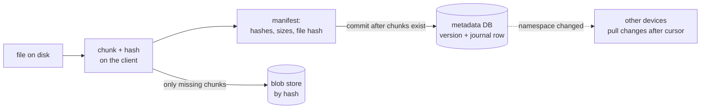
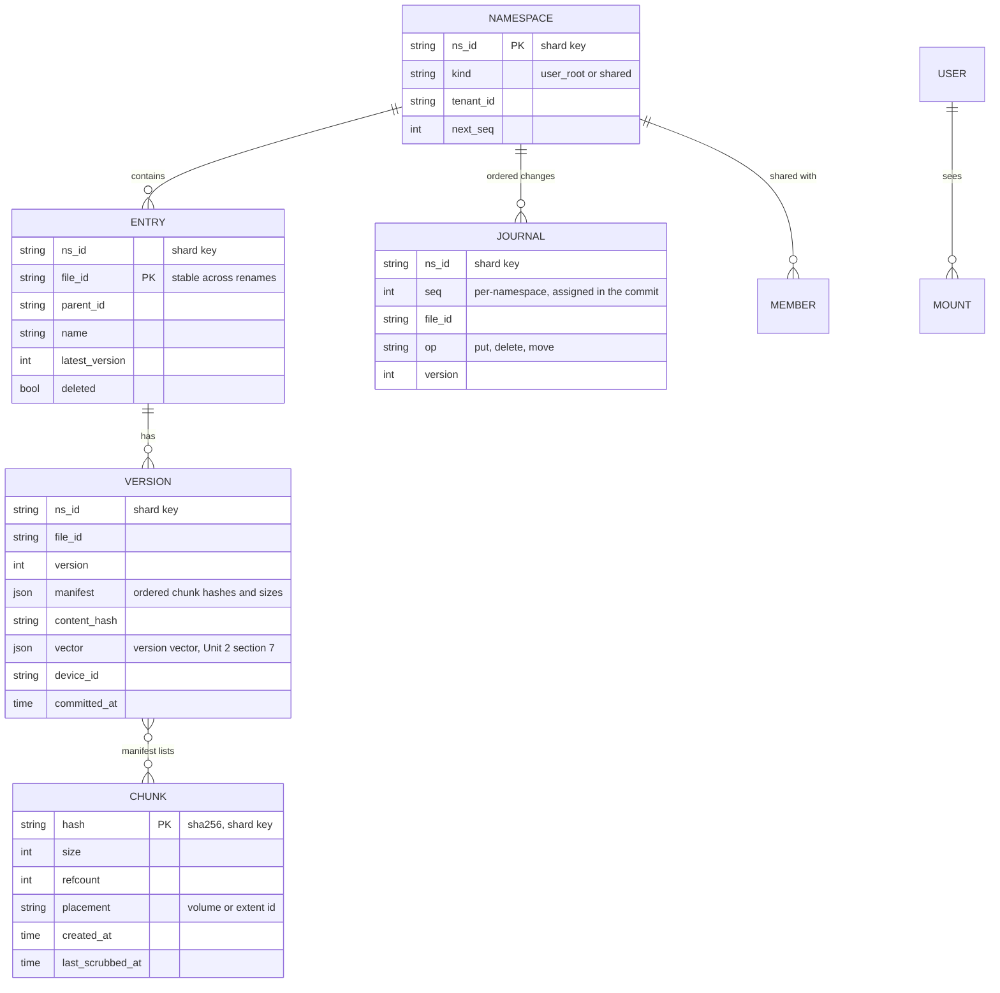
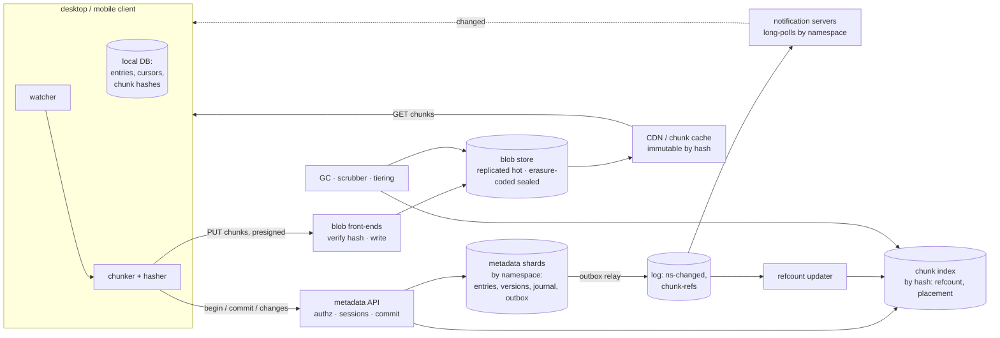

# C10 Unit 1 — Guided design: from the prompt to the high-level design

> Time: ~3.5 h · CORE: §1–§4 · STRETCH: the tiering arithmetic at the end of §2, the end-to-end encryption variant at
> the end of §3, the cross-region note at the end of §4 · Lab: none in this unit (Unit 2 builds `labs/c10/chunker`
> and the STRETCH `labs/c10/syncvv`)

"Design Dropbox" (or Google Drive, or OneDrive, or "a file sync service") looks like a storage question: put files in
S3, put names in a database, done. Candidates who answer it that way get a mid-level score, because the hard parts
are elsewhere. A 4 GB file has to survive a hotel Wi-Fi connection. A one-line edit to a 300 MB deck must not
re-upload 300 MB. The same installer saved by a million users should be stored once, which means the storage layer
has to name content by what it *is*. A file is only "saved" once its bytes are durable *and* a metadata transaction
says which bytes make it up, and those two things live in different systems. Thirty million devices need to learn
about changes within seconds without asking every few seconds. And two people will edit the same file on a plane.

The senior signal in this interview is the **split between metadata and blobs**, with a clear rule for how the two
stay consistent, plus a sync protocol whose source of truth is an ordered change journal rather than timestamps.

This unit runs the 45-minute framework ([`docs/INTERVIEW_FRAMEWORK.md`](../../docs/INTERVIEW_FRAMEWORK.md)) phase by
phase on this problem. Each section is one phase. Commit to your answer at every predict block before opening the
reveal: the reveals are the walkthrough, and the gaps between your version and the reveal are what to study. Unit 2
does the deep dives and the labs, and C11 (video streaming) reuses the upload and blob-storage design from here.

## Before you start

You should have passed A4 ([replication and partitioning](../A4-replication-partitioning/README.md)) and A6
([async](../A6-async/README.md)). You'll also lean on A1's
[idempotency keys](../A1-networking-api/unit-3-idempotency-auth.md#2-idempotency-keys-end-to-end) and A2's
[transactions](../A2-storage/unit-3-transactions-schema.md#7-acid-in-practice-and-the-isolation-anomalies). Warm-up,
answer first:

1. A user saves a file; the write goes to the leader and the client immediately lists the folder from an async
   follower. What can it see, and what is the guarantee you want here called?
2. A service commits a database row and then publishes an event to a topic. What goes wrong, and what's the standard
   fix?
3. A blob cluster places objects with consistent hashing over 100 nodes. You add one node. Roughly what fraction of
   objects moves?

<details data-kind="answer">
<summary>Warm-up answers</summary>

1. The folder without the file it just saved: the follower hasn't applied the write yet. You want
   **read-your-writes** consistency
   ([A4 Unit 1 §3](../A4-replication-partitioning/unit-1-replication.md#3-replication-lag-anomalies-and-how-to-fix-them)),
   for example by routing a user's reads to the leader for a short window after a write, or by having the client
   send the version it wrote and waiting for a replica that has it. In this module the client sends its cursor.
2. The process can die (or the publish can fail) between the commit and the publish, so the event is lost and
   nobody hears about a committed change. The fix is the
   [transactional outbox](../A6-async/unit-2-outbox-consumers.md#1-the-dual-write-problem-and-the-transactional-outbox):
   write the event row in the same transaction and let a relay publish it at-least-once. Sync notifications in §4
   use exactly this.
3. About 1/101 ≈ 1% of objects, taken evenly from the existing nodes if virtual nodes are used
   ([A4 Unit 2 §6](../A4-replication-partitioning/unit-2-partitioning.md#6-consistent-hashing-and-virtual-nodes)).
   With `hash mod N` placement almost everything would move.

</details>

---

## §1 Requirements and the clarifying questions that change the design

### The failure story

A 40-person startup built "TeamDrive" in a quarter. Files went into a Postgres `files` table as `bytea` columns; the
desktop client uploaded each saved file whole with one `POST /files` through the API servers; every client polled
`GET /files?modified_after=<last poll>` every 30 seconds; when two versions met, the one with the later `modified_at`
won. At 10,000 users it was fine.

At 2 M users and 3 M devices:

- The database held 40 TB, almost all of it file bytes. A full backup took 30 hours, a replica rebuild two days, and
  a vacuum on the big table stalled metadata queries for everyone.
- A sales engineer on hotel Wi-Fi tried to upload a 4 GB demo video eleven times. Each attempt died somewhere past
  90% and started again from byte zero. The API servers spent their memory buffering request bodies.
- A designer changed one slide in a 300 MB deck and re-uploaded 300 MB, which on a 10 Mbps uplink is four minutes.
  Ten saves a day each, across the design team, was most of the company's egress bill.
- 3 M devices polling every 30 s is ≈ 100,000 requests per second of "anything new?", ≈ 99% of which answered "no".
- A laptop whose clock ran four minutes slow saved a contract revision; the server copy had a later `modified_at`,
  so the revision silently lost. Two account managers edited the shared pricing sheet on the same flight; the one who
  landed second overwrote the first, and nobody knew until a customer quoted the old price back.

None of this needs exotic technology. Every failure is a requirement nobody stated: maximum file size and network
quality, edit patterns, how quickly other devices must see a change, what happens on concurrent edits, and what
"saved" means. Those are the first six minutes.

### Predict

<!-- predict id="C10-U1-P01" -->
**Predict.** Write your answers down first.

1. The interviewer says only: "Design a file storage and sync service like Dropbox." Write the eight clarifying
   questions you would ask, and next to each the design decision its answer changes. (A question whose answer
   changes nothing is small talk.)
2. Draft the functional requirements (at most six) and the non-functional requirements *with numbers*: durability,
   availability, sync latency, maximum file size, consistency of a commit.
3. Name three requirements whose answers would make this a *different* system (not just a bigger one).
<!-- /predict -->

### Reveal

<details data-kind="reveal" data-for="C10-U1-P01">
<summary>Reveal</summary>

**1. The questions, and what each decides.**

| Question | Why it matters | Decision it changes |
|---|---|---|
| Sync (a folder mirrored on every device) or upload/download and share (a web drive), or an object API (S3-like)? | Sync needs a change feed, a client-side state machine and conflict handling; a drive needs none of those | Whether a change journal, cursors and push notifications are in scope |
| Maximum file size, and what networks (mobile, hotel Wi-Fi, corporate proxies)? | A 50 GB file on a flaky link cannot be one HTTP request | Chunking, resumable upload sessions, parallel chunk uploads |
| Edit pattern: mostly new files, or frequent small edits to large files? | Small edits to large files are where re-uploading whole files hurts | Content-defined chunking and delta sync versus whole-file upload |
| Sharing: shared folders, links, team spaces? How many members in the largest share? | A shared folder appears in many users' trees and every change fans out to all their devices | Namespaces mounted into user trees, permissions, notification fan-out, hot namespaces |
| Can two devices edit the same file while offline, and what should happen? | Concurrent edits are inevitable; the choice is between losing one silently and keeping both | Version vectors or base-version checks, conflicted copies (Unit 2 §7) |
| How quickly must other devices see a change? | Seconds rules out periodic polling at 30 M devices | Long-poll or push notifications plus a cursor-based change feed |
| Versioning and undelete: how long are old versions and deleted files kept? | Old versions keep chunks alive | Reference counting, garbage collection, storage growth |
| Durability and residency: target nines, regions, legal hold? | "Never lose a file" is the product | Replication vs erasure coding, cross-region copies, holds that block deletion |

Two more that are worth asking if time allows: "Is cross-user deduplication allowed, and is there end-to-end
encryption?" (they conflict; §3 STRETCH and Unit 2 §5) and "Is real-time co-editing in scope?" (no: that's operational
transforms or CRDTs, C16; here a file is an opaque byte string).

**2. Requirements for the consumer-scale version** (state these as assumptions if the interviewer says "you decide").

Functional:
- Upload, download, rename, move and delete files and folders from desktop, mobile and web clients.
- **Sync**: a change made on one device appears on the user's other devices, and on collaborators' devices for
  shared folders, without user action.
- **Sharing**: share a folder with other users (read or edit); share a file by link.
- **Versions**: restore any version from the last 30 days; undelete within 30 days.
- **Offline**: edits made offline sync when the device reconnects; concurrent edits never lose data.

Non-functional, with numbers:
- **Durability**: no committed file is ever lost; design for ≈ 11 nines of annual object durability
  (`TODO-VERIFY: the durability figures you quote for a specific provider`). Durability beats availability: refusing
  a write is acceptable, losing one is not.
- **Availability**: metadata API 99.9–99.99%; a blob-store outage degrades uploads and downloads, not browsing.
- **Sync latency**: a committed change reaches other online devices in ≈ 5 s at p99 (plus transfer time for bytes).
- **Max file size**: 50 GB (assumed), uploads resumable after any disconnect without re-sending acknowledged bytes.
- **Commit consistency**: a version is either fully visible (every byte durable and readable) or not visible at all;
  a client that just committed sees its own commit (read-your-writes); devices see a namespace's changes in commit
  order.
- **Scale** (assumed in §2): 100 M registered users, 20 M daily active, ≈ 500 PB of logical data.

Out of scope: real-time co-editing, full-text search over contents, previews and thumbnails (mention as an async
pipeline), the billing system, antivirus scanning (mention it as an async step after commit).

**3. Requirements that make it a different system**: (a) *no sync*, just upload and download, which removes the
journal, cursors, notifications and conflicts and leaves a blob store with a metadata index; (b) *real-time
co-editing*, which replaces "files as opaque bytes plus conflicted copies" with operation logs and merge semantics
(C16); (c) *end-to-end encryption*, where the server can't see plaintext, so cross-user dedupe and server-side
previews or scanning disappear. Naming these shows the interviewer you know which design you're drawing.

The tempting wrong answer to question 1 is a list of features ("thumbnails, search, comments"). The senior version
asks about file sizes, networks, edit patterns, concurrency and durability, because those shape the storage and sync
design; features hang off it.

</details>

### How it actually works

A sync service is two systems with very different shapes, glued together by one rule.

| | Metadata | Blobs (file content) |
|---|---|---|
| What | Namespaces, folder trees, file entries, versions, the list of chunks per version, sharing, the change journal | Chunk bytes, addressed by their hash |
| Size | ≈ 100 TB at this scale (§2) | ≈ 500 PB |
| Access | Small reads and writes, transactions, ordering, indexes ("list this folder", "changes after cursor 812") | Large sequential reads and writes, immutable once written |
| Store | A sharded relational or NewSQL database, partitioned by namespace | An object store or a purpose-built blob store, replicated or erasure coded |
| Failure that matters | Lost or reordered updates, a version pointing at bytes that don't exist | Lost or corrupted bytes |

**The rule that glues them:** *bytes first, metadata last*. A client uploads every chunk to the blob store, the
blob store verifies each chunk's hash, and only then does a single metadata transaction create the new version that
lists those chunks. A version never points at a chunk that isn't durable. Chunks uploaded for a version that never
commits are orphans, and a garbage collector removes them later (Unit 2 §6). This is the same "write the payload,
then flip the pointer" idea as a database's WAL and a filesystem's journal.

Four more concepts the rest of the module uses:

- **Chunks and manifests.** A file version is a *manifest*: an ordered list of `(chunk hash, size)` plus the whole
  file's hash. Chunks are immutable and named by their content (SHA-256), so identical chunks are stored once
  (**dedupe**), integrity is checkable anywhere (**re-hash and compare**), and they can be cached forever.
- **Namespaces.** The unit of sharing, ordering and sharding. Each user has a root namespace; each shared folder is
  its own namespace *mounted* into every member's tree. Changes are ordered per namespace, not globally.
- **The change journal.** Every commit appends a row with a per-namespace sequence number. A device's sync state is
  a **cursor** (the last sequence it has applied) per namespace; "what changed?" is "rows after my cursor". Notifications
  only say "namespace 8812 moved"; the journal is the truth.
- **Base versions.** A client commits "version 7 of this file, based on version 6". If the server's latest is no
  longer 6, someone else committed first, and the client has a conflict to resolve instead of an overwrite.



### Build it

No lab for this section. The manifest becomes `chunker.Manifest` and the "bytes first, metadata last" rule becomes
`Uploader.Commit`'s refusal to commit while chunks are missing in Unit 2 §6.

### Break it

Change one requirement at a time and trace which decisions flip. Write your answer before opening the box.

(a) Maximum file size drops from 50 GB to 10 MB (a notes app with attachments). (b) "Concurrent offline edits must
never lose data" becomes "the most recent save wins; losing an edit is acceptable". (c) The product adds client-side
end-to-end encryption with a per-user key.

<details data-kind="answer">
<summary>What flips</summary>

(a) A 10 MB file uploads in one request in seconds on most networks; resumable sessions and parallel chunk uploads
become optional, and fixed-size chunks or whole-file hashing are enough (there are no large files for delta sync to
help). Metadata versus blobs still applies: 10 MB rows would still wreck the database.
(b) Conflict detection can use the server's commit order alone (accept every commit, the last one wins). Version
vectors and conflicted copies disappear. You still must not use *device* clocks to decide "most recent": the server's
commit sequence is the order. Say that this is a product decision that loses data, and that versions make it
recoverable.
(c) The server sees ciphertext. If every user encrypts with their own key, the same file encrypts to different bytes
for different users, so cross-user dedupe is gone (per-user dedupe still works); the server can't scan, preview or
index content; key loss is data loss. §3's STRETCH note and Unit 2 §5 cover the convergent-encryption compromise and
its privacy cost.

</details>

### In the wild

- **Dropbox** has described a metadata/blob split publicly: file content stored as blocks in its own blob store
  ("Magic Pocket"), metadata in a separate sharded system, and a long-poll notification service for clients
  (`TODO-VERIFY: current component names and architecture details; they have changed over the years`). Its public API
  exposes the same concepts: `list_folder` with a `cursor`, `list_folder/continue`, `list_folder/longpoll`, and
  upload sessions (`upload_session/start`, `append_v2`, `finish`).
- **Google Drive** and **OneDrive** expose change feeds with page tokens or delta links (Drive's `changes.list` with
  a `pageToken`; Microsoft Graph's `delta` query) — the cursor pattern (`TODO-VERIFY: endpoint names for the API
  version you cite`).
- **Git** is a content-addressed store: blobs and trees named by hash, commits as manifests, refs as the mutable
  pointer flipped last. A `git push` sends only objects the server lacks, which is Unit 2's "ask only for missing
  chunks".
- **Amazon S3** and **Google Cloud Storage** are blob stores without sync semantics: no rename, no folder tree (keys
  with slashes), no change feed of the kind a sync client needs. Building on them means building the metadata layer
  yourself.

### Trade-offs

| Option | Wins when | Loses when | When the answer flips |
|---|---|---|---|
| Separate metadata DB and blob store | Different sizes, access patterns and failure modes; each scales on its own axis | Two systems to keep consistent (orphans, dangling references) | Flip to one store only for tiny files at small scale (a notes app can inline small attachments in rows) |
| Sync with a change journal | Devices mirror state; offline edits; seconds-level propagation | Client state machine, conflicts, notification fleet | Flip to a plain upload/download drive when nobody needs a local mirror (a web portal for documents) |
| Keep every concurrent edit (conflicted copies) | No silent data loss; users merge | Users see "conflicted copy" files and must clean up | Flip to last-commit-wins only when the product explicitly accepts losing edits and versions make them recoverable |
| Files as opaque bytes | Works for every file type; simple server | No merging inside a file | Flip to operation-based co-editing (C16) for documents edited live by many people |

### Senior bar

- **Failure modes of bad scoping**: no max-file-size question → single-request uploads that fail on large files;
  no edit-pattern question → whole-file re-uploads; no sharing question → per-user ordering that breaks for shared
  folders; "latest timestamp wins" → silent loss from clock skew; no durability number → nobody can choose between
  replication and erasure coding.
- **Capacity**: the numbers come in §2; the point here is that bytes and metadata differ by ≈ 5,000× in size and
  need different stores.
- **Ops**: durability is measured (scrubbing, Unit 2 §6) and audited, not assumed; retention and legal-hold rules are
  configuration owned with compliance.
- **Cost**: storage dominates. Every requirement that keeps bytes alive (30-day versions, undelete, holds) has a
  storage bill; every requirement that removes bytes (dedupe, tiering) has a privacy or latency cost.

Interviewer follow-up probes:

1. "Why not store files in the database? Postgres handles large objects."

<details data-kind="answer">
<summary>Model answer</summary>

Because the bytes are ≈ 5,000× the metadata and have the opposite access pattern. In one database, backups,
replication, vacuum and failover all scale with the bytes, so a 40 TB table makes a metadata failover take hours;
large reads evict the metadata working set from the buffer cache; and the database's per-GB cost is several times
an object store's. The metadata needs transactions, indexes and ordering; the bytes need cheap, durable, immutable
storage. I'd keep them apart and connect them with chunk hashes, committing metadata only after the bytes are durable.

</details>

2. "What does 'saved' mean in your system?"

<details data-kind="answer">
<summary>Model answer</summary>

A version is saved when its metadata commit has succeeded, and that commit only succeeds once every chunk it lists
is durable in the blob store and has been verified against its hash. Before that, the bytes may be sitting in the
blob store as orphans, but no device will ever see them. After it, the version is in the journal, other devices
will learn about it, and the chunks are referenced so GC can't remove them. The client shows "saved" on the commit
response, not on the last chunk upload.

</details>

3. "Two people edit the same file offline and reconnect. What happens?"

<details data-kind="answer">
<summary>Model answer</summary>

The second device to commit is told its base version is stale (the server's latest is no longer the version it
edited from). It downloads the other version, sees that neither descends from the other, and keeps both: the
remote version takes the file's name and its own edit is committed as "name (conflicted copy from laptop)". No edit
is lost; the users merge by hand. I would not pick a winner by device timestamps, because device clocks are wrong
often enough to lose real edits. Unit 2 §7 has the version-vector mechanics.

</details>

### Check yourself

1. Name the two stores in this design, and one property that differs between them.
2. What is the "bytes first, metadata last" rule, and what does it leave behind when a client gives up mid-upload?
3. Which three requirements would turn this into a different system?

<details data-kind="answer">
<summary>Answers</summary>

1. A metadata database (small, transactional, indexed, ≈ 100 TB) and a blob store (huge, immutable, sequential,
   ≈ 500 PB). Either size, access pattern or failure mode works as the answer.
2. Upload and verify every chunk, then commit one metadata transaction that references them, so a version never
   points at missing bytes. An abandoned upload leaves orphaned chunks that a garbage collector reclaims later.
3. No sync (just a drive), real-time co-editing, end-to-end encryption.

</details>

---

## §2 Estimation: the numbers that decide the design

### The failure story

TeamDrive v2's architect sized the system on a whiteboard: "2 M users × 2 GB each = 4 PB, times three replicas, buy
12 PB." They missed four numbers. Upload bandwidth: whole-file re-uploads of edited files were ≈ 80% of ingress, so
the uplink saturated every weekday at 10:00 and uploads queued for hours. Metadata growth: each save wrote a version
row, a journal row and a row per block, and the "small" metadata database reached 8 TB in a year, which was too big
for the single primary they had planned. Notification load: they had not counted devices, only users, and 3 M
devices polling every 30 s was ≈ 100k requests per second, more than the rest of the API combined. And cost: three
full replicas of 4 PB at cloud block-storage prices was most of the company's revenue; nobody had compared it with
erasure coding or an object store.

### Predict

<!-- predict id="C10-U1-P02" -->
**Predict.** Assumptions: 100 M registered users, 20 M daily active, 1.5 devices per active user; ≈ 5 GB of logical
data per user on average; ≈ 2,000 files per user; each daily active user saves ≈ 20 file versions a day (new or
modified), averaging ≈ 2 MB per saved file if uploaded whole; with chunking and dedupe only ≈ 20% of those bytes are
new; peak ≈ 3× average; cross-user dedupe removes ≈ 25% of logical bytes (assumption; real ratios vary widely);
each commit must reach ≈ 3 other devices; 3× replication versus Reed–Solomon (10, 4) erasure coding (≈ 1.4×);
object storage ≈ $0.023 per GB-month ([`docs/NUMBERS.md`](../../docs/NUMBERS.md)); ≈ 100k idle long-poll connections
per notification server (assumption; memory-bound).

Compute, carrying units, and write the decision each number drives:

1. Logical, unique and raw storage, under replication and under erasure coding.
2. Commits per second, average and peak.
3. Upload bandwidth with whole-file uploads versus chunked delta uploads, in Gbps, average and peak.
4. Notifications per second at peak, connected devices, and the notification fleet.
5. The size of the metadata (files, chunk index, journal), and how many database shards it needs.
<!-- /predict -->

### Reveal

<details data-kind="reveal" data-for="C10-U1-P02">
<summary>Reveal</summary>

1. **Storage.** 100 M × 5 GB = **500 PB logical**. After ≈ 25% dedupe, **≈ 375 PB unique**. With 3× replication
   ≈ **1.1 EB raw**; with RS(10, 4) ≈ 375 × 1.4 ≈ **525 PB raw**, a saving of ≈ 600 PB of disks. Decision: erasure
   coding for everything except the newest, hottest data (which can sit replicated for fast writes and reads until
   it is sealed into an erasure-coded volume, Unit 2 §8); dedupe is worth ≈ 125 PB, which at object-storage list
   price is ≈ 1.25 × 10^8 GB × $0.023 ≈ **$2.9 M a month**. At this size companies run their own blob store rather
   than paying list price; either way the ratios drive the design.
2. **Commits.** 20 M × 20 = 400 M versions a day ÷ 86,400 s ≈ **4.6k commits/s average**, × 3 ≈ **14k/s peak**.
   Decision: the metadata tier is a transactional write workload, but a modest one; spread over tens of shards it is
   a few hundred commits per second per shard.
3. **Upload bandwidth.** Whole files: 400 M × 2 MB = 800 TB/day ≈ 9.3 GB/s ≈ **74 Gbps average, ≈ 220 Gbps peak**.
   Chunked with dedupe: 20% of that, 160 TB/day ≈ 1.85 GB/s ≈ **15 Gbps average, ≈ 45 Gbps peak**. Decision: delta
   sync is a ≈ 5× saving on the biggest bandwidth line (and on users' uplinks, which are often 10–20 Mbps); and bytes
   go straight to the blob tier through presigned URLs, never through the metadata API servers, which would otherwise
   need to proxy 45 Gbps.
4. **Notifications.** 14k commits/s × 3 devices ≈ **42k notifications/s at peak**, each followed by a
   `list_changes` call (≈ 42k metadata reads/s) and chunk downloads (≈ 3 × 160 TB/day ≈ 44 Gbps average). Connected
   devices: up to 20 M × 1.5 = **30 M** long-poll connections; at ≈ 100k per server, **≈ 300 notification servers**.
   Decision: notification servers hold idle connections and carry tiny messages ("namespace 8812 changed"); they are
   a separate fleet from the API, sized by connections, not by requests. Polling every 30 s instead would be
   30 M ÷ 30 s = 1 M requests/s, almost all empty.
5. **Metadata.** Files: 100 M × 2,000 = 200 B entries × ≈ 500 B (row, chunk list, indexes) ≈ **100 TB**. Chunk
   index: 375 PB ÷ 4 MiB per chunk ≈ 9 × 10^10 chunks × ≈ 100 B ≈ **9 TB**. Journal: 400 M rows/day × ≈ 200 B
   ≈ 80 GB/day (trim after clients have consumed it, keep 30 days for version history). Decision: ≈ 110 TB at
   ≈ 1–2 TB per shard ≈ **50–100 shards**, partitioned by namespace, each with its replicas (≈ 150–300 database
   nodes). **Storage, not write rate, sets the
   shard count**: 14k commits/s over 75 shards is under 200 per shard. Metadata is ≈ 0.02% of the bytes but is where
   every request starts.

The tempting wrong answers: counting users instead of devices for the notification fleet; forgetting that each save
writes several metadata rows; multiplying unique bytes by 3 without considering erasure coding; routing uploads
through the API servers; and assuming delta sync helps small files (a 2 MB file is one 4 MiB chunk; the saving comes
from large files and from identical re-saves).

</details>

### How it actually works

The estimate sheet for this system, in the order you'd write it on the board:

| Number | Arithmetic | Decision |
|---|---|---|
| Logical data | 100 M × 5 GB = 500 PB | Blob tier is the cost; metadata is separate |
| Unique after dedupe | × 0.75 ≈ 375 PB | Content addressing pays ≈ $2.9 M/month at list price |
| Raw disks | × 3 ≈ 1.1 EB vs × 1.4 ≈ 525 PB | Erasure-code sealed data; replicate only the hot write path |
| Commits | 400 M/day ≈ 4.6k/s avg, ≈ 14k/s peak | Transactional metadata, sharded by namespace |
| Upload | whole files ≈ 74 Gbps vs chunked ≈ 15 Gbps avg | Delta sync; presigned direct-to-blob uploads |
| Notifications | 14k × 3 ≈ 42k/s; 30 M connections ≈ 300 servers | Separate long-poll fleet; journal as truth |
| Metadata size | ≈ 100 TB entries + ≈ 9 TB chunk index | 50–100 shards (≈ 1–2 TB each), set by storage |

**Where the bytes go.** Average file size (≈ 2.5 MB here: 500 PB over 200 B files) hides a skewed distribution: most
files are small documents and most *bytes* are in a minority of large files (video, disk images, archives). That's
why delta sync helps bytes far more than it helps file counts, and why the commit rate, which is per file, and the
bandwidth, which is per byte, scale differently.

**Download bandwidth and egress.** Every committed byte is downloaded by ≈ 3 other devices, so download traffic is
≈ 3× upload, plus share links. Internet egress at ≈ $0.05–0.09 per GB (NUMBERS.md) on ≈ 480 TB/day is
≈ $25–45k a day, which is why chunk-level dedupe on the *download* side (the device already has most chunks) matters
as much as on upload.

**STRETCH — tiering arithmetic.** Suppose 70% of unique bytes haven't been read in 90 days. Moving them to an
infrequent-access tier at roughly half the price saves ≈ 0.7 × 375 PB × $0.0115 per GB-month ≈ $3 M a month at
list prices (`TODO-VERIFY: current infrequent-access and archive prices, minimum storage durations and retrieval
fees for the provider you cite`). The catch is retrieval: an archive tier with hours of restore latency cannot hold
anything a user might open, so only versions and deleted files past their window qualify for the coldest tier.
Unit 2 §8 does the design.

### Build it

No lab for this section. Run `sd estimate -kind storage -n 3` and `sd estimate -kind bandwidth -n 3` before Unit 2;
the numbers above should come out of your head in the design exercise.

### Break it

Re-run the sheet with each change and note which decisions flip: (a) the product targets photo and video backup
from phones (few edits, large immutable files, uploads only over Wi-Fi at night); (b) a team product where the
average shared folder has 200 members; (c) dedupe is scoped per user instead of global, for privacy.

<details data-kind="answer">
<summary>What flips</summary>

(a) Photos and videos are written once and almost never edited, so content-defined chunking and delta sync save
little; fixed-size parts for resumability plus a whole-file hash for "already backed up" (a new phone restoring the
same library) are enough. Upload becomes bursty (night-time peak ≫ 3× average), and cold tiering dominates cost
because old photos are rarely viewed. (b) Fan-out per commit in shared folders jumps from ≈ 3 to ≈ 300 devices, so
notifications and `list_changes` reads become the dominant load; per-namespace journals and a subscription index
(namespace → connected devices) matter, and a busy team folder becomes a hot shard (Unit 2 §8). (c) Unique bytes rise
towards 500 PB (most cross-user duplicates are popular files: installers, shared PDFs, media), ≈ $2.9 M a month at
list price; and the "already have it, skip upload" trick no longer tells anyone what other users store, which closes
the side channel in Unit 2 §5.

</details>

### In the wild

- **Dropbox** has described storing file content in 4 MiB blocks identified by SHA-256 hashes, and its API's
  `content_hash` is defined over per-block hashes (`TODO-VERIFY: block size and the content_hash definition in the
  current API docs`).
- **Amazon S3** prices storage per GB-month with cheaper classes for infrequent and archival access and charges for
  egress and requests (`TODO-VERIFY: current prices`); NUMBERS.md's ≈ $0.023 per GB-month is the Standard class
  ballpark.
- **Facebook's f4** warm-blob store described Reed–Solomon (10, 4) coding to cut replication overhead for older,
  rarely read photos (`TODO-VERIFY: the effective replication factor quoted in the paper`). **Backblaze** has
  published its storage-pod and vault designs, which use erasure coding across pods (`TODO-VERIFY: the data/parity
  split`).
- Long-poll fleets are sized by idle connections and memory per connection; Go and the JVM can hold hundreds of
  thousands of mostly idle connections per box with tuning (`TODO-VERIFY` for your stack; C6 does the connection
  arithmetic in depth).

### Trade-offs

| Option | Wins when | Loses when | When the answer flips |
|---|---|---|---|
| 3× replication | Hot data: fast writes, cheap repair (copy one replica), simple | 3× raw disks | Flip to erasure coding once data is sealed and read less often; at hundreds of PB it is the main cost lever |
| Erasure coding (e.g. RS(10, 4)) | ≈ 1.4× raw, survives 4 losses | Repair reads 10 fragments; small or partial reads touch several disks; more CPU | Flip to replication for the newest, hottest data and for small objects |
| Global dedupe | ≈ 25% fewer bytes (assumed), "upload" of popular files is instant | Leaks existence of files across users; a hot chunk becomes a shared fate | Flip to per-user or per-tenant scope for privacy-sensitive products (banking, health, E2E) |
| Whole-file upload | Simple; no chunk index | ≈ 5× bandwidth for edit-heavy workloads; no resumability | Flip to chunking once files exceed what one request can reliably carry, or edits to big files are common |
| Polling for changes | No connection fleet | 1 M empty requests/s at 30 s; seconds-to-minutes latency | Flip to long-poll or push as soon as devices number in the millions or latency is in seconds |

### Senior bar

- **Failure modes**: sizing from users not devices; multiplying by 3 without an erasure-coding comparison; ignoring
  metadata write amplification; routing bytes through API servers; assuming dedupe ratios as facts (state them as
  assumptions, measure them).
- **Capacity numbers**: ≈ 500 PB logical, ≈ 375 PB unique, ≈ 525 PB raw coded, ≈ 14k commits/s peak, ≈ 15 Gbps
  upload average after chunking, ≈ 42k notifications/s, ≈ 300 notification servers, ≈ 110 TB metadata in 50–100
  shards (all `≈`, assumptions stated).
- **Ops**: track the dedupe ratio, the orphan rate (uploaded but never committed bytes) and storage growth per day;
  capacity planning for the blob tier is in disks and racks with lead times of months.
- **Cost**: the blob tier dominates; erasure coding, dedupe and tiering each move millions a month; egress is the
  second line, and chunk-level download dedupe reduces it.

Interviewer follow-up probes:

1. "Which single number most changes this design?"

<details data-kind="answer">
<summary>Model answer</summary>

The ratio of logical bytes to unique bytes over time, which is to say how much dedupe and delta sync buy. It decides
whether content-defined chunking is worth its complexity, the upload bandwidth (≈ 74 versus ≈ 15 Gbps here), and the
storage bill (≈ 125 PB from cross-user dedupe). Second is the share fan-out: at ≈ 3 devices per commit notifications
are a side system; at ≈ 300 they are the main load.

</details>

2. "Why not just put everything in S3 and let Amazon worry about durability?"

<details data-kind="answer">
<summary>Model answer</summary>

For the blob tier, that's a fine starting point: S3 gives durability, scale and erasure coding underneath, and I
would start there. It doesn't give me the metadata layer (folders, renames, versions, sharing, a change journal) or
content-addressed dedupe; those are mine to build. At hundreds of petabytes the list price becomes the largest line
in the company, and owning the blob tier (as Dropbox has described doing) can be cheaper; but that's a build-versus-buy
decision for year three, not for the interview's first diagram.

</details>

3. "What's in flight for uploads at peak, if a chunk upload takes ≈ 2 s?"

<details data-kind="answer">
<summary>Model answer</summary>

Little's law on chunks: peak upload ≈ 45 Gbps ≈ 5.6 GB/s; at ≈ 4 MiB per chunk that's ≈ 1,350 chunks per second,
× 2 s ≈ **2,700 chunk uploads in flight**. Small for the blob tier, and it's why the blob front-ends are sized by
bandwidth (≈ 45 Gbps across a few dozen 10–25 Gbps NICs at ≈ 50% utilisation), not by request rate.

</details>

### Check yourself

1. Why does the notification fleet size follow devices rather than users, and what is that fleet sized by?
2. Why does delta sync cut bytes by ≈ 5× but barely change the commit rate?
3. What sets the number of metadata shards in this estimate?

<details data-kind="answer">
<summary>Answers</summary>

1. Each device holds its own connection and needs its own notification; 20 M daily users are ≈ 30 M devices. The
   fleet is sized by concurrent idle connections (memory), not requests per second.
2. Commits are per file version, and a file still gets a version per save; delta sync only reduces the bytes each
   commit uploads, mostly for large files.
3. Storage (≈ 110 TB, ≈ 2 TB per shard), not the ≈ 14k commits/s write rate, which is light per shard.

</details>

---

## §3 API and data model: metadata versus blobs

### The failure story

TeamDrive's v1 API was `POST /files` with the whole file in the body and `GET /files?modified_after=…` for sync.
One quarter of tickets:

- **No resumability.** A dropped connection at 93% meant starting over, and a retried POST after a timeout created
  a second copy of the file (`report.pdf`, `report (1).pdf`) because the first had actually been stored.
- **Path as identity.** Rows were keyed by path. Renaming a folder with 40,000 files rewrote 40,000 rows; a
  rename on one device and an edit on another produced a deleted file and an orphan with the edit in it.
- **Timestamps as cursor.** `modified_after` used the server's `updated_at`. Two commits in the same millisecond on
  different shards meant one was skipped forever by any client whose last poll landed between them.
- **Status overwritten.** One `files` row with a `content` column and no history: "restore yesterday's version"
  meant restoring last night's database backup.
- **Sharing by copying.** Sharing a folder copied its rows into each member's tree. Edits went to one copy; the
  others drifted.

### Predict

<!-- predict id="C10-U1-P03" -->
**Predict.** Write your answers down first.

1. Design the upload API for a 2 GB file that must survive disconnects and skip chunks the server already has:
   the calls, what each carries, where the bytes go, how a retry of each call behaves, and what the commit returns
   when someone else committed first. Then sketch the sync API a client uses to learn about changes.
2. List the access patterns first. Then the entities (namespaces, entries, versions, chunks, upload sessions,
   journal, sharing), their keys and partition keys. Where do chunk reference counts live, and why is that awkward?
<!-- /predict -->

### Reveal

<details data-kind="reveal" data-for="C10-U1-P03">
<summary>Reveal</summary>

**1. API.**

```
# Upload: begin a session with the manifest; the server answers with what it is missing
POST /v1/uploads
Authorization: Bearer …                         # user and tenant from the principal, never from the body
{
  "namespace_id": "ns_8812",
  "path": "/Designs/launch.key",                 # or "file_id" for an existing file
  "base_version": 6,                             # the version this edit started from (null for a new file)
  "manifest": {"size": 2147483648, "hash": "<sha256 of the file>",
               "chunks": [{"hash": "9f2c…", "size": 4194304}, …]}
}
→ 201 {"upload_id": "up_01J…", "expires_at": "…",
       "missing": [{"hash": "9f2c…", "put_url": "https://blob…/9f2c…?sig=…&exp=…"}, …]}

# Chunks: straight to the blob tier with presigned URLs, any order, in parallel, retried freely
PUT https://blob…/9f2c…?sig=…                   # body = chunk bytes; the blob tier re-hashes and rejects a mismatch
→ 201 (or 200 if the chunk already exists)

GET  /v1/uploads/{upload_id}                    → {"missing": […]}   # resume after a crash or a network change

# Commit: one metadata transaction, after every chunk exists
POST /v1/uploads/{upload_id}/commit
Idempotency-Key: up_01J…                        # the session id is a natural key
→ 200 {"file_id": "f_77", "version": 7, "journal_seq": 81244}
→ 409 {"error": "stale_base", "latest_version": 8}       # someone committed first: resolve (Unit 2 §7)
→ 412 {"error": "incomplete", "missing": […]}            # chunks still missing
→ 410 {"error": "session_expired"}

# Sync: an ordered change feed per namespace, and a cheap "did anything change?" wait
GET  /v1/namespaces/{ns}/changes?cursor=81200&limit=500
→ 200 {"entries": [{"seq": 81201, "file_id": "f_77", "path": "…", "op": "put", "version": 7,
                    "manifest_ref": "…"}, …],
       "cursor": 81244, "has_more": false}
POST /v1/notify/wait {"cursors": {"ns_8812": 81244, "ns_9001": 5521}, "timeout_s": 60}
→ 200 {"changed": ["ns_8812"]}   or after 60 s   → 200 {"changed": [], "backoff_s": 0}

# Download: the manifest, then chunks by hash (immutable, so cacheable forever)
GET  /v1/files/{file_id}/versions/{v}           → manifest + presigned GET URLs (or CDN URLs) per chunk
```

What each call guarantees:
- `POST /uploads` is **not** the commit. It opens a session, checks the chunk index and returns only the chunks to
  send (cross-user and cross-version dedupe happen here). Retrying it opens another session, which is harmless:
  unused sessions expire and their orphans are collected.
- Chunk `PUT`s are **idempotent by construction**: the key is the hash of the body, so a retry writes the same bytes
  to the same name. The blob tier re-hashes the body and rejects a mismatch, so a corrupted or malicious upload can't
  store wrong bytes under a hash.
- `commit` is idempotent on the session: the second call returns the same version without creating another (the
  lab's `TestUpload_ChunksArriveInAnyOrderAndRepeatedly`). It is **conditional** on `base_version`: optimistic
  concurrency, so concurrent edits surface as a `409` instead of an overwrite.
- The change feed is ordered by a per-namespace sequence assigned *in the commit transaction*, never by timestamps.
- `notify/wait` carries no data, only "go and pull". Missing a notification costs latency, never correctness.

The tempting wrong answers: one big `POST` with the bytes (no resume, the API proxies every byte); a commit that
doesn't check the base version (silent overwrites); `modified_after=<timestamp>` as the cursor (skips commits that
share a timestamp or arrive out of order across shards); a `409` that makes the client discard its edit.

**2. Access patterns → data model.**

| Access pattern | Rate (§2) | Served by |
|---|---|---|
| Commit a version: check base, insert version, update entry, append journal | ≈ 14k/s peak | One transaction on the namespace's shard: `entries`, `versions`, `journal` |
| List a folder | high (every UI open) | `entries(ns_id, parent_id, name)` index |
| Changes after a cursor | ≈ 42k/s peak | `journal(ns_id, seq)` clustered by seq |
| Which of these hashes do we already have? | ≈ chunks per upload | `chunks(hash)` index, sharded by hash, with a cache or Bloom filter in front |
| Resolve a path for a user (their tree with mounted shares) | high | `mounts(user_id) → [(ns_id, mount_path, role)]`, then per-namespace lookup |
| Versions of a file (restore) | low | `versions(ns_id, file_id, version)` |
| Who can see namespace X (authz, fan-out) | per request / per commit | `members(ns_id) → users`, `mounts` as the inverse |
| Upload session state | ≈ chunks per upload | `upload_sessions(upload_id)` with TTL (a cache-backed table is fine) |
| Orphans and unreferenced chunks | background | chunk `refcount` + `created_at`; GC scans |

Entities and keys:



- **`file_id`, not path, is identity.** A rename or move is one row update plus a journal entry; 40,000 children
  don't change. Paths are derived by walking `parent_id`.
- **Namespace is the shard key** for everything except chunks. A commit touches one namespace, so it is a
  single-shard transaction: version, entry, journal row with `seq = next_seq++`, and an outbox row for notifications.
- **Chunks are sharded by hash** (uniform, no hot ranges), so they live on *other* shards than the namespace. That's
  why reference counts are awkward: incrementing the refcount of every chunk in a commit would be a cross-shard
  transaction on the hottest path. The usual answer is to keep the commit single-shard and update refcounts
  **asynchronously from the journal** (an outbox consumer, idempotent per `(version, chunk)`), with GC that never
  deletes a chunk younger than a grace period or one that a live upload session is waiting on (Unit 2 §6). The
  tempting wrong answer is a distributed transaction per commit.
- **Shares are namespaces, not copies.** Sharing a folder converts it into its own namespace and adds a `mount` for
  each member; every member's client syncs that namespace's journal. One copy of the truth, one ordering.

</details>

### How it actually works

**Presigned URLs.** The API signs a URL that authorises exactly one operation (`PUT` this object name, this size,
until this time) with a key the blob tier trusts; the client sends bytes straight to the blob tier and the API never
sees them ([A1 Unit 2 §5](../A1-networking-api/unit-2-api-design.md#5-long-running-operations-and-webhooks) has the
long-running-operation shape; Unit 2 §6 has the security details). With a content-addressed name, the URL is
effectively "you may store *these* bytes", because the blob tier rejects any body whose hash differs.

**The commit transaction**, on the namespace's shard:

```sql
BEGIN;
-- 1. optimistic concurrency on the file
SELECT latest_version FROM entries WHERE ns_id = $ns AND file_id = $f FOR UPDATE;   -- must equal $base
-- 2. the session must be complete (every chunk verified by the blob tier)
-- 3. the new version and the pointer flip
INSERT INTO versions (ns_id, file_id, version, manifest, content_hash, vector, device_id, committed_at)
     VALUES ($ns, $f, $base + 1, $manifest, $hash, $vector, $device, now());
UPDATE entries SET latest_version = $base + 1 WHERE ns_id = $ns AND file_id = $f;
-- 4. ordering for every device
UPDATE namespaces SET next_seq = next_seq + 1 WHERE ns_id = $ns RETURNING next_seq;  -- → $seq
INSERT INTO journal (ns_id, seq, file_id, op, version) VALUES ($ns, $seq, $f, 'put', $base + 1);
-- 5. side effects, published at-least-once by a relay
INSERT INTO outbox (topic, key, payload) VALUES ('ns-changed', $ns, json_build_object('seq', $seq));
INSERT INTO outbox (topic, key, payload) VALUES ('chunk-refs', $ns, json_build_object('version', $base + 1));
COMMIT;
```

The row lock on `namespaces` serialises commits within a namespace, which is what gives a total order per namespace
(and is the reason a single very busy namespace is a hot spot; Unit 2 §8). Commits in different namespaces never
coordinate.

If you've built payment initiation against a processor, this shape is familiar: the session id plays the
idempotency key, the base-version check is the "expected balance or status" precondition that stops a stale request
from overwriting a newer state, and the outbox row is how the posting event leaves the database without a dual
write. A member uploading a KYC document from a phone gets exactly this protocol.

**Session state.** An upload session stores the manifest, the set of hashes still missing and `expires_at`. It is
touched on every chunk; an idle session expires (the lab's TTL), and GC later removes chunks that only that session
was waiting for.

**Deletes and versions.** Deleting a file is a journal entry and a tombstone on the entry; versions stay for the
retention window, so their chunks stay referenced. Purging a version (retention expiry, a user's "delete
permanently") releases its chunk references; chunks whose count reaches zero become GC candidates.

**Sharing and authorisation.** Every request resolves the caller's principal to a user and tenant, then checks
`members(ns_id)` for the role. Link shares are capability tokens mapped to `(ns_id or file_id, role, expiry)`.
Object-level checks on every call, not just at the folder you opened
([A9 Unit 1 §3](../A9-security-multitenancy/unit-1-authorization-tenancy.md#3-object-level-authorisation-and-the-confused-deputy)),
and chunk download URLs are only issued after the manifest is authorised: knowing a hash must not be enough to
download it.

**STRETCH — end-to-end encryption.** If clients encrypt chunks with a per-user (or per-namespace) key, the server
stores ciphertext, so cross-user dedupe is gone and the server can't scan or preview. *Convergent encryption* derives
the key from the chunk's own hash, so identical plaintext gives identical ciphertext and dedupe survives, at the price
of letting anyone who can guess a file confirm that you store it (Unit 2 §5's side channel, now cryptographic). Keys
are wrapped per member with envelope encryption
([A9 Unit 2 §3](../A9-security-multitenancy/unit-2-data-protection-audit.md#3-envelope-encryption-and-key-management)),
so sharing a namespace means wrapping its key for the new member, and revoking means rotating it.

### Build it

No lab for this section. `chunker.Manifest` and `chunker.ChunkRef` are the manifest; `Uploader.Begin` returns the
`missing` list; `Uploader.Commit` is the commit's idempotent, all-chunks-present part (without base versions, which
`syncvv` covers); `Store` is the chunk index with refcounts.

### Break it

For each change, say what breaks and which lab test in Unit 2 catches the equivalent: (a) commit the version first,
then upload the chunks; (b) let a retried `commit` add references again; (c) key entries by path instead of
`file_id`.

<details data-kind="answer">
<summary>What breaks</summary>

(a) Between the commit and the last chunk, other devices see a version they can't download: `list_changes` returns
it, the chunk `GET`s 404, and if the uploader dies the version is permanently broken. The lab's `Store.Commit`
returns `ErrMissingChunk` and `TestStore_DedupesAndReferenceCounts` checks it, and `TestUpload_ChunksArriveInAnyOrderAndRepeatedly`
checks that `Commit` returns `ErrIncomplete` until every chunk has arrived.
(b) The client timed out waiting for the first commit's response and retried: references are doubled, `LogicalBytes`
is 2× and a later purge leaves the chunks referenced forever (a storage leak, never collected).
`TestUpload_ChunksArriveInAnyOrderAndRepeatedly` asserts `LogicalBytes` equals the file size after a second commit.
(c) A folder rename rewrites every descendant row, and a rename concurrent with an edit splits into a delete and a new
file, with the edit attached to the old path. No lab test; it's a data-model decision.

</details>

### In the wild

- **Amazon S3 multipart upload** is a resumable, parallel, any-order upload: `CreateMultipartUpload`, `UploadPart`
  per part (each retried independently), `CompleteMultipartUpload` with the part list, and lifecycle rules to abort
  incomplete uploads after N days, which is the orphan GC (`TODO-VERIFY: current part size limits and part count`).
  Presigned URLs work per part.
- **Google Cloud Storage resumable uploads** return a session URI; the client `PUT`s ranges and, after a disconnect,
  asks the server how many bytes it has (`308 Resume Incomplete` with a `Range` header) (`TODO-VERIFY: current
  protocol details`). **tus** is an open protocol for the same thing over HTTP.
- **Dropbox's API** has `upload_session/start`, `append_v2` with an offset, and `finish` with a commit that carries a
  write mode (`add`, `overwrite`, or `update` with a revision: the base-version check) (`TODO-VERIFY: current
  parameter names`).
- **Git** commits are manifests over content-addressed objects; a ref update with an expected old value
  (`git push --force-with-lease`) is the optimistic base-version check.

### Trade-offs

| Option | Wins when | Loses when | When the answer flips |
|---|---|---|---|
| Presigned direct-to-blob uploads | API servers never carry bytes; blob tier scales on bandwidth | URL leakage risk; harder to inspect content inline | Flip to proxying through an upload service when you must scan or transform bytes inline (rare; scan after commit instead) |
| Content-addressed chunk names | Free dedupe, idempotent PUTs, verifiable reads, immutable caching | Needs a chunk index and refcounts or GC; existence leaks if dedupe is global | Flip to random object ids per upload when privacy forbids dedupe and files are never edited |
| `file_id` identity | Cheap renames and moves; edits follow the file | Path lookups walk parents (cache them) | Never flip for sync; object stores without renames can key by path |
| Base-version check on commit | No silent overwrites | Clients must handle `409` | Flip to unconditional writes only where last-commit-wins is the stated product rule |
| Async refcounts from the journal | Commits stay single-shard | Counts lag; GC needs a grace period | Flip to synchronous counting in a single-node or single-shard store (the lab) |

### Senior bar

- **Failure modes**: committing before bytes exist; non-idempotent commits; timestamp cursors that skip commits;
  presigned URLs with long expiry or no size limit (free storage for attackers); hash-only download authorisation
  (knowing a hash becomes a download right); refcounts updated in a cross-shard transaction on every commit.
- **Capacity**: ≈ 14k commits/s, each a single-shard transaction of ≈ 5 rows; ≈ 1,350 chunk PUTs/s at peak; the chunk
  index answers "which of these do you have?" for every upload, so a cache or a Bloom filter per shard in front of it
  keeps it cheap.
- **Ops**: the orphan rate (sessions that expire uncommitted) is a health signal for clients; schema changes to
  `versions` are additive; the journal is trimmed only behind the slowest cursor you still support (devices offline
  longer than that do a full re-list).
- **Cost**: metadata storage is small but on expensive replicated SSDs; the journal's retention is a cost and
  compatibility trade-off.

Interviewer follow-up probes:

1. "Why does the client compute the hashes? Couldn't the server do it?"

<details data-kind="answer">
<summary>Model answer</summary>

The client has to hash before uploading, otherwise it can't ask "which of these do you already have?" and the
dedupe and delta-sync savings disappear: the bytes would cross the network before anyone knew they were duplicates.
The server still re-hashes every uploaded chunk, because a client's claim is not trusted: a buggy or malicious client
could otherwise store wrong bytes under someone else's hash and corrupt every file that shares that chunk.

</details>

2. "A device has been offline for 90 days and your journal keeps 30. What happens when it reconnects?"

<details data-kind="answer">
<summary>Model answer</summary>

Its cursor is older than the oldest retained journal row, so `changes` answers "cursor expired, reset". The client
does a full re-list of each namespace (paginated), compares the server's entries and content hashes with its local
state, downloads what differs (mostly nothing, since chunks it already has aren't fetched), and uploads its own
offline edits as commits with their old base versions, which will conflict where the server moved on. It's slow but
correct, and it's why the journal's retention is a product decision.

</details>

3. "How do you stop someone from using your presigned URLs as free storage?"

<details data-kind="answer">
<summary>Model answer</summary>

Issue them only inside an authorised upload session, for exactly the hashes the session is missing, with a size
limit, a short expiry (minutes) and the object name fixed to the hash; the blob tier rejects bodies whose hash or
size don't match. Uncommitted chunks count against the user's quota until GC reclaims them, sessions per user are
rate-limited, and expired sessions' orphans are deleted after the grace period. Then the worst case is a user
uploading their own quota's worth of garbage that disappears a day later.

</details>

### Check yourself

1. Which call in the upload flow is the commit, and what makes it idempotent?
2. Why is `file_id` rather than path the identity of a file?
3. Why are chunk reference counts updated asynchronously at scale, and what does GC need because of it?

<details data-kind="answer">
<summary>Answers</summary>

1. `POST /uploads/{id}/commit`; the session id is the idempotency key, and a second commit on a committed session
   returns the same version without adding references.
2. Renames and moves then change one row, and an edit follows the file across a concurrent rename.
3. Chunks are sharded by hash, on different shards from the namespace, so synchronous counting would make every
   commit a cross-shard transaction. Async counts lag, so GC needs a grace period and must also keep chunks that
   live upload sessions are waiting for.

</details>

---

## §4 High-level design: upload, download and sync paths traced

### The failure story

TeamDrive v3 had separate metadata and blob stores, but three design choices undid the gain:

- **Uploads through the API.** Every byte went client → API server → blob store. At 10:00 the API fleet's NICs
  saturated on uploads, and *metadata* calls (folder listings, commits) queued behind them: users couldn't even
  browse.
- **Notifications from the commit path.** The commit handler called the notification service synchronously after the
  database commit. When the notification fleet restarted during a deploy, commits succeeded but nobody was told, and
  devices stayed stale until their next 10-minute full scan. When it was slow, commits were slow.
- **Downloads of whole files.** A device that already had 299 MB of a 300 MB deck downloaded all 300 MB on every
  change, because the download path served files, not chunks.

### Predict

<!-- predict id="C10-U1-P04" -->
**Predict.** Draw the high-level design before opening the reveal. Then decide, in writing:

1. Trace one edit on the laptop to the phone, box by box: what the laptop sends where, what makes the phone wake up,
   and what the phone downloads.
2. How does the notification service learn about commits without being in the commit's critical path?
3. What happens, box by box, when the blob store is unavailable for ten minutes? When the notification fleet is?
<!-- /predict -->

### Reveal

<details data-kind="reveal" data-for="C10-U1-P04">
<summary>Reveal</summary>

1. **Laptop → phone.** The laptop's watcher sees the save, chunks and hashes the file locally, and calls
   `POST /uploads` with the manifest and base version → the metadata service checks the chunk index and returns the
   ≈ 2 missing chunks with presigned URLs → the laptop `PUT`s them to the blob tier, which verifies each hash and
   stores it → the laptop commits → one transaction on the namespace shard writes the version, the entry, journal
   row 81244 and an outbox row → a relay publishes `ns_8812 changed (81244)` to a log → notification servers holding
   long-polls for `ns_8812` answer the phone's pending `notify/wait` → the phone calls `changes?cursor=81243`, gets the
   entry and the manifest, compares the manifest's hashes with its local chunk cache, downloads only the 2 chunks it
   lacks (presigned GETs or a CDN), verifies them, assembles the file into a temp path, and atomically renames it into
   place, then advances its cursor.
2. **Through the outbox.** The commit transaction writes an outbox row; a relay publishes to a log partitioned by
   namespace; notification servers consume it. A notification-fleet outage delays notifications but never fails or
   slows a commit, and nothing is lost: the journal has every change and the next `changes` call returns it.
3. **Blob store down**: uploads can't send chunks, so commits can't happen (correctly: no version without bytes);
   clients keep their pending uploads and retry with backoff; browsing, renames, moves and deletes still work
   (metadata only); downloads of uncached chunks fail, chunks already on the device or in the CDN still serve.
   **Notification fleet down**: commits succeed; devices don't hear about changes, so they fall back to polling
   `changes` with a backoff (every 1–5 minutes, jittered) until long-polls reconnect; sync latency degrades from
   seconds to minutes; nothing is lost.

The tempting wrong answers: notifications that carry the change itself (then a lost notification is lost data);
synchronous notification calls from the commit handler; downloading files instead of missing chunks; treating a
notification as the source of truth instead of a hint.

</details>

### How it actually works



**The upload path, with numbers.** ≈ 14k commits/s and ≈ 1,350 chunk PUTs/s at peak. The metadata API handles
`begin` (one chunk-index lookup per chunk, mostly cache hits) and `commit` (one single-shard transaction); the blob
front-ends handle ≈ 45 Gbps of chunk bytes. Separating them is a bulkhead
([A7 Unit 3 §1](../A7-reliability/unit-3-isolation-degradation-dr.md#1-bulkheads-cells-and-shuffle-sharding)): an
upload surge saturates blob NICs, not the API that every folder listing needs.

**The sync path.** Each device holds one long-poll per connection listing its namespaces and cursors (a user with 30
shared folders sends 30 cursors in one request). Notification servers keep an in-memory map `ns_id → waiting
connections`, consume the `ns-changed` log, and answer the waiting connections for that namespace. The device then
pulls `changes` for that namespace from the metadata API: the notification carries no data. Ordering is per
namespace (the journal's `seq`); across namespaces there's no order, and nobody needs one.

**The download path.** A manifest lists chunk hashes; the device's local DB knows which hashes it already has (from
any file, any version), so it downloads only the rest. Chunks are immutable and named by hash, so they can be served
from a CDN or a chunk cache with `Cache-Control: immutable` and no invalidation ever
([A1 Unit 1 §6](../A1-networking-api/unit-1-request-path.md#6-cdns)). A file is assembled into a temp file,
verified against the manifest's whole-file hash, and renamed atomically, so a crash mid-download never leaves a
half-written file under the real name.

**Background services.** The refcount updater consumes `chunk-refs` (idempotent per version); GC deletes chunks with
no references and no live session after a grace period; the scrubber re-reads and re-hashes stored data and repairs
from replicas or parity; the tiering job moves cold, sealed data to cheaper media. Unit 2 §6 and §8 cover them.

Why each box exists:

| Box | Justified by |
|---|---|
| Client-side chunker, hasher and local chunk DB | Delta upload and download (§2: ≈ 74 → 15 Gbps); dedupe before bytes cross the network |
| Metadata API, separate from blob front-ends | Bulkhead: ≈ 45 Gbps of bytes must not starve ≈ 42k/s metadata reads |
| Metadata shards by namespace | ≈ 110 TB; single-shard commits give a per-namespace order |
| Chunk index by hash | "Which chunks do you have?" for every upload; refcounts for GC |
| Outbox → log → notification servers | Commits never wait on notifications; at-least-once; 30 M idle connections in a separate fleet |
| Blob store, replicated then erasure coded | ≈ 375 PB unique; durability target; cost (§2) |
| CDN / chunk cache | Immutable chunks; download ≈ 3× upload; hot shared files |
| GC, scrubber, tiering | Orphans and expired versions; silent corruption; cold data cost |

**STRETCH — cross-region.** Metadata shards replicate synchronously within a region and asynchronously to a second
region for disaster recovery (an RPO of seconds for metadata). Blob chunks are written in the user's home region and
copied (or erasure-coded) across regions in the background; a version's commit can wait for the second-region copy
for users whose plan requires it. Data residency pins a tenant's namespaces and chunks to one jurisdiction, which
also scopes dedupe ([A7 Unit 3 §3](../A7-reliability/unit-3-isolation-degradation-dr.md#3-multi-az-multi-region-rporto-and-dr-tiers)).

### Build it

No lab for this section. `labs/c10/chunker` in Unit 2 is the storage core of the diagram: the client's chunker, the
chunk index with refcounts (`Store`), the upload session (`Uploader`) and GC.

### Break it

Trace each failure through your diagram, box by box, writing what a user on each device experiences: (a) one metadata
shard's primary fails and a replica is promoted 20 s later; (b) the outbox relay for one shard is stuck for 15
minutes; (c) a client bug uploads chunks but never commits, on 1% of saves.

<details data-kind="answer">
<summary>What happens</summary>

(a) For namespaces on that shard: commits and listings fail for ≈ 20 s; clients retry commits with the same session
id (idempotent), so nothing duplicates. If replication was asynchronous, the last few commits acknowledged by the old
primary may be lost on promotion
([A4 Unit 1 §2](../A4-replication-partitioning/unit-1-replication.md#2-synchronous-asynchronous-and-semi-synchronous-replication-failover)):
for a sync service that's a *saved file disappearing*, so metadata shards use semi-synchronous replication (commit
waits for one replica). Devices whose cursor is *ahead* of the promoted replica must be told to re-list.
(b) Commits on that shard succeed, but nobody is notified: collaborators see changes only via their fallback poll
(minutes). The relay's lag is the alert. Refcount updates for those commits also lag, which is why GC's grace period
must exceed the worst plausible relay lag.
(c) 1% of saves × 400 M/day = 4 M orphan sessions a day, each holding a few new chunks: maybe tens of TB a day of
garbage. Users see "syncing…" forever on those files. Session expiry plus GC reclaims the bytes; the orphan rate per
client version is the metric that finds the bug.

</details>

### In the wild

- **Dropbox** has described its desktop client keeping a local database of file state and block hashes, a long-poll
  notification service, and separating block storage servers from metadata servers (`TODO-VERIFY: component names
  and details in their published engineering posts`).
- **Google Drive's** `changes.watch` delivers push notifications to a webhook, carrying no change data; the client then
  calls `changes.list` with its page token — the hint-then-pull pattern (`TODO-VERIFY`).
- **Syncthing** (open source) syncs devices peer to peer with block-level hashes (fixed block sizes that scale with
  file size), version vectors per file and conflict files on concurrent edits (`TODO-VERIFY: block sizing rules and
  conflict-file naming`).
- **rsync** pioneered the rolling-checksum delta transfer that sync clients' delta logic descends from (Unit 2 §5).

### Trade-offs

| Option | Wins when | Loses when | When the answer flips |
|---|---|---|---|
| Notifications as hints (pull after) | Lost notifications are harmless; one source of truth | An extra round trip per change | Flip to pushing small change payloads only as an optimisation, still backed by the journal |
| Long-poll | Works through proxies and firewalls; simple HTTP | Connection churn every timeout; ≈ 30 M connections to hold | Flip to WebSocket or a mobile push service (APNs/FCM) for mobile, where background connections are restricted |
| Outbox → log for notifications and refcounts | Commits never wait; at-least-once; replayable | Relay lag delays notifications | Flip to a synchronous call never; flip to change-data-capture from the DB log when the outbox table becomes a hotspot |
| Download chunks via CDN | Immutable content caches perfectly; offloads origin | CDN cost; authorisation via signed URLs | Flip to direct blob reads for private files nobody else will fetch |
| Per-namespace ordering only | Single-shard commits; scales out | No global order across namespaces | Never flip; nobody needs cross-namespace order |

### Senior bar

- **Failure modes by box**: API down → nothing new commits, clients queue edits locally; metadata shard failover →
  semi-sync to avoid losing acknowledged commits, re-list for cursors ahead of the new primary; blob tier down →
  metadata-only operations continue; relay stuck → stale devices, refcount lag (GC grace must cover it);
  notification fleet down → polling fallback with jitter (or 30 M devices poll at once on reconnect: stagger
  reconnects with randomised backoff); CDN down → fall back to origin with a rate limit.
- **Capacity**: ≈ 14k commits/s across 50–100 shards; ≈ 42k change reads/s; ≈ 30 M idle connections on ≈ 300 servers;
  ≈ 45 Gbps upload and ≈ 130 Gbps download at peak, largely served by the CDN for shared content.
- **Ops**: dashboards per tier (commit latency and conflict rate, relay lag, notification delivery latency, upload
  session completion rate, orphan bytes, scrubber coverage); deploys of the notification fleet drain connections
  slowly so 30 M clients don't reconnect in the same second; client releases are staged because a client bug is a
  fleet-wide incident.
- **Cost**: blob storage and egress dominate; the notification fleet is cheap per connection but large in count.

Interviewer follow-up probes:

1. "Why not have the notification carry the change, so the device doesn't need a second call?"

<details data-kind="answer">
<summary>Model answer</summary>

Because then a lost or reordered notification is lost or reordered data, and notifications are best-effort by
nature (connections drop, servers restart, mobile OSes kill background sockets). With hints, the device always pulls
from the journal by cursor, which is ordered and complete, so a missed hint costs latency and nothing else. Small
payloads can ride along as an optimisation for the common case, as long as the cursor stays the truth.

</details>

2. "30 M devices reconnect at once after the notification fleet restarts. What happens?"

<details data-kind="answer">
<summary>Model answer</summary>

A thundering herd: 30 M long-poll requests plus 30 M `changes` calls in seconds, which would overload the metadata
API. Clients reconnect with randomised exponential backoff (spread over minutes), the server can answer with a
`backoff_s` hint, deploys restart servers in small batches so only a slice reconnects at a time, and `changes` calls
whose cursor equals the namespace's latest `seq` are answered from a cache without touching the shard. This is the
same herd as a cache stampede ([A3 Unit 2 §6](../A3-caching/unit-2-correctness.md#6-stampedes-thundering-herds-dogpiles-and-synchronized-expiry)).

</details>

3. "Where would you put antivirus scanning or thumbnail generation?"

<details data-kind="answer">
<summary>Model answer</summary>

After the commit, as consumers of the same `ns-changed` log: they read the manifest, fetch chunks from the blob tier,
and write results back as metadata (a scan verdict, thumbnail chunks). Never in the upload path, because they would
add seconds to every save and their outages would block commits. For a malware hit, the verdict blocks downloads and
share links for that version; for a regulated product that must scan before anyone else can see the file, the
version is committed in a "pending scan" state visible only to its uploader.

</details>

### Check yourself

1. Which component carries file bytes on upload, and which never does?
2. How does the notification service learn about commits, and why that way?
3. A device already has 299 MB of a 300 MB file's chunks. What does it download after a one-slide edit?

<details data-kind="answer">
<summary>Answers</summary>

1. The blob front-ends (via presigned URLs) carry bytes; the metadata API never does.
2. From an outbox row written in the commit transaction and published to a log by a relay: commits never wait on
   notifications, and nothing is lost if the notification fleet is down.
3. Only the chunks whose hashes it doesn't already have, typically one or two chunks around the edit.

</details>

---

## Unit wrap-up

| Decision | Default | Flip when… |
|---|---|---|
| Scope | Sync with shared folders, versions, offline edits; files as opaque bytes; durability over availability | Upload/download only → drop the journal and conflicts; co-editing → C16 |
| Estimation | Devices, not users, for notifications; unique bytes × 1.4 coded vs × 3 replicated; delta sync ≈ 5× on upload; storage sets metadata shard count | Photo backup → little delta value, tiering dominates; big team shares → fan-out dominates |
| Storage split | Metadata DB sharded by namespace; content-addressed blob store; bytes first, metadata last | Tiny files at small scale may inline |
| Upload API | Begin with a manifest → missing chunks with presigned URLs → idempotent PUTs by hash → conditional, idempotent commit with a base version | Whole-file upload for small files on good networks |
| Data model | `file_id` identity; versions with manifests; per-namespace journal with `seq`; chunks by hash with async refcounts; shares as mounted namespaces | Synchronous refcounts only in a single-shard store |
| Sync | Long-poll hints + cursor pull; chunk-level download; atomic rename on assemble | Mobile → OS push service; payloads in hints only as an optimisation |
| HLD | Separate metadata API and blob front-ends; outbox → log for notifications and refcounts; CDN for immutable chunks; GC, scrubber, tiering in the background | — |

Next: [Unit 2](unit-2-deep-dives.md) does the deep dives an interviewer picks (chunking and dedupe; resumable uploads,
integrity and the commit protocol; the sync protocol and conflicts; durability, hot shares and tiering), lists the
common mistakes, and builds the storage core in `labs/c10/chunker`.
