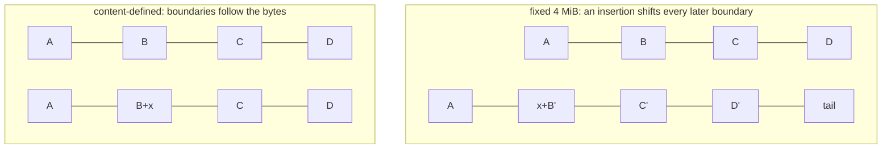
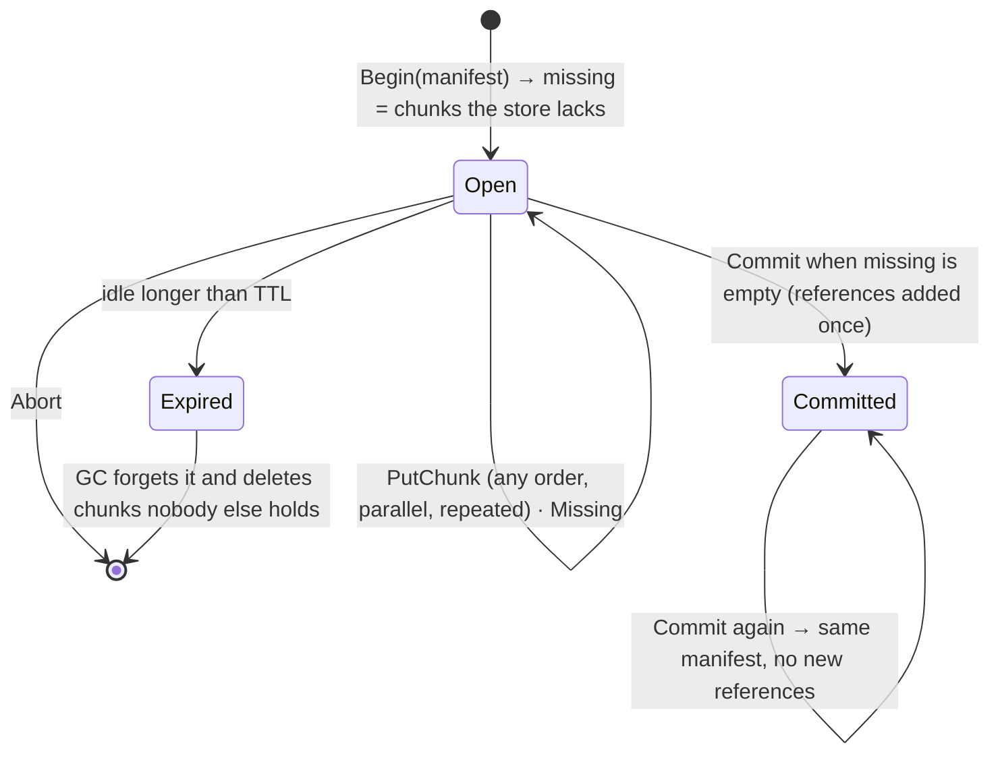
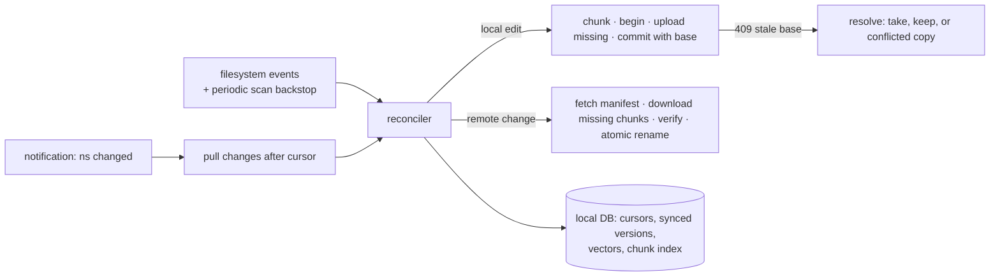
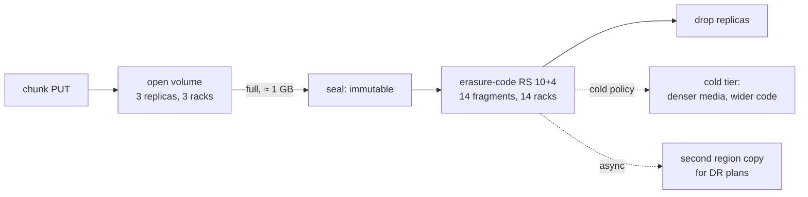

# C10 Unit 2 — Deep dives: chunks, commits, sync and durability

> Time: ~5.5 h · CORE: §5–§8 and "Common mistakes" · STRETCH: the `labs/c10/syncvv` lab in §7, the erasure-coding
> repair arithmetic, cold tiering and the replicated-store extension in §8 · Labs: `labs/c10/chunker` (CORE, gated),
> `labs/c10/syncvv` (STRETCH)

Unit 1 ended at 0:25 with an end-to-end design. For a file sync service the interviewer picks two or three deep dives
from a short, predictable list: **how files become chunks and why identical content is stored once** (and what that
leaks); **how an upload survives disconnects and how a version is committed safely** (integrity, orphans, GC); **how
devices learn about changes and what happens when two of them edit the same file**; and **how the bytes survive
disks, racks and regions** without tripling the bill, including the shared folder that every device in the company
watches. This unit does all four, lists the mistakes that cost candidates the senior score, and builds the storage
core in Go.

## Before you start

You should have finished [Unit 1](unit-1-guided-design.md). Warm-up, answer first:

1. What is the "bytes first, metadata last" rule, and what does it leave behind when a client gives up?
2. Why is the change journal ordered by a per-namespace sequence rather than by commit timestamps?
3. Erasure coding with RS(10, 4) versus 3× replication: raw bytes for 375 PB of unique data, and how many lost
   fragments or copies each survives.

<details data-kind="answer">
<summary>Warm-up answers</summary>

1. Upload and verify every chunk, then commit one metadata transaction that lists them, so no version ever points at
   missing bytes. An abandoned upload leaves orphaned chunks that GC reclaims (Unit 1 §1, §3).
2. A sequence assigned inside the commit transaction is gap-free and totally ordered within the namespace; timestamps
   collide, arrive out of order across shards and skew between machines, so a `modified_after` cursor skips commits
   (Unit 1 §3).
3. ≈ 525 PB raw coded (1.4×) and survives any 4 lost fragments of a stripe; ≈ 1.1 EB raw replicated (3×) and survives
   2 lost copies (Unit 1 §2).

</details>

---

## §5 Chunking and deduplication

### The failure story

TeamDrive v4 split every file into fixed 4 MiB blocks named by SHA-256 and uploaded only blocks the server didn't
have. The dedupe dashboard looked great (copies, re-saves and popular installers were free), but three things went
wrong in the first month.

- **Insertions defeated delta sync.** A designer added a title slide at the start of a 1 GB uncompressed video
  project file. Every byte after the insertion moved, so every block boundary after it cut different bytes: 256 of
  256 blocks were "new", and the "delta" upload was 1 GB, again, on every save. Appends to log files were cheap; edits
  near the start of big files were not.
- **The dedupe check leaked.** A security researcher showed that "begin upload" answered *instantly with nothing
  missing* when a file already existed anywhere in the service. They took a public offer-letter template, filled in
  the target employee's name, and tried salaries in $1,000 steps; the one that "uploaded" instantly was that
  employee's real letter. Forty requests, no access to anyone's account.
- **The hash became a password.** An early API let a client commit a manifest of hashes without uploading anything,
  as long as the chunks existed. Anyone who learned a file's chunk hashes (from a shared log, a leaked manifest, a
  forum post) could "commit" it into their own account and download it.

### Predict

<!-- predict id="C10-U2-P01" -->
**Predict.** Write your answers down first.

1. A 1 MiB insertion at the 20% mark of a 1 GiB file. With fixed 4 MiB chunks, roughly how many of the file's chunks
   change? With content-defined chunks averaging 4 MiB?
2. How must a chunker pick boundaries so that they move *with* the content? What are the minimum and maximum chunk
   sizes for?
3. Dedupe scope: global (all users), per tenant, or per user. What does each save, and what does each leak? How do
   you stop "I know the hash" from becoming "I can download the file"?
<!-- /predict -->

### Reveal

<details data-kind="reveal" data-for="C10-U2-P01">
<summary>Reveal</summary>

1. **Fixed**: the file has 256 chunks; everything after offset ≈ 205 MiB shifts by 1 MiB, so ≈ 205 chunks after the
   insertion are new (plus the one containing it): **≈ 80% of the file re-uploads**. **Content-defined**: boundaries
   are found by looking at the bytes themselves, so after the inserted region the chunker finds the *same* boundaries
   as before; only the chunk containing the insertion point changes and the inserted MiB adds a chunk or so:
   **≈ 2–3 chunks, ≈ 1% of the file**. The lab's insertion test measures exactly this (≥ 90% of CDC chunks shared,
   < 30% of fixed chunks shared after a 100-byte insertion).
2. Compute a **rolling hash over a small window** of recent bytes and cut where the hash matches a pattern (its low
   *k* bits are zero, so on random data a cut happens with probability 2^-k per byte: average chunk ≈ 2^k bytes). The
   cut depends only on the last few dozen bytes, so it's a property of the content, not of the offset. **Min** stops
   pathological tiny chunks (long runs where the pattern matches often; and it lets the chunker skip hashing the first
   Min bytes); **Max** stops unbounded chunks on data where the pattern never matches (zeros, already-compressed
   regions that happen not to match), which would wreck upload granularity and memory.
3. **Global** saves the most (cross-user duplicates: installers, shared PDFs, media) and leaks existence: the
   "missing" list tells any user whether *anyone* stores a chunk, which enables confirm-a-file and
   learn-the-remaining-information attacks. **Per tenant** saves duplicates within a company and leaks only within it.
   **Per user** saves re-saves, copies and versions, and leaks nothing new. Stop the hash being a capability: a
   manifest may only reference chunks the user has uploaded in this session or already holds in their own scope;
   otherwise the client must upload the bytes (or pass a proof-of-ownership challenge), even if the server already
   has them. The server may still dedupe *after* the upload (storage saved, bandwidth not), which leaks nothing.

The tempting wrong answers: "fixed blocks plus rsync solve it" (rsync deltas against the *previous version of the
same file*; it can't find duplicates across files or users, and needs the old version on both ends); "smaller fixed
blocks" (the shift still invalidates everything after the edit); "dedupe is pure win" (it's a privacy decision and a
shared-fate decision).

</details>

### How it actually works

**Fixed versus content-defined boundaries.**



**The gear hash** (the lab's chunker, as in FastCDC): keep a 64-bit `h`; for each byte `b`, `h = h<<1 + gear[b]`,
where `gear` is a table of 256 random 64-bit values. Each shift pushes older bytes towards the top bit, so after 64
bytes a byte no longer influences `h`: the hash is a function of the last 64 bytes only. Cut after byte *i* when the
current chunk is at least `Min` long and `h & (Avg-1) == 0` (`Avg` a power of two), or when it reaches `Max`; reset `h`
at every cut. On random data a cut is a 1-in-`Avg` event per byte past `Min`, so chunks average roughly `Min + Avg`.
After an insertion, the first cut point at or after the edit's end (plus 64 bytes) is the same cut point as before,
and from there on every chunk is identical: the chunker *resynchronises*. Rabin fingerprints (LBFS) achieve the same
with a polynomial rolling hash over a fixed window; gear hashing is cheaper per byte.

**Manifests and content addressing.** A file version is `{size, sha256(file), [(sha256(chunk), size)…]}`. The
whole-file hash is checked after assembly, which catches chunks in the wrong order (each chunk would pass its own
check) and gives a cheap "is this file identical?" test for whole-file dedupe.

**Choosing the chunk size.** Smaller chunks find more duplicates and make edits cheaper; larger chunks keep the index,
manifests and request counts small.

| Average chunk | Chunks for 375 PB | Chunk index (≈ 100 B/entry) | Manifest of a 1 GiB file (≈ 40 B/entry) | Requests per GiB uploaded |
|---|---|---|---|---|
| 8 KiB | ≈ 4.6 × 10^13 | ≈ 4.6 PB | ≈ 5 MB | ≈ 131k |
| 64 KiB | ≈ 5.7 × 10^12 | ≈ 570 TB | ≈ 650 KB | ≈ 16k |
| 1 MiB | ≈ 3.6 × 10^11 | ≈ 36 TB | ≈ 40 KB | ≈ 1k |
| 4 MiB | ≈ 9 × 10^10 | ≈ 9 TB | ≈ 10 KB | 256 |

That table is why consumer sync products sit in the MiB range and backup tools that dedupe across many machines sit
around 1 MiB, while 8 KiB chunks belong to single-node dedupe filesystems that keep the index in RAM. Small files are
one chunk; there is no point chunking a 30 KB file.

**Dedupe levels and the side channel.**

| Level | Saves | Leaks | Typical use |
|---|---|---|---|
| Per user (or per namespace) | Copies, re-saves, versions, moves | Nothing beyond the user's own data | Privacy-sensitive products, E2E encryption |
| Per tenant | Duplicates within a company | Existence within the tenant | Business products; banking (one bank's statements never dedupe against another's) |
| Global, client-side (skip upload) | Bytes stored *and* bandwidth for popular content | Existence to every user, observable by timing or the `missing` list | Consumer sync, with mitigations |
| Global, server-side (always upload, dedupe after) | Bytes stored | Nothing observable by the client | The privacy-preserving compromise |

Mitigations when you want global dedupe: dedupe only chunks that already have many owners (random thresholds were
proposed in the research that described the attack); always upload small or rare files; require proof of ownership
(answer a challenge that needs the actual bytes) before linking an existing chunk to a new user.

**Where dedupe doesn't help.** Compressed and container formats (zip, `.docx`, `.pptx`, JPEG, video) change many
bytes for a small logical edit, so CDC finds fewer shared chunks; per-user encryption makes identical files differ
completely. Measure dedupe and delta ratios per file type before promising them.

### Build it

Lab `labs/c10/chunker`, file `labs/c10/chunker/chunker.go` (see [`labs/c10/README.md`](../../labs/c10/README.md)),
parts 1–2:

- `FixedChunks(data, size)`: consecutive copies of `size` bytes, a short tail, `ErrInvalid` for `size <= 0`.
- `CDCChunks(data, p)`: validate `0 < Min <= Avg <= Max` with `Avg` a power of two; the gear recurrence above; cut at
  `Min`-or-more with `h & (Avg-1) == 0`, or at `Max`; reset `h` at each cut; return copies.
- `BuildManifest(chunks)` with per-chunk hashes (`HashChunk` is provided), sizes, the total size and the whole-file
  hash.
- `Store.PutChunk` (returns `existed` for dedupe), `Has`, `Commit` (all chunks must exist or nothing is referenced:
  `ErrMissingChunk`), `Release` (decrement; delete at zero), `Stats` (chunks, physical bytes, logical bytes).

Acceptance tests: `TestFixedChunks_SplitsEvenlyWithShortTail`, `TestCDCChunks_ValidatesParamsAndBounds`,
`TestCDCChunks_InsertionOnlyDisturbsNearbyChunks` (the point of the exercise), `TestHashAndManifest`,
`TestStore_DedupesAndReferenceCounts` (two files sharing a 5 KB chunk store it once: 3 chunks, 5,018 physical bytes,
10,018 logical bytes). Run `go test -race ./labs/c10/chunker/`.

### Break it

With your tests passing, temporarily change `DefaultCDC` in `chunker.go` and rerun
`go test -race -run Insertion -v ./labs/c10/chunker/`. Predict the shared fractions first.

1. `{Min: 4096, Avg: 4096, Max: 4096}`.
2. `{Min: 16384, Avg: 65536, Max: 262144}` (larger chunks).

<details data-kind="answer">
<summary>What you should see, and why</summary>

1. With `Min = Max`, every cut is forced at 4,096 bytes, which is fixed-size chunking in disguise: the CDC share
   collapses to the fixed-size figure (≈ 20% on the reference solution, the chunks before the insertion point) and
   the test fails. (With the default parameters the CDC share is ≈ 99%.) Content-defined boundaries need room
   between `Min` and `Max` for the content to choose.
2. The 1 MB test file now splits into ≈ 11 chunks instead of ≈ 200; the insertion still disturbs one chunk, so the
   shared fraction stays just above the threshold (≈ 91% on the reference solution: 10 of 11), but the *bytes* that
   must re-upload grow from ≈ 5 KiB to ≈ 80 KiB per edit.
   Bigger chunks trade upload bandwidth after small edits for a smaller index and fewer requests (the table above).
   For documents edited in place, ≈ 1 MiB averages are a reasonable start; for photo and video libraries, which are
   rarely edited, fixed multi-MiB parts are fine.

Revert `DefaultCDC` afterwards: `TestCDCChunks_ValidatesParamsAndBounds` checks chunk counts for the default.

</details>

### In the wild

- **LBFS** (the Low-Bandwidth Network File System, 2001) introduced content-defined chunking with Rabin fingerprints
  for file sync over slow links (`TODO-VERIFY: its ≈ 8 KB average chunk size`). **FastCDC** (USENIX ATC 2016)
  popularised the gear hash with normalised chunking for speed.
- **restic** and **Borg** back up with content-defined chunks and a repository-wide content-addressed index, so the
  second backup of a machine uploads only changed chunks (`TODO-VERIFY: restic's min/avg/max chunk sizes, commonly
  cited as 512 KiB / 1 MiB / 8 MiB`).
- **rsync** uses a weak rolling checksum plus a strong hash to send a delta of one file against the receiver's old
  copy: a delta algorithm, not cross-file dedupe.
- **Dropbox** has described fixed-size 4 MiB blocks (`TODO-VERIFY`). **ZFS** offers block-level dedupe whose dedupe
  table must fit in RAM to perform, which is the small-chunk index problem in the table above (`TODO-VERIFY: the
  per-entry memory cost usually quoted`).
- **Side channels in deduplicating cloud storage** were described in research by Harnik, Pinkas and Shulman-Peleg
  (2010), including the confirm-a-file and learn-the-remaining-information attacks (`TODO-VERIFY: citation details`).

### Trade-offs

| Option | Wins when | Loses when | When the answer flips |
|---|---|---|---|
| Fixed-size chunks | Simple, fast, no hashing per byte; files rarely edited in the middle (photos, video, appends) | Insertions shift every later chunk | Flip to CDC when large files are edited in place (documents, VM images, databases, uncompressed projects) |
| Content-defined chunks | Edits change ≈ 1–2 chunks; dedupe across files with shared regions | CPU per byte; variable sizes complicate parallel I/O and storage packing | Flip to fixed when the data is immutable or already compressed |
| Small chunks (KiB) | Best dedupe and smallest deltas | Index and manifests explode (≈ PB of index at 8 KiB) | Flip to MiB chunks at multi-PB scale or on high-latency links where request count dominates |
| Global client-side dedupe | Popular files upload instantly; most storage saved | Existence side channel; hash-as-capability bugs | Flip to per-tenant or server-side dedupe when content is sensitive (banking, health, legal) |
| Server-side dedupe after upload | Storage saved, nothing leaked | No bandwidth saving for duplicates | Flip to client-side when bandwidth is the binding cost and the data isn't sensitive |

### Senior bar

- **Failure modes**: fixed chunks on edit-heavy large files (no delta benefit); CDC without `Max` (unbounded chunks
  on degenerate data); a dedupe check that leaks existence globally; manifests that accept hashes the user never
  proved they own; a hash function that's weak against collisions (use SHA-256, not MD5 or a 64-bit hash, because a
  collision makes one file's chunk silently replace another's); trusting the client's hash without re-hashing.
- **Capacity**: index size scales with 1/(chunk size) (≈ 9 TB at 4 MiB, ≈ 4.6 PB at 8 KiB for 375 PB); CDC hashing
  runs at ≈ GB/s per core (`TODO-VERIFY` for your implementation), so the client's disk, not the chunker, is usually
  the bottleneck.
- **Ops**: dedupe ratio and delta ratio per file type as metrics; changing chunking parameters re-chunks everything
  (new boundaries → new hashes → no dedupe against old data), so parameters are effectively permanent; version them
  in the manifest.
- **Cost**: dedupe is worth ≈ $2.9 M a month in the Unit 1 estimate and delta sync ≈ 5× upload bandwidth; a privacy
  incident from the side channel costs more than both.

Interviewer follow-up probes:

1. "What chunk size would you choose, and why?"

<details data-kind="answer">
<summary>Model answer</summary>

Content-defined with ≈ 1 MiB average (min ≈ 256 KiB, max ≈ 4–8 MiB) for a document-sync product, files under the
minimum as a single chunk. Reasoning: at 375 PB that's an index of tens of TB, manageable on sharded SSD; a 1 GiB
manifest is ≈ 40 KB; an edit re-uploads ≈ 1–2 MiB, which is a second on a 10–20 Mbps uplink. Going to 64 KiB
multiplies the index by 16 for a modest dedupe gain; going to 16 MiB makes every small edit cost 16 MiB of a user's
uplink. I'd version the parameters in the manifest, because changing them later breaks dedupe against old data.

</details>

2. "An attacker knows the SHA-256 of a confidential file stored by another user. Can they get it?"

<details data-kind="answer">
<summary>Model answer</summary>

Not if the hash isn't a capability. Downloads require an authorised manifest (a file the caller can read), never a
bare hash. Commits may only reference chunks that the caller uploaded in this session or already owns in their scope;
for anything else the server answers "missing" and demands the bytes, so knowing the hash gets them nothing. What they
*can* still learn with global client-side dedupe is that the file exists somewhere, by seeing it reported as present;
if that matters (it does for a bank), dedupe per tenant or server-side.

</details>

3. "Does deduplication help for photos?"

<details data-kind="answer">
<summary>Model answer</summary>

Byte-level dedupe barely helps across users, because personal photos are unique; it helps a lot *within* a user, when
a new phone or a reinstall re-uploads a library the service already has (whole-file hash, so nothing is sent). CDC
adds almost nothing because photos aren't edited in place (edits are usually stored as a separate rendition or an
edit list). Visually similar photos are a perceptual-hashing feature, not storage dedupe. So for photo backup I'd use
fixed-size parts for resumability, a whole-file hash per user, and spend the effort on tiering.

</details>

### Check yourself

1. Why does an insertion near the start of a file defeat fixed-size chunking but not CDC?
2. What happens to dedupe if you change the CDC parameters after launch?
3. Name two mitigations for the dedupe existence side channel.

<details data-kind="answer">
<summary>Answers</summary>

1. Fixed boundaries are offsets, so every later boundary cuts different bytes; CDC boundaries depend only on the
   last ≈ 64 bytes, so after the insertion the chunker finds the same cut points as before.
2. New boundaries mean new chunk hashes, so new uploads stop deduplicating against everything stored before; that's
   why parameters are versioned and rarely changed.
3. Scope dedupe per user or per tenant; dedupe server-side after an upload; require proof of ownership; dedupe only
   chunks with many existing owners.

</details>

---

## §6 Resumable uploads, integrity and the commit protocol

### The failure story

TeamDrive v4's upload service kept sessions in the API process's memory and wrote chunks to the blob store as they
arrived. Four incidents in one quarter:

- **A deploy killed every upload.** Rolling the upload service dropped ≈ 60,000 in-flight sessions. Clients
  started their 2 GB uploads from zero; the 10:00 traffic peak doubled.
- **One bad laptop corrupted 1,200 users.** A client with failing RAM computed the right hash for a chunk and then
  sent different bytes. The blob tier stored the body under the client's claimed hash without checking it. That chunk
  was a common block of a popular installer, so the next 1,200 users who "uploaded" the installer got a deduplicated
  reference to garbage. Nobody noticed until installs failed weeks later.
- **GC raced dedupe.** A user purged an old version; the chunk's reference count hit zero. A minute later another
  user's `begin` saw the chunk in the index ("present, don't send it"). Then GC deleted it. The commit referenced a
  chunk that no longer existed: a file that downloaded as an error, forever.
- **Latent errors ate the last copy.** A disk returned wrong bytes for a sector for six months; nobody read that
  replica. When a rack lost power and two other disks died during the rebuild, the only remaining copy of ≈ 30,000
  chunks was the bad one.

### Predict

<!-- predict id="C10-U2-P02" -->
**Predict.** Write your answers down first.

1. Design the upload session: where its state lives, what makes `PutChunk` and `Commit` safe to retry, how expiry
   works, and what GC must never delete.
2. Close the race "begin says the chunk exists → GC deletes it → commit references it". Give two different
   mechanisms.
3. List every place you would verify a hash, and say why TCP checksums, disk ECC and the blob store's own replication
   aren't enough.
<!-- /predict -->

### Reveal

<details data-kind="reveal" data-for="C10-U2-P02">
<summary>Reveal</summary>

1. **Session state lives in a durable store** (a table in the metadata tier or a replicated key-value store), keyed
   by `upload_id`: the manifest, the set of hashes still missing, `committed`, `last_touch`. Any upload server can
   serve any session, so deploys and crashes don't lose uploads. **`PutChunk` is idempotent** because the chunk's name
   is its hash: re-sending writes the same bytes to the same key, and removing a hash from the missing set twice is a
   no-op. **`Commit` is idempotent** on the session: once committed, it returns the same version without adding
   references again (a retried commit after a timeout is normal). **Expiry** is a sliding TTL from the last activity
   (every chunk touches the session), so a slow upload stays alive and an abandoned one expires. **GC must never
   delete** a chunk that a committed version references, nor one that a live session is waiting on or was told it
   didn't need to send.
2. **(a) Pin on begin**: when `begin` reports a chunk as present, it records the session as a holder of that chunk
   (in the lab: the session's chunk list is in GC's keep set); GC only deletes chunks with zero references *and* no
   live session holding them, and it decides under a lock (or a conditional delete) that `begin` also takes. **(b)
   Tombstone and grace**: GC first marks a zero-reference chunk as a deletion candidate with a timestamp; `begin` and
   `commit` treat a candidate as missing (forcing a re-upload) or resurrect it atomically by clearing the mark; GC
   deletes only candidates older than a grace period longer than any session TTL plus refcount-pipeline lag. Either
   way, the deletion decision and the "it's present" answer can't interleave.
3. **Verify everywhere the bytes change hands**: the client hashes before upload; the blob front-end re-hashes every
   body and rejects a mismatch before storing (the 1,200-user incident); storage nodes keep a checksum per fragment and
   check it on every read; `Get` re-hashes the chunk against its name; assembly checks sizes and the whole-file hash
   (catches reordering and truncation); the downloading client verifies again before the atomic rename; and a
   **scrubber** re-reads everything on a schedule and repairs from replicas or parity before a second failure.
   TCP's 16-bit checksum misses some corruptions, and corruption also happens in RAM, NICs, controllers, firmware and
   your own code, *above* TCP and disk ECC; replication copies whatever bytes it was given and can't tell which copy
   is right without a checksum; and latent sector errors are only found by reading. This is the end-to-end argument:
   only the endpoints that know what the bytes should be can check them.

The tempting wrong answers: sessions in process memory; "the blob store is durable, so we don't need hashes"; GC as
"delete where refcount = 0" with no pinning or grace; verifying only on upload and never again.

</details>

### How it actually works

**The session state machine** (the lab's `Uploader`):



**Parallel uploads.** A 2 GB file is ≈ 500 chunks of 4 MiB. On a 20 Mbps uplink, a single connection is fine; on a
1 Gbps office link with 50 ms of latency, one TCP stream is window-limited, so clients upload 4–16 chunks in parallel.
The server must accept chunks in any order and concurrently: per-session bookkeeping is a short critical section,
while hashing and storing the bytes happen *outside* any session-wide lock (the lab's break-it 3 shows what happens
otherwise).

**Resuming.** After a crash or a network change the client calls `Missing(upload_id)` (or simply re-runs `begin`, which
deduplicates against everything already uploaded, including its own previous attempt's chunks) and sends only what's
left. Nothing acknowledged is ever re-sent; at worst the chunk in flight is re-sent.

**Presigned URLs, done safely.** Issue them per missing chunk, after authorising the session; bind the object name
to the hash, the method to `PUT`, a maximum size, and an expiry of minutes; have the blob front-end re-hash and reject
mismatches; count uncommitted bytes against the user's quota until GC. Downloads get presigned `GET`s per chunk only
after the manifest is authorised.

**The commit protocol at scale.** `commit` checks the session is complete, then runs Unit 1 §3's single-shard
transaction (base-version check, version row, entry update, journal row, outbox rows). Reference counts are applied
asynchronously by a consumer of the `chunk-refs` outbox topic, idempotently per `(version, chunk)`. Between the commit
and the refcount update, the chunks are protected by the session pin (the session stays alive, committed, until the
refcounts land) or by GC's grace period.

**GC: orphan reaping and purges.**
- Orphans: chunks uploaded for sessions that expired uncommitted. Find them by "refcount 0, no live session, older
  than the grace period", or by mark-and-sweep: mark every chunk referenced by any live version or session, sweep the
  rest.
- Purges: when a version leaves retention (or a user deletes permanently), release its references; chunks that reach
  zero become candidates.
- Holds: a version under legal hold is never purged, so its chunks stay referenced. GC never consults a "hold" flag
  directly; holds keep references alive.
- Safety rule of thumb: refcounts can drift (bugs, replays), so run a periodic mark-and-sweep audit that compares
  counts with the truth, and make the sweep *report* before it deletes. Deleting the only copy of a live chunk is
  unrecoverable; leaking a chunk costs cents.

**Integrity in numbers.** Disk vendors specify unrecoverable read errors per bits read (≈ 1 in 10^15 for many
enterprise drives, `TODO-VERIFY` for your hardware). Reading 525 PB of raw data once is ≈ 4 × 10^18 bits, so at that
rate a full pass meets errors in the thousands: latent errors are routine, and you find them by reading. A scrubber
covering 525 PB every two weeks reads ≈ 525 × 10^15 B ÷ 1.2 × 10^6 s ≈ 430 GB/s cluster-wide; across ≈ 50,000 disks
that's ≈ 9 MB/s per disk, a few percent of an HDD's ≈ 100–200 MB/s sequential bandwidth (NUMBERS.md). Cheap insurance.

### Build it

Lab `labs/c10/chunker`, parts 2–3 (after §5's parts):

- `Store.Get`: return a *copy* after re-hashing against the key (`ErrNotFound`, `ErrCorrupt`); `Assemble`: verify every
  chunk via `Get`, every size, and the whole-file hash (`ErrCorrupt` on any mismatch); `Corrupt` is the bit-rot test
  hook.
- `Uploader.Begin`: validate the manifest (`ErrInvalid`: no chunks, non-positive sizes, malformed hashes, sizes that
  don't sum), open a session, and return `Missing` in manifest order without duplicates.
- `Missing`, `PutChunk` (idempotent; `ErrUnexpectedChunk` for a chunk the manifest doesn't list; hash and store
  outside the uploader's lock), `Commit` (`ErrIncomplete` while chunks are missing; commit to the store exactly once;
  a second call returns the same manifest), `Abort`, sliding expiry (`ErrSessionExpired`; `ErrUnknownSession` for ids
  never issued or already forgotten).
- `GC`: forget expired sessions; delete chunks with no references that no live, uncommitted session is waiting on;
  return the count.

Acceptance tests: `TestStore_AssembleVerifiesEveryChunkAndTheWholeFile`, `TestUpload_MissingSkipsWhatTheStoreAlreadyHolds`
(a second user uploading the same file sends nothing; appending 20 KB sends only the tail),
`TestUpload_ChunksArriveInAnyOrderAndRepeatedly`, `TestUpload_ConcurrentChunkUploadsFromManyConnections` (16
goroutines, duplicates racing originals, under `-race`), `TestUpload_SessionsExpireAndGCReapsOrphans`,
`TestUpload_BeginValidatesTheManifest`. Run `go test -race ./labs/c10/chunker/`, then `sd lab C10`.

### Break it

Edit your passing solution, predict which test fails and with what message, run it, then revert
(`labs/c10/README.md` lists the same exercises).

1. In `Get`, return the stored bytes without re-hashing. Run `-run Assemble`.
2. In `GC`, forget the "keep chunks of live sessions" rule. Run `-run SessionsExpire`.
3. Hold the uploader's mutex while calling `HashChunk` and `store.PutChunk` inside `PutChunk`. Run
   `-run ConcurrentChunkUploads -v` before and after and compare the elapsed time.
4. Make `Commit` add references every time it's called. Run `-run AnyOrder`.

<details data-kind="answer">
<summary>What you should see, and why</summary>

1. `Get of a bit-rotted chunk: <nil>, want ErrCorrupt`. Note that `Assemble` would *still* catch the corruption,
   through the whole-file hash: defence in depth. But any path that serves single chunks (a device downloading only
   the two chunks it lacks, a range read, a CDN fill) would hand out silently wrong bytes, and the device would only
   notice after assembling, if it checks. Verify at every layer that has the expected hash.
2. `GC deleted 1 chunks of a live session, want 0`: the chunk the session already uploaded was unreferenced (no
   commit yet), so a refcount-only GC reaped it, and the client's next `Commit` would reference bytes that no longer
   exist. The same hole is the dedupe race in the failure story: "present" must pin.
3. Nothing fails, but the 16 "parallel" connections now hash and store one chunk at a time: every upload waits on one
   lock for the most expensive part of the work. In production that's a server whose throughput doesn't grow with
   connections, and a slow blob write stalling every session on the box. Keep critical sections to bookkeeping.
4. `LogicalBytes = <2× the file> after a repeated Commit`: the retry (a client that timed out waiting for the first
   commit's response) double-counted every chunk, so a later `Release` leaves them referenced forever, a storage
   leak no GC will ever reclaim. Idempotency on commit isn't politeness; it's what keeps refcounts true.

</details>

### In the wild

- **Amazon S3**: multipart uploads with independently retried parts and a final `CompleteMultipartUpload`;
  lifecycle rules that abort incomplete multipart uploads after N days (orphan GC as configuration); optional
  per-object checksums (CRC32C, SHA-256 and others) verified on upload; presigned URLs and POST policies that can
  limit content length (`TODO-VERIFY: current checksum algorithms and policy conditions`).
- **Google Cloud Storage** resumable uploads let a client ask how many bytes the server has after a disconnect, and
  accept CRC32C or MD5 hashes to verify the object (`TODO-VERIFY`).
- **Ceph**, **HDFS** and **ZFS** all run background scrubbing: HDFS block scanners re-verify block checksums; Ceph
  "deep scrub" reads objects and compares replicas; ZFS `scrub` re-reads every block against its checksum and repairs
  from redundancy (`TODO-VERIFY: default scrub intervals`).
- Large disk-fleet operators publish failure statistics (Backblaze's drive stats are the best-known public data
  set): annualised failure rates of a few percent or less per drive model, varying by model and age
  (`TODO-VERIFY: current figures`).
- **Git** garbage collection keeps unreachable objects for a grace period (`gc.pruneExpire`, two weeks by default,
  `TODO-VERIFY`) for exactly the race in this section: a concurrent operation may be about to reference them.

### Trade-offs

| Option | Wins when | Loses when | When the answer flips |
|---|---|---|---|
| Durable session state (DB or replicated KV) | Uploads survive deploys and crashes; any server serves any session | One more write per chunk | Flip to in-memory only for tiny files that upload in one request |
| Sliding session TTL (e.g. 24 h idle) | Slow uploads survive; abandoned ones expire | Orphans live up to TTL + grace | Shorten for anonymous or untrusted uploaders; lengthen for huge files on slow links |
| Synchronous refcounts | Exact counts; simple GC | Cross-shard writes on every commit at scale | Flip to async counts plus grace periods once chunks and namespaces live on different shards |
| Mark-and-sweep GC | Robust to count drift; easy to audit | Scans the whole metadata set | Use as the periodic audit behind refcount GC; flip to sweep-only for smaller systems |
| Verify on every read | Never serves wrong bytes | CPU per read (SHA-256 at ≈ GB/s per core) | Never flip for content; skip only for data verified by a lower layer you trust with the same hash |
| Frequent scrubbing (e.g. every 2 weeks) | Finds latent errors before the second failure | Disk I/O and power | Slow down for archive tiers with stronger codes; never stop |

### Senior bar

- **Failure modes**: sessions in memory; the blob tier trusting client hashes; refcount-only GC racing `begin`;
  non-idempotent commits double-counting; GC that deletes before the refcount pipeline catches up; no scrubbing; a
  sweep that deletes without a dry run; presigned URLs without size limits or with long expiry.
- **Capacity**: ≈ 1,350 chunk PUTs/s at peak, each one session update; scrubbing ≈ 430 GB/s cluster-wide for a
  two-week cycle (≈ 9 MB/s per disk across ≈ 50,000 disks); orphan bytes ≈ (abandoned sessions/day) × (new bytes per
  session).
- **Ops**: metrics for session completion rate, orphan bytes, GC deletions per day (alert on spikes: a GC bug deletes
  live data fast), refcount-pipeline lag versus grace period, scrub coverage and repair rate; a "GC kill switch"; a
  two-person review for changes to GC rules.
- **Cost**: verification CPU and scrubbing I/O are small; a single lost chunk referenced by thousands of files is a
  company-level incident.

Interviewer follow-up probes:

1. "A client uploads all chunks, then the network drops before the commit response. What does it do, and what does
   the server see?"

<details data-kind="answer">
<summary>Model answer</summary>

It retries `commit` with the same session id. If the first commit landed, the server returns the same version (no
second version, no double references); if it didn't, the second attempt commits. If the session has expired in the
meantime, `begin` again with the same manifest: every chunk is already in the store, so nothing is missing, and the
commit runs then, with a base-version check that may now report a conflict if someone else committed first. The
user sees one version either way.

</details>

2. "How long should the GC grace period be?"

<details data-kind="answer">
<summary>Model answer</summary>

Longer than the longest window in which something might reference a chunk GC can see as unreferenced: the maximum
session TTL (an upload that was told "present" can commit until it expires), plus the worst plausible lag of the
refcount pipeline (a stuck relay, a replay), plus a margin for clock skew between GC and the metadata tier. With a
24 h session TTL and pipelines that alert at an hour of lag, I'd use days, not hours; the cost is a few days of orphan
storage, which is cheap compared with deleting a live chunk.

</details>

3. "Your scrubber finds a chunk whose stored bytes don't match its hash on one replica. What happens next?"

<details data-kind="answer">
<summary>Model answer</summary>

Repair from a good copy: read the other replicas (or reconstruct from k fragments under erasure coding), verify
against the hash, rewrite the bad copy on a different disk, and record the event against the disk; a disk with a
rising error rate is drained and retired before it fails outright. If *no* copy verifies, the chunk is lost: find
every version that references it (the chunk index points back via manifests), mark those versions damaged, try the
uploading clients' local copies (a device that still has the chunk can re-upload it; the hash proves it's right), and
treat it as a durability incident.

</details>

### Check yourself

1. What makes a chunk `PUT` idempotent, and what makes a commit idempotent?
2. What does GC need to keep besides chunks referenced by committed versions?
3. Why does a whole-file hash catch something per-chunk hashes don't?

<details data-kind="answer">
<summary>Answers</summary>

1. The chunk's name is its hash, so a retry writes the same bytes to the same key; the commit is keyed by the
   session, which remembers that it committed and returns the same version without adding references.
2. Chunks that a live, uncommitted session is waiting on or was told it needn't send (pins), and anything younger than
   the grace period that covers refcount lag.
3. Chunks in the wrong order (or a missing or duplicated chunk) each pass their own check; only the hash of the
   assembled bytes notices.

</details>

---

## §7 The sync protocol and conflicts

### The failure story

TeamDrive v5 had chunks, sessions and a journal, but its sync logic still had three bugs that cost data:

- **Cursor before apply.** The client advanced its cursor when it *received* a page of changes, then applied them. A
  crash between the two (the laptop lid closing) skipped those changes forever: the files were never downloaded, and
  the next edit to one of them was based on a version the device didn't have.
- **Device clocks as the referee.** Conflicts were resolved by the file's local modification time. ≈ 2% of laptops
  had clocks more than a minute off (assumed from support data; laptops resume from sleep with drift, some users set
  clocks by hand). A user who edited at 14:02 on a laptop that thought it was 13:55 lost to a 13:58 edit from a phone.
- **Last commit wins.** After moving to server order, the team kept "the latest commit wins". At 400 M commits a day
  and ≈ 0.05% of commits racing another edit of the same file (shared spreadsheets, a laptop and a desktop both
  syncing after a weekend offline), that's ≈ 200,000 silently discarded edits a day, each one discovered later as
  "my changes disappeared".

### Predict

<!-- predict id="C10-U2-P03" -->
**Predict.** Write your answers down first.

1. What does a device store locally so that sync is correct after crashes and efficient on large files?
2. A laptop and a phone both last synced `budget.xlsx` at version vector `{laptop: 3}`. The laptop edits offline
   (`{laptop: 4}`); the phone edits and commits first (`{laptop: 3, phone: 1}`). When the laptop reconnects, what does
   it do? What would it do if the server's version were `{laptop: 4, phone: 1}` instead?
3. When is last-writer-wins acceptable in a sync product, and with whose clock?
<!-- /predict -->

### Reveal

<details data-kind="reveal" data-for="C10-U2-P03">
<summary>Reveal</summary>

1. **Local state**, in one local database updated transactionally: a cursor per namespace; per file its `file_id`,
   path, the last synced version and its version vector, the content hash and chunk list of the synced version, and
   the local file's identity (inode, size, mtime) to detect local edits cheaply; and an index of chunk hashes the
   device holds, so downloads fetch only missing chunks. **Crash safety**: apply a change and advance the cursor in
   the *same* local transaction; apply must be idempotent, because after a crash the same entry can be fetched again.
   Downloads land in a temp file, are verified, and are renamed atomically.
2. `{laptop: 4}` versus `{laptop: 3, phone: 1}`: the laptop has an entry the phone's version lacks (`laptop` 4 > 3)
   and the phone's has one the laptop's lacks (`phone` 1 > 0): **concurrent**. Neither edit saw the other, so keep
   both: one keeps the name, the other becomes `budget.xlsx (conflicted copy from phone)` (the lab's convention: the
   remote version is saved as the conflicted copy), both are committed so every device sees both, and the merged
   vector `{laptop: 4, phone: 1}` (incremented for the resolving device's write) dominates both. If the server held
   `{laptop: 4, phone: 1}`, the laptop's `{laptop: 4}` is **before** it: the phone's version already includes the
   laptop's edit, so the laptop **takes the remote** version. If the server held `{laptop: 3}` (the phone never
   committed), the laptop's version is **after**: it **keeps local** and pushes.
3. LWW is acceptable where losing a concurrent update is harmless and the product says so: per-file *metadata* like
   "starred" or a folder's colour, view preferences, or a product that explicitly chooses "latest save wins" and keeps
   versions so the loser is recoverable. The order must come from the server (the journal's commit order), never from
   device clocks
   ([A5 Unit 2 §1](../A5-consistency/unit-2-time-ordering.md#1-physical-clocks-and-last-write-wins)).

The tempting wrong answers: "compare modification times"; "the server's latest commit wins, users can restore from
history" (they won't know they need to); "lock the file while someone edits it" (offline devices can't take a lock,
and a crashed device holds it forever).

</details>

### How it actually works

**The client loop.** Three inputs, one reconciler:



The pull side, crash-safe (compile-able stdlib Go; the `Local.Apply` contract is the important part):

```go
package syncloop

import (
	"context"
	"errors"
)

// Entry is one row of a namespace's change journal.
type Entry struct {
	Seq     int64
	FileID  string
	Op      string // "put", "delete" or "move"
	Version int64
}

// Page is one response from GET /v1/namespaces/{ns}/changes.
type Page struct {
	Entries []Entry
	Cursor  int64
	HasMore bool
}

// ErrCursorExpired means the journal no longer holds the entries after the cursor.
var ErrCursorExpired = errors.New("cursor expired: re-list the namespace")

// Server is the metadata API as the client sees it.
type Server interface {
	Changes(ctx context.Context, ns string, cursor int64, limit int) (Page, error)
}

// Local is the client's own database and file tree.
type Local interface {
	// Apply makes the local tree match one entry and stores cursor = seq in the
	// same local transaction, so a crash never skips or half-applies an entry.
	// It must be idempotent: after a crash the same entry can arrive again.
	Apply(ns string, e Entry, seq int64) error
	Cursor(ns string) int64
}

// Pull applies every change after the device's cursor, in journal order.
// A notification only says "ns changed"; this loop is what makes sync correct.
func Pull(ctx context.Context, srv Server, loc Local, ns string) error {
	cursor := loc.Cursor(ns)
	for {
		page, err := srv.Changes(ctx, ns, cursor, 500)
		if err != nil {
			return err // ErrCursorExpired: the caller does a full re-list
		}
		for _, e := range page.Entries {
			if err := loc.Apply(ns, e, e.Seq); err != nil {
				return err // cursor stays at the last applied entry; retry later
			}
		}
		cursor = page.Cursor
		if !page.HasMore {
			return nil
		}
	}
}
```

**Echo suppression.** The device that committed version 7 will see journal entry 81244 for it; its local DB already
records version 7 as synced, so applying the entry is a no-op (idempotence again), and nothing is downloaded.

**Delta download.** For a changed file, the device fetches the new manifest and downloads only hashes absent from
its chunk index (from *any* file it holds, so moving or copying a file costs nothing). Under CDC that's ≈ 1–2 chunks
per small edit.

**Detecting conflicts: base versions and version vectors.** With a central server, the commit's base-version check
already detects "someone committed after the version you edited" (`409 stale_base`). What it can't tell the client
is *how* the versions relate when the client holds history of its own: a laptop that edited three times offline, two
devices that synced with each other over the LAN, or a file restored from an older version. A **version vector**
(one counter per device that has written the file; [A5 Unit 2 §2](../A5-consistency/unit-2-time-ordering.md#2-logical-time-lamport-and-vector-clocks))
answers "did this version see that one?" without clocks:

| `Compare(local, remote)` | Meaning | Client action (`Resolve`) |
|---|---|---|
| Equal | Same version | Keep local (nothing to do) |
| After (local dominates) | Remote is an ancestor of local | Keep local; push it |
| Before (remote dominates) | Local is an ancestor of remote | Take remote |
| Concurrent | Each has an edit the other lacks | Conflict: keep both, a conflicted copy, merged vector |

Each write increments the writing device's entry (`Increment`); after resolving, the device writes
`Merge(local, remote).Increment(self)`, which dominates both parents, so the conflict never re-triggers. Vector size
grows with the number of devices that ever wrote the file; prune entries for devices retired long ago, or use the
server's commit sequence as the authority and keep vectors only for the client's local reasoning.

**Conflicted copies.** Name them so humans can find and merge them: `"<name> (conflicted copy from <device>)"` in the
lab (products add the user and date). Both versions are committed (the original name with one content, a new file
with the other), so every device converges to the same two files. Never auto-merge opaque binary files; text-aware
merging is a product feature for specific formats.

**Tree conflicts** are the other half: an edit versus a delete keeps the edit (resurrect the file); a rename versus
a rename picks one by server order and records the other in the journal; moving a file into a folder another device
deleted restores the folder. Because identity is `file_id`, "rename on one device, edit on another" is not a
conflict at all: both apply to the same file.

### Build it

The client loop is conceptual (no lab). STRETCH, not gated: lab `labs/c10/syncvv`, file
`labs/c10/syncvv/syncvv.go`:

- `Vector.Increment(device)` returns a new vector (never mutates; works on a nil vector).
- `Compare(a, b)`: Equal, Before, After or Concurrent, with missing entries counting as zero.
- `Merge(a, b)`: the entry-wise maximum, as a new vector.
- `Resolve(local, remote)`: `KeepLocal` for Equal or After, `TakeRemote` for Before, `Conflict` for Concurrent, carrying
  both versions and the conflicted-copy name for the remote version, blaming the remote device with the largest count
  above the local count (ties to the smallest id).

Acceptance tests: `TestIncrementAndMergeDoNotMutateInputs`, `TestCompare_AllFourOrderings` (including explicit zeros
and disjoint vectors), `TestResolve_TakeKeepOrConflict`. Run `go test -race ./labs/c10/syncvv/`.

### Break it

1. (STRETCH lab) Add a wall-clock timestamp to `Version` and replace `Compare` inside `Resolve` with "the later
   timestamp wins". Rerun `TestResolve_TakeKeepOrConflict`. What happens to the concurrent case?
2. (Thought experiment) In the `Pull` loop above, move the cursor update to before the `Apply` calls and persist it.
   Kill the client after it has stored the cursor but before it has applied the page. What does the user see, and
   when do they notice?

<details data-kind="answer">
<summary>What you should see, and why</summary>

1. The concurrent case no longer returns `Conflict`: one version silently wins and the other edit is gone (the test
   fails on the action, and on `ConflictCopy`). With skewed clocks, it can even be the *older* edit that wins. This is
   the lost update that conflicted copies exist to prevent, and why A5 calls LWW "data loss with a timestamp".
2. The page's changes are never applied: the device believes it's up to date, shows old contents, and the next local
   edit of one of those files commits with a stale base version (a conflict the user didn't cause) or, without a base
   check, overwrites a newer version. Nobody notices until a human compares devices. Apply and advance in one local
   transaction; make apply idempotent; and run a periodic full comparison as a backstop for client bugs.

</details>

### In the wild

- **Dropbox** creates "conflicted copy" files named with the user and date when concurrent edits can't be ordered
  (`TODO-VERIFY: exact naming format and which version keeps the original name`).
- **Syncthing** tracks each file with a version vector over device ids and writes `.sync-conflict-<date>-<time>-<device>`
  files on concurrent modification (`TODO-VERIFY: current naming`).
- **Amazon's Dynamo** paper used vector clocks to detect concurrent writes and returned siblings for the application
  to merge; **Riak** later adopted dotted version vectors to bound sibling explosion (`TODO-VERIFY`).
- **Google Drive** and **OneDrive** APIs expose ETags or revision ids for conditional updates (`If-Match`), the
  base-version check over HTTP (`TODO-VERIFY` per API).
- **Git** is the extreme: every client keeps full history, merges are explicit, and conflicts are shown inline for
  text, which works because developers expect to merge.

### Trade-offs

| Option | Wins when | Loses when | When the answer flips |
|---|---|---|---|
| Base-version check only (server decides) | Central server; simple clients; conflicts surface as `409` | Can't classify relations when clients have local history (offline multi-edit, LAN sync) | Flip to version vectors when devices sync with each other or keep offline history |
| Version vectors | Clock-free causality across many writers | Vector growth; pruning; more client logic | Flip to base versions alone for web-only clients that never edit offline |
| Conflicted copies | No silent data loss; works for any file type | Users must notice and merge | Flip to auto-merge only for formats with a merge semantics (text, some structured data) |
| Last-commit-wins (server order) | Simple; no duplicates in the tree | Silently drops ≈ 0.05% of commits here | Flip to LWW only for low-value metadata or an explicit product choice with versions to recover |
| File locks (check-out) | Prevents conflicts for formats that can't be merged (CAD, design files) | Offline editing impossible; stale locks | Flip to advisory locks as a UX hint ("Alice is editing"), never as the correctness mechanism |

### Senior bar

- **Failure modes**: cursor advanced before apply; non-idempotent apply; device clocks deciding conflicts; LWW on file
  content; a conflict resolution that doesn't merge vectors (the same conflict re-fires forever); downloading whole
  files; missing filesystem events with no periodic scan; a reconnect storm with no jitter.
- **Capacity**: ≈ 42k `changes` calls/s at peak, mostly answered from a per-namespace cache of the journal's tail;
  conflict rate ≈ 0.05% of commits (assumed) ≈ 200k conflicted copies a day at 400 M commits, which is why the UX for
  them matters.
- **Ops**: metrics for conflict rate (per client version: a spike is often a client bug, not users), cursor resets,
  sync lag (commit to applied on other devices, measured by client telemetry), files stuck "syncing"; journal
  retention set from how long devices are offline; a "re-list everything" escape hatch per device.
- **Cost**: echo and duplicate downloads are egress; chunk-level delta download keeps sync traffic proportional to
  what changed.

Interviewer follow-up probes:

1. "Why not just lock a file while someone edits it?"

<details data-kind="answer">
<summary>Model answer</summary>

Because the devices that cause conflicts are exactly the ones that can't reach the lock service: offline laptops and
phones. A lock taken by a device that then goes offline (or crashes) blocks everyone else until a timeout, and a
timeout means two editors again. Locks are useful as an advisory hint ("Priya has this open") and for formats that
can't be merged, but correctness has to come from detecting concurrency at commit time and keeping both versions.

</details>

2. "A user's laptop and desktop both edited the file. The desktop's vector is `{desktop: 5, laptop: 2}`, the laptop's
   is `{desktop: 4, laptop: 3}`. What happens, and what vector does the resolved file get?"

<details data-kind="answer">
<summary>Model answer</summary>

Concurrent: the desktop's has `desktop` 5 > 4 and the laptop's has `laptop` 3 > 2. The resolving device (say the
laptop) keeps one version under the name, writes the other as a conflicted copy blaming the desktop, and commits the
named file with `Merge(...)` = `{desktop: 5, laptop: 3}` incremented for its own write: `{desktop: 5, laptop: 4}`.
That dominates both inputs, so no device will see this pair as a conflict again.

</details>

3. "How do you know sync is working for users, not just that your servers are up?"

<details data-kind="answer">
<summary>Model answer</summary>

End-to-end sync lag measured from client telemetry: the time from a commit to the moment each other device of the
same user has applied it, as a percentile per platform and client version, with an SLO (≈ p99 under 5 s for online
devices plus transfer time). Plus "stuck" signals: files pending upload for more than an hour, cursor resets, conflict
and error rates per client version. Server metrics (commit latency, notification delivery) explain a breach; client
metrics detect it, because many sync bugs live in the client.

</details>

### Check yourself

1. Why must applying a change and advancing the cursor happen in one local transaction?
2. `{a: 2, b: 1}` versus `{a: 2}`: which ordering, and what does the client do if the first is local?
3. Why is a rename on one device and an edit on another not a conflict in this design?

<details data-kind="answer">
<summary>Answers</summary>

1. Otherwise a crash between them either skips changes (cursor first) or re-applies them (apply first, which is fine
   only if apply is idempotent); one transaction plus idempotent apply makes both crash orders safe.
2. The local vector is After the remote one (it has `b: 1` the remote lacks and nothing less): keep local and push.
3. Identity is `file_id`, not path: the rename changes the entry's name and parent, the edit adds a version, and both
   apply to the same file.

</details>

---

## §8 Durability, hot shares and cold tiering

### The failure story

Three bills arrived in TeamDrive's second year.

- **The rack that lost files.** TeamDrive's ≈ 10^9 chunks (≈ 4 PB) were 3× replicated on randomly chosen disks
  among ≈ 600 in one datacenter. There are only ≈ 3.6 × 10^7 ways to pick three of 600 disks, so on average every
  combination of three disks held ≈ 28 chunks' complete set of copies. A power event took out a rack, and during the rebuild two more disks failed on other racks: some chunks
  had lost all three copies. Random placement had made *any* three simultaneous disk failures a data-loss event.
- **The All-Hands folder.** A 40,000-person customer shared one folder with everyone (≈ 60,000 devices). The CEO's
  assistant saved the all-hands deck 30 times in an hour. Each save woke 60,000 devices; each called `changes` on
  the same namespace shard within a second (≈ 60,000 requests in a burst) and downloaded the same new chunks from
  origin. The shard's p99 went to 9 s for every other namespace on it, and the blob origin served the same 8 MiB
  60,000 times per save.
- **Paying hot prices for cold bytes.** 70% of stored bytes hadn't been read in 90 days, nearly all of them old
  versions, trash and archived projects, and all of them sat on the same replicated, fast tier as today's files.

### Predict

<!-- predict id="C10-U2-P04" -->
**Predict.** Write your answers down first.

1. Compare 3× replication and RS(10, 4) erasure coding for 375 PB: raw bytes, failures tolerated per stripe, network
   traffic to rebuild one failed 20 TB disk, and the cost of reading a small file. Which data goes on which, and how
   do you place copies or fragments so a rack or a zone loss isn't fatal?
2. The All-Hands folder: 60,000 devices, a commit every two minutes. Which tiers take the load, and how do you
   protect the metadata shard, the notification fleet and the blob origin?
3. Which data can move to a cold tier, and what must stay hot?
<!-- /predict -->

### Reveal

<details data-kind="reveal" data-for="C10-U2-P04">
<summary>Reveal</summary>

1. | | 3× replication | RS(10, 4) |
   |---|---|---|
   | Raw bytes for 375 PB | ≈ 1.1 EB | ≈ 525 PB |
   | Failures tolerated per object/stripe | 2 copies | any 4 of 14 fragments |
   | Rebuild one failed 20 TB disk | read ≈ 20 TB (one surviving copy per chunk) | read ≈ 200 TB (10 fragments per lost fragment) |
   | Read a small file | one disk | one disk if the file is inside one data fragment; a degraded read touches 10 |
   | Write | 3 parallel writes | encode, 14 writes (usually done later, at seal time) |

   **Placement**: new data is written replicated into an open volume (fast writes, fast repair while it's hot), then
   the volume is **sealed** (≈ GB-sized, immutable) and erasure-coded in the background, and the replicas are dropped.
   Fragments of a stripe go to 14 different failure domains (racks), so a rack loss costs at most one fragment per
   stripe. Surviving a **zone** loss needs a code laid out across zones: e.g. RS(6, 3) with 3 fragments in each of 3
   zones (1.5× raw, a zone loss is 3 fragments), or a per-zone code plus a cross-zone copy (≈ 2.8×). And don't place
   replicas randomly across every disk: constrain placement to a limited set of disk groups (copysets), so a
   simultaneous triple failure only loses data if it hits one of those groups, which makes loss events far rarer.
2. **Notification fleet**: one log message for the namespace; each of ≈ 300 notification servers wakes its local
   subscribers (≈ 200 each), fan-out at the edge; add a random 0–5 s jitter to wake-ups so 60,000 devices don't arrive
   in the same second. **Metadata shard**: all 60,000 devices ask for "changes after 81243" on the same namespace, so
   serve the journal's tail from a per-namespace cache with request coalescing (one shard read per new seq); the hot
   namespace can move to its own shard. **Blob origin**: the new chunks are immutable and identical for everyone, so a
   CDN or chunk cache serves them; the origin sees one fetch per cache node, not 60,000. Writes to one namespace are
   serialised (Unit 1 §3), so a namespace can absorb tens to hundreds of commits a second; a build bot writing
   1,000 files a second into a shared folder needs batched commits or its own namespace.
3. **Cold**: versions older than a few days, trash inside its undelete window, files untouched for months, and
   retention or legal-hold copies (archive tier, hours to restore). **Hot**: all metadata, the latest version of any
   file a user might open in seconds, thumbnails, and recently written volumes. A chunk referenced by both a hot file
   and a cold version is hot (dedupe means tiering decides per chunk or per volume, by the hottest reference).

The tempting wrong answers: "erasure-code everything immediately" (small writes and fast repair suffer for the
newest, hottest data); "replicas on random disks" (maximises the chance that any three failures lose data); scaling
the shard for the All-Hands burst instead of caching an identical response; tiering by file age while the file is
still being opened daily.

</details>

### How it actually works

**Write path to durable storage.**



Packing chunks into large volumes keeps per-object metadata small (the chunk index stores `volume, offset`), makes
erasure coding efficient, and turns deletions into volume compaction: when enough of a sealed volume's chunks are
garbage, copy the live chunks into a new volume and drop the old one.

**Durability intuition.** Data is lost when more fragments of one stripe fail than the code tolerates *before repair
finishes*. So durability depends on the code (how many failures), the annual failure rate per disk, the **repair
time** (faster repair = shorter window for a second and third failure), **correlation** (racks, power, firmware
batches, a bad deploy), and latent errors found only by scrubbing (§6). Erasure coding's 10× repair reads lengthen
repair under load, which is why codes like LRC add local parity groups to repair most failures from a few fragments.
Quote durability as a design target with its assumptions, and verify it with scrub and repair data, not marketing.

**STRETCH — repair arithmetic.** A cluster of 50,000 disks at an annualised failure rate of ≈ 1–2% loses ≈ 500–1,000
disks a year, ≈ 2 a day. Under RS(10, 4), rebuilding one 20 TB disk reads ≈ 200 TB; two disks a day is ≈ 400 TB/day
≈ 4.6 GB/s of background repair reads, sustained, on top of scrubbing (≈ 430 GB/s in §6 is far larger, and it's
sequential local I/O rather than network). Spread over thousands of disks, a failed disk's fragments rebuild in
hours, not the ≈ 1–2 days it would take to copy 20 TB onto a single replacement disk at ≈ 150 MB/s. That parallel,
declustered repair is what keeps the vulnerable window short.

**Cross-region.** For a regional disaster, either keep a second copy in another region (async, ≈ 2× raw on top of
the code) or stripe across three regions (a read or repair crosses regions; ≈ 1.5× raw with RS(6, 3) style layouts).
Metadata replicates across regions with a small RPO; a chunk is "geo-durable" only after its remote copy exists, which
a plan can make a condition of the commit for regulated tenants ([A7 Unit 3 §3](../A7-reliability/unit-3-isolation-degradation-dr.md#3-multi-az-multi-region-rporto-and-dr-tiers)).

**Hot shares and hot files.**
- *Fan-out at the edge*: notification servers subscribe to namespaces their connections care about; one message per
  namespace change reaches each server once ([A6 Unit 2 §4](../A6-async/unit-2-outbox-consumers.md#4-fan-out-with-topics-and-subscriptions)).
- *Coalesce identical reads*: the journal tail per namespace is cached and filled once per new seq (singleflight);
  most of the 60,000 `changes` calls never reach the shard.
- *Jitter*: devices wait a random 0–N s before pulling, sized so the burst fits the cache tier.
- *Hot namespace placement*: a namespace with tens of thousands of members gets its own shard or a dedicated cell;
  a namespace with a high *write* rate (automation) gets batched commits and a per-namespace rate limit
  ([A4 Unit 3 §8](../A4-replication-partitioning/unit-3-hot-keys-indexes-sizing.md#8-skew-hot-keys-and-celebrity-problems)).
- *Hot public links*: a file shared publicly and downloaded millions of times is served by the CDN with immutable
  chunk URLs and an origin shield; per-link rate limits and abuse detection stop the service becoming free hosting.

**STRETCH — cold tiering.** Tier by observed access, per volume: a sealed volume whose chunks are referenced only by
versions or files untouched for 90 days moves to denser, cheaper media with a wider code; reads from it are slower
(hundreds of ms or more), and a read that would hit an archive tier with hours of restore must never be on a user's
path. Watch minimum storage durations and retrieval fees on managed cold tiers: data that churns (trash emptied after
30 days) can cost more cold than warm (`TODO-VERIFY: current minimums and fees`). Retention and legal hold keep
versions referenced; immutable (WORM) storage modes enforce "cannot be deleted before date X even by an admin", which
regulated records require (A9 Unit 2 §5).

### Build it

No lab for this section: the lab's `Store` keeps one in-memory copy of each chunk. As a STRETCH extension, wrap `Store` in a
type that keeps three copies in three maps (racks), make `Get` fall back to another copy on `ErrCorrupt` and rewrite
the bad one, and add a `Scrub()` that walks every chunk and repairs; then use `Corrupt` on one copy and check that
`Assemble` still returns the right bytes and `Scrub` reports one repair.

### Break it

Thought experiment, with numbers. Write your answers first.

(a) TeamDrive's 10^9 chunks, each with 3 replicas on random disks among 600. Three disks fail at once. Roughly how
many chunks lose all copies? (b) The same failure with copysets: the disks are split into 200 fixed groups of three,
and every chunk's replicas use one group. (c) A namespace with 60,000 devices and no jitter, no tail cache: what does one
commit cost the shard?

<details data-kind="answer">
<summary>What happens</summary>

(a) There are C(600, 3) ≈ 3.6 × 10^7 possible triples and each chunk picks one at random, so the failed triple holds
≈ 10^9 ÷ 3.6 × 10^7 ≈ 28 chunks: any three simultaneous failures lose data, almost surely. (At the Unit 1 scale,
9 × 10^10 chunks over 30,000 disks, it's ≈ 0.02 chunks per triple: a ≈ 2% chance per triple failure, which correlated
failures over a year turn into a near certainty.)
(b) Only 200 triples hold data, 5 × 10^6 chunks each. Three random simultaneous failures hit one of those groups with
probability ≈ 200 ÷ 3.6 × 10^7 ≈ 6 × 10^-6: loss events become rare, but each one loses ≈ 5 M chunks (≈ 20 TB),
referenced by many files. That's the copyset trade-off: far fewer loss events, bigger ones. Rack-aware
placement plus fast repair plus erasure coding beats both.
(c) 60,000 `changes` reads in about a second on one shard (several times its comfortable read rate), plus 60,000
manifest reads, plus chunk fetches from origin; at a commit every two minutes the shard spends its time on one
namespace and every other namespace on it suffers. With a tail cache and a 5 s jitter, the shard serves one read per
commit and the cache serves ≈ 12k/s.

</details>

### In the wild

- **Dropbox's Magic Pocket** has been described as storing blocks in large immutable extents, replicating new data
  and erasure-coding it once sealed, with replication across geographic zones (`TODO-VERIFY: extent size, codes and
  zone layout in their published posts`).
- **Facebook f4** moved warm photos from replicated Haystack storage to Reed–Solomon (10, 4) coded storage with a
  cross-datacenter XOR scheme (`TODO-VERIFY: effective replication factors`). **Azure Storage** described Local
  Reconstruction Codes, e.g. LRC(12, 2, 2), to cut repair reads (`TODO-VERIFY`).
- **HDFS** supports erasure-coding policies (RS-6-3 and others) alongside 3× replication, with rack-aware placement
  (`TODO-VERIFY: default policy names`). **Ceph** pools can be replicated or erasure-coded, with CRUSH rules placing
  data across failure domains.
- **Copysets** (Cidon et al., USENIX ATC 2013) analysed random replica placement and showed that constraining
  placement makes simultaneous-failure data loss far rarer (`TODO-VERIFY: citation`).
- **Amazon S3** offers storage classes from Standard through Infrequent Access to Glacier tiers with lifecycle rules,
  minimum storage durations and retrieval fees, and **S3 Object Lock** for WORM retention and legal holds
  (`TODO-VERIFY: current class names and rules`).

### Trade-offs

| Option | Wins when | Loses when | When the answer flips |
|---|---|---|---|
| 3× replication | Hot, newly written data; fast repair and small reads | 3× raw | Flip to erasure coding once volumes are sealed and access cools |
| Erasure coding (RS(10, 4) or LRC) | ≈ 1.4× raw for sealed data; tolerates 4 losses | 10× repair reads; degraded reads touch many disks | Flip to LRC when repair traffic dominates; to replication for small hot objects |
| Code across zones vs per zone + copy | Across zones: ≈ 1.5× survives a zone loss | Every degraded read and repair crosses zones | Flip to per-zone code + async copy when cross-zone bandwidth is scarce or reads are latency-sensitive |
| Random replica placement | Even load; fast parallel repair | Any m+1 simultaneous failures lose something | Flip to rack-aware, constrained placement (copysets) at large disk counts |
| Fan-out at notification edge + tail cache | Big shared folders cost one shard read per commit | Cache and coalescing to build | Flip to plain per-device pulls for namespaces with a handful of devices (the common case) |
| Cold tier by access | Large savings for rarely read data | Slow reads; fees and minimum durations on managed tiers | Flip back to warm for data that churns faster than the minimum duration |

### Senior bar

- **Failure modes**: replicas or fragments sharing a rack; random placement at large scale; erasure coding without
  rack/zone layout; repair that's too slow under load; no scrubbing (latent errors); a namespace hotspot taking down
  its shard neighbours; the CDN bypassed for public links; cold-tiering data users still open; GC or tiering that
  ignores legal holds.
- **Capacity**: ≈ 1.1 EB vs ≈ 525 PB raw; ≈ 2 disk failures a day at 50,000 disks; ≈ 200 TB of repair reads per
  failed 20 TB disk under RS(10, 4); a 60,000-device namespace burst served from cache at ≈ 12k/s with 5 s jitter.
- **Ops**: durability dashboards (stripes at each redundancy level, repair queue age, scrub coverage), alerts on any
  stripe at its last tolerable failure, placement audits after hardware moves, game days that pull a rack; hot-namespace
  detection and migration tooling; tiering dry runs before policy changes.
- **Cost**: erasure coding is the biggest lever (≈ 600 PB of disks here); cold tiering the next (≈ $3 M a month at
  list price in Unit 1's STRETCH arithmetic); CDN for hot content reduces origin egress.

Interviewer follow-up probes:

1. "Why not erasure-code everything as soon as it's written?"

<details data-kind="answer">
<summary>Model answer</summary>

Fresh data is written in small pieces, read soon after (other devices download it within seconds) and is the most
likely to be deleted or superseded (a file saved ten times in an hour). Coding it immediately means encoding tiny
writes into 14 fragments, degraded reads across 10 disks for the hottest data, and wasted work for chunks that become
garbage within minutes. Replicating into an open volume and coding at seal time gives fast writes and repair for hot
data and 1.4× for everything that settles. The cost is a few days of 3× for recent bytes, a small fraction of the
total.

</details>

2. "A whole availability zone goes dark. What still works?"

<details data-kind="answer">
<summary>Model answer</summary>

Depends on layout, which is why I'd decide it up front. With fragments coded across three zones (e.g. 3 of RS(6, 3)'s
9 fragments per zone), every stripe loses 3 fragments and stays readable via degraded reads from the other two zones;
reads are slower and repair traffic is enormous, so I'd rate-limit repair until the zone's fate is known. Metadata
shards with replicas in all zones fail over in seconds. New uploads go to open volumes in the surviving zones. With a
per-zone code and an async copy elsewhere, chunks newer than the copy's lag are unavailable (not lost, if the zone
comes back) until it returns.

</details>

3. "A regulator requires that bank statements be kept for seven years and never altered. How does that change
   storage?"

<details data-kind="answer">
<summary>Model answer</summary>

Retention becomes a reference that GC respects: the statement's version can't be purged until its retention date,
so its chunks stay referenced; a legal hold extends that indefinitely. "Never altered" is cheap here, because chunks
are immutable and content-addressed, but the metadata must be too: versions are append-only and deletions before the
date are refused, ideally enforced by a WORM mode in the storage layer so even an administrator can't shorten it.
Statements would dedupe per tenant only, tier to cold after a few months (they're rarely read), and the audit trail
records every access (A9 Unit 2 §4–§5).

</details>

### Check yourself

1. Why does RS(10, 4) need ≈ 10× the repair reads of replication for a lost disk?
2. What does constrained placement (copysets) change about data loss?
3. Why must tiering decide per chunk or per volume, by the hottest reference?

<details data-kind="answer">
<summary>Answers</summary>

1. Reconstructing one lost fragment needs any 10 surviving fragments of its stripe; with replication you copy one
   surviving replica.
2. Simultaneous failures lose data only if they hit one of the few designated groups, so loss events become much
   rarer, but each one loses more data.
3. Dedupe means one chunk can belong to today's file and to a five-year-old version; moving it cold because the old
   version is cold would make today's file slow.

</details>

---

## Common mistakes

The ones that cost candidates the "senior" mark on this problem, with the sentence that fixes each:

| Mistake | Why it fails | The senior move |
|---|---|---|
| File bytes in the metadata database | Backups, failover and vacuum scale with petabytes; bytes evict the metadata working set | Metadata DB sharded by namespace; content-addressed blob store; connect them by hash |
| Uploading through the API servers | API NICs carry ≈ 45 Gbps; metadata calls queue behind bytes | Presigned, per-chunk, short-lived URLs straight to the blob tier |
| Committing metadata before bytes exist | Devices see versions they can't download; a crashed uploader leaves them broken | Bytes first, verified; one metadata transaction last |
| One `POST` per file | No resume; a retry duplicates; 50 GB can't be one request | Upload sessions: begin with a manifest, send missing chunks in any order, idempotent commit |
| Fixed chunks for edit-heavy large files | An insertion shifts every later chunk; "delta" sync re-uploads ≈ 80% | Content-defined chunking with min/avg/max; fixed parts only for immutable media |
| "Dedupe everything globally" | Existence side channel; hash-as-capability downloads | Scope dedupe per tenant or user where data is sensitive; never accept unproven hashes |
| Trusting client hashes | One bad client corrupts every file sharing a chunk | Re-hash every upload at the blob tier; verify on every read and after assembly |
| GC as "delete where refcount = 0" | Races `begin` (dedupe said present) and lagging refcounts | Pin chunks for live sessions, a grace period beyond TTL + pipeline lag, a mark-and-sweep audit |
| No scrubbing | Latent errors surface only when the other copies die | Background scrub on a cycle (≈ 2 weeks), repair from replicas or parity |
| Polling for changes | ≈ 1 M empty requests/s at 30 M devices | Long-poll or push hints + cursor pull from a per-namespace journal |
| Timestamps as the cursor or the conflict referee | Skipped commits; clock skew loses real edits | A per-namespace sequence assigned in the commit; version vectors or base versions |
| Last-writer-wins on file content | Silently discards concurrent edits (≈ 200k a day here) | Conditional commits; conflicted copies; merged vectors |
| Notifications carrying the data, or called synchronously from commit | Lost notifications lose data; notification outages block saves | Outbox → log → notification hints; the journal is the truth |
| Path as identity | Folder renames rewrite thousands of rows; rename + edit splits a file | Stable `file_id`; paths derived from `parent_id` |
| 3× replication for everything, placed randomly | 3× the disks; any three failures lose data | Replicate hot volumes, erasure-code sealed ones, rack- and zone-aware constrained placement |
| Ignoring hot shared folders | One commit wakes 60,000 devices onto one shard | Fan-out at the notification edge, jitter, a cached journal tail, CDN for chunks, hot namespaces isolated |
| Tiering by file age alone | Deduped chunks of today's files go cold; churny data pays minimum-duration fees | Tier sealed volumes by observed access and hottest reference; keep latest versions hot |

---

## Unit wrap-up

| Decision | Use this by default | Flip when… |
|---|---|---|
| Chunking | Content-defined (gear or Rabin), ≈ 1 MiB average with min/max, small files whole; parameters versioned | Fixed multi-MiB parts for immutable media (photos, video, backups of compressed data) |
| Dedupe | Content-addressed chunks; scope per tenant (or per user) for sensitive data; proof of ownership for linking existing chunks | Global client-side dedupe for public, popular content where bandwidth dominates |
| Uploads | Durable sessions, missing-chunks-only, presigned per-chunk PUTs, parallel and any order, sliding TTL | Single request for small files on good networks |
| Commit | Bytes verified first; one single-shard transaction with a base-version check; idempotent per session | — |
| Integrity | Re-hash at upload, on every read, after assembly and on the client; scrub every ≈ 2 weeks and repair | — |
| GC | Async refcounts from the journal; pins for live sessions; grace period > TTL + lag; mark-and-sweep audit; holds keep references | Synchronous refcounts in a single-shard store |
| Sync | Long-poll hints, cursor pull, apply + advance in one local transaction, chunk-level delta download, periodic full scan backstop | Mobile OS push instead of long-poll |
| Conflicts | Detect at commit (base version) and classify with version vectors; conflicted copies; merged vector | LWW (server order) only for low-value metadata or an explicit product choice |
| Durability | Replicate open volumes, erasure-code sealed ones (RS(10, 4)/LRC) across racks; code or copy across zones; fast declustered repair | Replication-only for small clusters |
| Hot shares | Edge fan-out, jitter, cached journal tail, CDN for chunks, isolate hot namespaces, batch automated writes | — |
| Tiering (STRETCH) | Sealed volumes by access; latest versions, metadata and thumbnails stay hot; WORM for regulated retention | Keep warm when data churns faster than a tier's minimum duration |

Gate work from here: make `go test -race ./labs/c10/chunker/` pass and run `sd lab C10`; `sd quiz C10` (twice, on
different days); the [design exercise](design-exercise.md) in 45 minutes; the [teach-back](teachback.md). STRETCH:
`go test -race ./labs/c10/syncvv/`. Then `sd review` until the C10 cards are gone. C11 (video streaming) builds on this
unit's upload sessions, blob tier and CDN reasoning.
