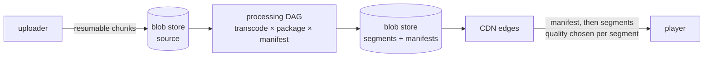
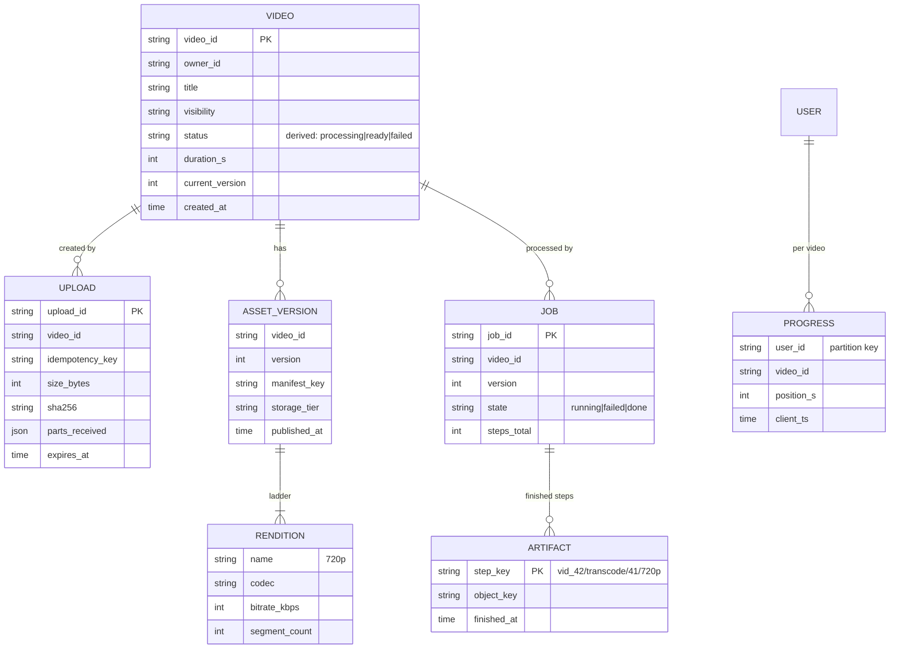
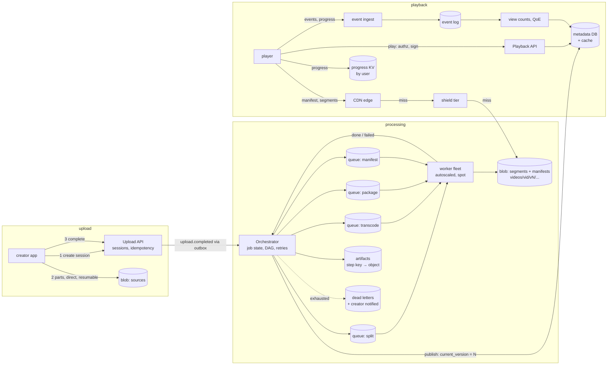

# C11 Unit 1 — Guided design: from the prompt to the high-level design

> Time: ~3.5 h · CORE: §1–§4 · STRETCH: the cost-per-hour-watched arithmetic at the end of §2, DRM and licence
> delivery in §3 · Lab: none in this unit (Unit 2 builds `labs/c11/transcode` and `labs/c11/abr`)

"Design YouTube" (or Netflix, or a video course platform) looks like a storage problem with a big upload button.
Candidates draw an upload API, a blob store and a "transcoding service" box, say "and a CDN", and run out of things
to say at minute twenty. The interesting parts are elsewhere. The bytes going *out* outnumber the bytes coming *in*
by two orders of magnitude, so the egress bill and the CDN hit ratio decide more than any database choice. One upload
becomes hundreds or thousands of output files, produced by a pipeline that must be parallel to be fast and
resumable to be affordable. And playback is not "download a file": the player picks a quality every few seconds from
what the network allows, so how you cut and label those files is a protocol decision, not an implementation detail.
The senior signal in this interview is following the bytes and the money.

This unit runs the 45-minute framework ([`docs/INTERVIEW_FRAMEWORK.md`](../../docs/INTERVIEW_FRAMEWORK.md)) phase by
phase on this problem. Each section is one phase. Commit to your answer at every predict block before opening the
reveal: the reveals are the walkthrough, and the gaps between your version and the reveal are what to study. Unit 2
does the deep dives and the labs.

## Before you start

You should have passed A1 ([networking and APIs](../A1-networking-api/README.md)), A6 ([async](../A6-async/README.md))
and C10 ([file storage](../C10-file-storage/README.md)). From C10 you need one idea: a large upload is a
**resumable, chunked upload into a blob store**, with the file's *metadata* (owner, name, chunk list, status) kept in
a database separate from the *bytes* ([C10 Unit 1 §3](../C10-file-storage/unit-1-guided-design.md#3-api-and-data-model-metadata-versus-blobs),
[C10 Unit 2 §6](../C10-file-storage/unit-2-deep-dives.md#6-resumable-uploads-integrity-and-the-commit-protocol)). This module
starts where that upload finishes. Warm-up, answer first:

1. A CDN in front of your origin has a 95% hit ratio. You raise it to 99%. By what factor does origin traffic fall?
2. 3.5 M people are each downloading a 3 Mbps stream at the same moment. What's the aggregate egress, in Gbps or
   Tbps? How many 25 Gbps NICs is that?
3. A queue consumer hits a message that crashes it every time it is processed. What happens without a retry limit,
   and what's the standard fix?

<details data-kind="answer">
<summary>Warm-up answers</summary>

1. Origin traffic is proportional to the *miss* ratio: 5% → 1% is a **5×** reduction
   ([A1 Unit 1 §6](../A1-networking-api/unit-1-request-path.md#6-cdns)). For video, where the totals are in Tbps,
   each extra point of hit ratio is a lot of bandwidth and money.
2. 3.5 × 10^6 × 3 × 10^6 bit/s ≈ 1.05 × 10^13 bit/s ≈ **10.5 Tbps**, ≈ 420 fully used 25 Gbps NICs. No origin
   serves that; this number is why a CDN is not optional in this design (§2 does it properly).
3. The message is redelivered forever, blocking its partition or burning a worker on every attempt: a **poison
   message**. Bound the attempts, then move it to a dead-letter queue with its error history and alert
   ([A6 Unit 2 §3](../A6-async/unit-2-outbox-consumers.md#3-poison-messages-dlqs-and-replay)). In this module a
   corrupt source video is the poison message.

</details>

---

## §1 Requirements and the questions an interviewer expects

### The failure story

A learning platform starts hosting its own lecture videos. Version 1: the instructor uploads an MP4 through the web
app, a server stores it on local disk, and the player gets an `<video src="/files/lecture-17.mp4">` tag served by
NGINX. At 2,000 students it works.

A year later there are 400,000 students in 30 countries. The complaints arrive in a predictable order. Students in
Jakarta on mobile data see the spinner for 20 seconds, then a stall every minute: the file is a 1080p, 8 Mbps
recording and their connection does 1.5 Mbps on a good day. Students on a train lose their place every time the
connection drops, because a single progressive download has no notion of quality steps. An instructor uploads a
3-hour, 9 GB workshop over hotel Wi-Fi; the single POST fails at 87% after 50 minutes and starts again from zero.
Someone adds "convert to 480p with ffmpeg" in the upload handler; the request now takes 40 minutes and times out at
the load balancer. The monthly bill shows the line nobody estimated: the servers pushed ≈ 900 TB out to the
internet, and cloud egress at ≈ $0.05–0.09 per GB (`docs/NUMBERS.md`) is ≈ $45–80k a month, more than every
other line combined. And when a course goes viral, one server's 10 Gbps NIC is the ceiling for everyone.

Every one of these is a requirement nobody asked about: who watches on what network, how long uploads are, how fast
an upload must become playable, where viewers are, and what the bytes cost.

### Predict

<!-- predict id="C11-U1-P01" -->
**Predict.** Write your answers down first.

1. The interviewer says only: "Design a video sharing platform like YouTube." Write the eight clarifying questions
   you'd ask, and next to each the design decision its answer changes. (A question whose answer changes nothing is
   small talk.)
2. Draft the functional requirements (at most six) and the non-functional requirements *with numbers*: startup time,
   rebuffering, upload-to-playable time, availability, durability.
3. Two prompts that sound alike: "design YouTube" and "design Netflix". Name three requirements that differ between
   them and the design decision each difference flips.
<!-- /predict -->

### Reveal

<details data-kind="reveal" data-for="C11-U1-P01">
<summary>Reveal</summary>

**1. The questions, and what each decides.**

| Question | Why it matters | Decision it changes |
|---|---|---|
| Video on demand, live, or both? | Live has a seconds-scale glass-to-glass budget and no time to transcode a whole file | Whether the pipeline is batch (a DAG per upload) or streaming (per-segment, real time); §10 STRETCH |
| Who uploads, how much, and how long are videos? (user-generated vs a curated catalogue) | UGC means hundreds of thousands of uploads a day and a huge long tail; a studio catalogue means few uploads and a hot head | Transcode fleet size, storage tiers, how much to spend per title on encoding |
| Upload-to-watch ratio: how many hours watched per hour uploaded? | Decides whether storage or egress dominates, and whether expensive encoding pays back | Codec and ladder policy (spend compute only where views justify it) |
| Which devices and networks? (phones on mobile data, smart TVs, browsers) | Device mix sets the codecs, the resolutions and the bitrate floor | The bitrate ladder, the packaging formats (HLS for Apple devices, DASH elsewhere, or CMAF for both), segment duration |
| Where are the viewers, and how concentrated is viewing? | Distance and concentration set the CDN footprint and the cache hit ratio | CDN choice (commercial, multi-CDN, own edge), regional origins, storage replication |
| How fast must an upload become playable? | "A few minutes" forces segment-level parallelism; "by tomorrow" allows a cheap serial queue | Pipeline design: one encode per file vs a DAG of segment tasks |
| Is the content protected? (DRM, paid content, geo-restriction) | Protected content needs encryption at packaging, licence servers and signed URLs | Packaging step, playback API, CDN token auth |
| What does a view count mean, and how fresh must it be? Watch progress across devices? | Counting at scale is a hot-key and fraud problem; resume needs per-user writes at high rate | Event pipeline for counts; a per-user progress store |

Fine to ask if time allows: retention ("do we ever delete?"), moderation and copyright matching (an extra pipeline
step), captions and audio tracks (more renditions per title), and offline download (a licence and storage
question on the device).

**2. Requirements for the UGC version** (state these as assumptions if the interviewer says "you decide").

Functional:
- Users **upload** videos (up to several GB) from flaky networks; uploads resume after a disconnect.
- The platform **processes** each upload into multiple qualities and makes it playable; the uploader sees progress.
- Viewers **watch** with adaptive quality on phones, browsers and TVs; seeking works.
- Viewers **resume** where they left off, on any device.
- Each video shows a **view count** (approximate, near-real-time).
- Video **metadata**: title, description, owner, visibility, thumbnails (search and recommendations out of scope).

Non-functional, with numbers:
- **Playback start**: time to first frame p90 ≤ ≈ 2 s on broadband (`TODO-VERIFY: published industry targets vary; use
  this as an assumption`). **Rebuffering**: stall time ≤ ≈ 1% of watch time. These two are the product.
- **Upload-to-playable**: a 10-minute video playable at some quality within ≈ 2 minutes of the upload finishing, all
  qualities within ≈ 10 minutes.
- **Availability**: playback 99.95% or better (viewers notice in seconds); upload and processing 99.9% (a delay is
  tolerable, a lost upload is not).
- **Durability**: an accepted upload is never lost: source and outputs in a store designed for ≈ 11 nines of
  durability (`TODO-VERIFY: the durability figure your object store documents`).
- **Scale** (assumed, §2 computes from it): 50 M daily viewers, ≈ 40 minutes each per day, 500k uploads a day.

Out of scope: search, recommendations, comments, monetisation and ads, the creator studio UI, live (offer it as
STRETCH; Unit 2 §10).

**3. YouTube vs Netflix.**

| Requirement | UGC (YouTube-like) | Curated (Netflix-like) | Decision it flips |
|---|---|---|---|
| Upload volume and catalogue size | Huge and growing every minute, mostly rarely watched | Tens of thousands of titles, added on a schedule | Transcode fleet and storage tiers matter for UGC; for a catalogue, storage is small and you can afford the best encode per title |
| Upload-to-watch ratio | Low per video on average, enormous for a few | Very high for every title | Per-title or per-scene encoding pays back for every Netflix title, only for popular UGC videos |
| Time to publish | Minutes | Days or weeks before a release date | Segment-parallel fast path for UGC; a slow, thorough pipeline for a catalogue |
| Predictability of demand | Viral spikes on unknown videos | Release dates known; popular titles known in advance | Pull caching for UGC; **pre-positioning** (push the next day's popular titles to edge caches overnight) for a catalogue |

The tempting wrong answer to question 1 is a list of features ("likes, comments, playlists, subscriptions"). They
change nothing about the hard parts. The senior version asks about the ratio, the devices, the latency of publishing
and the shape of demand, because those decide the pipeline and the CDN.

</details>

### How it actually works

A video platform is three systems joined at a blob store, and the requirements split cleanly between them:

| Path | Rate | What it cares about | Hard part |
|---|---|---|---|
| **Upload** (ingest) | ≈ 6 uploads/s, ≈ 20–50 Gbps in | never losing an accepted byte; resuming | flaky clients, multi-GB files (C10's problem) |
| **Processing** (transcode, package, publish) | ≈ thousands of CPU cores busy | turnaround time, cost per minute of video, never redoing finished work | a large DAG of tasks with failures, poison inputs and retries (Unit 2 §5–§6) |
| **Playback** (delivery) | ≈ 10 Tbps out, ≈ 1 M segment requests/s at peak | startup time, rebuffering, egress cost | CDN hit ratio, adaptive bitrate, the long tail (Unit 2 §7–§8) |

Four terms the rest of the module uses:

- **Rendition**: one encoded version of the video at a resolution and bitrate (e.g. 720p at 2.5 Mbps, H.264). The set
  of renditions offered for a title is the **bitrate ladder**.
- **Segment**: a short, independently decodable slice of a rendition (≈ 2–6 s), starting with a keyframe. Segments
  are aligned across renditions, so segment 42 covers the same seconds at every quality, which lets a player switch
  quality between segments.
- **Manifest** (playlist): a small text file that lists the renditions and, for each, the segment URLs. HLS calls it
  an `.m3u8` playlist; MPEG-DASH calls it an MPD. The player downloads the manifest first, then segments.
- **Adaptive bitrate (ABR)**: the player measures throughput and buffer, and picks the rendition for each next
  segment. The server does no per-viewer work at all: it serves static files, which is why a CDN can carry it.



### Build it

No lab for this section. The vocabulary becomes types in Unit 2: `transcode.Rendition`, `transcode.Job.Segments`
and the manifest step in `labs/c11/transcode`, and `abr.Rendition` with `abr.State` in `labs/c11/abr`.

### Break it

Change one requirement at a time and trace which decisions flip. Write your answer before opening the box.

(a) "Playable within 2 minutes" becomes "playable by tomorrow morning". (b) The audience is 95% smart TVs on
fibre. (c) The platform adds paid courses that must not be downloadable or shareable by URL.

<details data-kind="answer">
<summary>What flips</summary>

(a) Segment-level parallelism stops being necessary: a queue of whole-file encodes, one machine per video, run
overnight on cheap spare capacity, meets the requirement at lower orchestration cost. You'd still keep resumable,
idempotent steps (a 3-hour encode that fails at 2:50 shouldn't start over), but the DAG can be coarse.
(b) The ladder shifts up (more 1080p and 4K rungs, fewer low rungs), the average delivered bitrate rises (≈ 8–15 Mbps
instead of ≈ 3), so egress per hour watched rises ≈ 3–5×, and better codecs supported by TV hardware (HEVC, AV1;
`TODO-VERIFY` support per device generation) become worth their encoding cost sooner.
(c) DRM at the packaging step (encrypt segments; keys in a key service; licence server checks entitlement), signed
short-lived manifest and segment URLs or CDN token auth, and an entitlement check in the playback API. Note that
signed URLs stop casual link sharing; only DRM stops a determined downloader, and neither stops screen recording.

</details>

### In the wild

- **YouTube** has reported that more than 500 hours of video are uploaded every minute
  (`TODO-VERIFY: the current published figure and its date`), the defining fact of a UGC platform: the ingest and
  processing paths are large systems in their own right, and most uploads are watched rarely.
- **Netflix** has a catalogue measured in thousands of titles but very high viewing per title; it has published work
  on per-title and per-shot encoding (Unit 2 §7) and runs its own CDN, Open Connect, with caches placed in ISP
  networks and filled during off-peak hours (`TODO-VERIFY: current details of the fill window and appliance
  placement`; Unit 2 §8).
- **Apple's HLS** (HTTP Live Streaming, RFC 8216) and **MPEG-DASH** (ISO/IEC 23009-1) are the two dominant
  segmented-HTTP formats; Apple devices require HLS for many playback paths (`TODO-VERIFY: the exact platform
  requirement`), which is why "which devices?" is a packaging question.
- **Video course platforms** (Coursera, Udemy and similar) and corporate learning tools sit between the two shapes:
  curated uploads, long-tail viewing, and frequent requirements for protected content (`TODO-VERIFY` any specific
  platform's stack before citing it).

### Trade-offs

| Option | Wins when | Loses when | When the answer flips |
|---|---|---|---|
| Progressive download of one MP4 | Tiny audience on good networks; simplest possible | Mixed networks (stalls), seeking far ahead, no quality adaptation | Flip to segmented ABR as soon as viewers are on mobile or the audience is global |
| Segmented ABR (HLS/DASH) | Any real audience; CDN-friendly static files; quality adapts per segment | Many more objects and a packaging step; manifests to manage | Flip to WebRTC or another real-time protocol only for sub-second interactive latency (calls, auctions), never for VOD |
| Build the processing pipeline | High volume (UGC), custom ladders, cost control at scale | Engineering time; a fleet to run | Flip to a managed transcoding service (cloud media services) at low volume or for a team without media expertise |
| Treat live as part of the same system | Shared CDN, players and packaging | Live needs a real-time pipeline and different failure handling | Flip to a separate live pipeline sharing only the delivery side (Unit 2 §10) |

### Senior bar

- **Failure modes of bad scoping**: no device question → one 1080p rendition and stalls on mobile; no ratio
  question → spending AV1 compute on videos nobody watches, or skimping on titles watched a billion times; no
  publish-latency question → a serial pipeline where a parallel one was needed (or the reverse, over-built); no
  egress estimate → the bill in the failure story.
- **Capacity**: comes in §2; the point here is that *output bandwidth* is a requirement you must derive, because the
  interviewer will rarely state it.
- **Ops**: the requirements imply three different on-call stories: upload errors (user-visible, retryable),
  processing backlogs (delayed, not lost), playback QoE (startup time, rebuffer ratio, error rate per CDN, measured
  from players, not servers).
- **Cost**: egress is the dominant line for any video product at scale; say so in the first five minutes and the
  interviewer knows you've seen one.

Interviewer follow-up probes:

1. "Why ask about the upload-to-watch ratio? Isn't that a business metric?"

<details data-kind="answer">
<summary>Model answer</summary>

Because it decides where engineering money goes. Storage and transcode cost scale with hours *uploaded*; egress
scales with hours *watched*. At ≈ 600 hours watched per hour uploaded, bytes saved on delivery are worth far more than
compute spent on encoding, so better codecs and per-title ladders pay back, but only for the videos that are actually
watched. A platform where most uploads are watched a handful of times should encode the tail cheaply and spend on
the head. Without the ratio I'd be guessing which side of that line every decision is on.

</details>

2. "Why not just store one high-quality MP4 and let the player download it? Bandwidth is cheap now."

<details data-kind="answer">
<summary>Model answer</summary>

Three reasons. Networks vary per viewer and per minute: a 5 Mbps file on a 2 Mbps link stalls no matter how cheap
bandwidth is in a data centre. A single file can't change quality mid-stream, so the player can't trade sharpness for
continuity. And bandwidth is not cheap at this scale: at ≈ 45 PB a day of egress, sending 5 Mbps where 1.5 Mbps
would look fine on a phone screen roughly triples the largest line on the bill. A ladder plus segments lets every
viewer get the best picture their link sustains, and the platform pays for no bytes nobody can use.

</details>

3. "What's the one number you'd want to know before anything else?"

<details data-kind="answer">
<summary>Model answer</summary>

Hours watched per day (or concurrent viewers at peak) times the average delivered bitrate: that's peak egress. It
decides that a CDN is mandatory, sets the cost envelope, and tells me whether this is a tens-of-Gbps service (a
commercial CDN is fine) or a tens-of-Tbps one (multi-CDN, maybe your own edge). Uploads matter for the pipeline, but
egress is the number that makes or breaks the business.

</details>

### Check yourself

1. Name the three paths of a video platform and the one thing each optimises for.
2. Why must segments be aligned across renditions?
3. Which clarifying question decides whether segment-level parallelism is required?

<details data-kind="answer">
<summary>Answers</summary>

1. Upload (never lose an accepted byte, resume), processing (turnaround and cost per minute, never redo finished
   work), playback (startup time, rebuffering, egress cost).
2. So the player can switch quality between any two segments: segment *n* covers the same time range in every
   rendition and starts with a keyframe, so the next segment can come from a different rendition without a glitch.
3. How fast an upload must become playable. Minutes forces parallelism across segments; "tomorrow" allows one encode
   per file.

</details>

---

## §2 Estimation: the numbers that decide the design

### The failure story

The platform's v2 capacity review sized everything from uploads. "500k uploads a day, 6 minutes each, ≈ 10 Mbps
source: ≈ 225 TB a day in, ≈ 21 Gbps average. Ten upload servers with 25 Gbps NICs, plenty of headroom." The review
approved a single origin cluster in one region serving the encoded files, "with a CDN later if needed".

On launch week the origin cluster's NICs saturated at 19:00 every evening. Nobody had computed the other direction:
50 M daily viewers at 40 minutes a day, ≈ 3 Mbps each, is ≈ 4 Tbps on average and ≈ 10 Tbps at the evening peak,
roughly **200×** the ingest. The team added a CDN in a hurry with default settings: a 30-minute TTL on segments
"to be safe", which sent the long tail back to origin every half hour, and a hit ratio of 88%, which still left
≈ 1.2 Tbps on an origin built for 250 Gbps. The first monthly CDN invoice was ≈ 3× the forecast, because the
forecast used the average bitrate of uploads (what people send) rather than of views (what people watch, on bigger
screens, at the top rungs of the ladder). And the transcode queue, sized for the average upload rate, was 9 hours
deep every Sunday evening, when creators upload.

### Predict

<!-- predict id="C11-U1-P02" -->
**Predict.** Assumptions: 50 M daily active viewers watching ≈ 40 minutes a day each; average *delivered* bitrate
≈ 3 Mbps; peak concurrency ≈ 2.5× average; 500k uploads a day averaging 6 minutes, source ≈ 10 Mbps; a five-rung
H.264 ladder of 240p 0.4, 360p 0.8, 480p 1.2, 720p 2.5 and 1080p 5 Mbps (≈ 10 Mbps in total); 4-second segments;
transcoding costs ≈ 1 CPU-core-second per second of output per rendition (an assumption; measure yours); object
storage ≈ $0.023/GB-month; CDN egress ≈ $0.01/GB at committed volume (`TODO-VERIFY`: negotiated CDN prices vary
widely by volume and region; cloud list egress is ≈ $0.05–0.09/GB).

Compute, carrying units, and write the decision each number drives:

1. Average and peak concurrent viewers, and peak egress in Tbps.
2. Egress bytes per day, and the monthly egress bill at $0.01/GB.
3. Segment requests per second at peak.
4. Upload ingress (TB/day, Gbps) and the egress-to-ingress ratio.
5. Storage added per uploaded minute (ladder plus source) and per year.
6. Transcode CPU cores busy on average, and how that compares in cost with egress.
<!-- /predict -->

### Reveal

<details data-kind="reveal" data-for="C11-U1-P02">
<summary>Reveal</summary>

1. 50 M × 40 min = 2 × 10^9 viewer-minutes a day ÷ 1,440 minutes a day ≈ **1.4 M concurrent viewers on average**;
   × 2.5 ≈ **3.5 M at peak**. Peak egress ≈ 3.5 M × 3 Mbps ≈ **10.5 Tbps** (average ≈ 4.2 Tbps). Decision: a CDN
   is mandatory, and at this size probably more than one (§4, Unit 2 §8). An origin with 25 Gbps NICs would need
   ≈ 400+ of them just for bandwidth, before any redundancy.
2. One hour at 3 Mbps is 3 × 10^6 × 3,600 / 8 ≈ **1.35 GB**. 2 × 10^9 minutes ≈ 33 M hours × 1.35 GB ≈ **45 PB a
   day**, ≈ 1.35 EB a month. At $0.01/GB: 1.35 × 10^9 GB × $0.01 ≈ **$13.5 M a month**; at cloud list prices
   (≈ $0.05/GB) ≈ $68 M. Decision: egress is the dominant cost line, so the levers are bytes per hour watched
   (codecs, ladders, ABR caps on small screens) and price per byte (CDN contracts, multi-CDN, own edge).
3. Each viewer fetches one segment every 4 s: 3.5 M / 4 s ≈ **875k requests/s** at peak. Decision: the edge serves
   requests, the origin must see only misses; segment duration is a request-rate lever (2 s segments double it).
4. 500k × 6 min = 3 M minutes a day × 60 s × 10 Mbps ÷ 8 ≈ **225 TB a day** in, ≈ **21 Gbps** average, ≈ 40–50 Gbps
   at the upload peak. Egress ÷ ingress ≈ 4.2 Tbps ÷ 21 Gbps ≈ **200×**. Decision: uploads go directly to the blob
   store via signed, resumable chunk URLs (C10), never through app servers; but the *design effort* belongs on the
   egress side.
5. Ladder ≈ 10 Mbps ≈ 75 MB per minute; source ≈ 10 Mbps ≈ 75 MB per minute; ≈ **150 MB per uploaded minute**. 3 M
   minutes × 150 MB ≈ **450 TB a day** ≈ **165 PB a year** logical, plus the store's redundancy overhead (erasure
   coding ≈ 1.2–1.5×, `TODO-VERIFY` per store). At $0.023/GB-month, one year's accumulation costs ≈ 165 × 10^6 GB ×
   $0.023 ≈ **$3.8 M a month** at the standard tier, and it grows every year. Decision: storage tiers for the long tail
   (most videos are rarely watched after their first weeks), source kept in an archive tier, and possibly not keeping
   every rung for videos nobody watches (Unit 2 §8).
6. 3 M min × 60 s × 5 renditions × 1 core-s ≈ 9 × 10^8 core-seconds a day ÷ 86,400 ≈ **10,400 cores** busy on
   average (≈ 165 servers of 64 cores), ≈ 2× that at the upload peak. At ≈ $300 a month per 8-vCPU VM
   (`docs/NUMBERS.md`, on demand; ≈ 1,300 VMs) that's ≈ $0.4 M a month, much less on spot capacity. Decision: compute
   is a few percent of egress, so spending more compute to save bytes (better codecs, per-title ladders) pays, but
   only on videos with enough views to amortise it; and a backlog-tolerant queue on spot capacity is the cheap way
   to absorb the Sunday-evening upload peak.

The tempting wrong answers: sizing the system from uploads (the 200× is the whole story); using the source or
upload bitrate for egress (views happen at the rung the player picks, not at the source rate); quoting egress in
bytes and comparing it with NIC speeds in bits (8×); forgetting that storage accumulates while egress is a rate.

</details>

### How it actually works

The estimate sheet for this system, in the order you'd write it on the board:

| Number | Arithmetic | Decision |
|---|---|---|
| Concurrent viewers | 50 M × 40 min ÷ 1,440 ≈ 1.4 M avg; × 2.5 ≈ 3.5 M peak | Everything on the playback side scales from this |
| Peak egress | 3.5 M × 3 Mbps ≈ 10.5 Tbps | CDN mandatory; likely multi-CDN or own edge |
| Egress per day / month | 1.35 GB/hour × 33 M hours ≈ 45 PB/day ≈ 1.35 EB/month | Cost envelope: ≈ $13.5 M/month at $0.01/GB |
| Segment requests | 3.5 M ÷ 4 s ≈ 875k req/s | Edge serves requests; segment duration is a lever |
| Ingress | 3 M min × 60 × 10 Mbps ÷ 8 ≈ 225 TB/day ≈ 21 Gbps | Direct-to-blob resumable uploads (C10) |
| Storage growth | 150 MB/min × 3 M min ≈ 450 TB/day ≈ 165 PB/year | Tiering; source in archive; lazy rungs for the tail |
| Transcode compute | 9 × 10^8 core-s/day ÷ 86,400 ≈ 10k cores | Autoscaled, spot-friendly, queue-buffered fleet |
| Turnaround (§4) | 6-min video ≈ 90 segments × 5 rungs ≈ 450 tasks of ≈ 4 core-s | Segment-parallel DAG: ≈ seconds, not tens of minutes |

Two conversions are worth memorising for this module: **1 Mbps for an hour ≈ 0.45 GB** (so 3 Mbps ≈ 1.35 GB per
hour, 5 Mbps ≈ 2.25 GB), and **1 Mbps for a minute ≈ 7.5 MB** (so the 1080p rung at 5 Mbps is ≈ 37.5 MB per minute,
consistent with ≈ 40 MB/min in `docs/NUMBERS.md`). With those, every number above is one multiplication.

A small Go program reproduces the sheet; changing an assumption and re-running it is the fastest way to see which
decisions are sensitive to which inputs:

```go
package main

import "fmt"

func main() {
	const (
		dailyViewers   = 50e6
		minutesPerDay  = 40.0
		peakFactor     = 2.5
		deliveredMbps  = 3.0
		segmentSec     = 4.0
		uploadsPerDay  = 500e3
		uploadMinutes  = 6.0
		sourceMbps     = 10.0
		ladderMbps     = 10.0 // sum of all rungs
		renditions     = 5.0
		coreSecPerSec  = 1.0 // per rendition, assumption
		cdnDollarPerGB = 0.01
	)
	avgConc := dailyViewers * minutesPerDay / 1440
	peakConc := avgConc * peakFactor
	peakTbps := peakConc * deliveredMbps / 1e6
	gbPerHour := deliveredMbps * 1e6 * 3600 / 8 / 1e9
	pbPerDay := dailyViewers * minutesPerDay / 60 * gbPerHour / 1e6
	monthlyEgress := pbPerDay * 1e6 * 30 * cdnDollarPerGB
	upMin := uploadsPerDay * uploadMinutes
	ingressTBPerDay := upMin * 60 * sourceMbps * 1e6 / 8 / 1e12
	storageTBPerDay := upMin * 60 * (ladderMbps + sourceMbps) * 1e6 / 8 / 1e12
	cores := upMin * 60 * renditions * coreSecPerSec / 86400

	fmt.Printf("concurrent viewers: avg %.2fM, peak %.2fM\n", avgConc/1e6, peakConc/1e6)
	fmt.Printf("peak egress: %.1f Tbps; %.1f PB/day; $%.1fM/month\n", peakTbps, pbPerDay, monthlyEgress/1e6)
	fmt.Printf("segment requests at peak: %.0fk/s\n", peakConc/segmentSec/1e3)
	fmt.Printf("ingress: %.0f TB/day; storage added: %.0f TB/day (%.0f PB/year)\n",
		ingressTBPerDay, storageTBPerDay, storageTBPerDay*365/1000)
	fmt.Printf("transcode cores busy on average: %.0f\n", cores)
}
```

**STRETCH — cost per hour watched.** Divide each cost by the hours it serves. Egress: 1.35 GB × $0.01 ≈ **$0.0135
per hour watched**. Transcode: one uploaded hour is 3,600 s × 5 rungs ≈ 5 core-hours; at ≈ $0.02–0.05 per core-hour
(`TODO-VERIFY` for your cloud and spot market) that's ≈ $0.1–0.25 per uploaded hour, spread over ≈ 660 watched hours
(33 M ÷ 50k), so ≈ $0.0003 per hour watched on average. Storage: ≈ 9 GB per uploaded hour × $0.023 ≈ $0.2 per
month, forever, whether anyone watches or not. Two conclusions follow. For the platform as a whole, egress dominates
by ≈ 40×. For an individual tail video with 20 views in its life, storage dominates, because it never stops. Those
are the two halves of Unit 2 §8.

### Build it

No lab for this section. Run `sd estimate -kind bandwidth -n 3` and `sd estimate -kind storage -n 3` before Unit 2;
in the design exercise the egress and storage numbers should come out of your head.

### Break it

Re-run the sheet with each change and note which decisions flip: (a) the audience moves to TVs and the average
delivered bitrate rises to 8 Mbps; (b) segments shrink from 4 s to 2 s; (c) the platform keeps only the source plus
the three lowest rungs for videos with fewer than 100 views in their first month.

<details data-kind="answer">
<summary>What flips</summary>

(a) Egress scales linearly: ≈ 28 Tbps peak and ≈ 120 PB a day, ≈ $36 M a month at $0.01/GB. Encoding efficiency
becomes worth far more: a codec that saves ≈ 30% of bits (`TODO-VERIFY` for the codec pair you cite) now saves
≈ $11 M a month, which pays for a lot of encoding compute on popular titles. Building or embedding your own edge
caches moves from "maybe" to a serious business case.
(b) Peak segment requests double to ≈ 1.75 M/s, objects per video double, and compression gets ≈ a few percent
worse (more keyframes; `TODO-VERIFY` magnitude for your encoder). In exchange startup and quality switches get
faster. For VOD, ≈ 4–6 s is the usual compromise; 2 s (or partial segments) is a live-latency decision (Unit 2 §10).
(c) For the tail, storage per minute drops from ≈ 150 MB to ≈ 75 + 18 ≈ 93 MB (source plus 0.4 + 0.8 + 1.2 Mbps
≈ 18 MB/min), ≈ 40% less. The cost is that the rare viewer who wants 1080p either gets 480p or waits for an
on-demand transcode, and the pipeline must support transcoding a rung later, which the idempotent per-step keys of
Unit 2 §5 make easy (it's the same step with a key that doesn't exist yet).

</details>

### In the wild

- **Egress dominates media bills** across the industry, which is why large video companies run their own delivery
  networks: Netflix's **Open Connect** appliances and Google's edge caching inside ISPs (Google Global Cache) put
  servers in ISP networks so the bytes never cross a paid transit link (`TODO-VERIFY: current published details for
  either programme`).
- **Cloud list prices** for internet egress are ≈ $0.05–0.09/GB at the first tiers (`docs/NUMBERS.md`); CDN contracts
  at petabyte-a-month volumes are priced very differently and are almost never public (`TODO-VERIFY` before quoting
  any figure; the $0.01/GB above is an assumption for arithmetic, not a price).
- **YouTube** has published work on custom video-transcoding hardware (a "video coding unit") to cut the compute
  cost of encoding at its upload volume (`TODO-VERIFY: name, year and claimed efficiency`), evidence that at the very
  largest scale compute becomes significant too.
- **Sunday-evening and holiday upload peaks**, and evening viewing peaks ≈ 2–3× the daily average, are common
  patterns for consumer media (`TODO-VERIFY` for a specific platform); the 2.5× here is an assumption to state.

### Trade-offs

| Option | Wins when | Loses when | When the answer flips |
|---|---|---|---|
| Size from uploads | Ingest-heavy systems (backup, archives) | Any viewing product: egress is ≈ 200× ingest here | Flip to sizing from concurrent viewers × delivered bitrate for anything watched more than written |
| Average delivered bitrate ≈ 3 Mbps | Mixed mobile and desktop audiences | TV-heavy audiences (≈ 8–15 Mbps), audio-only products (≈ 0.1 Mbps) | Re-derive from the device mix; it's the most sensitive input on the sheet |
| Keep every rung of every video forever | Simple; any viewer gets any quality instantly | A long tail of rarely watched videos paying full storage | Flip to lazy or pruned rungs for the tail once storage is a visible line (≈ PB/year growth) |
| Transcode on dedicated reserved capacity | Steady, predictable upload volume | Weekly and seasonal peaks idle half the fleet | Flip to autoscaled spot capacity behind a queue; reserve only the base load |

### Senior bar

- **Failure modes of bad estimation**: sizing from uploads; bits/bytes confusion (comparing PB/day with Gbps links);
  using upload bitrate for views; no peak factor (the 19:00 saturation); storage as a rate rather than an
  accumulation; transcode fleet sized for the average upload rate (the Sunday backlog).
- **Capacity**: ≈ 10 Tbps egress, ≈ 875k segment req/s, ≈ 20–50 Gbps ingest, ≈ 10k cores of transcode, ≈ 165 PB a
  year of storage growth. Say them in that order of importance.
- **Ops**: the estimate becomes the capacity plan: CDN commit levels per region, origin offload target (hit ratio),
  transcode fleet autoscaling bounds, storage tier transition rules. Revisit when the device mix shifts.
- **Cost**: ≈ $13.5 M/month egress at an assumed $0.01/GB vs ≈ $3.8 M/month storage (growing) vs ≈ $0.4 M/month
  compute: egress first, storage second, compute last, which is the order in which to spend design effort.

Interviewer follow-up probes:

1. "Your egress estimate is 10 Tbps. How confident are you, and which input would you check first?"

<details data-kind="answer">
<summary>Model answer</summary>

Order-of-magnitude confident; the most sensitive input is the average *delivered* bitrate, which depends on the
device mix and on how the ABR policy caps quality on small screens. 3 Mbps could be 2 or 6 for a different audience,
a 2–3× swing. Second is the peak factor. I'd check both against player telemetry from a pilot (bitrate per session,
concurrency curve per region) before committing CDN contracts, and I'd size the commitment for the average with
burst pricing for the peak.

</details>

2. "Storage is $3.8 M a month and egress $13.5 M. So storage doesn't matter?"

<details data-kind="answer">
<summary>Model answer</summary>

It matters differently. Egress is a rate that follows viewing; storage is an accumulation that grows every year
whether anyone watches or not, so in year five it's ≈ 5× today's and still growing. And per video it flips: a
popular video's cost is almost all egress, a tail video's cost is almost all storage. So egress gets the CDN and
codec effort, and storage gets lifecycle rules (tiers, archive for sources, pruned or lazy rungs for the tail).
Both are worth an engineer.

</details>

3. "How long does it take to transcode a 2-hour movie?"

<details data-kind="answer">
<summary>Model answer</summary>

It depends on parallelism, not the movie. Serially, at ≈ 1 core-second per output second per rung, the 1080p rung
alone is ≈ 2 hours of one core and the whole ladder ≈ 10 core-hours. Split into 4 s segments, it's ≈ 1,800 segments
× 5 rungs ≈ 9,000 independent tasks of ≈ 4 core-seconds each; with 1,000 cores available that's ≈ 36 s of compute
plus packaging and scheduling overhead, so roughly a minute or two. The real limits become the split step (reading
the source and finding keyframes), the slowest straggler task and the scheduler, which is Unit 2 §5.

</details>

### Check yourself

1. Convert 5 Mbps sustained for one hour into GB.
2. Why is egress ≈ 200× ingest on this platform, and what does that tell you about where to spend design time?
3. What does halving segment duration do to peak request rate and to compression?

<details data-kind="answer">
<summary>Answers</summary>

1. 5 × 10^6 × 3,600 / 8 ≈ 2.25 × 10^9 B ≈ **2.25 GB** (or 5 × 0.45 GB).
2. Each uploaded hour is watched ≈ 660 hours, at a lower bitrate than the source but many times over: ≈ 4.2 Tbps out
   vs ≈ 21 Gbps in on average. Spend design time on delivery (CDN, ladder, ABR, cost per GB), not on the upload path,
   which C10's resumable upload already solves.
3. It doubles requests per second (one segment per 2 s per viewer instead of 4 s) and slightly worsens compression,
   because each segment starts with a keyframe and keyframes are expensive.

</details>

---

## §3 API and data model

### The failure story

The v1 API was one endpoint: `POST /videos` with the whole file in the body, returning the finished video when
transcoding completed. Three things went wrong in the first month.

- Long uploads failed and restarted from zero, as in §1. Mobile clients retried the POST after timeouts, and because
  nothing identified "the same upload", one creator ended up with four copies of the same 2 GB video, each
  transcoded, each stored, each with its own view count.
- The `videos` table had a `status` column overwritten by every worker ("transcoding", "packaging", "done",
  "failed"). When a worker crashed mid-transcode, the row said "transcoding" forever, and nobody could tell which of
  the 600 segment outputs existed. The fix was to re-run the whole job.
- Watch progress was a column on `videos`: `last_position`. For everyone. The second viewer of a video resumed at
  the first viewer's position. When someone fixed it with a `progress(user_id, video_id)` table written every
  second by every player, the database took ≈ 3.5 M writes per second at peak and fell over.

### Predict

<!-- predict id="C11-U1-P03" -->
**Predict.** Write down before opening the reveal:

1. The API: endpoints for starting, resuming and completing an upload; getting a video's metadata and its playback
   information; saving watch progress; reporting playback events. For each, the method, the important fields, and
   what makes retries safe.
2. The data model, starting from access patterns: what are the entities, what's the partition key of each, and what
   lives in the database versus the blob store?
3. How are output objects named in the blob store, and why does the naming scheme matter for both the pipeline and
   the CDN?
<!-- /predict -->

### Reveal

<details data-kind="reveal" data-for="C11-U1-P03">
<summary>Reveal</summary>

**1. The API.**

```text
POST /v1/uploads                                   Idempotency-Key: <client-generated, per upload intent>
  {"filename": "workshop.mp4", "size_bytes": 9123456789, "sha256": "…", "content_type": "video/mp4",
   "title": "Workshop day 1", "visibility": "unlisted"}
→ 201 {"upload_id": "up_7Kd…", "video_id": "vid_42", "chunk_size": 8388608,
       "parts": [{"n": 1, "url": "<signed PUT URL>"}, …]}          # or a URL template + a part-URL endpoint
PUT  <signed part URL>                              body: chunk n (direct to the blob store, not our servers)
GET  /v1/uploads/{upload_id}                        → {"received_parts": [1,2,3,5], "expires_at": "…"}   # resume
POST /v1/uploads/{upload_id}/complete               {"parts": [{"n":1,"etag":"…"}, …]}
→ 202 {"video_id": "vid_42", "status": "processing"}                # idempotent: same response on retry

GET  /v1/videos/{video_id}                          → metadata + {"status": "processing|ready|failed",
                                                       "progress": {"done": 312, "total": 451}}
GET  /v1/videos/{video_id}/playback                 → {"manifest_url": "https://cdn…/vid_42/v3/master.m3u8?sig=…",
                                                       "expires_at": "…", "drm": {…}, "resume_at_s": 1312}
PUT  /v1/me/progress/{video_id}                     {"position_s": 1312, "client_ts": "…", "device": "tv"}
→ 204                                                # last-writer-wins on client_ts; sent every ≈ 30 s and on pause/exit
POST /v1/events/playback                            [{"session": "…", "video_id": "vid_42", "type": "start|heartbeat|
                                                       rebuffer|bitrate_switch|end", "at": "…", …}, …]   # batched
→ 202
GET  /v1/videos/{video_id}/stats                    → {"views": 1284000, "as_of": "…"}   # approximate, cached
```

What makes each safe to retry: the upload create carries an `Idempotency-Key` so a retried create returns the same
`upload_id` and `video_id` instead of a second video (A1 Unit 3 §2); part uploads are idempotent by part number (a
re-uploaded part overwrites itself); `complete` is idempotent by `upload_id` and returns the same `202`; progress is
last-writer-wins by `client_ts`; playback events carry a session id and sequence number so the pipeline can drop
duplicates. The playback endpoint returns a *signed, short-lived* manifest URL: the CDN serves the bytes, our API
only authorises.

**2. Access patterns → data model.**

| Access pattern | Rate | Served by | Where |
|---|---|---|---|
| Create/resume/complete an upload | ≈ 6/s, plus part listings | `uploads(upload_id)` with parts received | DB (C10's session model) |
| Read a video's metadata (watch page, playback) | ≈ 15k/s peak, ≈ 10× that with browse pages | `videos(video_id)`, cached | DB + cache |
| A creator's videos | low | `videos_by_owner(owner_id, created_at)` | DB secondary index |
| Which renditions/segments exist for a video version? | per publish, per playback (via manifest) | `assets(video_id, version)` → rungs, codec, segment count, storage tier | DB; the manifest itself is a blob |
| Processing job state: which steps are done? | thousands of updates/s across jobs | `jobs(job_id)` + `artifacts(step_key → object key)` | DB (or the step store) |
| The bytes: sources, segments, manifests, thumbnails | ≈ 875k segment reads/s at the edge | object keys (below) | blob store behind the CDN |
| Save / read watch progress | ≈ 117k writes/s at peak (3.5 M ÷ 30 s) | `progress(user_id, video_id)` | KV store partitioned by `user_id` |
| Playback events | ≈ 100k+/s | append-only event log | log (Kafka-style), not a DB |
| View count per video | read ≈ 15k/s, updated by aggregation | `view_counts(video_id)` | KV/cache, written by a stream job (Unit 2 §9) |

The database holds small, mutable facts (≈ a few KB per video); the blob store holds large, immutable bytes
(≈ 150 MB per minute of video). The tempting wrong answers: a `status` column as the only record of processing
(the crash in the story), progress keyed by video, view counts as `UPDATE … SET views = views + 1` on the video row,
and any byte of video passing through the API servers.

**3. Object naming.**

```text
sources/vid_42/up_7Kd…/source.mp4                       # immutable, the upload as received
videos/vid_42/v3/720p/seg_00042.m4s                     # one segment of one rung of asset version 3
videos/vid_42/v3/720p/index.m3u8                        # media playlist for that rung
videos/vid_42/v3/master.m3u8                            # master playlist: the ladder
videos/vid_42/v3/thumbs/t_0005.jpg
```

Deterministic names make the pipeline **idempotent**: a step's output key is a function of its inputs (video,
version, rung, segment), so a retried or resumed step writes the same key, and "is this step done?" is "does the
key exist?" (Unit 2 §5–§6, and exactly what `Step.Key` does in the lab). A **version** in the path makes every
published object **immutable**, so the CDN can cache segments for a year with no invalidation; re-encoding a video
(a new codec, a fixed ladder) writes `v4/` and the playback API starts handing out `v4` manifests. Old versions are
deleted later by a lifecycle rule. The tempting wrong answer is overwriting `videos/vid_42/720p/seg_42.m4s` in place
on re-encode: half the world's edges keep the old bytes for the TTL, and players splice old and new segments.

</details>

### How it actually works



**Upload, briefly (C10's part).** The client asks for an upload session, gets a chunk size and signed part URLs, and
uploads parts in parallel directly to the blob store; a disconnect costs at most the parts in flight; `GET
/v1/uploads/{id}` tells it which parts to resend; `complete` stitches the parts (object stores support multipart
completion natively) and verifies the checksum. The session row is metadata; the bytes never touch the API. Then
`complete` publishes an `upload.completed` event, and processing begins. The session, presigned-part and commit
mechanics are [C10 Unit 2 §6](../C10-file-storage/unit-2-deep-dives.md#6-resumable-uploads-integrity-and-the-commit-protocol);
everything after this point is this module.

**Processing state is a set of finished artifacts, not a status column.** Each step of the job (Unit 2 §5) has a
deterministic key; when a step finishes, its output object is written and the `artifacts` row is inserted, in that
order. The job's progress is `count(artifacts) / steps_total`; the video's `status` is *derived* (ready when the
manifest artifact exists and the version is published). A crashed worker leaves no row for its step, so the resumed
job redoes only that step. This is the lab's `Store` interface and `Result.Executed` vs `Result.Skipped`.

**Publishing a version.** When the manifest step finishes, a single metadata write sets
`videos.current_version = 3`. That write is the atomic "go live": until it happens, players get the old version
(or "processing"); after it, they get `v3`. Because objects are immutable and versioned, there is no moment where
a player can see a manifest pointing at segments that don't exist yet, provided the manifest is written *after* its
segments, which the DAG guarantees.

**Watch progress.** Per `(user_id, video_id)`, last-writer-wins by the client's timestamp, written every ≈ 30 s and
on pause, seek and exit, not every second. Partitioned by `user_id` so "continue watching" for one user is one
partition read. At ≈ 117k writes/s peak this is a KV store (Cassandra/DynamoDB-style) or a sharded Redis with
persistence, not the relational metadata DB. Losing the last 30 s of progress on a crash is acceptable; say so.

**Playback events and view counts.** Players batch events (start, heartbeats, rebuffers, quality switches, end) to
`POST /v1/events/playback`, which appends to a log. Two consumers: a QoE pipeline (startup time, rebuffer ratio,
errors by CDN, region, device: the metrics that matter most in this system) and a view-count aggregator that
decides what counts as a view, drops duplicates and fraud, and updates `view_counts` in batches (Unit 2 §9). The
count on the watch page is read from a cache and is minutes old; nobody needs it exact.

**STRETCH — DRM and licence delivery.** For protected content, the packaging step encrypts segments with a content
key (Common Encryption, CENC; `TODO-VERIFY` which scheme, `cenc` or `cbcs`, each target device family supports), keys
are generated per title (or per group of rungs, so a leaked SD key doesn't expose HD) and stored in a key service
backed by a KMS, and the manifest carries the key identifiers, never the keys. At playback the player's DRM module
(Widevine, FairPlay or PlayReady, depending on the device) sends a licence request to a licence server, which checks
entitlement (is this user allowed to watch this title, in this country, on this device?) and returns the key
wrapped for that device. The playback API returns the licence server URL and a short-lived entitlement token. The
CDN still serves ordinary cacheable files: encryption happens once at packaging, not per viewer, which is what
keeps DRM compatible with CDN economics.

### Build it

No lab for this section. `transcode.Step.Key()` in `labs/c11/transcode` is the deterministic artifact key
(`vid_42/transcode/41/720p`, `vid_42/package/41`, `vid_42/manifest`), and `transcode.Store` with `MemStore` is the
`artifacts` table: the lab's resume test is the crash from this section's failure story, fixed.

### Break it

For each change, say what breaks and which lab test in Unit 2 would catch the equivalent: (a) output keys include a
random UUID per attempt instead of being derived from the step; (b) the worker writes the `artifacts` row *before*
the object upload finishes; (c) the manifest is written as soon as the first rung of every segment exists, and the
rest of the ladder is added in place later.

<details data-kind="answer">
<summary>What breaks</summary>

(a) A retried step writes a second object instead of overwriting the first; resume can't tell the step is done
(nothing to look up), so it redoes it, and the store fills with orphaned outputs nobody deletes.
`TestRun_ResumesFromTheStoreWithoutRedoingWork` asserts that a resumed run skips exactly what was stored; random keys
make "what was stored" unknowable.
(b) A crash between the two leaves a row pointing at an object that doesn't exist; resume skips the step, packaging
reads a missing segment, and the manifest references a 404. The order must be "output durable, then record it".
The lab's contract is the same rule: an artifact is written to the `Store` before dependents start.
(c) Players that fetched the early manifest never learn about the higher rungs (VOD manifests are cached for a long
time), and players that fetch it during the rewrite may see a ladder referencing segments still being written.
Progressive publishing is a legitimate feature (playable at 360p in seconds, Unit 2 §5), but it must be done as
separate published versions or a manifest that is only rewritten atomically, never as in-place edits of an
immutable, cached object. `TestRun_RespectsDependenciesAndPassesInputsInOrder` checks the base rule: the manifest
step runs only after every package step.

</details>

### In the wild

- **Resumable uploads**: Amazon S3 multipart upload (parts of ≥ 5 MB except the last, completed by an explicit
  call; `TODO-VERIFY` current limits), Google Cloud Storage resumable uploads, and the open **tus** protocol all
  implement the upload half; YouTube's Data API offers a resumable upload protocol for large files.
- **Signed URLs and CDN token auth**: CloudFront signed URLs and signed cookies, Akamai token authentication and
  similar features let the API authorise once and the edge enforce it on every segment request without calling
  back to origin (`TODO-VERIFY` feature names per vendor).
- **DRM**: Google Widevine (Android, Chrome, many TVs), Apple FairPlay Streaming (Apple platforms, Safari),
  Microsoft PlayReady (Windows, many TVs and set-top boxes); multi-DRM services exist to run the licence servers for
  you (`TODO-VERIFY` platform coverage before quoting it).
- **Watch progress** at large services is a per-user, high-write, last-writer-wins workload, the kind of workload
  wide-column stores (Cassandra, DynamoDB, Bigtable) are built for; Netflix has written about using Cassandra for
  viewing history (`TODO-VERIFY` the current design).

### Trade-offs

| Option | Wins when | Loses when | When the answer flips |
|---|---|---|---|
| Uploads through app servers | Tiny files, need to inspect bytes inline | Multi-GB video: app servers become a bandwidth tier; long requests | Flip to signed direct-to-blob uploads for anything over ≈ a few MB |
| Deterministic, versioned object keys | Idempotent pipeline, immutable CDN caching | Need a lifecycle rule to delete old versions | Never flip for published segments; random keys only for scratch files |
| Status column per video | Simple UI lookups | As the *only* processing record: crashes leave it wrong | Keep a derived status for the UI; the artifacts set is the truth |
| Progress every second | Exact resume | ≈ 3.5 M writes/s at peak for no visible benefit | Every ≈ 30 s plus pause/seek/exit; flip to finer only for short-form video where 30 s is the whole clip |
| Exact view counts in the DB | Tiny scale; legal or billing needs exactness | Hot rows on viral videos, fraud, write amplification | Flip to an event log + stream aggregation with approximate display (Unit 2 §9); keep an exact, delayed count for payouts |

### Senior bar

- **Failure modes**: duplicate videos from retried creates (no idempotency key); orphaned uploads that never
  complete (sessions need expiry and a cleanup job that aborts incomplete multipart uploads, or you pay for
  invisible parts); a status column that lies after a crash; manifests published before their segments; progress
  rows overwritten out of order (no client timestamp); signed URLs that never expire, shared on forums.
- **Capacity**: metadata ≈ 15k reads/s peak per play, ≈ 150k with browse, served from cache; progress ≈ 117k
  writes/s, a partitioned KV store; events ≈ 100k+/s into a log; the rest is blob store and CDN.
- **Ops**: lifecycle rules (abort incomplete multipart uploads after ≈ a week; delete superseded versions after a
  grace period; tier old sources to archive); the artifacts table is also the debugging tool ("which segment of job
  X failed, and why?").
- **Cost**: incomplete uploads and superseded versions are pure storage waste and easy to miss for months; at
  ≈ 450 TB a day of new data, a 1% leak is ≈ 1.6 PB a year.

Interviewer follow-up probes:

1. "The creator's phone uploads 80% of a 4 GB file and the app is killed. What happens next?"

<details data-kind="answer">
<summary>Model answer</summary>

The upload session survives on the server with its received parts recorded. When the app restarts it calls
`GET /v1/uploads/{id}`, learns which parts are missing, re-requests signed URLs for them if the old ones expired, and
uploads only those, then calls `complete`. If the user never comes back, the session expires after ≈ 24 h–7 days and a
lifecycle rule aborts the multipart upload so the parts stop costing money. The `video_id` was allocated at create
time, so the creator's draft exists throughout, shown as "upload incomplete".

</details>

2. "Why return a manifest URL from the API instead of serving the manifest yourselves?"

<details data-kind="answer">
<summary>Model answer</summary>

So that every byte of video, manifests included, comes from the CDN. The API's job is authorisation: check
visibility, entitlement and geo rules, pick the version, and sign a URL (or set a signed cookie) that the edge can
verify without calling us. If the API served manifests, it would take ≈ 15k requests/s at peak plus every manifest
refresh, and a slow API would delay every play start. With a signed URL the API is called once per play and the
edge does the rest.

</details>

3. "How do you re-encode the whole catalogue with a better codec without breaking playback?"

<details data-kind="answer">
<summary>Model answer</summary>

New asset version per video: the pipeline writes `v4/` with the new ladder alongside `v3/`, nothing in `v3/` is
touched, and when `v4`'s manifest exists a metadata write flips `current_version`. Players already in a session keep
using `v3` (their manifest references it); new sessions get `v4`. Do it gradually, most-watched first because that's
where the savings are, with a kill switch to flip back. Delete `v3/` after a grace period longer than the longest
session and any cached manifests. Because keys are deterministic, a crashed migration job resumes where it stopped.

</details>

### Check yourself

1. Which three upload operations need idempotency, and how is each made idempotent?
2. Why is watch progress partitioned by user rather than by video?
3. What makes it safe for the CDN to cache segments for a year?

<details data-kind="answer">
<summary>Answers</summary>

1. Create (an `Idempotency-Key` returns the same session and video), part upload (keyed by part number: re-uploading a
   part overwrites it), complete (keyed by upload id: a retry returns the same result).
2. The reads are per user ("continue watching", resume on this video), so one user's rows should live together; and
   partitioning by video would make a popular video a hot partition taking every viewer's heartbeats.
3. Immutable, versioned object keys: a segment's URL never changes content, so it never needs invalidation; a
   re-encode publishes a new version with new URLs.

</details>

---

## §4 High-level design: upload, processing and playback traced

### The failure story

The v3 architecture put one service in charge of everything: an "upload service" that received chunks, then ran
`ffmpeg` on the whole file in a background thread on the same machine, then wrote the outputs to the blob store and
updated the database. Problems in the first quarter:

- A popular creator uploaded a 3-hour stream recording. The single-machine encode took 4 hours; the machine was
  recycled by a deploy at 3:40 and the job started again from zero. Twice.
- Upload machines were sized for transcoding (CPU), so each also had a 25 Gbps NIC mostly idle; the upload peak
  (Sunday evening) and the transcode peak arrived together, and uploads timed out while CPUs were pinned by encodes.
- One corrupt file (a truncated MP4 from a phone that ran out of storage) made `ffmpeg` crash. The background thread
  retried it every minute for nine days.
- Playback went straight to the blob store's public URLs. The blob store throttled at the per-prefix request rate
  when a video went viral (`TODO-VERIFY` your store's per-prefix limits), and the egress bill was at cloud list
  price.

### Predict

<!-- predict id="C11-U1-P04" -->
**Predict.** Draw the high-level design before opening the reveal. Then decide, in writing:

1. Which components sit on the upload path, which on the processing path, and which on the playback path? Which of
   them must scale with viewers, and which with uploads?
2. How does a finished upload start processing, and how is the processing work split, queued and tracked?
3. What does a player do, request by request, from pressing play to the third segment? Which requests reach your
   servers?
4. A transcode worker is killed halfway through a 2-hour movie. What happens, box by box?
<!-- /predict -->

### Reveal

<details data-kind="reveal" data-for="C11-U1-P04">
<summary>Reveal</summary>

1. **Upload path**: upload API (sessions, signed part URLs), blob store (source bucket). Scales with uploads (≈ 6/s,
   ≈ 20–50 Gbps, all of which goes straight to the blob store). **Processing path**: an orchestrator that owns job
   state, queues per step type, an autoscaled worker fleet, the artifacts table, the blob store (outputs). Scales
   with upload *minutes* (≈ 10k cores). **Playback path**: playback API (authorise, pick version, sign URLs),
   metadata cache, CDN (edges, a shield tier), blob store as origin, event ingestion. Scales with viewers (≈ 10 Tbps,
   ≈ 875k req/s at the edge, ≈ 15k plays/s at the API). The three paths share only the blob store and the metadata
   DB, so a transcode backlog never slows playback and a viral video never slows uploads.
2. `complete` publishes `upload.completed` (via an outbox, so the event isn't lost if the publish fails; A6). The
   **orchestrator** creates a job: first a probe-and-split step (read the source, check it decodes, find keyframes,
   cut it into ≈ 4 s segments), then the DAG of Unit 2 §5: one transcode task per (segment, rung), one package task
   per segment once its rungs exist, one manifest task once all segments are packaged, plus side tasks (thumbnails,
   moderation, captions). Ready tasks go onto queues per step type; workers pull, run, write the output object under
   its deterministic key, record the artifact, and report back; the orchestrator releases dependents. Progress is
   artifacts done over steps total.
3. Player → playback API: `GET /v1/videos/vid_42/playback` (authz, version, signed manifest URL; ≈ 20–50 ms; our
   only server request). Player → CDN: master manifest (the ladder), → the chosen rung's media playlist, → segment 1
   at a conservative rung (no throughput measured yet), → segment 2 at a rung chosen from segment 1's download speed,
   → segment 3, and so on, one per ≈ 4 s once the buffer is full. Every one of those is a CDN request; a hit never
   reaches origin. The player batches playback events to the events endpoint (ours, but asynchronous and off the
   playback path) and saves progress every ≈ 30 s.
4. The worker's in-flight task (one segment × one rung, ≈ 4 core-seconds) is lost; nothing else is. The queue's
   visibility timeout (or the orchestrator's per-attempt timeout) expires, the task is retried on another worker,
   it writes the same deterministic key, and the job continues. Every other finished segment is already in the
   artifacts table and is skipped. Contrast the v3 design, where the same kill cost 4 hours of encoding.

</details>

### How it actually works



**The upload path, end to end.** Create session (idempotent) → parallel parts straight to the source bucket →
complete (checksum verified, multipart stitched) → `upload.completed` through an outbox → orchestrator. Our servers
handle a few small JSON requests per upload; ≈ 225 TB a day flows client → blob store.

**The processing path, end to end.** The orchestrator persists the job, runs probe/split, then schedules the DAG.
Queues per step type let each fleet scale and be sized independently (split is I/O-heavy and short; transcode is
CPU-heavy, ≈ 90% of the work; package and manifest are cheap). Each task's output goes to a deterministic,
versioned key; the artifacts table records it; failures are retried with backoff up to a limit and then
dead-lettered (Unit 2 §6). When the manifest exists, the orchestrator flips `current_version` and notifies the
creator. A **fast path** is optional: schedule the lowest rungs of every segment first and publish a low-quality
version as soon as they're done (playable at 360p in seconds), then publish the full ladder as the next version.

**The playback path, end to end.** One API call per play (authorise, choose version, sign), then only CDN requests:
manifests and segments from the edge, misses to a shield (one regional mid-tier that collapses misses from many
edges), shield misses to the blob store. Events and progress go to separate, asynchronous endpoints.

Why each box exists:

| Box | Justified by |
|---|---|
| Upload API + direct-to-blob parts | Multi-GB uploads on flaky networks (§1); ≈ 225 TB/day must not cross app servers (§2) |
| Outbox → orchestrator | An accepted upload must always start processing (durability requirement) |
| Orchestrator + artifacts table | Turnaround needs a parallel DAG; crashes must not redo finished work (§3) |
| Queue per step type, autoscaled spot fleet | ≈ 10k cores with weekly peaks (§2); transcode dominates |
| Dead letters | Corrupt sources are poison messages (warm-up 3); retrying forever burns a worker |
| Versioned outputs + publish flip | Immutable CDN caching; atomic go-live (§3) |
| Playback API with signed URLs | Authorisation without putting the API in the byte path |
| CDN edge + shield | ≈ 10 Tbps and ≈ 875k req/s (§2); origin sees only misses |
| Event log + aggregators | View counts and QoE without hot rows (§3, Unit 2 §9) |
| Progress KV by user | ≈ 117k writes/s last-writer-wins (§3) |

### Build it

No lab for this section; Unit 2's `labs/c11/transcode` is the orchestrator-plus-workers box in one process: the DAG,
the bounded pool, retries, timeouts, resume from the artifact store, cancellation. `labs/c11/abr` (STRETCH) is the
player's decision at each segment request.

### Break it

Trace each failure through your diagram, box by box, writing what creators and viewers experience: (a) the
transcode fleet loses half its capacity (a spot reclamation wave) for an hour on Sunday evening; (b) the CDN's
largest region has an outage for 20 minutes at the evening peak; (c) a bad deploy of the package worker produces
manifests that reference segments with the wrong extension, for 30 minutes.

<details data-kind="answer">
<summary>What happens</summary>

(a) In-flight tasks on reclaimed machines time out and are retried elsewhere (no work beyond those tasks is lost);
the transcode queue's depth and age grow; new uploads take longer to become playable (the creator sees "processing",
with progress). Playback is untouched: it shares nothing with the fleet but the blob store. Mitigations: a priority
for the fast-path low rungs so new uploads become playable at low quality first, an on-demand capacity floor, and
an alert on queue *age*, not depth.
(b) Players in that region see segment errors and stalls; a player with only one CDN in its manifest has nowhere
to go. With multi-CDN (Unit 2 §8), the playback API hands new sessions a different CDN, and players with
failover logic retry failed segments on an alternate host. The other CDN's caches are colder for that region, so
origin and shield load jump: the shield must be sized for that, or the failover becomes an origin outage.
(c) Every video published in those 30 minutes is unplayable. Because versions are immutable, the fix is not to
patch files: fix the worker, re-run the package and manifest steps for affected jobs as a new version (transcode
artifacts are reused, since their keys are unchanged), and flip `current_version`. Canary the package worker on a
small fraction of jobs with an automated playback check (fetch the manifest and a segment of each rung) before
publishing; that check is cheap and catches this whole class.

</details>

### In the wild

- **Netflix** has described its media processing platform as a large workflow system splitting sources into chunks
  encoded in parallel and reassembled (`TODO-VERIFY` current names: it has written about "Cosmos" and earlier
  "Reloaded"); the chunk-parallel, DAG-orchestrated shape here is the common one.
- **Managed transcoding** (AWS Elemental MediaConvert, Google Cloud Transcoder API and similar) offers the processing
  path as a service with job templates for ladders and HLS/DASH outputs (`TODO-VERIFY` feature details); the design
  decisions (ladder, segment duration, keys, publish flow) remain yours.
- **ffmpeg** is the near-universal open-source tool for probing, splitting, encoding (via libx264, libx265, libvpx,
  libaom/SVT-AV1) and packaging; most in-house pipelines wrap it in workers rather than reimplementing codecs.
- **Workflow engines** such as Temporal, AWS Step Functions and Netflix Conductor exist for exactly the
  orchestrator box: durable state per step, retries with backoff, timeouts and resumption
  ([A6 Unit 3 §1](../A6-async/unit-3-sagas-backpressure.md#1-sagas-orchestration-versus-choreography) is the same
  idea for business workflows).

### Trade-offs

| Option | Wins when | Loses when | When the answer flips |
|---|---|---|---|
| Separate upload, processing and playback paths | Different scaling drivers (uploads, upload minutes, viewers); failure isolation | More services | Flip to one service only for a prototype or an internal tool with a few uploads a day |
| Central orchestrator owning the DAG | Visibility (progress, retries, which step failed), easy resume | The orchestrator is a dependency to keep available | Flip to choreography (each step emits an event that triggers the next) only for short linear pipelines; a fan-out/fan-in DAG wants an orchestrator |
| Queue per step type | Independent scaling and sizing; one slow step type doesn't block others | More queues | Flip to one queue with typed tasks at small scale |
| Fast-path low rungs first | Upload-to-playable in seconds; creators see results quickly | Two publishes per video; manifest versions | Flip to single publish when time-to-playable isn't a requirement (curated catalogue) |
| Players fetch from the blob store directly | No CDN contract | List-price egress, per-prefix throttling, far-away viewers | Never at scale; maybe for an internal tool |

### Senior bar

- **Failure modes by box**: upload API down → clients retry session creation, parts already uploaded survive;
  orchestrator down → no new tasks scheduled, in-flight ones finish and their artifacts are recorded, the job
  resumes on restart; fleet shrinks → backlog, slower publish; a corrupt source → bounded retries, dead letter,
  creator told "we couldn't process this file"; CDN region down → multi-CDN or an outage; blob store slow →
  shield absorbs the hot set, the tail stalls; metadata DB down → cached playback authorisations keep popular videos
  playing for their TTL.
- **Capacity**: playback API ≈ 15k req/s peak (a few dozen servers); edge ≈ 875k req/s and ≈ 10 Tbps; shield and
  origin sized for the *miss* traffic at the worst plausible hit ratio (e.g. a CDN failover); transcode ≈ 10k
  cores average with ≈ 2× peaks; progress ≈ 117k writes/s.
- **Ops**: dashboards per path: upload success rate and part retry rate; transcode queue age per step type, task
  failure rate by error class, dead letters per day; playback startup time, rebuffer ratio and error rate per CDN,
  region and device, from player beacons. Deploys of workers are canaried with an automated playback check.
- **Cost**: CDN egress first; storage growth second; the fleet on spot with a small on-demand floor; and processing
  failures have a cost too: every retry of a 4-core-second task is cheap, every redo of a 10-core-hour job is not.

Interviewer follow-up probes:

1. "Why not do the transcoding in the upload service? It already has the file."

<details data-kind="answer">
<summary>Model answer</summary>

Different resources, different scaling drivers, different failure handling. Uploads are network-bound, bursty and
must be accepted immediately; transcoding is CPU-bound, ≈ 10k cores, and can queue. Co-locating them means sizing
for both peaks at once, and a pinned CPU slows uploads. And the upload service doesn't really "have the file": the
bytes went straight to the blob store, so a separate worker reads them from there just as easily. Splitting also
lets the fleet run on cheap interruptible capacity, which you'd never do for an upload endpoint.

</details>

2. "How does the creator see progress, and what does '73%' mean?"

<details data-kind="answer">
<summary>Model answer</summary>

`GET /v1/videos/{id}` returns `done/total` from the artifacts table: finished steps over the job's step count (for a
6-minute video ≈ 450 transcodes + 90 packages + 1 manifest ≈ 541). It's step-weighted, not time-weighted, so it moves
quickly through cheap package steps; weighting transcode steps by duration × rung cost gives a better estimate, and
a time-remaining figure from queue position plus throughput is better still. I'd also show "playable at low quality"
as soon as the fast path publishes, because that is what the creator actually waits for.

</details>

3. "A video goes viral one minute after it's published. What does the CDN see?"

<details data-kind="answer">
<summary>Model answer</summary>

A burst of misses for objects no edge has: every edge misses the first segments at once. The shield collapses
concurrent misses for the same object into one origin fetch per shield location (request collapsing), so origin
sees a handful of requests per segment rather than one per edge; after that, the edges serve hits. Segments early in
the video are hottest (most people start at 0:00 and many leave early), so the first few segments are cached
everywhere within seconds. Without a shield or collapsing, origin takes a thundering herd per segment
([A3 Unit 2 §6](../A3-caching/unit-2-correctness.md#6-stampedes-thundering-herds-dogpiles-and-synchronized-expiry)).

</details>

### Check yourself

1. Which single API call per play reaches your servers on the playback path, and what does it do?
2. Why is the orchestrator's state a set of finished artifacts rather than a job status?
3. What do the upload and playback paths share, and why does it matter that it's so little?

<details data-kind="answer">
<summary>Answers</summary>

1. `GET /v1/videos/{id}/playback`: authorises the viewer (visibility, entitlement, geo), picks the current version
   and returns a signed manifest URL (plus DRM and resume information); everything after it goes to the CDN.
2. Because a crash must cost one task, not the job: with per-step artifacts under deterministic keys, a resumed job
   skips everything that exists and redoes only what's missing; a status column can only say "running" or "failed".
3. Only the blob store and the metadata DB. A processing backlog or an upload surge can't slow playback, and a viral
   video can't slow uploads; failures stay in the path where they happen.

</details>

---

## Unit wrap-up

| Decision | Default | Flip when… |
|---|---|---|
| Scope | VOD, UGC, mixed devices; ask about ratio, devices, publish latency, protection, viewer geography | Live → a separate real-time pipeline (Unit 2 §10); curated catalogue → slow, thorough per-title encoding and pre-positioning |
| Estimation | Size from concurrent viewers × delivered bitrate: ≈ 10 Tbps, ≈ 45 PB/day, ≈ 875k segment req/s; storage ≈ 150 MB per uploaded minute, accumulating | TV-heavy audience → ≈ 3× egress; tiny audience → origin-only is fine |
| API | Idempotent upload create, resumable parts direct to blob, idempotent complete; playback API returns a signed manifest URL; progress every ≈ 30 s LWW; batched playback events | — |
| Data model | Metadata in a DB (cached), bytes in a blob store; deterministic, versioned, immutable object keys; artifacts table as processing truth; progress KV by user; counts from an event log | — |
| HLD | Three paths sharing only blob store and metadata; outbox → orchestrator → queues per step type → autoscaled fleet; publish by flipping `current_version`; CDN edge + shield in front of origin | One service only for a prototype |

Next: [Unit 2](unit-2-deep-dives.md) does the deep dives an interviewer will pick (the transcoding DAG and its
failure handling, packaging and ABR, CDN economics and storage tiers, view counts at scale, and live as STRETCH),
lists the common mistakes, and builds the pipeline in `labs/c11/transcode`.
