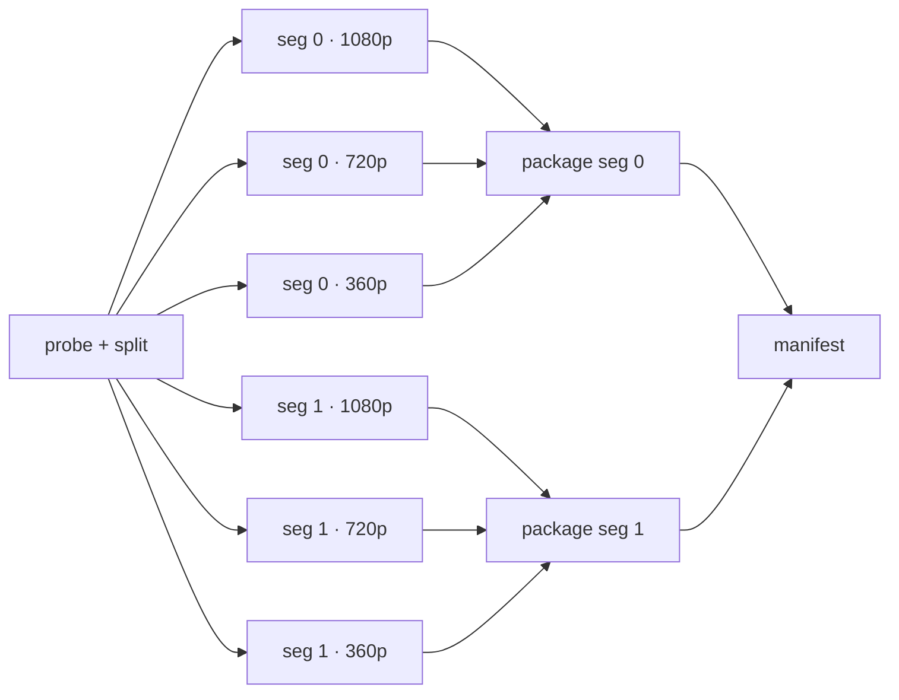
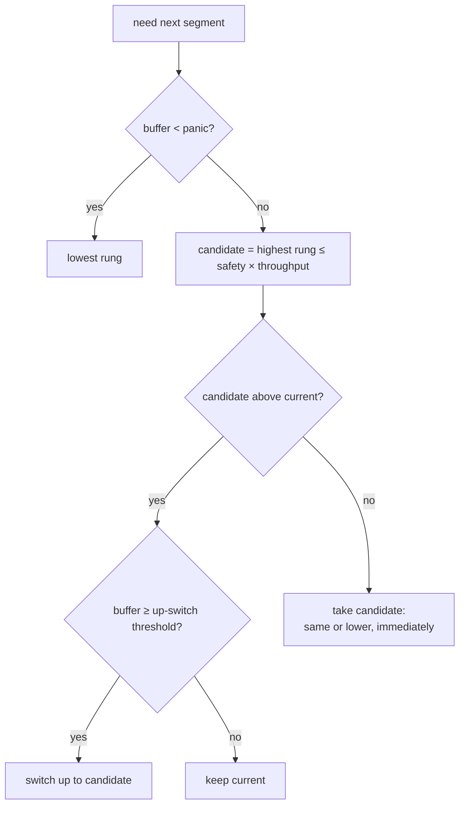
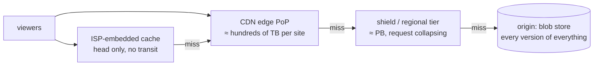
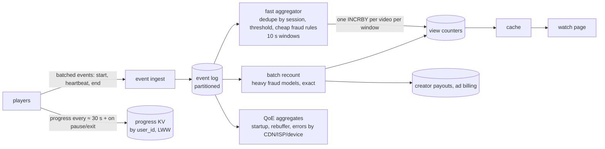
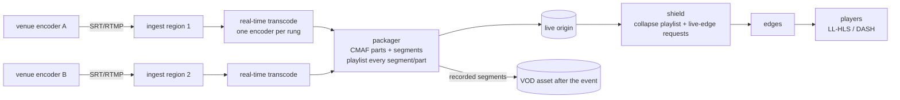

# C11 Unit 2 — Deep dives: the pipeline, the ladder, the bill

> Time: ~5.5 h · CORE: §5, §6, §7 (except per-title encoding and the `abr` lab), §8, §9, Common mistakes · STRETCH:
> per-title encoding and the `abr` lab in §7, §10 live streaming · Labs: `labs/c11/transcode` (CORE, gated),
> `labs/c11/abr` (STRETCH, not gated)

Unit 1 ended at 0:25 with three paths and every box justified. An interviewer then picks two or three places to dig,
and for video they are predictable: **how the processing pipeline is parallelised and how it survives failure**
(§5–§6), **what the player actually downloads and how it picks a quality** (§7), and **where the money goes**: CDN
egress, cache hit ratio and the long tail of storage (§8). View counts at scale (§9) is a common short probe, and
live streaming (§10) is the classic "now make it live" follow-up. This unit does each with the probe ladder (what
fails? at 10×? why not Y? how would you know? what does it cost?), then lists the mistakes that cost candidates the
senior score.

## Before you start

You should have finished [Unit 1](unit-1-guided-design.md), and the lab leans on B0's
[bounded concurrency](../B0-go-concurrency/unit-2-cancellation.md#2-bounded-concurrency-semaphores-worker-pools-and-errgroup)
and [leak-free pipelines](../B0-go-concurrency/unit-2-cancellation.md#3-pipelines-fan-outfan-in-and-goroutine-leaks).
Warm-up, answer first:

1. Why does a deterministic, versioned object key per pipeline step make the pipeline idempotent *and* the CDN
   cheap?
2. A 6-minute upload is cut into 4-second segments and encoded into a five-rung ladder. How many transcode, package
   and manifest steps does the job have?
3. Peak egress is ≈ 10.5 Tbps. What does the origin serve at a 95% hit ratio, and at 99%?

<details data-kind="answer">
<summary>Warm-up answers</summary>

1. A step's output key is a function of its inputs, so a retried or resumed step writes the same object and "done?"
   is "does the key exist?" (idempotent); a version in the path means an object's content never changes, so edges
   can cache it for a year with no invalidation (cheap) (Unit 1 §3).
2. 360 s ÷ 4 s = 90 segments; 90 × 5 = **450 transcode**, **90 package** (one per segment), **1 manifest**: 541 steps
   (Unit 1 §4).
3. 5% of 10.5 Tbps ≈ **525 Gbps**; 1% ≈ **105 Gbps**. Origin load follows the miss ratio (Unit 1 warm-up, §8 below).

</details>

---

## §5 The transcoding pipeline as a dependency graph

### The failure story

The v3 pipeline (Unit 1 §4) ran one job per video on one machine: `ffmpeg` encoded the 240p rung, then 360p, then
each rung in turn, then packaged everything, then wrote the manifest. An 8-core machine with multi-threaded
encoding took ≈ 4 minutes for a 6-minute video, which was fine. Then the long videos arrived.

- A 3-hour livestream recording took ≈ 2 hours on one machine. During those 2 hours the other 1,299 machines in the
  fleet were busy with their own videos and could not help: the unit of parallelism was the *video*, so one video
  could never use more than one machine.
- Creators uploading on Sunday evening queued behind a handful of 3-hour recordings; median time-to-playable went
  from 4 minutes to 70.
- An engineer "parallelised" it: split the source into segments and started one goroutine per (segment, rung), all
  at once. For a 3-hour video that's 2,700 segments × 5 rungs = 13,500 encoder processes on one 64-core box. The box
  ran out of memory in 40 seconds and the kernel killed the orchestrator.
- The second attempt added a pool, but the packager was started on a timer ("packaging begins 10 minutes after
  transcoding starts"). On slow days the packager read segments that didn't exist yet, and the manifest listed 404s.

### Predict

<!-- predict id="C11-U2-P01" -->
**Predict.** Write your answers down first.

1. Draw the dependency graph for a job with 3 segments and 3 renditions (1080p, 720p, 360p). How many steps, how many
   edges, and what's the longest chain (the critical path)? With unlimited workers and every step taking 1 unit of
   time, how long does the job take? With 2 workers?
2. Why is the segment, not the video or the rendition, the unit of parallelism? What's the main cost of cutting a
   video into segments?
3. The orchestrator must start each step "as soon as its inputs exist". What data structure tells it, cheaply, when a
   step becomes ready? Where should that state live: in the workers, behind a lock, or somewhere else?
4. One 3-hour upload has 13,500 ready transcode steps; 500 small uploads have 50 each. What goes wrong with a single
   FIFO ready queue, and what would you do instead?
<!-- /predict -->

### Reveal

<details data-kind="reveal" data-for="C11-U2-P01">
<summary>Reveal</summary>

1. **13 steps**: 9 transcodes, 3 packages, 1 manifest. **12 edges**: each package depends on its segment's 3
   transcodes (9 edges), the manifest on 3 packages (3 edges). Critical path = transcode → package → manifest = **3
   steps**, so with unlimited workers the job takes **3 units**. With 2 workers, 13 steps need at least ⌈13/2⌉ = 7
   units, and a dependency-aware scheduler achieves that (it can package segment 0 while segment 2's transcodes are
   still running). The lab's `Steps` produces exactly this graph: `len(steps) == segments × renditions + segments + 1`.
2. Segments are **independent**: segment 41 at 720p needs nothing from segment 40, so a 3-hour video becomes
   13,500 tasks that can run on 13,500 cores at once, and turnaround stops depending on video length. A per-rung
   split gives only 5-way parallelism (and the 1080p rung is still a 2-hour serial job); a per-video split gives
   none within a video. The costs: each segment must start with a keyframe (slightly larger output; the split must
   cut at keyframe boundaries), the encoder's rate control sees only one segment at a time (quality can vary at
   boundaries unless the encoder is given overlap or a first-pass analysis; `TODO-VERIFY` the technique your
   encoder supports), and there are many more tasks to schedule, track and retry.
3. **A count of unfinished dependencies per step, and a list of dependents per step** (Kahn's topological sort).
   When a step finishes, decrement each dependent's count; a count reaching zero means "ready". It should live in
   **one place that owns scheduling**: in the lab, the `Run` goroutine (workers only execute and report back on a
   channel, so no lock is needed); in production, the orchestrator's durable store. Workers that decide for
   themselves ("is everything I need done?") race each other and poll storage.
4. The 3-hour job's 13,500 steps fill the queue first, so 500 creators wait for it to drain: head-of-line blocking
   between jobs. Use **fair scheduling across jobs**: a per-job cap on in-flight tasks, or round-robin (weighted
   fair queuing) across jobs' ready lists, plus priority for the *fast path* (the lowest rungs, which make a video
   playable) over the top rungs of a long video. Within a job, keep the DAG; across jobs, share fairly.

The tempting wrong answers: "a barrier: wait for all transcodes, then all packages" (correct but slow: package 0
waits for segment 89's 1080p), a timer (the 404s in the story), and "one goroutine per step" (unbounded
concurrency: the OOM in the story).

</details>

### How it actually works

**The graph.** For `S` segments and `R` renditions: `S × R` transcode steps with no dependencies, `S` package steps
each depending on its segment's `R` transcodes, and one manifest step depending on all `S` packages. Before any of
that, a **probe/split** step reads the source, checks that it decodes, and cuts it at keyframes into segments (often
re-encoding to a lossless or high-bitrate *mezzanine* first if the source's keyframes are too sparse; side steps
such as thumbnails, captions and moderation hang off the split).



**Why package per segment.** Packaging takes a segment's encoded rungs and produces what players fetch: the
fragmented-MP4 (CMAF) segments for every rung, encrypted if the title has DRM, with consistent timestamps and
segment numbering across rungs (§7). Doing it per segment lets packaging overlap with transcoding of later segments,
and makes the per-segment invariant ("every rung of segment *n* exists and lines up") a checkable step. The
manifest step needs every segment's packaged output (durations, byte ranges, key ids), so it comes last.

**The scheduler.** Kahn's algorithm, run by one owner:

```go
package main

import "fmt"

// schedule runs a dependency graph serially in a valid order. deps maps each
// node to the nodes it needs. It returns the order, or an error on a cycle.
func schedule(nodes []string, deps map[string][]string) ([]string, error) {
	remaining := map[string]int{}
	dependents := map[string][]string{}
	for _, n := range nodes {
		remaining[n] = len(deps[n])
		for _, d := range deps[n] {
			dependents[d] = append(dependents[d], n)
		}
	}
	var ready, order []string
	for _, n := range nodes {
		if remaining[n] == 0 {
			ready = append(ready, n)
		}
	}
	for len(ready) > 0 {
		n := ready[0]
		ready = ready[1:]
		order = append(order, n) // "run" n
		for _, d := range dependents[n] {
			remaining[d]--
			if remaining[d] == 0 {
				ready = append(ready, d)
			}
		}
	}
	if len(order) != len(nodes) {
		return nil, fmt.Errorf("cycle: ran %d of %d nodes", len(order), len(nodes))
	}
	return order, nil
}

func main() {
	nodes := []string{"t0/hi", "t0/lo", "t1/hi", "t1/lo", "p0", "p1", "manifest"}
	deps := map[string][]string{
		"p0": {"t0/hi", "t0/lo"}, "p1": {"t1/hi", "t1/lo"}, "manifest": {"p0", "p1"},
	}
	order, err := schedule(nodes, deps)
	fmt.Println(order, err)
}
```

The concurrent version keeps exactly this bookkeeping in one goroutine and replaces "run n" with "hand n to a
worker when one is free; when a result comes back, do the decrements". Workers never touch the counts. The
scheduler's `select` has two cases: send the next ready step to a worker (enabled only when something is ready and a
worker is free; the nil-channel trick from
[B0 Unit 1 §2](../B0-go-concurrency/unit-1-primitives.md#2-channels-and-select)), and receive a finished result. That
is the shape the lab asks for, and it's why progress callbacks can run without any lock held.

**Bounded parallelism.** Each transcode is a CPU-bound process using ≈ 1–4 cores and ≈ 0.5–2 GB of memory
(`TODO-VERIFY` for your encoder and resolution), so a 64-core box runs ≈ 16–64 of them, not 13,500. `MaxWorkers` is
that bound per process; across the fleet, the bound is the number of worker slots, and the queue holds the rest
([B0 Unit 2 §2](../B0-go-concurrency/unit-2-cancellation.md#2-bounded-concurrency-semaphores-worker-pools-and-errgroup)).
The bound must also be *used*: a pool of 6 that only ever runs one step at a time because the scheduler waits for
each result before sending the next is serial with extra steps. The lab measures both.

**From the lab to production.** The lab is one process; production spreads the same roles out:

| Lab | Production |
|---|---|
| `Steps(job)` | The orchestrator expands a job into step records after probe/split (segment count known only then) |
| dependency counts in `Run`'s goroutine | Counts or "ready" flags in the orchestrator's database, updated transactionally as artifacts arrive |
| the `tasks` channel and `MaxWorkers` goroutines | One queue per step type; a fleet of worker processes, each with N slots; autoscaled on queue age |
| `Worker` | A process that downloads inputs from the blob store, runs `ffmpeg`, uploads the output under `Step.Key()`'s object key |
| `Store` (`MemStore`) | The artifacts table plus the objects themselves (§6) |
| `OnProgress` | The `done/total` the creator sees (Unit 1 §4) |

**Fairness and the fast path.** With many jobs sharing a fleet, the orchestrator schedules across jobs, not just
within one: a cap on in-flight steps per job, weighted round-robin across jobs' ready lists, and a priority class for
the steps that make a video *playable* (all segments of the lowest one or two rungs, then their packages and a
low-rung manifest published as an early version). Long videos still finish in minutes, because they get their fair
share of thousands of slots; short videos never wait behind them.

**Stragglers.** With 13,500 tasks, the job finishes when the *last* one does. One slow machine (a noisy neighbour,
a throttled disk) holding a single segment adds its whole delay to the job. The standard fix is the MapReduce one:
when a job is ≈ 95% done, re-issue the remaining in-flight tasks on other workers ("backup tasks") and take whichever
finishes first. Idempotent keys make the duplicate harmless (§6).

### Build it

Lab `labs/c11/transcode`, parts 1–2 (parts 3–4 are in §6):

1. `Steps(job)`: validate the job (an id, at least one segment, at least one rendition, unique non-empty rendition
   names, otherwise `ErrInvalid`) and enumerate one `StepTranscode` per (segment, rendition), one `StepPackage` per
   segment and one `StepManifest`. Then a serial `Run` that keeps dependency counts and dependents, starts only
   steps whose dependencies all have artifacts, and passes those artifacts as inputs in a stable order (renditions
   in job order, segments ascending).
2. The worker pool: `MaxWorkers` goroutines (default 1), a scheduler loop that sends ready steps when a worker is
   free and receives results, so independent segments overlap and the bound is reached but never exceeded.

Acceptance tests: `TestSteps_EnumeratesTranscodePackageManifest`, `TestRun_RespectsDependenciesAndPassesInputsInOrder`,
`TestRun_BoundsConcurrencyAndOverlapsIndependentWork`. Run `go test -race ./labs/c11/transcode/`.

### Break it

Edit your passing solution, predict which test fails and with what message, run it, then revert.

1. Schedule steps in the order `Steps` returns them, without dependency counts (send each step to a worker as soon
   as one is free). Run `go test -race -run RespectsDependencies ./labs/c11/transcode/`.
2. Ignore `MaxWorkers` and start one goroutine per ready step. Run `-run BoundsConcurrency`.
3. Keep the pool but make the scheduler wait for each result before sending the next step. Run
   `-run BoundsConcurrency` again.

<details data-kind="answer">
<summary>What you should see, and why</summary>

1. With several workers, a package (or the manifest) reaches a worker while some of its inputs are still running, so
   it runs with missing inputs: the test reports a manifest or `package/1` artifact whose data doesn't list every
   input it should, or a step that completed before one of its dependencies. In production that's the packager
   reading segments that don't exist and a manifest full of 404s: the timer bug from the story.
2. "max in-flight steps = 18, want exactly 6": all 18 transcodes of the 6-segment job start at once. In production
   that's the 13,500-process OOM; the bound is a resource limit, not a performance hint.
3. "max in-flight steps = 1, want exactly 6 (MaxWorkers must be a bound and must be used)", and if you got past that
   check, the 25 steps of 20 ms would take ≈ 500 ms instead of under 300. A pool that is never more than one deep is
   a serial pipeline.

</details>

### In the wild

- **Netflix** has written about splitting sources into chunks that are encoded in parallel across many machines and
  then assembled, which made turnaround roughly independent of title length (`TODO-VERIFY`: the specific blog posts
  and the system names, "Reloaded" and later "Cosmos").
- **AWS Elemental MediaConvert** offers "accelerated transcoding", which splits a job across multiple machines
  (`TODO-VERIFY` current naming and limits); cloud transcoders generally do segment- or chunk-level parallelism
  internally.
- **MapReduce** (Dean and Ghemawat, OSDI 2004) introduced *backup tasks* for stragglers near the end of a job; the
  same trick applies to the last few segment encodes.
- **Kahn's algorithm** (1962) is the standard topological sort; workflow engines (Airflow, Argo Workflows, Temporal,
  AWS Step Functions' Map state) implement dependency-driven scheduling with persistent state, which is the
  orchestrator box.
- **ffmpeg** can cut a source into segments at keyframes (the `segment` muxer) and encode each independently;
  encoder options control keyframe placement so segments align across rungs (`TODO-VERIFY` exact flags for your
  encoder, e.g. forcing keyframes at fixed intervals).

### Trade-offs

| Option | Wins when | Loses when | When the answer flips |
|---|---|---|---|
| One job per video, one machine | Short videos, low volume, simple ops | Long videos (hours of serial encode); can't use the fleet for one urgent video | Flip to segment-level tasks when publish latency matters or videos exceed ≈ 10–20 minutes |
| Segment (≈ 4 s) as the encode unit | Maximum parallelism; tiny retry cost | Rate control per segment; many tasks; keyframe at every segment | Flip to **longer encode chunks** (≈ 30–60 s) that the packager re-segments into 4 s delivery segments, when boundary quality or scheduling overhead dominates |
| Per-scene (shot) chunks | Best quality per bit: each shot encoded with its own settings | A scene-detection pass; uneven task sizes | Flip to it for high-view titles where bits saved × views pays for the extra pass (§7 STRETCH) |
| Central orchestrator with dependency counts | Fan-out/fan-in DAGs; visibility; resume | A stateful service to keep available | Flip to choreography (events trigger the next step) only for short linear chains |
| FIFO ready queue across jobs | One job at a time | Head-of-line blocking: long videos starve short ones | Flip to per-job caps + weighted fair queuing + fast-path priority as soon as jobs share a fleet |

### Senior bar

- **Failure modes**: unbounded fan-out (OOM, fork storms); barriers or timers instead of dependencies (slow or
  wrong); scheduling state spread across workers (races, polling); head-of-line blocking between jobs; stragglers
  setting job latency; split step at the wrong boundary (segments that don't start with a keyframe play as
  glitches after every quality switch).
- **Capacity**: ≈ 3k tasks/s across the fleet (500k jobs × ≈ 541 steps ÷ 86,400); the orchestrator handles that many
  state transitions per second, which is a sharded database or a workflow engine, not a single row per job; a 2-hour
  movie is ≈ 10,800 steps.
- **Ops**: queue age per step type is the autoscaling signal; per-job "time to playable" and "time to full ladder" are
  the SLIs; a per-job view of which steps are pending, running, retried and failed is the first debugging tool.
- **Cost**: the scheduler's overhead per task (download inputs, start a process, upload output) is paid 541 times
  for a 6-minute video; if it's ≈ 1 s per task, it's ≈ 25% of a 4 core-second task. That's when longer encode chunks
  pay off.

Interviewer follow-up probes:

1. "Your pipeline splits into 4-second segments. Doesn't that hurt quality?"

<details data-kind="answer">
<summary>Model answer</summary>

A little, in two ways: a keyframe at the start of every segment costs bits, and per-segment rate control can't
borrow bits from a simple scene to spend on a complex one across the boundary. Both are manageable. Encode in longer
chunks (≈ 30–60 s, or per scene) for rate control and let the packager cut 4 s delivery segments from them, keeping
keyframes aligned; or give the encoder a first-pass complexity analysis of the whole title. I'd measure with a
quality metric such as VMAF on a sample, compare chunked against whole-file encodes at the same bitrate, and choose
the chunk length where the difference stops being visible.

</details>

2. "How does a 3-hour upload not starve 500 short ones?"

<details data-kind="answer">
<summary>Model answer</summary>

Fairness across jobs in the orchestrator: each job may have at most K steps in flight (say 200), ready steps are
drawn round-robin across jobs, and steps that make a video playable (the lowest rungs) are in a higher priority
class than the top rungs of anything. The 3-hour video still finishes in minutes because K × fleet share is
hundreds of cores; the short uploads see no queue. Weighted fair queuing generalises it if some tenants or creators
pay for faster processing.

</details>

3. "What's the critical path of a job, and how would you shorten it?"

<details data-kind="answer">
<summary>Model answer</summary>

Probe/split, then one transcode (the slowest rung of the slowest segment), then one package, then the manifest.
With enough workers, job time ≈ split + max(transcode) + package + manifest + scheduling overheads, and the long
poles are the split (it reads the whole source, so I'd split while the upload is still arriving, part by part, or
seek-and-cut in parallel) and stragglers (backup tasks near the end). The fast path shortens the critical path to
"playable": only the low rungs need to finish before a first publish.

</details>

### Check yourself

1. How many steps does a job with 50 segments and 4 renditions have, and what is its critical path in steps?
2. What two maps does a dependency-driven scheduler keep, and what happens when a step finishes?
3. Why must the scheduler's bookkeeping have exactly one owner?

<details data-kind="answer">
<summary>Answers</summary>

1. 50 × 4 + 50 + 1 = **251** steps; the critical path is transcode → package → manifest, **3** steps (plus probe/split
   before them in production).
2. Unfinished-dependency count per step and dependents per step. On finish: record the artifact, decrement each
   dependent's count, and mark any that reach zero as ready.
3. Because two owners race: two workers can both see a count reach zero and both start the dependent, or neither
   does. One goroutine (in the lab) or one transactional store (in production) makes "became ready" happen exactly
   once, without locks held around worker calls.

</details>

---

## §6 When the pipeline fails: retries, poison inputs, resume and cost

### The failure story

With §5's DAG in production, the fleet runs ≈ 270 M tasks a day (500k jobs × ≈ 541 steps), ≈ 3k a second. Things go
wrong at that rate in four distinct ways, and the first version of the pipeline treated them all the same.

- **Transient failures.** Spot machines are reclaimed, blob-store reads time out, a worker's disk fills. About 0.1%
  of tasks fail for reasons that have nothing to do with the task. With no retries, a job of 541 tasks fails with
  probability 1 − 0.999^541 ≈ **42%**. Nearly half the uploads showed "processing failed".
- **Poison inputs.** About 0.05% of uploads are files the encoder can't handle: truncated recordings, exotic codecs,
  a header that says 24 fps and a stream that says otherwise. After someone added "retry until it works", each of
  these ≈ 250 files a day was retried every minute, forever. After a week, ≈ 1,750 jobs were looping and the retry
  traffic was ≈ 5% of the fleet.
- **Hangs.** A particular malformed file made the encoder spin forever at 100% CPU. There was no per-task timeout,
  so the worker slot was gone until someone noticed. Over a month, ≈ 3% of the fleet's slots were stuck on files
  that would never finish.
- **Restarts from zero.** When a job did fail permanently and a fix was deployed, "retry the job" started again from
  the probe step. For a 2-hour movie that's ≈ 10 core-hours redone for the one segment that had failed.

And when creators deleted a video while it was processing, the job kept running for 40 minutes, encoding a video
nobody could ever watch.

### Predict

<!-- predict id="C11-U2-P02" -->
**Predict.** Write your answers down first.

1. Each task fails transiently and independently with probability 0.1%. With up to 3 attempts per task, what's the
   probability a 541-step job fails? How many of the 500k daily jobs is that?
2. Classify these failures as retry (with backoff), fail fast, or something else, and say how you'd tell them apart
   in code: a spot reclamation mid-encode; "invalid data found when processing input"; an encoder segfault on one
   specific segment; a blob-store 503; a task still running after 10 minutes.
3. A transcode of one 4-second segment at 1080p normally takes ≈ 4–8 s, p99 ≈ 10 s. What per-attempt timeout do you
   set, and why not "1 hour to be safe"?
4. A job fails at step 10,700 of 10,801. After the fix, what must be true of the pipeline so that rerunning costs
   ≈ 100 steps and not 10,801? And what must be true so that a task that ran twice (queue redelivery) does no harm?
5. The creator deletes the video mid-processing. What should stop, in what order, and what must not leak?
<!-- /predict -->

### Reveal

<details data-kind="reveal" data-for="C11-U2-P02">
<summary>Reveal</summary>

1. A task fails only if all 3 attempts fail: 0.001³ = 10^−9. A job fails if any of its 541 tasks does: ≈ 541 × 10^−9
   ≈ **5.4 × 10^−7**, ≈ **0.27 jobs a day** out of 500k. Three attempts take the job failure rate from 42% to
   effectively zero, *for independent transient failures*. They do nothing for poison inputs, which fail every time.
2. Spot reclamation: **retry** (on another machine; the task never reported back, so its lease or attempt timeout
   expires). Blob-store 503: **retry** with exponential backoff and jitter (A7). "Invalid data": **fail fast**: it's
   a property of the input, retrying produces the same error, so mark the job failed, dead-letter it with the error,
   and tell the creator. Segfault on one segment: **retry a bounded number of times** (it could be a bad machine),
   and if it fails on two different workers treat it as poison for that input (a known encoder bug: route to a
   different encoder version or a re-encode of the segment's mezzanine). Still running after 10 minutes: the
   **per-attempt timeout** fires, the attempt counts as failed, and it's retried; repeated timeouts on the same
   input are the hang signature, which is poison too. In code: the worker returns a typed or wrapped error (a
   "permanent" class vs everything else), retries stop early for permanent errors, and the attempt history
   (error and worker per attempt) is kept with the dead letter.
3. Derive it from the measured distribution, with headroom: ≈ 3 × p99 ≈ **30 s**. A timeout of an hour means each
   hang holds a slot for an hour, and with hundreds of hangs a day you lose a measurable share of the fleet. A timeout
   too tight (say 8 s) kills healthy tasks at the slow end and turns their retries into extra load. Scale it by the
   task: a 30 s chunk at 4K gets a longer budget than a 4 s segment at 360p; a timeout proportional to segment
   duration × rung cost is better than one global number.
4. **Resume:** every finished step's output is durably stored under a deterministic key *as it finishes*, and the
   rerun skips any step whose artifact exists, so only the ≈ 100 missing steps run. **Duplicate execution:** the
   step writes to the same key with the same content (deterministic encoder settings), so a second run overwrites
   identical bytes and the artifact record is an upsert. That's idempotency by construction, the
   [A6 idempotent-consumer](../A6-async/unit-2-outbox-consumers.md#2-idempotent-consumers-and-dedupe) rule applied
   to files.
5. Cancel the job's context (stop scheduling new steps), let in-flight attempts observe cancellation and return
   (an encoder subprocess gets a signal), wait for them, mark the job cancelled, then let a lifecycle job delete the
   outputs written so far. Nothing may leak: no worker goroutine blocked sending a result nobody will read, no
   orphaned encoder process, no artifact records pointing at deleted objects. "Run returns only after everything
   it started has exited" is the contract.

</details>

### How it actually works

**Classify before you retry.**

| Failure class | Examples | Retry? | Signal |
|---|---|---|---|
| Transient infrastructure | spot reclamation, blob 503, network reset, a worker OOM-killed by a neighbour | yes, backoff + jitter, ≈ 3–5 attempts | errors from storage/network clients; the attempt never reports back (timeout) |
| Deterministic input (poison) | corrupt or truncated file, unsupported codec, impossible metadata | no: fail fast, dead-letter the job, tell the creator | the encoder's own error class; the same error on two different workers |
| Hang | encoder loops forever on a malformed frame | the timeout turns it into a failed attempt; repeated timeouts on one input = poison | per-attempt deadline |
| Worker or encoder bug | segfault on a valid input, panic in the worker library | bounded retries; then dead-letter and page the owning team | crash/panic recovered as an error; correlation with a deploy |
| Cancellation | creator deleted the video, job superseded | no: stop, clean up | the job's context is cancelled |

The rule from [A6 Unit 2 §3](../A6-async/unit-2-outbox-consumers.md#3-poison-messages-dlqs-and-replay) applies
unchanged: a bounded number of attempts, then a dead-letter record with the full attempt history, an alert, and a
way to replay after a fix. Here the "message" is a pipeline step and the "replay" is rerunning the job, which is
cheap because of resume. Backoff and jitter come from
[A7 Unit 1 §2](../A7-reliability/unit-1-timeouts-retries.md#2-retries-backoff-jitter-and-when-retrying-is-safe):
without jitter, a blob-store blip that fails 2,000 tasks at once retries all 2,000 at once.

**One attempt, contained.** Each attempt runs under its own deadline derived from the job's context, and a crash
in the attempt is an error, not a dead pipeline. In production the encoder is a subprocess, so a crash is an exit
code; when the work runs in-process (a Go library, or the lab's `Worker`), the same containment is a `recover`:

```go
package main

import (
	"context"
	"errors"
	"fmt"
	"time"
)

// attemptOnce runs fn under a per-attempt deadline and turns a panic into an
// error, so one bad input can neither hang nor crash the pipeline.
func attemptOnce(ctx context.Context, timeout time.Duration, fn func(context.Context) error) (err error) {
	actx, cancel := context.WithTimeout(ctx, timeout)
	defer cancel()
	defer func() {
		if r := recover(); r != nil {
			err = fmt.Errorf("attempt panicked: %v", r)
		}
	}()
	return fn(actx)
}

func main() {
	hang := func(ctx context.Context) error { <-ctx.Done(); return ctx.Err() }
	crash := func(context.Context) error { panic("segfault in decoder") }
	err := attemptOnce(context.Background(), 50*time.Millisecond, hang)
	fmt.Println(errors.Is(err, context.DeadlineExceeded), err)
	fmt.Println(attemptOnce(context.Background(), time.Second, crash))
}
```

A timeout only helps if the work *honours* the context: a goroutine that ignores `ctx.Done()` keeps running after
the attempt is abandoned. For a subprocess, honouring it means killing the process when the context ends
(`exec.CommandContext` does this).

**Resume from finished artifacts.** The order of operations in a step is: compute, write the output object under
its deterministic key, record the artifact, *then* release dependents. The scheduler checks the store when a step
becomes ready, and skips it (reusing the stored artifact, not calling the worker) if it's there. Three consequences:

- A crashed or cancelled job reruns only what's missing (`Result.Skipped` vs `Result.Executed` in the lab).
- A re-encode that changes only the packaging (a fix to the packager, a new DRM scheme) reruns package and manifest
  steps and reuses every transcode, because the transcode keys didn't change. Put the inputs that matter into the
  key (rendition name, encoder settings version) and nothing else.
- A step that runs twice (an at-least-once queue redelivered it, or a backup task for a straggler) is harmless:
  same key, same bytes, an upsert. The one thing that breaks this is non-determinism in the output (timestamps
  embedded in files, random encoder seeds): pin them, or accept "last writer wins" for byte-different but equivalent
  outputs.

If artifacts were only written at the end of the job, a crash would lose everything; the lab tests exactly that.

**Failing a job.** When a step exhausts its attempts, the lab fails the whole job: cancel the job's context, wait
for in-flight attempts, return an error that wraps `ErrStepFailed` and the last worker error. In production that
error, the step key and the attempt history become the dead-letter record and the creator's message. A softer
policy is possible: if one segment of the 1080p rung is poison, publish the ladder without 1080p (every segment of a
rung must exist, so drop the whole rung) and flag the job for review. That's a product decision; the default is
fail and explain.

**Cancellation without leaks.** The job has a context; deleting the video cancels it. The scheduler stops sending
steps, every worker's attempt sees `ctx.Done()`, and, critically, a worker that finishes *after* cancellation must
not block forever trying to hand its result to a scheduler that has stopped listening: the send selects on
`ctx.Done()` too. Then the scheduler closes the task channel and waits for the workers' `WaitGroup` before
returning ([B0 Unit 2 §3](../B0-go-concurrency/unit-2-cancellation.md#3-pipelines-fan-outfan-in-and-goroutine-leaks)
is this leak exactly). Production adds cleanup: delete the job's outputs by prefix (`videos/vid_42/v3/`) with a
lifecycle job, after the job has stopped writing.

**Cost of failure.** Retries are compute: at 0.1% transient failures, retries add ≈ 0.1% to the fleet; poison
inputs retried forever added 5% in the story. Resume turns a late failure on a 2-hour movie from ≈ 10 core-hours
into ≈ 4 core-seconds. Timeouts bound the cost of a hang to ≈ 3× a normal task instead of "until someone notices".
The cheapest failure is the one caught at probe/split, before 13,500 tasks are scheduled: validate the source there
(it decodes, durations agree, codec supported) and fail fast.

### Build it

Lab `labs/c11/transcode`, parts 3–4 (after §5's parts 1–2):

3. Retries, backoff, timeouts and panics: up to `MaxAttempts` attempts per step (default 3) with
   `cfg.Sleep(ctx, cfg.Backoff(attempt))` between attempts (attempt counted from 1); each attempt under a context
   that expires after `StepTimeout` (none if ≤ 0), a timeout counting as a failed attempt; a worker panic recovered
   and counted as a failed attempt; when a step's attempts are exhausted, cancel the rest of the job, wait for
   running steps, and return an error wrapping `ErrStepFailed` and the worker's last error.
4. Resume, cancellation and progress: skip any step whose `Step.Key()` is already in the `Store` (reuse the
   artifact, don't call the worker), `Store.Put` every produced artifact before its dependents start; when `ctx` is
   cancelled, stop starting steps, wait for running ones and return `ctx.Err()` with no goroutine left behind; call
   `OnProgress` from `Run`'s own goroutine after every finished or skipped step, outside any lock.

Acceptance tests: `TestRun_RetriesTransientFailuresWithBackoff`, `TestRun_FailsTheJobAfterMaxAttemptsAndStopsEverything`,
`TestRun_PerAttemptTimeoutRetriesAHungWorker`, `TestRun_ContainsWorkerPanics`, `TestRun_ResumesFromTheStoreWithoutRedoingWork`,
`TestRun_CancellationStopsPromptlyWithoutLeaks`, `TestRun_ProgressCallbackMayCallBackIntoTheStore`. Run
`go test -race ./labs/c11/transcode/`, then `go test -race -count=20 ./labs/c11/transcode/` before calling it done,
and `sd lab C11`.

### Break it

Edit your passing solution, predict the failure, run the named test, then revert. (These are the break-it exercises
in [`labs/c11/README.md`](../../labs/c11/README.md).)

1. In the worker goroutine, send the result with a plain `results <- r` instead of a `select` that also watches
   `ctx.Done()`. Run `-run Cancellation`.
2. Ignore `MaxAttempts` (retry forever). Run `-run FailsTheJob`.
3. Drop the per-attempt timeout. Run `-run PerAttemptTimeout`.
4. Call `Store.Put` only at the end of `Run` instead of as each step finishes. Run `-run Resumes`.

<details data-kind="answer">
<summary>What you should see, and why</summary>

1. "Run did not return within 5 s of cancellation". After cancel, the scheduler stops receiving; a worker that
   finishes its step blocks forever on the send; `Run` waits for the worker `WaitGroup` and never returns. In a
   long-running orchestrator that's a goroutine (and an encoder slot) leaked per cancelled job, the classic leak from
   [B0 Unit 2 §3](../B0-go-concurrency/unit-2-cancellation.md#3-pipelines-fan-outfan-in-and-goroutine-leaks).
2. The test's 20 s guard fires: "Run did not return within 20 s". The poison segment is retried forever, and in
   production the job loops until someone notices, holding a worker the whole time: the ≈ 1,750 looping jobs of
   the story.
3. The hung attempt never returns, so the job never finishes (the 20 s guard again). Then decide what the timeout
   should be for a 4 s segment at 1080p: measure the p99 and multiply by ≈ 3, not "30 minutes to be safe".
4. "only 0 artifacts persisted before the failure; finished steps must be stored as they complete". A crash or a
   permanent failure loses every finished step, and the rerun redoes the whole job: the 10 core-hours of the story.

</details>

### In the wild

- **Amazon SQS** redelivers a message whose visibility timeout expires without a delete (the "task never reported
  back" case) and moves it to a dead-letter queue after `maxReceiveCount` receives; that pair is the at-least-once
  queue plus bounded attempts this section assumes.
- **Temporal** activities have retry policies (initial interval, backoff coefficient, maximum attempts) and
  *non-retryable error types*, plus start-to-close and heartbeat timeouts: the classify-then-retry table as
  configuration. **Kubernetes Jobs** have `backoffLimit` and `activeDeadlineSeconds` for the same reasons.
- **Spot capacity**: AWS gives a two-minute interruption notice for Spot Instances and GCP preemptible/Spot VMs a
  shorter one (`TODO-VERIFY` current durations); short, idempotent tasks make the notice irrelevant: the in-flight
  task is simply retried elsewhere.
- **ffmpeg** returns a non-zero exit status and messages such as "Invalid data found when processing input" for
  corrupt sources; pipelines typically map stderr patterns and exit codes to permanent vs transient classes
  (`TODO-VERIFY` specific exit-code semantics before relying on them).

### Trade-offs

| Option | Wins when | Loses when | When the answer flips |
|---|---|---|---|
| Fail the whole job when a step is exhausted | Simple, honest; a broken video is visible | One poison segment of one rung blocks an otherwise good video | Flip to publishing the ladder without the failed rung (flagged for review) when partial availability beats none, e.g. a news clip |
| Retry everything ≈ 3× | Transient infra failures dominate | Poison inputs waste 3× and delay the error | Flip to fail-fast for classified permanent errors; keep bounded retries for the rest |
| One global per-attempt timeout | Simple | Tasks vary 100× (360p 4 s segment vs 4K 60 s chunk) | Flip to a timeout proportional to expected work (duration × rung cost), from measured p99 |
| Artifacts table as the record of "done" | Fast lookups, progress, history | Two writes per step (object, then row) to keep ordered | Flip to "object exists?" (HEAD on the deterministic key) as the check when the store's listing/HEAD cost and consistency are acceptable |
| In-process encoding (library) | No process start cost | A crash takes the worker down; needs `recover`, harder isolation | Flip to a subprocess per task (crash = exit code, kill on cancel) for third-party encoders |

### Senior bar

- **Failure modes**: retries without classification (poison loops); retries without jitter (synchronised waves after
  a storage blip); no per-attempt timeout (hangs eat the fleet); timeout ignored by the work (the attempt is
  abandoned but the goroutine or process keeps running); artifacts recorded before the object is durable (resume
  skips a missing output); non-deterministic outputs (duplicate runs produce different bytes under one key);
  cancellation that leaks goroutines or processes.
- **Capacity**: ≈ 270 M tasks/day; ≈ 270k transient failures/day at 0.1%, each retried; ≈ 250 poison jobs/day that
  must be dead-lettered on the first or second attempt; the dead-letter queue should be small enough for a human to
  read the top error classes every morning.
- **Ops**: dashboards for task failure rate by error class, retries per task, dead letters per day by class,
  timeouts per encoder version, and jobs cancelled; a replay tool ("rerun these jobs after the fix") that relies on
  resume; alerts on a sudden jump in one error class after a worker deploy.
- **Cost**: resume and fail-fast are cost features: they cap the cost of a failure at a few task-seconds instead of
  a whole job. Spot capacity is safe *because* tasks are short and idempotent.

Interviewer follow-up probes:

1. "How do you tell a corrupt upload from a flaky machine?"

<details data-kind="answer">
<summary>Model answer</summary>

By the error and by where it happens. The encoder's own errors about the input ("invalid data", unsupported codec,
decode errors at a specific timestamp) are input properties; storage and network errors, OOM kills and lost leases
are infrastructure. When the class is ambiguous (a segfault), I retry on a *different* worker: the same failure on two
machines with the same input points at the input or an encoder bug, a failure on one machine only points at the
machine. Most of this is caught earlier by validating the source at probe time, before any segment task exists.

</details>

2. "A worker finishes a segment, uploads it, and dies before telling the orchestrator. What happens?"

<details data-kind="answer">
<summary>Model answer</summary>

The orchestrator never hears back, so the attempt's lease or timeout expires and the step is retried on another
worker. The retry writes the same deterministic key with the same bytes (an overwrite), records the artifact, and the
job moves on. Nothing is duplicated in the output. If the orchestrator checks the store before dispatching a retry, it
may even find the object already there and skip the work; either way, correctness doesn't depend on the worker having
reported.

</details>

3. "Why not just rerun failed jobs from the start? It's simpler."

<details data-kind="answer">
<summary>Model answer</summary>

Because the cost of a failure would scale with the video's length instead of the failed task's. A 2-hour movie is
≈ 10,800 steps and ≈ 10 core-hours; restarting it for one segment wastes all of that, and if the failure is
intermittent the rerun may fail somewhere else and loop. Per-step artifacts make a rerun cost only the missing steps,
which also makes "fix the encoder, replay yesterday's 2,000 failed jobs" an operation that takes minutes. The
"simpler" version is only simpler until the first re-encode of the catalogue.

</details>

### Check yourself

1. With 1% transient failure per task and no retries, roughly what fraction of 541-step jobs fail? With 3 attempts?
2. Which failures should never be retried, and how should the pipeline handle them instead?
3. What are the two ordering rules that make resume correct?

<details data-kind="answer">
<summary>Answers</summary>

1. 1 − 0.99^541 ≈ 1 − e^−5.4 ≈ **99.5%** of jobs fail. With 3 attempts: per task 10^−6, per job ≈ 541 × 10^−6 ≈
   **0.05%**: retries matter more as the failure rate rises.
2. Deterministic input failures (corrupt, unsupported, impossible metadata) and cancellations. Fail fast, dead-letter
   the job with the error and attempt history, tell the creator, and replay after a fix if the fix is on our side.
3. Write the output durably before recording the artifact; record the artifact before releasing dependents. (And
   check the store for each step before running it.)

</details>

---

## §7 Packaging, the bitrate ladder and adaptive bitrate

### The failure story

The platform's first segmented release made four choices that each looked reasonable.

- **Two rungs**: 1080p at 8 Mbps and 480p at 1.5 Mbps. Viewers on 4 Mbps connections got 480p forever (the next rung
  up was double their bandwidth), and viewers on 1.2 Mbps stalled even at the bottom.
- **Two packages**: HLS with MPEG-TS segments for Apple devices and DASH with fragmented MP4 for everything else.
  Every rendition was stored twice, and the CDN cached two copies of every popular segment, halving the effective
  cache size.
- **10-second segments**, to keep request rates down. The first frame needed a full 10-second segment downloaded at
  whatever rung the player guessed; startup was ≈ 6 s on mobile.
- **A naive player**: pick the highest rung below the last segment's measured throughput. On a connection that
  wobbled between 4.5 and 5.5 Mbps it switched between 720p and 1080p on almost every segment, and viewers reported
  the picture "pulsing". When throughput dropped suddenly it kept requesting 1080p until the buffer ran dry.

### Predict

<!-- predict id="C11-U2-P03" -->
**Predict.** Write your answers down first.

1. Design a ladder for an audience of phones on mobile data, laptops on Wi-Fi and TVs on fibre. How many rungs, what
   top and bottom, and roughly what spacing between rungs? Why does spacing matter to the player?
2. You must support Apple devices (HLS) and Android, browsers and TVs (DASH). How do you avoid storing and caching
   everything twice?
3. Choose a segment duration for VOD and justify it against startup time, adaptation speed, request rate and
   compression.
4. A player is on 480p with 6 s buffered; throughput measures 10 Mbps. What should it request next? Another is on
   1080p with 20 s buffered and throughput drops to 2 Mbps. And a third has 3 s buffered on 1080p with 50 Mbps of
   measured throughput?
<!-- /predict -->

### Reveal

<details data-kind="reveal" data-for="C11-U2-P03">
<summary>Reveal</summary>

1. ≈ **5–7 rungs** from ≈ 0.3–0.4 Mbps (240p/360p, so a weak mobile link still plays) to ≈ 5 Mbps 1080p (and 4K at
   ≈ 15 Mbps for TVs if the content and devices justify it; `TODO-VERIFY` bitrates for your codec), spaced **≈ 1.5–2×**
   apart. Spacing sets the granularity of adaptation: with rungs 2× apart, a viewer whose bandwidth sits just below a
   rung gets half their bandwidth's worth of quality; too close (1.1×) and the player switches for no visible gain
   while storage and encode cost grow with every rung. The bottom rung is a continuity guarantee, the top rung a
   device ceiling.
2. **CMAF**: encode and package once as fragmented-MP4 segments, and write *two manifests* (an HLS `.m3u8` and a
   DASH `.mpd`) that reference the **same segment files**. One copy in storage, one copy in every CDN cache. The
   catch is encryption: DRM systems historically used different AES modes (`cenc` vs `cbcs`), so one encrypted copy
   for all devices requires every target to support the same mode (`TODO-VERIFY` current device support for
   `cbcs`).
3. ≈ **4–6 s** for VOD. Shorter segments start faster and adapt faster (a decision every 2 s instead of every 10)
   but double the request rate and objects and cost a few percent of compression (a keyframe per segment); longer
   segments do the reverse. The first-frame problem is also solved by starting at a low rung (a small first
   segment), not only by shrinking all segments. Sub-2-second segments or partial segments are a *live latency*
   tool (§10).
4. **480p, 6 s buffered, 10 Mbps:** stay at 480p (or step up one rung at most). Throughput affords 1080p, but 6 s of
   buffer is thin; switching up now risks a stall if the measurement was a burst. Switch up when the buffer is
   comfortable (≈ 10 s+). **1080p, 20 s, 2 Mbps:** switch **down immediately** to the highest rung that fits
   2 Mbps × a safety factor (≈ 0.8 → 1.6 Mbps → 480p at 1.2 Mbps). Waiting spends buffer at 2.5× the rate it
   refills. **1080p, 3 s, 50 Mbps:** go to the **lowest** rung: with 3 s left, any surprise means a stall, and a
   rebuffer is the worst outcome in this product; one small, fast segment refills the buffer, then the player climbs
   back. These are exactly the rules the `abr` lab encodes: `Startup` and `Next` with a safety factor, immediate
   down-switch, buffer-gated up-switch and a panic threshold.

</details>

### How it actually works

**Codec, container, protocol.** Three different layers that candidates blur:

| Layer | What it is | Examples |
|---|---|---|
| Codec | How pictures are compressed | H.264/AVC (plays everywhere), HEVC/H.265, VP9, AV1 (more efficient, more compute, narrower device support) |
| Container / segment format | How encoded frames are wrapped into files | MPEG-TS (legacy HLS), fragmented MP4 (fMP4), CMAF (a constrained fMP4 profile both HLS and DASH accept) |
| Protocol / manifest | How a player discovers renditions and segments | HLS (`.m3u8` playlists, RFC 8216), MPEG-DASH (`.mpd`) |

A newer codec saves bits at the same quality (often quoted as ≈ 30–50% for AV1 or HEVC vs H.264;
`TODO-VERIFY: efficiency claims vary a lot by content, encoder and metric`), but costs several times the encode
compute and only plays on supporting devices. So platforms keep an H.264 ladder for everyone and add a second-codec
ladder **only for titles with enough views** to repay the extra encode and storage: Unit 1 §2's ratio again.

**The manifest.** An HLS master playlist is a menu; each media playlist lists one rung's segments:

```text
#EXTM3U
#EXT-X-VERSION:7
#EXT-X-STREAM-INF:BANDWIDTH=900000,RESOLUTION=640x360,CODECS="avc1.4d401e,mp4a.40.2"
360p/index.m3u8
#EXT-X-STREAM-INF:BANDWIDTH=2800000,RESOLUTION=1280x720,CODECS="avc1.4d401f,mp4a.40.2"
720p/index.m3u8
#EXT-X-STREAM-INF:BANDWIDTH=5500000,RESOLUTION=1920x1080,CODECS="avc1.640028,mp4a.40.2"
1080p/index.m3u8
```

```text
#EXTM3U
#EXT-X-VERSION:7
#EXT-X-TARGETDURATION:4
#EXT-X-PLAYLIST-TYPE:VOD
#EXT-X-MAP:URI="init.mp4"
#EXTINF:4.000,
seg_00000.m4s
#EXTINF:4.000,
seg_00001.m4s
#EXT-X-ENDLIST
```

`BANDWIDTH` is what the player compares with measured throughput; `CODECS` lets it skip rungs it can't decode; the
`init.mp4` holds codec configuration once per rung. A DASH MPD carries the same information as XML
(`AdaptationSet` → `Representation`). For VOD both are written once by the manifest step and cached for a long time.

**Alignment is the invariant.** Every rung's segment *n* covers the same time range and starts with a keyframe
(closed GOP), so a player can request segment *n* at 720p and segment *n + 1* at 1080p and decode seamlessly. The
split step and forced keyframe intervals in the encoder guarantee it; the package step per segment (§5) is where you
can check it.

**The ladder as an engineering object.** A fixed ladder (the same rungs for every title) is simple and wastes bits:
a static lecture slide looks perfect at 1 Mbps in 1080p, a confetti-filled concert needs 8. **STRETCH — per-title
encoding**: encode a sample of each title at several resolutions and bitrates, measure quality (e.g. VMAF), and pick
the rungs on the quality–bitrate convex hull for *that* title: fewer bits for simple content, more rungs where they
matter. Shot-based encoding takes this further, choosing settings per scene. It's an extra analysis pass per title,
so it pays only where views are high (every title on a curated service, the popular head of a UGC platform).

**Adaptive bitrate on the client.** All adaptation logic lives in the player. The server just serves files. Each
time the player needs a segment it decides which rung to fetch from what it knows:

- **Throughput-based**: estimate bandwidth from recent segment downloads, multiply by a **safety factor** (≈ 0.8: never
  plan to spend all of a noisy measurement), pick the highest rung that fits. Fast to react; noisy.
- **Buffer-based**: pick the rung from how many seconds are buffered (low buffer → low rung, full buffer → high rung),
  e.g. the BBA family. Stable; slow to start (no buffer yet) and slow to react to a sudden drop.
- **Hybrid** (most production players): throughput for startup and down-switches, buffer to gate up-switches, a
  **panic** rule at a low buffer, and smoothing of the throughput estimate (an exponentially weighted or
  harmonic mean over several segments) so one fast download doesn't trigger a switch.

The asymmetry is deliberate: **switch down immediately, switch up cautiously**. A down-switch protects against a
stall (the worst outcome for viewers); an up-switch is a nice-to-have that can wait until the buffer proves the link
is stable. Flapping between two rungs looks worse than staying on the lower one.



**Startup.** The first segment is requested with no throughput measurement, so start low (the lab's `Startup` picks
the lowest rung when throughput is unknown), or use a measurement from the manifest download or from the previous
session on this device. A small first segment at a low rung is how players reach first frame in ≈ 1–2 s.

### Build it

STRETCH, not gated. Lab `labs/c11/abr`: implement `Policy.Startup` (the highest rung whose bitrate is at most
`Safety × throughput`, the lowest if none fits or throughput is unknown; rungs may arrive in any order; an empty list is
`ErrNoRenditions`) and `Policy.Next` (panic to the lowest below `PanicBufferSec`; a candidate above the current rung
only when `BufferSec ≥ UpSwitchBufferSec`, otherwise keep the current one; a candidate below the current rung
immediately; an unknown current rung behaves like `Startup`; zero-valued policy fields take the defaults 0.8, 10 s
and 4 s).

Acceptance tests: `TestStartup_PicksHighestAffordableOrLowest`, `TestNext_SwitchesDownImmediatelyButUpOnlyWithBuffer`,
`TestNext_PanicBufferDropsToLowest`, `TestNext_UnknownCurrentBehavesLikeStartupAndPolicyIsTunable`. Run
`go test -race ./labs/c11/abr/`.

### Break it

STRETCH. Drop this simulation into `labs/c11/abr/` as `scratch_test.go` once your `abr` tests pass (delete it
afterwards: `./check.sh` expects the lab's test files to match the solution's). It plays 20 four-second segments,
models the buffer (download time vs playback), and counts switches and stall time. Before running it, predict both
policies' numbers for each scenario.

```go
package abr

import "testing"

// simulate plays n four-second segments; throughput(i) is the link rate while
// segment i downloads. It returns quality switches, seconds stalled, and picks.
func simulate(p Policy, throughput func(i int) float64, n int) (int, float64, []string) {
	ladder := []Rendition{{"360p", 800_000}, {"480p", 1_200_000}, {"720p", 2_500_000}, {"1080p", 5_000_000}}
	const segSec = 4.0
	buffer, measured, stall, switches := 0.0, 0.0, 0.0, 0
	cur := ""
	var picks []string
	for i := 0; i < n; i++ {
		r, _ := p.Next(ladder, State{Current: cur, ThroughputBps: measured, BufferSec: buffer})
		if cur != "" && r.Name != cur {
			switches++
		}
		cur = r.Name
		picks = append(picks, cur)
		tp := throughput(i)
		dl := float64(r.BitrateBps) * segSec / tp
		if dl > buffer {
			stall += dl - buffer
			buffer = 0
		} else {
			buffer -= dl
		}
		buffer = min(buffer+segSec, 30) // the player stops fetching 30 s ahead
		measured = tp
	}
	return switches, stall, picks
}

func TestScratch_Hysteresis(t *testing.T) {
	wobble := func(i int) float64 { return []float64{4_500_000, 5_500_000}[i%2] }
	dip := func(i int) float64 {
		if i == 8 || i == 9 {
			return 1_500_000
		}
		return 6_000_000
	}
	naive := Policy{Safety: 1.0, UpSwitchBufferSec: 0.001, PanicBufferSec: 0.001} // zero would mean "default"
	for name, p := range map[string]Policy{"naive": naive, "default": {}} {
		for scen, tp := range map[string]func(int) float64{"wobble": wobble, "dip": dip} {
			sw, st, picks := simulate(p, tp, 20)
			t.Logf("%-7s %-6s switches=%2d stalled=%.1fs %v", name, scen, sw, st, picks)
		}
	}
}
```

Run `go test -run Scratch -v ./labs/c11/abr/`. Then change the wobble to 5.5 and 7 Mbps and run it again.

<details data-kind="answer">
<summary>What you should see, and why</summary>

With the reference solution: on the **4.5/5.5 Mbps wobble**, the naive policy (safety 1.0, no buffer gate) switches
**19** times in 20 segments, 720p ↔ 1080p on every segment; the default policy switches **once** (the startup climb
from 360p to 720p) and stays at 720p, because 0.8 × 5.5 Mbps = 4.4 Mbps never affords 1080p. On the **dip** (two
segments at 1.5 Mbps while on 1080p), the naive policy stalls for ≈ **5 s** (it was riding the top rung with no
margin, and its buffer gate and panic rule were disabled); the default policy stalls ≈ 0.5 s, all of it the
unavoidable first-segment startup, and drops to 480p for the dip. (Both start with ≈ 0.5–0.7 s of startup stall
because segment 1 downloads into an empty buffer.)

With the **5.5/7 Mbps wobble**, the default policy flaps too (≈ 17 switches): 0.8 × 7 = 5.6 Mbps affords 1080p,
0.8 × 5.5 = 4.4 does not, and once the buffer passes 10 s the up-switch gate is always open. The safety factor
absorbs wobble of ≈ ±20%, not more. That's why production players also **smooth the throughput estimate** over several
segments (and some require the candidate to persist before switching up): the lab's policy is the skeleton, not
the whole algorithm.

</details>

### In the wild

- **Apple's HLS Authoring Specification** gives recommended ladders, keyframe intervals and segment durations
  (6 s is commonly cited; `TODO-VERIFY` the current recommendation) and requires specific codecs for App Store
  apps' streaming paths (`TODO-VERIFY`).
- **Netflix** introduced per-title encoding publicly in 2015 and later shot-based "dynamic optimizer" encoding
  (`TODO-VERIFY` dates and claimed savings), and open-sourced **VMAF**, a perceptual quality metric widely used to
  build ladders.
- **ABR research and players**: buffer-based adaptation (Huang et al., SIGCOMM 2014, measured on Netflix traffic),
  **BOLA** (Spiteri et al., 2016) used in the reference `dash.js` player, model-predictive control (Yin et al.,
  SIGCOMM 2015); **hls.js**, **Shaka Player**, **ExoPlayer/Media3** and Apple's **AVPlayer** each ship their own
  hybrid heuristics with throughput smoothing (`TODO-VERIFY` each player's current default algorithm).
- **CMAF** (ISO/IEC 23000-19) exists precisely so one set of fMP4 segments can serve HLS and DASH players
  (`TODO-VERIFY` year of publication); most large services have moved from MPEG-TS to fMP4/CMAF segments.

### Trade-offs

| Option | Wins when | Loses when | When the answer flips |
|---|---|---|---|
| Segments ≈ 4–6 s | VOD: balanced startup, adaptation, requests, compression | Live latency targets of a few seconds | Flip to ≈ 1–2 s or partial segments for live (§10) |
| Separate HLS-TS and DASH packages | Legacy devices that only play TS | 2× storage and 2× cache footprint for the same bytes | Flip to CMAF with two manifests as soon as the device mix allows (most do) |
| Fixed ladder for every title | Simple, predictable, one encode pass | Wastes bits on simple content, starves complex content | Flip to per-title (or per-shot) ladders where views × bits saved pays for the analysis pass |
| One codec (H.264) | Plays everywhere, cheapest encode | ≈ 30–50% more bits than newer codecs (`TODO-VERIFY`) | Add an HEVC/AV1 ladder for the popular head, keep H.264 as the fallback |
| Throughput-based ABR | Fast startup and reaction | Noisy measurements → flapping | Hybrid: throughput for startup and down-switches, buffer-gated up-switches, smoothed estimates |
| Buffer-based ABR | Stable quality in steady state | Slow startup; needs a buffer to reason about | Use buffer signals for up-switches and panic; throughput when the buffer is small |

### Senior bar

- **Failure modes**: rungs too far apart (stuck at low quality) or missing a low rung (stalls); misaligned keyframes
  (glitches on every switch); two packaging formats (halved cache efficiency); segments too long (slow start) or too
  short (request storms); players with no safety margin, no hysteresis, no panic rule; manifests advertising
  `BANDWIDTH` below the real peak bitrate (players under-provision and stall).
- **Capacity**: rungs × segments = objects per title (a 2-hour movie at 4 s with 6 rungs ≈ 10,800 segment files, plus
  init segments and playlists); every extra rung adds ≈ its bitrate × duration to storage; segment requests ≈
  concurrent viewers ÷ segment duration.
- **Ops**: QoE metrics from player beacons: startup time, rebuffer ratio, average delivered bitrate, switches per
  minute, errors, broken down by device, CDN, ISP and region. A ladder or ABR change is an experiment, rolled out to a
  fraction of sessions and judged on those metrics.
- **Cost**: average delivered bitrate × hours watched *is* the egress bill; the ladder's top rung and the ABR policy's
  willingness to use it are cost levers (capping phones at 720p can cut bytes noticeably with little visible
  change).

Interviewer follow-up probes:

1. "Why not let the server choose the bitrate for each viewer? It has more information."

<details data-kind="answer">
<summary>Model answer</summary>

Because the server doesn't have the information that matters: the viewer's current throughput, buffer level and
screen are on the device, and they change second by second. Server-side selection also makes every segment
response per-viewer, which breaks CDN caching: the whole model depends on segments being identical static files for
everyone. The server's role is to offer a good ladder and accurate `BANDWIDTH` values; some services also send
hints (a recommended starting rung, a cap per device or plan) in the playback response.

</details>

2. "How many rungs would you encode for a video with 12 views?"

<details data-kind="answer">
<summary>Model answer</summary>

Fewer than for a popular one: H.264 only, perhaps three or four rungs up to 720p or 1080p, no second codec, no
per-title analysis. Encode and storage cost is paid per uploaded minute; benefit is per watched minute, and 12 views
don't repay a premium ladder. If the video later takes off, a popularity trigger re-encodes it with the full ladder
and a better codec as a new version, which the idempotent DAG makes a routine job.

</details>

3. "A viewer's quality keeps switching between 720p and 1080p. What do you look at?"

<details data-kind="answer">
<summary>Model answer</summary>

The player's throughput samples against the two rungs' `BANDWIDTH` values: if the link oscillates across the
boundary by more than the safety margin, the policy flaps. Fixes on the player side: smooth the throughput estimate
over several segments, require a buffer above a threshold and a candidate that persists for a few segments before
switching up, keep immediate down-switches. On the ladder side, check whether the rungs are too close or the
advertised bandwidths are wrong. I'd confirm with switch-rate metrics per player version.

</details>

### Check yourself

1. What does CMAF save, and what can still force two copies?
2. Why does the ABR policy switch down immediately but up only with a comfortable buffer?
3. Name the three layers that "HLS with H.264 in fMP4" refers to.

<details data-kind="answer">
<summary>Answers</summary>

1. One set of segment files (and one CDN cache footprint) serves both HLS and DASH players; only the manifests
   differ. Encryption-mode differences between DRM systems (or legacy devices needing MPEG-TS) can still force two.
2. A down-switch avoids a stall, the worst outcome, so it must be fast; an up-switch only improves sharpness and a
   wrong one risks a stall, so it waits until the buffer shows the link is stable. The asymmetry also stops flapping.
3. Protocol/manifest (HLS), codec (H.264), container/segment format (fragmented MP4).

</details>

---

## §8 CDN economics and storage tiers

### The failure story

Six months after launch, finance asked engineering to explain two lines on the bill.

**CDN egress** was ≈ 3× the forecast, and origin egress (blob store to CDN) was ≈ 10× it. The CDN dashboard showed a
cache hit ratio of 88%. Three causes, found over a month:

- Playback URLs carried a per-viewer signature in the query string (`?sig=…&exp=…`), and the CDN's cache key included
  the full query string. Every viewer's segment requests were unique cache keys. Popular videos still hit (the edge
  was fetching them from origin once per viewer, which looked like "hits" at the shield), but every edge filled with
  thousands of copies of the same segment under different keys.
- Segments had `Cache-Control: max-age=1800` "to be safe", although segment URLs were immutable and versioned. Every
  half hour, every edge re-fetched every segment it still wanted.
- There was no shield tier: each of ≈ 200 edge locations missed independently to the origin in one region, so a new
  popular video was fetched ≈ 200 times per segment.

**Storage** was ≈ $4 M a month and rising ≈ $300k each month. 80% of stored bytes had not been read in 90 days; all of
it was in the standard tier, including every source file, which nobody reads after processing unless a re-encode
happens.

### Predict

<!-- predict id="C11-U2-P04" -->
**Predict.** Write your answers down first.

1. At ≈ 10.5 Tbps peak, how much does the origin serve at 88%, 95% and 99% hit ratio? Which is the bigger win: 88 → 95
   or 95 → 99?
2. Segments are immutable. Why can the hit ratio still be bad? List at least three causes and the fix for each.
3. Viewing follows a steep popularity curve: a small head of videos gets most views, and a long tail of millions gets
   a few each. What does that mean for edge caches, and what extra cache layers help the tail?
4. Why might a platform use more than one CDN, and how does a player end up on one or the other?
5. Design storage tiers: what goes where, based on what signal, and what's the trap with cold tiers for a video
   platform?
<!-- /predict -->

### Reveal

<details data-kind="reveal" data-for="C11-U2-P04">
<summary>Reveal</summary>

1. 12% of 10.5 Tbps ≈ **1.26 Tbps**; 5% ≈ **525 Gbps**; 1% ≈ **105 Gbps**. 88 → 95 removes ≈ 735 Gbps (2.4×
   less origin traffic); 95 → 99 removes ≈ 420 Gbps but is a **5×** reduction. In absolute bandwidth the first is
   bigger; in proportional origin load (and origin capacity you must build) the last points are the most valuable.
   Origin egress is a separate, often pricier line (cloud list egress, `docs/NUMBERS.md`), so origin offload is a
   cost lever as well as a capacity one.
2. (a) **Cache key fragmentation**: signatures, session ids or tracking parameters in the cache key → validate the
   token at the edge, then strip it from the key. (b) **Short TTLs on immutable objects** → `Cache-Control: public,
   max-age=31536000, immutable` on segments; short TTLs only on things that change (live playlists). (c) **No shield
   tier** → one regional tier between edges and origin, with request collapsing, so N edge misses become one origin
   fetch. (d) **Duplicate formats** (TS and fMP4 copies of the same segment) → CMAF. (e) **The long tail itself**:
   millions of rarely watched videos don't fit in any edge → that one is structural; the fixes are bigger,
   deeper caches (shield, regional tiers, ISP-embedded caches) and accepting a lower hit ratio for the tail.
3. A small edge holds the head (the top few percent of videos and, within each video, the first segments, which
   are watched far more than the last). The tail misses at the edge on almost every request. **Tiered caching**
   helps: edges → a regional or shield tier with much more storage → origin; a tail video watched twice a day in a
   region still hits at the shield. For predictable demand, **pre-positioning** (filling caches with tomorrow's
   popular titles off-peak) turns misses into hits before anyone asks. **ISP-embedded caches** move the head even
   closer and off paid transit.
4. Price (negotiate against each other; send traffic where commit levels are cheapest), performance (CDN A is better
   in one country or ISP, CDN B in another), and resilience (one CDN's outage shouldn't stop playback). Steering
   happens mostly **at session start**: the playback API picks the CDN hostname for the manifest URL using
   real-user QoE data by region and ISP, cost and health; players can also **fail over mid-stream** by retrying a
   failed segment on an alternate host listed in the manifest or the playback response.
5. **Hot/standard** tier for recently uploaded and currently watched renditions; **infrequent-access** tier for
   renditions of videos not read in ≈ 30–90 days; **archive** for **sources** (read only for re-encodes) and for
   renditions of dead videos if you keep them at all. The signal is **last access** (from CDN origin-fetch logs or
   the store's access tracking), not upload age: an old video can go viral. The traps: cold tiers have **retrieval
   fees and minimum storage durations** (moving something you then read often costs more than leaving it hot), and
   deep archive tiers have **retrieval latency of hours**, so a viral tail video stored in deep archive can't be
   played until it's restored. Keep anything that may be streamed in a tier with millisecond reads; reserve hour-scale
   archive for sources and backups.

</details>

### How it actually works

**The cost model.** Delivery cost ≈ bytes delivered × price per GB at each layer:

```text
monthly cost ≈ edge egress (≈ 1.35 EB × CDN price/GB)
             + shield → edge traffic (often included or cheaper, contract-dependent)
             + origin egress (bytes missed at the shield × origin egress price/GB)
             + requests (per-10k-request fees, contract-dependent)
```

At ≈ 1.35 EB a month, each $0.001/GB on the CDN price is ≈ $1.35 M a month; each point of shield hit ratio moves
≈ 1% of 1.35 EB ≈ 13.5 PB of origin egress. That's why video companies negotiate CDN contracts hard, use several, and
at the largest scale build their own edge: at some volume, servers, colocation and peering cost less per GB than any
contract (`TODO-VERIFY` before quoting any break-even figure).

**Request hit ratio vs byte hit ratio.** A manifest is ≈ 1 KB; a 1080p segment is ≈ 2.5 MB. A cache that hits on every
manifest and misses on segments has a fine request hit ratio and a terrible byte hit ratio. For cost, watch the
*byte* hit ratio (bytes served from cache ÷ bytes served), per layer.

**Tiers of cache.**



- **Edges** are many and small: they hold the head and the first segments of the warm middle.
- A **shield** (or regional mid-tier) is few and large: it holds most of the warm middle and collapses concurrent
  misses, so a newly viral video costs one origin fetch per segment per shield, not one per edge
  ([A1 Unit 1 §6](../A1-networking-api/unit-1-request-path.md#6-cdns)).
- **ISP-embedded caches** (appliances placed inside an ISP's network) serve the head without crossing a transit or
  peering link at all; the ISP saves transit cost too, which is why ISPs accept them. They're filled off-peak with
  what's predicted to be popular, so their hit ratio for the head is very high
  (`TODO-VERIFY` any vendor's published hit-ratio or traffic-share figures).

The cache hierarchy is A3's hit-ratio math applied at Tbps:
[A3 Unit 1 §4](../A3-caching/unit-1-why-where-how-much.md#4-sizing-a-cache-from-hit-rate-math) sizes a cache from
the popularity curve, and for a long-tail catalogue the curve says the edge can't hold the tail no matter what.

**Head and tail.** Suppose (an assumption to state, not a fact) the top 1% of videos get ≈ 50% of views, the top
10% ≈ 80%, and the rest share the remaining 20%. A 1% head of a 100 M-video catalogue is still 1 M videos; at ≈ 150 MB
a minute across the ladder, nobody caches all rungs of all of them at every edge. In practice edges hold the rungs
and segments actually being requested (mostly the middle rungs and the first minutes), which is a far smaller set:
LRU-style eviction finds it automatically. The tail's 20% of views is where the origin and the shield earn their
keep.

**Cache keys and tokens.** The signed URL authorises the viewer at the edge (the edge validates signature and expiry
with a shared key), then the edge looks up the object by a key that *excludes* the token. Same for tracking
parameters. Result: one cached copy per segment, enforced access control, no origin call to authorise. Getting this
wrong is the single most common cause of a bad hit ratio on video.

**Multi-CDN.** The playback API is the steering point: per session it picks a CDN from real-user measurements
(startup time and rebuffer ratio by CDN × ISP × region over the last minutes), current health, and cost (filling cheap
commit levels first). Players get a fallback host for mid-stream failures. The cost of multi-CDN: every CDN must be
warm enough to absorb a failover (a cold CDN sends its whole miss stream to your shield and origin at once), token
schemes and logs differ per vendor, and QoE comparisons need consistent measurement.

**Storage tiers for the long tail.** The same popularity curve drives storage (C10 makes the same argument for
files in [Unit 2 §8](../C10-file-storage/unit-2-deep-dives.md#8-durability-hot-shares-and-cold-tiering), along with erasure
coding). Typical object-store classes
(`TODO-VERIFY` every price and duration for your provider and region):

| Tier | ≈ Storage price per GB-month | Read | Minimum duration / retrieval fee | Use for |
|---|---|---|---|---|
| Standard | ≈ $0.023 (`docs/NUMBERS.md`) | ms | none | new uploads, renditions read in the last ≈ 30–90 days |
| Infrequent access | ≈ $0.0125 (`TODO-VERIFY`) | ms | ≈ 30 days; per-GB retrieval fee (`TODO-VERIFY`) | renditions of tail videos (rarely read; the CDN absorbs repeats) |
| Archive, instant retrieval | ≈ $0.004 (`TODO-VERIFY`) | ms | ≈ 90 days; higher retrieval fee | sources (re-encode only), renditions of near-dead videos |
| Deep archive | ≈ $0.001 (`TODO-VERIFY`) | hours | ≈ 180 days; retrieval fee and restore step | sources you must keep but never expect to read; never anything playable |

With Unit 1's ≈ 165 PB/year: if ≈ 80% of rendition bytes (≈ 66 PB of the 82 PB/year of renditions) are tail and move to
infrequent access, that saves ≈ 66 × 10^6 GB × ($0.023 − $0.0125) ≈ **$0.7 M a month** per year of uploads; moving
all ≈ 82 PB/year of sources from standard to instant-retrieval archive saves ≈ 82 × 10^6 × ($0.023 − $0.004) ≈ **$1.6 M
a month** per year of uploads. Both compound as the archive grows.

**Lazy rungs.** For the deep tail, go further: keep the source (in an instant-retrieval tier) and the bottom rungs,
delete the top rungs, and re-create a rung on demand if anyone asks for it (the first viewer gets a lower rung for a
minute while the pipeline re-runs those transcode and package steps, whose keys are simply missing). The pipeline
from §5–§6 makes this a normal job; it's the same "skip what exists, run what's missing" logic.

### Build it

No lab for this section; the economics are arithmetic and configuration. The lazy-rung idea reuses
`labs/c11/transcode` as-is: a job whose `Store` already holds every artifact except the 1080p transcodes, a new
package step and a new manifest step, runs only those (see §6 and `TestRun_ResumesFromTheStoreWithoutRedoingWork`).
Run `sd estimate -kind bandwidth -n 3` and `sd estimate -kind cache -n 3` to drill the numbers.

### Break it

Thought experiments with numbers. Write your answers first.

1. The CDN's cache key starts including the `sig` query parameter. A popular segment is requested by 100,000
   viewers through 200 edges in an hour. How many origin (or shield) fetches, before and after?
2. You remove the shield tier. A new video goes viral: 200 edges each miss on each of its first 50 segments within
   a minute. How many origin fetches? With the shield and request collapsing?
3. The primary CDN fails at peak, and the playback API moves 60% of ≈ 10 Tbps to a second CDN whose caches hold
   ≈ 50% of the bytes being requested. What does your shield/origin see?

<details data-kind="answer">
<summary>What happens</summary>

1. Before: ≈ one fetch per edge, ≈ 200 (and the shield collapses them to ≈ 1 origin fetch per shield location).
   After: every viewer's URL is a distinct key, so ≈ 100,000 misses for one segment; the edges also fill with 100,000
   copies, evicting everything else. Hit ratio collapses, origin egress rises by orders of magnitude, and the
   dashboard may still say "hit" at the shield, hiding it. Fix: validate the token at the edge, exclude it from the
   key.
2. Without a shield: 200 × 50 = **10,000** origin fetches in a minute for one video (and many more if requests within
   one edge aren't collapsed). With a shield and collapsing: ≈ 50 (one per segment per shield location). This is
   the thundering herd of [A3 Unit 2 §6](../A3-caching/unit-2-correctness.md#6-stampedes-thundering-herds-dogpiles-and-synchronized-expiry)
   at CDN scale.
3. ≈ 6 Tbps lands on the second CDN; ≈ 50% byte misses means ≈ 3 Tbps of misses arriving at your shield, against a
   steady-state origin load of ≈ 105 Gbps: ≈ 30× the normal miss traffic. Unless the shield is sized for it (and its
   hit ratio holds, which it largely will for the head), the failover turns a CDN outage into an origin outage. Hence:
   keep the second CDN warm with a steady share of traffic (≈ 10–30%), ramp failovers gradually where possible, and
   size the shield for the failover case, not the steady state.

</details>

### In the wild

- **Netflix Open Connect**: Netflix-designed cache appliances offered to ISPs and installed inside their networks or
  at exchange points, filled during off-peak hours with predicted-popular content, serving most of Netflix's traffic
  (`TODO-VERIFY` the current share, whether appliances are free to ISPs, and fill-window details).
- **Google Global Cache**: Google's edge caches inside ISP networks, serving YouTube and other Google content
  (`TODO-VERIFY` current scope).
- **Tiered caching in commercial CDNs**: CloudFront **Origin Shield**, Cloudflare **Tiered Cache**, Akamai tiered
  distribution, Fastly shielding; all collapse misses to a designated tier (A1 Unit 1 §6).
- **Object storage classes**: Amazon S3 Standard, Standard-IA, Glacier Instant Retrieval, Glacier Flexible
  Retrieval and Deep Archive, plus Intelligent-Tiering that moves objects by access pattern; Google Cloud Storage
  Standard, Nearline, Coldline and Archive (`TODO-VERIFY` current prices, minimum durations and retrieval fees).
- **Multi-CDN steering** is common at large media companies, often using real-user monitoring data and
  "content steering" mechanisms in HLS and DASH (`TODO-VERIFY` the current spec names and adoption) to switch CDNs
  per session or mid-stream.

### Trade-offs

| Option | Wins when | Loses when | When the answer flips |
|---|---|---|---|
| One commercial CDN | Up to tens of Gbps; simplicity; one contract | Outage = playback outage; no price leverage at scale | Flip to multi-CDN at hundreds of Gbps or when one vendor's outage is unacceptable |
| Multi-CDN with session-start steering | Price leverage, per-region performance, resilience | Warm-cache cost on each CDN; token, log and metric differences | Flip back to one CDN when volume is too small to keep two warm |
| Own edge / ISP-embedded caches | Very large egress (Tbps) concentrated in a predictable head | Capital, operations, ISP relationships; only pays at huge scale | Flip to it when the per-GB cost of contracts exceeds owning servers and peering at your volume |
| Shield tier | Long tail, many edges, viral spikes | One more hop (latency on misses); its own cost | Skip only with very few edges or nearly all-head traffic |
| Lifecycle by age | Simple rules | Old videos go viral; new ones are never watched | Flip to tiering by last access (or an intelligent-tiering class) |
| Lazy top rungs for the tail | Big storage savings on the deep tail | First viewer of a revived video waits or gets lower quality | Flip to keeping full ladders when storage is small relative to egress, or for paid content |

### Senior bar

- **Failure modes**: tokens in the cache key; short TTLs on immutable segments; no shield (origin herds); a cold
  second CDN taking a failover (origin overload); lifecycle rules moving playable content into hour-latency archive;
  retrieval fees exceeding the savings for objects that are read more than expected; one CDN with no fallback host.
- **Capacity**: ≈ 10.5 Tbps at the edge; ≈ 100–500 Gbps from origin depending on hit ratio; the shield sized for a CDN
  failover (≈ Tbps of misses); ≈ 165 PB/year of storage, most of it eventually in colder tiers.
- **Ops**: byte hit ratio per layer and per CDN; origin egress; QoE per CDN × ISP × region (the steering input); CDN
  error rates and segment download times from player beacons; storage bytes per tier and retrieval fees per month;
  alerts on hit-ratio drops after any CDN configuration change.
- **Cost**: egress is the largest line; contracts, multi-CDN leverage and own-edge decisions are worth senior
  engineering time; storage tiering and lazy rungs compound year over year; measure cost per hour watched as the
  headline unit.

Interviewer follow-up probes:

1. "Your CDN bill doubled overnight and traffic didn't. Where do you look?"

<details data-kind="answer">
<summary>Model answer</summary>

First, hit ratio and cache-key changes: a configuration change that added a query parameter or header to the key,
or a new URL scheme (signatures, a player release adding a tracking parameter) fragments the cache and multiplies
origin fetches and shield traffic. Second, bytes per view: a player release that raised the top rung or removed a
device cap increases delivered bitrate. Third, steering: traffic shifted to a more expensive CDN or region. The
breakdown I'd ask for is bytes and requests per layer per CDN, before and after, plus average delivered bitrate per
device.

</details>

2. "Why not put every segment in deep archive and restore on demand? Most videos are never watched again."

<details data-kind="answer">
<summary>Model answer</summary>

Because deep archive reads take hours and cost a retrieval fee, and a viewer won't wait hours. Anything that can be
streamed must live in a tier with millisecond reads; the economic version is infrequent-access storage for tail
renditions (cheaper, still instant) and archive only for sources. If you want to go further for the dead tail, delete
top rungs and keep the source in an instant-retrieval archive, so a revived video can be re-transcoded in minutes.

</details>

3. "When would you build your own CDN?"

<details data-kind="answer">
<summary>Model answer</summary>

When egress is in the Tbps range, concentrated enough in a predictable head that appliances with a few hundred TB
each can serve most of it, and the per-GB cost of commercial contracts exceeds the all-in cost of servers,
colocation, peering and a team to run them. That's a handful of companies. Before that, multi-CDN with good
steering and contracts gets most of the benefit. A middle step is ISP-embedded caches for the top few ISPs, which is
where most of the traffic is.

</details>

### Check yourself

1. Origin traffic at 97% vs 99% hit ratio: what's the ratio?
2. Why is byte hit ratio the one to watch for cost?
3. What signal should drive storage tier transitions, and what must never go into hour-latency archive?

<details data-kind="answer">
<summary>Answers</summary>

1. 3% vs 1%: **3×** more origin traffic at 97%.
2. Egress is billed per byte; a cache that hits small manifests and misses large segments looks good on requests and
   is expensive on bytes.
3. Last access (not age). Anything that a viewer can request for playback: renditions of any video that might be
   watched; only sources and backups belong in hour-latency tiers.

</details>

---

## §9 Metadata, view counts and watch progress at scale

### The failure story

The watch page's view count was `UPDATE videos SET views = views + 1 WHERE id = ?` on every play start. At ≈ 15k plays
per second at peak, spread over many videos, the metadata database coped. Then a music video premiered: ≈ 40,000 play
starts per second for one video for the first ten minutes. Every play locked the same row. Lock waits climbed, the
connection pool filled with blocked increments, and the *metadata reads* for every other video (titles, owners,
visibility: the playback API's authorisation lookups) queued behind them. Playback failed site-wide for 12 minutes
because of a counter.

The quick fix (count in Redis with `INCR`) moved the hot key to one Redis shard, which saturated its CPU. Meanwhile a
bot network was replaying play starts from a few thousand IPs to inflate a creator's numbers, and every one counted.
And the "continue watching" row, written every second by every player, was the largest write load in the company.

### Predict

<!-- predict id="C11-U2-P05" -->
**Predict.** Write your answers down first.

1. Design the view-count path from player to the number on the watch page. Where are views counted, how fresh is the
   number, and what happens on a viral premiere at ≈ 40k plays/s for one video?
2. What counts as a view? Name two filters that must run before a play becomes a view.
3. Size the watch-progress writes at ≈ 3.5 M concurrent viewers if players save every second versus every 30 s, and
   choose the store and the partition key.
4. Metadata (title, owner, visibility, current version) is read on every play. How do you keep those reads off the
   database during a premiere, and how fast must a change (a video made private) take effect?
<!-- /predict -->

### Reveal

<details data-kind="reveal" data-for="C11-U2-P05">
<summary>Reveal</summary>

1. Players send **events** (start, heartbeats, end) in batches to an ingest endpoint that appends them to a **log**.
   A **stream aggregator** reads the log, decides which plays are views (below), and keeps per-video counts in memory
   per time window (say 10 s), then writes **one increment per video per window** to a counter store (`INCRBY`, or a
   counter column in a wide-column store). The watch page reads the count from a cache. Freshness: ≈ 10 s to a minute,
   which nobody minds. At 40k plays/s for one video, the aggregator turns them into one write per window. If the log
   is partitioned by `video_id`, the premiere lands on one partition: either pre-aggregate earlier (partition by
   session or randomly, aggregate per partition per window, then merge partial counts by video in a second stage),
   or split hot keys across sub-counters and sum on read
   ([A4 Unit 3 §8](../A4-replication-partitioning/unit-3-hot-keys-indexes-sizing.md#8-skew-hot-keys-and-celebrity-problems)).
2. A **watch-time threshold** (for example, a view counts after ≈ 30 s or most of a short video; `TODO-VERIFY` any
   platform's actual rule) and **deduplication** (one view per viewer or session per video per time window), plus
   **fraud filtering** (rates per IP, device and account, known bot signatures, impossible patterns). The
   displayed count can be updated quickly with cheap filters, while a slower batch job recomputes an exact,
   audited count with heavier fraud models (the one that matters for creator payouts and ad billing).
3. Every second: ≈ **3.5 M writes/s**. Every 30 s plus pause, seek and exit: ≈ **117k writes/s**. A wide-column or KV
   store partitioned by **`user_id`** (one user's rows together for "continue watching"; no hot partition, since
   no single user generates much), last-writer-wins on the client timestamp, ≈ 50–100 B per row
   (Unit 1 §3).
4. **Cache** the metadata (in-process for the hottest videos, plus a distributed cache), with the playback API
   reading from cache and the DB only on misses; request coalescing so a premiere's first second doesn't send 40k
   misses to the DB. Visibility changes **invalidate** the cache entry (delete on write, plus a short TTL as a backstop:
   A3), so a video made private stops getting new playback authorisations within seconds. Signed URLs already issued
   expire within their lifetime (minutes); for takedowns, keep that lifetime short or revoke at the edge.

</details>

### How it actually works



**Counting.** The write amplification problem disappears when you count in the aggregator: 40k plays/s for one
video becomes one write per 10 s. The display tolerates staleness and approximation; the billing path tolerates
delay but not error, so it's a separate, slower recomputation from the same log (the log is the source of truth;
both paths are derived). For "unique viewers", a HyperLogLog sketch per video per day gives an estimate within
≈ 1% using ≈ 12 KB (Redis's implementation documents ≈ 0.81% standard error), instead of a set of every viewer id.

**Hot keys in the pipeline.** Partitioning the log by `video_id` keeps one video's events together (simple per-video
windows) but puts a premiere on one partition. Two remedies: partition by a random or session key and aggregate in
two stages (partial counts per partition, then a merge keyed by video, which carries ≈ one record per video per
partition per window), or detect hot keys and salt them (`vid_42#0…#15`) with a sum on read.

**Watch progress.** A per-user KV row per video: `(user_id, video_id) → {position_s, client_ts, device}`. Writes
every ≈ 30 s and on pause/seek/exit; reads at play start (resume position) and for the "continue watching" row (one
partition scan, newest first). Last-writer-wins by client timestamp handles a phone and a TV racing; a clock-skewed
device can win wrongly, which is acceptable for a resume position (and fixable with server timestamps if not).

**Metadata.** Small, read-heavy, changes rarely: a relational or document store sharded by `video_id`, a cache in
front, invalidation on change. Search and recommendations read from their own indexes, fed by change events from the
metadata store: never by querying it directly at browse rates.

### Build it

No lab for this section — see §6 for the idempotency and batching patterns, and
[C1's analytics pipeline](../C1-url-shortener/unit-1-url-shortener.md#7-deep-dive-3-the-analytics-pipeline-abuse-and-what-breaks-at-10-038045)
for the same click-counting design built for a URL shortener.

### Break it

Thought experiments. Write your answers first.

1. The aggregator crashes and restarts from its last committed log offset, 40 s back. What happens to the counts,
   and how do you make the replay harmless?
2. The cache in front of view counts has a 1-hour TTL. What do viewers see during a premiere?
3. Progress writes switch from last-writer-wins on client timestamp to "last write received wins". A viewer pauses on
   the TV at 41:10, then the phone (in a pocket, offline for an hour) reconnects and flushes a progress event from
   12:05. What happens?

<details data-kind="answer">
<summary>What happens</summary>

1. It reprocesses 40 s of events; if it had already flushed some windows' increments, those are counted twice. Make
   the flush idempotent: write per-(video, window) partial counts with the window id as a key (an upsert, not an
   increment), and commit the log offset together with, or after, the flushed windows (A6's commit timing). Or accept
   the small over-count for the display path and let the batch recount correct it; never for the billing path.
2. A count frozen for up to an hour while the premiere is the most-watched thing on the site: a product bug, not a
   scaling success. Counts should have a short TTL (≈ 10–60 s) or be pushed on update; staleness should match the
   aggregator's window, not exceed it 360×.
3. The stale phone event overwrites the TV's position: the viewer's resume point jumps back 29 minutes. With
   last-writer-wins on the client timestamp, the 12:05 event loses to the 41:10 one. Offline flushes are exactly why
   the client timestamp is in the API.

</details>

### In the wild

- **YouTube** view counts are known to lag and be adjusted after fraud filtering (`TODO-VERIFY` current public
  description of how views are validated and the watch-time threshold, if any is documented).
- **Stream processors** (Apache Flink, Kafka Streams, Google Dataflow / Apache Beam) implement windowed, keyed
  aggregation with checkpointed state, which is the fast-aggregator box; exactly-once state updates come from
  checkpointing the offsets with the state (`TODO-VERIFY` each system's current guarantees before citing them).
- **Redis** `INCRBY` for counters and `PFADD`/`PFCOUNT` for HyperLogLog unique counts (≈ 12 KB per key, ≈ 0.81%
  standard error per the Redis documentation).
- **Netflix** has written about storing viewing history and "continue watching" data in Cassandra
  (`TODO-VERIFY` the current architecture).

### Trade-offs

| Option | Wins when | Loses when | When the answer flips |
|---|---|---|---|
| `UPDATE … SET views = views + 1` | Tiny scale; exact counts with no pipeline | Hot rows on viral videos; no fraud filtering; locks hurt unrelated reads | Flip to event log + aggregation once any single video can exceed a few hundred plays/s |
| Fast approximate display + slow exact recount | Display freshness and billing correctness from one log | Two code paths to keep consistent | Merge into one exactly-once stream job when the processor's guarantees and latency suffice for billing |
| Partition events by `video_id` | Simple per-video windows | Premieres create a hot partition | Flip to two-stage aggregation or salted hot keys when one video's rate exceeds a partition's capacity |
| Progress every ≈ 30 s | ≈ 30× fewer writes than every second | Up to ≈ 30 s of lost position on a crash | Flip to more frequent saves for short-form video (30 s is the whole clip) |
| HyperLogLog unique viewers | ≈ 12 KB per counter, ≈ 1% error | Not exact; can't list who watched | Flip to exact sets only for small, audited cohorts |

### Senior bar

- **Failure modes**: counters on the metadata DB (hot rows blocking playback authorisation); a single hot key in the
  counter store; counting raw plays (bots, refreshes, autoplay); non-idempotent flushes after a restart; stale count
  caches; progress written every second; out-of-order progress overwriting newer positions.
- **Capacity**: ≈ 15k play starts/s peak (≈ 40k/s for one video during a premiere); ≈ 117k progress writes/s; ≈ 100k+
  events/s into the log; counter writes ≈ active videos ÷ window length, not plays.
- **Ops**: aggregator lag (seconds behind the log head) as an SLI; fraud-filter rejection rates (a sudden change is
  either an attack or a bug); progress write error rate; cache hit ratio for metadata during premieres.
- **Cost**: event volume is large but cheap per byte; the expensive mistake is per-play writes to a transactional
  database, or retaining raw events forever instead of aggregates after the billing window.

Interviewer follow-up probes:

1. "Why not exact counts? Creators care."

<details data-kind="answer">
<summary>Model answer</summary>

Creators care about the number they're paid on, and that one is exact: a batch recount over the event log with
heavier fraud filtering, run after the fact. The number on the watch page is a display: it needs to be fresh and
roughly right, and making it exact in real time would mean per-play transactional writes on hot keys, which is what
took playback down in the story. Two numbers, one source of truth (the log), each with the consistency its use
needs.

</details>

2. "A premiere sends 40k plays/s to one video. Walk me through every component."

<details data-kind="answer">
<summary>Model answer</summary>

Playback API: metadata from an in-process cache, so 40k authorisations/s cost no DB reads; signed URLs issued. CDN:
the first segments are requested 40k times a second, collapsed at the shield into a handful of origin fetches, then
served from edges. Events: 40k starts/s into the log; if partitioned by video, one partition is hot, so the
aggregator pre-aggregates per partition or the key is salted. Counter store: one increment per window. Progress
writes: spread across users, no hot spot. The only component that sees "40k for one key" is the event pipeline,
and it turns that into one write per window.

</details>

### Check yourself

1. Why does counting in a stream aggregator remove the hot-row problem?
2. What's the partition key for watch progress, and why?
3. Which view count is exact, and how is it produced?

<details data-kind="answer">
<summary>Answers</summary>

1. It batches: any number of plays for one video in a window becomes one increment, so the counter store's write rate
   depends on the number of active videos and the window length, not on plays.
2. `user_id`: reads are per user ("continue watching", resume), and per-user write rates are tiny, so no partition is
   hot; partitioning by video would make popular videos hot.
3. The billing/payout count, recomputed in batch from the event log with dedupe and heavier fraud models; the
   displayed count is a fast approximation of it.

</details>

---

## §10 STRETCH — Live streaming

### The failure story

The platform streams a live football final. The team reuses the VOD path: the broadcaster's encoder pushes a
stream, a job transcodes it in 30-second chunks, packages 6-second segments, and players load a playlist with three
segments of buffer. Kick-off draws ≈ 2 M concurrent viewers.

- **Latency**: viewers are ≈ 45 s behind real time (30 s chunks + three 6 s segments + CDN), and the social feeds
  announce goals before the picture shows them. Neighbours with cable TV cheer first.
- **Playlist storm**: every player reloads the live media playlist every ≈ 6 s; ≈ 2 M ÷ 6 ≈ 333k playlist requests per
  second, with a 30 s TTL set by habit, so players see a stale playlist and stall at the live edge; when the TTL is
  cut to 1 s, the origin packager takes the misses directly because there's no collapsing.
- **The live edge**: each new segment is requested by ≈ 2 M players within a couple of seconds of appearing, before
  any edge has it.
- **A single encoder**: at minute 63 the contribution encoder at the stadium reboots. The stream is gone for 4 minutes
  for everyone, because there was one ingest path.

### Predict

<!-- predict id="C11-U2-P06" -->
**Predict.** Write your answers down first.

1. Build a latency budget for "≈ 5 s behind real time" with standard segments, and say why 6-second segments with a
   3-segment buffer can't meet it. What changes (segment duration, partial segments, a different protocol) get you
   to ≈ 5 s, and to under 1 s?
2. What in §5's VOD pipeline does *not* apply to live, and what replaces it?
3. How must the CDN treat live playlists vs live segments (TTL, collapsing), and why is the live edge harder to
   cache than VOD?
4. Where do you add redundancy so an encoder reboot doesn't end the stream?
<!-- /predict -->

### Reveal

<details data-kind="reveal" data-for="C11-U2-P06">
<summary>Reveal</summary>

1. Latency ≈ capture and contribution encode (≈ 1 s) + ingest and transcode (≈ 1–2 s, real-time) + packaging (until a
   segment is complete: one segment duration) + CDN propagation (≈ 0.1–0.5 s) + **player buffer** (typically ≈ 3
   segments). With 6 s segments the buffer alone is ≈ 18 s, plus a segment to package: ≥ 25 s. For ≈ 5 s: shorter
   segments (≈ 1–2 s) and a smaller buffer, or **low-latency HLS / low-latency DASH**, which publish *partial*
   segments (≈ 0.2–1 s parts) as they're encoded, let players fetch them as soon as they exist (chunked transfer,
   blocking playlist reloads), and keep a buffer of a few parts (`TODO-VERIFY` typical achieved latencies, commonly
   quoted at ≈ 2–5 s). Under 1 s needs a different protocol (**WebRTC**), which gives up most CDN caching and the HTTP
   segment model, so it's for interactive cases (calls, auctions, betting), not 2 M passive viewers.
2. The whole-file DAG doesn't apply: there is no file, and you can't wait for "all segments". Live transcoding is a
   **real-time stream** per rendition: one encoder process (or a GPU/ASIC channel) per rung per stream, running
   continuously, emitting segments as they complete; the "manifest step" becomes **a playlist updated every segment**
   (a sliding window, plus a DVR window if viewers can rewind). The parts that carry over: the ladder, aligned
   keyframes across rungs, packaging into CMAF, the CDN, ABR on the player. After the event, the recorded segments
   become a VOD asset (often re-encoded properly through the VOD pipeline for better quality per bit).
3. **Segments are immutable** even in live: long TTLs, cached normally. **Playlists change every segment**: a TTL of
   about half a segment duration (≈ 1 s or less), and request collapsing at edges and shield so 333k playlist
   requests/s become a few per second at the packager. The live edge is hard because demand arrives *before* the
   object exists in any cache: millions of requests for a segment published a second ago. Collapsing (one fetch per
   edge per object, others wait on it), a shield, and LL-HLS's blocking requests (the server holds the request until
   the part exists) turn a stampede into an orderly fan-out.
4. **Two independent contribution paths** (two encoders at the venue, two network links) into **two ingest points in
   different regions**, each feeding its own transcoder chain; the packager (or the player, via redundant
   playlists) fails over between them with aligned timestamps so the switch is seamless. Plus redundant packagers
   and an origin per region. A live event can't be retried, so redundancy replaces retries.

</details>

### How it actually works



- **Ingest**: RTMP is still common for contribution; SRT and WebRTC-based ingest (WHIP) are increasingly used
  (`TODO-VERIFY` current adoption). Ingest must be close to the source and redundant.
- **Real-time transcode**: the encoder must keep up with real time on every rung, so it's provisioned per stream,
  not queued; GPUs or dedicated encoders are common for many simultaneous streams. Back-pressure is not an option:
  if a rung can't keep up, you drop that rung, not the stream.
- **Playlists**: a sliding window of the last N segments (or a DVR window), regenerated every segment or part.
  LL-HLS adds partial segments, preload hints and blocking playlist reloads so players learn about new parts without
  polling.
- **Delivery**: same CDN, different cache rules (above). Egress for one big event can be enormous: 2 M viewers ×
  ≈ 5 Mbps ≈ 10 Tbps for two hours, concentrated in one country, so capacity is reserved with CDNs in advance and
  multi-CDN is the norm for major events.

### Build it

No lab for this section — the `transcode` DAG of §5 is a batch structure; the live equivalent is a set of
long-running real-time encoders, which is an operations problem more than a scheduling one. The `abr` lab's policy
applies unchanged, with a smaller buffer (try `PanicBufferSec: 1, UpSwitchBufferSec: 4` and see how much more often
it panics in the §7 simulation).

### Break it

Thought experiments. Write your answers first.

1. Live playlists get a 30 s TTL. What do players see?
2. The shield is removed for the live event. How many requests per second reach the packager for playlists, with
   2 M players reloading every 2 s across 200 edges, with and without per-edge collapsing?
3. One of the two ingest paths drops for 10 s and comes back 3 s out of sync. What must the failover logic do?

<details data-kind="answer">
<summary>What happens</summary>

1. Players keep receiving a playlist that doesn't list new segments; they reach the end of what's listed and stall
   (or fall far behind live). Live playlists need a TTL around half a segment duration, or LL-HLS blocking reloads.
2. Without any collapsing: ≈ 2 M ÷ 2 s ≈ **1 M requests/s** for playlists alone (more than the packager could ever
   serve). With per-edge collapsing and a ≈ 1 s TTL: each of 200 edges fetches each rung's playlist ≈ once per
   second, ≈ 200 × rungs ≈ 1,000–1,500 requests/s at the packager; with a shield in front, a handful per second.
3. It must not switch to a path whose timestamps don't line up, or players see a jump or a repeat; redundant paths
   carry aligned timestamps (both encoders locked to the same timecode) so segments are interchangeable, and the
   packager only fails back once the path is in sync again. Without alignment, a failover is a visible glitch, which
   is still better than a 4-minute outage.

</details>

### In the wild

- **Low-Latency HLS** (Apple, 2019–2020; partial segments, blocking playlist reload, preload hints) and **LL-DASH**
  with CMAF chunked transfer are the standard low-latency HTTP approaches (`TODO-VERIFY` achieved latency figures).
- **Twitch** and **YouTube Live** ingest via RTMP (and newer protocols) and deliver segmented HTTP streams with
  a few seconds of latency in their low-latency modes (`TODO-VERIFY` current protocols and figures).
- **WebRTC** delivers sub-second latency for interactive streaming; WHIP and WHEP standardise WebRTC ingest and
  playback signalling (`TODO-VERIFY` status of the RFCs).
- Major live sports streams are delivered over multiple CDNs with capacity reserved ahead of the event
  (`TODO-VERIFY` for any specific event before citing it).

### Trade-offs

| Option | Wins when | Loses when | When the answer flips |
|---|---|---|---|
| Standard HLS/DASH, 2–6 s segments | Huge audiences, robust playback, maximum caching | ≈ 10–30 s latency | Flip to LL-HLS/LL-DASH when "behind social media" matters (sports, live shopping) |
| LL-HLS / LL-DASH | ≈ 2–5 s latency with HTTP caching (`TODO-VERIFY`) | More requests, tighter CDN and packager requirements, smaller buffers (more stalls on bad networks) | Flip to WebRTC only when sub-second interaction is the product |
| WebRTC | Sub-second latency, interactivity | Little CDN caching; expensive per viewer at millions | Stay with HTTP streaming for passive mass audiences |
| One ingest path | Small streams, low stakes | Any encoder or link failure ends the stream | Flip to dual paths into two regions for anything that matters |

### Senior bar

- **Failure modes**: VOD-sized segments and buffers (latency); long playlist TTLs (stalls at the live edge); no
  collapsing (playlist and live-edge stampedes); single ingest; a transcoder that can't keep up in real time; no
  plan for the post-event VOD.
- **Capacity**: ≈ 2 M viewers × ≈ 5 Mbps ≈ 10 Tbps for one event; playlist requests ≈ viewers ÷ reload interval at the
  edge, ≈ edges × rungs per second at the shield; per-stream encoder capacity reserved, not queued.
- **Ops**: glass-to-glass latency, rebuffer ratio and error rate per CDN in real time during the event; a war room;
  pre-event load tests and CDN capacity reservations; a runbook for ingest failover.
- **Cost**: live egress is concentrated and reserved in advance (peak commitments cost more than average ones);
  redundancy doubles ingest and transcode cost, which is cheap relative to the event.

Interviewer follow-up probes:

1. "The product wants 1-second latency for a 2 M-viewer match. What do you say?"

<details data-kind="answer">
<summary>Model answer</summary>

That sub-second at that scale means WebRTC-style delivery, which gives up most of the CDN caching that makes 10 Tbps
affordable, so it's a cost and reliability step-change, not a configuration change. I'd offer LL-HLS at ≈ 2–5 s,
which keeps HTTP caching and is close to broadcast TV latency, and ask what the 1 second is for: if it's "don't be
behind social media", 3–5 s is enough; if it's live betting, that's a smaller interactive audience where WebRTC is
justified.

</details>

2. "What happens to the live stream after the match?"

<details data-kind="answer">
<summary>Model answer</summary>

The packaged live segments are already in storage, so a VOD version is available immediately by writing a VOD
playlist over them (with `#EXT-X-ENDLIST`). Because live encoding trades quality for speed, the source recording is
also sent through the VOD pipeline for a proper multi-pass, per-title encode, published as a new asset version that
replaces the live-encoded one, since highlights will be watched for years.

</details>

### Check yourself

1. Why do 6-second segments and a 3-segment buffer imply ≥ ≈ 20 s of latency?
2. Which live objects get long TTLs and which get short ones?
3. What replaces retries in live?

<details data-kind="answer">
<summary>Answers</summary>

1. The player holds ≈ 18 s of buffer, and a segment can't be published until its 6 s are encoded; add encode,
   ingest and CDN time.
2. Segments: long (they're immutable). Playlists: ≈ half a segment duration (or blocking reloads in LL-HLS).
3. Redundancy: dual encoders, links, ingest regions and transcoder chains with aligned timestamps, because a live
   moment can't be re-run.

</details>

---

## Common mistakes

The ones that cost candidates the "senior" mark on this problem, with the move that fixes each:

| Mistake | Why it fails | The senior move |
|---|---|---|
| Sizing from uploads | Egress is ≈ 200× ingest; the design and the bill live on the playback side | Concurrent viewers × delivered bitrate first: ≈ 10 Tbps, ≈ 45 PB/day |
| Bits vs bytes, or source bitrate for views | 8× errors; views happen at the rung the player picks | Carry units; use delivered bitrate (≈ 3 Mbps here), not the 10 Mbps source |
| Uploads through app servers | ≈ 225 TB/day through a tier that adds nothing | Signed, resumable, direct-to-blob parts (C10); the API only manages sessions |
| Transcoding the whole file on one machine | Turnaround scales with length; a 3-hour video takes hours | Segment-level DAG: transcode × package × manifest, dependency-driven |
| Unbounded fan-out | 13,500 encoder processes on one box | Bounded worker slots; the queue holds the rest; fair scheduling across jobs |
| Timers or barriers instead of dependencies | 404s in manifests, or idle capacity while one segment finishes | Dependency counts: a step starts when its inputs exist |
| Retrying everything, forever | Poison files loop; hangs eat the fleet | Classify; bounded retries with backoff and jitter; per-attempt timeouts; dead letters; fail fast on bad input |
| Restarting failed jobs from zero | A late failure on a long video costs the whole job again | Deterministic, versioned artifact keys; skip what exists; output durable before it's recorded |
| One rendition, or rungs 3× apart | Stalls on slow links, low quality on medium ones | ≈ 5–7 aligned rungs ≈ 1.5–2× apart; a low rung for continuity |
| Server-side bitrate selection | The server lacks the client's throughput and buffer, and per-viewer responses break caching | ABR in the player: safety factor, immediate down-switch, buffer-gated up-switch, panic rule |
| HLS-TS and DASH stored separately | 2× storage and 2× cache footprint | CMAF segments, two manifests |
| "Add a CDN" with defaults | Tokens in the cache key, short TTLs on immutable segments, no shield: low byte hit ratio | Immutable versioned URLs with a year-long TTL; token validated at the edge, excluded from the key; a shield with collapsing |
| One CDN, no plan for its outage | A CDN outage is a playback outage; a cold failover is an origin outage | Multi-CDN steered at session start, kept warm; shield sized for failover |
| All storage in the standard tier, or playable content in deep archive | $M a month for bytes nobody reads, or hours to play a revived video | Tier by last access; infrequent-access for tail renditions; archive for sources; lazy top rungs |
| View counts as a row increment | Hot rows on premieres block unrelated reads; bots count | Event log → windowed aggregation → batched increments; exact recount in batch |
| Progress written every second | ≈ 3.5 M writes/s for no visible benefit | Every ≈ 30 s and on pause/seek/exit, LWW on client timestamp, partitioned by user |
| Treating live as VOD with short segments | ≈ 30 s latency, playlist storms, single points of failure | Real-time transcode, LL-HLS or LL-DASH, short playlist TTLs with collapsing, dual ingest |

---

## Unit wrap-up

| Decision | Use this by default | Flip when… |
|---|---|---|
| Unit of parallelism | Segment (≈ 4 s) × rendition transcodes, package per segment, one manifest | Longer encode chunks (≈ 30–60 s) re-segmented at packaging when boundary quality or per-task overhead dominates |
| Scheduling | One owner keeps dependency counts; bounded worker slots; fair share across jobs; fast-path low rungs first | Choreography only for short linear chains |
| Failure handling | Classify; ≤ 3–5 attempts with backoff + jitter; per-attempt timeout ≈ 3× p99; poison → dead letter + creator message; cancellation without leaks | Publish without a failed rung when partial availability beats none |
| Idempotency | Deterministic, versioned keys per step; output durable, then recorded, then dependents released; skip existing | — |
| Packaging | CMAF fMP4 segments, HLS + DASH manifests, aligned keyframes, ≈ 4–6 s segments | Legacy TS for old devices; ≈ 1–2 s or partial segments for live |
| Ladder | ≈ 5–7 H.264 rungs ≈ 1.5–2× apart; second codec and per-title ladders for the popular head | Fewer rungs for the deep tail; full premium ladder for curated catalogues |
| ABR (client) | Safety ≈ 0.8, immediate down-switch, up-switch gated on buffer, panic to lowest, smoothed throughput | Tighter buffers for live |
| CDN | Immutable URLs with long TTLs, tokens out of the cache key, shield with collapsing, byte hit ratio as the KPI | Multi-CDN at hundreds of Gbps; own or ISP-embedded caches at Tbps with a predictable head |
| Storage | Tier by last access; tail renditions to infrequent access; sources to instant-retrieval archive | Lazy top rungs for the deep tail; keep full ladders for paid content |
| Counts and progress | Event log → windowed aggregation → batched counter writes; exact recount in batch; progress every ≈ 30 s, LWW, by user | Per-play writes only at tiny scale |
| Live (STRETCH) | Real-time transcode per rung, LL-HLS/LL-DASH, short playlist TTLs, dual ingest | WebRTC for sub-second interactive audiences |

Gate work from here: make `go test -race ./labs/c11/transcode/` pass and run `sd lab C11`; `sd quiz C11` (twice, on
different days); the [design exercise](design-exercise.md) in 45 minutes; the [teach-back](teachback.md). The `abr`
lab is STRETCH and not gated. Then `sd review` until the C11 cards are gone.
