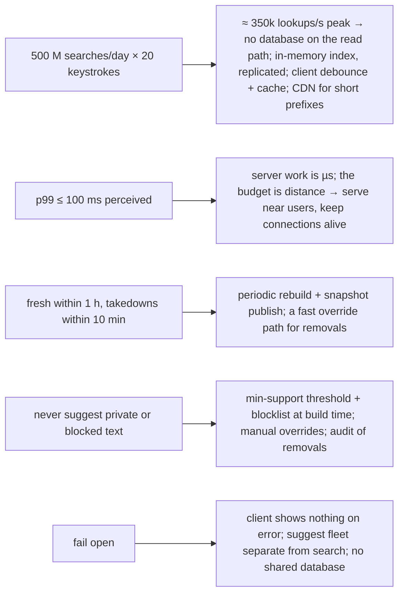
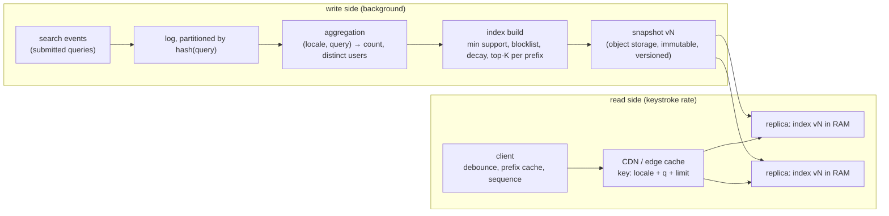
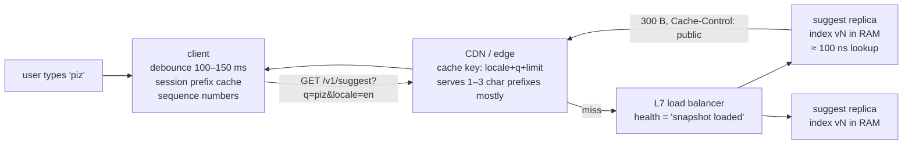
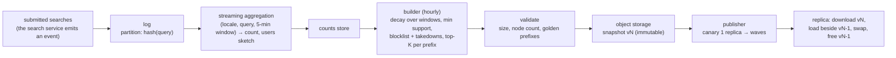

# C12 Unit 1 — Guided design: requirements, estimation, API, data model, high-level design

> Time: ~3 h · CORE: §1–§4 · STRETCH: the multi-region part of §4 · Lab: none in this unit (Unit 2 builds the index)

Search autocomplete looks like the smallest system in the Track C list: one endpoint, one data structure, no
transactions. Interviewers like it for exactly that reason. There is nowhere to hide behind boxes, so the whole
45 minutes is about numbers (every keystroke is a request), a data structure you have to justify (why not just
query the database?), a pipeline that decides what people see (freshness, safety) and the operational story of
replacing an in-memory index on a running fleet. This unit walks the first 25 minutes of the interview the way
[A0 Unit 1 §7](../A0-framework-estimation/unit-1-interview-framework.md#7-putting-it-together-pastebin-in-45-minutes)
did for pastebin: at every step you commit to a decision before the reveal. Unit 2 does the deep dives and the
lab.

## Before you start

You should have passed A3 (caching) and A4 (replication and partitioning), and have the
[45-minute framework](../../docs/INTERVIEW_FRAMEWORK.md) and [the numbers](../../docs/NUMBERS.md) in your head.
Warm-up — answer first:

1. A cache answers 95% of reads in 1 ms and the other 5% in 20 ms. What's the average latency, and what's the
   p99? ([A3 Unit 1 §4](../A3-caching/unit-1-why-where-how-much.md#4-sizing-a-cache-from-hit-rate-math))
2. Keys `s`, `sy`, `sys`, `syst` arrive one after another from one user. Which partitioning scheme keeps them on
   one node, and what does that scheme do to the node that owns everything starting with `s`?
   ([A4 Unit 2 §5](../A4-replication-partitioning/unit-2-partitioning.md#5-why-partition-and-the-partitioning-schemes),
   [A4 Unit 3 §8](../A4-replication-partitioning/unit-3-hot-keys-indexes-sizing.md#8-skew-hot-keys-and-celebrity-problems))
3. What is a CDN's cache key for `GET /v1/suggest?q=Piz&limit=5`, and why does that matter if clients send the
   query in different letter cases? ([A1 Unit 1 §6](../A1-networking-api/unit-1-request-path.md#6-cdns))

<details data-kind="answer">
<summary>Warm-up answers</summary>

1. Average ≈ 0.95 × 1 + 0.05 × 20 ≈ 1.95 ms. The p99 is a *miss*: ≈ 20 ms, because 5% of requests miss and 5% > 1%.
   Hit rate improves the average far more than the tail; a latency SLO at p99 is set by the miss path.
2. Range partitioning on the key keeps a prefix family together; hash partitioning scatters it. Range makes the
   node owning the `s…` range a hot shard (English queries are very unevenly distributed by first letter), so you
   split hot ranges or replicate them more, which is the celebrity problem in a different costume.
3. The full URL including the query string, byte for byte, unless the CDN is configured to normalise it. `q=Piz`
   and `q=piz` are two cache entries with identical answers, so the hit rate halves (or worse) and the origin sees
   the misses. Normalise on the client, and configure the CDN to lower-case and sort the query parameters it keys
   on.

</details>

---

## §1 Requirements and the clarifying questions

### The failure story

A consumer app's search team ships "typeahead v1" in a sprint. The implementation is one SQL query against the
table that already holds past searches:

```sql
SELECT query FROM searches WHERE query LIKE 'piz%' ORDER BY count DESC LIMIT 5;
```

It is fired on every keystroke. In the internal beta (≈ 2,000 searches a day) it is perfect. Then it launches to
≈ 20 M searches a day, and three different things fail in the first week:

- **Load.** Each search is ≈ 15 keystrokes, so 20 M searches become ≈ 300 M lookups a day: ≈ 3.5k/s average,
  ≈ 10k/s at the evening peak, 15× more than anyone estimated, because the estimate counted searches, not
  keystrokes. The prefix `s` matches ≈ 4 M rows; sorting them by `count` costs ≈ 300 ms of database CPU per
  request. The database that also serves search is at 100% CPU within an hour. Search itself slows down, which is
  the one thing autocomplete must never do.
- **Latency and ordering.** Responses take 1–3 s, longer than the gap between keystrokes. The client renders
  whatever arrives last: the user has typed `pizza`, and the list shows completions of `pi` because that response
  arrived after the one for `pizza`. Users describe the feature as "broken", not "slow".
- **Content.** A journalist notices that typing a private individual's name suggests that name followed by an
  accusation. One person searched it eleven times; nobody else ever did. A children's brand's prefix suggests a
  profanity. The top suggestion for `world cup` is last year's final, because counts never decay.

Nothing in that list is exotic. The first two are capacity and latency questions an interviewer expects you to
settle with numbers in the first ten minutes. The third is a requirement that candidates forget to ask about and
that real products spend engineering years on.

### Predict

<!-- predict id="C12-U1-P01" -->
**Predict.** The interviewer says: "Design search autocomplete: as the user types, show the top suggestions."
Nothing else. Before reading on, write down:

1. The 6–8 clarifying questions you would ask, and next to each one **what changes in the design** depending on
   the answer (a question whose answer changes nothing is not worth 30 seconds of a 45-minute interview).
2. Your requirements card: 3–5 functional requirements, every non-functional requirement **with a number**, and an
   explicit out-of-scope list. State the assumptions you'd proceed with if the interviewer says "you decide".
<!-- /predict -->

### Reveal

<details data-kind="reveal" data-for="C12-U1-P01">
<summary>Reveal</summary>

The questions that change the design, with the answer you can assume when the interviewer shrugs:

| Question | Why it changes the design | Assume |
|---|---|---|
| How many searches a day, and how many users? | Every keystroke is a request: this sets QPS, node count, and rules the database out of the read path | 100 M DAU, ≈ 500 M searches/day |
| What do we complete: queries people typed, or entities (products, contacts)? | Query completion is a popularity ranking over a log; entity completion is a ranking over a catalogue with its own fields and permissions | Queries, ranked by popularity |
| Personalised, or the same list for everyone? | Personal results kill CDN/edge caching and need per-user data on the read path; global results are a shared immutable snapshot | Global; personalisation out of scope (Unit 2 STRETCH) |
| How fresh must suggestions be? | Hours → a batch rebuild; minutes → a streaming aggregation plus a small "recent" index; seconds → a different system | New trends within ≈ 1 h; a 10-minute "trending" tier is a stretch goal |
| Latency target? | "As you type" means perceived ≈ 100 ms end to end; the server budget is ≈ 10–20 ms and the rest is the network, which decides *where* you serve from | p99 ≤ 100 ms perceived, server p99 ≤ 20 ms |
| How many suggestions, and from what prefix length? | K per prefix sets index memory; min prefix length 1 means the hottest keys are the 26–40 one-character prefixes | 5 suggestions, from 1 character, prefixes capped at 20 characters |
| Which languages and scripts? Case and accents? | Normalisation rules, per-locale indexes, and whether the index is 1 GB or 50 GB | Start with one locale; design must extend to many |
| What must never be suggested? Who can remove a suggestion, and how fast must it disappear? | Blocklists at build time, a minimum-support threshold (no one-user queries), manual takedowns with a propagation SLO | Blocklist + min support ≥ 5 distinct users; takedown visible within ≈ 10 min |
| What happens to search if suggestions are down? | Fail open: an empty list, never a blocked search box. This shapes availability targets and client behaviour | Suggest at 99.9%, search unaffected |

The requirements card you'd have on the board by 0:06:

**Functional.** (1) `suggest(prefix) → top 5 completions`, ranked by recent popularity. (2) Popularity comes from
what people actually searched (submitted queries), aggregated with recency weighting. (3) Blocked terms, queries
below a support threshold and manually removed suggestions never appear.

**Non-functional, with numbers.** ≈ 500 M searches/day, ≈ 20 keystrokes per search (so ≈ 10 B lookups/day,
≈ 350k/s at peak before client-side mitigation); p99 ≤ 100 ms perceived, server p99 ≤ 20 ms; availability 99.9%
with fail-open behaviour; freshness ≤ 1 h for popularity, ≤ 10 min for takedowns; consistency: eventual, and two
users may see different lists for a few minutes during a rollout.

**Out of scope.** Personalisation, spelling correction, entity/catalogue completion, ads in suggestions, the
search engine itself.

The tempting wrong answers: asking about "scale" without converting it into keystrokes (the 15–20× multiplier is
the point); treating freshness as a nice-to-have (it decides the pipeline); and not asking about safety, which is
the question that separates people who have run a text-suggestion product from people who have read about tries.

</details>

### How it actually works

The requirements phase for this problem is short, but each line of the card drives something concrete:



The dominant non-functional requirement is **latency at keystroke rate**: it rules out any design where a request
touches a disk or a database, and it moves the design problem from "how do I compute suggestions" (easy) to "how do
I precompute them, keep them fresh, and serve them from memory next to the user" (the interview).

A note on what to count. Aggregating *keystrokes* ("pi", "piz", "pizz") would make every prefix of a popular
query look popular. Aggregate **submitted searches**, and let the index derive prefix popularity from them.
Clicks on a suggestion are a second signal (a suggestion that is shown but never chosen should sink); it's worth
one sentence in the interview and a feature in a real ranker.

### Build it

No lab for this section — see Unit 2 §5 for the index and §6 for the pipeline that enforces these requirements.

### Break it

Re-run the requirements phase three times with one change each. For each, write down which line of the card
changes and which later decision it would flip: (a) "suggestions must be personalised to the user's own history";
(b) "a new trend must appear within 60 seconds"; (c) "match anywhere in the query, not just the start: typing
`cup` should suggest `world cup final`".

<details data-kind="answer">
<summary>What changes, and why</summary>

- **(a)** The response is no longer a function of `(locale, prefix)`, so the CDN and any shared cache drop out of
  the read path, and a per-user store (recent queries) is read on every keystroke. The practical design is a
  *merge*: the client keeps the user's recent queries locally and merges them with the global list, which keeps
  the global path cacheable. Say that; it's the senior answer.
- **(b)** Hourly rebuilds can't do it. You add a streaming aggregation (count per query per minute) feeding a small,
  frequently rebuilt "recent" index that is merged with the main one at query time, with its own decay. Memory and
  complexity go up; the data pipeline becomes the riskiest component and should be your first deep dive.
- **(c)** Prefix structures don't do infix. You either index every word of every query as a prefix (≈ 3–4× the
  index, suggestions keyed by word → query), or use an inverted index / n-gram index and lose the O(len(prefix))
  lookup. Push back first: is infix really the requirement, or "word-start" matching, which is cheap?

</details>

### In the wild

- **Google** launched autocomplete as a Google Labs experiment in 2004 and made it the default on the search page
  in 2008 (`TODO-VERIFY: the exact dates`). Its published autocomplete policies describe removing predictions
  that are violent, hateful, sexually explicit, dangerous, or that target individuals, which is the "content"
  requirement above turned into a policy with people and tooling behind it.
- **Facebook's "typeahead"** (described in a 2010 engineering note, "The Life of a Typeahead Query") is the
  classic *entity* completion: a browser cache first, then an aggregator fanning out to leaf services (friends,
  pages, applications), each with its own index, merged and ranked. Different data source, same shape: cache
  near the user, precomputed per-source candidates, a small merge at the end.
- **Elasticsearch's completion suggester** is the off-the-shelf version of "precompute at index time, hold it in
  memory": suggestions are stored in an in-memory finite state transducer per shard, built when documents are
  indexed, and queried by prefix with optional fuzziness and context filters. Its documentation is explicit that it
  is designed for search-as-you-type, not for arbitrary infix matching.

### Trade-offs

| Option | Wins when | Loses when | When the answer flips |
|---|---|---|---|
| Global (same list for everyone) | Cacheable at every layer; one immutable snapshot; simplest ops | Products where personal context dominates (contacts, your own files) | Flip to personalised (or a client-side merge) when the user's own history beats global popularity, as in a mail client's recipient box |
| Batch freshness (≈ hourly) | Cheap, simple, reproducible builds; ranking changes are reviewable | News, live events, trending products | Flip to streaming + a recent-index tier when the product's value depends on the last few minutes |
| Fail open (empty list on error) | Suggest is an enhancement; search must never block on it | Products where the suggestion *is* the result (a command palette) | Flip to fail closed only when an empty list would be worse than an error |
| High min-support threshold | Protects privacy; filters noise; smaller index | Long-tail completions disappear; small locales starve | Lower the threshold per locale as volume allows, never below "several distinct users" |

### Senior bar

- **Failure modes**: counting searches instead of keystrokes (15–20× under-estimate); suggesting one person's
  query (privacy incident); rankings frozen in the past because counts never decay; a slow suggest path that
  slows search; a client that renders out-of-order responses.
- **Capacity numbers**: ≈ 20 keystrokes per search; ≈ 350k lookups/s peak at 500 M searches/day; the one-character
  prefixes are ≈ 5% of lookups but a few dozen keys, i.e. the hottest keys in the system (`≈`, all assumptions
  to validate with client telemetry).
- **Ops**: takedown tooling with a propagation SLO and an audit trail of who removed what; A/B testing of ranking
  changes (shown-vs-chosen rate per suggestion); dashboards for empty-result rate per prefix length.
- **Cost**: every keystroke is a request; the cheapest request is one the client never sends, so debounce and a
  local prefix cache are the biggest cost lever before any server is bought.

Interviewer follow-up probes:

1. "Why not just run a prefix query against the search index on every keystroke?"

<details data-kind="answer">
<summary>Model answer</summary>

Cost per lookup and blast radius. A prefix query over the search index is O(matches) to rank (the prefix `s`
matches millions of queries), it's ≈ 10–20 lookups per search, and it puts the autocomplete load on the system
that serves search results, so an autocomplete spike degrades search. Precomputing the top-K per prefix makes a
lookup O(len(prefix)) in memory, and a separate serving fleet makes failure independent. The flip: a small
catalogue (≈ 10⁴ items) with low traffic, where a prefix query against the existing index is fine and the
precomputed index is over-engineering.

</details>

2. "How do you make sure a query that only one person ever typed is never suggested?"

<details data-kind="answer">
<summary>Model answer</summary>

A minimum-support threshold applied at build time, on *distinct users* (or sessions), not raw count — one person
typing a name eleven times must not qualify. That needs the aggregation to keep a per-query set or sketch of
distinct users (a HyperLogLog is enough) rather than a plain counter. Plus a blocklist for terms that are never
acceptable regardless of popularity, and a manual takedown path with a propagation SLO and an audit log.

</details>

3. "The suggest service is completely down. What does the user see?"

<details data-kind="answer">
<summary>Model answer</summary>

A search box that works normally, with no dropdown. The client treats any error or timeout (short, ≈ 200 ms) as
"no suggestions" and never blocks typing or submitting on it; the CDN may keep serving stale cached lists for hot
prefixes (`stale-if-error`). The suggest fleet shares nothing with search (no common database, separate
deployment), so its outage can't spread. Alerting is on the empty-result rate and the client-measured latency, not
only on server errors.

</details>

### Check yourself

1. Which single multiplier do most candidates forget when estimating autocomplete load, and how big is it?
2. Why aggregate submitted searches rather than keystrokes?
3. Name the two safety mechanisms that run at build time and the one that must run faster.

<details data-kind="answer">
<summary>Answers</summary>

1. Keystrokes per search, ≈ 15–20×. A search is one query; autocomplete serves one lookup per keystroke.
2. Keystroke counts inflate every prefix of a popular query and double-count the same intent; submitted searches
   are the actual signal, and the index derives prefix popularity from them.
3. Build time: the blocklist and the minimum-support threshold. Faster: manual takedowns, which need an override
   path with a propagation SLO (≈ 10 min) rather than waiting for the next hourly build.

</details>

---

## §2 Estimation walkthrough

### The failure story

The same team, second attempt. This time they estimate: "20 M searches a day is ≈ 230 per second. Two servers
with a lot of headroom." They also size the index: "20 M distinct queries at ≈ 20 bytes each is ≈ 400 MB; an 8 GB
instance is plenty." Both numbers are arithmetically right and both are the wrong numbers. Lookups are keystrokes,
not searches: ≈ 10k/s at peak, not 230. And an index isn't a list of strings: every prefix of every query needs
its own entry with its own top-5, and in a pointer-heavy Go trie each node costs hundreds of bytes, not 20. The
index was ≈ 7 GB. It fitted, once. The first hourly rebuild loaded the new index next to the old one, the process
needed 14 GB, and the kernel killed it on every replica within the same minute, because every replica rebuilt on
the same schedule.

### Predict

<!-- predict id="C12-U1-P02" -->
**Predict.** Using the assumptions from §1 (500 M searches/day, 20 keystrokes/search, 5 suggestions, prefixes up
to 20 characters, 20 M distinct queries kept after filtering), compute, with units and a decision after each:

1. Peak lookups per second as sent by clients, and after a client debounce + local prefix cache that halves them.
2. Memory for the serving index. Make your per-node assumption explicit (what does one prefix node hold, and
   roughly how many bytes does that cost?) and say how many distinct prefixes you expect for 20 M queries.
3. How many serving nodes per region, given a stateless HTTP service doing an in-memory lookup.
4. Peak egress, in bits per second, for ≈ 300-byte responses.
5. Daily raw log volume for submitted searches at ≈ 100 bytes per event, and the size of one index snapshot.

Then: which of these numbers decides whether the index is *replicated whole* or *partitioned*?
<!-- /predict -->

### Reveal

<details data-kind="reveal" data-for="C12-U1-P02">
<summary>Reveal</summary>

1. **Lookups.** 500 M/day ≈ 5.8k searches/s average (500 M ÷ 86,400). × 20 keystrokes ≈ 116k lookups/s average;
   × 3 peak factor ≈ **350k/s**. With debounce (wait ≈ 100–150 ms after the last keystroke before asking) and a
   client-side cache of prefixes already fetched in this session, assume ≈ ½: **≈ 175k/s at the edge**. If the
   CDN answers the one- and two-character prefixes, the origin sees perhaps ≈ 100k/s, but size the origin for
   175k/s so a cold CDN doesn't take you down. **Decision:** nothing that touches a disk or a database survives on
   the read path; in-memory index, stateless replicas, cacheable responses.
2. **Index memory.** 20 M queries × ≈ 20 characters means at most 400 M distinct prefixes, but prefixes are shared
   heavily (everything starts with one of a few dozen characters, most queries share their first 5–8 characters
   with thousands of others). Assume ≈ 5 new nodes per query: **≈ 100 M nodes**. A compact node (a sorted child
   array, five 4-byte query ids for the top-5, a terminal count) is ≈ 60–100 B → **≈ 6–10 GB**, plus the 20 M query
   strings at ≈ 24 B ≈ 0.5 GB. A naive Go trie with a `map[rune]*node` per node is ≈ 300+ B per node → ≈ 30 GB.
   **Decision:** the representation matters (Unit 2 §5), and the compact index fits in one box with room for the
   2× needed during a snapshot swap, so replicate the whole index; partition only when it stops fitting (many
   locales, or 10× the queries).
3. **Nodes.** An in-memory lookup is ≈ 100 ns; the HTTP handling around it is ≈ 50–100 µs of CPU, so assume
   ≈ 20k req/s per 8-vCPU node (`TODO-VERIFY` with a load test; it's above the 1–10k/s rule of thumb for services
   with downstream calls because there are none). 175k ÷ (20k × 0.6 utilisation) ≈ 15, plus N+2 across three
   zones → **≈ 17 nodes per region**. **Decision:** a small fleet; the cost is not the servers, it's the
   keystrokes (see egress).
4. **Egress.** 300 B × 350k/s ≈ 105 MB/s ≈ **0.84 Gbps** peak before client-side mitigation; average ≈ 116k/s ×
   300 B ≈ 35 MB/s ≈ 3 TB/day ≈ 90 TB/month. At ≈ $0.05–0.09/GB that's ≈ $4.5–8k/month, the same order as the
   servers (≈ 17 × $200–400). **Decision:** the client-side cache and the CDN pay for themselves; response size is
   worth trimming (suggestion text only, no decoration).
5. **Logs and snapshots.** 500 M × 100 B ≈ **50 GB/day** raw; aggregated to ≈ 20–30 M `(query, count)` rows
   ≈ 1–2 GB per build; one compact snapshot ≈ 2–4 GB. Distributing 3 GB to 17 replicas every hour ≈ 50 GB/h
   ≈ 14 MB/s inside a region: trivial. **Decision:** hourly rebuilds are cheap; minute-level freshness isn't a cost
   problem but a pipeline-design problem (Unit 2 §6).

The number that decides *replicate whole vs partition* is (2), index memory, against one box's RAM with the 2×
swap headroom: ≈ 10 GB of index needs ≈ 20 GB; a 64 GB box is comfortable. Traffic (1) is handled by replicas
either way. The tempting wrong answer is to partition "because it's big data": 100 M nodes is big for a database and
small for RAM.

</details>

### How it actually works

The estimate sheet you'd have on the board by 0:10, each line with its decision:

| Quantity | Arithmetic | ≈ Result | Decision |
|---|---|---|---|
| Searches/s | 500 M ÷ 86,400 | 5.8k/s avg | — (input) |
| Lookups/s | × 20 keystrokes, × 3 peak | 116k/s avg, 350k/s peak | In-memory only; client debounce + cache |
| At the origin after client mitigation | ÷ 2 | ≈ 175k/s peak | Size the fleet for this; CDN is a bonus |
| Distinct prefixes | 20 M queries × ≈ 5 new nodes each | ≈ 100 M nodes | — |
| Index memory | 100 M × 60–100 B + strings | ≈ 6–10 GB (compact); ≈ 30 GB (naive) | Replicate whole; representation matters |
| RAM per node | 2 × index (old + new during swap) | ≈ 20 GB | 64 GB nodes; rebuild staggered across replicas |
| Serving nodes | 175k ÷ (20k × 0.6) + N+2 | ≈ 17 per region | Small fleet |
| Egress | 300 B × 350k/s | ≈ 0.84 Gbps peak, ≈ 90 TB/month | Client cache + CDN; small responses |
| Raw logs | 500 M × 100 B | ≈ 50 GB/day | A log, batch and/or streaming aggregation |
| Snapshot distribution | 3 GB × 17 replicas/h | ≈ 14 MB/s | Hourly rebuilds are free |

And the latency budget, which is the number that decides *where* the service runs:

| Hop | ≈ Time | Note |
|---|---|---|
| Keystroke → request (debounce) | 100–150 ms | Deliberate; not counted in "perceived" latency by users, who are still typing |
| Client → nearest edge RTT | 10–40 ms | Depends on the edge footprint |
| Edge → origin RTT (if cross-region) | 60–80 ms | Blows the budget: serve in-region or from the edge |
| Server work | ≈ 1 ms | µs of lookup + HTTP overhead |
| Render | few ms | |

With a 100 ms perceived target, the server's share is a rounding error and the network is everything: serve from
every region users are in, keep connections alive (HTTP/2 multiplexes the keystroke burst over one connection;
[A1 Unit 1 §2](../A1-networking-api/unit-1-request-path.md#2-connection-setup-and-http-versions)), and let the CDN
answer the hottest prefixes at the edge.

### Build it

No lab for this section. Do three `sd estimate -kind qps` and `-kind cache` problems, then build the lab's break-it
corpus in a scratch test once Unit 2's `Build` works and print `Nodes()` and `Len()`: the ratio is the "new nodes
per query" assumption above, measured.

### Break it

Change one input at a time and find the decision that flips: (a) 10× searches (5 B/day); (b) the product team
refuses to debounce ("every keystroke must update instantly"); (c) 30 locales with ≈ 100 M distinct queries in
total; (d) the index is a naive pointer trie at ≈ 300 B per node.

<details data-kind="answer">
<summary>What flips, and why</summary>

- **(a)** ≈ 3.5 M lookups/s peak: still in-memory, ≈ 170 nodes per region; the CDN and client cache become
  mandatory rather than nice; snapshot distribution is 170 × 3 GB per hour ≈ 140 MB/s, still fine, but build time
  and the blast radius of a bad snapshot now argue for partitioning by locale and canarying by partition.
- **(b)** ≈ 2× the origin load and egress, no change in architecture. Push back with the cost (≈ $4–8k/month of
  egress) and the UX fact that a 100 ms debounce is invisible to a user typing at 200–300 ms per character.
- **(c)** ≈ 500 M nodes ≈ 30–50 GB compact, ≈ 60–100 GB with the swap headroom: partitioning by locale is now
  mandatory (and natural: a request carries its locale). Each partition is replicated whole.
- **(d)** ≈ 30 GB index, ≈ 60 GB with headroom: it still fits a 128 GB box, but the hourly rebuild spends minutes in
  garbage-collector-visible allocations and the swap doubles that. The representation becomes a cost line and a
  latency risk (GC pauses); Unit 2 §5 is about this.

</details>

### In the wild

- Public estimates put Google at several billion searches a day (`TODO-VERIFY: current public figure`), i.e. an
  order of magnitude above this walkthrough; the shape of the estimate is identical, only the fleet is bigger.
- Average typing speed is ≈ 40 words per minute on a keyboard (≈ 200–300 ms per character) and slower on phones;
  this is why a ≈ 100 ms debounce costs nothing perceptible and why the 100 ms perceived budget (the classic
  "feels instantaneous" threshold from human–computer interaction research) is the target.
- Netflix's **Hollow** library distributes in-memory datasets of exactly this scale (gigabytes, read-only, replaced
  by versioned snapshots and deltas from a blob store) to a fleet of consumers; its design notes make the same
  argument: for datasets of this size, a full in-memory copy per node beats a remote store on every axis except
  memory.

### Trade-offs

| Option | Wins when | Loses when | When the answer flips |
|---|---|---|---|
| Replicate the whole index on every node | Index ≪ RAM (≈ 10 GB vs 64 GB); simplest routing, no cross-node merge | Index approaches RAM ÷ 2; build/distribution time dominates | Flip to partition by locale, then by prefix range, when 2 × index > the RAM you want to buy |
| Client debounce + prefix cache | Always: it halves cost and removes stale-response bugs if done right | Never, except for "instant" demands that don't survive a cost conversation | — |
| CDN for short prefixes | Hot keys (1–3 chars) are a few thousand cache entries serving a large share of lookups | Personalised results; locales with tiny traffic (nothing is hot) | Flip to origin-only for personalised lists; keep the CDN for the global tier |
| Size the origin for the post-CDN load | Cheaper | A CDN config change or purge sends 100% to origin | Size the origin for the pre-CDN load; the CDN is latency and egress savings, not capacity |

### Senior bar

- **Failure modes of the estimate**: searches instead of keystrokes; strings instead of nodes; forgetting the 2×
  memory during a swap; sizing for the post-CDN load; bytes vs bits in the egress line (8×).
- **Capacity numbers**: ≈ 20 keystrokes/search; ≈ 5 nodes per query; ≈ 60–100 B per compact node; ≈ 20k req/s per
  node (assumption); 2× RAM for the swap.
- **Ops**: a load test that produces the real per-node QPS before anyone quotes one; memory alarms at ≈ 60% so a
  swap can't OOM; rebuilds staggered across replicas, never all at once.
- **Cost**: egress (≈ 90 TB/month) ≈ the server bill; the client cache halves both. Build cost (an hourly batch job
  over 50 GB) is small; the engineering cost of a streaming tier is the expensive line.

Interviewer follow-up probes:

1. "You said the index is ≈ 10 GB. Walk me through the bytes."

<details data-kind="answer">
<summary>Model answer</summary>

20 M queries × 20 characters is 400 M prefix positions, but shared prefixes collapse most of them; ≈ 5 new nodes
per query is my assumption, so ≈ 100 M nodes. A compact node holds a sorted child array (say 4 B per child, ≈ 2
children on average), the top-5 as five 4-byte query ids, and a count: ≈ 60–100 B. That's ≈ 6–10 GB, plus 0.5 GB
of query strings. A pointer-per-child trie with a map per node in Go costs 3–5× that, which is why the
representation is a deep dive, not a detail. I'd measure the real nodes-per-query on a sample of the log before
committing to hardware.

</details>

2. "Why not put the index in a shared Redis cluster instead of every node holding a copy?"

<details data-kind="answer">
<summary>Model answer</summary>

It adds a network hop (≈ 0.5–1 ms) to every one of 175k lookups/s and makes a single-threaded Redis node at
≈ 100k+ ops/s the thing I have to shard, when the index fits comfortably in each serving node's RAM. A local copy
makes a lookup ≈ 100 ns with no dependency to fail. Redis earns its place when the dataset doesn't fit on one node
and many different services need the same data; for a 10 GB read-only snapshot refreshed hourly, local memory wins
on latency, cost and failure modes.

</details>

3. "What breaks at 10× traffic, and what at 10× queries?"

<details data-kind="answer">
<summary>Model answer</summary>

10× traffic: ≈ 3.5 M lookups/s peak. The fleet grows ≈ 10× (≈ 170 replicas per region), which is linear and boring,
but three things change character: the CDN and client cache stop being optimisations and become the design
(origin cost and egress ≈ 10×), snapshot distribution is now ≈ 500 GB per hour per region (still fine, but
rollouts take longer, so canary waves matter more), and rate limiting at the edge becomes a necessity. 10×
queries: ≈ 1 B nodes ≈ 60–100 GB compact, ≈ 2× that with swap headroom, so the whole-index-per-node decision
flips: partition by locale first (free, since requests carry it), then by prefix range with hot ranges replicated
more, and the build becomes a distributed job. Traffic scales the fleet; corpus size changes the architecture.

</details>

### Check yourself

1. Why does a snapshot swap need ≈ 2× the index in RAM, and what's the alternative?
2. What is the first thing a CDN purge does to your origin?
3. Which cost line is the client-side cache attacking?

<details data-kind="answer">
<summary>Answers</summary>

1. The new index is built or loaded while the old one still serves; both exist until the swap. The alternative
   is an in-place update, which needs locks or copy-on-write per node and is much harder to make safe (Unit 2 §6).
2. Sends the whole keystroke load to the origin at once, which is why the origin is sized for the pre-CDN load.
3. Egress (and origin QPS): a prefix the client has already fetched is never requested again in that session.

</details>

---

## §3 API and data model

### The failure story

Version 2 of the API fixed the database, and then nobody could cache it:

```
POST /api/suggest   {"prefix": "Piz", "userId": "u_42"}
200 {"results": [{"title": "pizza near me", "thumbnail": "https://…/t1.jpg", "category": {...}}, …]}   (≈ 2 KB)
```

`POST` means no CDN and no browser cache. The `userId` in the body means every response is nominally personal,
so even an internal cache can't share it. The 2 KB body (thumbnails, categories) multiplies egress by ≈ 7. There is
no `limit`, so the client can't ask for 3 on a phone. And the response doesn't say which prefix it answers, so the
client can't tell a late response for `pi` from the fresh one for `pizza` and renders whatever arrives last.

Behind it, the data model was a table `suggestions(prefix TEXT PRIMARY KEY, results JSONB)` rebuilt nightly — a
reasonable shape — except that it lived in the same Postgres as user accounts, so a rebuild's 100 M-row `UPSERT`
bloated the table, pushed the hot set out of the buffer pool and made logins slow at 03:00 every night.

### Predict

<!-- predict id="C12-U1-P03" -->
**Predict.** Write down:

1. The endpoint: method, path, query parameters, response body, cache headers, and what the service returns for an
   empty prefix, a 200-character prefix, and an internal error.
2. The three data sets in this system (raw events, aggregated counts, the serving index): for each, what the
   key is, what the value is, which store holds it and why, and whether it is partitioned, replicated or both.
3. How the client should behave: when to send a request, what to cache, and how to handle responses that arrive
   out of order.
<!-- /predict -->

### Reveal

<details data-kind="reveal" data-for="C12-U1-P03">
<summary>Reveal</summary>

**1. Endpoint.**

```
GET /v1/suggest?q=piz&limit=5&locale=en-US
200 OK
Cache-Control: public, max-age=300, stale-while-revalidate=600, stale-if-error=3600
Content-Type: application/json

{"q": "piz", "snapshot": "2026-06-01T09:00Z", "suggestions": [{"text": "pizza near me"}, {"text": "pizza hut"}, …]}
```

`GET` because a lookup is safe and idempotent and the response depends only on `(locale, normalised q, limit)`, so
browsers, the CDN and any intermediate cache can store it ([A1 Unit 2 §1](../A1-networking-api/unit-2-api-design.md#1-resources-methods-status-codes-and-errors)).
The service echoes the normalised `q` so the client can drop responses for prefixes it has moved past. `snapshot`
lets support reproduce "why did it suggest that?". An empty or whitespace-only `q` → `200` with an empty list (not
`400`; nothing is wrong, there's just nothing to say). A prefix longer than the index depth → truncated server-side,
candidates filtered by the full prefix. Internal error → `503` with a short `Retry-After`, and the client shows
nothing; the CDN serves stale for hot prefixes because of `stale-if-error`. `limit` is capped (≤ 10). No
authentication (it's public data), so rate limit per client IP and per session at the edge
([A7 Unit 2 §3](../A7-reliability/unit-2-breakers-rate-limits.md#3-rate-limiting-in-a-fleet-shared-vs-local-counters-fairness-and-what-to-tell-the-client)):
an unauthenticated 100 ns endpoint is a cheap thing to abuse.

The tempting wrong answers: `POST` (uncacheable); returning rich objects (egress); a `400` for short prefixes
(clients then retry or log errors for normal behaviour); omitting the echo.

**2. Data sets.**

| Data set | Key → value | Store | Partitioned / replicated | Why |
|---|---|---|---|---|
| Raw search events | `(time, locale, query, user/session hash)` | An append-only log (Kafka-style; [A6 Unit 1 §2](../A6-async/unit-1-queues-logs.md#2-queues-versus-logs-and-partitions)), retained ≈ days, archived to object storage | Partitioned by hash of query (so one query's events land on one consumer); replicated by the log | Durable, replayable, decoupled from serving |
| Aggregated counts | `(locale, query, window)` → `(count, distinct_users_sketch)` | A columnar/warehouse table or a wide-column store, written by the aggregation job | Partitioned by locale and query hash | Batch-friendly; never read on the request path |
| Serving index | `(locale, prefix)` → `[top-K query ids]` plus `id → text` | An immutable snapshot file in object storage, versioned, loaded into each replica's RAM | Replicated whole per locale (fits); partitioned by prefix range only if it stops fitting | Lookup in O(len(prefix)); no database on the read path |

There is deliberately **no live database in the read path**. The serving index is an artefact, like a build
output: built from counts, validated, versioned, distributed, swapped in. Partitioning by prefix *range* (first
one or two characters) keeps a user's successive keystrokes on one node and lets you give the hot `s…` range more
replicas; partitioning by *hash* of the prefix spreads load evenly but gains nothing from keystroke locality. Either
is fine; say which and why ([A4 Unit 2 §5](../A4-replication-partitioning/unit-2-partitioning.md#5-why-partition-and-the-partitioning-schemes)).

**3. Client.** Debounce ≈ 100–150 ms after the last keystroke; keep a per-session cache keyed by normalised prefix
(a prefix typed, deleted and retyped is free); attach a sequence number to each request and ignore any response
older than the latest one shown (or compare the echoed `q` with the current input); on error or timeout show
nothing and keep the box usable; never block search submission on an outstanding suggest request.

</details>

### How it actually works



The serving layout, independent of the exact structure (Unit 2 §5 compares them): for each prefix up to the depth
cap, the K best query ids, already sorted; a separate id → text table so each query string is stored once rather
than once per prefix it appears under; and the prefix set itself as a trie, a sorted array with binary search, or
a finite state transducer. Lookup: normalise, walk or search the prefix, copy K ids, resolve to text, serialise.
No ranking happens at query time; ranking happened at build time, once, for all prefixes.

The aggregated counts carry a **distinct-users sketch** (HyperLogLog or a sampled set) next to the count, because
the min-support rule from §1 is on users, not on hits. The window column is what lets the builder apply recency
weighting: a query's score is a decayed sum over windows, e.g. `Σ count(window) × 2^(−age/half-life)`, which the
lab's `Counter` implements in streaming form.

Why ids rather than strings in the index value: a popular query such as `weather` appears in the top-5 of every
prefix `w`, `we`, `wea`, `weat`, … (7 prefixes); storing the text 7 times multiplies memory by the average prefix
depth. Four-byte ids plus one string table is the compact form; it also makes "remove this query everywhere" a
single tombstone in the id table (the takedown path).

### Build it

Unit 2's lab (`labs/c12/suggest`) is this section's serving layout: `Build` produces the immutable index from
`(query → count)`, and `(*Index).Suggest` is the endpoint's core. Wrap it in a handler in a scratch file to see the
whole request path:

```go
// A minimal handler around suggest.Service: GET /v1/suggest?q=&limit=
package main

import (
	"encoding/json"
	"net/http"
	"strconv"

	"github.com/chethu007/system-design-course/solutions/c12/suggest"
)

func handler(svc *suggest.Service) http.Handler {
	return http.HandlerFunc(func(w http.ResponseWriter, r *http.Request) {
		if r.Method != http.MethodGet {
			w.Header().Set("Allow", "GET")
			http.Error(w, `{"error":{"code":"method_not_allowed"}}`, http.StatusMethodNotAllowed)
			return
		}
		q := suggest.Normalize(r.URL.Query().Get("q"))
		limit, _ := strconv.Atoi(r.URL.Query().Get("limit"))
		if limit <= 0 || limit > 10 {
			limit = 5
		}
		type item struct {
			Text string `json:"text"`
		}
		out := struct {
			Q           string `json:"q"`
			Suggestions []item `json:"suggestions"`
		}{Q: q, Suggestions: []item{}} // never null: clients range over it
		for _, s := range svc.Suggest(q, limit) {
			out.Suggestions = append(out.Suggestions, item{Text: s.Query})
		}
		w.Header().Set("Content-Type", "application/json")
		w.Header().Set("Cache-Control", "public, max-age=300, stale-while-revalidate=600, stale-if-error=3600")
		json.NewEncoder(w).Encode(out)
	})
}

func main() {
	svc := suggest.NewService(suggest.Build(map[string]int64{"pizza near me": 90, "pizza hut": 70, "pizzeria": 20}, suggest.Options{}))
	http.ListenAndServe("127.0.0.1:8081", handler(svc))
}
```

Run it, then `curl -i 'http://127.0.0.1:8081/v1/suggest?q=Piz'` and `?q=` and check the headers and the empty-list
shape.

### Break it

With the handler above: (a) change the method to `POST` and put the prefix in the body — what did you lose, in
infrastructure terms? (b) remove the `q` echo and simulate a slow response for `pi` arriving after a fast one for
`pizza` — what does a naive client render? (c) add the session cookie to the CDN cache key (or `Vary: Cookie`) —
what happens to the hit rate?

<details data-kind="answer">
<summary>What breaks, and why</summary>

(a) Every cache between the user and the service (browser, CDN, any proxy) stops storing responses: `POST` is not
cacheable by default, and intermediaries also won't retry it on connection failure. You pay origin load and egress
for every keystroke and lose `stale-if-error` protection during outages. (b) The client renders the completions of
`pi` under the input `pizza`: a visibly wrong list. The fix is on the client (sequence numbers), and the echo makes
the fix trivial and debuggable. (c) The CDN keys each user's requests separately; the hit rate for global
suggestions collapses to ≈ 0, which is the same as having no CDN. Personalisation must be kept out of the
cacheable path (client-side merge) or served by a separate, uncached endpoint.

</details>

### In the wild

- The **OpenSearch suggestions** format, used by browser search boxes, is a JSON array whose first element echoes
  the query and whose second is the list of completions: `["piz", ["pizza near me", "pizza hut"]]`. Google's
  suggest endpoint speaks it; the echo exists for exactly the out-of-order reason above.
- **Elasticsearch** exposes completion through the `_search` API's `suggest` section with a `size`; results carry
  the matched text and a score computed at index time (weights), not at query time.
- **DynamoDB** supports `begins_with` only on the sort key of a composite primary key: the partition key must be
  known (a tenant, a locale), and the prefix scan runs inside one partition — a hardware-enforced version of
  "partition by locale, range by prefix".
- **Postgres** needs a B-tree with `text_pattern_ops` (or the `C` collation) for `LIKE 'piz%'` to use the index;
  `pg_trgm` GIN indexes handle infix matching at much higher cost. Either way the `ORDER BY count` over the matched
  range is what hurts at scale, as in §1's failure story.
- **Redis** sorted sets support lexicographic range queries (`ZRANGEBYLEX`), which is the basis of a well-known
  autocomplete pattern (every prefix of a term inserted with score 0, the range `[piz` to `[piz\xff` scanned); it
  gives prefix matching but not popularity ranking without a second structure (`TODO-VERIFY: current best-practice
  pattern in the Redis docs`).

### Trade-offs

| Option | Wins when | Loses when | When the answer flips |
|---|---|---|---|
| `GET` with cache headers | Global suggestions: browser/CDN caching, retries safe | Personalised responses (then they're `private` anyway) | Keep `GET`; mark personalised responses `Cache-Control: private, no-store` |
| Ids in the index + a string table | Memory: each string once; takedown = one tombstone | Extra indirection per result (≈ ns) | Flip to inline strings only for tiny indexes |
| Whole-index replication | Index fits with 2× headroom | Multi-locale/huge corpora | Partition by locale, then prefix range |
| Range partition by prefix | Keystroke locality; hot ranges can get more replicas | Skew: `s…` vs `x…` | Hash partition when there's no locality benefit (no per-node cache) and you want even load |
| Echo `q` in the response | Debuggable, simple client logic | A few bytes per response | — |

### Senior bar

- **Failure modes**: uncacheable `POST`; personal data in the shared cache key (or the reverse: personal results
  cached publicly, a privacy incident); unbounded `limit`; rebuilding the serving data inside the OLTP database;
  clients rendering out-of-order responses; no locale in the key (English suggestions for a French prefix).
- **Capacity numbers**: ≈ 300 B per response; ≈ 4 B per id vs ≈ 24 B per inline string × average depth ≈ 7;
  CDN keys ≈ (26–40)¹ + (26–40)² + … per locale for the short prefixes.
- **Ops**: snapshot version in every response and log line; per-prefix-length metrics (empty-result rate, latency);
  rate limiting at the edge; the takedown tombstone path tested like a deploy.
- **Cost**: response bytes × 10 B lookups/day; the string table trick is a memory line, the `GET` decision is an
  egress line.

Interviewer follow-up probes:

1. "How does the client avoid showing stale suggestions when responses arrive out of order?"

<details data-kind="answer">
<summary>Model answer</summary>

Every request carries a monotonically increasing sequence number held by the client; a response whose sequence is
lower than the last rendered one is discarded. The server's echo of the normalised `q` is a belt-and-braces check
(and a debugging aid): if it doesn't equal the current input, discard. Cancelling in-flight requests on each
keystroke (an `AbortController` in browsers, context cancellation in a native client) reduces waste but is not
sufficient, because a response can be in flight past the cancellation.

</details>

2. "Why is the serving index an immutable artefact rather than rows in a database?"

<details data-kind="answer">
<summary>Model answer</summary>

Because the read path needs ≈ 100 ns lookups at ≈ 175k/s with no dependency, and the data changes all at once
once an hour, not row by row. An immutable, versioned snapshot gives atomic switchover (readers see v7 or v8, never
half of each), trivial rollback (point at v7 again), canarying (one replica loads v8 first), reproducibility (the
same inputs give the same file), and no write amplification in a database that other things depend on. A database
earns its place when updates are incremental and concurrent, which they aren't here.

</details>

3. "The endpoint is unauthenticated. How do you stop someone from scraping all your suggestions, or hammering it?"

<details data-kind="answer">
<summary>Model answer</summary>

Rate limit at the edge per IP and per client token (a token bucket with a generous burst for typing bursts and a
low sustained rate), cap `limit`, and accept that the global suggestions are public data: scraping them is
possible and cheap to serve, so the goal is cost containment, not secrecy. Personalised or tenant-scoped
suggestions are a different matter: they need authentication and must never be cached publicly.

</details>

### Check yourself

1. Which three facts about the response make it CDN-cacheable?
2. Why store query ids rather than strings in the prefix index?
3. What does the `distinct_users` sketch in the aggregated counts enable?

<details data-kind="answer">
<summary>Answers</summary>

1. It's a `GET`; it depends only on `(locale, q, limit)` with no per-user data; it carries `Cache-Control: public`
   with a TTL (and `stale-*` directives for resilience).
2. A popular query appears under every prefix it has (≈ depth × copies); ids make it 4 B per occurrence, and a
   takedown becomes one tombstone.
3. The minimum-support rule on distinct users, so one person's repeated query never qualifies.

</details>

---

## §4 High-level design: the read path and the write path

### The failure story

The architecture review for version 3 has the right pieces and the wrong joints. The aggregation job writes
directly into the serving nodes over RPC, updating the in-memory index in place under a lock: every hourly update
holds the write lock for ≈ 40 s per node, during which lookups queue, time out, and the client shows nothing; since
every node updates at the same minute, the whole fleet "blinks" hourly. When a bug makes one build produce an index
with ≈ 2% of the usual prefixes, the job pushes it to all nodes at once; for 20 minutes 98% of prefixes return
empty lists and nobody can roll back, because the previous version exists nowhere but in the nodes' memory, which
has just been overwritten. The dashboards show green: no errors, fast responses, just nothing in them.

### Predict

<!-- predict id="C12-U1-P04" -->
**Predict.** Draw the end-to-end design: the read path from keystroke to response and the write path from a
submitted search to a replica serving the new suggestion. Every box must be justified by a requirement or a number
from §1–§3. Walk one request through it with latencies. Then write the two deep dives you'd pick for minutes
25–40 and why those two.
<!-- /predict -->

### Reveal

<details data-kind="reveal" data-for="C12-U1-P04">
<summary>Reveal</summary>

The design is below under "How it actually works". Compare yours box by box. The most common gaps:

1. **A database on the read path** ("the service queries the suggestions table"): rules out the ≈ 100 ns lookup
   and ties suggest availability to a database.
2. **Writing into the replicas** instead of publishing a snapshot they pull: no atomic switch, no rollback, no
   canary, and a lock on the read path.
3. **No client box**: debounce, cache and sequencing are design decisions that halve the load and prevent the
   out-of-order bug; a design that starts at the load balancer has silently doubled its cost.
4. **Aggregating keystrokes** rather than submitted searches.
5. **No validation before swap**: the "98% empty" incident is prevented by a sanity check (prefix count, size,
   a fixed set of golden prefixes returning non-empty lists) that fails the publish instead of the product.

Deep dives, chosen by risk: (1) the **index structure and the top-K precomputation** (it's the hot path and the
memory budget, and interviewers always ask "why a trie / how big"); (2) the **freshness pipeline and snapshot
publishing** (correctness of what people see, the operational blast radius, the takedown SLO). If there's time,
(3) hot prefixes and partitioning. A third candidate many people pick, "scaling the HTTP fleet", is the least
risky part of this system; say so and move on.

</details>

### How it actually works

**Read path.**



Walking `piz` through it: the client already holds `p` and `pi` from this session; 120 ms after the `z` it sends
the request over the existing HTTP/2 connection (no new handshake: a fresh TLS connection would cost 2–3 RTTs,
[A1 Unit 1 §2](../A1-networking-api/unit-1-request-path.md#2-connection-setup-and-http-versions)); the edge is
≈ 20 ms away and misses (three-character prefixes are long-tail enough that the hit rate drops); the load balancer
in the same region picks a healthy replica; the replica normalises `piz`, walks three nodes, copies five ids,
resolves five strings and writes ≈ 300 B; total ≈ 1 ms of server time plus ≈ 25 ms of network: well inside the
budget. The next keystroke `pizz` repeats the same path; a deleted and retyped `z` is served from the client cache.

**Write path.**



The publish is a sequence worth drawing, because it's where the §4 failure story is prevented:

```mermaid
sequenceDiagram
    participant B as builder
    participant O as object storage
    participant P as publisher
    participant R as replica
    B->>O: put snapshot v8 (+ manifest: size, node count, checksum)
    B->>P: v8 ready
    P->>R: load v8 (canary first)
    R->>O: get v8
    R->>R: deserialise beside v7 (RAM ≈ 2×), run golden-prefix checks
    R->>R: atomic swap current := v8; release v7
    R-->>P: serving v8 (metrics: empty rate, p99)
    P->>P: compare canary metrics with the fleet; proceed in waves or roll back to v7
```

Every box, justified: the **client** box exists because of the keystroke multiplier (§2) and the out-of-order bug
(§3); the **CDN** because the shortest prefixes are the hottest keys and the latency budget is all network; the
**replicas** hold the whole index because ≈ 10 GB fits with 2× headroom (§2); the **log** decouples the search
service from the pipeline and makes the aggregation replayable ([A6 Unit 1 §1](../A6-async/unit-1-queues-logs.md#1-when-a-queue-helps-and-when-it-hides-a-problem));
the **streaming aggregation** exists for the 10-minute tier and to keep the hourly build cheap (it sums windows
instead of re-reading 50 GB); the **builder** is where decay, min support and the blocklist live, so every replica
serves the same rules; **validation** and the **versioned snapshot** turn a bad build into a failed job instead of
an outage; the **publisher** canaries and staggers because 17 replicas swapping at once is a fleet-wide memory
spike and a fleet-wide blind spot.

Takedowns don't wait for the hourly build: a small **override set** (query ids to suppress, plus pinned or boosted
entries) is published on its own fast path (a tiny file, checked every minute) and applied at lookup time as a
filter over the top-K. That's why the index keeps a few more than K per node, so that a filtered entry still leaves
K to show.

**STRETCH — multi-region.** Snapshots are files, so multi-region serving is a cross-region copy of the object
(object stores replicate buckets across regions) and a publisher per region; the read path never crosses a region.
The write path can stay in one region, because freshness is measured in minutes and hours; a region outage pauses
freshness, not serving. Users are routed to the nearest region by DNS or anycast
([A1 Unit 1 §1](../A1-networking-api/unit-1-request-path.md#1-dns)), and a regional failover changes nothing in the
service because every region holds the same immutable data. The only cross-region question is the log: either each
region appends to a local log that the aggregation reads from all regions, or the search service ships events to
one region, which is simpler and fine at ≈ 50 GB/day.

### Build it

Unit 2's lab is the last three boxes of the write path and the core of the read path: `Counter` is the streaming
aggregation with decay, `Build` is the builder's top-K precomputation with min support and blocklist, and
`Service.Swap` is the replica's atomic switch. `TestCounter_SnapshotFeedsBuildAndSwap` runs the whole chain.

### Break it

Four faults, on paper (and in the lab for the last one): (a) the aggregation pipeline dies for a day; (b) a replica
runs out of memory during a swap; (c) a snapshot with 2% of the usual prefixes gets built; (d) a brand-new query
("solar eclipse") goes from 0 to 50k searches in ten minutes.

<details data-kind="answer">
<summary>What happens, and why</summary>

- **(a)** Serving continues on the last snapshot: suggestions are stale but present (fail open, by design). The
  alert is *snapshot age* ("no new snapshot for 3 h"), not an error rate. When the pipeline recovers it must replay
  from the log (the log's retention is sized for this: days, not hours) and may skip intermediate builds.
- **(b)** The process dies and restarts on the old snapshot (it reloads vN-1 from object storage or local disk);
  the load balancer's health check ("snapshot loaded") keeps traffic away until then. This is why memory alarms sit
  at ≈ 60% and swaps are staggered: one replica dying is capacity loss, all of them dying together is an outage.
- **(c)** Validation fails the publish: node count is far below the manifest's expected range, and the golden
  prefixes (a few hundred prefixes that must always return non-empty lists) return empty. The job alerts, the fleet
  stays on vN-1, nobody notices in production. If validation were missing, the canary replica's empty-result rate
  would spike and the publisher would stop the rollout after one replica.
- **(d)** With hourly builds the query appears within ≈ 1–2 h (next build + rollout). The 10-minute trending tier
  (Unit 2 §6) catches it in ≈ 10–15 min; a second, short-half-life counter makes it outrank evergreen queries while
  it's hot and sink afterwards. The lab's decay test is this scenario in miniature.

</details>

### In the wild

- Netflix's **Hollow** publishes in-memory datasets as versioned snapshots plus deltas in a blob store; consumers
  refresh to a version atomically and can pin or roll back — the publish pattern above as a library. Its
  documentation also discusses the memory headroom needed during a refresh.
- **Elasticsearch** rebuilds completion-suggester FSTs per shard as segments are written and merged; the data lives
  in memory and changes are visible after a refresh, which is the "index at write time, swap at refresh time" idea
  inside one process.
- **CDNs** (Cloudflare, Fastly, CloudFront) implement `stale-while-revalidate` and `stale-if-error`, the directives
  that keep hot prefixes served from the edge during an origin outage; configuring the cache key to normalise query
  parameters is a standard knob (`TODO-VERIFY: exact directive support per CDN`).

### Trade-offs

| Option | Wins when | Loses when | When the answer flips |
|---|---|---|---|
| Publish immutable snapshots, replicas pull | Atomic switch, rollback, canary, reproducibility | Freshness is bounded by build + distribution time (minutes) | Add a small delta/recent tier for minute-level freshness; never flip to in-place updates for the main index |
| Update replicas in place | Second-level freshness for individual entries | Locks on the read path, no rollback, hard to validate | Only for a tiny override set (takedowns, pins) applied as a filter |
| Canary + waves | 17+ replicas; any pipeline you don't fully trust | A fleet of 2 | Always canary at least one replica once the fleet has more than a handful |
| Aggregate submitted searches | Honest popularity; cheap | Products where typed-but-not-submitted intent matters | Add click-through on suggestions as a second signal; still never raw keystrokes |
| One write region | Simple; freshness tolerates it | Regulatory data residency; a region outage pauses freshness for everyone | Per-region pipelines when residency or freshness during a regional outage is required |

### Senior bar

- **Failure modes**: fleet-wide synchronised swaps (memory spike, blink); no validation before publish; no version
  to roll back to; a replica serving before its snapshot is loaded (health check must say "loaded", not "process
  up"); takedowns waiting for the hourly build; the log's retention shorter than the longest pipeline outage you'll
  tolerate.
- **Capacity numbers**: ≈ 17 replicas per region; snapshot ≈ 3 GB; swap headroom 2×; distribution ≈ 14 MB/s; a
  canary wave of 1, then 25%, 50%, 100% over ≈ 10–15 min.
- **Ops**: dashboards for p99 by prefix length, CDN hit rate, empty-result rate, snapshot age and version skew
  across replicas, build duration and validation failures; runbooks for "roll back to vN-1" and "publish override
  set now"; load tests before changing node size.
- **Cost**: replicas and egress dominate; object storage for snapshots (≈ 3 GB × 24 × 30 ≈ 2 TB/month at
  ≈ $0.023/GB-month, a rounding error); the streaming tier's engineering cost.

Interviewer follow-up probes:

1. "Why not update the index in place as counts change, instead of rebuilding?"

<details data-kind="answer">
<summary>Model answer</summary>

An in-place update of a precomputed top-K per prefix is a write to up to 20 nodes per query, under a lock or with
copy-on-write, on the hottest read path in the system, and it leaves no consistent version to roll back to or to
reproduce a bug against. The main index changes slowly in aggregate (hourly ranking shifts), so a rebuild from
counts is cheap (minutes), atomic (one pointer swap), and validated before anyone sees it. I keep a tiny mutable
override set (takedowns, pins) for the cases that genuinely need minute-level change, applied as a filter.

</details>

2. "Two replicas are on different snapshot versions during a rollout. A user's keystrokes hit both. Is that a
   problem?"

<details data-kind="answer">
<summary>Model answer</summary>

Suggestions legitimately change between keystrokes anyway, so a different version per request is tolerable;
what users notice is *flapping* (the same prefix giving a different list on re-render). Mitigations: keep at most
two versions live and finish rollouts in minutes; have the CDN absorb the hottest prefixes so most users see one
version; optionally hash sessions to replicas during a rollout. It is not worth a consistency mechanism.

</details>

3. "How do you know the pipeline is healthy if the serving tier always answers 200?"

<details data-kind="answer">
<summary>Model answer</summary>

Freshness and quality SLIs, not availability: snapshot age per replica (alert when > 2× the build interval),
version skew across the fleet, validation pass rate, the empty-result rate per prefix length compared with the
previous snapshot, and a small end-to-end canary: inject a synthetic query at a known rate and alert if it doesn't
appear in suggestions within the freshness SLO. A green error dashboard with stale data is the §4 failure story.

</details>

### Check yourself

1. Why does the load balancer's health check need to mean "snapshot loaded" rather than "process is up"?
2. Which part of the design handles a takedown within ten minutes, and why isn't it the main index?
3. What does the validation step compare, and what happens when it fails?

<details data-kind="answer">
<summary>Answers</summary>

1. A freshly started replica with no index would answer 200 with empty lists; the LB would route to it and the
   empty-result rate would rise with no errors anywhere.
2. The override set: a tiny, separately published filter applied at lookup time. The main index is rebuilt hourly
   and swapped as a whole; making it mutable for one use case would cost its atomicity and rollback.
3. Manifest expectations (size, node count, checksum) and golden prefixes; a failure fails the publish job and
   alerts, while the fleet keeps serving the previous version.

</details>

---

## Unit wrap-up

| Decision | Default | Flip when… |
|---|---|---|
| What to count | Submitted searches with distinct-user sketches, decayed over windows | Add suggestion click-through as a second signal; never raw keystrokes |
| Read path | Client debounce + cache → CDN for short prefixes → stateless replicas with the whole index in RAM | Index > RAM ÷ 2 → partition by locale, then prefix range |
| API | `GET /v1/suggest?q=&limit=&locale=`, echo `q`, `Cache-Control: public` with `stale-*`, empty list for empty `q` | Personalised → `private`, client-side merge with the global list |
| Serving data | Immutable, versioned snapshot: prefix → top-K ids, plus an id → text table | Never a database on the read path |
| Freshness | Hourly rebuild + staggered, canaried swap; override set for takedowns in minutes | Minute-level trends → add a streaming "recent" tier (Unit 2 §6) |
| Safety | Blocklist + min distinct-user support at build; manual takedowns via the override path with an audit trail | — |
| Deep dives | Index structure & top-K; freshness pipeline & publishing; then hot prefixes | — |

Next: [Unit 2](unit-2-deep-dives.md) does the two deep dives properly and builds the index, the swap and the
decaying counter in `labs/c12/suggest`.
