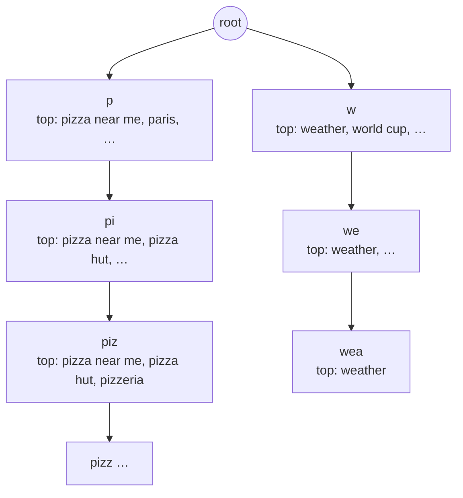
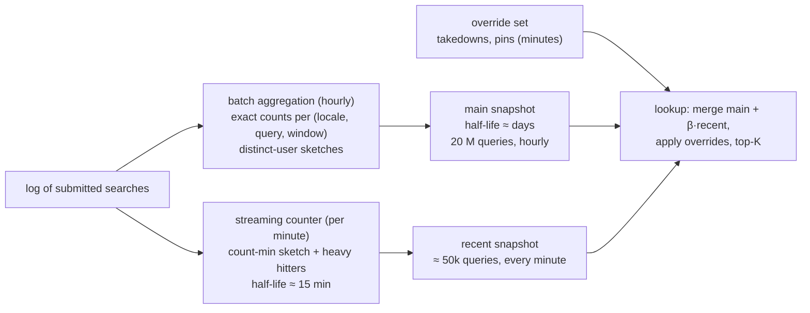

# C12 Unit 2 — Deep dives: the index, the freshness pipeline, and the lab

> Time: ~3 h · CORE: §5–§6 and the common-mistakes list (incl. ≈ 1 h gate work) · STRETCH: §7 · Lab: `labs/c12/suggest`

Unit 1 ended with two deep dives chosen by risk: the index structure (the hot path and the memory budget) and the
freshness pipeline with snapshot publishing (what people see, and the blast radius when it goes wrong). This unit
does both the way an interviewer wants them done in minutes 25–40, then has you build the three components in Go:
the prefix index with a precomputed top-K, the atomically swappable serving snapshot, and the decaying counter
that feeds the next build.

## Before you start

You should have finished [Unit 1](unit-1-guided-design.md). Warm-up — answer first:

1. Why is the suggest fleet sized for the *pre*-CDN load?
2. Where in the design does a manual takedown take effect, and why not in the hourly build?
3. A replica needs ≈ 2× the index in RAM. During which step, and what's the alternative?

Warm-up answers

1. A CDN purge, a configuration mistake or a key change sends 100% of lookups to the origin at once; the CDN is a
   latency and egress saving, not capacity you can count on.
2. In the override set: a tiny, separately published filter applied at lookup time with a propagation SLO of
   minutes. The main index is immutable and rebuilt hourly; making it mutable for one case would cost its atomic
   swap, rollback and validation.
3. Loading or building the new snapshot while the old one still serves, until the swap. The alternative is an
   in-place update under locks (no rollback, lock on the read path) or memory-mapping a serialised snapshot so the
   second copy lives in the page cache rather than the heap (§6).

---

## §5 Tries, sorted tables, FSTs: where the top-K lives

### The failure story

Three index implementations, three outages.

**Attempt 1** stores the queries in a trie and computes the top-5 at query time: walk to the prefix node, traverse
the whole subtree collecting terminal counts, keep the best five. For `pizza h` the subtree has ≈ 40 queries and
the lookup takes ≈ 5 µs. For `s` the subtree has ≈ 2 M queries and the lookup takes ≈ 40 ms of CPU. One-letter
prefixes are ≈ 5% of lookups, i.e. ≈ 9k/s at peak; 9k × 40 ms is 360 CPU-seconds per second. The team adds an
LRU cache in front of the trie. It works until the next hourly snapshot, when the cache is cold and every replica
recomputes every hot prefix at the same time, the classic stampede
([A3 Unit 2 §6](../A3-caching/unit-2-correctness.md#6-stampedes-thundering-herds-dogpiles-and-synchronized-expiry)):
the fleet melts once an hour, on schedule.

**Attempt 2** precomputes the top-5 per node and stores the five query *strings* in each node. `weather` is in
the top-5 of `w`, `we`, `wea`, `weat`, `weath`, `weathe`, `weather`: seven copies of the string, and the same for
every popular query under every prefix it dominates. The index is ≈ 4× the size anyone estimated.

**Attempt 3** fixes that with ids, but implements the trie the obvious Go way: `map[rune]*node` in every node,
a slice header per top-K, a pointer per child. 100 M nodes become ≈ 30 GB of small objects, and the garbage
collector's mark phase has to walk every pointer. A GC cycle takes seconds, during which the p99 of a 100 ns
lookup is measured in hundreds of milliseconds. The dashboards show a sawtooth that lines up with GC cycles.

### Predict

<!-- predict id="C12-U2-P01" -->
**Predict.** For 20 M queries, ≈ 100 M distinct prefixes, K = 5, compare these layouts on *lookup cost* and
*memory*, and say which one you'd pick in the interview and why:

(a) a trie that computes the top-K at query time by traversing the subtree; (b) a trie with a precomputed top-K of
query ids per node; (c) a hash map from prefix string to top-K ids; (d) a sorted array of all queries, binary
search to find the prefix's range, then scan the range; (e) a finite state transducer (minimal automaton) with
weights.

Then: in a Go process holding 100 M small heap objects, what does the garbage collector do to your p99, and how
would you lay the index out to avoid it?
<!-- /predict -->

### Reveal

Reveal

| Layout | Lookup | Memory (≈, 100 M prefixes, K = 5) | Verdict |
|---|---|---|---|
| (a) trie, top-K at query time | O(len(prefix) + size of subtree): µs deep, tens of ms for one letter | smallest: nodes only, ≈ 30–40 B compact | Wrong for the hot path; fine for deep prefixes with tiny subtrees (hybrid, below) |
| (b) trie, precomputed top-K ids | O(len(prefix) + K): ≈ 100 ns | ≈ 60–100 B per node compact (child array + 5 × 4 B ids) → ≈ 6–10 GB | The interview default |
| (c) hash map prefix → top-K ids | O(1) hash of the prefix (+ K): ≈ 100 ns | keys are *whole prefixes*, no sharing: Σ prefix lengths ≈ 100 M × ≈ 10 B ≈ 1 GB of key bytes plus map overhead (≈ 2–3×) plus 20 B of ids → ≈ 5–8 GB | Just as fast, simpler to build, but can't enumerate completions or share prefixes; a good answer if you say its costs |
| (d) sorted array + binary search + scan | O(log N) to find the range, then O(matches) to rank: ms for short prefixes | smallest: the strings once, ≈ 0.5 GB | The compact baseline; needs a precomputed top-K table for short prefixes to be usable (which turns it into (c) for those) |
| (e) FST with weights | O(len(prefix)) walk plus a bounded best-first search for the top-K using the weights | Smallest *structural* memory (shared prefixes *and* suffixes), ≈ bytes per transition | What Lucene/Elasticsearch do; worth naming, too intricate to build in 45 minutes |

Pick **(b)** and say why: lookup is independent of popularity, the hottest prefixes are the cheapest to serve,
memory is ≈ 10 GB (fits with headroom, §2 of Unit 1), and the structure makes the **hybrid** easy: a node whose
subtree holds fewer than K queries doesn't need a stored top-K at all, because the subtree *is* the answer. Most
nodes are deep and tiny, so the stored top-Ks live on the few million shallow nodes and the memory drops well below
the naive estimate. Mention (c) as the pragmatic alternative when the index is built by a batch job that already
emits `(prefix, top-K)` rows, and (e) as the production-grade structure.

**GC.** Go's collector is concurrent, but its mark phase visits every pointer in the live heap; 100 M nodes with
maps and slices are hundreds of millions of pointers, so each cycle burns CPU for seconds and the write barrier
slows every allocation. Readers don't stop, but p99 suffers and the 2× heap during a swap doubles the mark work.
The fix is a **pointer-free layout**: nodes in one `[]int32`/`[]uint8` arena (child ranges by index, not by
pointer), ids in one `[]int32`, strings in one `[]byte` with an offset table. The collector sees a handful of huge
slices with no pointers inside and skips them. The same layout serialises to disk as-is and can be **memory-mapped**,
so loading a snapshot is a page-cache operation and the second copy during a swap costs page cache, not heap.

### How it actually works

The trie with a precomputed top-K, as the lab builds it and as you'd draw it:

**Build** (the lab's `Build`): normalise and merge queries, drop the long tail (`MinCount`) and blocked terms,
then for every surviving query push `(id, count)` into the top-K of each of its prefixes down to `MaxPrefix`
runes. With a sorted slice of ≤ K per node, each push is a binary search and a bounded shift, so the build is
O(total runes × K): ≈ 400 M × 5 operations for 20 M queries, i.e. minutes on one core, seconds when parallelised
by first character (the sub-tries are independent, which is also how a partitioned build works). The bottom-up
alternative (compute each node's top-K by merging its children's top-Ks and its own terminal) does the same work
in one post-order pass and parallelises the same way.

**Lookup** (the lab's `Suggest`): normalise the prefix exactly like a query (otherwise `Pizza` and `pizza` are
different keys and the CDN's hit rate halves), walk one node per rune, stop at `MaxPrefix`, copy up to `limit`
ids, resolve ids to strings. If the prefix was longer than the depth cap, filter the candidates by the full prefix
so the user never sees a completion that doesn't match what they typed; the result may then be shorter than K.
Nothing is ranked at query time.

**Compact layout** (what you'd describe when asked about the bytes): nodes stored breadth-first in flat arrays, so
a node is an index, its children are a contiguous range `[firstChild, firstChild+n)` with a parallel array of the
edge runes (binary-searched, ≈ 2 children per node on average, so a linear scan is fine), and its top-K is a range
into one big `[]int32` of ids. Per node: 4 B first-child + 1–2 B child count + 4 B top-K offset + 5 × 4 B ids ≈ 30 B
+ ids; nodes without a stored top-K (small subtrees) skip the ids. That's the "≈ 60–100 B per node" assumption of
Unit 1 made concrete, and usually better.

**Why not a hash map keyed by prefix?** It is a fine answer for the lookup: `map["piz"] → [ids]` is O(1) and the
build is one pass over `(prefix, top-K)` rows that a batch job can emit directly. Its costs: every prefix is stored
as its own string (no sharing, ≈ Σ prefix lengths of key bytes), you can't enumerate "what completions exist below
this node" (needed for the hybrid and for debugging), and Go's map overhead per entry is significant. Say it and
move on.

**FSTs**: a minimal deterministic automaton over the sorted queries shares prefixes *and* suffixes (`…station`,
`…nation`), and Lucene's variant attaches an output (a weight) to arcs so that the best completions under a prefix
can be found by a bounded best-first search rather than a full traversal (`TODO-VERIFY: Lucene's exact top-N
search mechanics for the analyzing suggester`). Memory is typically a few bytes per transition. It is the right
answer for "how would you make this 3× smaller" and the wrong thing to attempt live.

### Build it

Lab `labs/c12/suggest`, file `suggest.go`. Provided: `Options`, `Suggestion`, `Less` (the total order: count
descending, then query ascending) and `Normalize`. Implement `Build`, `(*Index).Suggest`, `Nodes` and `Len`:

- defaults `K = 5`, `MaxPrefix = 20`; normalise and merge; drop non-positive counts; `MinCount`; the whole-word /
  whole-phrase `Blocklist`;
- one node per distinct prefix down to `MaxPrefix` runes; top-K per node ordered by `Less`; `Suggest` normalises,
  walks, truncates-then-filters, clamps `limit` to `K`, returns a copy, returns nil for an empty prefix;
- write the build cost, lookup cost and bytes per node of your layout in the `Index` doc comment.

Acceptance tests: `TestBuild_TopKMatchesBruteForce` (every prefix of a 3,000-query corpus for K ∈ {1, 3, 5}),
`TestSuggest_TiesBreakByQueryAscending`, `TestSuggest_LimitClampsToK`, `TestSuggest_EmptyPrefixAndMissesReturnNothing`,
`TestSuggest_NormalisesPrefixAndHandlesUnicode`, `TestBuild_MergesQueriesThatNormaliseEqual`,
`TestBuild_DropsBelowMinCountAndNonPositive`, `TestBuild_BlocklistMatchesWholeWordsAndPhrases`,
`TestSuggest_PrefixLongerThanMaxPrefixIsTruncatedThenFiltered`, `TestSuggest_ResultIsACopy`,
`TestIndex_NodesBoundedByPrefixCount`. Run `go test -race ./labs/c12/suggest/`.

### Break it

1. `go test -tags breakit -run '^$' -bench BreakIt -benchmem ./labs/c12/suggest/` compares your index with the
   "sorted array + scan the range" design on 200,000 queries for `a`, `ab` and `abc`. Predict the ratios first.
2. Measure your bytes per node: in a scratch test, read `runtime.MemStats.HeapAlloc` before and after `Build` on
   the break-it corpus, divide by `Nodes()`. Predict the number for your layout.

What you should see, and why

1. Reference solution: ≈ 65–80 ns for every prefix; the scan takes ≈ 1.4 ms for `a` (≈ 33k matching queries),
   ≈ 170 µs for `ab`, ≈ 24 µs for `abc`. The scan's cost is proportional to the number of queries sharing the
   prefix, so the most common requests are the most expensive: exactly backwards for a hot path. 1.4 ms × 9k/s of
   one-letter lookups is ≈ 13 cores just for those; 70 ns is nothing.
2. A `map[rune]*node` trie costs ≈ 300–450 B per node in Go (the map header and buckets dominate; an empty map is
   ≈ 48 B plus a bucket of ≈ 200+ B once it has a child). The compact layout from "How it actually works" is
   ≈ 30–60 B. The difference is the gap between "fits in one box with headroom" and "needs the biggest instance
   and GC tuning", and it's why the interviewer asks for the bytes.

### In the wild

- **Lucene** uses finite state transducers for term dictionaries and for its suggesters (described in Michael
  McCandless's 2010–2011 blog posts on FSTs in Lucene); **Elasticsearch's completion suggester** is built on
  them, held in memory per shard, and supports weights, fuzzy prefixes and context filters.
- **Redis** sorted sets with `ZRANGEBYLEX` give prefix enumeration over a lexicographically ordered set, the
  "sorted array + range" layout as a service; popularity ranking needs a second pass or a second structure.
- **Postgres** `text_pattern_ops` B-trees and **DynamoDB** `begins_with` are the database versions of the sorted
  array: fine for small catalogues with low traffic, the Unit 1 failure story at keystroke rate.
- **Go**: `sort.SearchStrings` is the stdlib's binary search for the sorted-array layout; there is no trie in the
  standard library, which is why the lab has you write one.

### Trade-offs

| Option | Wins when | Loses when | When the answer flips |
|---|---|---|---|
| Trie + precomputed top-K ids | Keystroke-rate lookups; hybrid skip for small subtrees; enumeration for debugging | Build complexity; pointer-heavy if done naively | Flip to a hash map of prefixes when a batch job already emits `(prefix, top-K)` rows and enumeration isn't needed |
| Hash map prefix → top-K | Simplest build and lookup | Memory per key (no sharing); no enumeration | Flip to a trie/FST when memory matters |
| Compute top-K at query time | Deep prefixes with tiny subtrees (the hybrid's second half) | Short prefixes: cost ∝ subtree, stampedes on cold caches | Never for prefixes shorter than ≈ 4–5 characters |
| FST | Minimal memory; production suggesters | Implementation effort; harder to update | Flip to FST when the index must shrink 2–3× or when you can use Lucene/ES |
| Pointer-free arena + mmap | Large indexes in Go/Java (GC); fast, cheap swaps | Code is less obvious; need a serialisation format | Always, once the index is > a few GB |

### Senior bar

- **Failure modes**: top-K computed at query time (cost ∝ popularity); strings duplicated per prefix (≈ depth ×
  memory); pointer-heavy heaps and GC pauses; a prefix normalised differently from the queries (`Pizza` vs
  `pizza`: double the cache keys, missed hits); the depth cap returning completions that don't match the full
  prefix (filter!); `limit` ignored (every response carries K).
- **Capacity numbers**: ≈ 100 ns per lookup; ≈ 30–100 B per compact node vs ≈ 300–450 B per naive Go node; ≈ 5
  nodes per query after sharing; build ≈ O(total runes × K), minutes single-threaded for 20 M queries.
- **Ops**: the manifest records node count, size and the build's input window so a replica can validate what it
  loaded; memory profile per snapshot version; `GOGC`/memory limit tuned for a mostly-static heap; parallel build
  by first character.
- **Cost**: memory per replica × replicas; the compact layout is the difference between 32 GB and 128 GB instances
  across a fleet.

Interviewer follow-up probes:

1. "Why a trie and not a hash map keyed by prefix?"

Model answer

Both give ≈ 100 ns lookups with a precomputed top-K. The trie shares prefixes (one node per distinct prefix instead
of one key string per prefix), lets me skip stored top-Ks for nodes whose subtree is smaller than K (which is most
nodes), and lets me enumerate completions for debugging and for the hybrid. The hash map is simpler to build
from batch output and is a perfectly good answer when memory isn't tight. If the interviewer pushes on memory,
the real answer is an FST, which also shares suffixes; I'd name it and say I'd use Lucene's rather than write one.

2. "What's your memory per node, and what happens to it in Go?"

Model answer

Compact: ≈ 30–60 B (child range, edge runes, a top-K offset, 5 × 4 B ids where stored). Naive Go: ≈ 300–450 B
(a map per node, pointers everywhere), and worse, hundreds of millions of pointers for the garbage collector to
mark every cycle, which shows up as p99 spikes. So I'd lay the index out as a few large pointer-free slices (an
arena), which the GC skips, and serialise it in that layout so a replica can memory-map a snapshot instead of
deserialising it into the heap.

3. "The index no longer fits on one node. What's your first move, and your second?"

Model answer

First: cut the index, because it's usually fat rather than big: ids instead of strings, skip stored top-Ks on
small subtrees, a compact layout, an FST if needed, and a higher min-support threshold for the long tail. That's
typically 3–5×. Second: partition — by locale first, because requests carry it and the sub-corpora are independent;
then by prefix range with a routing table, replicating the hot ranges more and letting the CDN absorb the
one- and two-character prefixes so the hottest keys never reach a shard.

### Check yourself

1. What makes a one-letter prefix the worst case for "compute top-K at query time" and the best case for a
   precomputed index?
2. Why does `Suggest` normalise its prefix with the same function as `Build` normalises queries?
3. Which nodes can skip a stored top-K, and why?

Answers

1. Its subtree is the largest (millions of queries) and it's requested on every search; the precomputed index
   answers it in the same ≈ 100 ns as any other prefix.
2. So that `Pizza`, `pizza ` and `pizza` are one key at every layer: in the trie, in the CDN cache, in the client
   cache. A mismatch means misses and wrong "nothing found" answers.
3. Nodes whose subtree holds ≤ K queries: the subtree itself is the top-K, enumerated at query time at negligible
   cost. Most deep nodes qualify, which shrinks the index a lot.

---

## §6 Freshness: aggregation, decay, snapshot publishing and hot prefixes

### The failure story

The counts problem first. Version 1 never decays: the top suggestion for `world cup` is last year's final, forever.
Version 2 resets the counts at midnight: at 00:05 every prefix is ranked by the last five minutes of a quiet night,
suggestions are noise, and they flap all morning as counts fill in. Version 3 keeps a sliding 7-day window with
exact counts per query in the aggregator's memory: ≈ 200 M distinct queries a day, 7 days, a hash map of strings
to counters, and the aggregator runs out of memory every Tuesday.

Then the publishing problem. To get fresher, someone streams updates straight into the serving trie under a
`sync.RWMutex`. Every update takes the write lock for microseconds, thousands of times a second, and the read
p99 goes from 0.2 ms to 30 ms, because readers queue behind writers and writers queue behind readers.

Then the partition problem. The index is range-partitioned by first character across 8 shards for a multi-locale
corpus. Shard `s` (and `c`, `p`, `m`) gets ≈ 10% of all lookups each, shard `x–z` gets ≈ 1%. The hot shards are at
90% CPU while most of the fleet idles, and adding shards doesn't help because the ranges are fixed.

### Predict

<!-- predict id="C12-U2-P02" -->
**Predict.** Write down:

1. How to make this week's searches count more than last year's without ever resetting counts, and what the knob
   is called. Then: how a count of 100 seen three days ago compares with a count of 20 seen today, for a
   one-day half-life.
2. Exact counts or sketches for the aggregation? Say what a count-min sketch gives you (what kind of error, and
   roughly how much memory for ε = 10⁻⁴, δ = 10⁻³), and where in this design you'd use it.
3. How you'd publish a new index to 17 replicas with no lock on the read path, no fleet-wide memory spike, and a
   way back if the new index is bad.
4. What you'd do about the hot `s` shard: name at least two mechanisms from A4 that apply.
<!-- /predict -->

### Reveal

Reveal

1. **Exponential decay with a half-life**: a query's score is `Σ 2^(−age_i / h)` over its observations. Nothing
   is ever reset, old observations fade continuously, and `h` is the product knob (hours for a trending tier, days
   for the main index). With `h = 1 day`, 100 observations three days old are worth 100 × 2⁻³ = 12.5 and 20
   observations today are worth 20: today wins. The implementation is lazy: store `(count, lastUpdate)` per query
   and decay `count` only when you touch it (`count *= 2^(−elapsed/h)`), which is what the lab's `Counter` does.
   Windowed sums with weights (`Σ count(window) × 2^(−age/h)`) are the batch form of the same thing and let you
   change `h` without re-reading events. The tempting wrong answers are resets (noise after the reset, flapping)
   and fixed sliding windows with exact per-query state (unbounded memory, and a query seen 6 days 23 hours ago
   counts fully while one seen 7 days 1 hour ago counts zero).
2. **Both.** The hourly build can afford exact counts because a batch job over a day of events is cheap and the
   output (≈ 20–30 M surviving queries) fits. The streaming trending tier can't keep exact state for ≈ 200 M
   distinct queries a day, and doesn't need to: a **count-min sketch** answers "how many times has *this* query
   been seen" with an *over*-estimate bounded by ε × N (N = total events) with probability 1 − δ, using
   `w = ⌈e/ε⌉ ≈ 27k` columns × `d = ⌈ln(1/δ)⌉ ≈ 7` rows ≈ 190k counters ≈ **0.8 MB** at 4 B each. Because it only
   over-estimates, it can promote a rare query into the top list on a collision, so pair it with a heavy-hitters
   structure (Space-Saving: tracks the top few thousand candidates with bounded error) or verify candidates
   against exact counts before publishing them.
3. **Immutable snapshot + atomic pointer swap + staggered rollout**: each replica downloads the versioned
   snapshot, loads it *beside* the current one, validates it (golden prefixes, node count), then swaps one atomic
   pointer (`atomic.Pointer[Index]`: a release store that makes the whole index visible to any reader whose load
   sees the new pointer), and releases the old index to the garbage collector once no reader holds it. No lock on
   the read path, ever. The publisher does one canary replica first, then waves, so the 2× memory happens on a
   few replicas at a time, and rollback is "point at the previous version", which still exists in object storage.
   Memory-mapping the serialised snapshot makes the second copy page cache rather than heap.
4. From [A4 Unit 3 §8](../A4-replication-partitioning/unit-3-hot-keys-indexes-sizing.md#8-skew-hot-keys-and-celebrity-problems)
   and [Unit 2 §7](../A4-replication-partitioning/unit-2-partitioning.md#7-rebalancing-request-routing-and-operating-a-partitioned-system):
   **split the hot range** (`s` becomes `sa–sm`, `sn–sz`) with a routing table rather than fixed first-letter
   ranges; **replicate hot shards more** (the celebrity fix: more copies of `s`, fewer of `x`); and **serve the
   hottest keys from a layer above** (the CDN absorbs one- and two-character prefixes; every replica can also hold
   a small copy of the top two levels of the whole index). Hash partitioning spreads load evenly but loses the
   range's keystroke locality, which costs nothing here (there's no per-node cache to warm), so it's a legitimate
   alternative.

### How it actually works

**Decay.** With rate `λ = ln 2 / h`, an observation at time `t_i` is worth `e^(−λ(t − t_i))` at time `t`. The
sum over observations has the lazy form used by the lab: keep `(score, at)`; on each touch, `score *=
2^(−(now − at)/h)`, `at = now`, then add. The main index uses `h ≈ 1–7 days` (stable, evergreen queries dominate);
a trending tier uses `h ≈ 10–30 minutes` and is rebuilt every minute from the streaming counter. At lookup time
the two are merged: `score = main + β × recent`, with `β` chosen so that a query hot *now* can outrank a
perennial for the hour it's hot and sink afterwards, and with the override set applied to both.

**Two-tier pipeline.**

The recent tier is tiny (tens of thousands of queries) so it can be rebuilt and swapped every minute at no cost;
the main tier is large and stable, so hourly is enough. Both are immutable snapshots swapped atomically; nothing
on the read path is ever mutated in place.

**Sketches, concretely.** A count-min sketch is `d` arrays of `w` counters with `d` hash functions; `add(q)`
increments one counter per row, `estimate(q)` takes the minimum over rows. Every estimate is ≥ the true count
(collisions only add), and the excess is ≤ ε × N with probability ≥ 1 − δ for `w = e/ε`, `d = ln(1/δ)`. It does
not tell you *which* queries are frequent, so a heavy-hitters structure (Space-Saving keeps `m` candidates with
counts and an error bound; the Misra–Gries summary is the simpler cousin) tracks candidates while the sketch
scores them. The distinct-user requirement needs a *cardinality* sketch per candidate (HyperLogLog, ≈ 1–2 KB for
≈ 2% error), kept only for the candidates, not for every query.

**Publishing a snapshot**, the mechanics behind the Unit 1 sequence diagram:

1. The builder writes `vN` as a flat, pointer-free file plus a manifest (size, node count, checksum, input window).
2. The publisher tells one replica to load `vN`. The replica downloads it to local disk, memory-maps or
   deserialises it, runs the golden-prefix checks against the *new* index only, then `Swap`s.
3. The old index becomes garbage when the last in-flight lookup that loaded the old pointer returns; in Go that
   is automatic (a reader holds a `*Index`; the collector frees it later). In C++ you'd use RCU or hazard pointers
   for the same guarantee, which is why the interviewer may ask "when is it safe to free the old index?".
4. Canary metrics (empty-result rate, p99, size) are compared with the fleet for a few minutes; then waves. Any
   replica can roll back to `vN−1` by swapping the pointer back, if it kept it, or by reloading the file.

The Go memory model guarantee that makes step 2 correct: `atomic.Pointer.Store` after the index is fully built,
and `Load` before any read of it, establish a happens-before edge, so a reader that sees the new pointer sees the
complete index. A plain pointer write gives no such guarantee (the break-it below).

**Hot prefixes and partitioning.** Only needed when the index doesn't fit in one node, but the question comes
anyway. Partition by locale first (free). Within a locale, either range-partition by prefix with a *routing table*
(`[a, sa) → shard 1, [sa, sn) → shard 2, …`, split when a range gets hot, exactly the dynamic range partitioning
of [A4 Unit 2 §5](../A4-replication-partitioning/unit-2-partitioning.md#5-why-partition-and-the-partitioning-schemes))
or hash the prefix onto a consistent-hashing ring with virtual nodes
([A4 Unit 2 §6](../A4-replication-partitioning/unit-2-partitioning.md#6-consistent-hashing-and-virtual-nodes)),
which evens the load and loses nothing, because a lookup needs one shard either way. Replicate per shard according
to its load, not uniformly. Keep the one- and two-character prefixes (a few thousand entries) in the CDN and in
every shard's local copy, so the hottest keys never cause a hot shard. Routing lives in the gateway, keyed by the
normalised prefix.

### Build it

Lab `labs/c12/suggest`, second half: `NewService`, `Current`, `Swap`, `(*Service).Suggest` (atomic pointer; no
lock on the read path) and `NewCounter`, `Record`, `Snapshot`, `(*Counter).Len` (lazy half-life decay; `Snapshot`
rounds, prunes zeros, and returns what `Build` takes). Acceptance tests: `TestService_NilIndexServesNothing`,
`TestService_SwapIsAtomicUnderConcurrentReaders` (8 readers, 20,000 swaps, `-race`: every result must belong
wholly to one of the two snapshots), `TestCounter_RecordNormalisesAndCounts`, `TestCounter_HalfLifeDecay`
(8 → 4 → 2 → 1 with an injected clock, then forgotten), `TestCounter_ConcurrentRecordsAreNotLost`,
`TestCounter_SnapshotFeedsBuildAndSwap` (record → snapshot → build → swap → suggest, with old news decaying away).
Run `go test -race -count=5 ./labs/c12/suggest/`; the swap test is schedule-dependent.

### Break it

1. `go test -race -tags breakit -run TestBreakIt ./labs/c12/suggest/`: `racyService` is `Service` with the atomic
   pointer replaced by a plain field. Predict the race detector's report, then run it with and without `-race`.
2. In a scratch copy of `TestCounter_SnapshotFeedsBuildAndSwap`, set `HalfLife: 0`, then `HalfLife: time.Minute`,
   and look at the second snapshot's suggestions each time.
3. Run `GODEBUG=gctrace=1 go test -run SwapIsAtomic -count=20 ./labs/c12/suggest/ 2>&1 | tail -5` and watch the
   heap: the old indexes are being collected while readers run.

What you should see, and why

1. `WARNING: DATA RACE` between the write in `Swap` and the read in `Suggest`; without `-race` the test passes
   every time and the program even "works" on amd64, where an aligned pointer write happens to be atomic. The bug
   is still real: nothing orders the construction of the new index before the publication of its pointer, so a
   reader may see the pointer and a partially visible index, and the compiler is free to reorder. `atomic.Pointer`
   (release/acquire) fixes it with zero cost on the read path; an `RWMutex` also fixes it, at a lock per lookup
   and writers waiting for readers to drain.
2. With `HalfLife: 0`, `world cup final` (100 observations three days ago) still outranks `world weather` (50
   today): a hall of fame. With a one-minute half-life everything older than a few minutes is gone and the
   snapshot is a few minutes of noise. The half-life is the product's stability-vs-freshness knob, hours to days
   for the main index.
3. Heap size rises as snapshots are allocated and falls as the collector frees the ones no reader references;
   lookups never pause for the swap. Compare with what an in-place update under a lock would show: no garbage,
   but reader latency coupled to writer activity.

### In the wild

- **Count-min sketch** (Cormode and Muthukrishnan, 2005) and **Space-Saving** (Metwally, Agrawal and El Abbadi,
  2005) are the standard streaming structures; the RedisBloom module ships `CMS` and `TOPK` commands (the latter
  based on HeavyKeeper) for exactly this use. HyperLogLog is Redis's `PFADD`/`PFCOUNT`.
- **Stream processors** (Apache Flink, Kafka Streams) provide windowed aggregations with event time, watermarks
  and late-data handling, the production form of the "streaming counter" box; their state is checkpointed so a
  crash doesn't lose the window.
- **Netflix Hollow** publishes versioned snapshots and deltas to a blob store and lets consumers pin, advance or
  roll back versions atomically in memory: the publishing mechanics above, packaged.
- **Go's `sync/atomic`** `Pointer[T]` (Go 1.19+) is the typed atomic used by the lab; the memory model document
  specifies the happens-before guarantee that makes the swap correct.

### Trade-offs

| Option | Wins when | Loses when | When the answer flips |
|---|---|---|---|
| Exponential decay (half-life) | Continuous, bounded state, one knob; no resets | Requires choosing `h`; very old evergreen queries need a long `h` | Add a second tier with a short `h` for trends rather than shortening the main one |
| Fixed sliding window with exact counts | Simple to explain; exact | Unbounded per-query state; cliff at the window edge | Flip to decay or to windowed sums with weights |
| Exact batch counts | Reproducible, auditable; feasible hourly | Not for per-minute freshness over 200 M distinct keys | Sketches + heavy hitters for the streaming tier, verified against exact counts before publishing |
| Atomic snapshot swap | Lock-free reads, rollback, canary | Freshness bounded by build + distribution (minutes) | A small, frequently rebuilt recent tier; never in-place mutation of the main index |
| Range partition by prefix | Keystroke locality; easy to reason about hot ranges | Static ranges skew badly | Dynamic ranges with a routing table, or hash partitioning when locality buys nothing |

### Senior bar

- **Failure modes**: counts never decayed or reset to zero; a sketch's over-estimate promoting a rare (possibly
  private) query — the min-support rule must apply to the recent tier too; the override set not applied to the
  recent tier (a takedown resurfaces as "trending"); synchronised fleet-wide swaps; version skew left unchecked;
  the streaming job losing its state on restart; late events (a replayed log) counted as fresh.
- **Capacity numbers**: count-min with ε = 10⁻⁴, δ = 10⁻³ ≈ 0.8 MB; HyperLogLog ≈ 1–2 KB per tracked candidate;
  recent tier ≈ 50k queries rebuilt per minute; main tier ≈ 20 M queries per hour; rollout ≈ 10–15 min in waves.
- **Ops**: snapshot age and version per replica; validation failures; canary comparison; the override path tested
  like a deploy; log retention ≥ the longest pipeline outage you'll tolerate (days); replay runbook.
- **Cost**: the streaming tier is the expensive engineering line, not the compute; a stream processor's state
  store and checkpoints; object storage for snapshots is negligible.

Interviewer follow-up probes:

1. "The recent tier says `solar eclipse` is hot; the main index has never seen it. How do you merge?"

Model answer

At lookup time: take the main top-K and the recent top-K for the prefix, score each candidate as
`main + β × recent` (a query missing from one side scores 0 there), re-rank, apply the override set and the
min-support rule, return K. `β` is tuned so that a query at the recent tier's top can beat a mid-ranked
evergreen query but not displace, say, `weather` for `w` after ten searches. The merge is K + K items: nanoseconds.
Both tiers must be filtered by the same blocklist and support threshold, or the recent tier becomes the hole in
the safety story.

2. "Your count-min sketch over-counts. What's the consequence, and the fix?"

Model answer

A rare query that collides with hot ones in every row looks popular and can surface in the trending tier — the
privacy incident from Unit 1, through a different door. Fixes: a heavy-hitters structure that tracks real
candidates (Space-Saving), exact verification of candidates against the batch counts or a per-candidate exact
counter before they're published, and the distinct-user threshold applied to the recent tier with a HyperLogLog
per candidate. The sketch scores; it doesn't nominate.

3. "Why a half-life and not 'the last 7 days'?"

Model answer

A hard window needs exact per-query state inside the window (unbounded for 200 M distinct queries a day) and has a
cliff: an observation counts fully until it is 7 days old and zero a minute later, so rankings jump at the edge.
Decay keeps one `(score, timestamp)` pair per query, forgets smoothly, lets me prune anything that rounds to
zero (bounded memory), and gives one knob per tier. Windowed sums with weights are the batch equivalent and let me
retune the half-life without reprocessing events.

### Check yourself

1. What does `atomic.Pointer.Store`/`Load` guarantee that a plain pointer assignment doesn't?
2. Why must the override set apply to the recent tier as well as the main index?
3. What's the memory of a count-min sketch for ε = 10⁻⁴, δ = 10⁻³, and what kind of error does it make?

Answers

1. A happens-before edge: everything written before the `Store` is visible to a goroutine whose `Load` observes
   the stored pointer; plain assignment gives no ordering or atomicity guarantee under the Go memory model.
2. A query removed from the main index can still be "trending" in the recent tier; a takedown must be a filter at
   lookup time over the merged result, not an edit to one artefact.
3. ≈ 27k × 7 ≈ 190k counters ≈ 0.8 MB at 4 bytes each; it only over-estimates, by at most ε × N with probability
   1 − δ.

---

## §7 STRETCH — Personalisation and spelling correction

### The failure story

Two product requests land the same week. "Show my own recent searches first": the first implementation fetches
the user's history from a database on every keystroke, adds ≈ 5 ms and a dependency to a 100 ns path, and puts
`Vary: Cookie` on the response, which turns the CDN off. "Tolerate typos": the second implementation runs an edit
distance against every candidate under the prefix, which is the compute-at-query-time failure of §5 with a bigger
constant; `pizx` costs 50 ms.

### Predict

<!-- predict id="C12-U2-P03" -->
**Predict.** (1) Where would you put the user's recent queries so that the global path stays cacheable and the
personal list still appears first? (2) Which part of a fuzzy prefix lookup can be precomputed, and which must be
bounded at query time?
<!-- /predict -->

### Reveal

Reveal

1. **On the client**, as a local store of the user's last ≈ 100 queries (synced from the server when the app
   starts, if history must follow the user across devices). The client merges the personal matches (prefix match
   over 100 strings is nothing) ahead of the global list, which stays a public, CDN-cacheable `GET`. Server-side
   personalisation, when it is required (compliance, no local storage), runs as a *second* request to an
   authenticated, uncached endpoint backed by a per-user KV lookup, issued in parallel with the global one and
   merged on the client; the global path is untouched. Never put the user into the global cache key.
2. Precompute the **candidate generation**: the symmetric-delete trick (SymSpell) stores, for every indexed term,
   its variants with up to one or two characters deleted, so a typo is found by deleting characters from the
   *input* and looking up the result in a hash map (no edit-distance computation over candidates); or a Levenshtein
   automaton walked over the trie/FST, which Lucene and Elasticsearch do for fuzzy completion. Bound at query
   time: the edit distance (1, or 2 for long inputs), the minimum prefix length before fuzziness kicks in
   (≈ 3–4 characters), and the number of candidates re-ranked. Exact matches always rank first.

### How it actually works

Personal-first merge: `personal matches (≤ 3, most recent first) + global top-K minus duplicates`, computed where
the personal data already is. Privacy and tenancy rules from
[A9 Unit 1 §4](../A9-security-multitenancy/unit-1-authorization-tenancy.md#4-tenant-isolation-models) apply the
moment suggestions are per-user or per-tenant: the response is `Cache-Control: private, no-store`, the endpoint is
authenticated, and a tenant's corpus is never visible to another's prefix.

Fuzzy prefix: generate candidates (SymSpell deletes, or an automaton over the index), look each candidate prefix
up in the normal index, merge the top-Ks, penalise by edit distance, return K. Cost is bounded by the number of
candidate prefixes (a handful for distance 1), each an O(len) lookup. Full-query spelling correction ("did you
mean") is a different feature: a language model over query logs, run after submission, not per keystroke.

### Build it

No lab for this section — see §5 and §6. If you want to extend the lab: a `MergePersonal(personal []string,
global []Suggestion, k int)` function with a test that personal matches come first and duplicates are removed.

### Break it

Put the user id into the CDN cache key of the global endpoint (or `Vary: Cookie`) and estimate the CDN hit rate.
Then run a distance-2 fuzzy lookup for a two-character input and count candidate prefixes.

What you should see, and why

The hit rate collapses to ≈ 0: each user warms their own cache entries and nobody shares them, so the origin sees
every keystroke. A distance-2 fuzzy lookup on two characters generates thousands of candidate prefixes over a
40-character alphabet, most matching real queries, which is why fuzziness waits for 3–4 characters and is capped at
distance 1 for short inputs.

### In the wild

- **Elasticsearch** completion suggester: `fuzzy` options with `fuzziness`, `prefix_length` (characters that must
  match exactly) and `min_length`, implemented with Levenshtein automata over the FST.
- **SymSpell** (symmetric delete spelling correction) precomputes delete-variants so lookup is a few hash probes;
  it is widely ported and is the standard answer for cheap typo tolerance.
- Browsers and mail clients merge local history with remote suggestions client-side (an address bar ranks your
  own history and bookmarks before the search engine's suggestions), which is the personal-first merge in
  practice.

### Trade-offs

| Option | Wins when | Loses when | When the answer flips |
|---|---|---|---|
| Client-side personal merge | Global path stays cacheable; no new dependency | History must be server-authoritative or very large | Server-side personal endpoint in parallel, still separate from the global one |
| Fuzzy via precomputed deletes / automaton | Bounded cost per keystroke | Memory (delete variants) or implementation effort | Only after ≥ 3–4 characters; distance 1 for short inputs |
| Edit distance over candidates at query time | Tiny corpora | Everything else (cost ∝ candidates) | Never on the keystroke path at scale |

### Senior bar

- **Failure modes**: user data in a shared cache key or public cache; personalised endpoints without
  authentication; fuzzy matching on one or two characters; tenant corpora leaking across tenants.
- **Capacity numbers**: personal history ≈ 100 strings per user (a few KB); SymSpell variants ≈ 10–30× the term
  count for distance 2 (the memory cost of cheap lookups).
- **Ops**: per-tenant blocklists and takedowns; privacy review of what the personal store retains and for how
  long.
- **Cost**: the personal path's KV lookups if server-side (≈ 175k/s of extra reads, hence client-side first).

Interviewer follow-up probe: "How would you personalise without touching the global path?"

Model answer

Keep the global endpoint public and cacheable, and merge personal results from a different source: locally on
the client from the user's own history, or from a separate authenticated endpoint backed by a per-user recent-
queries store, requested in parallel. The merge is "personal matches first, then global minus duplicates". The
global cache key never contains anything per-user.

### Check yourself

1. Why does `Vary: Cookie` on the global endpoint amount to switching the CDN off?
2. What does SymSpell precompute, and what does that buy at query time?

Answers

1. Each distinct cookie becomes its own cache entry; nothing is shared across users, so the hit rate approaches
   zero and every keystroke reaches the origin.
2. Delete-variants of every indexed term, so a typo is found by generating deletes of the *input* and probing a
   hash map, instead of computing edit distances against candidates.

---

## Common mistakes

The ones that cost candidates the senior bar on this problem, each with the fix:

1. **Counting searches, not keystrokes.** Load is ≈ 15–20× what "searches per day" suggests. Say the multiplier
   out loud in the first ten minutes.
2. **A database on the read path.** A prefix query at keystroke rate against the search database is the Unit 1
   failure story. The read path is an in-memory index, replicated, with no dependency.
3. **Top-K computed at query time.** Cost proportional to popularity: the hottest prefixes are the slowest.
   Precompute per node; compute only for tiny subtrees.
4. **No client behaviour.** Debounce, a session prefix cache and request sequencing halve the load and prevent
   stale rendering. A design that starts at the load balancer has doubled its own cost.
5. **Uncacheable API.** `POST`, per-user data in the global key, rich bodies. `GET`, `Cache-Control: public`, echo
   the normalised prefix, ids resolved to short strings.
6. **Strings in the index value.** Each popular query appears under every prefix it dominates; use ids plus one
   string table.
7. **Counts that never decay, or reset.** Last year's final forever, or noise at 00:05. Exponential decay with a
   half-life, two tiers for trends.
8. **In-place updates of the serving index.** Locks on the hot path, no rollback, no canary. Immutable snapshots,
   atomic pointer swap, staggered rollout, validation before publish.
9. **Forgetting the 2× memory during the swap**, and swapping every replica at the same minute.
10. **No safety story.** Min distinct-user support, a blocklist, a fast override path for takedowns with an audit
    trail, applied to every tier.
11. **Partitioning by reflex.** A 10 GB index fits in one box; partition by locale when you must, then by prefix
    range with hot-range splitting or by hash, and replicate hot shards more.
12. **Health checks that mean "process up"** rather than "snapshot loaded", and dashboards that measure errors but
    not emptiness or freshness.
13. **A fuzzy or personalised feature bolted onto the global path**, turning the CDN off or adding a database hop
    to every keystroke.

---

## Unit wrap-up

| Decision | Default | Flip when… |
|---|---|---|
| Index structure | Trie with precomputed top-K ids per node, pointer-free arena, skip stored top-K for subtrees ≤ K | Hash map of prefixes when batch output is `(prefix, top-K)` rows and memory is fine; FST when it must shrink 2–3× |
| Top-K timing | At build time, never at query time for short prefixes | Query-time enumeration only for subtrees ≤ K |
| Freshness | Hourly exact batch build (half-life ≈ days) + per-minute recent tier from sketches (half-life ≈ minutes), merged at lookup | Drop the recent tier if the product doesn't need minutes; never shorten the main half-life to get trends |
| Publishing | Immutable versioned snapshots, validate, canary, waves, `atomic.Pointer` swap | Only the override set (takedowns, pins) is updated between builds |
| Partitioning | None until 2 × index > RAM; then locale, then prefix range with a routing table or a hash ring; hot shards replicated more; shortest prefixes in the CDN and in every node | — |
| Safety | Min distinct-user support and blocklist at build, override set at lookup, both tiers | — |
| Personalisation / fuzziness (STRETCH) | Client-side merge; precomputed candidates, fuzzy only after 3–4 characters | Server-side personal endpoint in parallel when history must be server-authoritative |

Gate work: `sd lab C12` (all tests green under `-race`), `sd quiz C12` (two passes on different days), the
[design exercise](design-exercise.md) (45 minutes, solo, then self-score and the tutor's probes) and the
[teach-back](teachback.md). Run `sd review` first if cards are due.
