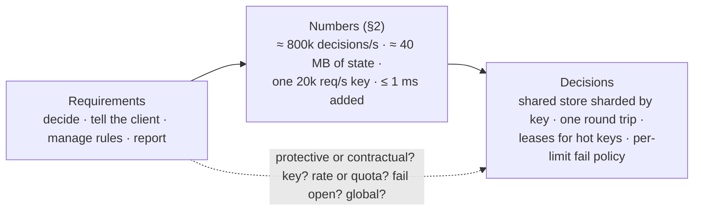
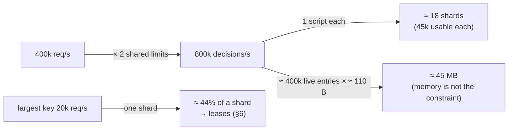
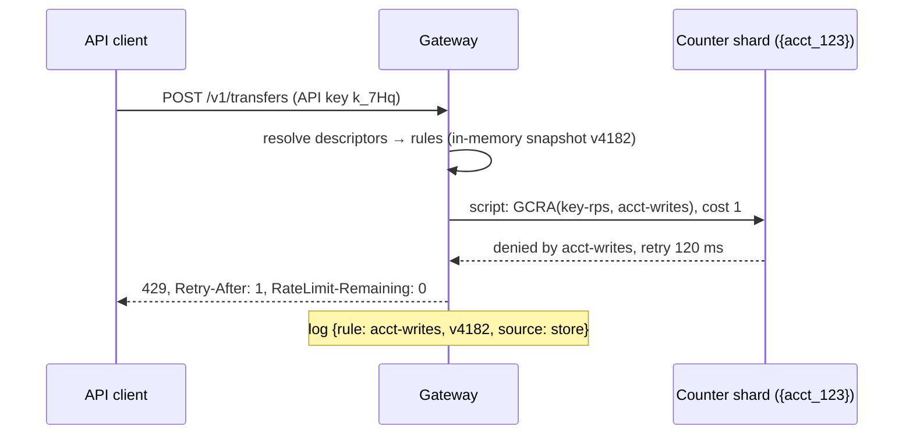
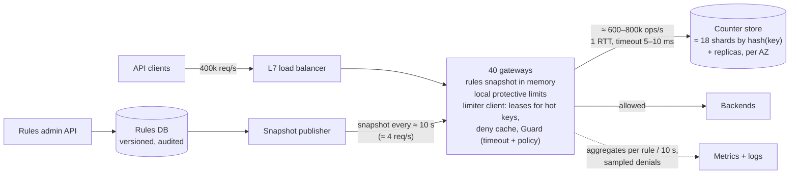
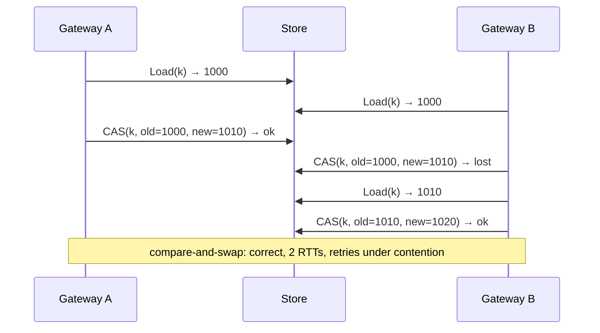
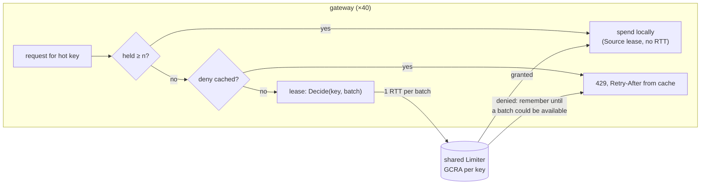
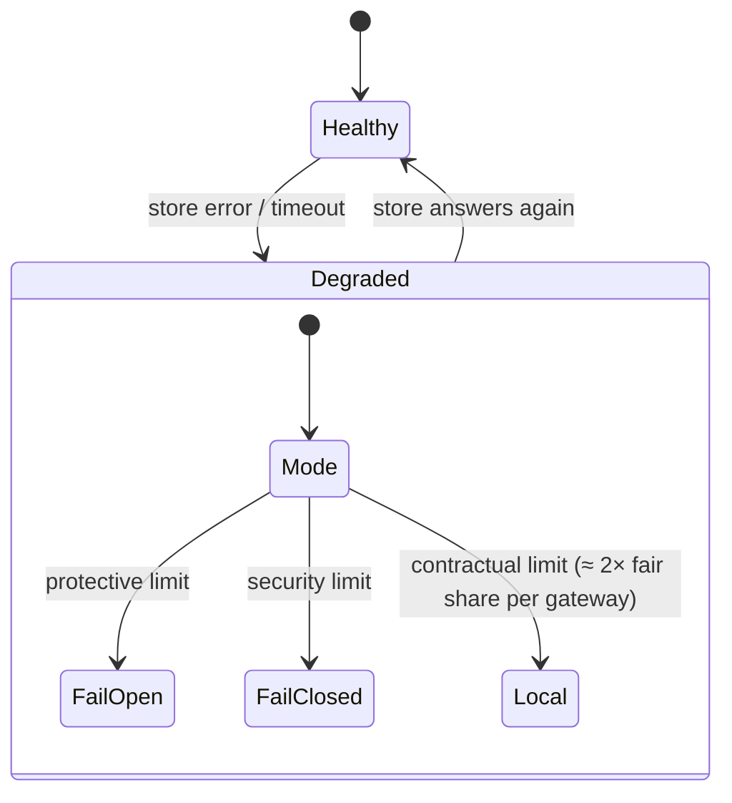

# C2 Unit 1 — Case study: distributed rate limiter

> Time: ~6 h · CORE: §1–§7 and Common mistakes (5 h, incl. ≈ 1.5 h gate work) · STRETCH: the multi-region and cost
> half of §7 (1 h) · Lab: `labs/c2/distlimit` · Framework card: [docs/INTERVIEW_FRAMEWORK.md](../../docs/INTERVIEW_FRAMEWORK.md)

"Design a rate limiter" sounds like a question about algorithms, and candidates who learned A7 well are tempted to
spend twenty minutes comparing token buckets with sliding windows. That's the part interviewers care about least.
You already know the algorithms ([A7 Unit 2 §2](../A7-reliability/unit-2-breakers-rate-limits.md#2-rate-limiting-algorithms))
and why per-node limits fail in a fleet ([A7 Unit 2 §3](../A7-reliability/unit-2-breakers-rate-limits.md#3-rate-limiting-in-a-fleet-shared-vs-local-counters-fairness-and-what-to-tell-the-client)).
This unit is about everything around them: a component that sits on *every* request, so its latency is everyone's
latency and its outage is everyone's outage; whose state is shared by forty gateways that must agree within a
millisecond; whose hottest key is the biggest customer; and whose configuration can lock that customer out with one
typo.

You run the 45-minute framework from [A0](../A0-framework-estimation/unit-1-interview-framework.md) end to end on
this problem, committing to each decision *before* you see the reveal. The three hard parts, which the numbers in §2
will point at, are: one atomic decision per request against shared state (§5), the hot key and the price of accuracy
(§6), and what the limiter does when its own store fails or a rule is wrong (§7).

## Before you start

You need A3's hot-key and negative-caching patterns, all of A7 Unit 2, and A7 Unit 1's timeouts. Warm-up (write
the answers down, then check):

1. A token bucket has rate 100/s and burst 100. A client that has been idle for a minute sends 300 requests in one
   second. How many are admitted, and which parameter decided it?
2. A tenant's limit is 1,000 req/s, enforced as 100 req/s on each of 10 nodes. Sticky routing pins the tenant to 2
   nodes. What limit does the tenant actually get?
3. A cache key receives 50k reads/s and lives on one shard of a 10-shard cluster. What does A3 suggest, and why
   doesn't adding shards help?

<details data-kind="answer">
<summary>Warm-up answers</summary>

1. ≈ 200: the full burst of 100 at once, then 100 more refilled over the second (`burst + rate × T`). The burst
   decides how much lands at once; the rate decides the sustained throughput
   ([A7 Unit 2 §2](../A7-reliability/unit-2-breakers-rate-limits.md#2-rate-limiting-algorithms)).
2. 2 × 100 = **200 req/s**, a fifth of what it pays for. The effective limit of a per-node share is `nodes touched ×
   limit / N`, which is why business limits need shared state
   ([A7 Unit 2 §3](../A7-reliability/unit-2-breakers-rate-limits.md#3-rate-limiting-in-a-fleet-shared-vs-local-counters-fairness-and-what-to-tell-the-client)).
3. A near cache (an in-process copy with a short TTL) and request coalescing, or splitting the key into replicas;
   adding shards doesn't help because one key lives on one shard whatever the shard count
   ([A3 Unit 2 §7](../A3-caching/unit-2-correctness.md#7-negative-caching-cache-penetration-and-hot-keys)). Hold that
   thought: a rate limiter's biggest customer is exactly this hot key, except that you can't cache a counter.

</details>

**Session plan (3 × 2 h):** Session 1: §1–§4, every Predict in writing, ending with your own HLD on paper.
Session 2: §5 and §6 with the lab (`labs/c2/distlimit`: store, limiter, leases) and their break-its. Session 3: §7
(the STRETCH half is optional) with the Guard part of the lab, Common mistakes, then the gate work: first
`sd quiz C2`, the [design exercise](design-exercise.md) (45 min, solo, a *different* prompt from this unit's), and
the [teach-back](teachback.md).

---

## §1 Requirements and the questions that change the design (0:00–0:06)

### The failure story

"Design a rate limiter for our public API." The candidate says "token bucket in Redis" in the first minute and
spends the next fifteen comparing it with a sliding window. At 0:20 the interviewer asks: "A login endpoint, a
per-customer plan limit and a monthly quota: same limiter?" (No: one must fail closed when the store is down, one
must be accurate to a few percent, and one is a billing counter with a calendar reset.) "Our biggest customer sends
20,000 requests a second on one key: what does that do to your Redis?" (One shard, one key: the candidate hasn't
computed how many operations per second the limiter generates at all.) "And when Redis is down?" (The design
admits nothing, or everything, and the candidate hasn't said which.)

The second failure is the opposite: a candidate who builds an elaborate global quota system with cross-region
consensus for a limit whose only job is to stop one runaway script from taking a database down, where a per-node
limit would have done.

### Predict

<!-- predict id="C2-U1-P01" -->
**Predict.** Set a 5-minute timer. For "design a rate limiter for our public API", write down:

1. the 3–5 functional requirements you'd design for, and what you'd put out of scope;
2. the non-functional requirements, *each with a number* (traffic, added latency, availability, accuracy, how fast
   a rule change takes effect);
3. the **clarifying questions whose answers change the architecture**, and for each one, what changes.

Then rank your questions: which single answer would change the most boxes?
<!-- /predict -->

### Reveal

<details data-kind="reveal" data-for="C2-U1-P01">
<summary>Reveal</summary>

A strong 5-minute card, with the numbers this unit uses from here on:

**Functional.** Decide, for every API request, whether it may proceed under every limit that applies to it (per API
key, per account and endpoint class, per IP for unauthenticated endpoints); tell a rejected client why and when to
come back (`429` + `Retry-After` + remaining-quota headers); let operators define, change and override limits per
plan and per customer; report usage against limits. **Out of scope:** billing itself, abuse/bot detection (it
*feeds* the limiter rules, it isn't the limiter), DDoS protection at the network edge (L3/L4 floods are stopped
before they reach an HTTP gateway), and per-request load shedding (A7 Unit 3 §2), which we'll connect to but not
design.

**Non-functional (assumptions stated out loud):** ≈ 400k req/s at peak through ≈ 40 gateway instances in one region
(three AZs); ≈ 2M API keys, ≈ 200k of them active in any minute; the limiter adds **≤ 1 ms p50 and ≤ 5 ms p99** to a
request; the API's 99.99% availability must not depend on the limiter's store for protective limits; contractual
limits are enforced within ≈ 5% of the limit over any 10 s window, and a client *under* its limit is wrongly
rejected on ≤ 0.1% of requests; a rule change takes effect fleet-wide within ≈ 30 s and can be rolled back as fast;
quotas (requests per day or month on a plan) are exact for billing, which may be reconciled after the fact.

**The questions that change the design**, in order of how much they move:

| Question | Why it changes boxes |
|---|---|
| What is each limit *for*: protecting our backends, or a contract (plan tiers, a customer's paid rate)? | A protective limit can be per node, approximate and fail open, and needs no shared state at all. A contractual limit must be shared across gateways and accurate, which adds a store, a round trip and a failure policy. Most real APIs have both, enforced in different places. |
| What do we limit on: API key, account, user, IP, endpoint, cost? How many limits per request? | The number of checks per request multiplies the decision rate (§2); the key's cardinality sizes the state; the biggest single key is the hot-key problem (§6). |
| Rate (per second, smoothness) or quota (per day or month, a count that resets on a calendar)? | Different algorithms and different stores: GCRA or a token bucket for rates; a per-period counter, reconciled against logs, for quotas (§5). |
| When the limiter's store is unreachable, admit or reject? Is it the same for every limit? | Fail open for protective limits, fail closed for security limits (login attempts, OTP sends), a local fallback for contractual ones (§7). Each limit carries its own policy. |
| Global across regions, or per region? | Global means cross-region coordination (60–150 ms RTTs) or a split of the limit per region; per region is simple and usually what the customer actually needs (§7, STRETCH). |
| Reject, or delay (shape) traffic that exceeds the limit? | Rejection is policing: cheap, needs client cooperation. Delay is shaping: holds connections and memory on the server. For a public API, reject with good headers; shaping belongs in clients (A7 Unit 2 §3). |

Also worth one sentence: *where it runs* (inside each service, at the gateway, as a sidecar, or as a separate
decision service), which §4 decides from the numbers; and *who changes rules and how fast*, which §7 turns into a
rollout process. Questions not worth the time: the exact header spelling, the admin UI.

**Which answer moves the most boxes?** "Protective or contractual?", because it decides whether you need shared state
at all, and with it the store, the round trip, the hot-key problem and the failure policy. A candidate who asks it
first and says "both, so two layers" has already structured the design.

Two common mistakes. (1) Starting with the algorithm: the algorithm is a 2-minute decision once you know what the
limit is for. (2) Treating the limiter as free: at 2 checks per request it makes more calls than the API itself
serves, and it is on the critical path of every one of them.

</details>

### How it actually works

**Two layers, two jobs.** Almost every production API ends up with both:

- **Protective limits** stop any single caller, or the sum of all callers, from overloading something: a database,
  a vendor, a worker pool. They are per node or per service, need no coordination, and when they're wrong they're
  wrong by a bounded factor. A7's per-node token buckets, concurrency limits and load shedders live here.
- **Contractual limits** are promises: "the Pro plan gets 100 req/s per key", "this customer bought 5,000 req/s",
  "free accounts get 100,000 requests a day". They must be the same number whichever gateway a request hits, so
  they need shared state, and their accuracy is something a customer can measure and complain about.

The interview usually means the second, but naming the first (and putting it on the diagram) is a senior signal:
it's what keeps the API up when the shared limiter isn't.

**Scope by consequence**, as in C1: for each candidate requirement, ask what it forces. "Limits per customer" forces
shared state. "Global across regions" forces either coordination or a split. "Fail closed" forces the limiter's
store to be as available as the API. "Rule changes in 30 s" forces a push or a short poll and a rollout process.



**Banking link.** The platform's partner API (fintechs calling `POST /v1/transfers` on behalf of members of 40 credit
unions) has every layer at once: a contractual per-partner rate, a per-credit-union fair share so one tenant's
batch can't starve another (the noisy-neighbour problem of
[A9 Unit 1 §5](../A9-security-multitenancy/unit-1-authorization-tenancy.md#5-noisy-neighbours-and-fair-sharing)),
a protective limit in front of the core-banking adapter whose vendor allows ≈ 300 req/s, and security limits on
login and OTP endpoints that must fail closed. When you scope a limiter in that context, "what is each limit for?" is
the first thing the risk team will ask too.

### Build it

No Go lab for this section; the module's lab starts in §5. Write the requirements card for two variants in ≤ 5
minutes each: (a) the per-node protection for an internal service that calls one slow vendor; (b) the partner API
above. Acceptance: the two cards differ in at least three NFRs and in the failure policy, and you can say which boxes
each difference adds or removes.

### Break it

Take the card from the Reveal and flip one requirement at a time: (a) limits must be global across three regions,
exact to 1%; (b) the limiter must fail closed for every limit; (c) the limit is on *concurrent* requests per
customer, not requests per second. For each, write what changes.

<details data-kind="answer">
<summary>What changes</summary>

- **(a) Global, exact to 1%, three regions:** every decision needs a state that all regions agree on. With
  cross-region RTTs of ≈ 60–150 ms (`docs/NUMBERS.md`), a synchronous global check blows the 5 ms budget by 20×. You
  either route every request for a key to a home region (latency for everyone else) or split the limit per region
  and rebalance the split periodically, which gives up the 1%. The honest answer is to negotiate the requirement:
  "exact per region, approximately global" is what most customers mean (§7 STRETCH).
- **(b) Fail closed everywhere:** the limiter's store becomes a hard dependency of the whole API, so its
  availability must be ≥ the API's 99.99% (≈ 4 min/month). That forces replicas with fast failover, multi-AZ, and a
  timeout short enough that a slow store doesn't turn into slow APIs. And a store outage is now a full API outage.
  Most teams accept that only for login/OTP-style limits.
- **(c) Concurrency, not rate:** the state is "requests in flight", which needs an *increment on start and a
  decrement on finish*. A crashed gateway never decrements, so the count leaks upward until the customer is locked
  out; you need leases with expiry (each in-flight slot is a key with a TTL, or a sorted set of request ids with
  deadlines) and a cleanup path. It's a different design: closer to a distributed semaphore
  ([A5 Unit 3 §3](../A5-consistency/unit-3-consensus-leases.md#3-leases-and-fencing-tokens)) than to a token bucket.

One flipped requirement redesigns the state, the store and the failure policy. That is why the questions come first.

</details>

### In the wild

- **Stripe** describes four kinds of limiters (request rate per user, concurrent requests per user, a fleet-usage
  load shedder, a worker-utilisation load shedder) and says most of the protection comes from the load shedders,
  not the per-user limits. That's the protective/contractual split in one blog post
  ("Scaling your API with rate limiters", 2017; see A7 Unit 2 §2).
- **GitHub's REST API** separates primary rate limits (a per-hour count per user or app, reported in
  `X-RateLimit-*` headers) from "secondary" limits against abusive patterns (TODO-VERIFY: current limits and which
  status code each returns).
- **AWS API Gateway** exposes account-, stage- and method-level throttles plus per-client usage plans with quotas,
  the same rate/quota split as above (TODO-VERIFY: current default account limits).
- **Envoy** has a *local* rate limit filter (protective, per proxy) and a *global* one that asks an external rate
  limit service (contractual, shared). A7 Unit 2 §3 has the details; §4 below uses it as a placement option.

### Trade-offs

| Decision | Option | Wins when | Loses when | When the answer flips |
|---|---|---|---|---|
| What to build | One shared limiter for every limit | Few limits, all contractual | Protective limits inherit a store dependency they don't need; a store outage removes all protection | As soon as one limit exists only to protect a dependency: enforce it locally |
| | Two layers: local protective + shared contractual | Real APIs | Two systems to explain and operate | Collapse to one layer for an internal API with no contracts |
| Limit kind | Rate (GCRA / token bucket) | Smoothness, protecting throughput | A plan's "100,000 a day" isn't a rate; a daily burst is allowed | Quotas get per-period counters reconciled against logs |
| Failure policy | One global policy | Simplicity | Login limits that fail open, or plan limits that fail closed | Per-limit policy from day one; the config carries it |

### Senior bar

- **Failure modes.** Starting with the algorithm; one limiter for every purpose; no failure policy; forgetting that
  the limiter is on every request's critical path; asking for global exactness the latency budget can't buy.
- **Numbers.** The card §2 needs: requests per second at peak, checks per request, active keys, the biggest single
  key's rate, the added-latency budget, the number of gateways.
- **Ops.** A senior candidate adds the requirement nobody asked for: "a rule change must be safe and reversible in
  seconds, and support must be able to tell a customer which limit rejected them". It's what shapes §3's API and
  §7's rollout.
- **Cost.** Say early that the limiter's store is sized by operations per second, not memory, and that the
  limiter can easily cost more than the cache tier it sits next to.

Interviewer follow-up probes:

1. "Why not just put a token bucket in every API server?"

<details data-kind="answer">
<summary>Model answer</summary>

For protective limits I would, and I'd keep them even with a shared limiter, because they need no dependency. For
a contractual limit it doesn't work: with 40 gateways each enforcing `limit / 40`, a customer's effective limit
depends on how the load balancer spreads its traffic. Random balancing wrongly rejects a few percent near the limit,
and sticky routing to 2 gateways gives the customer 1/20 of what it paid for. Autoscaling changes N and therefore
the limit. So the contractual layer needs one shared state per key, and the design question becomes how to make
that cheap, fast and safe when it fails.

</details>

2. "A customer says your limiter rejected them while they were under their limit. How do you find out?"

<details data-kind="answer">
<summary>Model answer</summary>

Every denial is logged (sampled if needed) with the rule id, the key, the limiter's view (remaining, retry-after),
the decision source (store, lease, fallback, fail-open/closed) and the rule version. The response also carries a
request id. With that I can see whether the denial came from their key limit, an account-wide limit, a degraded
fallback during a store incident, or a rule change that just rolled out. Without the source and the rule version, the
answer is a guess. That's a requirement for the decision API, so I put it in §3.

</details>

### Check yourself

1. Give one example each of a protective, a contractual and a security limit on the partner API, and the failure
   policy for each.
2. Why does the number of limits per request matter more than the number of API keys?
3. What does "global across regions" cost, and what do customers usually actually need?

<details data-kind="answer">
<summary>Answers</summary>

1. Protective: ≤ 300 req/s into the core-banking adapter (local, fail open, it's a node guard). Contractual: 100
   req/s per partner API key (shared, local fallback on store loss). Security: 5 login attempts per member per 15
   minutes (shared, fail closed).
2. It multiplies the decision rate, which sizes the store; key count only sizes memory, which is tiny (§2).
3. Either a cross-region round trip per decision (60–150 ms, far over budget) or a split of the limit across
   regions with periodic rebalancing, which is approximate. Customers usually need "about N per second wherever I
   call from", which the split provides.

</details>

---

## §2 Estimation: decisions, store operations and the hot key (0:06–0:10)

### The failure story

A team sizes its limiter's Redis by memory: 2M keys × ≈ 100 B ≈ 200 MB, so one small instance with a replica. In
production the instance sits at 100% CPU and p99 latency on every API call rises from 40 ms to 300 ms. Nobody had
computed operations per second: 400k req/s × 2 limits per request is ≈ 800k decisions a second, eight times what one
Redis instance does with simple commands (≈ 100k ops/s, `docs/NUMBERS.md`), and each decision is a script, not a
`GET`. Memory was never the constraint; the request rate was. The week after they shard it, their largest customer
starts a backfill at 20k req/s on one API key: one shard, one key, 25% of that shard's capacity, and every other
customer whose keys hash to that shard gets slower.

### Predict

<!-- predict id="C2-U1-P02" -->
**Predict.** Use the card from §1: 400k req/s peak, 40 gateways, 2 shared limits per request, ≈ 200k active keys,
the largest key at 20k req/s, limiter budget ≤ 1 ms p50 / ≤ 5 ms p99. Compute, with the arithmetic shown:

1. shared decisions per second, and the number of store shards at ≈ 75k decisions/s per shard and 60% target
   utilisation;
2. the state's memory for GCRA (one 8-byte value per key-limit) vs a sliding-window log at a 100 req/s limit;
3. what fraction of one shard the largest key uses, and how many requests per second each gateway sees for it;
4. whether two round trips per decision (read, then conditional write) fit the latency budget in-AZ and cross-AZ.

For each number, write the decision it drives.
<!-- /predict -->

### Reveal

<details data-kind="reveal" data-for="C2-U1-P02">
<summary>Reveal</summary>

| # | Number | Arithmetic | Decision it drives |
|---|---|---|---|
| 1 | ≈ **800k decisions/s**; ≈ **18 shards** | 400k × 2 = 800k; one shard at ≈ 75k × 0.6 ≈ 45k usable → 800k / 45k ≈ 18 | The store is sized by **ops/s**: shard by key hash from day one, and anything that cuts ops per request (leases, §6) is worth real money |
| 2 | GCRA ≈ **40–50 MB**; log ≈ **2–3 GB** | 200k keys × 2 limits × ≈ 100–120 B per entry with key and overhead ≈ 40–50 MB. Log: 400k × 100 timestamps × ≈ 60 B per sorted-set member ≈ 2.4 GB, plus an O(log n) insert and trim per request | Memory never decides the store; it rules out the log for high limits. One value per key (GCRA) also means one atomic update (§5) |
| 3 | ≈ **25–45% of a shard**; ≈ **500 req/s per gateway** | 20k / 75k ≈ 27% of a shard's raw capacity, ≈ 44% of its usable 45k; 20k / 40 = 500 per gateway | A single key can't be spread by sharding: it needs leases or local admission (§6); and a 3× retry storm on that key would saturate its shard |
| 4 | In-AZ: ≈ 0.2–1 ms for two RTTs; cross-AZ ≈ 2–4 ms | 2 × (0.1–0.5 ms) in-AZ; 2 × (1–2 ms) cross-AZ (`docs/NUMBERS.md`, TODO-VERIFY per cloud) | One round trip per decision (a server-side script) for the p99; keep the store's shards in every AZ or accept cross-AZ p99; a hard timeout ≈ 5–10 ms with a fail policy (§7) |

Two more numbers worth a sentence each: **rules** (≈ 10k rules and overrides, a few MB: every gateway holds all of
them in memory, refreshed every ≈ 10 s, so rule lookup costs no network call); and **telemetry** (800k decisions/s
can't each be a log line: aggregate per rule per gateway every 10 s, and sample denials).

The sentence that scores: **"The limiter does twice as many operations as the API serves, so it's sized by ops/s,
its latency is added to every request, and its biggest risk is one hot key, not memory."**

Tempting wrong answers: sizing by memory (the failure story); counting one check per request when the card says
two; forgetting that a script on a hot key is still one shard's CPU; dividing the hot key across shards ("just
shard more"), which doesn't work for one key.

</details>

### How it actually works

**The estimate sheet for a limiter** has the same shape every time:

1. **Decision rate** = peak requests × shared checks per request. Local (protective) checks cost CPU on the gateway
   and nothing else, so leave them out.
2. **Store ops per decision**: 1 with a server-side script (Redis Lua, a DynamoDB conditional update that computes
   in place); 2 with a read and a compare-and-swap from the client; plus retries under contention (§5). Denied
   requests cost a read and no write (lab: `TestLimiter_DenialsReadButNeverWrite`).
3. **Shards** = store ops/s ÷ (per-shard ops/s × target utilisation), with replicas on top for failover. The
   per-shard figure for a short script is lower than for `GET` (TODO-VERIFY: measure your script; ≈ 50k–100k/s is a
   reasonable planning range for a Redis-like single-threaded shard).
4. **Memory** = active keys × limits per key × bytes per entry. With TTLs equal to "time until the bucket is full"
   (§3), only keys active within the last burst/rate seconds take memory at all.
5. **Hot key** = the largest single key's rate, as a fraction of one shard and per gateway. This is the number that
   decides whether you need §6.
6. **Latency** = round trips per decision × RTT to the store, at p99, against the budget. This decides the round-trip
   count, the timeout and whether shards live in every AZ.



**Sanity checks.** Is 800k decisions/s plausible next to the API's 400k req/s? Yes, and that's the point: the
limiter can generate more traffic than the API. Does the hot key's rate per gateway (500/s) justify leases? A batch
of 20 lasts a gateway 40 ms, well under a 1 s lease TTL, so yes; a typical key at 100 req/s is 2.5 req/s per
gateway, so a batch would sit unspent: lease only hot keys (§6).

**Banking link.** On the partner API the numbers are smaller (≈ 5k req/s across 200 partners) but the shape is the
same: the payroll partner's 09:00 batch is the hot key, and the core-banking vendor's ≈ 300 req/s contract is a
*global* outbound limit, shared by every adapter instance, which is the [design exercise](design-exercise.md).

### Build it

No Go lab for this section. Use `sd estimate -kind qps` and `-kind servers` for two problems each, then redo the
Reveal's table for a variant: 50k req/s, 3 shared limits per request, 10 gateways, largest key 5k req/s. Acceptance:
you state the shard count, the hot key's share of one shard, and whether you'd lease, each with one sentence of
"so…".

### Break it

Change one assumption at a time and say what moves: (a) checks per request go from 2 to 5 (a per-endpoint limit for
every endpoint class); (b) the store needs two round trips per decision (no scripts, only read + compare-and-swap);
(c) the largest key triples its rate during a retry storm.

<details data-kind="answer">
<summary>What moves</summary>

- **(a) 5 checks per request:** 2M decisions/s, ≈ 45 shards. The cheaper fix is to collapse checks: evaluate all of
  one account's limits in one script on one shard (co-locate them with a hash tag on the account id), so the
  shard count follows *accounts touched per request* (1–2), not limits.
- **(b) Two round trips:** p99 roughly doubles (≈ 1 ms in-AZ, ≈ 4 ms cross-AZ, eating most of the 5 ms budget), and
  every decision costs 2 ops, so ≈ 36 shards. Under contention on a hot key, retries add more (§5). This is why the
  lab's compare-and-swap is the portable primitive but a script is what you'd ship on Redis.
- **(c) A 3× storm on the hot key:** 60k decisions/s on one key, more than its shard's usable capacity on its own.
  Every other key on the shard slows down or times out, the gateways' limiter calls hit their timeout, and the fail
  policy kicks in for unrelated customers. This is the strongest argument for the deny cache and leases in §6.

</details>

### In the wild

- **Redis** documents single-instance throughput in the ≈ 100k ops/s range for simple commands, much higher with
  pipelining; Lua scripts run atomically on the single main thread, so a slow script blocks the shard
  (TODO-VERIFY: current benchmark figures for your instance type and Redis version).
- **Envoy's global rate limit** sends one gRPC call per request (per set of descriptors) to the rate limit service,
  which in its reference implementation talks to Redis: the "decisions ≥ requests" shape in a real product
  (TODO-VERIFY: current batching and caching options in `envoyproxy/ratelimit`).

### Trade-offs

| Decision | Option | Wins when | Loses when | When the answer flips |
|---|---|---|---|---|
| Store sizing | By memory | Never for a limiter | Always under-provisions ops/s | Size by ops/s, then check memory |
| Checks per request | One decision call per limit | Limits on unrelated entities | N round trips, N × ops | One call per request with all descriptors; one script per co-located entity |
| Round trips | Server-side script (1 RTT, 1 op) | Redis or any store with server-side compute | Script runtime blocks the shard; harder to test | Read + compare-and-swap where only conditional writes exist (DynamoDB, etcd) |
| Hot key | Direct checks | Every key ≪ one shard | One key ≥ ≈ 10% of a shard | Leases / local admission for the top keys only |

### Senior bar

- **Failure modes.** Sizing by memory; counting one check per request; ignoring the hot key; two round trips that
  blow the p99; no telemetry budget (logging every decision is a second firehose).
- **Numbers.** 800k decisions/s → ≈ 18 shards; ≈ 45 MB of state; the largest key ≈ 44% of a shard; 1 RTT in-AZ ≈
  0.1–0.5 ms.
- **Ops.** Dashboards per shard (ops/s, CPU, p99) and per hot key; an alert when one key exceeds ≈ 10% of a shard.
- **Cost.** ≈ 18 primaries + replicas ≈ 36 small instances, for a component that serves no user data: the reason to
  make the hot keys cheaper (§6) and to keep protective limits local.

Interviewer follow-up probes:

1. "Why not size it by memory? It's only 45 MB."

<details data-kind="answer">
<summary>Model answer</summary>

Because every API request makes two limiter decisions, so the store has to sustain ≈ 800k operations a second. A
single-threaded Redis-style shard does on the order of 100k simple operations a second and fewer scripts. 45 MB
fits on one box, but 800k scripts a second don't. So I size by operations: ≈ 18 shards at 60% utilisation, sharded by
key hash. Memory tells me only that the sliding-window log is out for high limits.

</details>

2. "What changes if traffic grows 10×?"

<details data-kind="answer">
<summary>Model answer</summary>

8M decisions/s is ≈ 180 shards of a Redis-style store. That's operable, but it's expensive, and the hot keys get
10× hotter. Before buying shards I'd cut ops per request: co-locate an account's limits so one script covers them,
lease tokens for the top keys (a batch of 20 cuts a hot key's ops ≈ 10×), and move protective limits fully local.
Past that, I'd consider a dedicated limiter tier that owns keys in memory, with requests routed to it by key
(consistent hashing), which removes the store round trip entirely at the cost of losing state on a node failure (§6).

</details>

### Check yourself

1. Why does a denied request still cost the store something, and how much?
2. Which single number decides whether you need leases?
3. Why is one round trip per decision worth a server-side script?

<details data-kind="answer">
<summary>Answers</summary>

1. One read: the limiter must load the key's state to know it's over the limit. It writes nothing. A key over its
   limit therefore still costs the store one op per request, which a deny cache (§6) removes.
2. The largest single key's rate as a fraction of one shard (and per gateway): ≥ ≈ 10% of a shard, with hundreds of
   requests per second per gateway, means lease.
3. It halves both the latency (one RTT instead of two) and the ops (one instead of two), and it removes
   compare-and-swap retries under contention.

</details>

---

## §3 API and data model (0:10–0:16)

### The failure story

The first version's API is `isAllowed(key) → bool`. Within a quarter: clients complain that `429` responses say
nothing about when to come back, so their SDKs retry immediately and turn every limit into a retry storm (A7 Unit 1
§3). Support can't tell a customer *which* of their three limits rejected them. A request checked against the key
limit and then the account limit is charged to the key even when the account limit rejects it, so a busy customer
gets rejected by its key limit for requests that never ran. An engineer changes the Pro plan from 100 to 10 req/s
with a typo, the gateways pick it up in 10 seconds, and 3,000 customers start getting 429s; there's no version to
roll back to and no record of who changed it. The counters live in a `rate_counters` table keyed by `(key,
window_start)` that grows by 400k rows a second and has to be purged nightly.

### Predict

<!-- predict id="C2-U1-P03" -->
**Predict.** Sketch, in 6 minutes:

1. the decision call a gateway makes per request (inputs and outputs), and how it handles a request that is
   subject to several limits at once, one of which rejects it;
2. what the *client* of the public API sees on a rejection, and how that differs for a per-customer limit vs
   global overload;
3. the rules API and the data model: where rules live, where counter state lives, what the counter key looks like,
   and how state is cleaned up.
<!-- /predict -->

### Reveal

<details data-kind="reveal" data-for="C2-U1-P03">
<summary>Reveal</summary>

**The decision call** (gateway → limiter client or limiter service; gRPC or an in-process call):

```
Check(domain="public-api",
      descriptors=[{rule:"key-rps", key:"k_7Hq…"}, {rule:"acct-writes", key:"acct_123"}],
      cost=1, request_id="req_…")
→ { allowed: false,
    violated: "acct-writes",
    limits: [ {rule:"key-rps",     limit:100, remaining:37, reset_ms:630},
              {rule:"acct-writes", limit:50,  remaining:0,  retry_after_ms:120, reset_ms:1000} ],
    source: "store" | "lease" | "fallback" | "fail-open" | "fail-closed",
    rule_version: 4182 }
```

One call per request carrying **all** descriptors (not one call per limit), a **cost** so expensive operations can
charge more than 1 (an export costs 50, a balance check 1), and enough in the answer to build headers, log the
decision and answer support: which rule, its version, and whether the answer was degraded.

**Several limits, one rejects.** Three options, and the senior move is to name them: (a) charge each limit
independently, accepting that the passing limits are charged for a rejected request (an over-charge bounded by the
rejected traffic); (b) check all, then charge all, which is racy across gateways; (c) **co-locate an entity's limits
on one shard** (hash-tag the account id into every one of its counter keys) and evaluate them in one atomic script
that charges only if all pass. Default to (c) for an account's own limits and (a) across unrelated entities (key vs
IP), and say so.

**What the API client sees:**

| Situation | Status | Headers / body |
|---|---|---|
| Over a per-key or per-account limit | `429 Too Many Requests` | `Retry-After: 1` (seconds, rounded **up**, never 0), `RateLimit-Limit`, `RateLimit-Remaining: 0`, `RateLimit-Reset`; body `{"error":"rate_limited","limit":"acct-writes","retry_after_ms":120}` |
| Plan quota for the day used up | `429` | `Retry-After` until the period resets; body `"error":"quota_exceeded"` so SDKs don't retry in a loop |
| Global overload / shedding | `503 Service Unavailable` | `Retry-After`; not attributable to this client, so it feeds every client's breaker (A7 Unit 2 §3) |
| Under the limit | `2xx` | `RateLimit-Remaining` on every response, so well-behaved clients slow down *before* the wall |

(`RateLimit-*` is an IETF draft and many APIs still send `X-RateLimit-*`. TODO-VERIFY: current draft field names.)

**Rules API** (control plane, low volume, audited):

```
PUT  /v1/rules/{rule_id}        If-Match: "v4181"
     { domain, match: {descriptor:"api_key", plan:"pro"}, algorithm:"gcra",
       rate_per_s:100, burst:200, mode:"enforce"|"shadow", fail_mode:"open"|"closed"|"local",
       lease: {batch:20} | null }
PUT  /v1/overrides/{rule_id}/{key}  { rate_per_s:5000, burst:10000, expires_at, reason:"INC-1234" }
GET  /v1/rules?domain=public-api     → { version: 4182, rules:[…], overrides:[…] }   (the snapshot)
```

Versioned (`If-Match` stops two operators overwriting each other), with a `shadow` mode that logs "would deny"
without denying, an expiry on every override so temporary raises don't become permanent, and a reason field.

**Data model.** Two stores with nothing in common:

- **Rules and overrides**: a small relational table (thousands to ≈ 100k rows), the source of truth, with an audit
  history. Gateways never read it per request: they hold the whole snapshot in memory and refresh it.
- **Counter state**: the sharded counter store, one value per (rule, key): `rl:{acct_123}:acct-writes → TAT`
  (Unix ns), and `rl:{k_7Hq}:key-rps → TAT`. The `{…}` hash tag is the co-location choice above. **TTL = time until
  the bucket is full** (`ResetAfter`), so an idle key's state disappears exactly when it would mean "full" anyway:
  no purge job, and memory follows active keys. Quotas use per-period counters `q:{acct_123}:daily:2026-10-29 →
  count` with a TTL past the period's end, and the billing number is reconciled from request logs.

Tempting wrong answers: a boolean API (no headers, no support story); one call per limit (N round trips); counters
in a relational table (400k writes/s and a purge job); rules read from the database per request; no versioning.

</details>

### How it actually works

**Why TTL = ResetAfter is exactly right.** With GCRA the stored value is the theoretical arrival time `TAT`. When
`now ≥ TAT`, the key is indistinguishable from a key that has never been seen (its bucket is full). So writing the
key with TTL `TAT − now` lets the store forget it at the instant it stops carrying information. The lab checks this
(`TestLimiter_StateExpiresWhenTheBucketIsFull`) and the stale-state case: a TAT left in the past (a store without
TTLs, a restored snapshot) must be clamped to `now`, or idle time turns into an unbounded burst
(`TestLimiter_StaleStateIsTreatedAsFull`).

**Rule resolution happens on the gateway.** Each request is mapped to descriptors from what the gateway already
knows (API key → account → plan, endpoint → class, client IP), and each descriptor to the most specific matching
rule (override > customer rule > plan rule > default). That's a hash lookup in memory. Only the counter update
crosses the network.



**Headers are part of the algorithm.** `Retry-After` rounded up (a 120 ms wait becomes `1`; never `0`, or clients
hot-loop) and `RateLimit-Remaining` on successes are what make clients cooperate; without them the limiter's own
rejections generate the next wave of load. A7's lab implements exactly this (`labs/a7/ratelimit`, `SetHeaders`,
`Middleware`), so C2's lab doesn't repeat it.

### Build it

No Go lab for this section (headers and middleware are A7's `labs/a7/ratelimit`). Write the rule record and the
counter-key schema for three limits on the partner API: 100 req/s per partner key; 50 transfers/s per credit union
across all partners; 5 login attempts per member per 15 minutes. Acceptance: each has an algorithm, a key with its
hash tag (or a reason for none), a TTL rule, a fail mode and a shadow-mode plan for its first deploy.

### Break it

(a) Remove the hash tag so an account's two limits live on different shards, and keep "charge only if all pass".
What does a request now cost, and what goes wrong under concurrency? (b) Send `Retry-After: 0` when the wait is
under a second. (c) Store counter state without a TTL.

<details data-kind="answer">
<summary>What happens</summary>

- **(a)** "Charge only if all pass" across two shards needs a check on both, then a charge on both: four round
  trips instead of one, and between the check and the charge another gateway can spend the same tokens, so both
  admit. To make it atomic you'd need a distributed transaction for a rate limit. Either co-locate (one shard, one
  script) or accept independent charging and its bounded over-charge.
- **(b)** Clients that honour `Retry-After` retry immediately, get another 429, retry immediately: a hot loop at
  network speed, which is a self-inflicted load test on the limiter's hottest key. Round up to at least 1.
- **(c)** Memory grows with every key ever seen (2M keys and counting, plus attackers who rotate keys), and you need a
  sweeper that scans the store. Worse, if a store loses its TTLs on restore, stale TATs must be clamped to `now`, or
  long-idle keys get a huge burst.

</details>

### In the wild

- **Envoy's rate limit service API** takes a domain and a list of *descriptors* (key/value entries) per request and
  returns an overall code plus per-descriptor statuses (TODO-VERIFY: current proto field names): the descriptor
  shape above is borrowed from it.
- **Redis Cluster hash tags**: only the part of a key inside `{…}` is hashed, so `rl:{acct_123}:a` and
  `rl:{acct_123}:b` land in the same slot and one script may touch both.
- **IETF `RateLimit` header fields** draft (httpapi working group) standardises what `X-RateLimit-*` did ad hoc
  (TODO-VERIFY: current draft number and field names).
- **Stripe's API** returns `429` for rate limits and documents that clients should back off with jitter
  (TODO-VERIFY: current headers).

### Trade-offs

| Decision | Option | Wins when | Loses when | When the answer flips |
|---|---|---|---|---|
| Multi-limit charging | Independent per limit | Limits on unrelated entities (key vs IP) | Passing limits charged for rejected requests | Co-locate when the limits share an entity and the over-charge matters |
| | Co-located, one atomic script | An account's own limits | Hot accounts concentrate on one shard | Split when one account's shard is the hot spot (§6) |
| Rule distribution | Snapshot in gateway memory, refreshed | Thousands of rules; 10–30 s propagation is fine | Very large override sets (millions) | Look up overrides from a cache when they don't fit in memory |
| Counter cleanup | TTL = time to full | GCRA / token bucket state | Stores without TTLs | A sweeper plus clamp-to-now on read |
| Quota counting | Real-time per-period counters + log reconciliation | Billing needs exactness, enforcement can be ≈ | Two numbers to explain | Real-time only, when the quota is protective, not billed |

### Senior bar

- **Failure modes.** Boolean API; one call per limit; charging semantics unstated; `Retry-After: 0`; counters
  without TTL; rules read per request; unversioned rule changes; no record of which limit and which rule version
  denied a request.
- **Numbers.** Rules snapshot ≈ a few MB, refreshed every ≈ 10 s by 40 gateways ≈ 4 req/s on the rules service;
  counter state ≈ 45 MB; a decision response ≈ 100–200 B.
- **Ops.** Shadow mode for every new rule; expiring overrides with a reason; an audit of rule changes; the decision
  log sampled at ≈ 1% of allows and 100% of denials (rate-limited itself).
- **Cost.** Negligible for the control plane; the counter store is the line item (§2).

Interviewer follow-up probes:

1. "A request is under its key limit but over its account limit. Is the key charged?"

<details data-kind="answer">
<summary>Model answer</summary>

It depends on where the limits live, and I'd make it explicit. For an account's own limits I co-locate the
counters on one shard with a hash tag on the account id and evaluate them in one script that charges only if every
limit passes, so no. For limits on unrelated entities, like a per-IP limit and a per-key limit, I charge them
independently and accept that a request rejected by one is charged to the other; the over-charge is bounded by the
rejected traffic, and making it exact would need a cross-shard transaction per request.

</details>

2. "How does a client know when to retry?"

<details data-kind="answer">
<summary>Model answer</summary>

`Retry-After` on every 429, in whole seconds rounded up and never zero, from the limiter's own computation (GCRA
gives it directly: `TAT − tau − now`). `RateLimit-Remaining` and `RateLimit-Reset` on successful responses too, so
SDKs can pace themselves before hitting the wall. And documentation that tells clients to add jitter on top of
`Retry-After`, so a thousand clients told "1 second" don't come back in the same millisecond.

</details>

### Check yourself

1. Why is the counter's TTL "time until the bucket is full", and what does it save?
2. Name the three things a decision response must carry beyond allowed/denied, and who uses each.
3. Why should rule resolution never touch the network?

<details data-kind="answer">
<summary>Answers</summary>

1. Because a full bucket and an absent key are the same state; expiring the key at that instant needs no sweeper
   and keeps memory proportional to keys active within one burst period.
2. Retry/remaining/reset (the client's headers), the violated rule and its version (support and rollback), and
   the decision source (operators: was it degraded?).
3. It's on every request; the rules are small enough to hold in memory and change rarely, so a 10 s refresh of a
   snapshot is enough, and the rules service can be down without affecting traffic.

</details>

---

## §4 High-level design: where the limiter sits (0:16–0:25)

### The failure story

A team puts the shared limiter inside each backend service as a library. Twelve services, written in three
languages, each with its own copy of the GCRA script, its own Redis client settings and its own idea of the rules.
A rule change needs twelve deploys. One service's client has no timeout, and when Redis has a 3-second failover that
service's threads pile up and it falls over. Another team, burned by that, moves the limiter into a separate
"rate-limit service" that every gateway calls over the network, then discovers that the extra hop adds ≈ 0.5 ms to
every request and that the service is now a tier of its own with 40 instances to operate. Neither design is wrong;
neither team said what it was trading.

### Predict

<!-- predict id="C2-U1-P04" -->
**Predict.** Draw the HLD in 9 minutes, rates on the arrows:

1. Where does the limiter decision run: (a) a library in each backend service, (b) a filter in the API gateway
   with a client library talking to the store, (c) a sidecar per service, (d) a separate decision service the
   gateways call? Pick one and give the flip.
2. Trace one request (the data path) and one rule change (the control path) through your boxes.
3. For each box, say what happens to API traffic when it fails.
<!-- /predict -->

### Reveal

<details data-kind="reveal" data-for="C2-U1-P04">
<summary>Reveal</summary>



**Placement: (b), a filter in the gateway with a limiter client library.** The gateway is the one place every
external request already passes, it already authenticates the key (so it knows the descriptors), and putting the
client there means one round trip from the hot path to the store, no extra tier, and one implementation of the
script, the lease logic and the failure policy. Protective limits that need service-level knowledge (a worker pool,
a vendor) stay inside those services as local limiters.

**The flip:** use **(d) a separate decision service** when the callers are many and heterogeneous (proxies you
don't own, like Envoy, or services in several languages) or when you want a small number of instances to hold
leases and pooled store connections (12 limiter instances holding leases give a smaller `N × batch` overshoot than
40 gateways, §6). The price is one more network hop (≈ 0.1–0.5 ms in-AZ) and a tier whose failure needs the same
policy as the store's. Option (a) is fine for one service in one language; option (c) is (d) with the hop on
localhost, worth it in a service mesh that already runs sidecars.

**Data path:** gateway authenticates the key → resolves descriptors and rules from its snapshot → checks local
protective limits (in-process) → for each hot key with a live lease, decides locally; otherwise one script call to
the shard that owns the account's hash tag → 429 with headers, or forward to the backend.

**Control path:** operator `PUT`s a rule (versioned, validated) → rules DB → publisher builds snapshot v+1 →
gateways fetch it within ≈ 10 s; shadow-mode rules log "would deny" for a soak period before enforcement (§7).

**When each box fails:**

| Box | Failure | Effect on API traffic |
|---|---|---|
| Gateway instance | Crash | LB ejects it; its leased tokens are stranded until the lease TTL (≤ 1 s) |
| Counter shard | Down or slow | The Guard's 5–10 ms timeout trips; each rule's fail mode applies (open / closed / local); a replica is promoted, losing ≈ the last second of state, so keys get a fresh burst |
| Rules DB / publisher | Down | Gateways keep the last snapshot; rule changes wait; traffic unaffected |
| Metrics pipeline | Down | Lost aggregates; no effect on decisions |
| Backend | Overloaded | Not the contractual limiter's job: local protective limits and load shedding (503) handle it |

</details>

### How it actually works

**Why the store is sharded by key hash, not by gateway or by region.** All of a key's decisions must hit the same
state, so the key decides the shard. Hash, not range, because keys have no useful order and hashing spreads the
long tail evenly; the hot key is the exception that sharding can't fix (§6).

**Why replicas don't serve reads.** Every decision is a read-modify-write; a stale read from a replica means
admitting against old state, which is the non-atomic bug of §5 with extra steps. Replicas exist for failover, and
replication is asynchronous: losing the last second of limiter state on failover hands each key a fresh burst, which
is acceptable, while synchronous replication would double the write latency of every decision for a property
nobody needs.

**Why stateless gateways can hold leases.** A lease is a few tokens with a 1 s expiry; losing it on a crash means
the fleet under-admits by at most `batch` tokens per hot key for a second. Nothing about correctness depends on the
gateway surviving.

**The rules snapshot is the configuration of every request.** That makes the publisher a deploy system: versioned
snapshots, validation before publish, gradual rollout, and a one-click rollback to v−1 (§7).

**Banking link.** In the partner API, the gateway already validates the OAuth client credentials of each fintech
partner (A1 Unit 3), so it already knows the partner, the credit union and the endpoint: the descriptors come for
free. The outbound limit to the core-banking vendor is *not* a gateway concern: it lives in the adapter tier, shared
by every adapter instance through the same counter store with its own rule and its own fail mode.

### Build it

No Go lab for this section. Draw the HLD for the partner API variant with rates (5k req/s, 200 partners, 40 credit
unions, 6 gateways, one vendor limit of 300 req/s shared by 8 adapter instances). Acceptance: both the gateway's
limits and the adapter's outbound limit are on the diagram, with their store, fail mode and the rate on each arrow.

### Break it

Kill each box of the Reveal's diagram in turn, on paper: (a) the counter shard that owns your largest customer's
account; (b) the rules publisher, for an hour, during which an override expires; (c) one AZ, including the shards
whose primaries live there.

<details data-kind="answer">
<summary>What happens</summary>

- **(a)** Every key on that shard (≈ 1/18 of accounts, including the largest) falls into the Guard's fail mode
  after a 5–10 ms timeout: contractual limits fall back to a local per-gateway limit, security limits fail closed,
  the rest of the shards are unaffected. When the replica is promoted, keys on it start with a fresh burst. If the
  gateway had no timeout, every request for those accounts would wait on a dead connection, and the gateway's
  worker pool would fill: the limiter would become the outage (A7 Unit 1 §1).
- **(b)** Gateways keep enforcing snapshot v, including the override that should have expired: a temporary raise
  lasts an hour longer. The fix is to put `expires_at` *in the snapshot* and have gateways evaluate it, so expiry
  doesn't depend on the publisher being up.
- **(c)** A third of the gateways disappear (the LB shifts load to the others, which now see 1.5× the requests and
  the hot keys' leases re-form there); shard primaries in that AZ fail over to replicas in the others, each losing
  ≈ the last second of state. This only works if each shard's replica is in a *different* AZ from its primary, which
  is a placement rule worth saying out loud (A7 Unit 3 §3).

</details>

### In the wild

- **Envoy** supports both placements: a local rate limit filter per proxy, and a global filter that calls an
  external service (`envoyproxy/ratelimit`, Redis-backed) per request (TODO-VERIFY: current filter names).
- **Kong** and **NGINX**-based gateways ship rate-limiting plugins with local, cluster and Redis-backed modes
  (TODO-VERIFY: Kong's current strategies and their names).
- **Stripe** and **GitHub** describe Redis-backed limiters run close to the API tier (TODO-VERIFY: GitHub's
  published design of its sharded Redis limiter).

### Trade-offs

| Placement | Wins when | Loses when | When the answer flips |
|---|---|---|---|
| Library in each service | One service, one language | N implementations, N deploys per change, inconsistent rules | Move to the gateway once there are two services |
| Gateway filter + client library | You own the gateway; one entry point | Callers that bypass the gateway (internal traffic) | A decision service when callers are heterogeneous |
| Sidecar | A mesh already runs sidecars | One more process per pod | Gateway filter when there's no mesh |
| Separate decision service | Heterogeneous callers; fewer lease holders; pooled store connections | One more hop (≈ 0.1–0.5 ms) and a tier to operate | Gateway filter when every caller is your gateway |
| Route by key to an in-memory owner (no store) | Highest volume; lowest latency | Node loss resets its keys; rebalancing on scale | Shared store when losing state on a node failure is unacceptable |

### Senior bar

- **Failure modes.** No timeout on the store call; a limiter tier with no failure policy; replicas serving reads;
  primaries and replicas in the same AZ; rules read per request; override expiry that depends on the publisher.
- **Numbers.** 400k req/s into 40 gateways (≈ 10k each); ≈ 600–800k store ops/s; 1 RTT ≈ 0.1–0.5 ms in-AZ; 4 req/s
  of snapshot fetches.
- **Ops.** Per-shard and per-rule dashboards; a "degraded decisions" rate per gateway (any non-store decision);
  a game day that kills a shard and checks that p99 API latency stays within budget.
- **Cost.** The store dominates; a separate decision tier adds ≈ 10–40 instances; the control plane is negligible.

Interviewer follow-up probes:

1. "Why not a separate rate-limit service? That's what the question said."

<details data-kind="answer">
<summary>Model answer</summary>

"Service" can mean the whole system: the rules API, the snapshot publisher, the counter store and a client
library, which is what I've drawn. Whether the decision itself runs in the gateway or in a separate tier is a
placement choice. I put it in the gateway because every request already passes there and it saves a hop. I'd move
it into a separate tier if callers were heterogeneous (third-party proxies, several languages), or to concentrate
leases in fewer instances, accepting ≈ 0.1–0.5 ms and another tier with its own failure policy.

</details>

2. "What happens to latency when a shard fails over?"

<details data-kind="answer">
<summary>Model answer</summary>

For the 1/18 of keys on that shard, decisions wait until the Guard's timeout (5–10 ms) and then apply the rule's
fail mode, so their p99 rises by the timeout for the failover duration, a few seconds. Everything else is untouched.
After promotion, the new primary has lost about the last second of asynchronous replication, so those keys get a
fresh burst. I'd add a breaker in the client so that during the failover window requests skip the dead shard
immediately instead of each paying the full timeout (A7 Unit 2 §1).

</details>

### Check yourself

1. What does the gateway know that makes it the natural place for the decision?
2. Why don't replicas of the counter store serve reads?
3. What must be true of shard placement for an AZ loss to be survivable?

<details data-kind="answer">
<summary>Answers</summary>

1. The authenticated identity (key → account → plan), the endpoint, the client IP: the descriptors. And every
   external request passes through it.
2. A decision is a read-modify-write; reading stale state from a replica admits against old counts, which defeats
   the atomic update.
3. Each shard's replica must be in a different AZ from its primary (and gateways spread across AZs), so a failover
   always has somewhere to go.

</details>

---

## §5 Deep dive 1: one atomic decision per request (0:25–0:32)

### The failure story

The first shared limiter is written the obvious way, in the gateway: `GET` the bucket from Redis, compute the new
token count in Go, `SET` it back. In load tests, with one gateway, it is exact. In production, with 40 gateways, a
customer whose SDK fires 100 requests in parallel on startup gets most of them admitted against a burst of 100
*each time*: every gateway reads the same "full" bucket before any of them writes. The lab's reference run of this
bug admits **1,598 of 1,600** requests against a burst of 100, 16× the limit, with four gateways and no network at
all.

The second version uses `INCR` and `EXPIRE` for a per-minute counter: two commands. Once a week a gateway is
killed between the two, the key never gets a TTL, the counter never resets, and one customer is rejected forever
until someone deletes the key by hand. A third team's version is atomic, but each gateway computes the bucket from
its own clock, and gateways whose clocks run 50 ms slow quietly lose almost all of a customer's traffic to the
gateways whose clocks run fast.

### Predict

<!-- predict id="C2-U1-P05" -->
**Predict.** Write your answers down first.

1. For each limit, pick an algorithm and say what state it keeps in the shared store: (a) 100 req/s per API key,
   burst 200; (b) 5 login attempts per member per 15 minutes; (c) 100,000 requests per account per calendar day.
2. Four gateways run `GET → compute → SET` against one key with burst 100, frozen clock, 1,600 concurrent
   requests. Roughly how many are admitted? Then: what is the smallest change to the *store interaction* that makes
   it exact, and how many round trips does it cost?
3. Two gateways compute GCRA from their own clocks; gateway B's clock is 50 ms ahead. The limit is 100 req/s
   (T = 10 ms), burst 20, and traffic is split evenly. What happens to the total admitted, and to each gateway's
   share?
<!-- /predict -->

### Reveal

<details data-kind="reveal" data-for="C2-U1-P05">
<summary>Reveal</summary>

1. **(a) GCRA** (or a token bucket in a script): one `int64` per key, the theoretical arrival time, with TTL =
   time until full. **(b) A sliding-window log**: at most 5 timestamps per member, exact, and exactness is the point
   for a security limit; memory is trivial at a limit of 5. **(c) A fixed-window counter keyed by the day**
   (`q:{acct}:2026-10-29`), because the contract *is* calendar-aligned: "2× across the boundary" is the product, not a
   bug. Increment it atomically and reconcile the billed number from logs.

2. Nearly all of them: the lab's reference run admits **1,598 of 1,600**. Every gateway reads the same old state,
   computes "allowed", and writes; the last write wins and the counts of the others vanish (a lost update, A2's
   isolation anomaly at the network level). The fix is not a lock in the gateway (four processes don't share one)
   but an **atomic read-modify-write at the store**: either a **compare-and-swap** (write the new TAT only if the
   stored value is still the one you read, else reload and retry: 2 round trips, plus retries under contention), or a
   **server-side script** that does the read, the arithmetic and the write in one step (1 round trip, no retries).

3. The total stays at the limit (≈ 102/s in the lab's run at 300 req/s offered), but the split collapses: with 50 ms
   of skew, gateway A admits **≈ 0.7/s** and B **≈ 101/s**. B writes TATs that, read with A's slower clock, look
   like 50 ms of extra debt, five intervals of 10 ms. A's clients are starved while B's never notice. Under the
   limit (90 req/s offered), once the skew exceeds the burst tolerance (20 × 10 ms = 200 ms) ≈ **24% of all
   requests** are wrongly rejected, all of them through A. Skew doesn't break the total; it breaks fairness, and
   then correctness. The fix is one clock: compute in the store with the store's time (`TIME` inside the script), or
   keep skew far below `T`, which for a 1,000 req/s limit (`T` = 1 ms) is tighter than NTP typically holds
   (TODO-VERIFY: typical NTP accuracy in your cloud).

</details>

### How it actually works

**GCRA in the store.** The algorithm is A7's
([Unit 2 §2, STRETCH](../A7-reliability/unit-2-breakers-rate-limits.md#2-rate-limiting-algorithms)); what changes
is where it runs. With emission interval `T = 1/rate`, burst tolerance `τ = burst × T`, and cost `n`:

```
tat    = max(stored, now)     // a TAT in the past means the bucket is full
newTAT = tat + n × T
admit iff newTAT − now ≤ τ    // then store newTAT with TTL newTAT − now
deny  → RetryAfter = newTAT − τ − now; write nothing
Remaining = floor((τ − (TAT − now)) / T)
```

One value per key, one comparison, one write. That's why GCRA is the default for shared stores: the token bucket
needs two fields updated together, the sliding counter two windows, the log a whole set.

**Two ways to make it atomic.**



- **Compare-and-swap** (optimistic): read, compute, conditional write; on a lost race, reload and retry. Works on
  any store with conditional writes (DynamoDB condition expressions, etcd transactions on a key's revision,
  Postgres `UPDATE … WHERE tat = $old`, Redis `WATCH`/`MULTI`). Its cost under contention is the catch: with `k`
  gateways hitting one key at the same instant, each round has one winner, so the attempts add up to ≈ `k(k+1)/2`.
  Eight simultaneous writers cost ≈ 36 round trips to admit 8 requests. Hence `MaxRetries` and `ErrContended`.
- **Server-side script** (pessimistic, serialised at the store): the store runs the whole computation as one
  command. One round trip, no retries, contention costs nothing extra. The price is that a script occupies the
  shard's single thread while it runs, so it must be short and bounded.

The lab implements compare-and-swap because it's the primitive every store has and because it makes contention
visible in the operation counts; in production on Redis you'd ship the same arithmetic as a script.

**Whose clock?** Every gateway that computes `now` locally contributes its skew to the shared state. The store
running the computation with its own clock removes the problem; the lab's `MemoryStore` runs TTLs on its own clock
for the same reason, and the clock-skew break-it shows what happens when gateways supply `now`.
([A5 Unit 2 §1](../A5-consistency/unit-2-time-ordering.md#1-physical-clocks-and-last-write-wins) has why physical
clocks drift and why "just use NTP" is not a correctness argument.)

**Algorithms in a shared store**, the version of A7's table that matters here:

| Algorithm | State per key in the store | Atomic step | Burst behaviour | Use for |
|---|---|---|---|---|
| Fixed window | 1 counter, window in the key name, TTL = window | `INCR` (the TTL set atomically, or the window id in the key) | up to 2× across a boundary | Calendar quotas |
| Sliding-window log | a sorted set of timestamps | script: trim, count, add | exact | Small limits that must be exact (login, OTP) |
| Sliding-window counter | 2 counters (this and the previous window) | script | ≈, up to 1.5× under adversarial timing (A7) | High-volume, smooth traffic |
| Token bucket | 2 fields (tokens, last refill) | script | `burst + rate × T` | APIs, where a script is available |
| GCRA | 1 `int64` (TAT) | script **or** compare-and-swap | same as the token bucket | The shared-store default |

**The `INCR` + `EXPIRE` trap.** Two commands are two chances to die in between. Either set the TTL in the same
atomic step (a script, or `SET key 0 EX 60 NX` before `INCR`), or put the window id in the key name
(`q:{acct}:2026-10-29`), so a key that somehow lost its TTL only leaks memory instead of locking a customer out:
tomorrow uses a different key.

**Banking link.** You've seen this bug before under another name: a "check balance, then debit" in two statements
without a conditional update is the same lost update that lets two concurrent card authorisations both spend the
last $50. The fix was the same too: one atomic conditional write, and an idempotent retry on conflict.

### Build it

Lab `labs/c2/distlimit`, parts 1 and 2 ([README](../../labs/c2/README.md)):

1. **`MemoryStore`**: `NewMemoryStore`, `Load`, `CompareAndSwap` (comparison and write under **one** lock
   acquisition; `0` means absent or expired; `new == 0` deletes; TTLs on the *store's* clock), `Fail`, `Ops`,
   `Len`.
2. **`Limiter`**: `NewLimiter`, `Decide` (GCRA as above: clamp a past TAT to `now`, deny without writing, compare and
   swap against the value you *loaded*, reload and retry up to `MaxRetries`, then `ErrContended`; wrap store errors),
   and `Refund` (move TAT back by `n × T`, never below `now`; delete the key when the bucket would be full).

Acceptance tests: `TestMemoryStore_CompareAndSwapIsAtomic` (200 concurrent swaps from 0: exactly one wins),
`TestMemoryStore_TTLRunsOnTheStoreClock`, `TestLimiter_BurstThenSustainedRate`, `TestLimiter_CostNChargesNTokens`,
`TestLimiter_DenialsReadButNeverWrite`, `TestLimiter_StateExpiresWhenTheBucketIsFull`,
`TestLimiter_StaleStateIsTreatedAsFull`, `TestLimiter_IsExactAcrossGatewaysUnderConcurrency` (4 gateways × 8
goroutines × 50 requests against a burst of 100: exactly 100 admitted), `TestLimiter_RetriesLostSwapsThenGivesUp`,
`TestLimiter_StoreErrorsAndCancellation`, `TestLimiter_RefundGivesTokensBackButNeverOverfills`. Run
`go test -race -run 'MemoryStore|Limiter' ./labs/c2/distlimit/`.

### Break it

1. `go test -tags breakit -run BreakIt_NonAtomicStore -v ./labs/c2/distlimit/` runs your `Limiter` against a store
   whose "compare-and-swap" never compares (`GET → compute → SET`). Predict the admitted count first.
2. `go test -tags breakit -run BreakIt_ClockSkew -v ./labs/c2/distlimit/` gives gateway B a clock that runs ahead by
   0 to 1 s. Predict the column where wrong rejections jump, from `τ` alone.
3. In your own `Decide`, pass the *clamped* `tat` as the compare-and-swap's `old` instead of the stored value.
   Which test fails, and why only on some keys?

<details data-kind="answer">
<summary>What you should see, and why</summary>

1. Reference run:

   ```
   compare-and-swap (MemoryStore)   1,600 requests, burst 100, frozen clock: admitted  100 (1.0× the limit)
   GET then SET (blind write)       1,600 requests, burst 100, frozen clock: admitted 1598 (16.0× the limit)
   ```

   Your count for the blind store will vary from run to run, and it is always far above 100. Your `Limiter` didn't
   change between the two rows; only the store's primitive did. No retry loop in the client can repair a
   non-atomic store.

2. Reference run (limit 100 req/s, burst 20, so `τ` = 200 ms):

   ```
              | 90 req/s offered (under the limit)   | 300 req/s offered (limit 100/s)
   skew of B  | rejected     admitted A / B          | admitted/s (A / B)
   0s         |   0.5%        443 / 418              | 101.9  ( 50.3 /  51.6)
   10ms       |   0.6%        439 / 421              | 101.8  ( 14.8 /  87.0)
   50ms       |   0.9%        435 / 422              | 101.7  (  0.7 / 101.0)
   200ms      |  24.0%        235 / 422              | 101.7  (  0.0 / 101.7)
   1s         |  24.0%        235 / 422              | 101.7  (  0.0 / 101.7)
   ```

   The 0.5% at zero skew is Poisson burstiness at 90% of the limit with a burst of 20: real, and not a bug. Over the
   limit, a skew of a *single* interval (10 ms) already moves the split from 50/50 to 15/85, and the total never
   changes: an aggregate dashboard would show nothing wrong. Under the limit, wrong rejections jump when the skew
   reaches `τ`, because from then on any live state written by B looks to A like a full burst of debt.

3. Almost every test fails at once with `ErrContended`. On a fresh key the store holds `0` but you compare against
   `now`, so every attempt loses until `MaxRetries` runs out; the same happens to a stale TAT in the past. Keys whose
   stored TAT is in the future work, because there the clamp changes nothing, which is why this bug can survive a
   test suite that only exercises busy keys. The compare must be against exactly what the store holds; the clamped
   value exists only in your computation.

</details>

### In the wild

- **Redis**: Lua scripts (`EVAL`) and functions run atomically on the single main thread, which is the
  "server-side script" option; `WATCH`/`MULTI`/`EXEC` is the optimistic (compare-and-swap) option. The `INCR` docs
  describe rate-limiter patterns, including the `INCR`/`EXPIRE` race (TODO-VERIFY: current wording of that pattern).
- **redis-cell** implements GCRA as one command, `CL.THROTTLE key burst count period [quantity]`, returning
  allowed, limit, remaining, retry-after and reset-after: the same fields as the lab's `Decision`
  (TODO-VERIFY: argument order and maintenance status).
- **DynamoDB** conditional writes (`ConditionExpression`) are compare-and-swap; a lost race is a
  `ConditionalCheckFailedException` and a retry. **etcd** transactions compare a key's `mod_revision`.
- **Cloudflare** described its sliding-window-counter limiter as approximate with a very small measured error
  (A7 Unit 2 §2; TODO-VERIFY the figure before quoting it).

### Trade-offs

| Option | Wins when | Loses when | When the answer flips |
|---|---|---|---|
| Server-side script (1 RTT) | Redis or any store with server-side compute; hot keys | A slow script blocks the shard; logic lives in two languages | Compare-and-swap when the store has only conditional writes |
| Compare-and-swap (2 RTTs + retries) | DynamoDB, etcd, SQL; portability | Contention: ≈ k²/2 attempts for k simultaneous writers on one key | Script or leases (§6) once one key sees concurrent writers |
| GCRA | Shared stores: one value, one atomic step | Harder to explain than a bucket | Token bucket in a script if the team already has one; same decisions |
| Fixed window with the window in the key | Calendar quotas; cheapest | 2× across the boundary | Never for protection |
| Store clock | Any shared state written by many clients | Requires compute in the store | Client clocks only if skew ≪ `T` is guaranteed |

### Senior bar

- **Failure modes.** `GET`/`SET` without atomicity (16× over the limit in the lab); `INCR` and `EXPIRE` as two
  commands (permanent lockout); compare-and-swap against the wrong `old`; client clocks (unfairness, then wrong
  rejections); retry loops without a bound under contention; scripts that grow until they block the shard.
- **Numbers.** 1 RTT ≈ 0.1–0.5 ms for a script; 2 RTTs for compare-and-swap; ≈ `k(k+1)/2` attempts for `k`
  simultaneous writers; skew of one interval `T` already shifts fairness.
- **Ops.** Metrics on compare-and-swap retries per key (a hot-key detector for free); alerts on `ErrContended`;
  version the script and roll it out like code; a canary for script changes.
- **Cost.** A script halves store ops against compare-and-swap, which at 800k decisions/s is ≈ 18 shards saved.

Interviewer follow-up probes:

1. "Why GCRA rather than a token bucket in Redis?"

<details data-kind="answer">
<summary>Model answer</summary>

They make the same decisions, so the choice is about the store. GCRA keeps one integer per key, the theoretical
arrival time, so an update is one compare-and-swap on one value or a three-line script, and an idle key's TTL is
exactly "time until full". A token bucket keeps two fields that must change together, which needs a script and a
hash. If the team already has a token-bucket script I wouldn't fight it; if I'm writing it, GCRA.

</details>

2. "Your gateways' clocks differ by up to 20 ms. Does that matter?"

<details data-kind="answer">
<summary>Model answer</summary>

It depends on the emission interval. For a 10 req/s limit (`T` = 100 ms) 20 ms is noise. For a 1,000 req/s limit
(`T` = 1 ms) it's 20 intervals: the gateway with the slowest clock sees the others' state as debt and starves while
the total stays at the limit, so nobody notices in aggregate. I'd compute in the store with the store's clock (a
script that calls `TIME`) so the question disappears, and if I couldn't, I'd monitor admitted share per gateway for
the hot keys.

</details>

3. "Your store only offers conditional writes. What does your hottest key cost?"

<details data-kind="answer">
<summary>Model answer</summary>

Two round trips per admitted request and a growing number of retries as concurrent writers pile up: with `k`
gateways writing at once, ≈ `k²/2` attempts. At 20k req/s across 40 gateways that's a lot of lost swaps on one
partition. So for that key I wouldn't do per-request swaps at all: each gateway leases a batch of tokens with one
swap and spends it locally (§6), which turns 20k swaps/s into ≈ 1k and makes contention rare.

</details>

### Check yourself

1. Why can't a mutex in the gateway fix the `GET`/`SET` limiter?
2. What does `max(stored, now)` protect against?
3. Why put the window id in a fixed-window counter's key?

<details data-kind="answer">
<summary>Answers</summary>

1. The race is between gateways, which are separate processes; only the store sees all the writers, so only the
   store can make the read-modify-write atomic.
2. A TAT left in the past (a long-idle key, a store without TTLs, a restored snapshot) being treated as credit: without
   the clamp, an hour of idleness becomes an hour's worth of burst.
3. So that a key whose TTL was lost (a crash between `INCR` and `EXPIRE`) only leaks memory: the next window uses
   a new key, and nobody is locked out.

</details>

---

## §6 Deep dive 2: hot keys, leases and the price of accuracy (0:32–0:38)

### The failure story

The largest customer runs a backfill at 20k req/s on one API key, within its contracted limit. Its key hashes to
shard 7, which now spends ≈ 44% of its usable capacity on one key. At 14:00 the customer's job hits a downstream
error and its client retries without backoff: 60k req/s on the same key, now *over* the limit, so every request is
a denied read. Shard 7 saturates. p99 for every key on shard 7 (≈ 1/18 of all customers) climbs past the gateways'
10 ms limiter timeout, and their limits fall back to the local per-gateway mode, so for ten minutes ≈ 11,000
unrelated customers are limited by a coarse fallback because one customer's retry loop is pinned to their shard.
Adding shards doesn't help: one key is one shard.

### Predict

<!-- predict id="C2-U1-P06" -->
**Predict.** The hot key's limit is 20k req/s, burst 20k; 40 gateways, each seeing ≈ 500 req/s of it. Each gateway
can *lease* tokens: take a batch from the shared limiter in one decision, spend it locally, come back when it runs
out.

1. With a batch of 20, how many store decisions per second does the key cost under the limit? Over the limit at 3×,
   with nothing else changed?
2. What is the worst-case overshoot of the limit in any one-second window, with 40 gateways and a batch of 20? Of
   100? What traffic pattern produces the worst case?
3. A gateway sees 2.5 req/s of an ordinary key (100 req/s limit spread over 40 gateways). Should it lease a batch of
   20 for that key? Write the rule that decides which keys to lease.
<!-- /predict -->

### Reveal

<details data-kind="reveal" data-for="C2-U1-P06">
<summary>Reveal</summary>

1. **Under the limit: ≈ 1,000 decisions/s** (20,000 / 20), i.e. ≈ 2,000 ops with compare-and-swap: a 20× cut.
   **Over the limit, much less of a win:** a gateway whose lease ran out asks for 20 more, the pool is empty, and
   without anything else it asks again on the very next request. Leases alone don't help a key that is over its
   limit; a **deny cache** does: remember the pool's denial until a batch could be available again (the pool's
   `RetryAfter` for 20 tokens), and deny locally until then. The lab's simulation (10 nodes, 3× overload) measures
   ≈ 4,000 store ops/s without leases and ≈ 2,000 with a batch of 20 and the deny cache: 2× over the limit vs 20×
   under it. Gateways still poll for new batches; what they no longer do is pay one round trip per rejected request.

2. **Burst + rate × 1 s + N × batch**: at any instant each gateway holds fewer than `batch` tokens, so the fleet
   can spend up to `N × batch` tokens it took *earlier* on top of everything the pool can give now. With 40 × 20 =
   **800** that's 4% of the key's one-second allowance; with a batch of 100 it's **4,000** (20%). The worst case is
   a **synchronized burst after a quiet period**: every gateway holds a part-spent lease, the pool refills during
   the lull, and then traffic arrives everywhere at once. The lab's version: 10 nodes, burst 200, a batch of 100
   → **1,190** admitted at one instant instead of 200. Random steady traffic never comes close to the bound.

3. **No.** A batch of 20 lasts that gateway 8 seconds, longer than any sensible lease TTL, so most of it expires
   unspent. Meanwhile those stranded tokens are missing from the pool, and other gateways get wrong rejections.
   Lease only keys whose per-gateway rate is high enough that a batch is spent in a small fraction of the lease TTL:
   **batch ≪ per-gateway rate × lease TTL**, and **N × batch ≪ burst** (so stranded tokens can't empty the pool).
   For the hot key: 500 req/s × 1 s = 500 ≫ 20 and 40 × 20 = 800 ≪ 20,000. For an ordinary key: neither.

</details>

### How it actually works

**A lease is GCRA with `n = batch`.** The lab's `LeaseClient` asks the shared `Limiter` for `Decide(key, limit,
batch)`: one atomic decision takes `batch` tokens out of the global bucket. The node then spends them without
touching the store. The global accounting is never violated: every token spent was first taken from the pool. What
changes is *when* tokens are spent relative to when they were taken, which is the source of both the overshoot
bound and the stranded-token cost.



**The rules the lab encodes**, each of which a test pins down:

- **One lease per key per node at a time.** Concurrent callers on one gateway wait on that key's lock while one of
  them refills; other keys aren't blocked (`TestLeaseClient_ConcurrentCallersAcrossNodesConserveTokens`: 4 nodes × 8
  goroutines, `admitted + held == burst` exactly).
- **Take what's left.** If the pool can't give a whole batch but has enough for this request, take exactly what it
  has (`TestLeaseClient_TakesWhatIsLeftWhenABatchDoesNotFit`). Otherwise the tail of every burst is wrongly denied.
- **Cache denials for a batch's worth of time.** Denied → remember the pool's `RetryAfter` for the batch and deny
  locally until then (`TestLeaseClient_DenyCacheShieldsTheStoreFromAKeyOverItsLimit`: 2,000 requests over the limit
  cost ≤ 40 store ops). Why a batch's worth and not one token's: a version of the lab that waited only for one
  token measured ≈ 4,600 store ops/s at 3× overload, *more* than the ≈ 4,000 without leases, because every node
  dribbled single tokens out of the pool; waiting for a batch brought it to ≈ 2,000. The price is up to `batch × T` of
  extra wait, which is why the batch must be small in time: 20 tokens at `T` = 50 µs is 1 ms.
- **Leases expire.** Tokens held longer than the lease TTL are dropped, not handed back late
  (`TestLeaseClient_HeldTokensExpireAfterTheLeaseTTL`). Hoarded tokens spent much later are exactly how the
  synchronized burst happens; dropping them under-admits slightly, which is the safe direction.
- **Draining nodes give tokens back.** `Close` refunds unspent tokens (`Limiter.Refund` moves TAT back, never below
  `now`), so a deploy that drains 10 gateways doesn't strand 10 batches
  (`TestLeaseClient_CloseRefundsUnspentTokens`).

**Other tools for a hot key**, because leases aren't the only answer:

- **A local pre-filter**: a per-gateway token bucket at ≈ 2× the gateway's fair share *in front of* the shared
  check. Traffic far over the limit is rejected locally before it costs a round trip; traffic near the limit still
  goes to the shared limiter for accuracy. Cheap, and it caps what a retry storm can send to the store at ≈ 2× the
  limit.
- **Route by key**: hash the key to one limiter node that owns its state in memory
  ([A4 Unit 2 §6](../A4-replication-partitioning/unit-2-partitioning.md#6-consistent-hashing-and-virtual-nodes)).
  No store round trip and exact, but one node now carries the hot key (the same problem moved), and a node loss
  resets its keys.
- **Split the key**: `k` sub-keys each with `limit / k`, chosen at random per request. It spreads the hot key over
  `k` shards at the price of the per-node-split error of A7 Unit 2 §3, now at the shard level.
- **Detect it**: compare-and-swap retries per key, and top-k keys by decisions per shard, find hot keys before
  they find you (A3's hot-key detection,
  [Unit 2 §7](../A3-caching/unit-2-correctness.md#7-negative-caching-cache-penetration-and-hot-keys)).

**Banking link.** The payroll partner's 09:00 run is this key: a contracted 2,000 req/s for 25 seconds, every
payday, on one partner credential. Leasing that key on the gateways (and only that one) keeps the run from
pinning a shard; the per-credit-union limit underneath keeps one credit union's payroll from starving the others'
members (A9 Unit 1 §5).

### Build it

Lab `labs/c2/distlimit`, part 4 (part 3 is §7's `Guard`; the order in the [README](../../labs/c2/README.md) is
store → limiter → guard → leases, and you may do leases first). Implement `NewLeaseClient`, `Decide` (per-key state
with its own mutex; the four steps in the doc comment), `Held` and `Close`.

Acceptance tests: `TestLeaseClient_OneStoreRoundTripPerBatch` (100 requests with a batch of 10: exactly 20 store
ops; the denial costs one read; 50 cached denials cost none), `TestLeaseClient_TakesWhatIsLeftWhenABatchDoesNotFit`,
`TestLeaseClient_HeldTokensExpireAfterTheLeaseTTL`, `TestLeaseClient_DenyCacheShieldsTheStoreFromAKeyOverItsLimit`,
`TestLeaseClient_FleetOvershootIsBoundedByNodesTimesBatch` (a 5-node simulation: busiest second ≤ `burst + rate +
N × batch`, total ≤ `burst + rate × 10 s`, and ≤ 2/3 of the no-lease store ops even at 3× overload),
`TestLeaseClient_UnderTheLimitCostsAboutTwoOpsPerBatch`, `TestLeaseClient_ConcurrentCallersAcrossNodesConserveTokens`,
`TestLeaseClient_CloseRefundsUnspentTokens`, `TestLeaseClient_PoolErrorsAndComposition`. Run
`go test -race -run LeaseClient ./labs/c2/distlimit/`.

### Break it

1. `go test -tags breakit -run BreakIt_LeaseSize -v ./labs/c2/distlimit/` sweeps the batch from none to 100 for 10
   nodes sharing a 1,000 req/s limit (burst 200), under the limit (800 req/s) and over it (3,000 req/s), then runs the
   synchronized burst and a skewed fleet with one hot node. Before running it, predict: the batch at which wrong
   rejections under the limit first exceed the NFR of 0.1%, and the synchronized-burst count for a batch of 50.
2. Remove the deny cache from your `Decide` (always ask the pool when you hold too few tokens). Which test fails,
   and what does the over-the-limit column do?
3. Make `Close` forget held tokens instead of refunding them. Which test fails, and what is the production symptom
   during a rolling deploy?

<details data-kind="answer">
<summary>What you should see, and why</summary>

1. Reference run:

   ```
            | 800 req/s offered (under the limit) | 3,000 req/s offered (over the limit)
   batch    | rejected     store ops/s            | busiest 1 s     bound              store ops/s
   none     |  0.00%       1614                   | 1199            ≤ 1200             4024
   1        |  0.00%       1614                   | 1199            ≤ 1210             3816
   5        |  0.00%       324                    | 1199            ≤ 1250             3302
   20       |  0.00%       82                     | 1198            ≤ 1400             1984
   50       |  0.19%       40                     | 1196            ≤ 1700             1320
   100      |  0.52%       37                     | 1193            ≤ 2200             904
   synchronized burst: batch 0 → 200, 5 → 240, 20 → 390, 50 → 690, 100 → 1190 admitted at one instant (burst 200)
   one hot node (60% of the traffic through node 0), 800 req/s offered:
     batch 5 rejected 0.00%   batch 50 rejected 0.02%   batch 100 rejected 0.11%
   ```

   Under the limit, a batch of 20 cuts store ops ≈ 20× with no wrong rejections. Past that the gains stop (37 vs 40
   ops/s) and wrong rejections start: at a batch of 50, 10 nodes × ≈ 25 held tokens on average is more than the
   burst of 200, so the pool runs dry while tokens sit in other nodes' hands. Over the limit, random traffic never
   approaches the bound (1,199 in every row), but the synchronized burst hits it exactly: `200 + 10 × (batch − 1)`.
   The store saving over the limit is real but smaller (2× at a batch of 20) because nodes keep polling for batches;
   that's the deny cache's floor.
2. Four tests fail: `OneStoreRoundTripPerBatch` (the repeated denials now each cost a read),
   `DenyCacheShieldsTheStoreFromAKeyOverItsLimit`, `FleetOvershootIsBoundedByNodesTimesBatch` (its store-ops check)
   and `ConcurrentCallersAcrossNodesConserveTokens` (the op budget). In the sweep, the over-the-limit column climbs to
   **≈ 4,800 ops/s for every batch**, *above* the 4,024 without leases: each node dribbles single tokens out of the
   pool at up to three round trips apiece. (Under the limit, the large-batch rejections fall to 0.04% and 0.10%: the
   deny cache's batch-sized wait is part of why big batches under-admit. Another reason to keep batches small.)
3. `TestLeaseClient_CloseRefundsUnspentTokens`: the next node gets 0 of the 9 tokens instead of 9. In production,
   a rolling deploy of 40 gateways strands up to 40 batches per hot key for a lease TTL each: brief wrong rejections
   for the biggest customers at every deploy, which looks exactly like "deploys cause 429s".

</details>

### In the wild

- **Google's Doorman** (open-sourced 2016) is a quota service in which clients *lease capacity* from a server for a
  period and refresh it, with algorithms for sharing a resource among clients (TODO-VERIFY: current project status).
  It leases a rate rather than a count of tokens, but the trade (fewer coordination calls, bounded inaccuracy, expiry
  for crashed clients) is the same.
- **Kafka** quotas are enforced per broker against a per-client rate, which is a per-node share of a global limit
  (TODO-VERIFY: whether quotas are per broker or cluster-wide in current versions).
- **Token-batching limiters** in front of shared stores are described in several large-scale API write-ups;
  quote a specific system only with a source (TODO-VERIFY before naming one).

### Trade-offs

| Option | Wins when | Loses when | When the answer flips |
|---|---|---|---|
| Direct check per request | Ordinary keys (per-gateway rate ≪ batch per lease TTL) | Hot keys pin a shard; storms on one key | Lease once a key exceeds ≈ 10% of a shard |
| Leases (batch) | Hot keys under their limit: ≈ batch× fewer ops | Overshoot up to `N × batch`; stranded tokens; extra wait up to `batch × T` | Smaller batch (or direct) when `N × batch` approaches the burst |
| Deny cache (batch-sized wait) | Keys over their limit; retry storms | Up to `batch × T` of extra wait; adds to under-admission at large batches | A one-token wait only for keys you don't lease; with leases the cache is what keeps the store safe over the limit |
| Local pre-filter (≈ 2× share) | Caps storms before they reach the store | Inaccurate on its own | Keep it always; it's cheap insurance |
| Route by key, in-memory owner | Very high volume; no store hop | Owner node is the hot spot; node loss resets keys | Shared store when state loss on failure matters |
| Split the key into `k` | One key too hot for any single shard or node | Per-sub-key imbalance errors (A7 §3) | Leases first; split only when even leasing pins a shard |

### Senior bar

- **Failure modes.** Leasing every key (stranded tokens everywhere); a batch so large that `N × batch` exceeds the
  burst; no deny cache (a storm costs one round trip per request); no lease expiry (synchronized bursts); no refund
  on drain (429s at every deploy); one lock for all keys in the lease client (head-of-line blocking).
- **Numbers.** Hot key 20k req/s ÷ batch 20 ≈ 1,000 decisions/s (20×); overshoot ≤ 40 × 20 = 800 (4% of a second);
  synchronized burst `burst + N × (batch − 1)`; extra wait ≤ `batch × T` = 1 ms at `T` = 50 µs.
- **Ops.** Lease efficiency per hot key (tokens spent ÷ tokens leased); the stranded-token rate; overshoot measured
  from logs per window; a list of leased keys driven by measurement, not guessed.
- **Cost.** Leasing the top ≈ 100 keys that carry ≈ 30% of traffic removes ≈ 30% of store ops ≈ 5 shards.

Interviewer follow-up probes:

1. "How accurate is your limit with leases?"

<details data-kind="answer">
<summary>Model answer</summary>

Exact over long windows: every token is taken from the shared bucket before it's spent, so over 10 s the fleet
admits at most `burst + rate × 10 s`. Over short windows it can overshoot by up to `N × batch` tokens, the ones held
in gateways' hands; with 40 gateways and a batch of 20 that's 800, ≈ 4% of the hot key's one-second allowance. The
worst case is a synchronized burst after a quiet period, and lease expiry keeps hoarded tokens from making it
worse. I'd state that bound in the contract ("within 5% over any 10 s window") and pick the batch to fit it.

</details>

2. "A customer goes 3× over its limit and its client ignores `Retry-After`. What protects your store?"

<details data-kind="answer">
<summary>Model answer</summary>

Three layers. A local pre-filter on each gateway at ≈ 2× its fair share rejects most of the storm without a round
trip. For what passes, the lease client's deny cache remembers the pool's denial until a batch could be available, so
a gateway asks the store about once per batch-interval, not once per request. And if the key's shard still
saturates, the Guard's timeout and fail mode protect everyone else's latency while that shard recovers. I'd also
flag the key in an abuse rule so its traffic can be cut at the edge.

</details>

3. "Why not lease every key? It'd cut store load across the board."

<details data-kind="answer">
<summary>Model answer</summary>

Because for an ordinary key a gateway sees a couple of requests a second: a batch of 20 would sit unspent for longer
than the lease lives, expire, and meanwhile be missing from the pool, so other gateways reject the customer while
it's under its limit. The rule is batch ≪ per-gateway rate × lease TTL and N × batch ≪ burst. That's true for the
few hot keys that dominate store load and false for the long tail, so I lease the measured top keys only.

</details>

### Check yourself

1. Why are leases exact over 10 seconds but not over 1?
2. What does the deny cache trade, and why is a batch-sized wait the right one?
3. Why does `Close` refund tokens but an expired lease drops them?

<details data-kind="answer">
<summary>Answers</summary>

1. Every spent token was taken from the pool first, so totals are bounded by the pool's own bound; but tokens taken
   earlier can be spent later alongside new ones, so a short window can see up to `N × batch` extra.
2. It trades up to `batch × T` of extra wait for not paying a round trip per rejected request. Waiting for a whole
   batch (instead of one token) stops nodes from dribbling single tokens out of the pool at several round trips
   each.
3. A draining node returns tokens it took moments ago, so giving them back now is accurate. Handing back tokens
   that expired after a full lease TTL would release old allowance into the present, which is the overshoot leases
   must avoid.

</details>

---

## §7 Deep dive 3: when the limiter fails, rule rollout and 10× (0:38–0:45)

> CORE: the failure policy, failover and rule rollout. STRETCH: multi-region limits and the cost model at the end of
> the section.

### The failure story

Three incidents from one quarter. **02:10:** a counter shard's primary hangs without closing connections. The
limiter client has a connect timeout but no request timeout; every gateway request for keys on that shard waits ≈ 30
s for the OS to give up, the gateways' worker pools fill, and the whole API, not just 1/18 of it, returns 503 for
nine minutes. The rate limiter, whose job is to protect the API, took it down. **11:40:** an engineer changes the Pro
plan from `rate_per_s: 100` to `10` (meant for a test domain). Ten seconds later 3,000 customers are getting 429s;
it takes four minutes to notice (the dashboard shows "denials up", which is what limiters do) and six more to find
the row to change back. **16:05:** to "be safe", the security team has every limit fail closed. A shard failover takes
4 seconds, and for those 4 seconds every request for 1/18 of customers is rejected with 429, including payments.

### Predict

<!-- predict id="C2-U1-P07" -->
**Predict.** Write your answers down first.

1. For each limit, pick fail open, fail closed or a local fallback, and justify it: (a) Pro plan, 100 req/s per
   key; (b) 5 login attempts per member per 15 minutes; (c) the protective 300 req/s limit in front of the
   core-banking vendor. For (a), what should the local fallback's limit be on each of 40 gateways?
2. A shard fails over to an asynchronously replicated replica that lost the last ≈ 1 s of writes. What do clients
   see? Would you make replication synchronous?
3. How would you roll out a rule change so that the 11:40 incident can't happen, and how fast can it be undone?
<!-- /predict -->

### Reveal

<details data-kind="reveal" data-for="C2-U1-P07">
<summary>Reveal</summary>

1. **(a) Local fallback** at ≈ **2 × the fair share** per gateway: 2 × 100 / 40 = **5 req/s per gateway**, burst
   scaled the same way. A customer under its limit is (mostly) unaffected, a customer in a storm is held to ≈ 2× its
   limit, and the API stays up. The lab's outage run makes it concrete: with the store down, a tenant storming at
   3,000 req/s against a 1,000 limit gets **≈ 3,000/s through fail-open, 0 through fail-closed, ≈ 2,000/s through
   the local fallback**, and a well-behaved tenant at 500 req/s gets 500, 0 and 500. **(b) Fail closed**: an outage of
   the limiter must not become a credential-stuffing window; a member who can't log in for a few seconds is the
   lesser harm, and the limit's store must then be as available as login itself. **(c) Neither: it's local by
   design.** A protective limit in front of one dependency lives in the adapters with no shared store, so it has no
   store to lose. (If it *is* shared across adapters because the vendor's contract is global, the fallback is
   `limit / adapters`, slightly conservative.)

   Whatever the mode, **every store call has a hard timeout** (≈ 5–10 ms, a few times the store's p99) and a breaker,
   so a slow store costs a bounded few milliseconds, never a worker pool
   ([A7 Unit 1 §1](../A7-reliability/unit-1-timeouts-retries.md#1-timeouts-and-deadline-budgets)).

2. Keys on that shard lose ≈ 1 s of history, so each gets a **fresh burst**: a customer can briefly exceed its limit
   by up to one burst. For a rate limiter that's acceptable, and the alternative is worse: synchronous replication
   adds a replica round trip to every decision (doubling the latency budget for 800k decisions/s) to protect a
   property nobody pays for. Say it explicitly: "limiter state is soft state; losing a second of it costs one burst
   per key". (Quotas that bill are different: their source of truth is the request log, not the counter.)

3. Treat rules as code. **Validate** (bounds, and a diff against live traffic: "this change would deny 38% of
   current Pro traffic" blocks the publish without an explicit override); **shadow** first (the rule logs "would
   deny" with its version but denies nothing, for a soak period); **canary** (one gateway, then one AZ, then all),
   with an automatic rollback when the would-deny or deny rate for that rule jumps; **versioned snapshots** so
   rollback means "publish v−1", which takes one refresh interval (≈ 10 s), not a database edit. And alert on
   denials *per rule relative to its baseline*, not on denials in aggregate.

</details>

### How it actually works

**The Guard is the limiter's own circuit breaker.** The lab's `Guard` wraps any `Decider` with a timeout and a
policy. The subtle part is deciding which errors are outages:

| Primary returns | It means | Guard does |
|---|---|---|
| A decision (allowed or denied) | The store answered | Pass it through: a denial is not an outage |
| `ErrBadArgument` | The caller's bug (cost above the burst) | Return the error; never "fail open" on a bad request |
| The caller's context is done | The client went away | Return `ctx.Err()`; admitting on behalf of a departed caller is wrong |
| Anything else (store error, our timeout, `ErrContended`) | The store couldn't decide | Apply the mode, count a degraded decision |

Add a breaker in front of the store (A7 Unit 2 §1) so that once a shard is known dead, requests skip it at once
instead of each paying the timeout; and expose `Degraded()` as a metric, because "decisions not made by the store"
is the limiter's most important health signal.



**Failover is soft-state loss.** Asynchronous replicas in another AZ, promoted on failure; keys lose ≈ the
replication lag of history. The client should reconnect to the new primary quickly (a breaker half-opening, a
topology refresh) and the Guard covers the gap.

**Rules are a deploy.** The snapshot publisher validates, versions and stages; gateways report the version they
run (so you can see a stuck gateway); overrides carry `expires_at` evaluated by the gateway; shadow mode is a
per-rule flag; rollback is publishing an older version. This is the same discipline as feature flags, and for the
same reason: a config change on every request is a code change on every request.

**What to watch.** Per rule: allowed, denied, would-deny (shadow), degraded, and the ratio to its baseline. Per
shard: ops/s, p99, CPU. Per hot key: lease efficiency, overshoot per window. Per customer: usage as a fraction of
the limit (alert at > 80%: a sales conversation or an incident). Per gateway: the rule version it runs.

**What breaks at 10× and 100×.** At 10× (4M req/s, 8M decisions/s) the store needs ≈ 180 shards, and the first
fixes are to cut ops per request: co-locate an account's limits so one script covers them, lease the top keys,
and keep protective limits local. At 100× the per-request round trip itself is the problem: move to a tier of limiter
nodes that own keys in memory, with requests routed to them by key (consistent hashing), accepting state loss on a
node failure, or to per-AZ limiters with the limit split three ways and periodic rebalancing. The algorithms never
change; the placement of state does.

**Banking link.** You've owned this exact decision for vendor adapters: when the fraud-scoring vendor times out, do
you approve the card transaction (fail open), decline it (fail closed), or fall back to a local rule set (fail
local)? The answer was per transaction type, written down, and tested in game days. A limiter's fail mode is the
same decision, and it belongs in the rule's config, not in someone's memory.

### Build it

Lab `labs/c2/distlimit`, part 3: `NewGuard` (validation and defaults), `Decide` (timeout around the Primary; pass
through answers, bad arguments and the caller's cancellation; apply the mode otherwise; for `FailLocal`, scale the
limit by `FallbackScale`, rate × scale and burst × scale rounded up, at least 1), `Degraded`.

Acceptance tests: `TestGuard_PassesThroughAHealthyPrimary`, `TestGuard_FailOpenAndFailClosed`,
`TestGuard_FailLocalEnforcesTheScaledLimit` (burst 100 × 0.2: exactly 20 admitted during an outage),
`TestGuard_SlowStoreIsCutOffAtTheTimeout` (16 concurrent decisions against a store that never answers all return
fail-open within the timeout), `TestGuard_BadArgumentsAndCallerCancellationAreNotOutages`,
`TestNewGuard_ValidatesConfig`, and `TestLeaseClient_PoolErrorsAndComposition` (a `Guard` over a `LeaseClient`
over a `Limiter`). Run `go test -race -run Guard ./labs/c2/distlimit/`, then the whole package, then `sd lab C2`.

### Break it

1. `go test -tags breakit -run BreakIt_StoreOutage -v ./labs/c2/distlimit/`: 10 gateways, a storming tenant at
   3,000 req/s against a 1,000 req/s limit, a well-behaved tenant at 500 req/s, and the store down from 5 s to 10 s.
   Predict both columns for each mode before running it.
2. Delete the `context.WithTimeout` from your `Guard.Decide`. Which test catches it, and how does it fail?
3. Make the Guard fail open on *every* error, including `ErrBadArgument` and the caller's cancellation. Which test
   fails, and what would that do in production?

<details data-kind="answer">
<summary>What you should see, and why</summary>

1. Reference run (admitted per second during the outage):

   ```
   mode                     storm admitted/s       good tenant admitted/s (healthy: storm 1000/s, good 500/s)
   fail open                2994                   495
   fail closed              0                      0
   fail local (scale 2/N)   2074                   495
   ```

   Fail open hands the storm to the backend at 3× the limit, exactly when the protection is most needed; fail closed
   turns a store outage into an outage for the good tenant too; the local fallback holds the storm near 2× (each of
   10 gateways enforces 2 × 1,000 / 10 = 200 req/s) and leaves the good tenant alone, at the cost of the per-node
   inaccuracy of A7 Unit 2 §3 (sticky routing would hurt it).
2. `TestGuard_SlowStoreIsCutOffAtTheTimeout` fails by reporting that 16 decisions were still running after 3 s:
   every call waits for a store that never answers. That's the 02:10 incident in miniature; the test fails instead of
   hanging only because it has its own deadline.
3. `TestGuard_BadArgumentsAndCallerCancellationAreNotOutages`. In production, a client bug that sends a cost above
   the burst would be admitted (an unbounded request through a limiter), and requests from clients that already went
   away would be counted as admitted, inflating "degraded" metrics during every client-side timeout storm.

</details>

### In the wild

- **Envoy's global rate limit filter** has a `failure_mode_deny` setting that decides whether requests are allowed
  when the rate limit service is unreachable; the default is to allow (TODO-VERIFY: current field name and default).
- **Stripe** recommends treating its rate limiters as soft dependencies: if the limiter's Redis is unavailable,
  requests flow (fail open) and load shedders protect the fleet (TODO-VERIFY: current wording in their post).
- **Feature-flag systems** (LaunchDarkly, Unleash, in-house equivalents) are the model for rule rollout: versioned
  config, targeting, gradual rollout and instant rollback.

### Trade-offs

| Option | Wins when | Loses when | When the answer flips |
|---|---|---|---|
| Fail open | Protective limits; availability first | A storm passes at full rate exactly during the outage | Local fallback when the limit protects something fragile |
| Fail closed | Security limits (login, OTP, wire transfers per day) | A store outage is an API outage for that endpoint | Open or local for anything customer-facing that isn't security |
| Local fallback (≈ 2× share) | Contractual limits; bounded damage, API stays up | Per-node inaccuracy; sticky routing shrinks it | Fail open if the per-node state itself is too costly |
| Async replica failover | Limiter state is soft; latency matters | Each key gets one fresh burst on failover | Sync replication only for counters that bill (better: bill from logs) |
| Shadow → canary → full rollout | Every rule change | Slower changes (minutes) | An emergency raise can skip shadow, never the canary |

### Senior bar

- **Failure modes.** No request timeout (the limiter becomes the outage); one fail mode for every limit; fail open
  on bad arguments; rules changed without validation, shadow or rollback; override expiry dependent on the
  publisher; aggregate-only denial alerts; synchronous replication of soft state.
- **Numbers.** Timeout ≈ 5–10 ms (a few × the store p99); local fallback 2 × limit / N per gateway; failover loses
  ≈ 1 s of state = at most one burst per key; rollback = one snapshot refresh ≈ 10 s.
- **Ops.** Game days that kill a shard and push a bad rule; the degraded-decision rate as a top-level SLI; per-rule
  baselines; the rule version per gateway on a dashboard.
- **Cost.** Fail-closed limits need the store at the API's availability (more replicas, multi-AZ); keep that set
  small.

Interviewer follow-up probes:

1. "Redis is down. What happens to my API?"

<details data-kind="answer">
<summary>Model answer</summary>

Nothing hangs: every limiter call has a 5–10 ms timeout and a breaker, so after the first few requests the gateways
skip the dead store immediately. Then each rule's own fail mode applies: plan limits fall back to a per-gateway
token bucket at about twice the fair share, so customers under their limit don't notice and storms are held near
2×; login and OTP limits fail closed; protective limits were local all along. Latency for affected keys rises by at
most the timeout until the breaker opens. When the replica is promoted, keys start with a fresh burst. I'd page on
the degraded-decision rate, not on Redis alone.

</details>

2. "How do you stop a bad rule change from locking out your customers?"

<details data-kind="answer">
<summary>Model answer</summary>

Rules go through a pipeline like code. The publisher validates them against live traffic and blocks a change that
would deny a large share of current requests without an explicit override. New rules run in shadow mode first,
logging "would deny" with their version. Then canary: one gateway, then one AZ, with automatic rollback if that
rule's denial rate jumps against its baseline. Snapshots are versioned, so rollback is "publish the previous
version", effective in one refresh interval, ≈ 10 s. And every 429 carries the rule id and version, so support can
see the culprit immediately.

</details>

3. "Why not replicate the counters synchronously so a failover loses nothing?"

<details data-kind="answer">
<summary>Model answer</summary>

Because limiter state is soft: losing a second of it gives each key on the shard one fresh burst, which is a small,
bounded over-admission. Synchronous replication would add a replica round trip to every one of 800k decisions a
second, roughly doubling the limiter's latency and making the replica's availability part of every request's. If a
counter actually bills, I'd make the request log the source of truth and reconcile from it, rather than make every
rate decision pay for durability.

</details>

### STRETCH: multi-region limits and the cost model

<!-- predict id="C2-U1-P08" -->
**Predict (STRETCH).** A customer has a contracted **3,000 req/s globally**, sending from three regions in
proportions that shift during the day. Cross-region RTT ≈ 80 ms. Compare: (a) one home region decides for all
traffic; (b) a static split of 1,000 per region; (c) per-region limits whose shares are rebalanced every few seconds
from observed usage; (d) per-region counters replicated asynchronously to the other regions (lag ≈ 200 ms) and
summed. For each: added latency, accuracy, and what goes wrong.
<!-- /predict -->

<details data-kind="reveal" data-for="C2-U1-P08">
<summary>Reveal</summary>

| Option | Added latency | Accuracy | What goes wrong |
|---|---|---|---|
| (a) Home region | +80 ms for 2/3 of traffic | Exact | Blows the 5 ms budget; a home-region outage stops the customer everywhere |
| (b) Static split | none | Exact per region, wrong globally | A customer sending 2,500/s from one region gets 1,000 there and wastes 2,000 elsewhere |
| (c) Rebalanced shares | none on the hot path | ≈, lags demand shifts by the rebalance period | A sudden shift is under-served for a period; needs a coordinator (or gossip) and a floor per region |
| (d) Replicated counters | none | Overshoot ≈ regions × rate × lag | 3 × 3,000 × 0.2 s ≈ 1,800 requests of overshoot per lag window; correct over long windows only |

The usual answer is **(c)**, with a floor per region so a region with no recent traffic can still serve a burst, and
a statement that the global limit is approximate within the rebalance period. Reserve (a) for low-rate, high-value
limits where 80 ms doesn't matter ("100 wire transfers per day per member"), and say that a quota for billing is
counted from logs anyway.

</details>

**The cost model.** Two lines dominate, and the second surprises people:

- **Store instances:** ≈ 18 primaries + 18 replicas of a small memory-optimised instance. At ≈ $100–300 per instance
  per month (TODO-VERIFY: current pricing for your instance class) that's ≈ $4k–11k/month.
- **Cross-AZ traffic:** 800k decisions/s × ≈ 200 B each way ≈ 320 MB/s; if two thirds of calls cross an AZ boundary,
  that's ≈ 550 TB/month, and at ≈ $0.01/GB charged in each direction (TODO-VERIFY for your cloud) ≈ **$11k/month**,
  as much as the instances. That's an argument for AZ-local shards (with the limit split per AZ and rebalanced, as in
  (c)) or for leases, which cut both lines at once.

Compare it with what it protects: a limiter costing ≈ $20k/month in front of an API that serves 400k req/s is cheap
insurance; a limiter that costs that much in front of a 5k req/s partner API is a design smell, and that API's
limiter is one small Redis with a replica.

### Check yourself

1. Which three kinds of primary error must a Guard *not* treat as an outage? (Careful: one is a decision, not an
   error.)
2. Why is the local fallback 2× the fair share rather than 1×?
3. What does a rule rollback cost in time, and what makes it that fast?

<details data-kind="answer">
<summary>Answers</summary>

1. A denial (it's an answer), `ErrBadArgument` (the caller's bug) and the caller's own cancellation (the caller is
   gone). Everything else (store errors, our timeout, contention) is an outage.
2. Because per-node limits wrongly reject near the limit (Poisson imbalance, uneven routing); 2× keeps customers under
   their limit almost unaffected while still bounding a storm to ≈ 2×.
3. One snapshot refresh interval, ≈ 10 s, because rollback is publishing a previous immutable version that gateways
   already know how to load, not editing a database row and hoping every cache notices.

</details>

---

## Common mistakes

The ones that cost candidates the "senior" mark on this problem, with the move that fixes each:

| Mistake | Why it fails | The senior move |
|---|---|---|
| Twenty minutes on token bucket vs sliding window | The algorithm is a 2-minute decision; the interviewer wanted state, latency and failure | Pick GCRA for the shared store in one sentence (one value, one atomic step) and move on |
| Not asking what each limit is *for* | Protective, contractual and security limits need different state, accuracy and fail modes | Two layers: local protective limits, shared contractual ones; a fail mode per rule |
| Sizing the store by memory | 45 MB fits anywhere; 800k decisions/s doesn't | Decisions = requests × checks; shards = ops ÷ (per-shard ops × utilisation) |
| `GET` → compute → `SET` | 16× over the limit in the lab with only 4 gateways | One atomic step: a server-side script, or compare-and-swap with reload-and-retry |
| `INCR` then `EXPIRE` as two commands | A crash in between locks a customer out forever | TTL in the same atomic step, or the window id in the key name |
| Each gateway's own clock in shared state | Total stays right, fairness collapses (A gets 0.7/s, B 101/s at 50 ms skew) | Compute with the store's clock |
| `limit / N` per gateway for a plan limit | Sticky routing gives a customer 1/20 of its limit; autoscaling moves it | Shared state for contractual limits; `limit / N` only as the failure fallback (×2) |
| One call per limit | N round trips per request | One call with all descriptors; co-locate an account's limits on one shard |
| "Shard more" for the biggest customer | One key is one shard | Leases + deny cache for the measured hot keys; a local pre-filter at ≈ 2× share |
| Leasing every key | Ordinary keys' batches expire unspent; stranded tokens cause wrong rejections | Lease only where batch ≪ per-gateway rate × lease TTL and N × batch ≪ burst |
| No timeout on the limiter call | A hung shard fills every gateway's worker pool: the limiter becomes the outage | 5–10 ms timeout + breaker + per-rule fail mode |
| Fail closed everywhere "to be safe" | Every store blip is an API outage | Fail closed only for security limits |
| `429` without `Retry-After`, or `Retry-After: 0` | Clients retry at once and the limiter's own denials become the next storm | Round up, at least 1 s; `RateLimit-Remaining` on successes; jitter in SDKs |
| Rule changes straight to production | A typo locks out 3,000 customers in 10 s | Validate against live traffic, shadow, canary, versioned rollback |
| "Global and exact across regions" | Cross-region RTTs blow the budget 20× | Per-region limits with rebalanced shares; exactness from logs for billing |

---

## Unit wrap-up

**The 45 minutes, as a walkthrough** (compare with your own from §4 and with C1's):

| Time | What happens | Why it scores |
|---|---|---|
| 0:00 | "I'll scope, estimate, sketch the decision API and data model, draw the data and control paths, then go deep on atomicity, the hot key and failure." | Plan announced |
| 0:01 | Functional: decide per request under every applicable limit; tell the client; manage rules; report usage. Out of scope: abuse detection, L3/L4 DDoS, load shedding. | Few core operations |
| 0:03 | NFRs with numbers: 400k req/s, 40 gateways, ≤ 1 ms p50 / 5 ms p99 added, API availability independent of the limiter, ≈ 5% accuracy, rule changes in 30 s. Questions: protective or contractual? key? rate or quota? fail mode? global? | Numbers; the questions that move boxes |
| 0:06 | 800k decisions/s → ≈ 18 shards; ≈ 45 MB of state; the largest key ≈ 44% of a shard; 1 RTT per decision. "Sized by ops/s; the risks are atomicity, the hot key and failure." | Numbers → decisions by 0:10 |
| 0:10 | `Check(descriptors, cost)` → allowed, violated rule, remaining/retry/reset, source, rule version. 429 + `Retry-After` vs 503. Rules API with versions, shadow mode, expiring overrides. | Contract, observability, safety |
| 0:13 | Rules in a small relational DB → snapshot in gateway memory; counters as one TAT per (rule, key) with TTL = time to full; account limits co-located by hash tag; quotas per period, billed from logs. | Model follows access patterns |
| 0:16 | HLD: LB → gateways (snapshot, local protective limits, limiter client with leases, deny cache and Guard) → sharded counter store with replicas in other AZs; publisher → gateways; metrics. Each box's failure stated. | Every box justified; complete by 0:25 |
| 0:25 | Deep dive 1: GCRA as one atomic step; script vs compare-and-swap; `INCR`/`EXPIRE` trap; the store's clock. | Correctness with a mechanism |
| 0:32 | Deep dive 2: the 20k req/s key; leases of 20 (20× fewer ops, ≤ 800 overshoot); deny cache; lease only hot keys; pre-filter. | Depth with numbers and a bound |
| 0:38 | Deep dive 3: Guard with timeout and per-rule fail modes; failover = one fresh burst; rule rollout as a deploy; 10× and 100×. | Operability and evolution |
| 0:44 | "That's the design; the first thing I'd validate is the per-shard script throughput behind the shard count, and the hot-key list behind the leases." | Ownership |

| Decision | Default | Flip when… |
|---|---|---|
| Layers | Local protective limits + shared contractual limits | Internal API with no contracts → local only |
| Algorithm in the store | GCRA (one `int64`, TTL = time to full) | Calendar quota → fixed window with the window in the key; tiny exact limit → log |
| Atomicity | Server-side script, 1 RTT | Store has only conditional writes → compare-and-swap with bounded retries |
| Placement | Gateway filter + client library | Heterogeneous callers → separate decision service |
| Multi-limit charging | Co-located per account, charge only if all pass | Unrelated entities → independent charging, bounded over-charge |
| Hot keys | Leases (batch ≈ 20) + deny cache, for measured top keys | Even leased, one key pins a shard → route by key or split the key |
| Store failure | 5–10 ms timeout + breaker + per-rule mode (local 2× share for plans) | Security limits → fail closed |
| Replication | Async replicas in another AZ (soft state) | Never sync for rates; bill quotas from logs |
| Rule changes | Validate → shadow → canary → full; versioned rollback | Emergency raise → skip shadow, keep canary |
| Multi-region | Per-region limits with rebalanced shares | Low-rate, high-value limits → one home region |

**Gate work (≈ 1.5 h of this unit):** `go test -race ./labs/c2/distlimit/` green and `sd lab C2` recorded; first
`sd quiz C2`; the [design exercise](design-exercise.md) (45 minutes, solo, a different prompt); the
[teach-back](teachback.md). Second `sd quiz C2` on a later day. Then `sd review`: the tags `rate-limiting`,
`concurrency`, `hot-key` and `availability` come back in every later case study, and E1 builds a limiter into a
real service.
