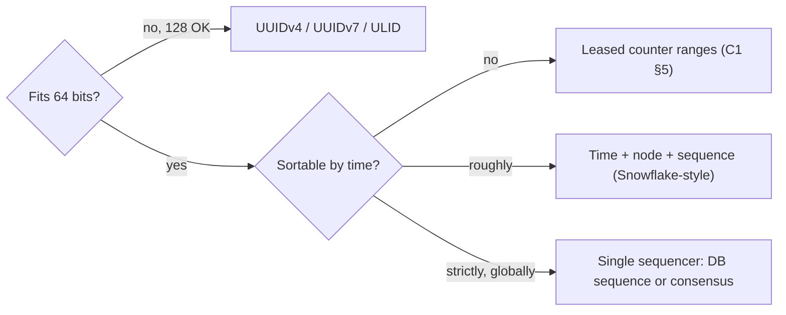
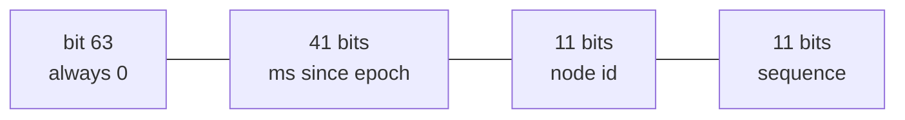
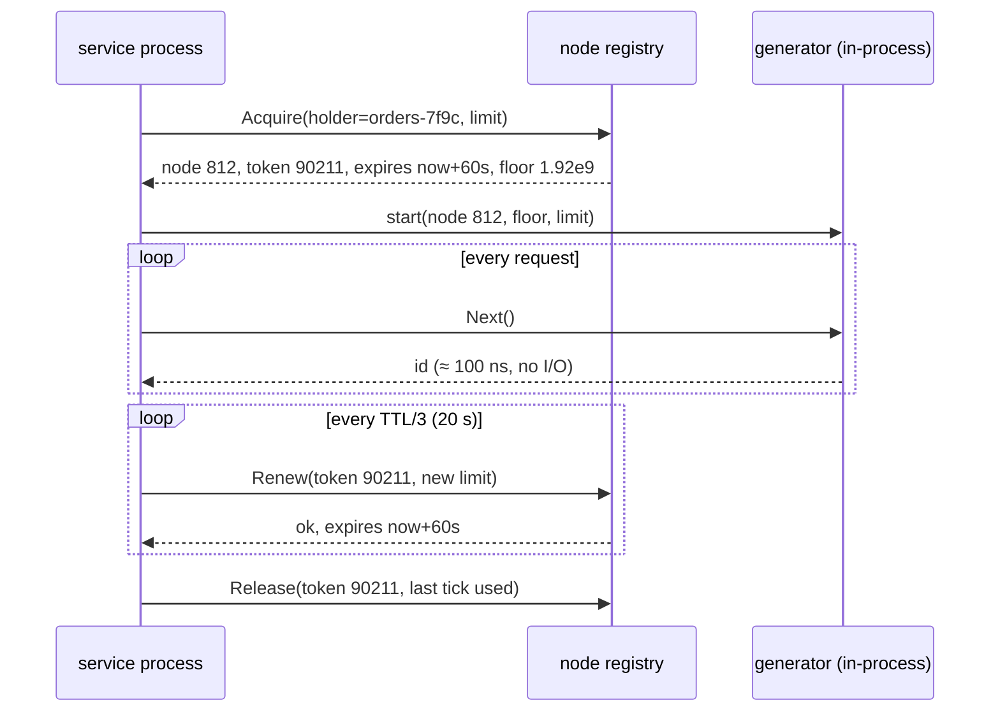
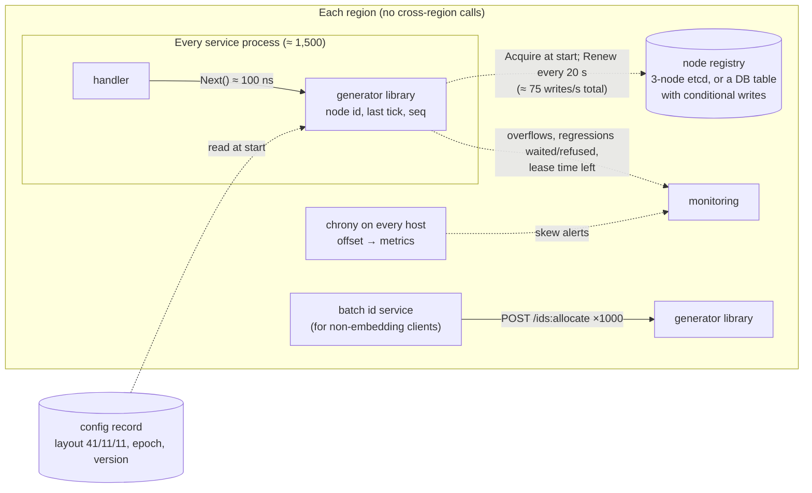
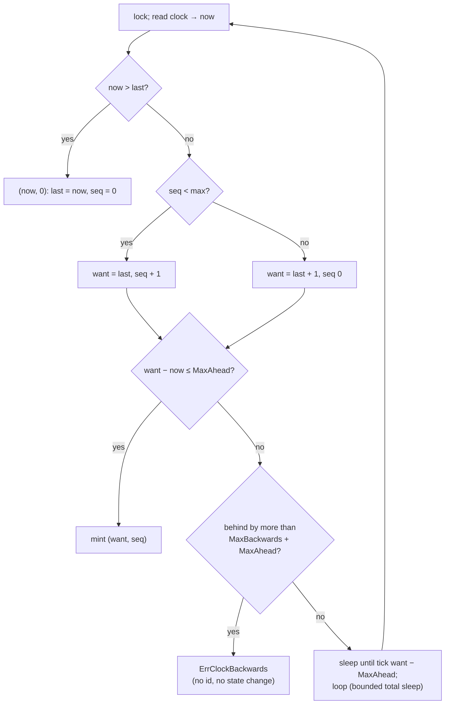

# C3 Unit 1 — Case study: unique ID generator

> Time: ~6 h · CORE: §1–§7 and Common mistakes (5 h, incl. ≈ 1.5 h gate work) · STRETCH: the second half of §7
> (index locality, range-partitioned stores, multi-region ordering) (1 h) · Lab: `labs/c3/snowflake` · Framework
> card: [docs/INTERVIEW_FRAMEWORK.md](../../docs/INTERVIEW_FRAMEWORK.md)

"Design a unique ID generator" sounds like the shortest interview question in the book. Most candidates answer it
in one breath ("UUIDs", or "a database sequence", or "Snowflake: 41 bits of time, 10 of machine, 12 of sequence")
and then stall when the interviewer asks the second question. What happens when the clock goes backwards? Who
decides which machine is number 37, and what happens when machine 37 is paused for 40 seconds and a replacement
is given the same number? Why are your ids all even? Why do the newest orders all land on one database
partition? Each of those is a real outage, and none of them is visible in the one-breath answer.

The problem is small on purpose. There is no read path, almost no storage, and the "service" may not even be a
service. That strips the case study down to the three things every distributed system eventually has to get
right: **what it may assume about clocks**, **how it hands out identity to processes without a single point of
failure**, and **what ordering it actually promises**. [C1 §5](../C1-url-shortener/unit-1-url-shortener.md#5-deep-dive-1-unique-codes-without-a-serialising-point-025032)
solved uniqueness for short codes with leased counter ranges and a keyed permutation; this unit removes the
counter entirely and puts time into the id. You run the 45-minute framework end to end, committing to each
decision *before* the reveal. Keep your notes file open.

## Before you start

You need C1's §5 (range leasing and the atomic primitive behind every uniqueness scheme), A2's B-tree internals,
A4's partitioning schemes and A5's clocks, leases and fencing tokens. Warm-up (write the answers down, then
check):

1. In C1's counter-range scheme, each API server leases 1,000 ids with one compare-and-swap. A server crashes after
   handing out 3 of them. What is lost, what can never happen, and why are those ids *not* sortable by creation
   time across servers?
2. NTP finds a machine's clock 200 ms fast. Name its two ways of correcting it, and say which Go clock reading is
   immune to one of them.
3. A 400 GB table has a random UUID (v4) primary key and inserts have slowed down badly. What is happening in the
   B-tree, and what does a time-ordered key change?

<details data-kind="answer">
<summary>Warm-up answers</summary>

1. The other 997 ids are gone (the counter already moved past them), and no id is ever issued twice, because the
   range was reserved with compare-and-swap. Ranges are handed out in lease order, not time order: server A may
   still be working through `[41,000, 42,000)` an hour after server B started on `[42,000, 43,000)`, so a larger
   id says nothing about which link is newer. That is fine for short codes and fatal for "sort by id = sort by
   time" ([C1 §5](../C1-url-shortener/unit-1-url-shortener.md#5-deep-dive-1-unique-codes-without-a-serialising-point-025032)).
2. **Slew** (run the clock slightly slow until it is right, so time stays monotonic but is briefly wrong) or **step**
   (jump it back by 200 ms at once). Go's `time.Now()` carries a **monotonic** reading since Go 1.9, and
   `time.Since`/`Sub` between two such readings ignore steps; `UnixMilli()` reads the wall clock and does not.
   ([A5 Unit 2 §1](../A5-consistency/unit-2-time-ordering.md#1-physical-clocks-and-last-write-wins).)
3. Every insert lands on a random leaf. Once the index is larger than memory, most inserts read a leaf from disk,
   dirty it, and split pages all over the tree, so the buffer pool thrashes and the WAL fills with full-page
   images. A time-ordered key (UUIDv7, ULID, Snowflake-style) inserts at the right edge like a sequence: a small hot
   set of leaves stays in memory ([A2 Unit 1 §2](../A2-storage/unit-1-access-patterns-indexes.md#2-how-a-b-tree-index-works)).

</details>

**Session plan (3 × 2 h):** Session 1: §1–§4, every Predict in writing, ending with your own HLD on paper.
Session 2: §5–§6 with the lab (`labs/c3/snowflake`: layout, then the generator) and the first break-its.
Session 3: §7 and the lab's registry and worker (the STRETCH half of §7 is optional), then the gate work: first
`sd quiz C3`, the [design exercise](design-exercise.md) (45 min, solo, a *different* prompt from this unit's), and
the [teach-back](teachback.md).

---

## §1 Requirements and the questions that change the design (0:00–0:06)

### The failure story

Three teams, three ID schemes, three incidents.

The orders team used random UUIDs (v4) as primary keys. At 2,000 orders/s the table reached 400 GB in its second
year, and insert latency went from ≈ 2 ms to ≈ 40 ms at p99 because every insert touched a random leaf of a
B-tree that no longer fitted in memory. Their cursor pagination ("orders after this one") had to add a
`created_at` column and a second index, because the id carried no order at all.

The payments team used one Postgres sequence on the primary in their home region and called it over the network
from two other regions: ≈ 70 ms per id from the far region, three ids per payment, and when the primary failed over
for 90 seconds, nobody anywhere could create a payment. The "ID service" had become the least available component
on the write path.

The events team copied a Snowflake implementation from a blog post, set the machine number to the last 10 bits of
the pod's IP address, and deployed on a cluster with several `/22` subnets. Two pods in different subnets got the
same 10 bits. For eleven days, about one event in two thousand silently overwrote another in their key-value
store, because two processes were minting identical ids whenever both happened to issue one in the same
millisecond.

Each team answered "how do I make a unique number?" correctly. Each one skipped a question whose answer moved a
box.

### Predict

<!-- predict id="C3-U1-P01" -->
**Predict.** The interviewer says: "Design a unique ID generator for our platform. Lots of services need ids."
Nothing else. Write the requirements card: the functional requirements, the NFRs **with numbers** (state your
assumptions), the out-of-scope list, and **five clarifying questions** whose answers change the architecture. For
each question, write which part of the design its answer moves (the id's size, the scheme, a box on the diagram,
a deep dive). Write it down before opening the reveal.
<!-- /predict -->

### Reveal

<details data-kind="reveal" data-for="C3-U1-P01">
<summary>Reveal</summary>

**The interviewer's answers** (the reference card below assumes them; yours may differ, and that is fine as long
as you asked): ids for orders, payments, messages and events across ≈ 50 services; ≈ 50k ids/s on average and
≈ 200k/s at peak across the fleet; the hottest single service mints ≈ 40k/s across 20 pods; backfill jobs
sometimes want a million ids at once; ≈ 1,200 service processes in steady state and ≈ 1,500 during a rolling
deploy; three regions. Ids are primary keys in existing `BIGINT` columns, they are used for cursor pagination and
"newest first" lists, and they must be unique forever.

| Question | Why it moves the design |
|---|---|
| **Must it fit in 64 bits?** (existing `BIGINT` columns, Java `long`, Kafka keys) And will JavaScript clients see it? | 64 bits rules out UUIDs (128) and forces a bit budget (§2). JavaScript numbers are exact only up to 2^53, so 64-bit ids travel as **strings** in JSON. |
| **Must ids sort by creation time? How strictly?** (none; roughly, within seconds; per producer; one global order) | "None" allows random ids and leased ranges; "roughly" allows time-in-the-high-bits; a **single global total order** needs one sequencer (§5, §7) and is a different, much more expensive system. |
| **Throughput per process and fleet-wide, and the largest burst?** | Sets the sequence bits and the overflow policy (§2, §5); rules a per-id network call in or out (§3). |
| **How many generating processes, how much churn, how many regions?** | Sets the node bits and how node ids are assigned and reclaimed (§7). Regions decide whether any coordination may cross a WAN. |
| **Must generation keep working when the network or a coordination store is down?** | Rules out "call a central service per id"; decides whether a lease registry may be on the startup path only (§4, §7). |
| **May an id reveal anything?** (creation time, volume, which machine) | Time-ordered ids reveal creation time to anyone; sequential ids reveal volume. If ids are customer-visible and that matters, permute or encrypt them (C1's mixer) at the edge. |
| **May there be gaps?** | Almost always yes. If **no** (some invoice, cheque or receipt numbering rules), it is a different problem: a counter inside the same transaction as the business write, per series, serialised by design. |

**Functional requirements.**
1. `Next()`: a new id, unique across every process, every region, forever.
2. `NextN(n)`: a batch (backfills, bulk imports).
3. `Decode(id)`: creation time and origin, for debugging, time-range scans and routing.

**Non-functional requirements (with numbers).**
- **Uniqueness: absolute.** A duplicate id is a data-corruption bug, not an availability blip; the design must say
  what prevents one under every failure it names.
- **Size:** fits a signed 64-bit integer.
- **Ordering:** roughly by creation time ("k-sorted"): ids minted more than a few milliseconds apart (the clock
  skew bound) compare in time order; within that window, no promise.
- **Throughput:** ≈ 200k ids/s fleet peak; ≈ 2k/s per pod sustained on the hottest service, bursts of 20 per
  millisecond, backfills of 10^6.
- **Latency:** in-process, p99 well under 1 ms (an id is on the write path of everything).
- **Availability:** minting must not depend on any remote call per id, and must survive a coordination-store or
  inter-region outage for at least as long as a process keeps running.
- **Lifetime:** ≥ 50 years from launch.

**Out of scope:** gapless numbering (a ledger-numbering problem, see above), human-friendly short codes (C1),
secrecy of the id (handled at the edge if needed), global total order (explicitly not promised).

**Dominant risk, in one sentence:** uniqueness depends on two things the generator does not control (the clock,
and the assignment of node ids), so the deep dives are the sequence, the clock and the node-id lease, not
throughput.

Two common mistakes. (1) Answering with a scheme before asking about size and ordering: "UUIDs" fails the 64-bit
requirement, and "a sequence" fails the availability one. (2) Promising "strictly increasing ids" without noticing
that a strict global order across processes needs a single sequencer, which is the very thing the design is trying
to avoid.

</details>

### How it actually works

**Four strengths of "ordered", and what each one costs.** The ordering question is the one that decides the
architecture, so name the options precisely:

| Promise | What a consumer may conclude from `a < b` | What it costs |
|---|---|---|
| **None** (random ids, leased ranges) | Nothing | Nothing: no clock, no shared state beyond uniqueness |
| **k-sorted** (time in the high bits) | If `b` was minted more than ε earlier than `a` was, then `b < a` is impossible; ε = clock skew + one tick | Clocks kept within ε, and a policy for when they are not (§6) |
| **Per-producer monotonic** | Ids from the *same* process increase | One mutex per process (§5) |
| **Total order, linearizable** | `a < b` exactly when `a` was minted first, by any process, anywhere | A single sequencer (one primary, or consensus) on every id: latency, throughput ceiling, availability of one box ([A5 Unit 1 §1](../A5-consistency/unit-1-consistency-quorums.md#1-consistency-models-what-a-read-may-return)) |

Almost every product requirement is satisfied by "k-sorted plus per-producer monotonic": newest-first lists,
cursor pagination, time-range scans and log merging all tolerate a few milliseconds of disorder between machines.
The requirement that is *not* satisfied by it is "the id order is the order in which things happened", for
example "the ledger entry with the larger id was applied second". That is a causality or sequencing requirement,
and it belongs to the ledger (a per-account sequence inside the transaction, [A5 Unit 3 §4](../A5-consistency/unit-3-consensus-leases.md#4-choosing-a-model-for-money-movement)),
not to the id generator.



### Build it

No lab for this section — see §5. The requirements decide which part of `labs/c3/snowflake` matters most: the
layout (§2) is the 64-bit answer, the generator (§5–§6) the ordering answer, the registry and worker (§7) the
"many processes, no central call" answer.

### Break it

Change one requirement and follow the damage: the product manager now says "ids must be **strictly increasing
across the whole platform**, because the audit export sorts by id and must match the order in which payments were
accepted." Which box appears, what does it do to the 200k/s peak and to the availability NFR, and what would you
propose instead?

<details data-kind="answer">
<summary>Answer</summary>

A single sequencer appears: one process (or one consensus group) that every id request goes through. At ≈ 200k
ids/s that is either one very busy primary or a Raft group whose every id is a quorum write (≈ 1–2 ms within a
region, tens of ms across regions), unless ids are pre-allocated in blocks, which immediately breaks "strictly
increasing across the platform" again. Availability becomes that of the sequencer, and every region pays the
round trip to it. Propose instead: keep k-sorted ids for identity, and give the audit export what it actually
needs, an **order of acceptance**, from the system that accepts payments: a per-ledger (or per-account) sequence
number assigned inside the same transaction that accepts the payment. That sequence is serialised exactly where
the business already serialises, and nowhere else.

</details>

### In the wild

- **Twitter Snowflake** (announced in 2010 for tweet ids): 64-bit ids with a millisecond timestamp in the high bits,
  a worker id and a per-millisecond sequence, generated by a small network service. Tweet ids are k-sorted, not
  strictly ordered, which is why timelines are "roughly newest first". (TODO-VERIFY: the exact 2010 announcement
  wording and whether the original service took worker ids from ZooKeeper.)
- **Twitter's API** returns `id_str` next to the numeric `id` because JavaScript parses JSON numbers into IEEE-754
  doubles, which are exact only up to 2^53 (`Number.MAX_SAFE_INTEGER` = 2^53 − 1).
- **MongoDB ObjectId**: 12 bytes, a 4-byte timestamp in seconds, a 5-byte random value per process and a 3-byte
  counter: roughly time-ordered at one-second granularity, no coordination, 96 bits.
- **UUIDv7** ([RFC 9562](https://www.rfc-editor.org/rfc/rfc9562), 2024): a 48-bit Unix millisecond timestamp in the
  high bits followed by random bits, so 128-bit UUIDs sort roughly by time.
- **Gapless numbering** is a regulatory requirement for some documents in some jurisdictions (invoices in parts of
  the EU, for example), and systems that need it use a per-series counter inside the business transaction, not an
  id generator. (TODO-VERIFY: which jurisdictions require it for which documents.)

### Trade-offs

| Ordering promise | Wins when | Loses when | When the answer flips |
|---|---|---|---|
| None (random, ranges) | Ids are only handles; you want no clock dependency at all | Anyone needs "newest first" or time-range scans by id | The first cursor-pagination or time-range query by id appears |
| k-sorted (time in high bits) | Lists, pagination, log merging, index locality on one node | Someone reads id order as event order across machines | A requirement says "the larger id happened second"; then add a sequence where the business serialises |
| Per-producer monotonic | Consumers merge streams per producer (one partition, one session) | Consumers compare ids across producers and expect order | Cross-producer order needed: k-sorted is the most you get cheaply |
| Total order (sequencer) | Rates are low, one region, and order is the product (an exchange's sequence number) | High rates, many regions, or an availability target above the sequencer's | Rates or regions grow past one primary: shard the sequence by key and order only within a key |

### Senior bar

- **Failure modes.** A duplicate id is the worst failure, and it is usually silent: an upsert or a KV `put`
  overwrites, a unique index rejects (the lucky case), a cache serves one entity's data under the other's id. A
  senior answer names where the duplicate would be *detected* (the unique constraint at the consumer is the last
  line) and says that the generator must prefer refusing to mint over guessing.
- **Capacity.** ≈ 200k ids/s is tiny for in-process generation (≈ 10^6–10^7 ids/s per core, §2) and large for a
  per-id remote call (≈ 200k RPCs/s).
- **Operations.** The ordering promise must be written down and *tested by consumers*: someone will eventually
  write `ORDER BY id` and assume it is the order of acceptance.
- **Cost.** Negligible compute; the real cost is in the consumers: 8-byte vs 16-byte keys in every index and
  foreign key (§2), and index locality (§7).

**Interviewer follow-up probes**

1. "Why not just use UUIDs everywhere?"

<details data-kind="answer">
<summary>Model answer</summary>

For many systems I would: UUIDv4 needs no coordination and no clock, and 122 random bits make collisions
negligible. Here they fail two stated requirements: the ids must fit existing `BIGINT` columns, and they must sort
roughly by time for pagination and index locality. UUIDv7 fixes the ordering but not the size. If the 64-bit
constraint were dropped I would take UUIDv7 and skip the node-id machinery entirely, because that machinery is
the riskiest part of a Snowflake design.

</details>

2. "The audit team says ids must be strictly increasing. What do you say?"

<details data-kind="answer">
<summary>Model answer</summary>

I ask what they need the order *for*. If it is "the order in which payments were accepted", the id generator is
the wrong place: a global total order needs a sequencer on every id, which costs latency, throughput and the
multi-region availability we required. I'd give them a sequence number per ledger, assigned in the same
transaction that accepts the payment, and keep k-sorted ids for identity. If they only need exports sorted
"roughly by time", k-sorted ids already do that, and I'd document the skew bound.

</details>

3. "What is the worst thing this system can do?"

<details data-kind="answer">
<summary>Model answer</summary>

Hand out the same id twice. Every other failure (slow, unavailable, out of order) is visible and recoverable; a
duplicate silently merges two entities. So every component's failure behaviour is chosen to fail closed: a clock
that is too far behind, an expired node lease, or an exhausted sequence makes the generator return an error, and
the caller's create fails visibly instead.

</details>

### Check yourself

1. Why is "k-sorted" a promise about pairs of ids minted far enough apart, not about every pair?
2. What changes in the design if JavaScript clients consume the ids?
3. Which requirement turns an id generator into a sequencer, and where should that requirement usually live?

<details data-kind="answer">
<summary>Answers</summary>

1. Two machines' clocks disagree by up to the skew bound ε, and a tick lumps a millisecond together; ids minted
   within ε of each other on different machines can compare in either order. Only pairs further apart than ε are
   guaranteed to compare in time order.
2. Nothing in the generator; the API contract: ids are serialised as decimal strings in JSON (a double holds
   integers exactly only up to 2^53), and clients must treat them as opaque strings.
3. "The id order is the order things happened, across producers" (a total order). It usually belongs to the system
   that already serialises those events (a ledger's per-account sequence inside its transaction), not to the
   identity scheme.

</details>

---

## §2 Estimation: bits are the budget (0:06–0:10)

### The failure story

A team copies the classic 41/10/12 layout ("Twitter did it") with the Unix epoch, because "milliseconds since
1970" is what `System.currentTimeMillis()` returns. 2^41 ms is ≈ 69.7 years, so their time field runs out in
September 2039, which nobody checks because it is fifteen years away. Then they move to Kubernetes: 10 node bits
are 1,024 node ids, the platform runs 1,400 pods during a rolling deploy, and the deploy fails halfway with
"no free worker id" on the last 400 pods. Meanwhile the web team parses the ids as JSON numbers in the browser:
`1834475639263240193` becomes `1834475639263240200`, so two different orders on the same page link to the same
detail URL.

None of these is hard. All three are arithmetic that nobody did at 0:06.

### Predict

<!-- predict id="C3-U1-P02" -->
**Predict.** Use the card from §1: ≈ 200k ids/s fleet peak; hottest pod ≈ 2k ids/s sustained with bursts of 20 per
millisecond; backfills of 10^6 ids; ≈ 1,200 processes, ≈ 1,500 during a deploy; a 50-year lifetime; 63 usable bits
(the sign bit stays 0). Compute, showing the arithmetic:

1. Time bits for 1 ms ticks and ≥ 50 years. With a custom epoch of 2026-01-01, when does it run out? With the
   Unix epoch?
2. Node bits, with headroom for the deploy surge. What else, besides the number of live processes, consumes node
   ids?
3. Sequence bits left over, and the per-node and fleet-wide ceilings they give. How long does a 10^6-id backfill
   take on one node?
4. Bytes per id compared with a UUID, and what that is worth in one index over a year of ≈ 50k ids/s.

For each number, write the decision it drives.
<!-- /predict -->

<!-- predict id="C3-U1-P03" -->
**Predict.** (1) Why must the *time* field be in the most significant bits, and what would ordering look like if
the node id came first? (2) Moving one bit from the sequence to the node field: what changes in the fleet-wide
capacity, and what changes for one hot pod? (3) Could you make the ids fit JavaScript's 2^53 instead of sending
strings? What would you have to give up?
<!-- /predict -->

### Reveal

<details data-kind="reveal" data-for="C3-U1-P02">
<summary>Reveal</summary>

1. **Time: 41 bits.** 50 years ≈ 50 × 3.15 × 10^10 ms ≈ 1.6 × 10^12 ms; 2^40 ≈ 1.1 × 10^12 is too small, 2^41 ≈
   2.2 × 10^12 ms ≈ **69.7 years**. From a 2026 epoch it ends in **2095**; from the Unix epoch it ended in **2039**
   (`BreakIt_Layouts` prints both). Decision: a **custom epoch** at launch, written into config once and never
   changed. 1 ms ticks because the ordering promise is "within a few milliseconds" anyway; finer ticks buy nothing
   the skew doesn't take away.
2. **Node: 11 bits (2,048).** 1,500 processes at the deploy peak don't fit 10 bits (1,024); 11 bits leaves ≈ 25%
   headroom. Node ids are also consumed by **processes that died without releasing** (until their lease expires)
   and by **failed starts**: the requirement is *live processes + restarts per lease TTL*, which §7 turns into the
   TTL choice. Decision: 11 node bits and a lease-based assignment, not static config.
3. **Sequence: 63 − 41 − 11 = 11 bits** = 2,048 ids per millisecond per node ≈ **2 × 10^6 ids/s per node**, and
   2,048 × 2,048 per ms ≈ **4.2 × 10^9 ids/s fleet-wide** (the `41/11/11` row of `BreakIt_Layouts`). The hot pod
   bursts to 20/ms, ≈ 100× below the ceiling: overflow happens only in backfills, and a 10^6-id backfill on one
   node takes ≈ 10^6 / 2,048 ≈ **490 ms** of ticks. Decision: overflow waits for the next tick (§5); it is a rare,
   bounded wait, not a design driver.
4. **8 bytes vs 16** (a UUID in binary; 36 as text). At ≈ 50k ids/s × 3.15 × 10^7 s ≈ 1.6 × 10^12 ids a year, every
   index or foreign-key column holding the id is ≈ 12.6 TB a year at 8 bytes and ≈ 25 TB at 16 (key bytes alone,
   before page overhead). Decision: 64-bit ids are worth a bit-budget exercise for a platform this size; for a
   system with 10^8 rows, they aren't, and UUIDv7 is the simpler answer.

Not computed, on purpose: storage of the generator itself (none), and read QPS (none). Saying so is part of the
answer: "this is a bit-budget problem, not a scale problem; the risks are the clock and the node ids."

</details>

<details data-kind="reveal" data-for="C3-U1-P03">
<summary>Reveal</summary>

1. Numeric order compares the most significant bits first. With time on top, ids sort by time, then by node, then
   by sequence: k-sorted across the fleet. With the node id on top, all of node 0's ids (forever) sort below all
   of node 1's: ids would be ordered by machine, which is useless to every consumer, and every node's inserts
   would land in its own region of the index.
2. **Fleet capacity does not change**: it is 2^(node + seq bits) ids per tick, and the sum stays 22. Per node it
   halves (2,048 → 1,024 per ms) while the node count doubles. So moving bits between node and sequence is
   choosing *how capacity is distributed*: many small producers (node bits) or a few very hot ones (sequence bits).
   Only moving bits out of the time field buys fleet capacity, at the price of lifetime.
3. You could: 53 bits = 31 bits of seconds (≈ 68 years) + 22 bits of node and sequence, or 41 bits of milliseconds
   + 12 bits for everything else (e.g. 6 node + 6 seq: 64 nodes at 64 ids/ms). Both give up something the card
   requires (millisecond ordering, or 1,500 producers). Strings cost nothing, so send strings and keep the full 63
   bits; mention the 53-bit layout only as the answer when a downstream system genuinely accepts nothing but a
   double or a 16-digit number (the design exercise has one).

</details>

### How it actually works

**The bit-budget worksheet.** Every time-node-sequence layout is three numbers that must add up to at most 63:

| Quantity | Formula | 41/11/11 at 1 ms |
|---|---|---|
| Lifetime | 2^T × tick | 2^41 ms ≈ 69.7 years |
| Node ids | 2^N | 2,048 |
| Ids per tick per node | 2^S | 2,048 |
| Per-node rate | 2^S / tick | ≈ 2.05 × 10^6 /s |
| Fleet rate | 2^(N+S) / tick | ≈ 4.2 × 10^9 /s |
| End date | epoch + lifetime | 2026 + 69.7 ≈ 2095 |



Read the table as a budget with exactly one free variable per decision. **Lifetime** is fixed by the time bits and
the tick. **Distribution of capacity** is the split between node and sequence. The **tick** trades ordering
resolution against lifetime: 10 ms ticks give 10× the lifetime for the same bits but lump ten milliseconds of ids
together (Sonyflake's choice, ≈ 174 years with 39 bits).

**What a generator costs.** In process: an uncontended mutex (≈ 15–25 ns, [docs/NUMBERS.md](../../docs/NUMBERS.md))
plus a clock read (≈ tens of ns through the vDSO on Linux; TODO-VERIFY for your platform) ≈ 50–100 ns per id, so
≈ 10^7 ids/s per core uncontended. Contended, the mutex costs microseconds, and that still covers the 2k/s pod
with room to spare. As a remote service: one network round trip per id, ≈ 0.1–0.5 ms in a datacenter, ≈ 70 ms
across a continent, i.e. 1,000× to 10^6× the in-process cost, plus a dependency. That ratio is the whole case for
the library (§3).

**Numbers that do *not* move the design.** Storage of the generator (a few lease rows), read QPS (none), bandwidth
(none). Say so in one sentence and move on.

### Build it

Lab `labs/c3/snowflake`, file `snowflake.go`: implement the layout first: `Validate`, `Nodes`, `PerTick`,
`Lifetime`, `NodeRate`, `Compose`, `Decompose`, `TickOf`, `TimeOf`. Acceptance tests:
`TestLayout_DefaultIs41_10_12AndLastsAbout69Years`, `TestLayout_ValidateRejectsLayoutsThatDoNotFit`,
`TestLayout_ComposeAndDecomposeRoundTrip`, `TestLayout_NumericOrderIsTimeThenNodeThenSeq`,
`TestLayout_TickOfAndTimeOf`. Run `go test -race -run Layout ./labs/c3/snowflake/`.

### Break it

`go test -tags breakit -run BreakIt_Layouts -v ./labs/c3/snowflake/` prints lifetime, end year, nodes, per-node and
fleet rate for six layouts using your methods. Before running it, predict: (a) the end year of 41 bits of
milliseconds from the Unix epoch and from 2026; (b) which columns change between 41/10/12 and 41/11/11; (c) which
layout has the largest fleet rate, and why that is the wrong column to optimise.

<details data-kind="answer">
<summary>Answer</summary>

(a) **2039** and **2095**. (b) Nodes double (1,024 → 2,048) and per-node rate halves (4.1M/s → 2.0M/s); lifetime and
fleet rate (≈ 4.19 × 10^9 /s) are identical, because the time field didn't change. (c) 31/16/16 with 1 s ticks has
the largest fleet rate (≈ 4.29 × 10^9 /s), and it is the worst layout here for this product: ids are ordered only to
the second, and it lasts 68 years. Every layout in the table can mint billions per second; the fleet rate is never
the binding constraint. Lifetime, node count and ordering resolution are.

</details>

### In the wild

- **Classic Snowflake**: 1 unused sign bit, 41 bits of milliseconds since a custom epoch, 10 bits of worker id
  (5 datacenter + 5 worker), 12 bits of sequence. (TODO-VERIFY: Twitter's epoch value, commonly cited as
  1288834974657 ms, in November 2010.)
- **Discord** documents its ids as Snowflakes: milliseconds since the first second of 2015, then internal worker
  and process ids and a 12-bit increment, and tells API clients to treat them as strings. (TODO-VERIFY: the exact
  field widths in Discord's current API reference.)
- **Instagram** (2012 engineering post on sharding and ids): 41 bits of milliseconds since a custom epoch, 13 bits
  of logical shard id and 10 bits of a per-shard auto-increment, generated inside PostgreSQL by a PL/pgSQL
  function in each logical shard. (TODO-VERIFY: the post's exact details.)
- **Sonyflake**: 39 bits of time in 10 ms units (≈ 174 years), an 8-bit sequence (256 per 10 ms ≈ 25,600 ids/s per
  machine) and a 16-bit machine id, by default from the low 16 bits of the private IP address. (TODO-VERIFY: the
  field order and the current default machine-id function.)
- **UUIDv7** spends 48 bits on milliseconds (≈ 8,900 years) because it has 128 bits to spend.

### Trade-offs

| Choice | Wins when | Loses when | When the answer flips |
|---|---|---|---|
| 1 ms ticks | Ordering within milliseconds is useful; lifetime from a custom epoch is enough | You need more than ≈ 70 years in 41 bits | Fewer time bits are available (a 53-bit budget): go to 10 ms or 1 s ticks |
| 10 ms ticks (Sonyflake-style) | Long lifetime, many node bits | Ordering resolution and per-node burst (256 per 10 ms) | A single producer needs more than ≈ 25k ids/s |
| More node bits | Many small producers (pods, lambdas, mobile clients) | One hot producer bursts beyond 2^S per tick | A backfill or a hot partition needs more than the per-tick ceiling: give it more sequence bits, or several node ids |
| More sequence bits | Few, very hot producers | Many producers, high churn | Process count × churn outgrows 2^N |
| Custom epoch | Buys decades | Must be fixed forever, documented, identical everywhere | Never flips; changing it later reuses old ids |

### Senior bar

- **Failure modes.** Epoch drift between services (one service configured with a different epoch mints ids that
  sort decades away from everyone else's, or collide with the past); node-id exhaustion during a deploy surge; JSON
  precision loss in clients; the time field silently wrapping at end of life (the lab returns `ErrOverflow`
  instead).
- **Capacity numbers.** 41/11/11: ≈ 69.7 years, 2,048 nodes, ≈ 2 × 10^6 ids/s per node, ≈ 4 × 10^9 ids/s fleet. A
  pod's need (≈ 2k/s) is ≈ 1,000× below its ceiling, so overflow is a backfill concern only.
- **Operations.** The layout and epoch are a **schema**: put them in one versioned config record, check them at
  startup (refuse to start on a mismatch), and never change them in place. A layout change is a new id space with
  a cut-over date, and old ids must still decode.
- **Cost.** 8 bytes per id per index or foreign key; ≈ 12.6 TB a year of key bytes per column at 50k ids/s, half
  of what UUIDs would cost.

**Interviewer follow-up probes**

1. "Your layout has 11 node bits. We're moving to serverless and might have 50,000 concurrent function instances.
   What breaks, and what do you change?"

<details data-kind="answer">
<summary>Model answer</summary>

Node ids break first: 50,000 instances, with churn, need ≈ 2^17 node ids, and a lease per short-lived instance
is a coordination write per cold start. Options: move 6 bits from the sequence to the node field (17/5: 32 ids per
ms per instance, plenty for a function); or stop giving instances node ids at all and let them fetch **batches**
from a small id service that does own node ids (one call per 1,000 ids); or switch those producers to UUIDv7 if
the consuming columns can take 128 bits. I'd pick the batch service: it keeps the layout and moves the churn out
of the registry.

</details>

2. "Why not use the full 64 bits as unsigned?"

<details data-kind="answer">
<summary>Model answer</summary>

Because half the world's integer columns and types are signed: Java's `long`, PostgreSQL's `BIGINT`, most JSON
libraries' int64. An id with the top bit set becomes negative in those systems, sorts below every older id, and
breaks "newest first". Keeping the top bit 0 costs one bit, i.e. half the lifetime of the time field, and that is
the cheapest bit in the budget.

</details>

3. "How would you know you are running out?"

<details data-kind="answer">
<summary>Model answer</summary>

Three gauges, each against its ceiling: node ids leased vs 2^N (alert at 75%, and before every deploy-surge
change); sequence overflows per second per node (should be ≈ 0 outside backfills; a rising rate means a hot
producer is near 2^S per tick); and years left in the time field, which goes on the same long-range risk register
as certificate and domain expiries.

</details>

### Check yourself

1. A layout uses 39 bits of 10 ms ticks. Roughly how long does it last?
2. Why doesn't moving a bit from the sequence field to the node field change fleet-wide capacity?
3. What two things besides live processes consume node ids?

<details data-kind="answer">
<summary>Answers</summary>

1. 2^39 × 10 ms ≈ 5.5 × 10^9 s ≈ 174 years.
2. Fleet capacity per tick is 2^(N+S); moving a bit keeps N+S constant, so it only changes how that capacity is
   split between producers.
3. Processes that died without releasing their node id (held until the lease expires), and processes in the middle
   of starting or stopping; in practice "restarts per lease TTL" during deploys and crash loops.

</details>

---

## §3 API and data model (0:10–0:16)

### The failure story

The platform team ships "IdService": `GET /v1/id` returns one id, behind a load balancer, three replicas per region.
The orders service needs three ids per order (order, payment intent, outbox event), so every order now waits for
three sequential round trips: ≈ 1.5 ms in the same zone, ≈ 6 ms when the replicas are in another zone. At 2,000
orders/s that is 6,000 RPCs/s for numbers the orders process could have made itself in 300 ns. Then IdService's
deploy has a bad readiness probe, and for four minutes every create on the platform fails with "could not
allocate id", including the ones that would have succeeded against a degraded database.

A year later the team that consumes the ids from a browser dashboard files a bug: "two orders open the same
page". The API returned the id as a JSON number.

### Predict

<!-- predict id="C3-U1-P04" -->
**Predict.** Design the interface, before any diagram:

1. Library or service? If both, who uses which, and what does the service's API look like so that a caller makes
   one round trip per *many* ids rather than per id?
2. What operations does the library expose, and what does `Next` do when it cannot mint safely (clock far behind,
   node lease expired)?
3. How do consumers store and transmit the id (database column type, JSON, logs)?
4. The generator needs a node id. Sketch the record that assigns node ids to processes: its key, its fields, and
   the one atomic operation it relies on.
<!-- /predict -->

### Reveal

<details data-kind="reveal" data-for="C3-U1-P04">
<summary>Reveal</summary>

1. **A library by default, a small batch service for the rest.** Every Go (or JVM) service embeds the generator:
   no network call, no dependency on the hot path. Clients that cannot embed it (other runtimes, short-lived jobs,
   serverless functions that would churn node ids, browsers) call a service that **hands out batches**:
   `POST /v1/ids:allocate {"count": 1000}` → `{"ids": ["…", "…"], "minted_by": 812}`. One round trip per 1,000 ids
   makes the remote cost ≈ 0.5 µs per id. The service is itself a set of library users with node ids.
2. **Library operations:**

   | Call | Returns | Notes |
   |---|---|---|
   | `Next() (ID, error)` | one id | ≈ 100 ns; strictly increasing per process |
   | `NextN(n) ([]ID, error)` | n ids | one lock acquisition; may span ticks |
   | `Decode(id) Parts` | time, node, sequence | debugging, time-range scans, "which region minted this?" |

   When it cannot mint safely it **returns an error** (`ErrClockBackwards`, `ErrLeaseExpired`, `ErrClockStalled`):
   never an id it isn't sure of. The caller fails the create (a 503 the client retries), and an alert fires. A
   retry against another pod usually succeeds at once, because the problem is local to one machine.
3. **Storage:** `BIGINT` (signed 64-bit; the top bit is always 0). **JSON:** a decimal **string**. **Logs and
   URLs:** the decimal string (or a base-32/62 encoding of it if it is shown to people). Consumers must treat it as
   opaque: no arithmetic, no `id % N` sharding (§5), no parsing the time out of it for business logic unless the
   layout is a documented contract.
4. **The node-lease record**, one row (or key) per node id:

   ```sql
   CREATE TABLE node_leases (
     node_id     SMALLINT PRIMARY KEY,   -- 0 .. 2^N − 1
     holder      TEXT,                   -- pod name / process identity, for humans
     token       BIGINT NOT NULL,        -- fencing token: strictly increasing across grants
     expires_at  TIMESTAMPTZ,            -- the registry's clock
     high_water  BIGINT NOT NULL         -- the highest tick any holder may have used
   );
   ```

   Acquire is **one conditional write**: "set holder, a new token, `expires_at = now() + ttl`, `high_water =
   greatest(high_water, :my_limit)` **where** the row is free or expired", returning the old `high_water` as the new
   holder's floor. Renew is "extend **where** `token = :mine` and not expired". In etcd it is a key per node id
   attached to a lease, created in a transaction that compares the key's create revision to 0. §7 explains every
   field; the lab's `Registry` is this table in memory.

Plus one **config record**, never edited in place: `{layout: "41/11/11", tick: "1ms", epoch:
"2026-01-01T00:00:00Z", version: 1}`. Every generator reads it at startup and refuses to start if its compiled-in
layout disagrees.

The tempting wrong answers: "a REST service with `GET /id`" (a round trip and a dependency per id); returning the
id as a JSON number; letting `Next` "do its best" when the clock is wrong (it can only do its best by guessing);
and assigning node ids from environment variables or hostnames, which works until two processes share one (§7).

</details>

### How it actually works



The registry sees ≈ one write per process per 20 s: 1,500 processes ≈ 75 writes/s, which any small etcd
cluster or a single database row set handles. The generator sees every request and touches nothing but memory and
the clock.

**`NextN` and the batch service.** A batch is just `n` calls to the same loop under one lock. With 2,048 ids per
tick a batch of 10,000 spans ≈ 5 ticks: it waits ≈ 5 ms, or, with a run-ahead allowance (§6), borrows them from
the next few milliseconds without waiting. The batch service returns ids, not a range descriptor: callers must not
assume the ids in a batch are contiguous numbers.

**Decode is a contract.** Once you publish `Decode`, consumers will use the timestamp ("ids after midnight" as a
cheap time-range scan). That is useful and it freezes the layout. Decide at 0:13 whether it is public, internal
only, or not offered.

**Why a string in JSON.** An IEEE-754 double has a 53-bit significand. Every integer up to 2^53 is exact; above it
the spacing between representable numbers grows (256 near 2^60), so `1834475639263240193` arrives in a browser as
`1834475639263240200`. Strings are exact, sort correctly if zero-padded, and cost a few bytes.

### Build it

Lab `labs/c3/snowflake`: the registry is §7's subject, but its API is this section's data model. `NewRegistry`,
`Acquire(holder, limit)`, `Renew(lease, limit)`, `Release(lease, used)`, and the `Lease` type (node, holder, token,
expiry, floor). Acceptance tests: `TestRegistry_ValidatesConfig`,
`TestRegistry_AcquireHandsOutDistinctNodesAndIncreasingTokens`. The `ID.String` method (provided) is the JSON
rule as code.

### Break it

Make the generator a remote service with `GET /v1/id` and no batching. Using the card from §1 (≈ 200k ids/s peak,
three ids per order, ≈ 0.3 ms same-zone RTT), compute the RPC rate and the added latency per order, and say what
the generator's availability now has to be for the orders service to keep 99.95%.

<details data-kind="answer">
<summary>Answer</summary>

≈ 200k RPCs/s, i.e. a fleet of RPC servers whose only job is incrementing counters; ≈ 0.9 ms of added latency per
order (three sequential calls; more across zones, and p99 is worse than the average). Availability multiplies for
serial dependencies ([docs/NUMBERS.md](../../docs/NUMBERS.md)): if orders were 99.95% without it, the generator must
be well above 99.95% just to stay level, and every one of its deploys and incidents now appears in every other
team's error budget. With the in-process library the generator's availability is the process's own; with batches
of 1,000 the RPC rate drops to ≈ 200/s and a short outage of the batch service is absorbed by the batches already in
hand.

</details>

### In the wild

- **Twitter's Snowflake** was a network service (Thrift) that clients called for ids; client libraries in most
  later systems embed the generator instead. (TODO-VERIFY: Snowflake's original deployment model.)
- **Instagram** generated ids inside PostgreSQL, one function per logical shard, so the id was minted in the same
  transaction as the row and no extra service existed at all.
- **etcd** leases: a client grants a lease with a TTL, attaches keys to it and keeps it alive with periodic
  `KeepAlive` calls; keys vanish when the lease expires. Every write has a cluster-wide, monotonically increasing
  revision, usable as a fencing token.
- **ZooKeeper** offers ephemeral nodes that disappear when the client's session times out, and sequential nodes
  whose names carry a monotonically increasing counter: two common ways of assigning worker ids.
- **Kubernetes StatefulSets** give pods stable ordinal names (`idgen-0`, `idgen-1`, …), which some teams use as node
  ids; it works only if every generator is in one StatefulSet and nothing else uses the same numbers.

### Trade-offs

| Option | Wins when | Loses when | When the answer flips |
|---|---|---|---|
| In-process library | Most producers are long-lived processes in a few languages | Many runtimes, or very short-lived producers that would churn node ids | Producers are serverless or polyglot: add the batch service for them |
| Batch id service | Clients can't embed the library; churn is high | Callers want ids with no dependency; a batch lost on crash leaves gaps (fine) | Calls per id creep back (batch size 1): it is the `GET /id` service again |
| Generated in the database (sequence, function) | Ids are minted where the row is written; one shard, one transaction | Many writers across shards and regions; an extra hop for ids needed before the write (outbox, idempotency) | You need the id before the transaction (to put it in an event or a URL) |

### Senior bar

- **Failure modes.** A library has no network failure mode, but it has *configuration* failure modes: wrong epoch,
  wrong layout, two processes with one node id. All three are prevented by reading layout and node id from one
  place (config record + registry) and checking at startup.
- **Capacity numbers.** ≈ 75 registry writes/s for 1,500 processes renewing every 20 s; a batch service at 1,000
  ids per call needs ≈ 200 calls/s for the whole fleet's 200k/s.
- **Operations.** `Decode` is an operator's tool: a bad row's id tells you which node minted it and when, which is
  the first step of any duplicate-id investigation.
- **Cost.** Essentially none for the library. A batch service is a few small pods; a per-id service is a fleet.

**Interviewer follow-up probes**

1. "A mobile app needs to create records offline and sync later. How does it get ids?"

<details data-kind="answer">
<summary>Model answer</summary>

It can't hold a node id lease while offline, so either it mints **client ids** that are only unique per device
(UUIDv4 or UUIDv7 on the device, 128 bits, no coordination) and the server assigns the 64-bit id on sync, mapping
one to the other idempotently; or it pre-fetches a batch of 64-bit ids while online and spends them offline,
accepting that a batch can run out. The first is simpler and also gives you the idempotency key for the sync
upload.

</details>

2. "Is an id a good idempotency key?"

<details data-kind="answer">
<summary>Model answer</summary>

Only if it is generated **once, by the client, before the first attempt**, and reused on every retry. An id minted
by the server on each attempt is a new id per retry, so it dedupes nothing: two retries of the same transfer get
two ids and become two transfers. The idempotency key belongs to the caller's intent
([A1 Unit 3 §2](../A1-networking-api/unit-3-idempotency-auth.md#2-idempotency-keys-end-to-end)); the generated id is the
server's handle for the resulting record. It is the duplicate-transfer problem from your vendor-adapter work: a
callback retried with a fresh reference is a second transfer.

</details>

3. "What does `Next` return when the node's lease has expired?"

<details data-kind="answer">
<summary>Model answer</summary>

An error, and the process treats it as "I can no longer mint": creates fail with a retryable 503, the readiness
probe goes red so the load balancer stops sending creates, and the process tries to re-acquire a node id. It must
never fall back to "keep using the old node id": that is the paused-holder duplicate in §7.

</details>

### Check yourself

1. Why does the batch service return a list of ids rather than "ids from X to Y"?
2. What makes the node-lease acquire safe when two processes try to take the same free node id at once?
3. What is the config record for, and why is it never edited in place?

<details data-kind="answer">
<summary>Answers</summary>

1. Ids in a batch are not contiguous numbers: they span ticks and skip the node bits in between, so a range
   descriptor would invite callers to fill in numbers that were never minted.
2. It is one conditional write (compare-and-set on "free or expired", or an etcd transaction comparing the create
   revision), so exactly one of them succeeds; the loser tries the next node id.
3. It pins the layout, tick and epoch for every generator; changing it in place would make new ids decode
   differently from old ones and could re-mint old values. A change is a new version with a cut-over.

</details>

---

## §4 High-level design: the candidates, one decision at a time (0:16–0:25)

### The failure story

The same 45 minutes, three candidates. The first draws one box, "ID service", with a database behind it, and spends
the remaining time on its API. The second says "UUIDv4" and is done by 0:18; the interviewer asks about the
`BIGINT` columns and the B-tree, and there is nothing left to say. The third draws Snowflake from memory, with "machine
id from config", and at 0:30 gets "two pods have the same config map: now what?", followed by "NTP steps the clock
back 50 ms: now what?", and has no box on the diagram that answers either.

All three skipped the step where you put the candidates side by side and let the requirements eliminate them.

### Predict

<!-- predict id="C3-U1-P05" -->
**Predict.** Score these against the card from §1 (64 bits; k-sorted; ≈ 200k ids/s; no remote call per id; works
during a coordination or cross-region outage; three regions). For each: size, ordering, coordination per id,
what a failure of its dependency does, and index locality. Then pick one and write the trade-off sentence (claim →
why here → cost → flip).

(a) UUIDv4; (b) UUIDv7 or ULID; (c) a database auto-increment, or several databases with interleaved offsets
(MySQL `auto_increment_increment` / `auto_increment_offset`); (d) ticket servers (Flickr-style: a `REPLACE INTO` on
a one-row table in each of two MySQL servers, odd and even); (e) leased counter ranges with a keyed permutation
(C1 §5); (f) time + node + sequence (Snowflake-style).
<!-- /predict -->

<!-- predict id="C3-U1-P06" -->
**Predict.** Draw the high-level design for (f): every box, the path of one `Next()`, the path of a process
starting, and the rates on the arrows. Then: the node registry is down for 10 minutes. What happens to running
processes, to processes that start during the outage, and what lease TTL makes the answer acceptable?
<!-- /predict -->

### Reveal

<details data-kind="reveal" data-for="C3-U1-P05">
<summary>Reveal</summary>

| Scheme | Size | Ordering | Coordination per id | Dependency failure | Index locality |
|---|---|---|---|---|---|
| (a) UUIDv4 | 128 | none | none | none | poor: random leaf per insert |
| (b) UUIDv7 / ULID | 128 | k-sorted (ms) | none | none (needs a sane clock) | good: right-edge inserts |
| (c) auto-increment | 64 | total per database; interleaved across offsets | one write per id on the primary | primary down = no ids; async failover can re-issue values | good (one node) |
| (d) ticket servers | 64 | odd/even interleave, not time-ordered | one round trip per id (or per block) | one server down = half the throughput; both = none | good |
| (e) leased ranges | 64 | none across nodes | one CAS per range | counter down = creates continue until ranges run out | fair: each node writes its own region |
| (f) time + node + seq | 64 | k-sorted (ms) | none per id; one lease write per process per TTL/3 | registry down = no *new* processes; clock wrong = refuse | good: right-edge inserts |

(a) and (b) fail the 64-bit requirement; if it were dropped, (b) would win outright, because it needs no node ids.
(c) and (d) put a remote call or a single primary on every id, which the availability and multi-region
requirements exclude (and adding a third server to an odd/even scheme means re-striding every server). (e) is the
right answer when ordering doesn't matter (C1's short codes), and fails "k-sorted".

> **Claim:** time-ordered 64-bit ids, 41 bits of milliseconds from a 2026 epoch, 11 bits of node id leased from a
> small registry, 11 bits of sequence, minted in-process by a library. **Why here:** it meets the 64-bit and
> k-sorted requirements with no remote call per id, so creates keep working through registry and cross-region
> outages, and inserts stay at the right edge of every B-tree. **Cost:** correctness now depends on the clock
> (handled by a regression policy and skew monitoring) and on node-id leases (handled by tokens, a deadline and a
> floor); ids reveal creation time. **Flip:** if the consumers accept 128-bit keys, I'd use UUIDv7 and delete the
> registry; if order didn't matter, leased ranges with no clock dependency at all.

</details>

<details data-kind="reveal" data-for="C3-U1-P06">
<summary>Reveal</summary>



**The path of `Next()`:** lock, read the clock, compose, unlock. No I/O. **A process starting:** read the config
record, `Acquire` a node id from the region's registry (the node-id space is split per region, e.g. the top 2 of
the 11 bits are the region), then serve. **Every TTL/3:** `Renew`.

**Registry down for 10 minutes.** Running processes keep minting until their **lease deadline**, because the
deadline is local (§7): they stop at `last successful renew + TTL − margin`. So the TTL decides it. With a 60 s TTL,
every process stops minting about a minute into the outage, and the whole platform loses creates: the registry has
become a hot-path dependency after all, just a delayed one. With a TTL of **≈ 15–30 minutes**, a 10-minute outage is
invisible to running processes; only processes that start during the outage can't get a node id and stay
not-ready (the deploy pauses). The cost of a long TTL is node ids held by crashed processes: `restarts per TTL`
ids are tied up, which §7 sizes against the 2,048 available. That is the trade-off sentence for the TTL.

The tempting wrong answer is "the registry is only used at startup, so its outage doesn't matter": with leases, it
matters exactly one TTL later.

</details>

### How it actually works

**Why the database schemes don't scale out.** An auto-increment column is a counter on the primary: one write per
id, serialised. Interleaving (`auto_increment_increment = 2`, offsets 1 and 2) doubles throughput and survives one
primary failing, but the two servers drift apart (one at 10,001, the other at 7,342), so ids are neither time-ordered
nor dense, and going from two servers to three changes every server's stride. Ticket servers are the same idea as a
dedicated pair of databases whose only table is the counter; they can hand out blocks to cut the round trips,
which turns them into leased ranges (e).

**Why the 128-bit schemes need no node ids.** UUIDv4 has 122 random bits: the birthday bound for 10^12 ids is
≈ n²/2^123 ≈ 10^24 / 10^37 ≈ 10^-13, so uniqueness is a probability argument, not a coordination one. UUIDv7 keeps
74 random bits per millisecond: even 10^5 ids in one millisecond collide with probability ≈ (10^5)² / 2^75 ≈ 3 ×
10^-13. Spending bits on randomness buys away the node-id registry. In 64 bits there aren't enough bits to spend,
which is the whole reason for the node field.

**The design in four parts**, each with its own deep dive:

| Part | What it guarantees | What threatens it | Deep dive |
|---|---|---|---|
| Layout and epoch | Lifetime, capacity, order by time | Copy-paste layouts, a changed epoch | §2 |
| Sequence and lock | Per-process uniqueness and monotonicity | Overflow, unlocked access, wrap-around | §5 |
| Clock policy | Never reusing a (tick, seq) after a regression | NTP steps, VM pauses, restarts | §6 |
| Node-id lease | No two live processes share a node id | Copied configs, paused holders, registry outages | §7 |

**Multi-region.** Split the node-id space per region (2 of the 11 bits → 4 regions × 512 node ids) and give each
region its own registry. No id ever needs a cross-region call, and ids from different regions are ordered only by
their clocks: k-sorted across regions if the clocks are kept within the skew bound (§7, STRETCH).

### Build it

No new lab code for this section. The HLD is the composition of the lab's four pieces: `Layout` (the config record),
`Generator` (the library), `Registry` (the node registry) and `Worker` (a process holding a lease). Read
`StartWorker` in the package doc as the "process starting" path above.

### Break it

Kill the registry in your head for three durations (30 s, 10 min, 2 h) with a lease TTL of 60 s and then of 20 min,
and fill in a table: running processes, processes starting during the outage, processes that crash and restart
during the outage. Then say which TTL you'd pick and what it costs in node ids if 150 processes crash-loop.

<details data-kind="answer">
<summary>Answer</summary>

| Outage | TTL 60 s | TTL 20 min |
|---|---|---|
| 30 s | Running: fine (renewals resume in time). Starting: wait ≤ 30 s. | Same. |
| 10 min | Running: **all stop minting** ≈ 1 min in (deadline passes). Starting: can't. | Running: fine. Starting and restarting: stuck until it recovers. |
| 2 h | All stop after ≈ 1 min. | All stop ≈ 20 min in. |

Pick ≈ 20 min, and make the registry boring and highly available (3- or 5-node etcd per region). The cost: a
crashed process's node id stays held for up to 20 min. 150 processes crash-looping every 30 s for 20 min burn up to
150 × 40 = 6,000 node ids, more than the 2,048 available, so a crash loop could exhaust the space. Mitigations:
release on graceful shutdown (most restarts), cap crash-loop restarts (Kubernetes back-off already spaces them out),
re-use the *same* node id for a restarting pod by holder name when its old lease is provably its own, and alert at
75% of node ids leased.

</details>

### In the wild

- **Flickr** described its ticket servers in 2010: two MySQL servers, each with a one-row `Tickets64` table, where
  `REPLACE INTO Tickets64 (stub) VALUES ('a')` followed by `SELECT LAST_INSERT_ID()` returns the next id, with one
  server configured for odd ids and the other for even. (TODO-VERIFY: the post's exact SQL.)
- **MySQL** exposes `auto_increment_increment` and `auto_increment_offset` for exactly the interleaved multi-primary
  case.
- **PostgreSQL** sequences are non-transactional (a rolled-back `nextval` is never returned again, so gaps are
  normal), and a sequence with `CACHE n` lets each session pre-allocate `n` values, so values from different
  sessions are not handed out in order.
- **Meituan's Leaf** and **Baidu's UidGenerator** are open-source id services that offer both a range ("segment")
  mode backed by a database and a Snowflake-style mode with worker ids from ZooKeeper or a database table.
  (TODO-VERIFY: current modes and worker-id mechanisms of both.)

### Trade-offs

| Scheme | Wins when | Loses when | When the answer flips |
|---|---|---|---|
| UUIDv7 / ULID | 128-bit keys are acceptable; no node ids to manage | 64-bit columns; key size matters at 10^12 rows | Consumers require 64 bits |
| Snowflake-style | 64 bits, k-sorted, no per-id coordination | You can't keep clocks sane or node ids unique | Clock discipline is out of your hands (client devices): use 128-bit random ids |
| Leased ranges (C1 §5) | 64 bits, ordering irrelevant, no clock dependency | Anyone needs time order | Pagination or time-range scans by id appear |
| DB sequence / ticket servers | Low rates, one region, few writers; ids minted in the write transaction | Rates beyond one primary; multiple regions | Writes leave one primary |

### Senior bar

- **Failure modes.** For each box: generator (clock regression → wait or refuse; overflow → wait), registry
  (outage → no new processes after one TTL), config (mismatch → refuse to start), NTP (skew → refusals and ordering
  noise; monitored), batch service (outage → clients use the batches they hold).
- **Capacity numbers.** Ids/s: ≈ 200k peak against a ceiling of ≈ 4 × 10^9. Registry: ≈ 75 writes/s. Node ids:
  1,500 live against 2,048.
- **Operations.** Rollout is two steps: first deploy the library behind a flag that only logs the ids it would mint
  (decode them, check uniqueness offline), then switch tables to it, newest first. Migration of existing tables
  needs no change if the new ids are larger than every existing id (pick an epoch so that they are).
- **Cost.** A registry (three small nodes per region) and some metrics. The cheapest component on the platform, if
  it never mints a duplicate.

**Interviewer follow-up probes**

1. "We already have a sequence-based schema with ids up to 4 × 10^9. Can we switch to these ids without a
   migration?"

<details data-kind="answer">
<summary>Model answer</summary>

Yes, if every new id is larger than every old one and the column is already `BIGINT`. A 41/11/11 id from a 2026
epoch is `tick << 22`, so even the first millisecond's ids are ≥ 2^22 ≈ 4 × 10^6, too small; but within ≈ 1,000 ms of
the epoch they pass 4 × 10^9. Choose the epoch slightly *before* go-live (a day earlier gives ids ≈ 3.6 × 10^14), so
all new ids sort above the old ones, keep the old sequence for old rows, and never decode an old id with the new
layout (they're distinguishable by range).

</details>

2. "Why does the registry need a token if it already has an expiry?"

<details data-kind="answer">
<summary>Model answer</summary>

Because the expiry protects only the *registry's* view. A process paused past its expiry still believes it holds the
lease; when it wakes and tries to renew, the registry must be able to tell "this is the old grant" from "this is
the current one". The token, strictly increasing per grant, is that distinction: renew and release succeed only
with the current token. It is the fencing token of A5 Unit 3 §3, applied to the registry itself; §7 adds the part
the token can't do (stopping a process that mints without asking anyone).

</details>

### Check yourself

1. Which two candidates would win if the 64-bit requirement were dropped, and which of those two would you choose?
2. Why does a short lease TTL turn the registry into a hot-path dependency?
3. What does splitting the node-id space per region buy, and what ordering does it give up?

<details data-kind="answer">
<summary>Answers</summary>

1. UUIDv4 and UUIDv7/ULID; UUIDv7, because it keeps k-sorting and index locality and still needs no coordination.
2. Running processes stop minting when their lease deadline passes, so the registry must answer a renewal at least
   once per TTL; with a 60 s TTL, a one-minute registry outage stops every create on the platform.
3. No cross-region coordination for node ids (each region's registry is independent, and a WAN partition never
   blocks minting). Cross-region order is only as good as the clocks: ids from two regions compare in time order only
   when they're further apart than the skew between them.

</details>

---

## §5 Deep dive 1: the sequence, the lock and what "ordered" means (0:25–0:31)

### The failure story

The generator from the blog post looks like this, and it passed every test the team wrote:

```go
package blogid

import "time"

const epochMs = 1767225600000 // 2026-01-01T00:00:00Z

type gen struct{ last, seq, node uint64 }

func (g *gen) Next() uint64 {
	now := uint64(time.Now().UnixMilli()) - epochMs
	if now == g.last {
		g.seq = (g.seq + 1) & 0xFFF // 12 bits
	} else {
		g.seq = 0
	}
	g.last = now
	return now<<22 | g.node<<12 | g.seq
}
```

Three bugs, each of which surfaced at a different scale. A nightly import minted 30,000 ids in one millisecond-heavy
burst on one node; on the 4,097th id the sequence wrapped to 0 and the id repeated the first one of that
millisecond. A traffic spike put two goroutines into `Next` at the same instant; without a lock, both read the same
`g.seq` and returned the same id (the race detector would have caught it, had anyone run the tests with `-race`).
And the analytics team, which shards events with `id % 64` across 64 partitions, found that partition 0 received
≈ 97% of the traffic: on a quiet node the sequence is almost always 0, and the low bits of every id are the sequence.

### Predict

<!-- predict id="C3-U1-P07" -->
**Predict.** (1) One node gets its 2,049th request in the same millisecond (2,048 per tick). Compare: wrap the
sequence; return an error; wait for the next millisecond; use the next millisecond now ("borrow" it) without
waiting. Which ones are correct, what does each cost, and which do you pick? (2) Two ids `a < b` come from
*different* nodes. What may you conclude about which was created first? What if they come from the *same* node?
(3) Why does `id % 64` put almost everything on one shard, and what should the consumer do instead?
<!-- /predict -->

### Reveal

<details data-kind="reveal" data-for="C3-U1-P07">
<summary>Reveal</summary>

1. **Wrapping is the only incorrect option**: it re-issues `(tick, 0)`. The other three are correct and differ in
   cost. **Error**: correct, but it turns a burst into failures. **Wait**: the caller blocks until the next tick,
   at most one tick (≈ 1 ms), and only during bursts above 2,048/ms per node: the default. **Borrow**: mint from tick
   `t+1` immediately, and keep going up to a bound (`MaxAhead`), so a 10,000-id batch costs no waiting at all; the
   price is ids stamped slightly in the future (k-sorting is off by up to `MaxAhead`), and a bound you must enforce
   or the generator drifts arbitrarily far ahead of real time. Pick **wait** for the default, **borrow with a small
   bound** (a few ms) for batch endpoints.
2. **Different nodes:** only that `b` was not created *more than ε earlier* than `a`, where ε is the clock skew between
   the two machines plus one tick. Within ε, either order is possible: k-sorted, not linearizable. **Same node:**
   `a` was minted before `b`, because one node's ids are strictly increasing under its lock (and that survives
   clock regressions only because of §6's policy).
3. With 11 sequence bits at the bottom, `id % 64` is `seq % 64`, and on a node minting a few ids per millisecond the
   sequence is almost always 0, so almost every id is ≡ 0 (mod 64). Any modulus that is a power of two up to 2^11
   reads only the sequence; `% 10` isn't much better (`BreakIt_ShardByModulo`: only the five even shards are used,
   because every id is a multiple of 2^11 plus a small sequence). **Hash the id** before taking the modulus (or
   shard by a business key), and say so in the API contract.

The tempting wrong answer for (1) is "the sequence is 2,048 per millisecond, nobody will hit it". Backfills and
batch endpoints will, and a wrapped sequence is a duplicate.

</details>

### How it actually works

**The state and the lock.** A generator is three numbers, `last` (the tick of the previous id), `seq` (its
sequence) and the node id, plus a mutex. `Next` holds the mutex for the whole decision, so concurrent callers are
serialised and each sees a strictly larger `(tick, seq)` than the one before:



The same loop handles overflow (`now == last`, sequence used up: `want = last + 1`), a clock regression
(`now < last`: §6) and the floor a new node-id holder inherits (§7), because all three are the same question: "the
clock has not passed the last tick I am allowed to have used; what now?" Two details matter. **The decision is
re-made after every sleep**, from the current state, never from what was computed before sleeping (another caller
may have moved `last` on, if the lock was released). And the total sleep in one call is bounded, so a clock that
never moves (a frozen VM, a broken fake) produces `ErrClockStalled` instead of a hang.

**What it costs.** One lock and one clock read per id. Under contention the lock is the bottleneck, at roughly
millions of ids per second per process; `NextN` amortises it for batches. If one process genuinely needs more
than one lock can serve, give it *several* node ids and one generator per node id (shard the generator), not a
lock-free trick around one sequence.

**k-sorted, precisely.** Node A's clock reads `t_A = t + δ_A`, node B's `t_B = t + δ_B`, with |δ_A − δ_B| ≤ ε. If A
mints at real time `t1` and B at real time `t2 > t1 + ε + tick`, then B's tick is strictly larger and so is its id.
Within that window, B's id can be smaller than A's. Consumers that merge streams by id (logs, feeds, CDC) see
"slightly out of order by up to ε", and must be written to tolerate it: a cursor that pages by id must re-read a
small overlap or accept that an id minted ε earlier on a slower clock can appear behind the cursor.

**Low bits are not random.** The bottom of the id is the sequence, then the node. Neither is uniformly distributed:
the sequence is usually 0, and node ids are dense small integers. Shard on `hash(id) % N`, on a business key, or on
the *time* bits for time-partitioned tables; never on `id % 2^k`.

### Build it

Lab `labs/c3/snowflake`: `NewGenerator`, `Next` (rules 1, 2 and the overflow case of rule 4), `Last`, `Node`. Acceptance
tests: `TestGenerator_ValidatesConfig`, `TestGenerator_IDsCarryTheNodeAndTheClock`,
`TestGenerator_StrictlyIncreasingOnOneNode`, `TestGenerator_SequenceOverflowWaitsForTheNextTick`,
`TestGenerator_ConcurrentCallersNeverDuplicate` (16 goroutines × 4,000 ids, 16 per tick: constant overflow under
contention), `TestGenerator_DistinctNodesNeverCollide`, `TestGenerator_FrozenClockIsAnErrorNotAHang`,
`TestGenerator_RunAheadBorrowsTicksWithinTheBound`, `TestGenerator_LifetimeOverIsAnError`,
`TestGenerator_SystemClockSmoke`. Run `go test -race -run Generator ./labs/c3/snowflake/`, then `-count=10`.

### Break it

1. Remove the mutex from your `Next` and run `go test -race -run Concurrent ./labs/c3/snowflake/`. Then run it
   without `-race` a few times. What do you see each way?
2. Make the sequence wrap (`seq = (seq + 1) & mask`, no wait) and run
   `go test -race -run Overflow ./labs/c3/snowflake/`.
3. `go test -tags breakit -run BreakIt_ShardByModulo -v ./labs/c3/snowflake/`: predict the three histograms first.

<details data-kind="answer">
<summary>Answer</summary>

1. With `-race` the detector reports a data race on the generator's fields on the first concurrent test, and the
   uniqueness tests also report duplicates. Without `-race` the duplicate count varies run to run, which is
   exactly why "it passed locally" means nothing for concurrent code ([B0](../B0-go-concurrency/)).
2. `TestGenerator_SequenceOverflowWaitsForTheNextTick` fails on the 4,097th id: `(tick, 0)` again. Several other tests
   that run with small sequences fail too.
3. `id % 16`: all 10,000 on shard 0 (the sequence is 0 every time at one id per 3 ms). `id % 10`: 2,000 each on the
   five even shards, none on the odd ones (every id is a multiple of 4,096 plus 0). `fnv(id) % 16`: ≈ 625 per shard.

</details>

### In the wild

- **Sonyflake** sleeps until the next 10 ms time unit when its 8-bit sequence is exhausted. (TODO-VERIFY: current
  behaviour of the overflow path.)
- **ULID's monotonic mode** increments the 80-bit random part for ids in the same millisecond and returns an error
  if it would overflow; **UUIDv7** (RFC 9562 §6.2) describes several ways to keep ids monotonic within a millisecond,
  including a counter in the high random bits. (TODO-VERIFY: the exact list of methods in §6.2.)
- **Baidu's UidGenerator** "borrows" future seconds in its cached mode to serve bursts beyond the per-second
  sequence. (TODO-VERIFY.)
- **Kafka** partitions keyed messages by a hash of the key (murmur2 in the Java client's default partitioner), never
  by the key's low bits, which is the same lesson as the modulo break-it.

### Trade-offs

| Overflow policy | Wins when | Loses when | When the answer flips |
|---|---|---|---|
| Wait for the next tick | Default; bursts above the per-tick ceiling are rare | Large batches pay ≈ 1 ms per 2,048 ids | Batch endpoints matter: allow a small run-ahead |
| Borrow ahead (bounded) | Batches and backfills with no waiting | Ids stamped up to `MaxAhead` in the future; more k-sort error | The bound is reached: falls back to waiting |
| Return an error | The caller can shed load better than it can wait | Every burst becomes errors | Never the default |
| Wrap | Never | Always: duplicates | Never |

| Sharding a consumer by id | Wins when | Loses when | When the answer flips |
|---|---|---|---|
| `hash(id) % N` | Even spread, any rate | Range scans by id hit every shard | Time-range scans dominate: partition by time bits instead |
| Time bits (e.g. by day) | Time-range scans, retention by dropping partitions | All writes go to the newest partition (hot) | Write rate exceeds one partition: add `hash(id)` within the time partition |
| `id % 2^k` | Never | Always: the low bits are the sequence | Never |

### Senior bar

- **Failure modes.** Wrap-around (duplicates), missing lock (duplicates, data race), unbounded waiting (a hang on
  a frozen clock), unbounded borrowing (ids drifting into the future), low-bit sharding (hot shards), consumers
  assuming id order is event order across nodes.
- **Capacity numbers.** 2,048 ids per tick per node; a burst beyond that costs ≈ 1 ms per 2,048 ids when waiting.
  One process's lock serves ≈ millions of ids/s; shard into several node ids before optimising the lock.
- **Operations.** Export `overflow_waits_total` and `borrowed_ticks` per node. A sustained overflow rate means a
  producer needs more sequence bits or more node ids; a growing borrow means a batch caller is too big.
- **Cost.** None to speak of; the cost of getting this wrong is a data repair.

**Interviewer follow-up probes**

1. "One service needs 10 million ids per second. What now?"

<details data-kind="answer">
<summary>Model answer</summary>

One node id gives ≈ 2 × 10^6 /s at 11 sequence bits, so it needs at least five node ids' worth. I'd run several
generators in the process, each with its own leased node id, and spread callers across them (per goroutine pool or
round-robin). That keeps every guarantee except monotonicity *across* those generators inside the process, which is
the same as k-sorting across nodes. I'd only change the layout if a large share of the fleet looked like this.

</details>

2. "Can you make ids from different nodes strictly ordered?"

<details data-kind="answer">
<summary>Model answer</summary>

Not without coordination. Strict cross-node order means every id is ordered against every other, which needs one
sequencer or a consensus round per id (or per batch, which breaks strictness again). TrueTime-style bounded clocks
can give "commit wait" ordering, at the cost of waiting out the uncertainty (A5 Unit 2 §3). I'd ask which consumer
needs it and give that consumer a sequence at the place where it already serialises.

</details>

3. "Why not use an atomic integer instead of a mutex?"

<details data-kind="answer">
<summary>Model answer</summary>

Because the state is two fields that must change together (`last` and `seq`) and the decision depends on the clock
read between them. You can pack them into one 64-bit word and use compare-and-swap in a loop, and some
implementations do; it removes the lock but not the serialisation (CAS retries under contention), and the clock
policy (waiting, refusing) gets harder to get right. A mutex is ≈ 20 ns uncontended, so I'd start there and
measure.

</details>

### Check yourself

1. Which overflow policy is incorrect, and why are the other three all correct?
2. Ids `a < b` from two nodes with 5 ms of skew were minted 2 ms apart. Is `a` necessarily older?
3. What should a consumer shard on instead of `id % 64`?

<details data-kind="answer">
<summary>Answers</summary>

1. Wrapping: it re-issues `(tick, 0)`. Waiting, borrowing within a bound, and erroring never re-issue a `(tick, seq)`
   pair; they differ only in who pays (latency, timestamp accuracy, or failed calls).
2. No. 2 ms is inside the 5 ms skew window, so either could be older; only ids more than skew + one tick apart are
   ordered by time.
3. `hash(id) % 64`, a business key, or the time bits when the table is partitioned by time.

</details>

---

## §6 Deep dive 2: when the clock lies (0:31–0:37)

### The failure story

A payments service runs 40 pods on VMs. One night the hypervisor live-migrates a VM; when it resumes, chrony sees
the clock 1.2 s ahead of its sources and **steps** it back. The generator on that VM had minted ids up to tick `T`;
the next `Next()` reads `T − 1,200`, sees "a new tick", resets the sequence to 0, and starts re-minting
`(T − 1,200, 0)`, `(T − 1,200, 1)`, … ids it already handed out 1.2 seconds ago. The payments table rejects 1,100
inserts on the primary-key constraint, which pages someone, which is the lucky outcome. The same service also
writes the id into a Redis hash and a Kafka topic keyed by id; there, nothing rejected anything, and 1,100 payment
records were overwritten by different payments.

A week later the same VM is restarted after a kernel patch. It boots with its clock 3 s behind (the hardware clock
drifted while it was off), the generator starts with an empty `last`, and mints happily for 3 seconds in a range of
ticks the *previous* process on that node id had already used.

### Predict

<!-- predict id="C3-U1-P08" -->
**Predict.** For each event, say what a naive generator (`now != last` → new tick) does, and what yours should do.
Be specific about waiting, refusing, or carrying on.

(a) NTP slews a clock that is 50 ms fast, over the next few minutes. (b) NTP steps a clock back by 5 ms. (c) A
step back of 2 s. (d) A positive leap second applied as a step (the same Unix second happens twice). (e) A VM is
paused for 30 s and resumed: its clock jumps forward 30 s at once.
<!-- /predict -->

<!-- predict id="C3-U1-P09" -->
**Predict.** The generator's `last` lives in memory. (1) The process restarts and its clock is now 3 s behind
where it was. What prevents re-minting the old ids? Give at least two mechanisms and their costs. (2) Would using
Go's monotonic clock reading inside the process solve (1)? Would it solve (b) and (c)?
<!-- /predict -->

### Reveal

<details data-kind="reveal" data-for="C3-U1-P08">
<summary>Reveal</summary>

| Event | Naive generator | Yours |
|---|---|---|
| (a) slew, 50 ms fast | Fine: time keeps moving forward, only slower | Fine. Ids are 50 ms "in the future" relative to other nodes until the slew completes: k-sort error, not a correctness problem |
| (b) step back 5 ms | **Re-mints** the last 5 ms of ids (≈ rate × 5 ms duplicates) | **Waits it out**: sleeps ≈ 5 ms (≤ `MaxBackwards`), then continues from `last` |
| (c) step back 2 s | **Re-mints** 2 s of ids | **Refuses**: `ErrClockBackwards` at once, alert, readiness red; resumes when the clock passes `last` (or the operator drains the node) |
| (d) stepped leap second | Like (c) with a 1 s step: re-mints | Refuses for up to 1 s (or waits, if `MaxBackwards` ≥ 1 s); smearing avoids the step altogether |
| (e) 30 s forward jump | Fine for uniqueness | Fine for uniqueness. Its ids are now 30 s ahead of the fleet until NTP corrects it, and if NTP then **steps back**, that's (c) |

The rule underneath: **the generator may never use a tick at or below `last` with a sequence it has already used.**
Small regressions are cheapest to wait out (a few ms of latency on one node). Large ones must be refused, because
waiting 2 s with a lock held stalls every caller and hides the problem. A third option, **running ahead** (keep
minting from `last` and `last + 1` as if the clock hadn't moved back, within a bound), trades k-sort accuracy for
availability; it is a hybrid logical clock in miniature ([A5 Unit 2 §3](../A5-consistency/unit-2-time-ordering.md#3-hybrid-and-bounded-uncertainty-clocks)).

`BreakIt_ClockStepBack` measures the naive damage as "rate × step": at 10 ids/ms, 100 duplicates for a 10 ms step and
20,000 for a 2 s step; yours mints none.

</details>

<details data-kind="reveal" data-for="C3-U1-P09">
<summary>Reveal</summary>

1. Something must remember the highest tick the node id may have used, outside the process:
   - **A high-water mark in the node lease** (this unit's choice): the registry stores, per node id, the highest
     tick any holder *was allowed* to use (its lease limit), and hands it to the next holder as a **floor**. The new
     process may not mint at or below it: if its clock is a little behind, it waits; if far behind, it refuses.
     Cost: one field in a record you already write; the floor is the previous *limit*, which can be up to a TTL
     ahead, unless the previous holder released cleanly with the tick it actually used (`Release(lease, used)`).
   - **Wait out the worst plausible regression at startup** (sleep `MaxBackwards` before the first id). Cost:
     startup latency, and it is only safe if no regression is ever larger than the wait.
   - **A fresh node id on every start** (never reuse a node id until it has been idle longer than any plausible
     regression). Cost: node-id churn (§7's TTL arithmetic), and still a bet on a bound.
   - **Persist `last` locally** (a file, fsynced periodically with headroom). Cost: an fsync on the hot path or a
     window; useless when the process moves to another machine.
2. **No.** Go's monotonic reading is per process: it starts fresh at every process start, so it can't remember the
   previous process's ticks. Inside one process it **does** solve (b) and (c), if the generator computes time as
   `wall_at_start + time.Since(start)`: that value never goes backwards, whatever NTP does. The price is that it
   drifts from the real wall clock for the life of the process (a slew NTP applies after startup is ignored), so a
   long-lived process's ids slowly stop being comparable with other nodes'. A common compromise: use the monotonic
   reading to detect and absorb steps, and re-anchor to the wall clock only when the wall clock is *ahead*.

</details>

### How it actually works

**Three kinds of wrong clock**, from A5 ([Unit 2 §1](../A5-consistency/unit-2-time-ordering.md#1-physical-clocks-and-last-write-wins)):

| Kind | What the generator sees | What to do |
|---|---|---|
| **Skew** (clocks disagree; each moves forward) | Its ids are ahead of or behind other nodes' by the skew | Nothing for uniqueness; monitor and bound it for k-sorting |
| **Slew** (corrected gradually) | Time moves slightly slower or faster for a while | Nothing |
| **Step** (corrected at once; or a resumed VM, a manual `date`, a stepped leap second) | `now` jumps: backwards is the hazard | Wait (small), refuse (large), or run ahead (bounded) |

**The regression policy as two numbers.** `MaxBackwards` is the largest regression the generator waits out
(≈ 10–50 ms: larger than a normal NTP step, smaller than what you'd tolerate as added latency for one node);
`MaxAhead` is how far it may run ahead of the clock instead of waiting (0 by default, a few ms for batch
endpoints). Anything beyond `MaxBackwards + MaxAhead` is refused with an error, the node goes not-ready, and an
alert says "clock regression of 1.2 s on payments-17". It recovers by itself once the clock passes `last`.

**Startup is a regression you can't see.** A new process has no `last`; the floor from the node lease is what makes
"the clock is 3 s behind where this node id was" visible. In the lab, the `Worker` starts its generator with
`Floor` = the lease's floor and `Limit` = the end of its own lease, so a new holder's first id is strictly above
anything a previous holder of the node id could have minted (§7).

**Keep the clock sane, and know when it isn't.** Run chrony (or ntpd) everywhere, configured to step only at boot
and slew afterwards where you can (TODO-VERIFY: chrony's `makestep` default and how your distribution configures
it); export the offset to its sources as a metric; alert when it exceeds the skew bound you've promised; refuse to
start the generator if the host reports it is unsynchronised. Leap seconds: prefer sources that **smear** them
(spread the extra second over many hours) so no step happens at all. The international timekeeping bodies have
voted to stop adding leap seconds by 2035 (TODO-VERIFY: the 2022 CGPM resolution's date), but the clocks you run
until then may still see one.

**A process-local monotonic anchor**, in Go:

```go
package idclock

import "time"

// Anchored reads wall time as "wall time at start + monotonic time since start":
// it never goes backwards inside one process, whatever NTP does to the wall clock.
type Anchored struct{ start time.Time }

func NewAnchored() Anchored { return Anchored{start: time.Now()} }

func (a Anchored) Now() time.Time {
	// time.Since uses the monotonic reading carried by start (Go 1.9+);
	// Round(0) strips the monotonic reading so callers see a plain wall-clock value.
	return a.start.Round(0).Add(time.Since(a.start))
}

func (a Anchored) Sleep(d time.Duration) { time.Sleep(d) }
```

It satisfies the lab's `Clock` interface. It is immune to steps after startup and blind to every correction NTP
makes after startup, which is the trade-off in P09's reveal.

### Build it

Lab `labs/c3/snowflake`: rules 3–5 of `Next` (`MaxBackwards`, `MaxAhead`, `Floor`, `Limit`) and `Extend`. Acceptance
tests: `TestGenerator_SmallBackwardStepIsWaitedOut`, `TestGenerator_LargeBackwardStepIsRefusedWithoutAnID`,
`TestGenerator_FrozenClockIsAnErrorNotAHang`, `TestGenerator_RunAheadBorrowsTicksWithinTheBound`,
`TestGenerator_FloorIsNeverReusedAndLimitIsNeverPassed`, `TestGenerator_LifetimeOverIsAnError`.

### Break it

1. `go test -tags breakit -run BreakIt_ClockStepBack -v ./labs/c3/snowflake/`. Before running, predict the naive
   generator's duplicates for steps of 2 ms, 10 ms, 50 ms and 2 s at 10 ids per millisecond with 3 s of history, and
   how your generator handles each with `MaxBackwards` = 10 ms.
2. In your own `Next`, change the "now > last" test to "now != last" (the naive rule) and run
   `go test -race -run Backward ./labs/c3/snowflake/`.

<details data-kind="answer">
<summary>Answer</summary>

1. Reference run: naive **20 / 100 / 500 / 20,000** duplicates (≈ 10 per ms × step, capped by the 3 s of history);
   yours **0** each time: it waits ≈ 1 ms and ≈ 9 ms for the two small steps, and refuses the two large ones (36 and
   1,809 refusals by a caller retrying every millisecond until the clock is back within 10 ms of `last`, then a
   final wait of ≈ 9 ms). The naive damage scales with the *rate*: a quiet service survives the step that corrupts a
   busy one, which is why the bug hides in staging.
2. `TestGenerator_SmallBackwardStepIsWaitedOut` and `TestGenerator_LargeBackwardStepIsRefusedWithoutAnID` fail (and
   the floor and run-ahead tests with them): after the step the generator mints `(earlier tick, 0)`, an id that
   sorts below ids it has already returned and, at a higher rate, equals one of them.

</details>

### In the wild

- **Twitter's original Snowflake** refused to generate ids when it saw the clock move backwards, with an error
  telling the caller for how many milliseconds it was refusing. (TODO-VERIFY: the exact behaviour and message.)
- **RFC 4122 version-1 UUIDs** (Cassandra's `timeuuid`) carry a 14-bit **clock sequence** that the generator must
  change when the clock is set backwards or the node id changes: the same problem, solved with randomness instead of
  waiting.
- **Meituan's Leaf** in Snowflake mode is described as waiting out small regressions and refusing larger ones, and
  as checking its clock against the last time it recorded in ZooKeeper at startup. (TODO-VERIFY.)
- **Leap seconds in production:** the 2012 leap second triggered a Linux kernel bug that sent many Java and MySQL
  processes into high CPU (TODO-VERIFY: the precise mechanism); the 2016 one caused Cloudflare's DNS outage through
  a negative duration in Go code (A5 Unit 2 §1). Google and AWS time services smear leap seconds. (TODO-VERIFY:
  each provider's current smear window.)
- **Go**: `time.Now()` carries a monotonic reading since Go 1.9; `t.Sub(u)` and `time.Since(u)` use it when both
  values have one; `UnixMilli()` and `UnixNano()` are wall-clock values.

### Trade-offs

| Regression policy | Wins when | Loses when | When the answer flips |
|---|---|---|---|
| Wait (≤ `MaxBackwards`) | Small NTP steps; a few ms of latency on one node is acceptable | Large steps: the lock is held while waiting | Steps beyond the bound: refuse |
| Refuse (beyond the bound) | Correctness first; the node drains and alerts | That node can't mint until its clock passes `last` | The platform can't tolerate one node refusing: it should be able to, since others still mint |
| Run ahead (bounded logical time) | Availability during small regressions and bursts, no waiting | Ids stamped in the future; k-sort error up to the bound | The bound is reached: wait or refuse |
| Process-local monotonic anchor | Immune to steps within a process | Blind to corrections after start; restarts still need a floor | Long-lived processes drift: re-anchor periodically when the wall clock is ahead |
| Floor from the node lease | Restarts and takeovers with a clock behind | The floor can be up to a lease TTL ahead after a crash | Clean shutdowns release with the tick actually used |

### Senior bar

- **Failure modes.** NTP step back (re-minting), resumed VM (forward jump, later step back), boot with a drifted
  hardware clock (restart regression), leap second (stepped), a host whose sync daemon died (unbounded drift; the
  offset metric goes stale), a container whose clock differs from its host (rare, but a manual `date` in a debug
  session does it).
- **Capacity numbers.** Typical NTP offsets: a few ms to tens of ms; PTP: microseconds. `MaxBackwards` ≈ 10–50 ms
  covers normal corrections; ntpd's default step threshold is often quoted as 128 ms (TODO-VERIFY, as in A5).
- **Operations.** Metrics: `clock_regressions_waited_total`, `clock_regressions_refused_total`, the largest regression
  seen, and the host's NTP offset. A refusal is a page for the platform team, not for the service owner. Drain the
  node, don't restart it in a loop (a restart re-acquires the same floor).
- **Cost.** Waiting is a few ms on one node; refusing costs that node's capacity until its clock catches up.

**Interviewer follow-up probes**

1. "Why not just use the monotonic clock and forget about the wall clock?"

<details data-kind="answer">
<summary>Model answer</summary>

Two reasons. The monotonic clock has no meaning across processes or machines, so ids from different nodes would no
longer be comparable at all: the time field would be "milliseconds since this process started". Anchoring it to the
wall clock at startup fixes that but makes each process drift from real time by however much NTP corrects after it
started. I use the anchor to absorb steps within a process, and the lease floor to handle restarts.

</details>

2. "A node's clock is 2 s behind and it refuses. Isn't that an outage?"

<details data-kind="answer">
<summary>Model answer</summary>

For that node, yes, and only that node. It goes not-ready, the load balancer stops sending it creates, and the other
1,499 processes keep minting. That is the right failure: one node unavailable for 2 seconds versus 2 seconds of
duplicate ids. If clock regressions became common enough that refusals hurt capacity, the problem is the time
infrastructure, and the fix is there (smearing, step-only-at-boot, monitoring), not in the generator.

</details>

3. "Could you avoid the clock entirely?"

<details data-kind="answer">
<summary>Model answer</summary>

Yes, by giving up time order: leased counter ranges (C1 §5) or 128-bit random ids. Or by replacing the wall clock
with a logical one per node and accepting that ids are ordered only within a node. The clock is in the design
because the product wants ids to sort by time; every clock hazard is the price of that requirement, and it is
worth naming as such.

</details>

### Check yourself

1. Which of slew, skew and step can make a generator re-mint ids, and why?
2. Why must a large regression be refused rather than waited out?
3. What does a new holder of a node id need to know that its own clock can't tell it?

<details data-kind="answer">
<summary>Answers</summary>

1. Only a backwards step (including stepped leap seconds and resets). Slew and skew keep each clock moving forward,
   so no tick is revisited on one node; they only affect cross-node ordering.
2. Waiting holds the generator's lock for the whole regression, stalling every caller, and hides a clock fault that
   operators need to see; refusing fails one node visibly while the fleet carries on.
3. The highest tick any previous holder of that node id may have used (the lease's floor), so it doesn't re-mint
   their ids if its clock is behind theirs.

</details>

---

## §7 Deep dive 3: node ids, leases and what breaks at 10× (0:37–0:45)

> CORE: node-id assignment, leases, the paused holder, TTL sizing. STRETCH: the second half, from "Index locality
> and range-partitioned stores" to the end of "How it actually works", plus probe 3.

### The failure story

The events team from §1 fixed their IP-derived node ids by moving to leases: each pod takes a node id from etcd
with a 30 s TTL and renews every 10 s. Six months later, a pod stalls for 41 seconds: a stop-the-world pause while its
node is swapping heavily. Its lease expires at 30 s. A new pod starts, gets the same node id (the lowest free one),
and begins minting. At 41 s the old pod wakes up, finishes the request it was in the middle of, and mints for
another 200 ms before its next renewal fails, on the same node id, in the same milliseconds as its replacement. The
renewal failure is logged; the 3,000 duplicate event ids are not.

The lease was correct. The registry never granted node 37 to two holders at once. The old holder just never asked
it again before minting, because minting is a local operation, and A5's lesson applies: a lease tells the *service*
who holds it, not the holder that it still does.

### Predict

<!-- predict id="C3-U1-P10" -->
**Predict.** 1,500 processes need node ids from 2,048, with rolling deploys and occasional crash loops. Compare: static
config per deployment; derived from the hostname or IP; Kubernetes StatefulSet ordinals; a lease in a coordination
store (etcd/ZooKeeper/a DB row) with a TTL. For the lease option, size the TTL: what does a long TTL cost, what does a
short one cost, and what is the inequality that must hold between TTL, churn and the node-id space?
<!-- /predict -->

<!-- predict id="C3-U1-P11" -->
**Predict.** The paused holder. Process A holds node 37 with a 10 s TTL (renewed at time 0), pauses at 8.9 s,
and resumes at 15.5 s; process B acquires node 37 at 15.5 s, and **B's clock is 7 s behind A's**. (1) What must A do
so that it never mints after B could have started, given that it can't ask anyone at the moment it mints? (2) What
must B do so that it never mints a tick A used, given that its clock is behind? (3) Where does a fencing token fit,
and what can't it do here?
<!-- /predict -->

<!-- predict id="C3-U1-P12" -->
**Predict (STRETCH).** (1) Time-ordered ids are great primary keys in a single-node B-tree. Are they great *partition
keys* in a range-partitioned store (Bigtable, HBase, Spanner, CockroachDB)? What happens to the newest partition?
(2) Ids from three regions with clocks kept within 20 ms of each other: what does "ORDER BY id" mean for a merged
feed, and what would make it wrong?
<!-- /predict -->

### Reveal

<details data-kind="reveal" data-for="C3-U1-P10">
<summary>Reveal</summary>

| Option | Uniqueness depends on | Breaks when |
|---|---|---|
| Static config | Humans never copy a config | A deployment is cloned, scaled, or run twice (blue/green): two processes, one node id |
| Hostname / IP bits | The derivation being injective on the fleet | Subnets overlap in the low bits; IPs are reused within seconds; a pod has two processes |
| StatefulSet ordinal | One StatefulSet owns the whole space | Two StatefulSets, or a pod running two generators; and ordinals are only unique *while* pods don't overlap during rescheduling |
| **Lease with TTL** | One conditional write per grant, and holders honouring their deadline | The holder mints past its deadline (P11) |

**Leases**, with the inequality: node ids in use ≈ live processes + (processes that died without releasing × time
until their lease expires). With graceful releases, only crashes hold ids past their death, so the bound is

> live processes + crash restarts per TTL ≤ 2^N, with headroom.

At 1,500 live and 2,048 ids there are ≈ 500 ids to spare. A **long TTL** (20 min) survives registry outages (§4) but
holds a crashed process's id for 20 min: 500 / 20 min = ≈ 25 unreleased crashes per minute before the space runs out.
A **short TTL** (30 s) frees ids fast but turns the registry into a near-hot-path dependency and makes a 30 s pause
long enough to lose the lease. Pick ≈ 10–20 min with graceful release, alert at 75% of ids leased, and let a pod
re-acquire *its own* previous node id on restart when the registry can prove it (same holder name, lease expired or
released).

</details>

<details data-kind="reveal" data-for="C3-U1-P11">
<summary>Reveal</summary>

1. **A stops at a deadline it computes itself.** When A sends a renewal at time `s`, the registry will hold the lease
   until at least `s + TTL` *on the registry's clock*. A may mint only while its own clock reads before
   `s + TTL − margin`, measured from when it **sent** the request (not when the answer arrived), with the margin
   covering skew between A and the registry. A's generator has a **limit**: the last tick it may use. After the pause,
   A's next `Next()` sees its clock past the limit and returns `ErrLeaseExpired` without minting; its renewal then
   fails with `ErrLeaseLost` and it stops for good. That is A5 Unit 3 §3's lease rule, applied to a holder whose
   action is local.
2. **B starts above a floor.** The registry records, with every grant and renewal, the highest tick the holder
   promised not to exceed (A's limit), and hands it to the next holder: B's `Floor`. B may only mint ticks above it.
   Its clock is 7 s behind, so it reads ≈ 8.5 s while the floor is A's limit (≈ 9 s on A's clock): B waits ≈ 0.5 s if
   its `MaxBackwards` allows it, or refuses with `ErrClockBackwards`. Without the floor, B mints in ticks A already
   used, and the node id is the same: duplicates (`BreakIt_PausedHolder`: 400 of B's 1,000 ids).
3. **The token fences the registry, not the minting.** A's renewal and release carry its token; the registry rejects
   them once B holds a newer one, so A can't extend or free B's lease. But nobody checks a token when A *mints*:
   there is no resource to reject it. That is why the deadline and the floor are needed. The last line of defence is
   at the consumer: a unique constraint on the id column turns a duplicate into a failed insert instead of an
   overwrite.

</details>

<details data-kind="reveal" data-for="C3-U1-P12">
<summary>Reveal</summary>

1. **No.** A range-partitioned store splits the key space into contiguous ranges; time-ordered keys make every new
   row's key larger than every existing one, so **all inserts go to the last range**: one hot partition, whatever
   the cluster size, and splitting it only moves the hot spot to the new last range. Fixes: hash the id into the
   partition key (`hash(id) % 64` as a prefix, losing range scans by id), **bit-reverse** the id (Spanner offers
   bit-reversed sequences for exactly this), or partition by a business key (account, tenant) and keep the id
   second. On a single-node B-tree the same property is the *benefit* (right-edge inserts, a small hot set).
2. A merged feed ordered by id is ordered by **each region's clock**: entries minted within ≈ 20 ms (plus a tick) of
   each other in different regions may appear in either order. It becomes wrong, as opposed to slightly fuzzy, if a
   region's clock drifts beyond the bound (the merge is then off by the drift), or if a consumer reads causality
   into the order ("the reply's id is smaller than the message's, so it came first"). If replies must sort after
   messages, the reply must carry a reference to the message, or be minted with a lower bound (HLC-style: tick ≥ the
   message's tick + 1).

</details>

### How it actually works

**The lease, end to end.**

```mermaid
sequenceDiagram
  participant A as process A (node 37)
  participant R as registry
  participant B as process B
  Note over A: sent = now; limit = tick(sent + TTL − margin)
  A->>R: Renew(token 7, limit)
  R-->>A: ok (expires sent' + TTL); high_water = max(·, limit)
  Note over A: mints only ticks ≤ limit
  Note over A: pause (GC, VM freeze)
  Note over R: TTL passes: lease expired
  B->>R: Acquire(holder B, limitB)
  R-->>B: node 37, token 8, floor = A's limit
  Note over B: mints only ticks > floor (waits if its clock is behind)
  Note over A: resumes: clock > limit → ErrLeaseExpired
  A->>R: Renew(token 7, …)
  R-->>A: ErrLeaseLost (token 8 is current)
  Note over A: stops for good
```

Three numbers protect the node id, each against a different failure:

| Mechanism | Protects against | Where it lives |
|---|---|---|
| **Token** (strictly increasing per grant) | A stale holder renewing or releasing someone else's lease | Registry: renew and release compare it |
| **Limit** (sent + TTL − margin, as a tick) | A paused holder minting after its lease could have been re-granted | Holder's generator: refuses ticks above it |
| **Floor** (the node's high-water mark) | A new holder whose clock is behind re-minting the old holder's ticks | Registry stores it; new holder's generator refuses ticks at or below it |

Safety needs one assumption: skew between a holder and the registry is less than the margin. Pick the margin
(≈ 1–5 s with a TTL of minutes) far above the skew bound you monitor, and the assumption holds with room to spare.

**Graceful release.** On shutdown, a holder stops minting and releases with the tick it **actually used**; the
registry sets the node's high-water mark to that tick, so the next holder starts at once instead of waiting out
the old limit. That is why `Release(lease, used)` and `Renew(lease, limit)` record different things: a renewal is a
promise about the future, a release a fact about the past.

**What breaks at 10× and 100×.**

| Scale | First thing to break | Change |
|---|---|---|
| 10× processes (15,000) | Node ids (2,048) | Move sequence bits to node bits (e.g. 41/14/8), or a batch service for small producers |
| 10× per-node burst (20k/ms) | Sequence (2,048/ms) | Several node ids per hot process; borrow-ahead for batch endpoints |
| 100× processes, serverless | Registry churn (a lease per cold start) | Batch id service; or 128-bit ids at those producers |
| More regions | Node-id split per region (512 each at 4) | Re-plan the region bits before the fifth region, not after |
| Clock discipline across a big fleet | Refusals and ordering noise | Smearing sources, offset SLOs per host, PTP where available |

**Index locality and range-partitioned stores (STRETCH).** On a single B-tree (one Postgres or MySQL table), a
time-ordered key puts every insert on the rightmost leaf: few dirty pages, a tiny hot set, sequential WAL, and pages
that fill completely instead of the ≈ 69% average fill of random inserts (A2 Unit 1 §2). Two caveats. The rightmost
leaf is now contended by every inserter on that table (very high insert rates can contend on that page; SQL Server
added `OPTIMIZE_FOR_SEQUENTIAL_KEY` in 2019 for "last page insert contention", TODO-VERIFY); and in a
**range-partitioned** distributed store the same property makes the newest range the only one taking writes. Use
time-ordered ids as primary keys inside one node or inside one hash partition, and never as the leading part of a
distributed range-partition key. Hash-partitioned stores (Cassandra, DynamoDB) don't care: they hash the partition
key anyway ([A4 Unit 2 §5](../A4-replication-partitioning/unit-2-partitioning.md#5-why-partition-and-the-partitioning-schemes)).

**Multi-region ordering (STRETCH).** With the node-id space split per region, each region mints independently and
ids interleave by clock. For feeds and lists that's what you want. For anything that needs "after" across regions,
carry the dependency explicitly (the reply stores the message's id and is minted with `tick > message tick`), or
assign order where the business serialises (a per-conversation sequence). Cost across all of this: three small
registry clusters, NTP monitoring and a page of documentation, against ≈ 12 TB a year of index bytes saved per
column compared with 128-bit ids at this volume.

### Build it

Lab `labs/c3/snowflake`: `Acquire`, `Renew`, `Release`, then `StartWorker`, `Worker.Next`, `Renew`, `Stop`. Acceptance
tests: `TestRegistry_ExpiredLeaseIsReassignedWithItsHighWaterAsTheFloor`,
`TestRegistry_RenewExtendsAndRaisesTheHighWater`, `TestRegistry_ReleaseLowersTheFloorToWhatWasUsed`,
`TestWorker_ValidatesConfig`, `TestWorker_StopsMintingBeforeItsLeaseExpires`,
`TestWorker_PausedHolderAndNewHolderNeverCollide`, `TestWorker_StopHandsTheNodeOverWithoutWaitingForTheOldLimit`,
`TestWorker_ChurningWorkersNeverDuplicate`. Then run the whole package with `-race -count=10`, and `sd lab C3`.

### Break it

1. `go test -tags breakit -run BreakIt_SharedNodeID -v ./labs/c3/snowflake/`: two correct generators with one node
   id. Predict the duplicates per million ids at 1 id/s per process first, using "both mint in the same millisecond".
2. `go test -tags breakit -run BreakIt_PausedHolder -v ./labs/c3/snowflake/`: the two takeover hazards (a zombie old
   holder, a skewed new holder) with plain generators and with your workers.
3. In your `Acquire`, keep the old token when re-granting an expired node, and run
   `go test -race -run 'Registry|Worker' ./labs/c3/snowflake/`.

<details data-kind="answer">
<summary>Answer</summary>

1. At λ = 1 id/s = 0.001 per ms per process, the chance that both mint in a given millisecond is ≈ λ², and each such
   millisecond produces a duplicate pair, so duplicates per id ≈ λ²/(2λ) = λ/2 ≈ 0.0005 ≈ 500 per million. Reference
   run: **565 per million** at 1/s, 5,275 at 10/s, 44,785 at 100/s, 237,785 at 1,000/s. At low rates the bug is one id
   in ≈ 1,800: invisible in tests, constant in production.
2. Reference run: zombie old holder, plain generators: **1,000 duplicates of 2,000** (every pair), workers: **0**, and
   the old holder's 1,000 attempts are refused by its deadline. Skewed new holder, plain: **400 of 1,000**; workers:
   **0**, after the new holder waits ≈ 501 ms for its floor.
3. `TestRegistry_ExpiredLeaseIsReassignedWithItsHighWaterAsTheFloor` fails (the old holder's renewal succeeds after
   the takeover) and so does the paused-holder test: the old holder can now extend a lease that belongs to someone
   else. The token is what makes "the current grant" a checkable fact.

</details>

### In the wild

- **etcd** leases (TTL, `KeepAlive`, keys deleted on expiry) and **ZooKeeper** sessions with ephemeral nodes are the
  common registries; both give a monotonically increasing number per write (etcd's revision, ZooKeeper's zxid)
  that serves as a fencing token. Neither can stop a client that has stopped asking: that is the client's deadline.
- **Martin Kleppmann's** analysis of Redis-based locks (2016) is the standard write-up of "a paused process holding
  an expired lease", and why fencing tokens must be checked by the resource. (TODO-VERIFY: the article's title.)
- **Baidu's UidGenerator** assigns a worker id from a database table on every start (a fresh id per process
  lifetime), trading node-id churn for never reusing a worker id. (TODO-VERIFY.)
- **Spanner** documentation recommends against monotonically increasing primary keys because they create hot spots,
  suggesting UUIDv4 or bit-reversed sequences instead. (TODO-VERIFY: current wording.)
- **Bigtable and HBase** schema guides warn against timestamp-leading row keys for the same reason. (TODO-VERIFY.)

### Trade-offs

| Node-id assignment | Wins when | Loses when | When the answer flips |
|---|---|---|---|
| Static config | A handful of hand-managed servers | Anything that scales, clones or runs blue/green | The first autoscaler |
| Hostname / IP bits | Quick start; no registry | Collisions in the low bits; reused addresses | A second subnet or a second process per host |
| StatefulSet ordinals | All generators in one StatefulSet; no registry | Multiple StatefulSets; overlapping pods during rescheduling | A second workload needs ids |
| Lease (TTL, token, limit, floor) | Any fleet shape, with churn | A registry to run; a TTL to size | Producers too short-lived for a lease: batch service |
| Fresh id per process start | Never reuses a node id, so no floor needed | Churn eats the node space | Crash loops: exhausts 2^N |

| Lease TTL | Wins when | Loses when | When the answer flips |
|---|---|---|---|
| Short (≈ 30–60 s) | Fast reclamation of crashed holders' ids | Registry outage of one TTL stops all minting; short pauses lose leases | Registry availability is below what the platform needs |
| Long (≈ 10–30 min) | Registry outages up to a TTL are invisible | Crashed holders' ids are tied up for a TTL | Crash restarts per TTL approach the spare node ids |

### Senior bar

- **Failure modes.** Two processes with one node id (config copy, hash collision, zombie holder); a new holder with
  a clock behind the old holder's; a registry outage longer than the TTL; node-id exhaustion in a crash loop; a
  renewal measured from the response instead of the request (the limit is too late by the round trip).
- **Capacity numbers.** 1,500 live of 2,048 node ids; ≈ 75 renewals/s; with a 20 min TTL, ≈ 25 unreleased crashes per
  minute before exhaustion; margin ≈ 1–5 s against a skew bound of ≈ 20 ms.
- **Operations.** Dashboards: node ids leased (gauge vs 2^N), renew failures, time left on each process's lease,
  takeovers (a grant whose floor came from an expired lease rather than a release). Runbook for "duplicate id
  found": decode both ids (node, tick), look up that node's lease history by token, and compare against both
  processes' clock offsets.
- **Cost.** A registry per region and its on-call. Compared with a duplicate in a ledger, cheap.

**Interviewer follow-up probes**

1. "Your registry says node 37 belongs to B. How do you know A really stopped?"

<details data-kind="answer">
<summary>Model answer</summary>

You don't know it; you've arranged that it doesn't matter. A stops by its own deadline, computed from the send time
of its last successful renewal minus a margin, so it can't mint past the point where the registry could re-grant
the node. B starts above the floor, so even if A minted right up to its limit, B's ticks are higher. The remaining
assumption is skew below the margin, which is monitored. And the consumer's unique constraint catches anything that
slips through, loudly.

</details>

2. "Why not give every process a fresh node id at every start and never reuse one?"

<details data-kind="answer">
<summary>Model answer</summary>

It removes the floor problem (no node id is ever shared over time), and it's a legitimate design when the node
space is large (Baidu's 22-bit worker ids). With 11 bits it's 2,048 starts, ever, which a busy platform uses in a
week. Reuse is inevitable with a small node field, so the floor is cheaper than the bits.

</details>

3. (STRETCH) "We're moving the orders table to a distributed SQL database with range partitioning. Keep these ids
   as the primary key?"

<details data-kind="answer">
<summary>Model answer</summary>

Not as the leading key. Every insert would go to the last range, so the cluster's write throughput would be one
range's. I'd make the primary key `(hash(order_id) % 64, order_id)` or use the database's bit-reversed or hashed
sequence option for the leading column, or lead with the customer or tenant id if the access pattern is per
customer. The ids stay the same; only their position in the key changes. I'd keep a secondary index on
`order_id` alone for lookups.

</details>

### Check yourself

1. What are the token, the limit and the floor each protecting against?
2. Write the inequality that sizes the lease TTL against the node-id space.
3. (STRETCH) Why are time-ordered keys good for a single B-tree and bad as the leading key of a range-partitioned store?

<details data-kind="answer">
<summary>Answers</summary>

1. Token: a stale holder renewing or releasing a newer holder's lease. Limit: a paused holder minting after its lease
   could have been re-granted. Floor: a new holder with a clock behind re-minting ticks the old holder used.
2. Live processes + crash restarts per TTL (unreleased leases still held) ≤ 2^N, with headroom.
3. In a B-tree they insert at the right edge (small hot set, full pages); in a range-partitioned store the right edge
   is one partition, so all writes land on it and the cluster can't spread them.

</details>

---

## Common mistakes

The ones that cost candidates the "senior" mark on this problem, with the move that fixes each:

| Mistake | Why it fails | The senior move |
|---|---|---|
| A scheme in the first sentence | "UUIDs" fails 64 bits; "a sequence" fails availability and regions | Ask size, ordering, rate, processes, regions, gaps first; let them eliminate candidates |
| Promising strictly increasing ids across the fleet | Needs a sequencer on every id | k-sorted plus per-process monotonic; a business sequence where order is the product |
| Copying 41/10/12 and the Unix epoch | Ran out in 2039; 1,024 node ids may be too few | Do the bit budget: lifetime from the epoch, node ids from processes + churn, sequence from the hot pod |
| Ids as JSON numbers | Precision loss above 2^53 in browsers | Decimal strings in JSON; opaque to clients |
| A `GET /id` service per id | Round trip and a dependency on every write | In-process library; a batch service for clients that can't embed it |
| Wrapping the sequence | Re-issues `(tick, 0)` in a burst | Wait for the next tick, or borrow ahead within a bound |
| No lock, or deciding before sleeping and acting after | Two callers mint the same id | Hold the lock for the decision; re-decide after every sleep |
| `now != last` → new tick | A backwards step re-mints old ids | `now > last` only; wait out small regressions, refuse large ones |
| "NTP keeps clocks in sync" | Steps, resumed VMs and leap seconds happen | A regression policy, offset monitoring, smearing sources, a floor at startup |
| Node id from config, hostname or IP | Two processes share one, silently | Leases with a token, a limit and a floor |
| Leases without a holder-side deadline | A paused holder mints after the lease was re-granted | Stop at sent + TTL − margin; refuse on expiry |
| A 30 s lease TTL "to be safe" | A 30 s registry outage stops all minting | TTL sized against registry outages and churn: minutes |
| Using a freshly minted id as the idempotency key | Each retry gets a new id, so nothing is deduplicated | The caller's key, created once before the first attempt |
| Sharding consumers with `id % N` | The low bits are the sequence: one hot shard | `hash(id) % N`, a business key, or the time bits |
| Time-ordered ids leading a range-partition key | All writes on the newest range | Hash or bit-reverse the leading key; keep the id second |

---

## Unit wrap-up

**The 45 minutes, as a walkthrough** (compare with your own from §4):

| Time | What happens | Why it scores |
|---|---|---|
| 0:00 | "I'll scope, do the bit budget, sketch the API, compare schemes, then go deep on the sequence, the clock and node ids." | Plan announced |
| 0:01 | Functional: `Next`, `NextN`, `Decode`. Questions: 64 bits? sortable, how strictly? rates and bursts? processes, churn, regions? works without the coordinator? may ids leak time or volume? gaps OK? | The questions that move boxes |
| 0:06 | 41 bits of ms from a 2026 epoch (to 2095); 11 node bits (1,500 processes, deploy surge); 11 sequence bits (2,048/ms per node vs 20/ms needed); 8 bytes vs 16 ≈ 12.6 TB/year per index column. "A bit-budget problem, not a scale problem." | Numbers → decisions by 0:10 |
| 0:10 | Library `Next`/`NextN`/`Decode` with errors, never guesses; batch service for others; `BIGINT`, strings in JSON; node-lease record (token, expiry, high-water); config record. | Contract and model |
| 0:16 | Candidates scored: UUIDv4/v7 (size), DB sequences and ticket servers (per-id coordination), ranges (no order), Snowflake. HLD: library in every process, registry per region, NTP monitoring, batch service. Registry outage vs TTL. | Every box justified; complete by 0:25 |
| 0:25 | Deep dive 1: the sequence: wait vs borrow vs wrap; the lock; k-sorted within skew + tick; the `id % N` trap. | Correctness with numbers |
| 0:31 | Deep dive 2: the clock: slew vs step; wait ≤ 10–50 ms, refuse beyond; run-ahead as bounded logical time; restart regressions and the floor; smearing and monitoring. | Failure modes, not hope |
| 0:37 | Deep dive 3: node ids: leases with token, limit and floor; the paused holder; TTL sized against outages and churn; what breaks at 10×; range-partitioned stores and regions. | Judgement, operations, evolution |
| 0:44 | "The first thing I'd validate is the clock-offset distribution on the fleet, because `MaxBackwards` and the lease margin both rest on it." | Ownership |

| Decision | Default | Flip when… |
|---|---|---|
| Scheme | Time + node + sequence, 64 bits, in-process | 128-bit keys acceptable → UUIDv7; no ordering needed → leased ranges (C1 §5) |
| Layout | 41/11/11, 1 ms ticks, custom epoch at launch | More producers → move bits to node; one hot producer → more node ids per process, not a new layout |
| Overflow | Wait for the next tick | Batch endpoints → borrow ahead ≤ a few ms |
| Clock regression | Wait ≤ `MaxBackwards` (≈ 10–50 ms), refuse beyond | Availability during regressions matters more than timestamp accuracy → bounded run-ahead |
| Restart / takeover | Floor from the node lease's high-water mark | Huge node space → a fresh node id per process start |
| Node ids | Leases: token, limit (sent + TTL − margin), floor | Short-lived producers → batch id service |
| Lease TTL | ≈ 10–20 min, graceful release | Crash churn approaches spare ids → more node bits or shorter TTL with a more available registry |
| JSON | Decimal strings | Never numbers |
| Consumer sharding | `hash(id) % N` | Time-partitioned tables → time bits plus a hash within |
| Multi-region | Node-id space split per region, no cross-region calls | Cross-region "after" needed → carry the dependency or a business sequence |

**Gate work (≈ 1.5 h of this unit):** `go test -race ./labs/c3/snowflake/` green and `sd lab C3` recorded; first
`sd quiz C3`; the [design exercise](design-exercise.md) (45 minutes, solo, a different prompt); the
[teach-back](teachback.md). Second `sd quiz C3` on a later day. Then `sd review`: the tags `id-generation`, `clocks`,
`leases` and `ordering` come back in C4 (versioned values and hinted handoff), C6 (message ordering) and C9 (the
ledger's sequence numbers).
